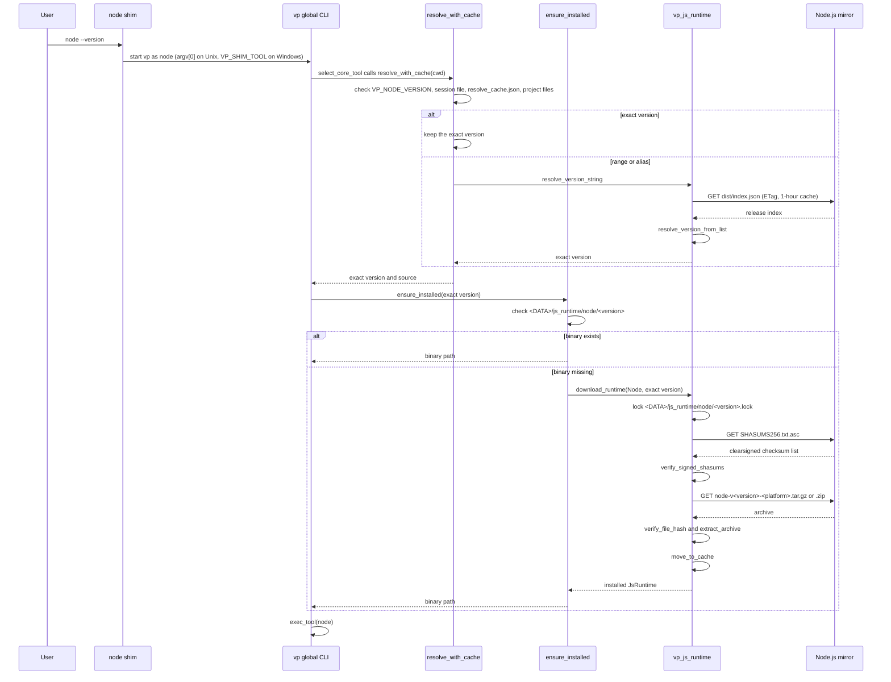
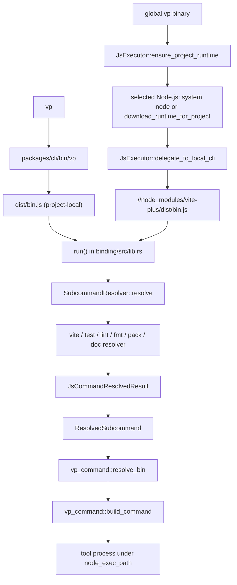

# 04 — How Vite+ supplies and starts a Node.js runtime

Vite+ has two command surfaces. The global Command-Line Interface (CLI) is a standalone Rust executable named `vp`. The local CLI is the Node Package Manager (NPM) package `vite-plus`. The build configuration compiles `src/bin.ts` into `dist/bin.js` (`vite-plus/packages/cli/tsdown.config.ts:69`). The package manifest maps the `vp`, `vpr`, and `vpx` names to files in `bin/` (`vite-plus/packages/cli/package.json:16-20`). The `bin/vp` file enables the Node.js compile cache and imports `../dist/bin.js` (`vite-plus/packages/cli/bin/vp:1-7`). Vite+ does not assume that a suitable Node.js installation already exists. It treats Node.js as an installable asset. The `vp_js_runtime` crate downloads the asset, verifies it, and stores it in a cache keyed by version. A version resolver selects the asset for each project. The `vp_setup` crate installs the global CLI and its dependencies. A shim is an executable or a symbolic link with a tool name, such as `node` or `npm`. A shim starts the correct binary. On Windows, each shim is a copy of a small executable called the trampoline. The JavaScript package locates the real tool, such as Vite or Vitest. It passes resolver functions into the Rust core through the Node.js native addon interface, called NAPI. NAPI is an application programming interface (API) between JavaScript and native code. The Rust core calls a resolver and starts the binary that the resolver returns. This document follows each step in that chain and names the code that performs it.

## 1. The four layers of runtime supply

Vite+ has more than one runtime concern. The layers are separate on purpose, and each layer has its own failure mode.

| Layer | Crate or package | Question that it answers |
|-------|------------------|--------------------------|
| Runtime acquisition | `vite-plus/crates/vp_js_runtime` | Which Node.js version does this project need, and where is its verified archive? |
| Global installation | `vite-plus/crates/vp_setup` | How does the standalone `vp` binary and its global JavaScript dependencies reach the machine? |
| Startup | `vite-plus/crates/vp_trampoline`, `vite-plus/crates/vp_global_cli/src/shim` | Which executable must run for this command name and this project? |
| Tool resolution | `vite-plus/packages/cli/src/resolve-*.ts` (resolvers), `vite-plus/packages/cli/binding` (NAPI bridge) | Which JavaScript file implements Vite, Vitest, Oxlint, or Oxfmt, and which command starts it? |

The table shows a deliberate split. The runtime crate knows how to obtain Node.js. It does not know how a shell finds `vp`. The setup crate knows how to install the global CLI. It does not parse project version files. The shim layer knows the command name. It does not resolve Semantic Versioning (SemVer) ranges. The JavaScript resolvers know package layout. They do not download Node.js. The binding directory is the NAPI bridge between the Rust core and those resolvers. Oxlint is a linter and Oxfmt is a formatter.

## 2. What `vp_js_runtime` downloads

The crate downloads a Node.js distribution archive. The default sources are `https://nodejs.org/dist` for systems with the GNU C Library (glibc) and `https://unofficial-builds.nodejs.org/download/release` for systems with the musl C library (`vite-plus/crates/vp_js_runtime/src/providers/node.rs:20-26`). The selection is a compile-time target property, not a runtime check. The crate tests `target_env` with `#[cfg(target_env = "musl")]` (`vite-plus/crates/vp_js_runtime/src/providers/node.rs:20-26`). The setup installer uses the same test to select the NPM package suffix (`vite-plus/crates/vp_setup/src/platform.rs:31-36`). The archive name is `node-v<version>-<os>-<arch>.<extension>` (`vite-plus/crates/vp_js_runtime/src/providers/node.rs:630-639`). The operating system string is `linux`, `darwin`, or `win`. The architecture string is `x64` or `arm64`. A musl build appends `-musl` (`vite-plus/crates/vp_js_runtime/src/providers/node.rs:611-628`).

The archive format follows the platform. Windows uses a ZIP archive. Linux and macOS use a gzip-compressed tar archive (`vite-plus/crates/vp_js_runtime/src/providers/node.rs:171-176`, `vite-plus/crates/vp_js_runtime/src/provider.rs:10-28`). The crate extracts the archive into a temporary directory. It then renames the extracted tree into the cache. The rename is atomic on the same file system, and the temporary directory lives under the cache for that reason (`vite-plus/crates/vp_js_runtime/src/runtime.rs:238-242`).

### 2.1 The cache path

The cache root is `<DATA>/js_runtime` (`vite-plus/crates/vp_js_runtime/src/cache.rs:7-12`). A runtime for version `24.22.2` therefore lives at `<DATA>/js_runtime/node/24.22.2/`. The Windows binary is `node.exe` at the root of that directory. The Unix binary is `bin/node` (`vite-plus/crates/vp_js_runtime/src/providers/node.rs:667-672`).

The following block shows the cache object and the fast path that skips all network work.

```rust
// vite-plus/crates/vp_js_runtime/src/runtime.rs:209-223
    // Cache path: <DATA>/js_runtime/{runtime}/{version}/
    let runtime = JsRuntime {
        runtime_type,
        version: version.into(),
        install_dir: cache_dir.join(provider.name()).join(version),
        binary_relative_path: provider.binary_relative_path(platform),
        bin_dir_relative_path: provider.bin_dir_relative_path(platform),
    };
    let install_dir = &runtime.install_dir;
    let binary_path = runtime.get_binary_path();

    if tokio::fs::try_exists(&binary_path).await.unwrap_or(false) {
        tracing::debug!("{} {version} already cached at {install_dir:?}", provider.name());
        return Ok(runtime);
    }
```

The check occurs after `ensure_managed_node_allowed()` (`vite-plus/crates/vp_js_runtime/src/runtime.rs:202-205`). The order matters. When `VP_ENV_FORBIDDEN=1` is set, Vite+ must not use a cached runtime either. The operator sets this variable, and only the exact value `1` enables it (`vite-plus/crates/vp_shared/src/env_config.rs:218-225`, `vite-plus/crates/vp_shared/src/env_config.rs:293`). It forbids all Vite+ management of Node.js and package managers. The environment check rejects every managed Node.js use before the cache can hide it (`vite-plus/crates/vp_js_runtime/src/runtime.rs:177-185`). The version-index fetch repeats the same check, so a cached index cannot bypass the rule either (`vite-plus/crates/vp_js_runtime/src/providers/node.rs:187-190`).

The placeholder `<DATA>` is the data root. It holds CLI versions, managed runtimes, and package managers (`vite-plus/crates/vp_shared/src/dirs.rs:78-92`). Four other roots have separate jobs. `<BIN>` holds executables and shims. `<CACHE>` holds disposable caches. `<CONFIG>` holds user configuration. `<STATE>` holds state files such as the session version (`vite-plus/crates/vp_shared/src/dirs.rs:78-92`).

### 2.2 The download lock and the retry loop

Two `vp` processes can request the same missing version at the same time. The crate creates a lock file named `<version>.lock` beside the install directory. The full path is `<DATA>/js_runtime/node/<version>.lock` (`vite-plus/crates/vp_js_runtime/src/download.rs:440-447`). The primitive is the standard-library advisory file lock on an opened file. The crate takes it inside `spawn_blocking`, so it waits without blocking the asynchronous runtime (`vite-plus/crates/vp_js_runtime/src/download.rs:449-459`). The lock is advisory and shared by every process that opens the same path. The operating system releases it when the file handle closes or the process exits. The source does not state this contract; it relies on the standard-library lock. After the lock is held, the code checks the binary again. A peer process may have completed the installation while this process waited.

```rust
// vite-plus/crates/vp_js_runtime/src/runtime.rs:225-230
    // Lock before downloading so concurrent commands share one download and
    // extraction. A peer may finish installing while we wait for the lock.
    let _lock = lock_installation(install_dir, version).await?;
    if tokio::fs::try_exists(&binary_path).await.unwrap_or(false) {
        return Ok(runtime);
    }
```

The download, checksum check, and extraction form one retryable unit. The backoff builder receives `.with_max_times(3)` (`vite-plus/crates/vp_js_runtime/src/runtime.rs:280-285`). The repository does not contain the `backon` crate source or its documentation. It therefore does not state whether this number counts retries or total attempts. The unit uses jitter and a minimum delay of 200 milliseconds (`vite-plus/crates/vp_js_runtime/src/runtime.rs:266-287`). The retry predicate accepts only a hash mismatch, an extraction failure, or an input/output error (`vite-plus/crates/vp_js_runtime/src/runtime.rs:297-307`). A network failure is not retried here. The lower-level `download_file` function already retries the network (`vite-plus/crates/vp_js_runtime/src/runtime.rs:257-265`). Inside `download_file`, the request and the body stream form one retried unit. That loop keeps partial bytes, resumes with a Range header, falls back to a full request on `416`, and treats a short read as `UnexpectedEof`. It uses a 500-millisecond minimum delay and the same `.with_max_times(3)` (`vite-plus/crates/vp_js_runtime/src/download.rs:38-191`).

```rust
// vite-plus/crates/vp_js_runtime/src/runtime.rs:266-287
    (|| async {
        download_file(&download_info.archive_url, &archive_path, &download_message).await?;

        if let Some(expected_hash) = &expected_hash {
            verify_file_hash(&archive_path, expected_hash, &download_info.archive_filename).await?;
        }

        if tokio::fs::try_exists(&extracted_path).await.unwrap_or(false) {
            tokio::fs::remove_dir_all(&extracted_path).await?;
        }
        extract_archive(&archive_path, &temp_path, download_info.archive_format).await?;

        Ok::<(), Error>(())
    })
    .retry(
        ExponentialBuilder::default()
            .with_jitter()
            .with_min_delay(Duration::from_millis(200))
            .with_max_times(3),
    )
    .when(is_retryable_runtime_error)
    .await?;
```

The temporary directory sits under the cache. `archive_path` is the downloaded archive inside that directory. `extracted_path` is the tree that `extract_archive` creates beside it (`vite-plus/crates/vp_js_runtime/src/runtime.rs:238-258`, `vite-plus/crates/vp_js_runtime/src/runtime.rs:276`).

The publication step is also race-safe. `move_to_cache` checks the binary, not only the directory. A directory without a binary is a partial install, so the function removes it and renames the new tree into place (`vite-plus/crates/vp_js_runtime/src/download.rs:461-485`).

### 2.3 Verification

Vite+ verifies two things. The first is the authenticity of the checksum list. The second is the integrity of the archive.

For official Node.js releases, Vite+ downloads `SHASUMS256.txt.asc`. That file is a Pretty Good Privacy (PGP) clearsigned message. Vite+ verifies it against a bundled set of Node.js release keys (`vite-plus/crates/vp_js_runtime/src/providers/node.rs:641-654`, `vite-plus/crates/vp_js_runtime/src/pgp_verify.rs:64-72`). The verifier accepts a valid primary-key signature. It also accepts a valid signing-subkey signature, but only when that subkey is bound to the primary key and is allowed to sign (`vite-plus/crates/vp_js_runtime/src/pgp_verify.rs:88-116`).

The bundled keys are ASCII-armored public keys. They are concatenated from the `nodejs/release-keys` repository and embedded in the binary at build time (`vite-plus/crates/vp_js_runtime/src/pgp_verify.rs:48-50`). The snapshot covers current and historical releasers. An update requires a new Vite+ build; the module documentation states that the keyring must be refreshed as the releaser set changes (`vite-plus/crates/vp_js_runtime/src/pgp_verify.rs:10-36`). Key expiry is not enforced. Revocation is enforced. A signing subkey is accepted only when it is not revoked, its binding signature has the sign key flag, the binding is valid, and the embedded primary-key back-signature is valid (`vite-plus/crates/vp_js_runtime/src/pgp_verify.rs:118-160`).

```rust
// vite-plus/crates/vp_js_runtime/src/pgp_verify.rs:95-113
    for key in trusted_keys {
        // A revoked primary key (and, with it, all its subkeys) is never trusted.
        if primary_key_revoked(key) {
            continue;
        }

        // Primary-key signing path: a valid signature from a trusted, non-revoked
        // primary key is accepted, as gpgv trusts keys present in the keyring.
        if message.verify(key).is_ok() {
            return Ok(message.signed_text());
        }

        // Subkey signing path (some releasers sign with a signing subkey).
        for subkey in &key.public_subkeys {
            if message.verify(subkey).is_ok() && subkey_is_valid_signer(key, subkey) {
                return Ok(message.signed_text());
            }
        }
    }
```

The verified plaintext of the signed file supplies the expected checksum. Vite+ finds the line for the archive name and reads its Secure Hash Algorithm 256-bit (SHA-256) value (`vite-plus/crates/vp_js_runtime/src/providers/node.rs:681-695`). The archive check compares the full file digest with that value (`vite-plus/crates/vp_js_runtime/src/download.rs:363-387`).

```rust
// vite-plus/crates/vp_js_runtime/src/download.rs:377-383
    if actual_hash != expected_hash {
        return Err(Error::HashMismatch {
            filename: filename.into(),
            expected: expected_hash.into(),
            actual: actual_hash,
        });
    }
```

A mirror is set with `VP_NODE_DIST_MIRROR`, which replaces the distribution base Uniform Resource Locator (URL) after a trailing slash is removed (`vite-plus/crates/vp_js_runtime/src/providers/node.rs:578-587`). The only classification in the source is `is_official_dist_host`. That function parses the authority, removes user information and a port, removes a trailing dot, and compares the host with `nodejs.org` without case (`vite-plus/crates/vp_js_runtime/src/providers/node.rs:590-604`). A mirror on that host is official. Every other host is non-official. The source does not use a separate "unofficial" category. The musl default host is the unofficial builds site. Custom mirrors can publish only the plain `SHASUMS256.txt`. In that case Vite+ falls back to checksum-only verification and writes a debug message (`vite-plus/crates/vp_js_runtime/src/runtime.rs:121-158`). The official source requires the signature. The unofficial musl builds publish no signature, so they also use the plain checksum list (`vite-plus/crates/vp_js_runtime/src/providers/node.rs:641-654`). A custom mirror that does publish an `.asc` file still has that signature checked, and an invalid signature is a hard error (`vite-plus/crates/vp_js_runtime/src/provider.rs:47-58`). The verifier uses the Node.js release keys that the binary carries (`vite-plus/crates/vp_js_runtime/src/pgp_verify.rs:64-72`). The operator can set `VP_NODE_SKIP_SIGNATURE_VERIFY` to skip the signature check. The SHA-256 check still runs (`vite-plus/crates/vp_js_runtime/src/runtime.rs:133-143`).

The guarantee therefore has three scopes. The official host requires a valid signature. A non-official mirror may publish no signature, and then only SHA-256 protects the archive. `VP_NODE_SKIP_SIGNATURE_VERIFY` removes the signature check for every source, and SHA-256 still runs. An `.asc` file that is present on a non-official mirror is always checked, and an invalid signature always fails.

**Aha:** The signature protects the checksum list, not the archive directly. A valid archive digest from a forged checksum list would not pass, because the list itself must first carry a trusted Node.js signature. This is why the fallback is a deliberate security downgrade, and why the official source refuses it.

### 2.4 Version discovery and the index cache

An exact version needs no index. A range, a partial version such as `22`, or an alias needs the Node.js release index. Vite+ fetches `<dist>/index.json`, where `<dist>` is the selected mirror base from section 2, and caches it at `<DATA>/js_runtime/node/index_cache.json` (`vite-plus/crates/vp_js_runtime/src/providers/node.rs:187-191`). The cache entry lives for 3600 seconds by default (`vite-plus/crates/vp_js_runtime/src/providers/node.rs:30-31`). `DEFAULT_CACHE_TTL_SECS` is the fallback. The `max-age` value from the HTTP `Cache-Control` header replaces it when present (`vite-plus/crates/vp_js_runtime/src/providers/node.rs:244-262`, `vite-plus/crates/vp_js_runtime/src/providers/node.rs:568-572`). The source reads no environment variable for this lifetime, so the default is not configurable through the `VP_*` variables. After expiry, Vite+ sends a conditional request with the stored HyperText Transfer Protocol (HTTP) entity tag. A `304 Not Modified` response refreshes the cache time to live without a new body (`vite-plus/crates/vp_js_runtime/src/providers/node.rs:232-269`). If the network fails, an expired cache is still usable (`vite-plus/crates/vp_js_runtime/src/providers/node.rs:213-229`).

Each index entry has two fields, `version` and `lts` (`vite-plus/crates/vp_js_runtime/src/providers/node.rs:35-52`). The `lts` value is either a Boolean or a code name, because the parser uses an untagged enumeration (`vite-plus/crates/vp_js_runtime/src/providers/node.rs:54-66`). Only a code-name string counts as a Long-Term Support (LTS) release. `false` and an absent value do not. The source does not state why LTS is preferred. It states only the rule to prefer LTS (`vite-plus/crates/vp_js_runtime/src/providers/node.rs:531-532`). The resolver filters all releases that satisfy the range. It takes the highest LTS match first. Only when no LTS release matches does it take the highest non-LTS release (`vite-plus/crates/vp_js_runtime/src/providers/node.rs:513-547`).

```rust
// vite-plus/crates/vp_js_runtime/src/providers/node.rs:531-546
    // Prefer LTS versions: find highest LTS first
    let lts_max = matching_versions
        .iter()
        .filter(|(_, _, is_lts)| *is_lts)
        .max_by(|(a, _, _), (b, _, _)| a.cmp(b));

    if let Some((_, version_str, _)) = lts_max {
        return Ok((*version_str).into());
    }

    // Fallback to highest non-LTS version
    matching_versions
        .into_iter()
        .max_by(|(a, _, _), (b, _, _)| a.cmp(b))
        .map(|(_, version_str, _)| version_str.into())
        .ok_or_else(|| Error::NoMatchingVersion { version_req: version_req.into() })
```

## 3. How Vite+ selects the version

The selection has two entry paths. The project path reads files. The shim path adds session overrides and a disk cache.

### 3.1 Project files

`resolve_node_version` walks from the starting directory toward the root. At each directory it checks four sources in a fixed order. The first match returns immediately. Only then does the function move to the parent (`vite-plus/crates/vp_js_runtime/src/runtime.rs:368-447`). `resolve_node_version` does not call `resolve_version_from_files`. In the global CLI the call direction is the reverse. `resolve_version_from_files` calls `resolve_project_version_source`, which calls `resolve_node_version` (`vite-plus/crates/vp_global_cli/src/commands/env/config.rs:390-408`, `vite-plus/crates/vp_global_cli/src/commands/env/config.rs:489-496`).

| Order | Source | Code |
|-------|--------|------|
| 1 | `.node-version` | `vite-plus/crates/vp_js_runtime/src/runtime.rs:378-387` |
| 2 | `devEngines.runtime` in `package.json` | `vite-plus/crates/vp_js_runtime/src/runtime.rs:394-406` |
| 3 | `engines.node` in `package.json` | `vite-plus/crates/vp_js_runtime/src/runtime.rs:408-419` |
| 4 | `.nvmrc` | `vite-plus/crates/vp_js_runtime/src/runtime.rs:423-432` |

The nearest directory always wins. A `package.json` in a child directory therefore beats a `.node-version` file in a parent directory. The test `test_resolve_node_version_child_package_json_over_parent_node_version` states this rule (`vite-plus/crates/vp_js_runtime/src/runtime.rs:1795-1817`). Within one directory, `.node-version` has the highest priority. The documentation states the same order (`vite-plus/docs/guide/env.md:35-42`).

The sources do not hold the same kind of value. `.node-version` and `.nvmrc` hold a version string. `devEngines.runtime` is a `package.json` field with the shape that the devEngines specification defines. It is one entry or an array of entries (`vite-plus/crates/vp_shared/src/package_json.rs:100-140`). Each entry has a `name`, an optional `version`, and an optional `onFail` (`vite-plus/crates/vp_shared/src/package_json.rs:60-84`). An array can list several runtimes. Vite+ reads only the first entry whose name is `node` (`vite-plus/crates/vp_shared/src/package_json.rs:115-119`). Vite+ does not parse the `os`, `cpu`, and `libc` sub-fields (`vite-plus/crates/vp_shared/src/package_json.rs:141-142`). `engines.node` holds a SemVer range. The `walk_up` parameter enables the parent walk (`vite-plus/crates/vp_js_runtime/src/runtime.rs:368-376`).

```rust
// vite-plus/crates/vp_js_runtime/src/runtime.rs:378-387
        // 1. Check .node-version file
        if let Some(version) = read_node_version_file(current).await {
            let node_version_path = current.join(".node-version");
            return Ok(Some(VersionResolution {
                version,
                source: VersionSource::NodeVersionFile,
                source_path: Some(node_version_path),
                project_root: Some(current.to_absolute_path_buf()),
            }));
        }
```

The walk to the parent is explicit. It stops when `walk_up` is false or when the current directory has no parent (`vite-plus/crates/vp_js_runtime/src/runtime.rs:434-442`).

```rust
// vite-plus/crates/vp_js_runtime/src/runtime.rs:434-442
        // Move to parent directory if walk_up is enabled
        if !walk_up {
            break;
        }

        match current.parent() {
            Some(parent) => current = parent.to_owned(),
            None => break,
        }
```

The repository itself uses this mechanism. Its `.node-version` file contains `24.22.2` (`vite-plus/.node-version:1`). The setup crate embeds that exact string at build time as `DEFAULT_INSTALL_NODE_VERSION` (`vite-plus/crates/vp_setup/src/lib.rs:26-27`). This is why the global installer uses the same Node.js version that development and Continuous Integration (CI) use.

### 3.2 Session overrides and the user default

The shim path adds two overrides before it reads project files. `resolve_version` checks `VP_NODE_VERSION` first. This variable is set by `vp env use` through the shell wrapper. The wrapper sets `VP_ENV_USE_EVAL_ENABLE=1` before it starts `vp` (`vite-plus/crates/vp_global_cli/src/commands/env/setup.rs:900-905`). The command reads that variable through `env_use_eval_enable`; it does not inspect the parent shell (`vite-plus/crates/vp_global_cli/src/commands/env/use.rs:55-59`, `vite-plus/crates/vp_shared/src/env_config.rs:275`). It then checks the session file `.session-node-version`. This file supports shells that cannot keep a wrapper function, including Continuous Integration (CI) jobs (`vite-plus/crates/vp_global_cli/src/commands/env/config.rs:337-376`, `vite-plus/docs/guide/env.md:179`).

```rust
// vite-plus/crates/vp_global_cli/src/commands/env/config.rs:348-376
pub async fn resolve_version(cwd: &AbsolutePath) -> Result<VersionResolution, Error> {
    // Session override via environment variable (set by `vp env use`)
    if let Some(env_version) = vp_shared::EnvConfig::get().node_version.as_deref() {
        let env_version = env_version.trim();
        if !env_version.is_empty() {
            let version = resolve_version_alias(env_version, &NodeProvider::new()).await?;
            return Ok(VersionResolution {
                version,
                source: VERSION_ENV_VAR.into(),
                source_path: None,
                project_root: None,
                is_range: false,
            });
        }
    }

    // Session override via file (written by `vp env use` for shell-wrapper-less environments)
    if let Some(session_version) = read_session_version().await {
        return Ok(VersionResolution {
            version: session_version,
            source: SESSION_VERSION_FILE.into(),
            source_path: get_session_version_path().ok(),
            project_root: None,
            is_range: false,
        });
    }

    resolve_version_from_files(cwd).await
}
```

The command-line override is `vp env use <version>`. It does not attach a flag to a later command. With an active shell wrapper, it prints the shell command that sets `VP_NODE_VERSION`. Without a wrapper, it writes the session file (`vite-plus/crates/vp_global_cli/src/commands/env/use.rs:1-9`, `vite-plus/crates/vp_global_cli/src/commands/env/use.rs:55-64`).

`resolve_version_from_files` reads the project sources. When none exists, it reads `default_node_version` from `config.json`, a JavaScript Object Notation (JSON) file in the configuration root. When that value is also absent, it uses the latest LTS release (`vite-plus/crates/vp_global_cli/src/commands/env/config.rs:489-536`). The shim adds a disk cache in front of this resolver. The cache file is `<CACHE>/resolve_cache.json` (`vite-plus/crates/vp_global_cli/src/shim/dispatch.rs:1189-1289`, `vite-plus/crates/vp_global_cli/src/shim/cache.rs:42-43`). A cache hit needs two checks. First, `ResolveCache::get` compares the stored modification time of the source file with the current time. A range entry also expires after one hour (`vite-plus/crates/vp_global_cli/src/shim/cache.rs:92-175`). Second, `cached_project_source_still_current` compares the stored source kind and source path with a fresh project-source lookup (`vite-plus/crates/vp_global_cli/src/shim/dispatch.rs:1273-1291`). An entry without a source path is valid for one hour. The source does not say why the second check repeats the source identity after the modification-time check. Critically, the environment and session fast paths run before the cache, so a session override never waits for disk state (`vite-plus/crates/vp_global_cli/src/shim/dispatch.rs:1191-1223`).

The shell wrapper is a `vp()` function that `vp env setup` writes into the environment file. It intercepts `vp env use` and evaluates the assignment that the command prints (`vite-plus/crates/vp_global_cli/src/commands/env/setup.rs:828-884`). This is how a child `vp` process changes its parent shell. The session file covers shells where such a function is not available (`vite-plus/docs/guide/env.md:147-179`). The two session paths are not identical. The environment variable path resolves an alias through `resolve_version_alias`, but the session file path returns its content unchanged (`vite-plus/crates/vp_global_cli/src/commands/env/config.rs:348-376`). `vp env use` resolves an alias to an exact version before it writes the session file (`vite-plus/crates/vp_global_cli/src/commands/env/use.rs:136-140`, `vite-plus/crates/vp_global_cli/src/commands/env/use.rs:273-275`). A hand-written alias in the session file is therefore treated as an exact version downstream. The shim does not resolve it again.

### 3.3 The provable precedence

The source supports this order for a command that runs through a global shim:

1. `VP_NODE_VERSION`, set by `vp env use` with a shell wrapper.
2. `<STATE>/.session-node-version`, written by `vp env use` without a wrapper.
3. Project files, nearest directory first, in the order `.node-version`, `devEngines.runtime`, `engines.node`, `.nvmrc`.
4. The user default in `config.json`.
5. The latest LTS release.

The order is explicit in `vite-plus/crates/vp_global_cli/src/commands/env/config.rs:339-347` and `vite-plus/docs/guide/env.md:35-42`. The code enforces it at `vite-plus/crates/vp_global_cli/src/commands/env/config.rs:348-375`, `vite-plus/crates/vp_global_cli/src/commands/env/config.rs:492-536`, and `vite-plus/crates/vp_js_runtime/src/runtime.rs:368-447`.

The resolution names have separate jobs. `resolve_node_version` finds the first non-empty project source (`vite-plus/crates/vp_js_runtime/src/runtime.rs:368-447`). `resolve_project_version_source` validates that value and tries lower-priority declarations in the same directory (`vite-plus/crates/vp_global_cli/src/commands/env/config.rs:390-474`). `resolve_version_from_files` adds the user default and the LTS fallback (`vite-plus/crates/vp_global_cli/src/commands/env/config.rs:489-536`). `resolve_version` adds the two session overrides and then calls `resolve_version_from_files` (`vite-plus/crates/vp_global_cli/src/commands/env/config.rs:348-376`). `resolve_version_for_project` is a private function in the runtime crate. It turns one requirement string into one exact version. `download_runtime_for_project` calls it (`vite-plus/crates/vp_js_runtime/src/runtime.rs:524-535`, `vite-plus/crates/vp_js_runtime/src/runtime.rs:540-579`).

One qualification is important. The runtime crate function `download_runtime_for_project` does not read `VP_NODE_VERSION` or the session file. It starts from `resolve_node_version` (`vite-plus/crates/vp_js_runtime/src/runtime.rs:474-535`). The overrides belong to the global CLI path. A caller that calls `download_runtime_for_project` directly gets the project-file order only. The source does not define a single universal order for every caller. It defines the order in each entry path.

A third entry path has a different first step. `JsExecutor::ensure_project_runtime` first uses a system Node.js runtime when `find_system_node_runtime` finds one. Only when no system runtime exists does it apply the session overrides, then the project files (`vite-plus/crates/vp_global_cli/src/js_executor.rs:198-245`). `find_system_node_runtime` checks two conditions. The configuration must select system-first mode. The first `node` on the search path must not be a Vite+ shim (`vite-plus/crates/vp_global_cli/src/js_executor.rs:521-529`). It does not read `VP_NODE_VERSION`, the session file, or a recorded executable. This path serves the global CLI when it delegates to the local package. When a system Node.js exists, the project pin does not control that path.

### 3.4 Ranges, aliases, and the absence of a version

`resolve_version_for_project` turns the selected requirement into one exact version (`vite-plus/crates/vp_js_runtime/src/runtime.rs:540-579`). An empty requirement fetches the latest LTS release. An `lts/*`, `lts/<codename>`, or `lts/-1` alias goes to the LTS resolver. `lts/iron` names a codename. `lts/-1` names the second-highest LTS line, because offset zero is the highest line (`vite-plus/crates/vp_js_runtime/src/providers/node.rs:332-339`, `vite-plus/crates/vp_js_runtime/src/providers/node.rs:425-448`). The `latest` alias selects the newest stable release, including a non-LTS release. An exact version is used after a leading `v` is removed. A range or partial version first checks the local cache for a satisfying installed version. The cache check prefers the highest installed LTS that satisfies the range and otherwise the highest installed version (`vite-plus/crates/vp_js_runtime/src/providers/node.rs:113-168`). Only when no installed version satisfies the range does it query the network (`vite-plus/crates/vp_js_runtime/src/runtime.rs:570-578`). A cached choice can therefore override a newer LTS release that is not installed.

When no version source exists, the project path does not fail. It uses the latest LTS release (`vite-plus/crates/vp_js_runtime/src/runtime.rs:545-549`). When a source exists but its value is invalid, `resolve_node_version` has already returned that value. Validation then rejects it, and `resolve_project_version_source` tries the lower-priority declarations in the same directory: `devEngines.runtime`, then `engines.node`, then `.nvmrc` (`vite-plus/crates/vp_global_cli/src/commands/env/config.rs:390-474`). An invalid `.nvmrc` returns no source. The walk does not continue to a parent directory after a source was found. In the runtime crate, `download_runtime_for_project` repeats a similar fallback and ends with an empty requirement (`vite-plus/crates/vp_js_runtime/src/runtime.rs:510-521`). `normalize_version` prints a warning for an invalid non-empty value (`vite-plus/crates/vp_js_runtime/src/runtime.rs:661-673`). The mismatch warning compares the selected version with the lower-priority `engines.node` and `devEngines.runtime` declarations in the project `package.json`. The selected version wins, and the warning goes to standard error (`vite-plus/crates/vp_js_runtime/src/runtime.rs:583-633`). A valid exact version that has no release is different again. It fails at download (section 3.5).

The documentation adds a useful rule about aliases. `lts` selects the newest LTS release. `latest` selects the newest stable release and skips pre-releases (`vite-plus/docs/guide/env.md:42-46`). To use a pre-release, the project must name its exact version.

### 3.5 When the requested version is absent

An exact version is not checked against the release index. The resolver removes a leading `v` and returns the string. The download then constructs the archive Uniform Resource Locator (URL) and requests it (`vite-plus/crates/vp_js_runtime/src/runtime.rs:563-568`, `vite-plus/crates/vp_js_runtime/src/providers/node.rs:630-639`). A missing release therefore appears as a failed archive download, not as a resolution error.

A range that matches no release produces `Error::NoMatchingVersion` from the list resolver (`vite-plus/crates/vp_js_runtime/src/providers/node.rs:542-546`). The shim prints the failure as `Failed to install Node <version>: <error>` and exits with code 1 (`vite-plus/crates/vp_global_cli/src/shim/dispatch.rs:812-815`, `vite-plus/crates/vp_global_cli/src/shim/dispatch.rs:929-933`). The content-integrity retry does not apply to a download failure (`vite-plus/crates/vp_js_runtime/src/runtime.rs:297-307`). The network layer inside `download_file` has already retried that failure.

The source does not add a project-file fallback after a selected exact version fails to download. The fallback chain applies when a source is missing or invalid, before resolution (`vite-plus/crates/vp_js_runtime/src/runtime.rs:510-521`). A valid but unavailable exact version stops the command with an error.

## 4. What "setup" means

The word "setup" names two different operations. The source uses the same word for both, so this section separates them.

### 4.1 `vp_setup`: install the global CLI

`vp_setup` installs the standalone `vp` binary and the JavaScript dependencies that the binary needs. It does not select a runtime from project files. It does populate the shared runtime cache with the Node.js version that its private pnpm requires (`vite-plus/crates/vp_setup/src/install.rs:508-559`).

Three names describe the on-disk layout. `<DATA>` is the data root from section 2.1. `<install>` is the same data root; this document uses `<install>` only when it discusses the installer. `<VERSION>` is the directory `<DATA>/<version>`, for example `<DATA>/24.22.2`. The installer forms it with `install_dir.join(version)` (`vite-plus/crates/vp_setup/src/install.rs:667`). `<DATA>/current` is a link to the active `<VERSION>` directory. The payload is `<DATA>/current/bin/vp`, or `vp.exe` on Windows (`vite-plus/crates/vp_trampoline/src/main.rs:86-91`).

The install starts from an NPM platform package named `@voidzero-dev/vite-plus-cli-<suffix>` (`vite-plus/crates/vp_setup/src/registry.rs:145-160`). The suffix comes from the operating system, the architecture, and, on Linux, the C library: `darwin-arm64`, `linux-x64-gnu`, `linux-arm64-musl`, or `win32-x64-msvc` (`vite-plus/crates/vp_setup/src/platform.rs:8-40`). The installer reads the package metadata from the configured NPM registry and takes the `dist.tarball` URL (`vite-plus/crates/vp_setup/src/registry.rs:145-198`). The package is a gzip-compressed tar archive. The installer extracts `vp`, `vp.exe`, or `vp-shim.exe` into `<VERSION>/bin/`. It also extracts the release install lockfile to `<VERSION>/bin/vp-install-lock.yaml` unless `VP_SETUP_SKIP_INSTALL_LOCKFILE` is set (`vite-plus/crates/vp_setup/src/install.rs:40-121`). It rejects path traversal in archive entries (`vite-plus/crates/vp_setup/src/install.rs:69-72`). It sets mode `0755` on Unix binaries (`vite-plus/crates/vp_setup/src/install.rs:100-105`).

`vp-shim.exe` is the Windows trampoline from the `vp_trampoline` crate, whose binary name is `vp-shim` (`vite-plus/crates/vp_trampoline/Cargo.toml:30-32`). Only Windows uses it. The installer extracts it beside `vp.exe`. Self-setup copies it when the file is absent (`vite-plus/crates/vp_global_cli/src/self_setup.rs:389-410`).

`vp-install-lock.yaml` is the release's pnpm lockfile. It pins the exact dependency tree of `vite-plus` for a frozen install. A successful install writes `node_modules/.vp-install-complete`. That receipt contains the SHA-256 digest of the lockfile, or the text `unlocked` when the bypass is active (`vite-plus/crates/vp_setup/src/lockfile.rs:13-16`, `vite-plus/crates/vp_setup/src/lockfile.rs:48-72`). `VP_SETUP_SKIP_INSTALL_LOCKFILE=1` stops extraction and restoration. It changes the receipt to `unlocked`, and a later run reuses only that unlocked receipt (`vite-plus/crates/vp_setup/src/lockfile.rs:114-123`).

The installer then provides a package manager. It downloads a pinned pnpm `10.34.9` from the registry metadata `dist.tarball` URL (`vite-plus/crates/vp_setup/src/install.rs:125`, `vite-plus/crates/vp_pm_cli/src/package_manager/bootstrap.rs:35-81`). It checks the archive against a SHA-512 value in the `packageManager` hash format (`vite-plus/crates/vp_setup/src/install.rs:127-137`). That format is `sha512.<hex>`. A Subresource Integrity (SRI) value uses `sha512-<base64>` instead (`vite-plus/crates/vp_pm_cli/src/request.rs:660-704`). The `bootstrap_pnpm` function returns a directory, and the entry point is `bin/pnpm.cjs` in that directory (`vite-plus/crates/vp_setup/src/install.rs:508-517`). `prepare_install_runtime` then reads pnpm's `engines.node` field through `supports_pnpm_node`. It downloads that Node.js runtime through `vp_js_runtime::download_runtime` (`vite-plus/crates/vp_setup/src/install.rs:508-559`).

`install_production_deps` receives a `NodeVersion` value (`vite-plus/crates/vp_setup/src/install.rs:398-403`, `vite-plus/crates/vp_setup/src/install.rs:286-294`). The upgrade path marks the platform package's `vpNodeVersion` as `Required` (`vite-plus/crates/vp_global_cli/src/commands/upgrade/mod.rs:274-280`). Self-setup marks `VP_SETUP_NODE_VERSION` as `Preferred` when `supports_cli` accepts it (`vite-plus/crates/vp_global_cli/src/self_setup.rs:356-375`). A `Required` version that pnpm does not support is an error. A `Preferred` version that pnpm does not support falls back to `DEFAULT_INSTALL_NODE_VERSION` (`vite-plus/crates/vp_setup/src/install.rs:529-545`). The source does not state a second fallback when the default is also unsupported. The code uses the default without another check.

The dependency install runs pnpm through the selected Node.js binary with a carefully built search-path (`PATH`) environment variable (`vite-plus/crates/vp_setup/src/install.rs:399-447`). The path contains the Node.js binary directory first, then the pnpm directory, then the existing path (`vite-plus/crates/vp_setup/src/install.rs:579-600`). The installer writes a generated wrapper `package.json` and a `.npmrc` that sets `minimum-release-age=0`. The wrapper has the name `vp-global`, the CLI version, `private: true`, a `packageManager` field that pins pnpm, and a dependency on `vite-plus` at the same version (`vite-plus/crates/vp_setup/src/install.rs:148-177`). Under `VP_ENV_FORBIDDEN`, it omits `packageManager` so the system pnpm does not download the pin. The `.npmrc` value disables pnpm's minimum release age. That guard blocks packages published very recently. Setup needs the bypass because the `vite-plus` version that it installs may be newer than the guard allows (`vite-plus/crates/vp_setup/src/install.rs:169-173`, `vite-plus/crates/vp_setup/src/install.rs:179-185`).

### 4.2 The `current` link

Each installed version lives in its own directory. A `current` link selects the active version. On Unix, the installer creates a temporary symbolic link and renames it over `current`. The rename is atomic. On Windows, it removes the old junction (a Windows directory link) and creates a new junction; that operation is not atomic (`vite-plus/crates/vp_setup/src/install.rs:661-706`).

```rust
// vite-plus/crates/vp_setup/src/install.rs:676-686
    #[cfg(unix)]
    {
        // Atomic symlink swap: create temp link, then rename over current
        let temp_link = install_dir.join("current.new");

        // Remove temp link if it exists from a previous failed attempt
        let _ = tokio::fs::remove_file(&temp_link).await;

        tokio::fs::symlink(version, &temp_link).await?;
        tokio::fs::rename(&temp_link, &current_link).await?;
    }
```

The installer keeps at most three versions (`vite-plus/crates/vp_setup/src/lib.rs:29-30`). `vp upgrade --rollback` relies on this retention, and the active and previous versions are never pruned (`vite-plus/docs/guide/upgrade.md:78-86`).

Activation means two things: the version directory is complete, and the `current` link points to it. After activation, the setup crate does not recreate the shims itself. `vp_setup::install::refresh_shims` starts `<install>/current/bin/vp` with `env setup --refresh` (`vite-plus/crates/vp_setup/src/install.rs:758-777`). The flag has two effects. It permits replacement of existing entrypoint wrappers and shims, and it suppresses the "skipped shims" list (`vite-plus/crates/vp_global_cli/src/commands/env/setup.rs:175-217`). The setup crate calls this invocation "the legacy refresh command" (`vite-plus/crates/vp_setup/src/install.rs:758`). A new binary intercepts the invocation as self-setup. Setup writes a marker file beside the installed binary. `maybe_run` checks for `SELF_SETUP_MARKER` in the directory of the running executable. When the marker is absent, it runs full setup before command dispatch (`vite-plus/crates/vp_global_cli/src/self_setup.rs:30-42`, `vite-plus/crates/vp_global_cli/src/main.rs:416-425`). A legacy rollback target already has the marker, so it executes `env setup --refresh` normally (`vite-plus/crates/vp_setup/src/install.rs:759-760`). This is the boundary between the two meanings of setup. `vp_setup` installs the version directory. The new binary performs the environment setup.

### 4.3 `vp env setup`: write files and shims

`vp env setup` creates environment files in the configuration directory. `create_env_files` writes `vp.ps1`, `env`, `env.fish`, `env.nu`, and `env.ps1` (`vite-plus/crates/vp_global_cli/src/commands/env/setup.rs:1465-1492`). The `env` file is the Portable Operating System Interface (POSIX) shell file for Bash and Zsh (`vite-plus/crates/vp_global_cli/src/commands/env/setup.rs:1468`). The PowerShell files `vp.ps1` and `env.ps1` receive a Byte Order Mark (BOM) when needed for non-ASCII paths (`vite-plus/crates/vp_global_cli/src/commands/env/setup.rs:1474-1488`).

The same command writes shell profile entries. `configure` appends a `source` or `.` line to the profiles for the shells that it finds (`vite-plus/crates/vp_global_cli/src/self_setup/shell.rs:15-116`). The line has a stable marker, `# Vite+ bin (https://viteplus.dev)` (`vite-plus/crates/vp_global_cli/src/self_setup/shell.rs:56-58`). The function skips a shell that is not on the `PATH` environment variable. It never rewrites the main Fish configuration. For Nushell it writes `vite-plus.nu` into the vendor autoload directory (`vite-plus/crates/vp_global_cli/src/self_setup/shell.rs:17-49`). On Windows it updates the user `PATH` through PowerShell (`vite-plus/crates/vp_global_cli/src/self_setup/shell.rs:93-114`).

`vp_global_cli::commands::env::setup::refresh_shims` reconciles the shim directories. It iterates `DEFAULT_SHIM_TOOLS`. Ownership means that the file is a Vite+ shim for the running `vp` binary. `is_owned_shim` accepts a target that `is_vp_shim_target` approves, or a symbolic link that resolves to the current executable (`vite-plus/crates/vp_global_cli/src/commands/env/setup.rs:280-286`). On Unix, the first check requires a link to `<DATA>/current/bin/vp`; on Windows, a trampoline is owned only when its sidecar records this installation's data root (`vite-plus/crates/vp_global_cli/src/commands/global/install.rs:64-103`). A foreign core shim is an existing core shim at the destination that fails the ownership test. A bin directory from an explicit override group can hold unrelated executables such as `node.exe` (`vite-plus/crates/vp_global_cli/src/commands/global/install.rs:70-74`). The function never replaces a foreign core shim (`vite-plus/crates/vp_global_cli/src/commands/env/setup.rs:317-321`). An owned stale shim is a shim in the other bin directory, the one that the current mode does not use, that passes the ownership test. The function removes it (`vite-plus/crates/vp_global_cli/src/commands/env/setup.rs:327-338`). The `vp env setup` documentation promises exactly this behaviour (`vite-plus/docs/guide/env.md:138-145`). The setup crate and the global command-line crate each define a function named `refresh_shims`. The names are the same, but the work is different. One starts the new binary; the other reconciles the shims.

## 5. Shims and the `PATH` search

### 5.1 The shim names

`DEFAULT_SHIM_TOOLS` contains `node`, `npm`, `npx`, `pnpm`, `pnpx`, `pn`, `pnx`, `yarn`, `yarnpkg`, `bun`, `bunx`, `vpx`, and `vpr` (`vite-plus/crates/vp_global_cli/src/shim/mod.rs:22-26`). The list does not contain `vp`. The `vp` entrypoint is a separate wrapper created by `setup_vp_wrapper` (`vite-plus/crates/vp_global_cli/src/commands/env/setup.rs:182-183`). The local `vpx` and `vpr` files in a project come from the npm package, not from this list (`vite-plus/packages/cli/bin/vpx:1-9`, `vite-plus/packages/cli/bin/vpr:1-10`).

```rust
// vite-plus/crates/vp_global_cli/src/shim/mod.rs:22-26
/// Default shims created by `vp env setup`.
pub const DEFAULT_SHIM_TOOLS: &[&str] = &[
    "node", "npm", "npx", "pnpm", "pnpx", "pn", "pnx", "yarn", "yarnpkg", "bun", "bunx", "vpx",
    "vpr",
];
```

The names are not arbitrary aliases. Each name is a command that a build script or a user can call. A project that runs `npm ci` must receive a managed npm when managed mode is active. A project that runs `node` must receive the selected Node.js. The shim list is the set of interception points for that policy.

Managed mode is the default. The managed core shims are in `<BIN>`, which the generated environment file puts first on the search path. System-first mode puts the system tools first and keeps the managed shims as a fallback. `shim_dir` implements this by placing a system-first tool's shim in `<DATA>/fallback-bin` instead of `<BIN>` (`vite-plus/crates/vp_global_cli/src/commands/env/setup.rs:289-295`). The environment file puts `<DATA>/fallback-bin` last, so a system tool earlier on the path wins (`vite-plus/crates/vp_global_cli/src/commands/env/setup.rs:877`). `vp env off` selects the system-first preference (`vite-plus/docs/guide/env.md:107-134`). The two directories are described in section 5.4.

### 5.2 How a shim knows its tool

On Unix a shim is a symbolic link to the active `vp` binary. A symbolic link preserves `argv[0]`, so the invoked name is still available to the program. The `vp` binary reads that name and learns which tool the user invoked (`vite-plus/crates/vp_global_cli/src/commands/env/setup.rs:579-594`). This is the same technique that Volta uses, and the source says so (`vite-plus/crates/vp_global_cli/src/commands/env/setup.rs:582`).

On Windows a shim is a copy of a tiny executable named `<tool>.exe`. A copy cannot preserve the invoked name through `argv[0]` alone, because the process starts the real `vp.exe`. The trampoline sets `VP_SHIM_TOOL` to the tool name before it starts `vp.exe` (`vite-plus/crates/vp_trampoline/src/main.rs:139-141`). `peek_shim_tool` reads that variable first (`vite-plus/crates/vp_global_cli/src/shim/mod.rs:159-192`). From the variable, it accepts any tool name except `vp`. From `argv[0]`, it accepts only a known shim name. That second path serves the Unix symbolic links (`vite-plus/crates/vp_global_cli/src/shim/mod.rs:176-192`).

### 5.3 The sidecar file

A Windows shim copies one executable into a bin directory. The executable is identical for every tool and every installation. The bin directory can be shared. A copied executable therefore cannot prove which Vite+ data root owns it.

Vite+ writes a sidecar next to every copied trampoline. The file is `<name>.shim`. Its first line is the format marker `vite-plus-shim-v1`. The remaining lines record the layout, the data root, the cache root, and the bin root (`vite-plus/crates/vp_shared/src/dirs.rs:151-169`, `vite-plus/crates/vp_shared/src/dirs.rs:26-45`).

```rust
// vite-plus/crates/vp_shared/src/dirs.rs:161-168
        let contents = format!(
            "{SHIM_POINTER_HEADER}\nlayout={}\ndata={}\ncache={}\nbin={}\n",
            self.layout.as_str(),
            self.data.as_path().to_string_lossy(),
            self.cache.as_path().to_string_lossy(),
            self.bin.as_path().to_string_lossy()
        );
        std::fs::write(exe_path.with_extension(SHIM_POINTER_EXTENSION), contents)
```

The trampoline parses this file with no allocator and no external crates. The parser accepts a UTF-8 BOM and Carriage Return and Line Feed (CRLF) line endings. It requires the versioned header. It accepts `single-root` and `split` layouts. A `single-root` layout records one root in `data`. A `split` layout records independent data, cache, and bin roots. A split layout requires a cache root and may omit the bin root (`vite-plus/crates/vp_trampoline/src/cmdline.rs:20-71`). The parser accepts the keys in any order, so the write order in the format string is not part of the format (`vite-plus/crates/vp_trampoline/src/cmdline.rs:52-62`). A split layout requires a cache root and may omit the bin root (`vite-plus/crates/vp_trampoline/src/cmdline.rs:20-71`). When `bin=` is absent, `read_shim_pointer` uses the directory of the executable. The comment states that old sidecars occur only beside the main bin entrypoints (`vite-plus/crates/vp_trampoline/src/main.rs:96-106`). The trampoline then sets `VP_BIN_DIR` to that directory. It does not unset the variable and does not set it to an empty string (`vite-plus/crates/vp_trampoline/src/main.rs:131-136`).

```rust
// vite-plus/crates/vp_trampoline/src/cmdline.rs:40-71
pub fn parse_shim_pointer(bytes: &[u8]) -> Option<ShimPointer<'_>> {
    let bytes = bytes.strip_prefix(&[0xEF, 0xBB, 0xBF]).unwrap_or(bytes);
    let text = core::str::from_utf8(bytes).ok()?.trim();
    let mut lines = text.lines();
    if lines.next()? != SHIM_POINTER_HEADER {
        return None;
    }

    let mut layout = None;
    let mut data = None;
    let mut cache = None;
    let mut bin = None;
    for line in lines {
        if let Some(value) = line.strip_prefix("layout=") {
            layout = Some(value);
        } else if let Some(value) = line.strip_prefix("data=") {
            data = (!value.is_empty()).then_some(value);
        } else if let Some(value) = line.strip_prefix("bin=") {
            bin = (!value.is_empty()).then_some(value);
        } else if let Some(value) = line.strip_prefix("cache=") {
            cache = (!value.is_empty()).then_some(value);
        }
    }

    let data = data?;
    let layout = match layout? {
        "single-root" => ShimLayout::SingleRoot,
        "split" => ShimLayout::Split { cache: cache?, bin },
        _ => return None,
    };
    Some(ShimPointer { data, layout })
}
```

**Aha:** The sidecar is not metadata that repeats the executable. It is the ownership proof. `owns_windows_trampoline` compares the data root in the sidecar with the current installation before Vite+ updates or deletes an executable (`vite-plus/crates/vp_shared/src/dirs.rs:171-180`). Without it, a shared bin directory would let one installation delete another installation's shim.

The running `vp` process learns its own data root from `EnvConfig::get().dirs`. That value comes from the environment that launched the process: `VP_HOME` for a single-root sidecar, or `VP_DATA_DIR` for a split sidecar (`vite-plus/crates/vp_trampoline/src/main.rs:127-137`). When no override is present, the platform default applies (`vite-plus/crates/vp_shared/src/dirs.rs:94-118`). `owns_windows_trampoline` then compares this value with the `data=` line of the candidate shim's sidecar (`vite-plus/crates/vp_shared/src/dirs.rs:178-180`).

### 5.4 The two bin directories and ownership

A split installation stores the data, cache, bin, and configuration roots in different directories. The sidecar names this layout `split`. The alternative, single-root, stores the roots under one directory; the sidecar records that directory in `data` (`vite-plus/crates/vp_shared/src/dirs.rs:50-67`). The trampoline passes `VP_HOME` for a single-root sidecar and the `VP_DATA_DIR`, `VP_BIN_DIR`, and `VP_CACHE_DIR` group for a split sidecar (`vite-plus/crates/vp_trampoline/src/main.rs:127-137`).

A split installation has a main bin directory and a fallback bin directory. Managed shims go to `<BIN>`. System-first shims go to `<DATA>/fallback-bin` (`vite-plus/docs/guide/global-cli.md:169-181`, `vite-plus/crates/vp_global_cli/src/commands/env/setup.rs:289-295`). For each tool, only one of the two directories holds its shim; the global command-line `refresh_shims` removes an owned shim from the other directory (`vite-plus/crates/vp_global_cli/src/commands/env/setup.rs:297-353`). The generated `env` file sets the search path with `<BIN>` first and `<DATA>/fallback-bin` last (`vite-plus/crates/vp_global_cli/src/commands/env/setup.rs:877`). A Windows setup command in the same module uses the same order (`vite-plus/crates/vp_global_cli/src/commands/env/setup.rs:1604-1608`).

A shim also prepares the search path of its child. It prepends the selected Node.js bin directory. When a package manager applies, it also prepends that package manager's bin directory (`vite-plus/crates/vp_global_cli/src/shim/dispatch.rs:832-850`). This ordering lets a nested command find the same Node.js and package-manager versions as its parent.

The installer claims only empty or newly created roots. To claim a root means to create it and write the `.vp-owned` marker into it (`vite-plus/crates/vp_global_cli/src/install_dirs.rs:14-15`, `vite-plus/crates/vp_global_cli/src/install_dirs.rs:92-130`). A non-empty root without the marker is never claimed. This rule prevents the installer from deleting an unrelated directory that happens to use the same name. The self-setup path is the only production caller. It calls `install_dirs::prepare` before it takes the setup lock (`vite-plus/crates/vp_global_cli/src/self_setup.rs:69-71`). Only four roots are claimable: data, cache, config, and state (`vite-plus/crates/vp_global_cli/src/install_dirs.rs:31-33`, `vite-plus/crates/vp_global_cli/src/install_dirs.rs:70-82`). The bin root is not in that set. A shared bin directory can contain files from other tools, so the installer does not mark it as owned.

```rust
// vite-plus/crates/vp_global_cli/src/install_dirs.rs:94-110
pub(crate) fn prepare(dirs: &VpDirs) -> Result<(), Error> {
    validate_root_normalization(dirs)?;
    let mut empty_roots = Vec::new();
    // Preflight all roots before creating directories or ownership markers.
    for root in roots(dirs) {
        if is_owned(&root)? {
            continue;
        }
        let is_empty = match fs::read_dir(&root) {
            Ok(mut entries) => entries.next().transpose()?.is_none(),
            Err(error) if error.kind() == std::io::ErrorKind::NotFound => true,
            Err(error) => return Err(error.into()),
        };
        if is_empty {
            empty_roots.push(root);
        }
    }
```

```rust
// vite-plus/crates/vp_global_cli/src/install_dirs.rs:111-130
    for root in empty_roots {
        // An earlier root may have created the marker through a filesystem alias.
        if is_owned(&root)? {
            continue;
        }
        fs::create_dir_all(&root)?;
        let marker =
            fs::OpenOptions::new().write(true).create_new(true).open(root.join(OWNERSHIP_MARKER));
        let mut marker = match marker {
            Ok(marker) => marker,
            // Concurrent first launches can claim the same empty root before taking the setup lock.
            Err(error) if error.kind() == std::io::ErrorKind::AlreadyExists && is_owned(&root)? => {
                continue;
            }
            Err(error) => return Err(error.into()),
        };
        marker.write_all(OWNERSHIP_CONTENT)?;
    }
    Ok(())
}
```

The installer also rejects a `..` component when lexical normalization would cross a symbolic link and change the target (`vite-plus/crates/vp_global_cli/src/install_dirs.rs:31-68`). The check is necessary because an absolute path with `..` is not necessarily a simple path. An example shows the rejected shape. Suppose `/home/u/link` is a symbolic link to `/srv/other`. The root `/home/u/link/../data` normalizes lexically to `/home/u/data`. Filesystem traversal follows the link first, so `..` resolves to `/srv`, and the real path is `/srv/data`. The two results differ. `validate_parent_traversal` detects that the resolved parent of `link` is not the lexical parent, and it refuses the root (`vite-plus/crates/vp_global_cli/src/install_dirs.rs:49-67`). The error asks the user to specify the directory without `..` (`vite-plus/crates/vp_global_cli/src/install_dirs.rs:62-64`).

## 6. The Windows trampoline

The trampoline exists for one reason. A Windows `.cmd` wrapper leaves `cmd.exe` waiting at the "Terminate batch job?" prompt after Ctrl+C. A native executable returns control cleanly and passes the exit code to the caller (`vite-plus/crates/vp_global_cli/src/commands/env/setup.rs:596-621`). The trampoline is also a real process, so a console signal reaches it directly.

The trampoline is deliberately small. Its release profile uses `opt-level = "z"`, fat Link Time Optimization, one code-generation unit, stripped symbols, and immediate abort on panic (`vite-plus/crates/vp_trampoline/Cargo.toml:46-54`). The measurements refer to the `x86_64-pc-windows-msvc` target. The current executable is 14 KiB. The earlier implementation, which linked a precompiled standard library, was approximately 222 KiB (`vite-plus/crates/vp_trampoline/Cargo.toml:14-19`). The build recompiles the standard library from source with `build-std = ["std", "panic_abort"]` and the features `optimize_for_size` and `compiler-builtins-mem` (`vite-plus/crates/vp_trampoline/.cargo/config.toml:5-15`). `compiler-builtins-mem` supplies the memory functions that the C runtime would normally provide. The `#![no_main]` entry point needs these functions, and the raw Win32 code does not link the C runtime (`vite-plus/crates/vp_trampoline/.cargo/config.toml:13-14`, `vite-plus/crates/vp_trampoline/Cargo.toml:18`). It declares `#![no_main]` and the Windows console subsystem, so the normal C runtime startup is absent (`vite-plus/crates/vp_trampoline/src/main.rs:25-41`).

The portable path in `main.rs` performs four steps. It reads its own file name. It locates `vp.exe` through the sidecar. It pins the directory layout in the child environment. It starts the child and propagates the exit code. The following block shows the first three steps.

```rust
// vite-plus/crates/vp_trampoline/src/main.rs:109-141
    pub fn run() {
        // 1. Determine the tool name from our own executable filename.
        let exe_path = env::current_exe().unwrap_or_else(|_| process::exit(1));
        let tool_name =
            exe_path.file_stem().and_then(|s| s.to_str()).unwrap_or_else(|| process::exit(1));

        // 2. Locate vp.exe via `<name>.shim` (written next to every trampoline).
        let Some(location) = resolve_vp_exe(&exe_path) else {
            use std::io::Write;
            let stderr = std::io::stderr();
            let mut handle = stderr.lock();
            let _ = handle.write_all(b"vite-plus: could not locate vp.exe through .shim\n");
            process::exit(1);
        };

        // 3. Spawn vp.exe with the directory layout pinned by the sidecar.
        let mut cmd = Command::new(&location.exe);
        cmd.args(env::args_os().skip(1));
        match &location.pointer.layout {
            ShimLayout::SingleRoot => {
                cmd.env("VP_HOME", &location.pointer.data);
            }
            ShimLayout::Split { cache, bin } => {
                cmd.env_remove("VP_HOME");
                cmd.env("VP_DATA_DIR", &location.pointer.data);
                cmd.env("VP_BIN_DIR", bin);
                cmd.env("VP_CACHE_DIR", cache);
            }
        }

        if tool_name != "vp" {
            cmd.env("VP_SHIM_TOOL", tool_name);
        }
```

The single-root layout passes `VP_HOME`. The split layout removes `VP_HOME` and passes `VP_DATA_DIR`, `VP_BIN_DIR`, and `VP_CACHE_DIR` (`vite-plus/crates/vp_trampoline/src/main.rs:127-137`). The sidecar decides which layout applies. `VP_HOME` is an absolute-path override that selects the single-root mapping. Every category then derives from that one root: `bin` is `<root>/bin`, `cache` is `<root>/cache`, and data, config, and state are `<root>` (`vite-plus/crates/vp_shared/src/dirs/resolution.rs:95-128`, `vite-plus/crates/vp_shared/src/dirs/resolution.rs:144-151`). A single root needs one variable because one value determines all five directories. The split mapping needs three because bin, data, and cache have independent parents. Config and state still come from the platform defaults, so the group has no variables for them (`vite-plus/crates/vp_shared/src/dirs/resolution.rs:53-93`).

The fourth step starts the child and propagates its status. `exit_code_from_status` returns `128 + signal` for a Unix signal, and the child code otherwise (`vite-plus/crates/vp_trampoline/src/main.rs:74-84`). The following block shows the start and the exit.

```rust
// vite-plus/crates/vp_trampoline/src/main.rs:143-156
        // 4. Execute and propagate the exit code.
        match cmd.status() {
            Ok(status) => process::exit(exit_code_from_status(status)),
            Err(_) => {
                use std::io::Write;
                let stderr = std::io::stderr();
                let mut handle = stderr.lock();
                let _ = handle.write_all(b"vite-plus: could not execute ");
                let _ = handle.write_all(location.exe.as_os_str().as_encoded_bytes());
                let _ = handle.write_all(b"\n");
                process::exit(1);
            }
        }
    }
```

The Windows implementation does not use `std::process::Command`, and the Rust standard library does not initialize. The module declares its own KERNEL32 functions in an `extern` block with `#[link(name = "kernel32")]` (`vite-plus/crates/vp_trampoline/src/win.rs:1-7`, `vite-plus/crates/vp_trampoline/src/win.rs:72-114`). The production entry point is `mainCRTStartup`, and it calls this module directly (`vite-plus/crates/vp_trampoline/src/main.rs:33-41`). The command-line rebuild explains the quoting claim. `GetCommandLineW` returns the complete line that started the shim. `skip_program_argument` scans to the first space or tab outside quotation marks and returns the index after the program name (`vite-plus/crates/vp_trampoline/src/cmdline.rs:81-94`). The code takes that tail without changes, encloses only the `vp.exe` path in quotation marks, and passes the buffer to `CreateProcessW` (`vite-plus/crates/vp_trampoline/src/win.rs:489-511`). The caller's quotation marks are never parsed and never re-quoted, so the child receives the same argument text. It installs a console control handler that ignores Ctrl+C, because the child must receive the signal and perform its own cleanup (`vite-plus/crates/vp_trampoline/src/win.rs:513-518`). It makes the standard handles inheritable before `CreateProcessW` (`vite-plus/crates/vp_trampoline/src/win.rs:520-553`). The payload path is `<DATA>/current/bin/vp.exe` (`vite-plus/crates/vp_trampoline/src/main.rs:86-91`).

The portable path is compiled only for a target that is not Windows (`vite-plus/crates/vp_trampoline/src/main.rs:43-46`). The crate documentation states that it exists for portable tests and that Vite+ does not ship this binary for Unix shims, because Unix shims are symbolic links (`vite-plus/crates/vp_trampoline/src/main.rs:19-21`). It is not the production Windows path. The production path avoids the C runtime and its startup code, which is where most of the 14 KiB budget would otherwise go.

## 7. What happens when a shim runs a managed tool

The global CLI receives the tool name from `VP_SHIM_TOOL` or from `argv[0]`. `dispatch` routes `vpx` and `vpr` to their own command modules. It handles the environment-forbidden case. It handles `VP_BYPASS`. `VP_BYPASS` selects the system tool from the search path and skips the Vite+ shim directories (`vite-plus/docs/guide/global-cli.md:319-328`, `vite-plus/crates/vp_global_cli/src/shim/dispatch.rs:905-909`). It sends non-core names to package-binary dispatch. A core name goes to `select_core_tool` (`vite-plus/crates/vp_global_cli/src/shim/dispatch.rs:855-995`).

Package-binary dispatch serves a name that belongs to an installed package, not to a core tool. Each global install writes a metadata record at `<DATA>/packages/<name>.json` (`vite-plus/crates/vp_global_cli/src/commands/env/config.rs:183-185`, `vite-plus/crates/vp_global_cli/src/commands/env/package_metadata.rs:130-133`). The record holds the package name and version, an install identifier, the platform versions used at install time, the binary names, the set of JavaScript binary names, the version spec, the package manager, and the installation time (`vite-plus/crates/vp_global_cli/src/commands/env/package_metadata.rs:26-53`). The `platform.node` field is the per-package runtime model. A package keeps the Node.js version that installed it. Dispatch ensures that version is installed and runs the package binary with it, not with the project's selected version (`vite-plus/crates/vp_global_cli/src/shim/dispatch.rs:1059-1098`). It finds the package that provides the binary and uses the Node.js version that installed that package. If no package provides the name, it prints an instruction to run `vp install -g <package>` and exits with code 1 (`vite-plus/crates/vp_global_cli/src/shim/dispatch.rs:1017-1055`).

`select_core_tool` decides whether to use a system Node.js or a managed one. A package-manager shim can inherit a system `node` from its parent path. Otherwise, system-first mode can select the system Node.js. If neither applies, `resolve_with_cache` selects a version and `ensure_installed` obtains the binary (`vite-plus/crates/vp_global_cli/src/shim/dispatch.rs:776-830`). `ensure_installed` checks the binary at `<DATA>/js_runtime/node/<version>`. If it is missing, it calls `vp_js_runtime::download_runtime` for that exact version (`vite-plus/crates/vp_global_cli/src/shim/dispatch.rs:1297-1324`). `download_runtime` is the exact-version entry point. `download_runtime_for_project` selects a version first and then calls the same function (`vite-plus/crates/vp_js_runtime/src/runtime.rs:526-535`).

The final start is an `exec` on Unix. `exec_tool` replaces the shim process with the target process. The caller's process identifier, signal handlers, and terminal belong to the target (`vite-plus/crates/vp_global_cli/src/shim/exec.rs:53-81`). Windows uses `spawn_tool` and waits, because Windows has no `exec`. The Windows path also rewrites a `.cmd` target to PowerShell. Without that rewrite, an interactive package-manager shim leaves `cmd.exe` at its batch termination prompt after Ctrl+C (`vite-plus/crates/vp_global_cli/src/shim/exec.rs:22-51`).

```rust
// vite-plus/crates/vp_global_cli/src/shim/exec.rs:56-81
pub fn exec_tool(path: &AbsolutePath, args: &[String], env: ToolPathEnv) -> i32 {
    #[cfg(unix)]
    {
        exec_unix(path, args, env)
    }

    #[cfg(windows)]
    {
        exec_windows(path, args, env)
    }
}

/// Unix: Use exec to replace the current process.
#[cfg(unix)]
fn exec_unix(path: &AbsolutePath, args: &[String], env: ToolPathEnv) -> i32 {
    use std::os::unix::process::CommandExt;

    let mut cmd = std::process::Command::new(path.as_path());
    cmd.args(args).envs(env.into_envs());
    sync_child_pwd(&mut cmd);

    // exec replaces the current process - this only returns on error
    let err = cmd.exec();
    output::error(&format!("Failed to exec {}: {}", path.as_path().display(), err));
    1
}
```

### 7.1 The version-selection and download flow

The following diagram shows one `node` shim invocation in managed mode. Function names in the diagram match the source. Participant labels describe roles, not files. `resolve_with_cache` is the shim helper that reads `VP_NODE_VERSION`, the session file, the resolution cache, and the project files in precedence order, then returns a version (`vite-plus/crates/vp_global_cli/src/shim/dispatch.rs:1189-1291`). `verify_signed_shasums` is the runtime-crate function that verifies the clearsigned checksum list with the bundled PGP keys (`vite-plus/crates/vp_js_runtime/src/pgp_verify.rs:64-72`).



For a range or alias, `resolve_version_string` fetches the release index through `fetch_version_index`. It resolves the requirement with `resolve_version_from_list` (`vite-plus/crates/vp_global_cli/src/commands/env/config.rs:539-561`, `vite-plus/crates/vp_js_runtime/src/providers/node.rs:504-547`). The index fetch uses an Entity Tag (ETag) and a one-hour cache (section 2.4). A cached matching version is not preferred on this path. `download_runtime_for_project` has that preference, and the JavaScript executor uses that function (section 3.4, section 7.2).

`ensure_installed` and `resolve_with_cache` do different jobs. `resolve_with_cache` returns the exact version and a source. It reads `VP_NODE_VERSION`, the session file, the resolution cache, and the project files. `ensure_installed` receives that exact version, checks `<DATA>/js_runtime/node/<version>`, and calls `download_runtime` when the binary is absent (`vite-plus/crates/vp_global_cli/src/shim/dispatch.rs:1297-1324`). It never reads project files and never resolves a range. The diagram omits the checksum-only mirror path and the `VP_NODE_SKIP_SIGNATURE_VERIFY` path from section 2.3. `ensure_installed` belongs to the global CLI shim module and calls the runtime crate (`vite-plus/crates/vp_global_cli/src/shim/dispatch.rs:1297-1324`). `resolve_cache.json` is the file in `<CACHE>` that section 3.2 describes (`vite-plus/crates/vp_global_cli/src/shim/cache.rs:42-43`). On Windows the archive is `node-v<version>-win-x64.zip`, and `extract_archive` sends it to `extract_zip`. On Linux and Darwin the archive is a gzip-compressed tar file, and `extract_tar_gz` handles it (`vite-plus/crates/vp_js_runtime/src/providers/node.rs:170-176`, `vite-plus/crates/vp_js_runtime/src/download.rs:390-400`).

### 7.2 The shim startup flow from `vp` to the JavaScript runtime

The next diagram starts at the `vp` command and ends at the tool process that the JavaScript resolver selected. It shows the two entry styles. The local `vp` script loads `dist/bin.js` and calls the NAPI `run` function. The Rust core invokes a TypeScript resolver through a thread-safe function. The resolver returns a binary path and environment. The Rust core starts that binary under the Node.js executable that is already running the CLI.



The diagram has two entry points. The local path starts at `packages/cli/bin/vp` (`vite-plus/packages/cli/bin/vp:1-7`). The global path starts at the global `vp` binary. `JsExecutor::ensure_project_runtime` selects the project runtime. It uses a system Node.js in system-first mode; otherwise it resolves the project version and downloads it (`vite-plus/crates/vp_global_cli/src/js_executor.rs:198-245`). `delegate_to_local_cli` then runs the JavaScript command-line interface (`vite-plus/crates/vp_global_cli/src/js_executor.rs:268-278`). The entry is the project-local `vite-plus` when one resolves. When none resolves, the entry is `<DATA>/<version>/node_modules/vite-plus/dist/bin.js` for the global installation (`vite-plus/crates/vp_global_cli/src/js_executor.rs:82-116`, `vite-plus/crates/vp_global_cli/src/js_executor.rs:363-382`). The comment at `js_executor.rs:104-106` states this relative path. Both entries continue at an NAPI `run` function.

Three names in the diagram need a short gloss here. `JsCommandResolvedResult` is the object that a resolver returns, with a binary path and an environment map (`vite-plus/packages/cli/binding/src/lib.rs:109-123`). `ResolvedSubcommand` is the Rust value that holds the program and its arguments (`vite-plus/packages/cli/binding/src/cli/types.rs:186-191`). `node_exec_path` is the Node.js executable that is already running the CLI (`vite-plus/packages/cli/binding/src/lib.rs:75-100`). The tool process is a child of that Node.js process. It is not a replacement in the same process. The last three nodes are the process-creation step. `resolve_bin` applies the Windows executable-extension rules, `build_command` installs the resolved environment, and the terminal guard starts and waits for the child (`vite-plus/packages/cli/binding/src/cli/execution.rs:12-57`).

## 8. The JavaScript tool resolver and the Rust callback

### 8.1 The NAPI contract

The JavaScript package passes resolver functions into Rust at startup. A synthesizable command is a built-in subcommand that Rust resolves to one concrete tool before it starts the process: `lint`, `fmt`, `build`, `test`, `pack`, `dev`, `preview`, and `doc` (`vite-plus/packages/cli/binding/src/cli/types.rs:33-111`). `check` is composite and cannot resolve to one subcommand (`vite-plus/packages/cli/binding/src/cli/resolver.rs:274-278`). `CliOptions` holds one `ThreadsafeFunction` for each synthesizable command: `lint`, `fmt`, `vite`, `test`, `pack`, and `doc`. It also holds a resolver for the universal Vite configuration (`vite-plus/packages/cli/binding/src/lib.rs:75-100`). The input to each command resolver is a `JsCommandContext` with a working directory and arguments. The output is a `JsCommandResolvedResult` with a binary path and an environment map (`vite-plus/packages/cli/binding/src/lib.rs:102-123`).

```rust
// vite-plus/packages/cli/binding/src/lib.rs:76-100
#[napi(object, object_to_js = false)]
pub struct CliOptions {
    /// The current JavaScript runtime (`process.execPath`).
    pub node_exec_path: String,
    pub lint: Arc<ThreadsafeFunction<JsCommandContext, Promise<JsCommandResolvedResult>>>,
    pub fmt: Arc<ThreadsafeFunction<JsCommandContext, Promise<JsCommandResolvedResult>>>,
    pub vite: Arc<ThreadsafeFunction<JsCommandContext, Promise<JsCommandResolvedResult>>>,
    pub test: Arc<ThreadsafeFunction<JsCommandContext, Promise<JsCommandResolvedResult>>>,
    pub pack: Arc<ThreadsafeFunction<JsCommandContext, Promise<JsCommandResolvedResult>>>,
    pub doc: Arc<ThreadsafeFunction<JsCommandContext, Promise<JsCommandResolvedResult>>>,
    pub cwd: Option<String>,
    /// Whether the user supplied the global `-C` option.
    pub explicit_chdir: Option<bool>,
    /// CLI arguments (should be process.argv.slice(2) from JavaScript)
    pub args: Option<Vec<String>>,
    /// Host Node.js version (`process.version`), used for the package-manager
    /// lifecycle env user agent.
    pub node_version: Option<String>,
    /// Generated toolchain manifest shipped with this vite-plus package.
    pub toolchain_manifest_path: String,
    /// Root directory of this vite-plus package.
    pub vite_plus_package_path: String,
    /// Read the vite.config.ts in the Node.js side and return the `lint` and `fmt` config JSON string back to the Rust side
    pub resolve_universal_vite_config: Arc<ThreadsafeFunction<String, Promise<String>>>,
}
```

`create_resolver` turns each thread-safe function into a boxed asynchronous resolver. It clones the function handle, calls it on the Node.js event loop, awaits the returned promise, and converts the result (`vite-plus/packages/cli/binding/src/lib.rs:125-150`). The conversion is a plain `From` implementation (`vite-plus/packages/cli/binding/src/lib.rs:116-123`). The Rust core never parses JavaScript. It receives a path and a map.

The conversion uses generated NAPI code. `#[napi(object)]` generates a conversion from the JavaScript object to the Rust struct and back. For a resolver result, the JavaScript promise resolves to an object with `binPath` and `envs`. NAPI builds `JsCommandResolvedResult`, and the `From` implementation turns it into `ResolveCommandResult` with `envs` as a vector of pairs (`vite-plus/packages/cli/binding/src/lib.rs:109-123`). A rejected promise becomes a `napi::Error` at `promise.await`. `create_resolver` maps that error to `anyhow::Error` with a command-specific message (`vite-plus/packages/cli/binding/src/lib.rs:138-147`). `run` then returns a `napi::Error` with the full source chain to JavaScript (`vite-plus/packages/cli/binding/src/lib.rs:263-268`).

`run` is the NAPI entry point. Its signature is `pub async fn run(options: CliOptions) -> Result<i32>` (`vite-plus/packages/cli/binding/src/lib.rs:195-196`). It copies the resolver handles and arguments into a new thread, because the CLI futures are not `Send`. That thread builds a current-thread Tokio runtime and a `LocalSet`, calls `crate::cli::main`, and sends the result back through a oneshot channel (`vite-plus/packages/cli/binding/src/lib.rs:218-256`). On success, `run` returns the process exit code as an `i32`. On an error, it returns a `napi::Error` that joins the error chain with `* ` lines (`vite-plus/packages/cli/binding/src/lib.rs:173-188`, `vite-plus/packages/cli/binding/src/lib.rs:259-269`).

The toolchain manifest is a generated file. `syncToolchainExports` in `packages/cli/build.ts` reads `toolchain.config.json` and writes `dist/toolchain.json`, `dist/toolchain.js`, `dist/toolchain.d.ts`, and the `versions` exports (`vite-plus/packages/cli/build.ts:851-934`). The manifest has `schemaVersion: 1`, an array of `nodes`, and an array of `edges` (`vite-plus/packages/cli/build.ts:868-873`). A node has an `id`, a `name`, optional `version`, `revision`, and `builtAt`, a `kind` (`package`, `tool`, or `engine`), a `delivery` list (`dependency`, `bundled`, or `compiled`), and `aliases`. An edge has `from`, `to`, and a `relationship` (`depends-on`, `bundles`, `uses`, or `compiles`) (`vite-plus/packages/cli/build.ts:882-899`). `bin.ts` passes `dist/toolchain.json` as `toolchainManifestPath` (`vite-plus/packages/cli/src/bin.ts:168-191`). Consumers include `vp toolchain`, which reads the manifest, `vp version`, and the sync-versions protocol, which requires exactly one version for `vite-plus` and one for `vitest` (`vite-plus/crates/vp_global_cli/src/commands/toolchain.rs:24`, `vite-plus/crates/vp_global_cli/src/commands/version.rs:86`, `vite-plus/packages/cli/src/sync-versions/protocol.ts:34-40`).

The binding is a napi-rs native addon. `binding/index.js` re-exports `binding/index.cjs` (`vite-plus/packages/cli/binding/index.js:1`). The generated `index.cjs` selects a platform file such as `vite-plus.darwin-arm64.node` and loads it with `require` (`vite-plus/packages/cli/binding/index.cjs:92-537`). The release publishes those platform files as optional dependencies of the `vite-plus` package (`vite-plus/packages/cli/publish-native-addons.ts:124-137`). `bin.ts` imports `run` from `../binding/index.js` (`vite-plus/packages/cli/src/bin.ts:16`).

The JavaScript side registers the functions in `bin.ts`. `run` receives `nodeExecPath: process.execPath` and the six resolver functions. It also receives the toolchain manifest path, the package root, the configuration resolver, the host Node.js version, the explicit change-directory flag, and the remaining arguments (`vite-plus/packages/cli/src/bin.ts:168-191`). The call happens after `bin.ts` handles the global-only commands; those commands do not enter the NAPI path (`vite-plus/packages/cli/src/bin.ts:132-191`). The import list at `vite-plus/packages/cli/src/bin.ts:16-24` shows the exact resolver modules.

### 8.2 One resolver in detail: Vitest

The Vitest resolver shows the general shape. It resolves `vitest/package.json` through `resolveBundled`, a helper that finds a bundled package, and reads the `bin` field. It joins the package root with the relative binary path. The function returns an absolute path and an environment object (`vite-plus/packages/cli/src/resolve-test.ts:37-62`). The environment object contains `DEFAULT_ENVS` and, when set, passes through `DEBUG_DISABLE_SOURCE_MAP` (`vite-plus/packages/cli/src/resolve-test.ts:50-61`).

`resolveBundled` lives in `packages/cli/src/utils/constants.ts` (`vite-plus/packages/cli/src/utils/constants.ts:89-93`). "Bundled" means the copy that is installed inside the `vite-plus` package, at `import.meta.dirname`. `resolveBundled` calls `require.resolve` with `[import.meta.dirname, process.cwd()]`, so it searches the CLI's own copy first and the project only as a fallback. Normal Node.js resolution starts from the importing module and walks up the `node_modules` chain; it does not put the CLI's copy first. The source gives the reason: the runner must match the Vitest that `vite-plus/test` imports, or two physical copies produce internal-state and mock-hoisting mismatches (`vite-plus/packages/cli/src/utils/constants.ts:75-88`).

`DEFAULT_ENVS` has three entries. `JS_RUNTIME_VERSION` is `process.versions.node`. `JS_RUNTIME_NAME` is `process.release.name`. `NODE_PACKAGE_MANAGER` is the string `vite-plus` (`vite-plus/packages/cli/src/utils/constants.ts:107-113`). They tell a child tool the running Node.js version, the runtime name, and the package manager. `DEBUG_DISABLE_SOURCE_MAP` is copied into the child environment only when it is already set (`vite-plus/packages/cli/src/resolve-test.ts:50-61`, `vite-plus/packages/cli/src/resolve-vite.ts:48-51`). These files do not define what the child does with that variable.

```ts
// vite-plus/packages/cli/src/resolve-test.ts:41-48
  const pkgJsonPath = resolveBundled('vitest/package.json');
  const pkgRoot = dirname(pkgJsonPath);
  const pkgJson = JSON.parse(readFileSync(pkgJsonPath, 'utf-8')) as VitestPackageJson;
  const binRel = typeof pkgJson.bin === 'string' ? pkgJson.bin : pkgJson.bin?.vitest;
  if (!binRel) {
    throw new Error(`Could not find 'vitest' bin entry in ${pkgJsonPath}`);
  }
  const binPath = join(pkgRoot, binRel);
```

The other resolvers follow the same contract. `resolve-vite.ts` parses the Vite root with `cac`, a command-line argument parsing library, and resolves `bin/vite.js` from the core package (`vite-plus/packages/cli/src/resolve-vite.ts:10-53`). It declares Vite's boolean options to `cac` so that the parser does not consume the root argument as an option value (`vite-plus/packages/cli/src/resolve-vite.ts:13-30`). `resolve-lint.ts` resolves the `oxlint` package and sets `OXLINT_TSGOLINT_PATH` (`vite-plus/packages/cli/src/resolve-lint.ts:31-59`). TSGOLINT is the type-aware checker that Oxlint uses; the executable comes from the `oxlint-tsgolint` package (`vite-plus/docs/guide/lint.md:52`). The resolver sets the variable to that executable so Oxlint can find the checker. On Windows it prefers a `.exe` and then a `.cmd` in the local and project bin directories (`vite-plus/packages/cli/src/utils/tsgolint-path.ts:29-54`). `resolve-fmt.ts` resolves `oxfmt` (`vite-plus/packages/cli/src/resolve-fmt.ts:1-50`).

`resolveCore` validates that the resolved `vite` package is the expected core package. The expected package is `@voidzero-dev/vite-plus-core` at the exact version of the CLI's own `vite-plus` package (`vite-plus/packages/cli/src/resolve-core.ts:7-20`, `vite-plus/packages/cli/src/resolve-core.ts:55-76`). If the project declares `vite`, `resolveCore` also checks the project's resolved copy (`vite-plus/packages/cli/src/resolve-core.ts:22-52`). A mismatch means that the project alias still points at an upstream Vite copy. The alias is stale, so `vp migrate` must rewrite it. The installed dependencies then must match the new alias, so `vp install` must run. The error text states this order (`vite-plus/packages/cli/src/resolve-core.ts:14-18`).

### 8.3 From a resolved path to a process

`SubcommandResolver::resolve` turns a subcommand into a program and arguments. For lint, the program is `cli_options.node_exec_path`; the arguments are Node.js' `--disable-warning=MODULE_TYPELESS_PACKAGE_JSON`, the resolved Oxlint path, and the user arguments (`vite-plus/packages/cli/binding/src/cli/resolver.rs:79-104`). The resolver also records `OXLINT_TSGOLINT_PATH` in a cache configuration (`vite-plus/packages/cli/binding/src/cli/resolver.rs:96-102`). The source does not describe how the task cache uses that record.

```rust
// vite-plus/packages/cli/binding/src/cli/resolver.rs:79-105
            SynthesizableSubcommand::Lint { args } => {
                let cli_options = self.cli_options()?;
                let resolved = (cli_options.lint)(cwd, &args).await?;
                let js_path = resolved.bin_path;
                let js_path_str = js_path
                    .to_str()
                    .ok_or_else(|| anyhow::anyhow!("lint JS path is not valid UTF-8"))?;

                Ok(ResolvedSubcommand {
                    program: Arc::clone(&cli_options.node_exec_path),
                    args: [
                        Str::from("--disable-warning=MODULE_TYPELESS_PACKAGE_JSON"),
                        Str::from(js_path_str),
                    ]
                    .into_iter()
                    .chain(args.into_iter().map(Str::from))
                    .collect(),
                    cache_config: UserCacheConfig::with_config(EnabledCacheConfig {
                        env: Some(Box::new([Str::from("OXLINT_TSGOLINT_PATH")])),
                        untracked_env: None,
                        input: None,
                        output: None,
                        remote: None,
                    }),
                    envs: merge_resolved_envs_with_version(envs, resolved.envs),
                })
            }
```

`resolve_and_build_command` resolves the program through `vp_command::resolve_bin`, which applies the Windows `PATHEXT` executable-extension rules. It builds the command with `vp_command::build_command`, clears the inherited environment, and installs only the resolved environment (`vite-plus/packages/cli/binding/src/cli/execution.rs:12-33`).

The phrase "clears the inherited environment" needs its context. The CLI copies the full process environment into an `EnvMap` at startup (`vite-plus/packages/cli/binding/src/cli/mod.rs:80-95`). A resolver adds its entries with `or_insert_with`, so an existing variable is not replaced (`vite-plus/packages/cli/binding/src/cli/resolver.rs:311-318`). The map also receives `VP_VERSION` for commands that use the version-branded path (`vite-plus/packages/cli/binding/src/cli/resolver.rs:320-330`). `resolve_and_build_command` then calls `env_clear()` and installs that map (`vite-plus/packages/cli/binding/src/cli/execution.rs:28-31`). The child therefore sees the inherited environment plus the resolver entries. It does not see a minimal environment. Section 5.4 is consistent: a shim builds the child path by prepending directories to the same inherited value.

`UserCacheConfig` is the task-cache request for one subcommand. `with_config(EnabledCacheConfig { ... })` enables the cache with explicit fields, and `disabled()` turns the cache off (`vite-plus/packages/cli/binding/src/cli/resolver.rs:96-102`, `vite-plus/packages/cli/binding/src/cli/resolver.rs:229`). The block on the lint path sets `env` to the single variable `OXLINT_TSGOLINT_PATH`. `input` and `output` list input and output patterns. `UserInputEntry::Auto(AutoTracking { auto: true })` enables automatic input inference. `GlobWithBase` adds a pattern with a base of `Package` or `Workspace`. The test path excludes `!node_modules/.vite/vitest/**/results.json` (`vite-plus/packages/cli/binding/src/cli/resolver.rs:179-185`). `untracked_env` and `remote` are `None` in every block in this file. Their type and meaning come from the external `vt` crate, and this repository does not define them. The source therefore does not state their semantics.

The execution path uses a terminal guard for interactive `dev` and `preview`; the guard restores terminal state when the child exits. `resolve_and_execute` marks only `Dev` and `Preview` as interactive (`vite-plus/packages/cli/binding/src/cli/execution.rs:42-45`). For those two, `execute_with_terminal_guard` saves the terminal state and ignores `SIGINT` on Unix, or installs a console control guard on Windows, until the child exits (`vite-plus/crates/vp_command/src/lib.rs:126-143`). A long-running server can leave the terminal in a non-standard state when the user interrupts it. The guard restores the saved state. Other commands use a plain spawn and wait (`vite-plus/packages/cli/binding/src/cli/execution.rs:47-55`). The source does not state another reason for the narrower selection.

This is the point where the JavaScript runtime and the Rust core exchange control. JavaScript owns package layout and Vite configuration. Rust owns process creation, environment construction, and task integration. Neither side duplicates the other's knowledge.

## 9. `vpr` and `vpx`

### 9.1 `vpr`

`vpr` is a thin entrypoint for `vp run`. A named project task is a `package.json` script or a task declared in `vite.config.ts`, addressed by its name (`vite-plus/docs/guide/run.md:3`, `vite-plus/docs/guide/run.md:47-60`). `vp run <name>` runs the script or task with that name; `vp run` without a name opens an interactive selector (`vite-plus/docs/guide/run.md:36-43`). A task name is not a built-in subcommand. `vp dev` runs the built-in Vite server, while `vp run dev` runs the project's `dev` script or task (`vite-plus/docs/guide/run.md:47-58`). The npm bin file loads `dist/bin.js`, and the TypeScript entry rewrites the arguments to insert `run` when the process was started as `vpr` (`vite-plus/packages/cli/bin/vpr:1-10`, `vite-plus/packages/cli/src/bin.ts:115-118`). The Rust core then receives a normal `vp run` argument vector. The global `vpr` shim follows the same rule. `dispatch` sends the name to `execute_vpr` with `VP_SHIM_TOOL` as the signal (`vite-plus/crates/vp_global_cli/src/shim/dispatch.rs:875-884`).

### 9.2 `vpx`

`vpx` has two implementations that must agree. Three files matter. `vite-plus/packages/cli/src/vpx-bin.ts` is the project-local entry point that runs. `vite-plus/packages/cli/src/vpx-script.ts` holds argument parsing, script detection, and package invocation. Its module comment states that it mirrors the global Rust module `crates/vp_global_cli/src/commands/vpx_script.rs` (`vite-plus/packages/cli/src/vpx-script.ts:1-4`). The global implementation is that Rust command module. The rest of this subsection describes the project-local implementation in `vpx-bin.ts` and `vpx-script.ts`.

The local binary never hands off to the global CLI. It first decides between script mode and package mode. A script is a file with a known JavaScript or TypeScript extension. A package is a name that must resolve in `node_modules/.bin`, or a specifier that needs `vp dlx`, the command that downloads and runs a package (`vite-plus/packages/cli/src/vpx-script.ts:224-321`, `vite-plus/packages/cli/src/vpx-bin.ts:259-335`). A missing explicit script path is an error. It never becomes a remote package download (`vite-plus/packages/cli/src/vpx-script.ts:300-320`).

Script mode runs Node.js with one preload module and one import hook. `script-preload.cjs` is the build output of `script-preload.ts`. It runs before any user `--require` or `--import`. It checks the Node.js range `^22.18.0 || ^24.11.0 || >=26.0.0` and stops when the version is unsupported (`vite-plus/packages/cli/src/script-preload.ts:39-44`, `vite-plus/packages/cli/src/script-hooks.ts:68-79`). It installs a CommonJS transform hook with `pirates.addHook` and, where the version allows, in-thread ESM hooks with `module.registerHooks` (`vite-plus/packages/cli/src/script-preload.ts:81-148`). `script-register.js` is the build output of `script-register.ts`. It handles the older releases where the in-thread hook is unavailable. On those releases it calls `module.register()` with `script-esm-hooks.js`, which runs the hooks on a separate hooks thread. "Off-thread" means that separate thread (`vite-plus/packages/cli/src/script-register.ts:19-35`). Node.js 22 cannot run `module.register()` from a `--require` entry, so the second file is necessary (`vite-plus/packages/cli/src/script-register.ts:4-8`). On every version, the `--import` entry also makes Node.js run the entry point through the ECMAScript Module loader (`vite-plus/packages/cli/src/script-register.ts:6-8`).

```ts
// vite-plus/packages/cli/src/vpx-bin.ts:303-314
    runAndExit(
      process.execPath,
      [
        '--require',
        fileURLToPath(new URL('./script-preload.cjs', import.meta.url)),
        '--import',
        new URL('./script-register.js', import.meta.url).href,
        ...invocation.nodeArgs,
      ],
      env,
      { relayIpc: true },
    );
```

On Unix, `runAndExit` replaces the current process with `process.execve` when there is no Inter-Process Communication (IPC) channel. It restores default signal dispositions and blocking standard input/output first, because Node.js changes both (`vite-plus/packages/cli/src/vpx-bin.ts:67-103`). If the target cannot be executed directly, it runs `/bin/sh -c 'exec "$0" "$@"'` and lets the shell report the error. The IPC mode exists because `exec` would close an inherited channel. `runAndExit` detects the channel with `process.send !== undefined`. With `relayIpc`, it spawns the child with an `ipc` stdio entry and relays messages in both directions (`vite-plus/packages/cli/src/vpx-bin.ts:105-129`, `vite-plus/packages/cli/src/vpx-bin.ts:151-179`). The process that starts `vpx` creates the channel: `fork()`, or a parent that passes an `ipc` stdio entry (`vite-plus/packages/cli/src/vpx-bin.ts:111-114`). The relay carries `process.send()` messages and uses the default JSON serialization. A handle or a message that cannot be serialized is not relayed (`vite-plus/packages/cli/src/vpx-bin.ts:112-114`). The mode lets `process.send()` in the script reach the process that started `vpx`. The global `vpx` has a separate Rust implementation. The local file mirrors its script detection, as its module comment states (`vite-plus/packages/cli/src/vpx-script.ts:1-4`).

## 10. Documented behaviour and the implementing code

The guide pages describe the user-visible contract. The table maps each statement to the code that implements it. It also covers two topics that earlier sections do not use: `vp implode`, which removes managed data, and `VP_USER_AGENT`, which names the running CLI version.

| Documented behaviour | Documentation | Implementing code |
|----------------------|---------------|-------------------|
| The project version comes from `.node-version`, then `devEngines.runtime`, then `engines.node`, then `.nvmrc` | `vite-plus/docs/guide/env.md:35-42` | `vite-plus/crates/vp_js_runtime/src/runtime.rs:368-447` |
| `lts` selects the newest LTS release; `latest` selects the newest stable release | `vite-plus/docs/guide/env.md:42-46` | `vite-plus/crates/vp_js_runtime/src/runtime.rs:545-578` |
| `devEngines.runtime` outranks `engines.node`; the guide states a reason | `vite-plus/docs/guide/env.md:46` | `vite-plus/crates/vp_js_runtime/src/runtime.rs:394-419` (the order only; the code does not record the reason) |
| The global CLI includes a toolchain and does not need Node.js first | `vite-plus/docs/guide/global-cli.md:44-56` | `vite-plus/crates/vp_setup/src/install.rs:40-121`, `vite-plus/crates/vp_setup/src/install.rs:508-559` |
| The installer uses the `.node-version` version embedded at build time | `vite-plus/docs/guide/global-cli.md:76` | `vite-plus/crates/vp_setup/src/lib.rs:26-27` |
| Split installations use separate data, bin, cache, config, and state roots | `vite-plus/docs/guide/global-cli.md:169-181` | `vite-plus/crates/vp_shared/src/dirs.rs:51-131` |
| `VP_BYPASS` selects the system tool and excludes the Vite+ shims | `vite-plus/docs/guide/global-cli.md:319-328` | `vite-plus/crates/vp_global_cli/src/shim/dispatch.rs:910-915`, `vite-plus/crates/vp_global_cli/src/shim/dispatch.rs:1156-1167` |
| `VP_USER_AGENT` is set for `vp`, `vpr`, and `vpx` children | `vite-plus/docs/guide/global-cli.md:338-342` | `vite-plus/packages/cli/src/bin.ts:28`, `vite-plus/packages/cli/src/utils/user-agent.ts:1-8` |
| Managed mode is the default; `vp env off` prefers system tools | `vite-plus/docs/guide/env.md:107-134` | `vite-plus/crates/vp_global_cli/src/shim/dispatch.rs:776-830` |
| `vp env setup` creates shims and shell setup scripts | `vite-plus/docs/guide/env.md:138-145` | `vite-plus/crates/vp_global_cli/src/commands/env/setup.rs:140-224` |
| A CI job can use `vp env use` without shell initialization because it writes a session file | `vite-plus/docs/guide/env.md:179` | `vite-plus/crates/vp_global_cli/src/commands/env/config.rs:253-335` |
| A custom mirror can use checksum-only verification | `vite-plus/docs/guide/env.md:309-328` | `vite-plus/crates/vp_js_runtime/src/runtime.rs:121-158` |
| `VP_NODE_SKIP_SIGNATURE_VERIFY` skips PGP but keeps SHA-256 | `vite-plus/docs/guide/env.md:330-334` | `vite-plus/crates/vp_js_runtime/src/runtime.rs:133-143` |
| The global CLI delegates development commands to the project-local package | `vite-plus/docs/guide/global-cli.md:476-491` | `vite-plus/crates/vp_global_cli/src/js_executor.rs:256-278` |
| The local package requires an existing Node.js runtime and package manager | `vite-plus/docs/guide/local-cli.md:1-5` | `vite-plus/packages/cli/bin/vp:1-7`, `vite-plus/packages/cli/package.json:430-432` |
| `vp upgrade` keeps three versions and supports rollback | `vite-plus/docs/guide/upgrade.md:78-86` | `vite-plus/crates/vp_setup/src/lib.rs:29-30` |
| `vp implode` removes managed runtimes, global packages, configuration, shims, and shell entries | `vite-plus/docs/guide/implode.md:1-3`, `vite-plus/docs/guide/implode.md:29-40` | `vite-plus/crates/vp_global_cli/src/commands/implode.rs:69-163` |
| The global and local CLIs share the `vp` command name | `vite-plus/docs/guide/local-cli.md:122-158` | `vite-plus/crates/vp_global_cli/src/js_executor.rs:423-452` |

One row needs a caveat. `VP_USER_AGENT` is set in JavaScript, not in the Rust core. `setUserAgent` writes `vp/<version>` when the CLI module loads (`vite-plus/packages/cli/src/bin.ts:28`, `vite-plus/packages/cli/src/utils/user-agent.ts:3-8`). The guide also states that the local version takes over when the global CLI delegates (`vite-plus/docs/guide/global-cli.md:340`).

The guide gives the reason for the rank between the two package fields. `devEngines.runtime` declares the development-environment requirement. `engines.node` is a consumer-facing support range (`vite-plus/docs/guide/env.md:46`).

## 11. Why the split matters

The split has three practical effects.

First, a project can change its Node.js version without changing the global CLI. The runtime cache is keyed by version, so two projects can use different runtimes at the same time. The cache lock prevents duplicate downloads. The `current` link belongs to the global installation, not to a project.

Second, a project can change its toolchain version without changing Node.js. The local `vite-plus` package supplies Vite, Vitest, Oxlint, Oxfmt, and the core. The global CLI delegates to that package when it exists. The runtime that executes the package comes from `ensure_project_runtime`. That function uses a system Node.js when it finds one, and otherwise applies the session overrides and the project files (`vite-plus/crates/vp_global_cli/src/js_executor.rs:198-245`). The global install has a separate runtime path for its own bundled scripts (`vite-plus/crates/vp_global_cli/src/js_executor.rs:168-187`).

Third, the failure modes stay separate. A range with no matching release produces `NoMatchingVersion` (`vite-plus/crates/vp_js_runtime/src/providers/node.rs:542-546`). An exact release with no archive produces a download error (section 3.5). A missing local package produces a fallback to the global package: `delegate_to_local_cli` resolves the local package and uses the global `dist/bin.js` when none exists (`vite-plus/crates/vp_global_cli/src/js_executor.rs:256-278`, `vite-plus/packages/cli/src/bin.ts:7-10`). A missing tool binary produces a resolver error; the Vitest resolver names the missing `bin` entry (`vite-plus/packages/cli/src/resolve-test.ts:44-46`). The `vp install` instruction comes from the core-version check (`vite-plus/packages/cli/src/resolve-core.ts:9-20`). A shim that cannot find its sidecar prints a short message on standard error and exits with code 1 (`vite-plus/crates/vp_trampoline/src/main.rs:115-121`). Each failure names its own layer.

## 12. Limits

This document describes the source at commit `794a96acd52e12216b3fe4eb02026637962cd315`. Several facts remain outside the source or are not stated by it.

The source does not state why the project order puts `.node-version` above `devEngines.runtime`. The documentation gives a reason for the order between `devEngines.runtime` and `engines.node`, but not for the first position. The code is the only authority for the order.

The source does not define one global precedence for every caller. `download_runtime_for_project` reads project files only. The global shim path adds session overrides and a cache. A direct caller of the runtime crate therefore gets a different order from a shell user. This document states both paths and does not merge them into one rule.

The source does not state why `JsExecutor::ensure_project_runtime` prefers a system Node.js over the project pin. The code checks for a system runtime first (`vite-plus/crates/vp_global_cli/src/js_executor.rs:198-206`). This document reports the behaviour and does not infer a reason.

The source does not state how long an expired version index remains usable after a network failure. The code falls back to the expired cache, but the source sets no maximum age for that fallback (`vite-plus/crates/vp_js_runtime/src/providers/node.rs:220-228`).

The source does not state whether the Windows trampoline is signed. The build profile and the KERNEL32 calls are visible, but code signing is a release step outside this tree.

The source does not state the exact effect of every `VP_*` variable on every command. The guide documents the main variables, and the code reads them in several modules. This document cites the variables that affect runtime selection and shim startup. It does not claim a complete environment-variable contract.

This document does not trace the full output path of `vp env current`, which the guide names as the way to see the resolved environment (`vite-plus/docs/guide/env.md:31`).

## 13. Related documents

Document 02, [The Vite+ toolchain and command dispatch](02-vite-plus-toolchain.md), follows a command from the shell to the TypeScript handler or the Rust core. Document 03, [Package management and supply chain](03-vite-plus-package-management.md), covers pnpm, lockfiles, and registry verification. Document 05, [Development, test, and build](05-vite-plus-dev-test-build.md), covers the dev server, checks, tests, and builds that use the resolved tools. Document 10, [setup-vp for Continuous Integration](10-setup-vp-ci.md), covers the action that installs `vp` in GitHub Actions, GitLab Continuous Integration and Continuous Delivery (CI/CD), and Azure Pipelines.

The runtime layer is the base for all four. A command cannot start a tool until a Node.js binary exists. A build cannot run until the tool resolver returns a path. A CI job cannot reproduce a local result until it selects the same runtime version. The chain in this document is therefore the first chain that a reader must understand.
