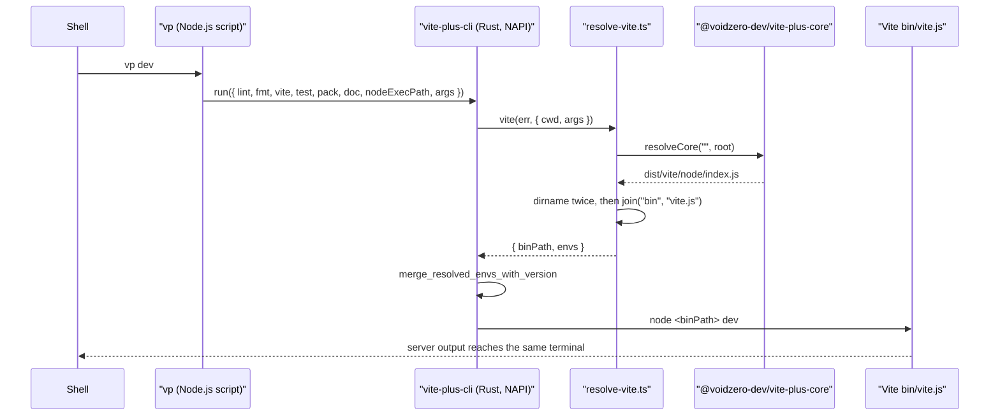
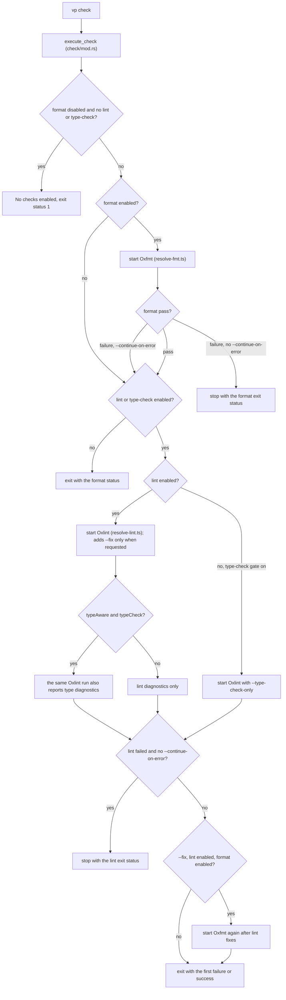
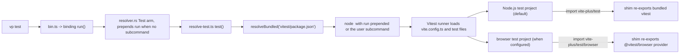

# 05 — Development, test, and build commands

Vite+ does not implement a development server, a bundler, a test runner, a linter, or a formatter.
It resolves the real tool for each command and starts that tool with the same Node.js runtime that runs the Command-Line Interface (CLI).
The command path has two layers. A Node.js script handles a small set of global commands. Every other command crosses a Native API (NAPI) boundary into a Rust core. The Rust core calls back into TypeScript resolver functions. Each resolver returns a binary path and an environment map. The Rust core then starts `node <binary path> <tool arguments>`.
This document follows that path for `vp dev`, `vp build`, `vp check`, `vp test`, `vp fmt`, `vp lint`, `vp pack`, and the `vpx` script runner. It also covers `vp preview` and the project setup commands `vp create`, `vp migrate`, `vp config`, `vp hooks`, and `vp staged`, together with the configuration surface that these commands read.

The name `vite-plus` has three referents in this file.
It names the repository directory at `/Users/darkvoid/GitSources/src.voidzero/vite-plus`.
It names the published package `vite-plus`.
It also appears in the names of the core package and the internal crates.
The command itself is `vp`.
A path that starts with `vite-plus/` is relative to `/Users/darkvoid/GitSources/src.voidzero`.

## 1. Scope and the two-layer command path

This document owns the commands whose job is development, checking, building, or project setup.
Document 02 owns the full dispatch model and the Rust command crates.
Document 03 owns package installation and the lockfile.
`vp migrate` edits package files as part of a project migration, but Document 03 owns the package-file rules.
Document 04 owns the Node.js runtime, version selection, and environment shims.
Documents 06 to 09 own `vp run` and the Vite Task engine.
This document links to those documents instead of repeating them.

The first layer is `vite-plus/packages/cli/src/bin.ts`.
The file starts with argument normalization, then splits the command set.

```ts
// vite-plus/packages/cli/src/bin.ts:138-153
} else if (command === 'create') {
  await import('./create/bin.js');
} else if (command === 'migrate') {
  await import('./migration/bin.js');
} else if (command === 'sync-versions') {
  await import('./sync-versions/bin.js');
} else if (command === 'config') {
  await import('./config/bin.js');
} else if (command === 'hooks') {
  await import('./hooks/bin.js');
} else if (command === '--version' || command === '-V') {
  await import('./version.js');
} else if (command === 'staged') {
  await import('./staged/bin.js');
} else {
  // All other commands — delegate to Rust core via NAPI binding
```

The block starts in the middle of an `else if` chain.
`command` is `args[0]` from `vite-plus/packages/cli/src/bin.ts:132`.
The global commands in this block are `create`, `migrate`, `sync-versions`, `config`, `hooks`, `staged`, and `--version`.
Every other command enters the `run` call at `vite-plus/packages/cli/src/bin.ts:168-191`.
That call passes six resolver functions to Rust: `lint`, `pack`, `fmt`, `vite`, `test`, and `doc`.
The `doc` channel serves `vp doc`, which this document does not cover (`vite-plus/packages/cli/src/resolve-doc.ts`).
It also passes `nodeExecPath`, the toolchain manifest path, the `vite-plus` package path, a universal configuration resolver, the Node.js version, and the raw arguments.

`sync-versions` is not a developer command.
It reads one JSON request from standard input and one bundled toolchain manifest (`vite-plus/packages/cli/src/sync-versions/bin.ts:15-39`).
It writes one JSON response to standard output.
It rejects input from a terminal and requires the exact form `vp sync-versions --json` (`sync-versions/bin.ts:17-25`).
The error text says that it is "intended for external automation" (`sync-versions/bin.ts:22-24`).

The second layer is the Rust crate `vite-plus-cli`, declared at `vite-plus/packages/cli/binding/Cargo.toml:1-7`.
The exported `run` function receives the resolver functions as `ThreadsafeFunction` values at `vite-plus/packages/cli/binding/src/lib.rs:77-99`.
It moves them to a worker thread and calls the Rust command entry point.

```rust
// vite-plus/packages/cli/binding/src/lib.rs:224-252
    std::thread::spawn(move || {
        // Create the resolvers inside the thread (BoxedResolverFn is not Send)
        let cli_options = ViteTaskCliOptions {
            node_exec_path,
            lint: create_resolver(lint_tsf, "Failed to resolve lint command"),
            fmt: create_resolver(fmt_tsf, "Failed to resolve fmt command"),
            vite: create_resolver(vite_tsf, "Failed to resolve vite command"),
            test: create_resolver(test_tsf, "Failed to resolve test command"),
            pack: create_resolver(pack_tsf, "Failed to resolve pack command"),
            doc: create_resolver(doc_tsf, "Failed to resolve doc command"),
            toolchain_manifest_path,
            vite_plus_package_path,
            resolve_universal_vite_config: create_vite_config_resolver(
                resolve_universal_vite_config_tsf,
            ),
            node_version,
        };

        // Create a new single-threaded runtime for non-Send futures
        let rt = tokio::runtime::Builder::new_current_thread()
            .enable_all()
            .build()
            .expect("Failed to create runtime");

        // Run the CLI in a LocalSet to allow non-Send futures
        let local = tokio::task::LocalSet::new();
        let result = local.block_on(&rt, async {
            crate::cli::main(cwd, Some(cli_options), args, explicit_chdir).await
        });
```

The block above stops after `block_on` returns, and it is still inside the `std::thread::spawn` closure (`vite-plus/packages/cli/binding/src/lib.rs:224-256`).
The closure runs on a new native thread.
`BoxedResolverFn` is not `Send`, so the code creates the resolvers inside that thread (`lib.rs:225`).
`Send` is the Rust trait that permits a value to move to another thread.
A `LocalSet` permits non-`Send` futures to run on one thread (`lib.rs:248-252`).
The omitted lines then send the result back to the caller (`lib.rs:254-256`).

The Rust core never guesses a tool path.
It asks TypeScript for the path.
The anchor of that resolution depends on the resolver.
For Vite, Vitest, and the core package, Node.js resolves from the CLI installation (`vite-plus/packages/cli/src/resolve-core.ts:60-75`).
`resolveBundled` also tries `import.meta.dirname` before `process.cwd()`, so the bundled Vitest wins over a project copy (`vite-plus/packages/cli/src/utils/constants.ts:89-93`).
For Oxlint and Oxfmt, the `resolve` helper tries `process.cwd()` before `import.meta.dirname`, so those two tools are project-first (`vite-plus/packages/cli/src/utils/constants.ts:69-73`).
`SubcommandResolver::resolve` at `vite-plus/packages/cli/binding/src/cli/resolver.rs:72-77` maps each subcommand to one resolver.
The resolved subcommand has four parts: a program, arguments, a cache configuration, and environment values (`vite-plus/packages/cli/binding/src/cli/types.rs:185-191`).
The program is always `cli_options.node_exec_path`, the Node.js executable that started `vp`.
Therefore the started process is always `node <first argument> ...`.
`vp_command::resolve_bin` applies the PATH rules to that program path, including `PATHEXT` on Windows (`vite-plus/crates/vp_command/src/lib.rs:57-72`).

The first argument is the resolver `binPath`.
For Vite, Vitest, and `pack-bin.js`, the path is a JavaScript entry file.
For Oxlint and Oxfmt, the path is the package `bin/oxlint` or `bin/oxfmt` file.
The resolver derives that path by going up two directories from the package main entry (`vite-plus/packages/cli/src/resolve-lint.ts:35-42`, `vite-plus/packages/cli/src/resolve-fmt.ts:32-38`).
The Oxlint and Oxfmt packages are not in this checkout.
Therefore this document cannot show the file type or the contents of `bin/oxlint` and `bin/oxfmt`.
The Rust core passes the path to `node` in every case.

`SubcommandResolver` is the Rust object that answers "what process should run".
`SynthesizableSubcommand` is the parsed command enum that it accepts (`vite-plus/packages/cli/binding/src/cli/types.rs:35-149`).
`vp_command::build_command` creates the process, clears the inherited environment, and applies the resolver environment.
This happens in `vite-plus/packages/cli/binding/src/cli/execution.rs:13-33`.
Interactive commands `dev` and `preview` use `execute_with_terminal_guard`; other commands spawn and wait (`vite-plus/packages/cli/binding/src/cli/execution.rs:36-57`).
A third mode captures output: `resolve_and_capture_output` pipes standard output and standard error and returns both to the caller (`vite-plus/packages/cli/binding/src/cli/execution.rs:98-124`).
`vp check` uses this mode to parse tool output (Section 8).

**Aha:** `vp build` does not contain a build implementation.
The TypeScript resolver returns the path of Vite's own `bin/vite.js` inside the bundled core package.
Rust starts that file with `node` and the argument `build`.
The build pipeline is upstream Vite, not a reimplementation in this repository.

## 2. The TypeScript resolution layer

The tool resolvers live in `vite-plus/packages/cli/src/`.
Each tool resolver is small and returns `{ binPath, envs }`.
The Rust side treats the result as a tool description, not as a library call.
Three helper modules sit beside the tool resolvers.
`resolve-vite-config.ts` returns a configuration object.
`resolve-core.ts` returns a module path string.
`run-config.ts` exports types only.
The table marks the return shape of each file.

| File | Purpose | Return shape | Key behaviour |
|------|---------|--------------|---------------|
| `resolve-vite.ts` | Resolve Vite for `dev`, `build`, and `preview` | `{ binPath, envs }` | Parses the project root with `cac`, a command-line argument parser; returns `dist/vite/bin/vite.js` from the core package |
| `resolve-vite-config.ts` | Load `vite.config.*` to read non-plugin blocks | resolved configuration | Wraps `resolveConfig` in `withConfigMetadataResolution`; optional walk up to the workspace root |
| `resolve-test.ts` | Resolve Vitest | `{ binPath, envs }` | Reads the bundled `vitest/package.json` and its `bin` entry |
| `resolve-lint.ts` | Resolve Oxlint | `{ binPath, envs }` | Derives `bin/oxlint`; adds the tsgolint executable path |
| `resolve-fmt.ts` | Resolve Oxfmt | `{ binPath, envs }` | Derives `bin/oxfmt` |
| `resolve-pack.ts` | Resolve the `vp pack` entry | `{ binPath, envs }` | Validates the core alias; returns `pack-bin.js` |
| `resolve-core.ts` | Resolve the installed core package | module path string | Reads the CLI version; validates the `vite` alias; returns `vite` exports |
| `run-config.ts` | Types for `run` configuration | TypeScript types | Generated by `cargo test`; do not edit |

### 2.1 `resolve-vite.ts`

`resolveViteRoot` uses `cac` to find the positional root argument.
It registers the Vite boolean options first, so `cac` does not consume the root as an option value (`vite-plus/packages/cli/src/resolve-vite.ts:10-31`).
The `vite` function then resolves the core package from that root and constructs the path to the bundled Vite CLI.

```ts
// vite-plus/packages/cli/src/resolve-vite.ts:33-53
/** Resolve the bundled CLI for dev, build, and preview from the selected project root. */
export async function vite(
  err: Error | null,
  context: JsCommandContext,
): Promise<JsCommandResolvedResult> {
  if (err) {
    throw err;
  }
  // Start through Vite's bin script, as `vite` does; see packages/core/BUNDLING.md.
  const viteDistDir = dirname(dirname(resolveCore('', resolveViteRoot(context))));
  const binPath = join(viteDistDir, 'bin', 'vite.js');
  if (!existsSync(binPath)) {
    throw new Error(`Could not find the bundled Vite CLI at ${binPath}. Run \`vp install\`.`);
  }

  const envs: Record<string, string> = { ...DEFAULT_ENVS };
  if (process.env.DEBUG_DISABLE_SOURCE_MAP) {
    envs.DEBUG_DISABLE_SOURCE_MAP = process.env.DEBUG_DISABLE_SOURCE_MAP;
  }
  return { binPath, envs };
}
```

The JavaScript function has two parameters.
The first is an error channel.
The second is a context object with `cwd` and `args`.
`create_resolver` builds that context and invokes the function through `call_async` (`vite-plus/packages/cli/binding/src/lib.rs:127-149`).
The `err` parameter is therefore always `null` on a normal call.
`ThreadsafeFunction` is the NAPI handle that queues a call onto the Node.js event loop.
`call_async` returns a future for the JavaScript `Promise`.
Rust awaits that future and then awaits the promise value (`vite-plus/packages/cli/binding/src/lib.rs:139-147`).
A resolver can therefore return a `Promise` and still appear synchronous to the Rust caller.

`resolveCore('', root)` returns the main entry file of the core package, for example `dist/vite/node/index.js`.
Two `dirname` calls move from `node/index.js` to `dist/vite`.
The function then adds `bin/vite.js`.
The comment at line 41 states the reason: Vite must start through its bin script, as the `vite` command does.
`vite-plus/packages/core/BUNDLING.md` explains that the bin script is copied and its CLI import is pointed at `../node/cli.js`.

`DEFAULT_ENVS` is defined at `vite-plus/packages/cli/src/utils/constants.ts:107-113`.
It provides three values: `JS_RUNTIME_VERSION` from `process.versions.node`, `JS_RUNTIME_NAME` from `process.release.name`, and `NODE_PACKAGE_MANAGER=vite-plus`.
`JS_RUNTIME_NAME` is usually `node`.
`JS_RUNTIME_VERSION` is the exact version string.
The comment states the purpose: telemetry and compatibility checks in Oxfmt (`vite-plus/packages/cli/src/utils/constants.ts:107-113`).
The last value tells the tool that Vite+ is the package manager.
The Vite, Vitest, and pack resolvers copy these values into their child environment (`vite-plus/packages/cli/src/resolve-vite.ts:47-52`, `vite-plus/packages/cli/src/resolve-test.ts:50-62`, `vite-plus/packages/cli/src/resolve-pack.ts:16-19`).

`DEBUG_DISABLE_SOURCE_MAP` is a pass-through variable.
When the parent process sets it, the resolver copies the value into the child environment (`vite-plus/packages/cli/src/resolve-vite.ts:48-52`, `vite-plus/packages/cli/src/resolve-test.ts:52-60`).
The source does not define what the child does with the value.

### 2.2 `resolve-vite-config.ts`

This file is not a tool resolver for a child process.
It loads the user configuration inside the CLI process so that Vite+ can read the `lint`, `fmt`, `check`, `run`, `staged`, and `pack` blocks.
`resolveViteConfig` imports the public `resolveConfig` from `./index.js` and calls it with the build command (`vite-plus/packages/cli/src/resolve-vite-config.ts:58-76`).
`./index.js` re-exports everything from `vite` (`vite-plus/packages/cli/src/index.ts:9`).
Therefore `resolveConfig` is Vite's own configuration resolver, not a Vite+ copy.
`withConfigMetadataResolution` is the Vite+ wrapper that sets the metadata marker (`vite-plus/packages/cli/src/define-config.ts:1038-1059`).

```ts
// vite-plus/packages/cli/src/resolve-vite-config.ts:58-76
export async function resolveViteConfig(cwd: string, options?: ResolveViteConfigOptions) {
  const { resolveConfig } = await import('./index.js');

  // This loads the config purely to read a non-plugin block (lint/fmt/pack/run/
  // staged/create…), so skip the user's plugin factory while it evaluates.
  return withConfigMetadataResolution(async () => {
    if (options?.traverseUp && !hasViteConfig(cwd)) {
      const workspaceRoot = findMonorepoRoot(cwd);
      if (workspaceRoot) {
        const configFile = findViteConfigUp(path.dirname(cwd), workspaceRoot);
        if (configFile) {
          return resolveConfig({ root: cwd, configFile }, 'build');
        }
      }
    }

    return resolveConfig({ root: cwd }, 'build');
  });
}
```

The `traverseUp` option is used by `vp pack` so that a package directory can use the root configuration (`vite-plus/packages/cli/src/pack-bin.ts:148-152`).
`resolveUniversalViteConfig` serializes a subset of the resolved configuration to JavaScript Object Notation (JSON) at `vite-plus/packages/cli/src/resolve-vite-config.ts:78-97`.
"Universal" means that one filtered result serves every command that needs a configuration block.
The function reads the full Vite configuration and then projects six fields into JSON.
It does not return the full Vite configuration.
It includes `configFile`, `lint`, `fmt`, `check`, `run`, and `staged`.
The JSON string crosses the NAPI boundary and becomes `ResolvedUniversalViteConfig` in Rust (`vite-plus/packages/cli/binding/src/cli/resolver.rs:54-69`).

### 2.3 `resolve-test.ts`

`test` resolves the Vitest package through `resolveBundled` and reads its `bin` field (`vite-plus/packages/cli/src/resolve-test.ts:37-62`).

```ts
// vite-plus/packages/cli/src/resolve-test.ts:41-48
  const pkgJsonPath = resolveBundled('vitest/package.json');
  const pkgRoot = dirname(pkgJsonPath);
  const pkgJson = JSON.parse(readFileSync(pkgJsonPath, 'utf-8')) as VitestPackageJson;
  const binRel = typeof pkgJson.bin === 'string' ? pkgJson.bin : pkgJson.bin?.vitest;
  if (!binRel) {
    throw new Error(`Could not find 'vitest' bin entry in ${pkgJsonPath}`);
  }
  const binPath = join(pkgRoot, binRel);
```

`resolveBundled` prefers the copy inside the CLI package over the copy in the project (`vite-plus/packages/cli/src/utils/constants.ts:89-93`).
The comment at `vite-plus/packages/cli/src/utils/constants.ts:75-88` gives the reason.
The `vite-plus/test` shims re-export from `vitest`.
If `vp test` started a different physical copy of Vitest, the runner and the imported `vi`, `expect`, and runner internals would be two modules.
That split causes internal-state mismatches and mock-hoisting mismatches.
Mock hoisting is the Vitest step that moves `vi.mock` calls above the imports of a test file.
A hoisted mock must register on the same Vitest module instance that the test file later imports.
Two copies give two registries, so the mock does not apply to the runner's copy.
This is a real constraint, not a preference.

The Rust `Test` arm at `vite-plus/packages/cli/binding/src/cli/resolver.rs:159-191` adds one more rule.
It may prepend the argument `run` before the user arguments.
`should_prepend_vitest_run` returns `true` when the argument list is empty (`vite-plus/packages/cli/binding/src/cli/help.rs:87-90`).
It returns `false` when the first argument is a Vitest subcommand: `run`, `watch`, `dev`, `related`, `bench`, `init`, `list`, `doctor`, or `complete` (`help.rs:57-64`).
It also returns `false` when an argument before `--` is `-h`, `--help`, `-w`, `--watch`, or `--run` (`help.rs:49-55`, `help.rs:96-101`).
It returns `true` in every other case (`help.rs:103`).
Vitest itself starts watch mode when no subcommand is given.
The documentation states this contrast (`vite-plus/docs/guide/test.md:33-35`).
The prepended `run` therefore removes a default that would otherwise apply.
The arm also sets a cache input to automatic tracking and excludes `node_modules/.vite/vitest/**/results.json`.
That file is Vitest's results cache.
Vitest rewrites it during a run, so file-system tracking would count the run's own write as an input (`vite-plus/packages/cli/src/define-config.ts:774-790`).
Without the exclusion, every `vp test` task would stay permanently uncacheable.
The exclusion glob keeps the file out of the input list (`vite-plus/packages/cli/binding/src/cli/resolver.rs:179-185`).
This cache input matters only when Vitest runs inside the Vite Task engine, which documents 06 and 07 own.

### 2.4 `resolve-lint.ts` and `resolve-fmt.ts`

Both resolvers derive the binary from the package main entry, because the `bin` subpath is not exported.
Oxlint: `resolve('oxlint')` returns `dist/index.js`; two `dirname` calls reach the package root, then `bin/oxlint` (`vite-plus/packages/cli/src/resolve-lint.ts:35-42`).
Oxfmt uses the same derivation at `vite-plus/packages/cli/src/resolve-fmt.ts:32-38`.

Oxlint also needs the type-check helper.
tsgolint is the TypeScript-Go linter that Oxlint calls for type-aware rules.
`resolve-lint.ts` resolves `oxlint-tsgolint/bin/tsgolint` and passes the result as `OXLINT_TSGOLINT_PATH` (`vite-plus/packages/cli/src/resolve-lint.ts:43-56`).
`resolveTsgolintExecutable` adds `.exe` or `.cmd` on Windows (`vite-plus/packages/cli/src/utils/tsgolint-path.ts:29-46`).
The Rust `Lint` arm copies the value into the child environment cache (`vite-plus/packages/cli/binding/src/cli/resolver.rs:96-102`).
The source does not show how Oxlint uses the variable after it starts.
Both resolvers set `VP_RESOLVING_CONFIG_METADATA=1`, because the tool loads `vite.config.ts` only to read its own block (`vite-plus/packages/cli/src/resolve-fmt.ts:43-48`, `vite-plus/packages/cli/src/resolve-lint.ts:50-56`).
The constant is defined at `vite-plus/packages/cli/src/utils/constants.ts:115-120`.

The Rust `Lint` arm adds `--disable-warning=MODULE_TYPELESS_PACKAGE_JSON` before the Oxlint path (`vite-plus/packages/cli/binding/src/cli/resolver.rs:79-95`).
`MODULE_TYPELESS_PACKAGE_JSON` warns when Node.js loads an ECMAScript Module (ESM) file from a package with no `"type"` field.
The flag disables that warning for the child process.
The source does not name the file that triggers the warning.
The `Fmt` arm starts the Oxfmt path with the user arguments unchanged (`vite-plus/packages/cli/binding/src/cli/resolver.rs:106-127`).

### 2.5 `resolve-pack.ts`

`vp pack` does not start tsdown directly from the Rust core.
The resolver validates the project's core alias, then returns the CLI's own `pack-bin.js` (`vite-plus/packages/cli/src/resolve-pack.ts:7-20`).

```ts
// vite-plus/packages/cli/src/resolve-pack.ts:7-20
/** Validate the target project's core alias before starting the bundled pack entry. */
export async function pack(
  err: Error | null,
  { cwd }: JsCommandContext,
): Promise<JsCommandResolvedResult> {
  if (err) {
    throw err;
  }
  resolveCore('/pack', cwd);
  return {
    binPath: join(import.meta.dirname, 'pack-bin.js'),
    envs: { ...DEFAULT_ENVS },
  };
}
```

`resolveCore('/pack', cwd)` resolves the `vite` subpath `./pack`.
The core manifest maps `./pack` to `./dist/tsdown/index.js` (`vite-plus/packages/core/package.json:45-48`).
`pack-bin.ts` imports `buildWithConfigs`, `resolveUserConfig`, `globalLogger`, and `enableDebug` from `vite/pack` (`vite-plus/packages/cli/src/pack-bin.ts:5-14`).
In other words, `vp pack` is the tsdown build application programming interface (API) bundled inside the core package.

### 2.6 `resolve-core.ts`

`resolveCore` is the single place that validates the `vite` alias.
It reads the installed `vite-plus/package.json` version at run time, not at build time (`vite-plus/packages/cli/src/resolve-core.ts:55-75`).

```ts
// vite-plus/packages/cli/src/resolve-core.ts:54-76
/** Resolve the same core dependency as the CLI's static `vite` re-exports. */
export function resolveCore(
  subpath = '',
  cwd = process.cwd(),
  modulePath = import.meta.url,
): string {
  const cliRequire = createRequire(modulePath);
  // Read the selected CLI's installed manifest. A static JSON import is inlined
  // during the build, before CI and preview packers can stamp a new version.
  const { version: expectedVersion } = JSON.parse(
    readFileSync(cliRequire.resolve('vite-plus/package.json'), 'utf8'),
  ) as { version: string };
  let corePackageJsonPath: string;
  try {
    corePackageJsonPath = cliRequire.resolve('vite/package.json');
  } catch (cause) {
    throw new Error('Could not resolve the bundled Vite dependency. Run `vp install`.', { cause });
  }
  checkCoreVersion(corePackageJsonPath, expectedVersion);
  checkProjectCoreVersion(cwd, corePackageJsonPath, expectedVersion);

  return cliRequire.resolve(`vite${subpath}`);
}
```

`checkCoreVersion` requires both the package name `@voidzero-dev/vite-plus-core` and the exact expected version (`vite-plus/packages/cli/src/resolve-core.ts:9-20`).
`checkProjectCoreVersion` validates the project copy only when the nearest `package.json` declares `vite` (`vite-plus/packages/cli/src/resolve-core.ts:22-52`).
The comment at lines 27-28 states why: the Node Package Manager (NPM) can hoist an upstream Vite peer even when the project declares only `vite-plus`.

### 2.7 `run-config.ts`

`run-config.ts` is generated, not written by hand.
Its first line is `// This file is auto-generated by \`cargo test\`. Do not edit manually.` (`vite-plus/packages/cli/src/run-config.ts:1`).
It exports TypeScript types that mirror the Rust task model: `Task`, `TaskCache`, `DependsOnEntry`, `RunConfig`, and related names.
Document 06 explains the semantics of those fields.

### 2.8 The `vpx` script loaders

Five more files support script execution rather than a build command: `script-preload.ts`, `script-register.ts`, `script-hooks.ts`, `script-esm-hooks.ts`, and `script-watch.ts`.
They serve `vpx`, a separate executable in the `vite-plus` package (`vite-plus/packages/cli/package.json:19`).
`vpx` is the package executor of Vite+, with the same role that `npx` has for npm.
The `bin/vpx` launcher imports `dist/vpx-bin.js` (`vite-plus/packages/cli/bin/vpx:1-9`).
That entry makes three choices (`vite-plus/packages/cli/src/vpx-bin.ts:259-334`).
A path that resolves to a supported script file runs through the loader in this package.
A file installed in `node_modules/.bin` runs directly.
A versioned package, a `--package` flag, or `--shell-mode` hands off to `vp dlx`.
`vp dlx` is the download-and-execute command that loads the CLI bundle and the native binding (`vpx-bin.ts:11-12`).
`oxc-node` is the Oxc-based loader that performs the transform.
Oxc is the JavaScript and TypeScript toolchain that parses and transforms the source.
`oxc-node` applies that transform when Node.js loads a module, so a `.ts` file can run directly.
`pirates` is the library that adds a CommonJS (CJS) `require` hook.
`--require` and `--import` are Node.js flags that load a module before the script starts.
`script-preload.ts` is the `--require` entry (`vite-plus/packages/cli/src/script-preload.ts:2`).
The preload entry stops with exit code 1 when the Node.js version is outside `^22.18.0 || ^24.11.0 || >=26.0.0` (`vite-plus/packages/cli/src/script-preload.ts:39-42`, `vite-plus/packages/cli/src/script-hooks.ts:68`).
It loads `oxc-node`, initializes the loader, sets the TypeScript transform dependency, and installs the `pirates` hook for JavaScript and TypeScript extensions (`vite-plus/packages/cli/src/script-preload.ts:67-81`).

`script-register.ts` is the `--import` entry.
When synchronous hooks are not available, it registers the asynchronous ESM hook file through `module.register()` (`vite-plus/packages/cli/src/script-register.ts:19-34`).
`module.register()` installs hooks on a separate hooks thread.
"Off-thread" means that the hook work runs outside the main JavaScript thread.
`script-esm-hooks.ts` is that off-thread hook file. It resolves and loads each module through `oxc-node` (`vite-plus/packages/cli/src/script-esm-hooks.ts:1-29`).
The file comment explains that Node.js 22 cannot run this registration from a `--require` entry (`script-register.ts:5-8`).
`script-hooks.ts` holds the shared logic (`vite-plus/packages/cli/src/script-hooks.ts:37-112`).
`threadScriptConfig` captures the tsconfig path from the environment before the first resolve, because a worker can have a different environment (`script-hooks.ts:33-50`).
`canRegisterSyncHooks` returns true only for Node.js 22.22.3 or later in the 22.x line, 24.11.1 or later in the 24.x line, or 26.0.0 or later (`script-hooks.ts:94-103`).
Each threshold matches the Node.js release that fixed one required hook bug (`script-hooks.ts:87-93`).
The comment also states that `tsx` switches at the same releases (`script-hooks.ts:88-89`).
Helper-module routing sends only the helper imports that these hooks emit through the name `vite-plus:oxc-node` (`script-hooks.ts:105-112`).
`runtimeHelperSpecifier` maps that name to `@oxc-project/runtime/helpers/` (`script-hooks.ts:121-126`).
`script-watch.ts` starts the watch variant with the `--require` and `--import` loader arguments (`vite-plus/packages/cli/src/script-watch.ts:22-33`).
Document 04 owns the runtime and environment behaviour that these loaders depend on.

## 3. `packages/core`: the single package behind `vite`

`@voidzero-dev/vite-plus-core` is not a normal library with a `src` directory.
The package directory contains `build.ts`, `BUNDLING.md`, `build-support/`, `package.json`, `tsconfig.json`, and tests.
The files that users import are produced into `dist/` by `build.ts`.
The manifest runs `build.ts` with the `oxnode` runner (`vite-plus/packages/core/package.json:109-111`).
`oxnode` is the Oxc Node.js runtime from the same toolchain.
This document does not establish what the `-C dev` flag changes.

The package name and version are `@voidzero-dev/vite-plus-core` 1.6.0 (`vite-plus/packages/core/package.json:2-3`).
The main entry is `./dist/vite/node/index.js`, and the types entry is `./dist/vite/node/index.d.ts` (`vite-plus/packages/core/package.json:20-21`).
The export map shows the shape of the bundle.

```json
// vite-plus/packages/core/package.json:37-48
  "exports": {
    ".": "./dist/vite/node/index.js",
    "./client": {
      "types": "./dist/vite/client.d.ts"
    },
    "./dist/client/*": "./dist/vite/client/*",
    "./internal": "./dist/vite/node/internal.js",
    "./module-runner": "./dist/vite/node/module-runner.js",
    "./pack": {
      "default": "./dist/tsdown/index.js",
      "types": "./dist/tsdown/index-types.d.ts"
    },
```

The exports continue with the `./rolldown/*` family and `./types/*` (`vite-plus/packages/core/package.json:53-107`).
The `bundledVersions` field records the upstream versions: Vite 8.3.7, Rolldown 1.2.18, and tsdown 0.23.4 (`vite-plus/packages/core/package.json:241-245`).
The engine range is `^20.19.0 || ^22.18.0 || >=24.11.0` (`vite-plus/packages/core/package.json:238-240`).

`build.ts` runs a fixed sequence at `vite-plus/packages/core/build.ts:67-72`:
1. `bundleRolldownPluginutils`
2. `bundleRolldown`
3. `buildVite`
4. `bundleTsdown`
5. `brandTsdown`
6. `wireBundledTsdownExtensions`

A final `mergePackageJson()` call writes the manifest (`vite-plus/packages/core/build.ts:105`).
`BUNDLING.md` describes the same sequence and the source of each input (`vite-plus/packages/core/BUNDLING.md:1-102`).
It numbers five steps.
Step 1 is `bundleRolldownPluginutils` (`BUNDLING.md:38-49`).
Step 2 is `bundleRolldown` (`BUNDLING.md:51-63`).
Step 3 is `buildVite` (`BUNDLING.md:65-78`).
Step 4 is `bundleTsdown` (`BUNDLING.md:80-92`).
Step 5 is `mergePackageJson` (`BUNDLING.md:94-102`).
The mapping is not one to one.
The `brandTsdown` and `wireBundledTsdownExtensions` calls are extra passes after Step 4.
They are not separate numbered steps in that document.

`buildVite` reads the upstream Vite configuration from `../../vite/packages/vite/rolldown.config.js` (`vite-plus/packages/core/build.ts:20`).
It rewrites module specifiers, copies `bin/vite.js`, and points the bin import at `../node/cli.js`.
`BUNDLING.md` lists these actions as Step 3 (`vite-plus/packages/core/BUNDLING.md:65-75`).
`brandTsdown` rewrites the tsdown command text so that user messages name `vp pack` instead of `tsdown`.

Rolldown has a fallback for WebContainer, a browser-based Node.js environment.
That fallback downloads a WebAssembly (WASM) build of Rolldown.
The fallback code reads the Rolldown version by resolving `rolldown/package.json` at run time (`vite-plus/packages/core/build.ts:366-367`).
The bundle replaces that lookup with the literal bundled version string (`vite-plus/packages/core/build.ts:406-410`).
The build fails unless exactly one replacement occurs, so an upstream change cannot pass silently (`vite-plus/packages/core/build.ts:431-436`).
`BUNDLING.md` records the same rewrite (`vite-plus/packages/core/BUNDLING.md:59`).

The core package is published under its own name and then aliased to `vite`.
The alias takes effect when dependencies are resolved and installed.
`vp create` writes the alias into the catalog or override of the new project (`vite-plus/packages/cli/src/create/utils.ts:31-34`).
`vp migrate` writes the same alias into an existing project (`vite-plus/packages/cli/src/migration/migrator/package-json.ts:298-306`).
The package manager then installs the core package under the name `vite`.
The alias is declared in two places.
`VITE_PLUS_OVERRIDE_PACKAGES` maps `vite` to `npm:@voidzero-dev/vite-plus-core@<version>` (`vite-plus/packages/cli/src/utils/constants.ts:27-40`).
The workspace file maps `vite` to `workspace:@voidzero-dev/vite-plus-core@*` (`vite-plus/pnpm-workspace.yaml:144-145`).

**The Vite source is not part of this checkout.**
`pnpm-workspace.yaml` lists `vite` and `vite/packages/vite` as workspace packages (`vite-plus/pnpm-workspace.yaml:1-6`).
`packages/core/package.json` declares `"vite": "workspace:*"` (`vite-plus/packages/core/package.json:145`).
But the `vite/` directory is absent from the snapshot, and `.gitignore` lists `vite` and `rolldown` (`vite-plus/.gitignore:8-10`).
The same is true for `rolldown/`.
The build downloads or synchronizes these sources before `build.ts` runs.
The command is `pnpm tool sync-remote`, followed by `just build` (`vite-plus/CONTRIBUTING.md:220-231`).
It runs `git clone` for an absent directory.
It runs `git reset --hard` for an existing directory (`vite-plus/packages/tools/src/sync-remote-deps.ts:177-183`, `vite-plus/packages/tools/src/sync-remote-deps.ts:199-200`).
The pins are in `vite-plus/packages/tools/.upstream-versions.json:1-17`.
Therefore this exploration cannot describe Vite internals from this checkout.
It can only describe how Vite+ wraps and starts Vite.

## 4. `vp_static_config`: configuration without execution

`vp_static_config` is a Rust crate that reads a small set of top-level fields from `vite.config.*` without executing the file.
The crate depends on `oxc_parser`, `oxc_ast`, and `oxc_allocator` (`vite-plus/crates/vp_static_config/Cargo.toml`).
It parses the file into an Abstract Syntax Tree (AST) and extracts literal values.

The entry point is `resolve_static_config` (`vite-plus/crates/vp_static_config/src/lib.rs:129-141`).

```rust
// vite-plus/crates/vp_static_config/src/lib.rs:129-141
pub fn resolve_static_config(dir: &AbsolutePath) -> FieldMap {
    let Some(config_path) = resolve_config_path(dir) else {
        // No config file found — closed empty map; get() returns None for any key.
        return FieldMap::no_config();
    };
    let Ok(source) = std::fs::read_to_string(&config_path) else {
        return FieldMap::unanalyzable();
    };

    let extension = config_path.as_path().extension().and_then(|e| e.to_str()).unwrap_or("");

    parse_js_ts_config(&source, extension)
}
```

The file names and their order match Vite's default list: `vite.config.js`, `.mjs`, `.ts`, `.cjs`, `.mts`, `.cts` (`vite-plus/crates/vp_static_config/src/lib.rs:98-105`).
The parser accepts `defineConfig({...})`, `defineConfig(() => ({...}))`, and a function body with exactly one `return` (`vite-plus/crates/vp_static_config/src/lib.rs:205-263`).
It trusts only a `defineConfig` binding imported from `vite-plus` or `vite` (`vite-plus/crates/vp_static_config/src/lib.rs:21`, `vite-plus/crates/vp_static_config/src/lib.rs:337-360`).

The result type is `FieldMap` (`vite-plus/crates/vp_static_config/src/lib.rs:49-92`).
`FieldMap` has a closed mode and an open mode.
A closed map has no spread and no computed key. Every absent key is definitely absent.
An open map has at least one spread or computed key. An absent key may still exist at run time.
`get` returns `FieldValue::NonStatic` for a possible key in an open map.
`get_declared` returns only keys that the file explicitly writes.
The difference matters when the file exists but cannot be read as text.
`no_config()` means the field is definitely absent, so `get` returns `None` (`vite-plus/crates/vp_static_config/src/lib.rs:61-65`).
`unanalyzable()` means the field may exist, so `get` returns `Some(NonStatic)` (`vite-plus/crates/vp_static_config/src/lib.rs:55-59`).
A caller that must not change behaviour on an unknown value uses `get_declared`, which returns `None` in both cases (`vite-plus/crates/vp_static_config/src/lib.rs:79-88`).
`app_target.rs` uses `get_declared` for exactly this reason (`vite-plus/packages/cli/binding/src/cli/app_target.rs:54-73`).
The object extractor implements this rule.

```rust
// vite-plus/crates/vp_static_config/src/lib.rs:433-461
fn extract_object_fields(obj: &oxc_ast::ast::ObjectExpression<'_>) -> FieldMap {
    let mut map = FxHashMap::default();
    let mut open = false;

    for prop in &obj.properties {
        if prop.is_spread() {
            map.clear();
            open = true;
            continue;
        }
        let ObjectPropertyKind::ObjectProperty(prop) = prop else { continue };
        // A key with a lone surrogate is statically known but not
        // UTF-8-representable, so it cannot key the map — treat it like a
        // computed key and open the map.
        let Some(key) = prop.key.static_name().and_then(StaticPropertyName::into_cow_str) else {
            map.clear();
            open = true;
            continue;
        };

        // Open and closed maps alike record explicit declarations, including
        // NonStatic ones: `get_declared` must distinguish a written
        // `key: expr` from a key that merely might exist behind a spread.
        let value = expr_to_json(&prop.value).map_or(FieldValue::NonStatic, FieldValue::Json);
        map.insert(Box::from(key), value);
    }

    FieldMap { map, open }
}
```

A spread clears the map, because keys before a spread can be overwritten by it.
Keys written after the spread are recorded again.
`expr_to_json` accepts null, booleans, numbers, strings, single-quasi template literals, arrays, and objects (`vite-plus/crates/vp_static_config/src/lib.rs:482-540`).
It returns `None` for a call, an identifier, a template with expressions, or a spread inside an array or object.

The main consumer in this checkout is the command target selection in `vite-plus/packages/cli/binding/src/cli/app_target.rs`.
`classify` returns one of two outcomes (`vite-plus/packages/cli/binding/src/cli/app_target.rs:199-210`).
It either runs in place or asks for a target.
`AppTarget` is the later result and has three outcomes: current directory, a selected directory, or exit (`app_target.rs:17-26`).
`resolve_app_target` converts the first outcome to `CurrentDir` and resolves the second (`app_target.rs:305-395`).
The two outcomes of `classify` are `RunInPlace` and `Elicit` (`app_target.rs:199-210`).
An "intent signal" is a declared configuration field or an `index.html` file that shows the directory is an application root (`app_target.rs:46-73`).
`root_has_intent_signal` uses `get_declared` for `pack` and for the Vite fields `root`, `build`, `input`, `environments`, and `appType` (`vite-plus/packages/cli/binding/src/cli/app_target.rs:54-73`).
`resolve_default_package` requires a JSON string and reports a clear error for a non-static value (`vite-plus/packages/cli/binding/src/cli/app_target.rs:95-120`).
`defaultPackage` may also be an object that maps each command to a directory, and a missing command entry falls through to target selection (`app_target.rs:221-237`).

```rust
// vite-plus/packages/cli/binding/src/cli/app_target.rs:95-120
fn resolve_default_package(
    command: &str,
    cwd: &AbsolutePath,
    value: vp_static_config::FieldValue,
) -> AppTarget {
    let fail = |msg: &str| {
        output::error(msg);
        AppTarget::Exit(ExitStatus(1))
    };
    match value {
        vp_static_config::FieldValue::Json(serde_json::Value::String(dir)) => {
            let target = cwd.join(&dir).clean();
            if !target.as_path().is_dir() {
                return fail(&format!("defaultPackage points to a missing directory: {dir}"));
            }
            output::note(&format!("vp {command}: using {dir} (defaultPackage in vite.config.ts)"));
            AppTarget::Dir(target)
        }
        vp_static_config::FieldValue::Json(other) => {
            fail(&format!("defaultPackage must be a string of a directory, got: {other}"))
        }
        vp_static_config::FieldValue::NonStatic => fail(
            "defaultPackage in vite.config.ts must be a static string literal so vp can read it without executing the config",
        ),
    }
}
```

`classify` calls `resolve_static_config(cwd)` once and reuses the result (`vite-plus/packages/cli/binding/src/cli/app_target.rs:262-274`).
This lookup works at a workspace root that has no `vite-plus` installation, because it never imports the configuration file.

**Aha:** `defaultPackage` must be a string literal for a mechanical reason.
Vite+ reads it before it knows which project to run.
If it executed the configuration to learn the target, the configuration might import `vite-plus` from the wrong project, or from no project at all.
The AST reader removes that circular dependency.
The same mechanism explains why a computed or spread value is rejected instead of guessed.

### 4.1 The relationship to `define-config.ts`

`define-config.ts` is the TypeScript side of the same configuration surface.
It augments the Vite `UserConfig` interface with the Vite+ fields (`vite-plus/packages/cli/src/define-config.ts:37-111`).
The fields are `lint`, `fmt`, `check`, `pack`, `defaultPackage`, `run`, `staged`, `create`, and `test`.
`defaultPackage` carries a comment that states the static-read constraint (`vite-plus/packages/cli/src/define-config.ts:66-77`).
That comment and the Rust error at `app_target.rs:116-118` describe the same rule.

`defineConfig` adds Vite+ plugins to the user configuration before it calls Vite's own `defineConfig` (`vite-plus/packages/cli/src/define-config.ts:977-979`).
`defineProject` does the same for a Vitest project file (`vite-plus/packages/cli/src/define-config.ts:1008-1013`).
The comment at lines 1001-1007 gives the reason.
A migrated project that uses `defineProject({ test: { browser: ... } })` must still receive the Vitest resolver plugins.
Without them, a browser project can fail to resolve `vitest` or `@vitest/*` from its own root under a strict package layout.

`withConfigMetadataResolution` sets the marker `VP_RESOLVING_CONFIG_METADATA=1` while a metadata read is in progress (`vite-plus/packages/cli/src/define-config.ts:1038-1059`).
The counter is ref-counted, so overlapping reads in a monorepo do not clear the marker early.
`lazyPlugins` returns `undefined` while the marker is set (`vite-plus/packages/cli/src/define-config.ts:1124-1137`).

```ts
// vite-plus/packages/cli/src/define-config.ts:1124-1137
export function lazyPlugins(cb: () => PluginOption[]): PluginOption[] | undefined;
export function lazyPlugins(cb: () => Promise<PluginOption[]>): PluginOption[] | undefined;
export function lazyPlugins(
  cb: () => PluginOption[] | Promise<PluginOption[]>,
): PluginOption[] | undefined {
  if (process.env[CONFIG_METADATA_ENV] === '1') {
    return undefined;
  }
  const result = cb();
  if (result instanceof Promise) {
    return [result];
  }
  return result;
}
```

`resolveConfigFromFile` wraps the same marker around a real `resolveConfig` call (`vite-plus/packages/cli/src/define-config.ts:1102-1118`).
It also passes a `rootBase` option through a private type bridge.
The public `resolveConfig` signature has seven parameters.
`ResolveConfigWithInternalOptions` adds an eighth internal parameter, `{ rootBase?: string }` (`vite-plus/packages/cli/src/define-config.ts:1061-1070`).
`rootBase` is the base directory for an unset or relative `root` in the configuration file.
Its default is the parent directory of the configuration file (`define-config.ts:1087-1097`).
The bundled core accepts the extra parameter because the build applies a resolver patch (`vite-plus/packages/core/BUNDLING.md:20-30`).
`BUNDLING.md` also states that an ordinary `resolveConfig` call keeps Vite's current-working-directory behaviour (`BUNDLING.md:31-33`).

## 5. The configuration files that the commands read

Most developer commands read one Vite configuration file.
`vp create` and `vp test` are the exceptions described below.
`VITE_CONFIG_FILES` lists the six accepted `vite.config.*` names in Vite's order (`vite-plus/packages/cli/src/utils/constants.ts:8-16`).
The TypeScript configuration finder uses that list (`vite-plus/packages/cli/src/resolve-vite-config.ts:22-33`, `vite-plus/packages/cli/src/resolve-vite-config.ts:43-45`).
The Rust static reader has its own copy of the same six names (`vite-plus/crates/vp_static_config/src/lib.rs:98-105`).
`vite-config-entry-basenames.json` lists twelve base names: those six names and six `vitest.config.*` names (`vite-plus/packages/cli/src/vite-config-entry-basenames.json:1-14`).
Only two components read the twelve-name list.
The Oxlint import rule uses it to decide whether a file is a configuration entry file (`vite-plus/packages/cli/src/oxlint-plugin.ts:39`, `vite-plus/packages/cli/src/oxlint-plugin.ts:54-56`).
The migration import rewriter embeds the same file at compile time (`vite-plus/crates/vp_migration/src/import_rewriter.rs:2107-2114`).

The configuration blocks map to commands as follows.

| Block | Read by | Meaning |
|-------|---------|---------|
| `lint` | `vp lint`, `vp check` | Oxlint rules and options, including `typeAware` and `typeCheck` |
| `fmt` | `vp fmt`, `vp check` | Oxfmt options |
| `check` | `vp check` | Default on/off for the format step and the lint step |
| `pack` | `vp pack` | tsdown options |
| `defaultPackage` | `dev`, `build`, `preview`, `pack` | Default target directory |
| `test` | `vp test` | Vitest configuration |
| `staged` | `vp staged` | lint-staged configuration |
| `create` | `vp create` | Local templates and default template |
| `run` | `vp run` | Task configuration; document 06 owns it |

`resolveUniversalViteConfig` returns only `configFile`, `lint`, `fmt`, `check`, `run`, and `staged` (`vite-plus/packages/cli/src/resolve-vite-config.ts:85-92`).
It does not return `pack`, `test`, `create`, or `defaultPackage`.
Those values are read by a different path.
`vp pack` calls `resolveViteConfig` directly (`vite-plus/packages/cli/src/pack-bin.ts:149-152`).
`defaultPackage` is read by the Rust static reader (`vite-plus/packages/cli/binding/src/cli/app_target.rs:267-274`).
`vp staged` calls `resolveViteConfig` directly (`vite-plus/packages/cli/src/staged/bin.ts:59-63`).

The `test` block has no separate transfer.
The Vitest resolver returns only the binary path and the environment (`vite-plus/packages/cli/src/resolve-test.ts:50-61`).
Vitest then loads `vite.config.*` itself.
The `test` field is declared on the Vite configuration type so that this loader accepts it (`vite-plus/packages/cli/src/define-config.ts:105-111`).
The documentation recommends the `test` block in `vite.config.ts` and does not recommend a separate `vitest.config.ts` (`vite-plus/docs/guide/test.md:39`).

`create` is not read by `resolveUniversalViteConfig` either.
`vp create` reads the `create` block through its own options path (`vite-plus/packages/cli/src/create/bin.ts:1-30`).

## 6. `vp dev`

`vp dev` goes through the generic Rust path.
The command reaches `SynthesizableSubcommand::Dev` and the resolver arm at `vite-plus/packages/cli/binding/src/cli/resolver.rs:215-232`.

```rust
// vite-plus/packages/cli/binding/src/cli/resolver.rs:215-232
            SynthesizableSubcommand::Dev { args } => {
                let cli_options = self.cli_options()?;
                let resolved = (cli_options.vite)(cwd, &args).await?;
                let js_path = resolved.bin_path;
                let js_path_str = js_path
                    .to_str()
                    .ok_or_else(|| anyhow::anyhow!("vite JS path is not valid UTF-8"))?;

                Ok(ResolvedSubcommand {
                    program: Arc::clone(&cli_options.node_exec_path),
                    args: iter::once(Str::from(js_path_str))
                        .chain(iter::once(Str::from("dev")))
                        .chain(args.into_iter().map(Str::from))
                        .collect(),
                    cache_config: UserCacheConfig::disabled(),
                    envs: merge_resolved_envs_with_version(envs, resolved.envs),
                })
            }
```

Cache is disabled for `dev`, because a development server is long-running and interactive (`resolver.rs:229`).
`merge_resolved_envs_with_version` adds `VP_VERSION` to the resolver environment (`vite-plus/packages/cli/binding/src/cli/resolver.rs:320-330`).
Its value is the Rust crate version compiled into the CLI (`env!("CARGO_PKG_VERSION")`, `resolver.rs:327-328`).
The branded Vite reads it through a generated `VITE_PLUS_VERSION` constant (`vite-plus/packages/tools/src/brand-vite.ts:127-148`).
That constant sets the Vite+ name and version in the Vite command-line output (`brand-vite.ts:145-157`).
The execution layer uses `execute_with_terminal_guard`, because `dev` is interactive (`vite-plus/packages/cli/binding/src/cli/execution.rs:42-55`).
That function saves the terminal state, ignores `SIGINT` on Unix or `Control-C` on Windows while the child runs, and restores the state after the child exits (`vite-plus/crates/vp_command/src/lib.rs:126-143`).
The purpose is to keep escape sequences out of the shell prompt after an interruption (`vite-plus/crates/vp_command/src/lib.rs:128-133`).

The following diagram shows the names that participate in one `vp dev` invocation.



The last arrow follows from inherited standard input and output.
`build_command` sets `stdin`, `stdout`, and `stderr` to `Stdio::inherit()` (`vite-plus/crates/vp_command/src/lib.rs:110-113`).
`execute_with_terminal_guard` spawns that command without changing them (`vite-plus/crates/vp_command/src/lib.rs:134-141`).
The child therefore writes to the same terminal as `vp`.

`Bin` and `NAPI` are one Node.js process.
The NAPI participant is the native addon that loads the Rust core and calls back into `Resolver`.
The resolver returns the path of `dist/vite/bin/vite.js`, and the Rust core starts it with `node` and the argument `dev`.

The `--app` flag is registered as a boolean option in `resolveViteRoot` (`vite-plus/packages/cli/src/resolve-vite.ts:15-28`).
The reason is not stated in this file.
Vite documents `--app` as an option in builds that use environments.
This document cannot confirm the behaviour from this repository.

## 7. `vp build` and `vp pack`

`vp build` and `vp pack` answer different questions.
`vp build` builds a web application for production with Vite.
`vp pack` builds a library or a standalone executable with tsdown.
tsdown is the TypeScript library bundler that `vp pack` uses (`vite-plus/docs/guide/pack.md:3-7`).
The documentation states both definitions (`vite-plus/docs/guide/build.md:3-7`, `vite-plus/docs/guide/pack.md:3-7`).

`vp preview` reuses the Vite resolver.
It adds the argument `preview` and disables the cache (`vite-plus/packages/cli/binding/src/cli/resolver.rs:233-249`).

`vp build` uses the Vite resolver and adds the argument `build` before the user arguments (`vite-plus/packages/cli/binding/src/cli/resolver.rs:129-157`).
The cache configuration adds no invented values.
An invented value would be a cache input that Vite does not report.
The comment at lines 143-148 says that Vite reports its inputs, outputs, and environment values through `@voidzero-dev/vite-task-client`.
The comment also says that Vite refines the `fingerprint` at run time with `ignoreInput`, `ignoreOutput`, `getEnv`, and `getEnvs`.
`ignoreInput(path)` tells the runner not to treat reads under `path` as cache inputs (`vite-task/packages/vite-task-client/src/index.d.ts:1-9`).
`ignoreOutput(path)` does the same for writes and cache outputs (`vite-task/packages/vite-task-client/src/index.d.ts:10-18`).
`getEnv(name)` returns one environment value.
By default, it records the name as a dependency (`vite-task/packages/vite-task-client/src/index.d.ts:27-43`).
`getEnvs(query)` returns a matching set.
By default, it records the pattern as a dependency (`vite-task/packages/vite-task-client/src/index.d.ts:44-65`).
All four functions are no-ops outside the runner (`vite-task/packages/vite-task-client/src/index.d.ts:3-4`, `vite-task/packages/vite-task-client/src/index.d.ts:12-13`, `vite-task/packages/vite-task-client/src/index.d.ts:34-35`, `vite-task/packages/vite-task-client/src/index.d.ts:58-59`).
A `fingerprint` is the cache key that the Vite Task engine computes for one task.
Documents 06 and 07 own that mechanism.

`vp pack` uses `pack-bin.js`.
The entry point creates a `cac` program, resolves the user configuration, merges the `pack` block with the command flags, and calls `buildWithConfigs` (`vite-plus/packages/cli/src/pack-bin.ts:140-180`).

```ts
// vite-plus/packages/cli/src/pack-bin.ts:148-177
    async function runBuild(): Promise<TsdownHandle> {
      const viteConfig =
        flags.config === false
          ? undefined
          : await resolveViteConfig(process.cwd(), { traverseUp: true });

      const configDeps = new Set<string>();
      if (viteConfig?.configFile) {
        // Vite uses forward slashes, but watcher events use native path separators.
        configDeps.add(path.normalize(viteConfig.configFile));
      }

      const configs: ResolvedConfig[] = [];
      const packConfigs = Array.isArray(viteConfig?.pack)
        ? viteConfig.pack
        : [viteConfig?.pack ?? {}];
      for (const packConfig of packConfigs) {
        const merged = { ...packConfig, ...flags };
        // Keep postcss/lightningcss external to the dts bundle (see plugin doc)
        if (merged.dts) {
          const existingPlugins = Array.isArray(merged.plugins) ? merged.plugins : [];
          merged.plugins = [...existingPlugins, externalDtsTypeOnlyPlugin()];
        }
        const resolvedConfig = await resolveUserConfig(merged, flags, configDeps);
        resolvedConfig.forEach((config) => config.configDeps.forEach((dep) => configDeps.add(dep)));
        configs.push(...resolvedConfig);
      }

      return buildWithConfigs(configs, configDeps, runBuild);
    }
```

`flags` is the parsed `cac` option object of type `InlineConfig` (`vite-plus/packages/cli/src/pack-bin.ts:140`).
`TsdownHandle` is the handle type that `vite/pack` exports (lines 6-15).
`externalDtsTypeOnlyPlugin` is the local Rolldown plugin (lines 20-78).
Rolldown is the bundler that `@voidzero-dev/vite-plus-core` exposes under `./rolldown` (`vite-plus/packages/core/package.json:53-78`).
The third argument to `buildWithConfigs` is the enclosing `runBuild` function (line 176).
The tsdown source is not in this checkout, so this document does not state when tsdown calls that argument.

The `pack` block may be one object or an array (`vite-plus/packages/cli/src/pack-bin.ts:161-163`).
Command flags win over the block, because the merge is `{ ...packConfig, ...flags }` (line 165).
The `dts` option adds a plugin that keeps `postcss`, `lightningcss`, `vitest`, and `vite-plus` external to the declaration bundle (lines 167-170).
The plugin is defined at `vite-plus/packages/cli/src/pack-bin.ts:20-78`.

The `vp pack` command supports many tsdown options.
The `cac` option list is at `vite-plus/packages/cli/src/pack-bin.ts:41-139`.
It includes `--dts` (declaration files), `--exe` (standalone executable), `--unbundle`, `--exports`, and workspace filters.
The documentation groups the options by declaration files, output formats, watch mode, and standalone executables (`vite-plus/docs/guide/pack.md:25-30`).
The default environment prefixes are `VITE_PACK_` and `TSDOWN_` (`vite-plus/packages/cli/src/pack-bin.ts:144-145`).

`vp build` always runs the built-in Vite build.
It does not run a `build` script from `package.json` (`vite-plus/docs/guide/build.md:9-11`).
`vp pack` is the library counterpart, and it is not a replacement for `vp build`.

The Vite source is absent from this checkout.
Therefore this document cannot show how the HyperText Markup Language (HTML) entry becomes the production bundle.
It can only show the Vite+ path to the Vite command.
The documentation states that the build pipeline is the standard Vite pipeline (`vite-plus/docs/guide/build.md:3-7`).

## 8. `vp check`

`vp check` is a composite command.
It runs formatting, linting, and optional type checking in one invocation.
The general dispatch is a direct call from Rust, not a child process for the whole composite (`vite-plus/packages/cli/binding/src/cli/mod.rs:99-123`).
`execute_check` receives the flags and the environment map (`vite-plus/packages/cli/binding/src/check/mod.rs:21-33`).

The command has these phases:
1. Read the universal Vite configuration (`vite-plus/packages/cli/binding/src/check/mod.rs:43`).
2. Decide whether the format step and the lint step are enabled (`check/mod.rs:61-78`).
3. Run Oxfmt, unless the step is disabled.
4. Run Oxlint, with type checking when enabled.
5. Run Oxfmt again after `--fix` lint edits (`check/mod.rs:281-309`).

The format step is skipped when `--no-fmt` is passed or when `check.fmt` is `false`.
The lint step is skipped in the same way (`check/mod.rs:65-74`).
The skip note is printed only when the configuration disabled the step, not when a flag did (lines 67-72).
This keeps the existing flag output unchanged.

The type-check decision is not a separate option.
`typeAware` enables lint rules that need TypeScript type information (`vite-plus/docs/guide/lint.md:45-52`).
`typeCheck` enables the full type-check pass.
`typeCheck` depends on the type-aware analysis, so that analysis must be on.
It requires both `typeAware` and `typeCheck` in the `lint.options` block (`vite-plus/packages/cli/binding/src/check/analysis.rs:84-90`).

```rust
// vite-plus/packages/cli/binding/src/check/analysis.rs:84-90
pub(super) fn lint_config_type_check_enabled(lint_config: Option<&serde_json::Value>) -> bool {
    let type_aware =
        lint_config.and_then(|config| lint_config_option(config, "typeAware")).unwrap_or(false);
    let type_check =
        lint_config.and_then(|config| lint_config_option(config, "typeCheck")).unwrap_or(false);
    type_aware && type_check
}
```

`lint_config_option` reads the local `options` object first.
It then reads `extends` from last to first, so the last entry wins (`vite-plus/packages/cli/binding/src/check/analysis.rs:92-100`).
The result is used at `vite-plus/packages/cli/binding/src/check/mod.rs:76-78`.

```rust
// vite-plus/packages/cli/binding/src/check/mod.rs:76-78
    let type_check_enabled = lint_config_type_check_enabled(resolved_vite_config.lint.as_ref());
    let lint_enabled = !no_lint;
    let run_lint_phase = lint_enabled || type_check_enabled;
```

When lint is disabled but type checking is enabled, the command passes `--type-check-only` to Oxlint (`vite-plus/packages/cli/binding/src/check/mod.rs:195-197`).
When `--fix` is active and lint is enabled, the command passes `--fix` (`check/mod.rs:178-182`).
Oxlint cannot fix type diagnostics, so `--fix` is dropped on the type-check-only path.
The command also forces `--format=default`.
The comment at lines 189-193 explains why: the GitHub Actions reporter omits the summary that the parser reads.

```rust
// vite-plus/packages/cli/binding/src/check/mod.rs:178-197
        // oxlint cannot auto-fix type diagnostics, so `--fix` is dropped on the
        // type-check-only path.
        if fix && lint_enabled {
            args.push("--fix".to_string());
        }
        if quiet {
            args.push("--quiet".to_string());
        }
        if deny_warnings {
            args.push("--deny-warnings".to_string());
        }
        // `vp check` parses oxlint's human-readable summary output to print
        // unified pass/fail lines. When `GITHUB_ACTIONS=true`, oxlint auto-switches
        // to the GitHub reporter, which omits that summary on success and makes the
        // parser think linting never started. Force the default reporter here so the
        // captured output is stable across local and CI environments.
        args.push("--format=default".to_string());
        if !lint_enabled && type_check_enabled {
            args.push("--type-check-only".to_string());
        }
```

The `--continue-on-error` flag changes the control flow.
Without it, a format failure stops the command before lint.
With it, the command records the first failure and continues (`vite-plus/docs/guide/check.md:26-36`).
The first failing exit status is preserved (`check.md:33-35`).

The documentation states that the type-check path uses tsgolint on the TypeScript Go toolchain (`vite-plus/docs/guide/check.md:7-11`).
The source shows the Oxlint resolver supplies the tsgolint executable path (`vite-plus/packages/cli/src/resolve-lint.ts:43-53`).
The source does not show the handoff inside Oxlint, because Oxlint is an external binary.

The first decision after configuration is the P0 gate.
When format is off and neither lint nor type checking runs, the command prints `No checks enabled` (`vite-plus/packages/cli/binding/src/check/mod.rs:80-86`).
It then prints the hint and returns exit status 1 (`check/mod.rs:81-85`).

The following diagram shows the tools that `vp check` starts.



`execute_check` does not start the tools itself.
It calls `resolve_and_capture_output` with `SynthesizableSubcommand::Fmt` or `SynthesizableSubcommand::Lint` (`vite-plus/packages/cli/binding/src/check/mod.rs:103-110`, `vite-plus/packages/cli/binding/src/check/mod.rs:204-211`).
That helper uses the same `SubcommandResolver` path as Section 2: Rust asks the TypeScript resolver for the binary path, starts `node <binary path> <arguments>`, and captures the output (`vite-plus/packages/cli/binding/src/cli/execution.rs:13-33`).
Therefore each tool is a separate Node.js child process, and the composite command is one Rust call.

The `--fix` flag and the type-check path can operate in one run.
The Rust code adds `--fix` only when lint is enabled (`vite-plus/packages/cli/binding/src/check/mod.rs:178-182`).
It adds `--type-check-only` only when lint is disabled and `typeCheck` is enabled (`check/mod.rs:195-197`).
When both lint and type check are enabled, one Oxlint process does both, and Oxlint cannot auto-fix type diagnostics (`check/mod.rs:178-181`).

`vp check` does not run the TypeScript compiler as a separate child process.
It asks Oxlint for type diagnostics through the Oxlint type-aware path.
That answer comes from the documentation and from the `typeAware` and `typeCheck` gate in the Rust code.

## 9. `vp test`

`vp test` starts the Vitest copy that ships with the CLI, and uses the project copy only as a fallback (Section 2.3).
The fallback is the second path entry in `resolveBundled` (`vite-plus/packages/cli/src/utils/constants.ts:89-93`).
It applies only when Node.js cannot resolve `vitest/package.json` from the CLI directory.
The reason is that the `vite-plus/test` shims import the bundled copy, so two physical copies would split the runner state (Section 9.1).
The Rust `Test` arm prepends `run` unless the first argument names a Vitest subcommand or the arguments ask for help, watch mode, or `--run` (Section 2.3).
Therefore `vp test` does not enter watch mode by default, and `vp test watch` does (`vite-plus/packages/cli/binding/src/cli/resolver.rs:159-190`).
The documentation states the same default and the Node.js version requirement (`vite-plus/docs/guide/test.md:3-5`, `vite-plus/docs/guide/test.md:33-35`).

A cache input is a value that the Vite Task engine includes in a cache key.
Automatic tracking means that the engine derives the input list from observed file access instead of a declared list.
Documents 06 and 07 own that mechanism.

Vitest is version 5.1.0.
The CLI constant is `VITEST_VERSION = '5.1.0'` (`vite-plus/packages/cli/src/utils/constants.ts:18`).
The workspace catalog pins the Vitest family at 5.1.0, except `@vitest/browser-webdriverio` at 5.0.0 (`vite-plus/pnpm-workspace.yaml:28-36`).

### 9.1 The `vite-plus/test` shims

The `vite-plus` manifest exports `./test`, `./test/browser`, and many browser provider paths (`vite-plus/packages/cli/package.json:109-223`).
The build generates these shims from Vitest's own `package.json` exports.
`syncTestPackageExports` reads the exports, creates a shim for each path, and maps `./foo` to `./test/foo` (`vite-plus/packages/cli/build.ts:344-392`).

```ts
// vite-plus/packages/cli/build.ts:369-401
  for (const [exportPath, exportValue] of Object.entries(testExports)) {
    // Skip package.json export and wildcard exports
    if (exportPath === './package.json' || exportPath.includes('*')) {
      continue;
    }

    // Convert ./foo to ./test/foo, . to ./test
    const cliExportPath = exportPath === '.' ? './test' : `./test${exportPath.slice(1)}`;
    const shimBaseName = exportPath === '.' ? 'index' : exportPath.slice(2);
    const importSpecifier =
      exportPath === '.' ? TEST_PACKAGE_NAME : `${TEST_PACKAGE_NAME}${exportPath.slice(1)}`;

    // Create shim files and build export entry
    const shimExport = await createShimForExport(
      shimBaseName,
      exportValue,
      importSpecifier,
      testDistDir,
    );
    if (shimExport) {
      generatedExports[cliExportPath] = shimExport;
      console.log(`  Created ${cliExportPath}`);
    }
  }

  // Vitest v5 no longer re-exports the standalone mocker package. Keep this
  // public migration target; the other removed entry points use node/runtime.
  generatedExports['./test/mocker'] = await createShimForExport(
    'mocker',
    { types: './index.d.ts', default: './index.js' },
    '@vitest/mocker',
    testDistDir,
  );
```

`TEST_PACKAGE_NAME` is the string `'vitest'` (`vite-plus/packages/cli/build.ts:37`).
`testExports` is the `exports` map of the installed Vitest manifest (`build.ts:361`).
`testDistDir` is the directory `dist/test` inside the CLI package (`build.ts:354`).
`generatedExports` collects the new export entries (`build.ts:367`).
`createShimForExport` writes one shim file and returns its export entry, or `null` when it cannot create a shim (`build.ts:1192-1265`).
The comment at lines 394-395 says that the removed entry points use `node/runtime`.

The build asserts the Vitest version before it creates the shims (`vite-plus/packages/cli/build.ts:358-360`).
It also writes private shims for `@vitest/browser` and `@vitest/browser/context` (`build.ts:403-408`).
The comment at lines 402-407 explains the reason: the shims keep one type identity across the bundled provider and the user project.

### 9.2 The Vitest 5 entry-point map

Vitest 5 moved or removed several subpaths.
`vitest-v5-entry-points.json` maps the old names to the Vite+ names.

```json
// vite-plus/packages/cli/src/vitest-v5-entry-points.json:1-22
{
  "vitest/coverage": "vite-plus/test/node",
  "vitest/reporters": "vite-plus/test/node",
  "vitest/environments": "vite-plus/test/runtime",
  "vitest/snapshot": "vite-plus/test/runtime",
  "vitest/mocker": "vite-plus/test/mocker",
  "vite-plus/test/coverage": "vite-plus/test/node",
  "vite-plus/test/reporters": "vite-plus/test/node",
  "vite-plus/test/environments": "vite-plus/test/runtime",
  "vite-plus/test/snapshot": "vite-plus/test/runtime",
  "vitest/browser-webdriverio": "@vitest/browser-webdriverio",
  "vitest/browser-webdriverio/context": "vite-plus/test/browser/context",
  "vitest/browser/providers/webdriverio": "@vitest/browser-webdriverio",
  "vitest/browser/providers/webdriverio/context": "vite-plus/test/browser/context",
  "vitest/plugins/browser-webdriverio": "@vitest/browser-webdriverio",
  "vite-plus/test/browser-webdriverio": "@vitest/browser-webdriverio",
  "vite-plus/test/browser-webdriverio/context": "vite-plus/test/browser/context",
  "vite-plus/test/browser/providers/webdriverio": "@vitest/browser-webdriverio",
  "vite-plus/test/browser/providers/webdriverio/context": "vite-plus/test/browser/context",
  "vite-plus/test/plugins/browser-webdriverio": "@vitest/browser-webdriverio",
  "@vitest/browser/providers/webdriverio": "@vitest/browser-webdriverio"
}
```

The map has three consumers.
The Oxlint import rule looks up the old specifier and returns the new name (`vite-plus/packages/cli/src/oxlint-plugin.ts:114-116`).
The migration source rewriter replaces the import source string with the mapped value (`vite-plus/packages/cli/src/migration/vitest-v5/source.ts:616-621`).
The TypeScript configuration migration reads only the entries whose key starts with `vite-plus/`.
It uses those entries to rewrite matching strings in `compilerOptions.types` (`vite-plus/packages/cli/src/utils/tsconfig.ts:176-182`, `vite-plus/packages/cli/src/utils/tsconfig.ts:224-260`).
That rewrite is needed when a removed `vite-plus/test/...` type entry must point to its replacement.

### 9.3 Browser mode

Browser mode is supplied by package exports and by generated shims, not by a separate Vitest build inside Vite+.
The source has four relevant parts:
1. The `vite-plus/test/browser` export and the provider exports.
2. The generated shims for each browser provider package.
3. The `@vitest/browser`, `@vitest/browser-playwright`, `@vitest/browser-preview`, and `@vitest/browser-webdriverio` packages in the workspace catalog.
4. The entry-point map for the WebDriverIO provider.

The catalog pins the browser packages at 5.1.0, except WebDriverIO at 5.0.0 (`vite-plus/pnpm-workspace.yaml:28-31`).
`BROWSER_PROVIDER_PACKAGES` drives the mirror loops in `packages/cli/build.ts:414-420`.
The build creates `./test/<provider>` and `./test/browser/providers/<short>` paths.
The expression `vite-plus/test/browser` itself resolves through the `vite-plus` export map (`vite-plus/packages/cli/package.json:119-168`).

The documentation states that WebDriverIO moved to `@vitest/browser-webdriverio` (`vite-plus/docs/guide/vitest-v5.md:146-150`).
The migration adds or updates that provider and adds an `@vitest/browser` override that matches the bundled Vitest.
The source of that migration is in `packages/cli/src/migration/` and `crates/vp_migration`.
This document does not trace every browser provider package, because the provider code is not in this checkout.

The following diagram shows the two `vp test` paths.



The shims are import targets, not process stages.
They answer the `import` statements in the test files, and they do not start a program.
A browser project runs only when the test configuration selects a browser provider; the shim names the provider but does not start a browser by itself.

## 10. `vp fmt` and `vp lint`

`vp fmt` runs Oxfmt.
The documentation defines the formatter and the recommended configuration location (`vite-plus/docs/guide/fmt.md:3-7`, `fmt.md:13-27`).
The resolver derives the binary from the Oxfmt package and returns it with the metadata marker (`vite-plus/packages/cli/src/resolve-fmt.ts:28-50`).

`vp lint` runs Oxlint.
The documentation defines the linter and the configuration location (`vite-plus/docs/guide/lint.md:3-7`, `lint.md:20-29`).
The resolver derives the binary and the tsgolint path (`vite-plus/packages/cli/src/resolve-lint.ts:31-59`).
The Rust `Lint` arm disables the `MODULE_TYPELESS_PACKAGE_JSON` warning before it starts Oxlint (`vite-plus/packages/cli/binding/src/cli/resolver.rs:87-95`).

Both commands find their block in the nearest `vite.config.*` file.
An explicit `-c` or `--config` selects another file (`vite-plus/docs/guide/fmt.md:27`, `vite-plus/docs/guide/lint.md:27`).
Nested configuration files do not override settings for individual files (`vite-plus/docs/guide/fmt.md:27`, `vite-plus/docs/guide/lint.md:27`).
The resolvers set `VP_RESOLVING_CONFIG_METADATA=1` for these child processes (`vite-plus/packages/cli/src/resolve-lint.ts:50-56`, `vite-plus/packages/cli/src/resolve-fmt.ts:41-48`).
`lazyPlugins` returns `undefined` while the marker is set, so the user plugin factory does not run (`vite-plus/packages/cli/src/define-config.ts:1124-1137`).
The source does not show the evaluator inside Oxlint or Oxfmt, because both are external binaries.
`BUNDLING.md` calls adopting the `resolveConfigFromFile` helper a separate choice for these tools (`vite-plus/packages/core/BUNDLING.md:32`).

Vite+ also supplies an Oxlint JavaScript plugin.
The plugin rule `prefer-vite-plus-imports` rewrites old import specifiers.
The rewrite is an autofix.
The rule declares `fixable: 'code'` (`vite-plus/packages/cli/src/oxlint-plugin.ts:427-439`).
Its fix replaces the import literal (`vite-plus/packages/cli/src/oxlint-plugin.ts:336-338`).
The fix applies when the linter runs with fixes enabled, such as `vp lint --fix` or `vp check --fix`.
The rule exists so an import that returns after migration does not reintroduce an old specifier (`vite-plus/docs/guide/lint.md:107`).
The specifier rewriter is `rewriteVitePlusImportSpecifier` (`vite-plus/packages/cli/src/oxlint-plugin.ts:80-220`).
The rule is registered in `preferVitePlusImportsRule` (`vite-plus/packages/cli/src/oxlint-plugin.ts:427-513`).
The default configuration adds the plugin and sets the rule to `error` (`vite-plus/packages/cli/src/oxlint-plugin-config.ts:26-47`).
`createDefaultVitePlusLintConfig` can also set `typeAware` and `typeCheck` to `true` (`vite-plus/packages/cli/src/oxlint-plugin-config.ts:49-61`).

`vite-plus/packages/cli/src/lint-plugins.ts` is a small re-export of `definePlugin`, `defineRule`, and `eslintCompatPlugin` from `@oxlint/plugins` (`vite-plus/packages/cli/src/lint-plugins.ts:1-6`).
Its comment states that it exists so that a direct `vite-plus` dependency can reach the plugin API under strict pnpm (`lint-plugins.ts:1-3`).

## 11. `vp create` and `vp migrate`

`vp create` and `vp migrate` are global JavaScript commands (`vite-plus/packages/cli/src/bin.ts:138-141`).
The Node.js entry point imports their TypeScript entry files directly.
The TypeScript entries call the Rust crate through the NAPI binding, not through a child process.
For example, `migration/migrator/vite-config.ts` imports `mergeJsonConfig`, `mergeTsdownConfig`, `rewriteImportsInDirectory`, and `wrapLazyPlugins` from the binding (`vite-plus/packages/cli/src/migration/migrator/vite-config.ts:9-18`).
`migration/migrator/eslint.ts` imports `rewriteEslint` from the same binding (`vite-plus/packages/cli/src/migration/migrator/eslint.ts:10`).
`create/register-template.ts` imports `upsertJsonConfig` (`vite-plus/packages/cli/src/create/register-template.ts:8`).
The binding file wraps each `vp_migration` function with `#[napi]` (`vite-plus/packages/cli/binding/src/migration.rs:98-102`, `vite-plus/packages/cli/binding/src/migration.rs:156-166`, `vite-plus/packages/cli/binding/src/migration.rs:290-300`, `vite-plus/packages/cli/binding/src/migration.rs:365-372`).
A NAPI call is a direct function call from JavaScript to Rust.

`vp create` scaffolds a project from a built-in template, a community template, or a remote template (`vite-plus/docs/guide/create.md:13`).
The templates are `vite:monorepo`, `vite:application`, `vite:library`, and `vite:generator` (`vite-plus/docs/guide/create.md:59-64`).
A remote template can be a shorthand such as `github:user/repo`, or a Uniform Resource Locator (URL) such as `https://github.com/user/template-repo` (`vite-plus/docs/guide/create.md:68-73`).
The `https` scheme is the secure form of the HyperText Transfer Protocol (HTTP).
The package `create-vite-plus` runs the same command through a package manager.
Its `bin` script inserts `create` into the argument list and imports `vite-plus/bin` (`vite-plus/packages/create-vite-plus/bin/create-vite-plus:7-11`).
The implementation is in `vite-plus/packages/create-vite-plus/` and `vite-plus/packages/cli/src/create/bin.ts`.
`create/bin.ts` imports prompts from `@voidzero-dev/vite-plus-prompts`, migration helpers from `../migration/migrator.ts`, and the argument parser from the NAPI binding (`vite-plus/packages/cli/src/create/bin.ts:1-32`).
Both `vp create` and `vp migrate` invoke a package manager and run installs.
`vp create` selects or downloads the package manager (`vite-plus/packages/cli/src/create/bin.ts:678-708`).
It then calls `runViteInstall` (`create/bin.ts:994`, `vite-plus/packages/cli/src/utils/prompts.ts:101-149`).

`vp migrate` moves an existing project onto Vite+.
It updates dependencies, package manager configuration, catalogs, lockfiles, source imports, and configuration files (`vite-plus/docs/guide/migrate.md:7-51`).
The command parses its options through the NAPI binding (`vite-plus/packages/cli/src/migration/bin.ts:1-32`).
`vp migrate` downloads the selected package manager and runs `vp install` before the migration (`vite-plus/packages/cli/src/migration/bin.ts:659-700`, `vite-plus/packages/cli/src/migration/bin.ts:782-790`, `vite-plus/packages/cli/src/migration/bin.ts:819-826`).
It runs the install again after the migration (`migration/bin.ts:979-1000`).
The options type is `MigrationOptions` in `vite-plus/packages/cli/src/migration/options.ts:1-8`.
The migrator list is re-exported from `vite-plus/packages/cli/src/migration/migrator.ts`.
The Rust crate `vp_migration` performs the structural edits.
Its public exports include `rewrite_imports_in_directory`, `rewrite_eslint`, `merge_json_config`, `merge_tsdown_config`, `upsert_json_config`, and `wrap_lazy_plugins` (`vite-plus/crates/vp_migration/src/lib.rs:22-33`).
`rewrite_imports_in_directory` finds JavaScript and TypeScript files under a root, applies the import rules, writes the changed files, and returns the changed and failed lists (`vite-plus/crates/vp_migration/src/lib.rs:22-26`, `vite-plus/crates/vp_migration/src/import_rewriter.rs:2279-2286`).
`rewrite_eslint` renames `eslint` scripts to `vp lint` and removes ESLint-only flags (`vite-plus/crates/vp_migration/src/lib.rs:27`, `vite-plus/crates/vp_migration/src/package.rs:91-93`).
`merge_json_config` merges a JSON configuration file into a `vite.config.*` key (`vite-plus/crates/vp_migration/src/lib.rs:31-34`, `vite-plus/crates/vp_migration/src/vite_config.rs:63-75`).
`merge_tsdown_config` adds a `tsdown.config.*` import and a `pack` entry (`vite-plus/crates/vp_migration/src/vite_config.rs:1025-1040`).
`upsert_json_config` replaces or inserts one top-level key and reports `updated: false` for unsupported shapes (`vite-plus/crates/vp_migration/src/vite_config.rs:143-160`).
`wrap_lazy_plugins` wraps inline `plugins: [...]` arrays with `lazyPlugins(() => [...])` and adds the import (`vite-plus/crates/vp_migration/src/vite_config.rs:365-385`).

`vp migrate` does not migrate one workspace member on its own.
The target must be the workspace root, because the command updates shared package manager files (`vite-plus/docs/guide/migrate.md:23-29`).
The Vitest 5 migration uses the entry-point map in Section 9.2 and the source rewriter in `vite-plus/packages/cli/src/migration/vitest-v5/source.ts`.
The rule list is documented in `vite-plus/docs/guide/migrate-rules.md:1-3`.

## 12. Commit hooks and staged files

`vp hooks` manages a Git hook dispatcher.
The hooks directory is `.vite-hooks` by default, and the generated dispatcher lives in its `_` subdirectory (`vite-plus/packages/cli/src/config/hooks.ts:31`).
The supported hook names are listed at `vite-plus/packages/cli/src/config/hooks.ts:14-29`.
The documentation describes the three commands and the generated dispatcher under `<hooks-dir>/_` (`vite-plus/docs/guide/commit-hooks.md:3-13`, `vite-plus/docs/guide/commit-hooks.md:46-52`).
The local Git configuration keys are `vp.hooks.disabled`, `vp.hooks.dir`, and `vp.hooks.prefix` (`vite-plus/packages/cli/src/config/hooks.ts:33-38`).

```ts
// vite-plus/packages/cli/src/config/hooks.ts:31-38
export const DEFAULT_HOOKS_DIR = '.vite-hooks';

/** Local git config: user chose `vp hooks disable` (survives prepare / vp config). */
const PREFERENCE_DISABLED_KEY = 'vp.hooks.disabled';
/** Local git config: last hooks directory used by enable (relative to setup cwd). */
const PREFERENCE_DIR_KEY = 'vp.hooks.dir';
/** Local git config: `git rev-parse --show-prefix` when the dir was stored. `.` = worktree root. */
const PREFERENCE_PREFIX_KEY = 'vp.hooks.prefix';
```

The hook dispatcher is a small shell script.
`HOOK_STUB_SCRIPT` sources a shared file named `h` in the same directory (`vite-plus/packages/cli/src/config/hooks.ts:87`).
`enable` creates an internal `_` directory under the hooks directory.
Inside `_`, it writes a `.gitignore`, the shared `h` script, and one stub for each supported hook name (`vite-plus/packages/cli/src/config/hooks.ts:595-617`).
`enable` calls `install`, and `install` sets `core.hooksPath` to `<hooks-dir>/_` (`hooks.ts:404`, `hooks.ts:595-621`).
Git runs only files under `core.hooksPath`, so the generated stubs are the only entry points that Git sees.
The `_` directory holds only generated files.
Git ignores those files (`hooks.ts:610-616`).
Git then runs a path such as `.vite-hooks/_/pre-commit`.
That stub sources `_/h`.
The `h` script computes the project hook path by removing the `_` segment, so it runs `.vite-hooks/pre-commit` when that file exists (`hooks.ts:60-83`).
The `_` directory stays out of commits because `enable` writes a `.gitignore` with `*` inside it (`vite-plus/packages/cli/src/config/hooks.ts:611`).
`disable` persists the disable preference in local Git configuration and removes only the generated `_` directory (`hooks.ts:670-745`).
`status` reports the preference, the current `core.hooksPath`, the dispatcher presence, and project-owned hook scripts (`hooks.ts:748-790`).
The `hooks/bin.ts` entry dispatches `enable`, `disable`, and `status` (`vite-plus/packages/cli/src/hooks/bin.ts:1-31`).

`vp config` is the post-install setup command.
It parses its flags, installs the hook dispatcher, and updates existing agent instruction files (`vite-plus/packages/cli/src/config/bin.ts:18-80`).
The agent instruction files are `AGENTS.md`, `CLAUDE.md`, `GEMINI.md`, `.github/copilot-instructions.md`, `.cursor/rules/viteplus.mdc`, and `.aiassistant/rules/viteplus.md` (`vite-plus/packages/cli/src/utils/agent.ts:14-69`).
`updateExistingAgentInstructions` updates only files that already contain the Vite+ markers, and it never creates a file (`vite-plus/packages/cli/src/utils/agent.ts:211-242`, `config/bin.ts:78-81`).
It also stops when it finds a stale Vitest alias that points to the removed `@voidzero-dev/vite-plus-test` package, and it tells the user to run `vp migrate` (`config/bin.ts:28-34`).
The command treats `prepare` and `postinstall` lifecycle events as opting in to hook installation (`config/bin.ts:22-24`).
An explicit hooks directory also opts in, because the interactive question is skipped in that case (`config/bin.ts:58-63`).
This repository calls it from the `prepare` script (`vite-plus/package.json:23`).

The installed hooks can be disabled for one process or one machine.
`VP_GIT_HOOKS=0` makes every hook exit immediately, and `HUSKY=0` has the same effect (`vite-plus/docs/guide/commit-hooks.md:124-132`).
Before it reads that variable, each hook sources an init script from `$XDG_CONFIG_HOME/vite-plus/hooks-init.sh`, with `$XDG_CONFIG_HOME/husky/init.sh` as a fallback (`commit-hooks.md:134-147`).

`vp staged` runs checks on staged files with the lint-staged programmatic API.
It reads the `staged` block from `vite.config.*` and passes it to lint-staged as an explicit configuration object (`vite-plus/packages/cli/src/staged/bin.ts:59-82`).
The documentation states that `vp staged` bundles lint-staged 17 and requires Node.js 22.22.1 or later in the 22.x line, or 24.11.0 or later (`vite-plus/docs/guide/commit-hooks.md:83-90`).
The default staged configuration is `{ '*': 'vp check --fix' }` (`commit-hooks.md:108-116`).

```ts
// vite-plus/packages/cli/src/staged/bin.ts:59-82
// Read "staged" from vite.config.ts and pass it as an inline config object to lint-staged.
let stagedConfig;
try {
  const viteConfig = await resolveViteConfig(args.cwd ?? process.cwd());
  stagedConfig = viteConfig.staged;
} catch (err) {
  // Surface real errors (syntax errors, missing imports, etc.)
  // instead of masking them as "no config found"
  const message = err instanceof Error ? err.message : String(err);
  log(`Failed to load vite.config: ${message}`);
  process.exit(1);
}
if (stagedConfig) {
  options.config = stagedConfig;
} else {
  printHeader();
  errorMsg('No "staged" config found in vite.config.ts. Please add a staged config:');
  log('');
  log('  // vite.config.ts');
  log('  export default defineConfig({');
  log("    staged: { '*': 'vp check --fix' },");
  log('  });');
  process.exit(1);
}
```

The type of the block is `StagedConfig`, a re-export of lint-staged's `Configuration` type (`vite-plus/packages/cli/src/staged-config.ts:1-3`).
`vp hooks` and `vp staged` do not need a Rust command crate.
The only Rust participation is the argument parser exported through the NAPI binding.

## 13. Command map

The table maps each command to the document that owns it, the TypeScript entry file, the Rust code that participates, and the tool that finally runs.

| Command | Owning document | TypeScript entry | Rust participation | Tool started |
|---------|-----------------|------------------|--------------------|--------------|
| `vp dev` | 05 (behaviour), 02 (dispatch) | `vite-plus/packages/cli/src/resolve-vite.ts` | `vite-plus-cli`, `SubcommandResolver::Dev` | Vite `bin/vite.js dev` |
| `vp build` | 05 | `vite-plus/packages/cli/src/resolve-vite.ts` | `vite-plus-cli`, `SubcommandResolver::Build` | Vite `bin/vite.js build` |
| `vp preview` | 05 | `vite-plus/packages/cli/src/resolve-vite.ts` | `vite-plus-cli`, `SubcommandResolver::Preview` | Vite `bin/vite.js preview` |
| `vp check` | 05 | `resolve-fmt.ts` and `resolve-lint.ts` | `vite-plus-cli`, `check::execute_check` | Oxfmt, then Oxlint |
| `vp test` | 05 | `vite-plus/packages/cli/src/resolve-test.ts` | `vite-plus-cli`, `SubcommandResolver::Test` | Vitest binary |
| `vp fmt` | 05 | `vite-plus/packages/cli/src/resolve-fmt.ts` | `vite-plus-cli`, `SubcommandResolver::Fmt` | Oxfmt binary |
| `vp lint` | 05 | `vite-plus/packages/cli/src/resolve-lint.ts` | `vite-plus-cli`, `SubcommandResolver::Lint` | Oxlint binary |
| `vp pack` | 05 | `resolve-pack.ts` then `pack-bin.ts` | `vite-plus-cli`, `SubcommandResolver::Pack` | tsdown API in `node pack-bin.js` |
| `vp create` | 05 (overview), 03 | `vite-plus/packages/cli/src/create/bin.ts` | argument parser only | package manager |
| `vp migrate` | 05 (overview), 03 | `vite-plus/packages/cli/src/migration/bin.ts` | `vp_migration` | package manager |
| `vp hooks` | 05 | `vite-plus/packages/cli/src/hooks/bin.ts` | argument parser only | Git |
| `vp staged` | 05 | `vite-plus/packages/cli/src/staged/bin.ts` | argument parser only | lint-staged |
| `vp config` | 05, 04 | `vite-plus/packages/cli/src/config/bin.ts` | argument parser only | none |
| `vp run` | 06 to 09 | not in this document | Vite Task crates | task process |
| package operations | 03 | `vite-plus/packages/cli/src/resolve-core.ts` | `vp_pm_cli` | package manager |

`vp_static_config` participates in the target selection of `dev`, `build`, `preview`, and `pack`.
It does not start a tool.
`vp_pm_cli` is the Rust crate that detects, downloads, and executes package managers (`vite-plus/crates/vp_pm_cli/src/lib.rs:1-6`).
It provides the shared command surface and the dispatch functions (`vp_pm_cli/src/lib.rs:22-29`).
It also provides registry, authorization, and lockfile helpers that `vp_setup` uses (`vite-plus/crates/vp_setup/src/registry.rs:7`, `vite-plus/crates/vp_setup/src/lockfile.rs:149`).

## 14. Limits

This document cannot answer several questions from the pinned source.
The Vite and Rolldown source trees are absent from the checkout, so this document cannot describe Vite internals, the Rolldown build, or the exact `vite build` phases.
The `vite-plus` build declares Vite as a workspace package and ignores the directory (`vite-plus/pnpm-workspace.yaml:1-6`, `vite-plus/.gitignore:8-10`).
The manifests do not state which upstream commit a release build uses.
The Oxlint type-check handoff is inside the Oxlint binary, so the source here shows only the environment variable and the command-line flag.
The `vp_static_config` README describes a return shape that does not match the current `FieldMap` code (`vite-plus/crates/vp_static_config/README.md`).
This document follows the code and treats the README as stale.
The `vp create` implementation is large, and this document gives only its entry points and its template list.
The `vp migrate` rule set is documented separately, and this document does not restate every rule.
The Vite Task crates in Vite+ declare a Git revision that differs from the checkout of `vite-task`; documents 06 to 09 must state that difference before they describe task behaviour.

The command map, the code blocks, and the diagrams are complete for the files that this checkout contains.

## 15. Related documents

- Document 02, [The Vite+ toolchain](./02-vite-plus-toolchain.md), owns the full `vp` dispatch model, the global Rust binary, and the Rust crate list.
- Document 03, [Package management](./03-vite-plus-package-management.md), owns `vp install`, the lockfile, the installer, and supply chain checks.
- Document 04, [The JavaScript runtime](./04-vite-plus-js-runtime.md), owns Node.js version selection, environment setup, and the runtime shims.
- Document 06, [The Vite Task scheduler](./06-vite-task-scheduler.md), owns `vp run`, task selection, and the task graph.
- Document 07, [Vite Task caching](./07-vite-task-caching.md), owns the cache key and the restore path for `vp build` and `vp test`.
- Document 08, [The `fspy` file-system proxy](./08-fspy-file-system-proxy.md), owns the file-access tracing that makes automatic cache inputs possible.
- Document 09, [The Vite Task client and IPC](./09-vite-task-client-and-ipc.md), owns the client that `vp build` and `vp test` use to report inputs and outputs.
- Document 10, [`setup-vp` in Continuous Integration](./10-setup-vp-ci.md), owns the Continuous Integration (CI) installation of `vp`.
