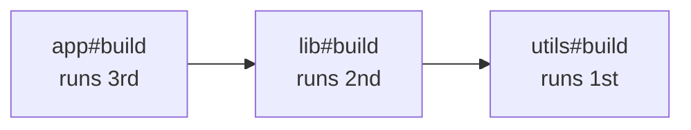
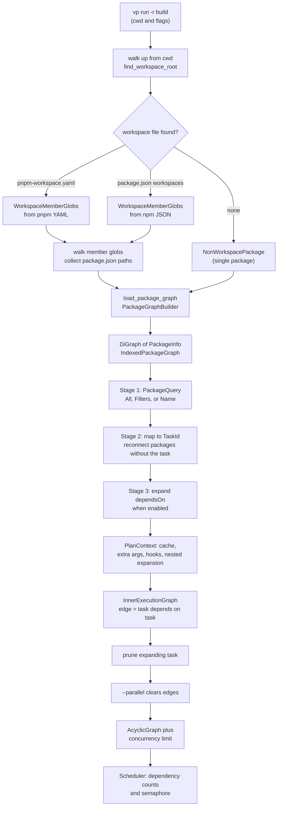

# 06 Vite Task Scheduler: From Workspace Discovery to an Ordered Run Plan

Vite Task is the task runner in Vite+, the unified web toolchain from VoidZero. The toolchain command is `vp`; `vp run` runs a task. `vpr` is a shorthand for `vp run`. The snapshot also contains a standalone runner binary named `vt`. Vite Task turns a request such as `vp run -r build` into an acyclic execution graph and runs that graph with a concurrency limit. The runner keeps two graphs apart. The first graph is the package graph from the workspace files. The second graph is the task graph from the task declarations and `dependsOn` fields. Selection has three stages. Stage one selects packages. Stage two maps packages to tasks and reconnects package nodes that lack the task. Stage three records each `dependsOn` dependency on its task. The planner turns those records into graph edges. It then removes the task that started a nested expansion when the nested result contains that task. The document calls that removal the prune rule. The planner validates the result at the end. The scheduler starts every task whose dependencies have completed.

The thesis is that the scheduler never guesses the order. The package dependency edges define a partial order. The `dependsOn` fields add more edges. The task mapper removes packages that lack the requested task. Reconnection means that every predecessor of the removed package becomes a predecessor of every successor. Section 3.5 gives the full rule. The scheduler then runs every task whose dependency count is zero. A dependency count is the number of tasks that the task waits for. A semaphore enforces the concurrency limit.

This document spells out each abbreviation at its first use. The terms are: command-line interface (CLI), Application Programming Interface (API), JavaScript Object Notation (JSON), Node-API (NAPI), and Node Package Manager (npm). The other terms are inter-process communication (IPC), pseudo-terminal (PTY), Uniform Resource Locator (URL), and Continuous Integration (CI). The remaining terms are performant npm (pnpm), terminal user interface (TUI), and standard input and standard output (stdio).

| Name | What it holds | Evidence |
|------|---------------|----------|
| Package graph | `PackageInfo` nodes and `DependencyType` edges | `vite-task/crates/vt_workspace/src/lib.rs:198-203`, `vite-task/crates/vt_workspace/src/lib.rs:209` |
| `IndexedPackageGraph` | The package graph plus name-to-index and path-to-index maps | `vite-task/crates/vt_workspace/src/package_graph.rs:133-168` |
| `TaskExecutionGraph` | Selected tasks, each with a dependency set | `vite-task/crates/vt_graph/src/query/mod.rs:46-61` |
| `InnerExecutionGraph` | Execution nodes and edges before the cycle check | `vite-task/crates/vt_plan/src/plan.rs:850-854` |
| `AcyclicGraph` | A directed graph that passed the cycle check | `vite-task/crates/vt_plan/src/execution_graph.rs:64-85` |
| `ExecutionGraph` | An `AcyclicGraph<TaskExecution>` plus a concurrency limit | `vite-task/crates/vt_plan/src/execution_graph.rs:167-179` |
| Graph level | One `ExecutionGraph`; a nested run is another level | `vite-task/crates/vt/src/session/execute/scheduler.rs:85-104` |

All paths in this document are relative to the snapshot root `/Users/darkvoid/GitSources/src.voidzero`. Every source-tree path starts with the repository name, such as `vite-task/crates/vt_plan/src/plan.rs`. This file is document 06 of a series. Document 02 covers the Vite+ toolchain, 07 the cache, 08 the file-system proxy, 09 the client and terminal layers, and 10 the Continuous Integration setup.

The Vite Task source is commit `95d8da2fc1f06cfe8d176b30b608ed540efab066`. The Vite+ files come from revision `794a96acd52e12216b3fe4eb02026637962cd315`. Vite+ pins the Vite Task crates at a different revision, `cb1ea8d214b26a0f3ca2b2ef3b6bc471b18ffacb` (`vite-plus/Cargo.toml:197`, `vite-plus/Cargo.toml:312-321`). Unless a citation starts with `vite-plus/`, a statement below describes the Vite Task snapshot. The Vite+ files can differ. The Vite+ guide links the JSON Schema files at `cb1ea8d` (`vite-plus/docs/guide/run.md:375-376`).

Each source code block starts with a label line, such as `// vite-task/crates/vt_plan/src/plan.rs:783-800`. The label gives the file and the exact line range. The label is not part of the source text. A `#` label marks a non-Rust file. A `//` label marks Rust source. The two Mermaid diagrams in section 5.5 have no label line.

## 1. The task model

### 1.1 A task is a name in a package

A task is a named command in one workspace package. The task identifier has two fields. The first field is the package index. The second field is the task name. The runner uses the same identifier for a task from the configuration file and for a script from `package.json`.

```rust
// vite-task/crates/vt_graph/src/lib.rs:22-39
/// Uniquely identifies a task, by its name and the package where it's defined.
#[derive(Debug, PartialEq, Eq, Hash, Clone, PartialOrd, Ord)]
pub struct TaskId {
    /// The index of the package where the task is defined.
    pub package_index: PackageNodeIndex,

    /// The name of the script or the entry in `vite.config.*`.
    pub task_name: Str,
}

/// Whether a task originates from the `tasks` map or from a package.json script.
#[derive(Debug, Clone, Copy, PartialEq, Eq, Serialize)]
pub enum TaskSource {
    /// Defined in the `tasks` map in the workspace config.
    TaskConfig,
    /// Pure package.json script (not in the tasks map).
    PackageJsonScript,
}
```

A package index is a small integer that identifies a package in the package graph (`vite-task/crates/vt_workspace/src/lib.rs:274-290`). The `TaskSource` value records where the task came from. A `TaskNode` holds the `TaskId`, a display value, the resolved configuration, and the `TaskSource` (`vite-task/crates/vt_graph/src/lib.rs:41-61`). The resolved configuration holds the commands and the runtime options. The loader fills defaults in these options. `dependsOn` stays out of this runtime configuration. The loader turns each `dependsOn` entry into a task graph edge. The options hold the working directory and the cache configuration (`vite-task/crates/vt_graph/src/config/mod.rs:30-46`).

### 1.2 Where a task is declared

A task name can come from two places. The first place is the `run.tasks` map in the package configuration. The second place is a `scripts` entry in `package.json`. A name cannot come from both places. The loader collects the `scripts` object of `package.json` into a mutable map. It then removes each configuration task name from that map. If the removal returns a script, the same name exists in both places. The load then fails with `ScriptConflict` (`vite-task/crates/vt_graph/src/task_loader.rs:180-186`; `vite-task/crates/vt_graph/src/lib.rs:75-79`).

Both places use the same schema. The standalone file stores the map under a top-level `tasks` key. Vite+ stores the same map under its `run` key. Both loaders return a `UserRunConfig`, and its `tasks` field is a map from a name to a `UserTaskDefinition` (`vite-task/crates/vt_graph/src/config/user.rs:453-461`).

An entry in that map is either a task object or a command shorthand. The task object holds a `command` field and a `UserTaskOptions` value (`vite-task/crates/vt_graph/src/config/user.rs:313-343`). The shorthand is one command string or an array of strings (`vite-task/crates/vt_graph/src/config/user.rs:301-311`, `vite-task/crates/vt_graph/src/config/user.rs:334-343`). The code block below shows the options part.

The user-facing schema for one task is `UserTaskOptions`. This is the input schema before the loader resolves it. It holds the working directory, the `dependsOn` entries, and the cache configuration.

```rust
// vite-task/crates/vt_graph/src/config/user.rs:264-286
pub struct UserTaskOptions {
    /// The working directory for the task, relative to the package root (not workspace root).
    #[serde(rename = "cwd")]
    pub cwd_relative_to_package: Option<RelativePathBuf>,

    /// Tasks that must run before this task.
    ///
    /// - A string runs one named task, such as `"build"` in the same package or
    ///   `"package-name#build"` in another package.
    /// - An object runs a task in direct workspace dependency packages selected
    ///   from package.json fields. For example,
    ///   `{ "task": "build", "from": "dependencies" }` runs `build` in each
    ///   direct workspace dependency that defines a `build` task.
    pub depends_on: Option<Arc<[UserDependsOnEntry]>>,

    /// Whether and how to cache the task.
    ///
    /// - Omitted or `true`: caching enabled with default settings (same as `{}`)
    /// - `false`: caching disabled
    /// - Object: caching enabled with the given settings
    #[serde(rename = "cache")]
    pub cache_config: Option<UserCacheConfig>,
}
```

A task definition is either an object or a command shorthand. The command shorthand is a single string or an array of strings (`vite-task/crates/vt_graph/src/config/user.rs:301-357`). The object form also accepts cache fields at the top level. These fields are no longer supported. Loading the task graph fails with a migration message when a task sets them (`vite-task/crates/vt_graph/src/config/user/top_level_cache_fields.rs:1-4`, `vite-task/crates/vt_graph/src/task_loader.rs:243`).

Two settings belong only to the workspace root configuration. The global `cache` block is the workspace-root setting for caching. It is different from the per-task `cache` option. A non-root package that sets the global `cache` block or `enablePrePostScripts` makes the load fail (`vite-task/crates/vt_graph/src/task_loader.rs:151-167`). `enablePrePostScripts` enables the automatic `pre<name>` and `post<name>` scripts for a package.json script (`vite-task/crates/vt_graph/src/config/user.rs:463-471`). It defaults to true (`vite-task/crates/vt_graph/src/task_loader.rs:41-46`). The root loader stores the `enablePrePostScripts` value in `RootSettings` (`vite-task/crates/vt_graph/src/task_loader.rs:153-155`). `IndexedTaskGraph` copies that value into a field and exposes a getter (`vite-task/crates/vt_graph/src/lib.rs:151-152`, `vite-task/crates/vt_graph/src/lib.rs:263-264`). The planner calls that getter before it looks up either hook (`vite-task/crates/vt_plan/src/plan.rs:109-115`). A false value skips both hooks. The source does not state why these settings are root-only. The source only enforces the rule.

The runner does not read `vite.config.ts` itself. It defines the schema and calls a loader trait. The trait returns an optional `UserRunConfig` for one package directory.

```rust
// vite-task/crates/vt_graph/src/loader.rs:7-14
/// Loader trait for loading user configuration files (vite-task.json).
#[async_trait::async_trait(?Send)]
pub trait UserConfigLoader: Debug + Send + Sync {
    async fn load_user_config_file(
        &self,
        package_path: &AbsolutePath,
    ) -> anyhow::Result<Option<UserRunConfig>>;
}
```

The two loaders read different files. The standalone `vt` binary reads `vite-task.json` (`vite-task/crates/vt_bin/src/lib.rs:112-140`). Vite+ reads the `run` block of `vite.config.ts` (`vite-plus/docs/guide/run.md:91-124`; `vite-plus/packages/cli/binding/src/cli/handler.rs:144-199`). The standalone loader reads the whole file into a `UserRunConfig` (`vite-task/crates/vt_bin/src/lib.rs:120-139`). The Vite+ loader reads the extracted `run` value into the same type (`vite-plus/packages/cli/binding/src/cli/handler.rs:167-176`, `vite-plus/packages/cli/binding/src/cli/handler.rs:203-207`). The trait hides the difference from the graph code. Section 8 covers the Vite+ integration.

The user guide states the same rule from the outside. A task name can come from `vite.config.ts` or `package.json`, but not both (`vite-plus/docs/guide/run.md:118`). Tasks from the configuration file are cached by default. Scripts are not (`vite-plus/docs/guide/run.md:120-122`). The cache rules are the subject of document 07.

### 1.3 Commands become execution items

A task command is not always one process. A command array runs its strings in order. Each string is parsed on its own, and each string may contain `&&`. The planning code parses each string as a list joined by `&&` (`vite-task/crates/vt_plan/src/plan.rs:133-138`). Each parsed command is a candidate execution item. The planner also handles two special cases before it spawns a process.

The first special case is the `cd` built-in. The planner reads a `cd` command while it builds execution items. The command changes the working directory of the following items in the same task and creates neither a process nor an execution item (`vite-task/crates/vt_plan/src/plan.rs:161-179`). The second special case is an in-process built-in such as `echo`. It becomes an `InProcess` item that runs inside the runner process and creates no child process (`vite-task/crates/vt_plan/src/plan.rs:195-206`).

The parser accepts only simple commands joined by `&&` (`vite-task/crates/vt_shell/src/lib.rs:163-183`). A timed command is a command with `time`. A suffix item is a trailing part of a command. The parse stops at a pipeline, a redirection, a timed command, a background command, or a suffix item that is not a plain word (`vite-task/crates/vt_shell/src/lib.rs:118-155`). A redirection such as `> out.txt` is one example. A quoted word loses its quotes when the parser builds the argument list (`vite-task/crates/vt_shell/src/lib.rs:147-156`). If a `&&` string fails to parse, that whole string goes to the platform shell as one process (`vite-task/crates/vt_plan/src/plan.rs:348-414`). The platform shell is `/bin/sh` on Unix or `cmd.exe` on Windows (`vite-task/crates/vt_plan/src/plan.rs:350-363`). Other strings in the array still parse on their own. `echo` is the only in-process built-in (`vite-task/crates/vt_plan/src/in_process.rs:63-104`).

The planner also expands the `pre<name>` and `post<name>` scripts of a `package.json` script. Hooks expand one level deep only: a hook is planned with `with_hooks = false`, so its own hooks are not added (`vite-task/crates/vt_plan/src/plan.rs:105-107`, `vite-task/crates/vt_plan/src/plan.rs:109-123`). The source comment says this matches npm behaviour (`vite-task/crates/vt_plan/src/plan.rs:84-86`). The execution item order is the `pre<name>` hook first, then each command in array order, then the `post<name>` hook. Inside one command, the planner splits `&&` and handles `cd` and in-process built-ins (`vite-task/crates/vt_plan/src/plan.rs:105-206`).

## 2. Workspace discovery

### 2.1 Find the workspace root

The session, the object that owns workspace discovery and the task graph, starts from the current working directory and walks up the directory tree. At each level it looks for the pnpm package manager's `pnpm-workspace.yaml` file first (`vite-task/crates/vt_workspace/src/package_manager.rs:144-163`).

```rust
// vite-task/crates/vt_workspace/src/package_manager.rs:144-163
    loop {
        // Check for pnpm-workspace.yaml for pnpm workspace
        let pnpm_workspace_path: Arc<AbsolutePath> = cwd.join("pnpm-workspace.yaml").into();
        let pnpm_workspace = FileWithPath::open_if_exists(pnpm_workspace_path)?;
        let is_pnpm_workspace = pnpm_workspace.is_some();
        if let Some(file_with_path) = pnpm_workspace
            && includes_package(cwd, nearest_package, || {
                WorkspaceMemberGlobs::from_pnpm_workspace_yaml(&file_with_path)
            })?
        {
            let relative_cwd =
                original_cwd.strip_prefix(cwd)?.expect("cwd must be within the pnpm workspace");
            return Ok((
                WorkspaceRoot {
                    path: Arc::from(cwd),
                    workspace_file: WorkspaceFile::PnpmWorkspaceYaml(file_with_path),
                },
                relative_cwd,
            ));
        }
```

The walk records the nearest package directory. `find_package_root` walks up to the nearest `package.json` (`vite-task/crates/vt_workspace/src/package_manager.rs:73-94`). If no pnpm workspace applies, the code checks the `workspaces` field of the `package.json` at the current walk level (`vite-task/crates/vt_workspace/src/package_manager.rs:165-193`). When a pnpm file exists at a directory, the code skips the npm field at that directory (`vite-task/crates/vt_workspace/src/package_manager.rs:176-177`). The comment gives the reason: pnpm defines membership, even when pnpm's globs exclude the current package (`vite-task/crates/vt_workspace/src/package_manager.rs:175`). The pnpm branch itself still requires its globs to include the nearest package (`vite-task/crates/vt_workspace/src/package_manager.rs:152-157`).

If the pnpm globs exclude the nearest package, this branch does not match. The code still suppresses the npm field at that directory, because the pnpm file defines the directory as a pnpm workspace (`vite-task/crates/vt_workspace/src/package_manager.rs:146-177`). The walk then moves to the parent directory (`vite-task/crates/vt_workspace/src/package_manager.rs:197-199`). If no ancestor workspace qualifies, the code returns the nearest package as a non-workspace package (`vite-task/crates/vt_workspace/src/package_manager.rs:200-207`).

A workspace counts only if its member globs include the nearest package (`vite-task/crates/vt_workspace/src/package_manager.rs:124-128`, `vite-task/crates/vt_workspace/src/package_manager.rs:215-228`). The package must be at or below the workspace root. The root directory itself also qualifies. For example, the directory `/repo/apps/web` has the nearest package `apps/web`. A member glob `apps/*` includes it. The subdirectory `/repo/apps/web/src` has the same nearest package, because the search walks up. `find_package_root` supplies the nearest package, if one exists. When the walk found no `package.json` below the workspace root, `includes_package` returns true (`vite-task/crates/vt_workspace/src/package_manager.rs:212-222`). The current directory is then the workspace root itself, so the root package is the package for the query. For example, a root with `pnpm-workspace.yaml` but no `package.json` has no nearer package. The root package is then the target of discovery. If the walk reaches the file-system root, the code falls back to the nearest package as a non-workspace package (`vite-task/crates/vt_workspace/src/package_manager.rs:198-208`). The source has a TODO for other package managers (`vite-task/crates/vt_workspace/src/package_manager.rs:195`).

The workspace file is wrapped in `FileWithPath`. That type reads the file into memory and closes the operating-system handle immediately (`vite-task/crates/vt_workspace/src/package_manager.rs:7-14`). The comment gives the reason. On Windows, an open handle can block pnpm's atomic rename of `pnpm-workspace.yaml` (`vite-task/crates/vt_workspace/src/package_manager.rs:12-14`).

### 2.2 Turn member globs into package directories

`WorkspaceMemberGlobs` converts each member pattern into a glob for a `package.json` file. It first strips any leading `!` characters and counts them (`vite-task/crates/vt_workspace/src/lib.rs:112-124`).

```rust
// vite-task/crates/vt_workspace/src/lib.rs:112-138
    fn package_json_patterns(&self) -> impl Iterator<Item = (Str, bool)> + '_ {
        self.workspaces.iter().map(|pattern| {
            // Ported from npm's workspace pattern normalization:
            // https://github.com/npm/map-workspaces/blob/76ea3c852171790e245052e006329de15b09e60e/lib/index.js#L17
            let exclusion_count = pattern.bytes().take_while(|byte| *byte == b'!').count();
            let path = &pattern[exclusion_count..];
            let path_without_optional_dot = path.strip_prefix('.').unwrap_or(path);
            let path = if path_without_optional_dot.starts_with('/') {
                path_without_optional_dot.trim_start_matches('/')
            } else {
                path
            };
            let is_negated = exclusion_count % 2 == 1;

            let mut pattern = Str::with_capacity(pattern.len() + "/package.json".len());
            if is_negated {
                pattern.push('!');
            }
            pattern.push_str(path);
            pattern.push_str(if path.is_empty() || path.ends_with('/') {
                "package.json"
            } else {
                "/package.json"
            });
            (pattern, is_negated)
        })
    }
```

The normalization follows the npm rule. A leading dot is optional. A leading slash is optional. An odd number of `!` characters makes the pattern an exclusion. An even count keeps it as an inclusion (`vite-task/crates/vt_workspace/src/lib.rs:114-124`). For example, `packages/*` becomes `packages/*/package.json`, and `!packages/old` becomes `!packages/old/package.json` (`vite-task/crates/vt_workspace/src/lib.rs:126-136`).

The walk has two safeguards. It never enters a `node_modules` directory (`vite-task/crates/vt_workspace/src/lib.rs:172-174`). It applies all patterns through a `PathGlobSet` when any exclusion exists (`vite-task/crates/vt_workspace/src/lib.rs:168-188`). That set uses last-match-wins when an exclusion is present. For example, with `packages/*/package.json` and `!packages/old/package.json`, a path under `packages/old` matches the exclusion last and is removed (`vite-task/crates/vt_glob/src/path.rs:22-86`). The result is a list of absolute `package.json` paths, sorted by path (`vite-task/crates/vt_workspace/src/lib.rs:192-194`).

The `PathGlobSet` exists only when at least one pattern is negated (`vite-task/crates/vt_workspace/src/lib.rs:157-168`). Without a negated pattern, no pattern can remove an earlier match. The code walks once for each inclusion pattern and unions the paths in a set (`vite-task/crates/vt_workspace/src/lib.rs:170-189`). The union set removes duplicate paths. With a negated pattern, the walk still visits each inclusion pattern. Every visited path must then pass the `PathGlobSet`, which applies last-match-wins (`vite-task/crates/vt_glob/src/path.rs:73-84`).

The snapshot has two glob modules inside one crate boundary. `vt_glob::env` matches environment variable names without path rules. `vt_glob::path` matches file paths with the `wax` glob library, which applies path-component rules (`vite-task/crates/vt_glob/src/lib.rs:1-12`). The workspace code uses the path variant.

The environment module uses `globset` with separator handling disabled, so `*` matches any character (`vite-task/crates/vt_glob/src/env.rs:1-31`). It splits patterns into an include set and an exclude set (`vite-task/crates/vt_glob/src/env.rs:55-68`). The path module uses `wax` with path-component rules and calls its `!` handling gitignore negation (`vite-task/crates/vt_glob/src/path.rs:1-4`). In this module, a `!` pattern excludes a path by setting the match result to false. The last matching pattern decides. This is the reverse of the usual gitignore convention, where `!` re-includes a path (`vite-task/crates/vt_glob/src/path.rs:38-50`). The environment module is not used for package paths. The workspace code uses only the path module. The environment module ignores letter case on Windows (`vite-task/crates/vt_glob/src/env.rs:28-30`). The path module sets no case option (`vite-task/crates/vt_glob/src/path.rs:31-50`).

### 2.3 Build the package graph

`load_package_graph` reads every discovered `package.json` and adds it to a builder (`vite-task/crates/vt_workspace/src/lib.rs:314-362`). A non-workspace package is added as one root node in the package graph (`vite-task/crates/vt_workspace/src/lib.rs:326-342`). A workspace always gets a root package, even when the member globs exclude the root directory. The builder sets `has_root_package` when the discovered package path is empty. The function first adds each discovered member package. The excerpt below runs after that loop, so `graph_builder` already holds the member packages.

```rust
// vite-task/crates/vt_workspace/src/lib.rs:363-386
    // Always add the root package if member globs do not include it.
    if !has_root_package {
        let package_json_path = workspace_root.path.join("package.json");
        let package_json = match fs::read(&package_json_path) {
            Ok(content) => {
                let package_json_path: Arc<AbsolutePath> = package_json_path.into();
                serde_json::from_slice(strip_bom(&content)).map_err(|e| Error::SerdeJson {
                    file_path: package_json_path,
                    serde_json_error: e,
                })?
            }
            Err(err) if err.kind() == io::ErrorKind::NotFound => {
                // No package.json at root - use empty default
                PackageJson::default()
            }
            Err(err) => return Err(err.into()),
        };
        graph_builder.add_package(
            RelativePathBuf::default(),
            Arc::clone(&workspace_root.path),
            package_json,
        );
    }
    graph_builder.build()
```

The graph node is `PackageInfo`. It holds the parsed `package.json`, the path relative to the workspace root, and the absolute path (`vite-task/crates/vt_workspace/src/lib.rs:198-203`). The graph edge weight is a `DependencyType`: normal, development, or peer (`vite-task/crates/vt_workspace/src/package.rs:5-11`).

The builder derives edges from the `workspace:` protocol only. A dependency with a value such as `workspace:*` names another package in the same workspace (`vite-task/crates/vt_workspace/src/package.rs:46-70`). `get_workspace_dependencies` keeps a dependency when its value starts with `workspace:`. The code has TODOs for `link-workspace-packages` and for path dependencies (`vite-task/crates/vt_workspace/src/package.rs:57-60`). `link-workspace-packages` is a pnpm option that controls links to workspace packages. A path dependency names a local directory, such as `file:../lib`. The TODO sits on the branch that discards a dependency without the `workspace:` prefix (`vite-task/crates/vt_workspace/src/package.rs:55-59`). The Vite Task code does not define either term or state how the edges would change.

The builder keeps a map from each package name to its relative paths (`vite-task/crates/vt_workspace/src/lib.rs:228-239`). For each dependency, it looks up the dependency name in that map. The code uses the first path only to find a candidate package index (`vite-task/crates/vt_workspace/src/lib.rs:241-271`). It then checks the full path list. If the name has two or more paths, the build fails with `DuplicatedPackageName`, so no edge is added (`vite-task/crates/vt_workspace/src/lib.rs:254-260`). Three rules apply. A duplicated dependency name is an error (`vite-task/crates/vt_workspace/src/lib.rs:254-260`). A self-edge is skipped (`vite-task/crates/vt_workspace/src/lib.rs:261-265`). A dependency that names no workspace package is skipped silently, because it can be an external package (`vite-task/crates/vt_workspace/src/lib.rs:267`).

The result is a directed graph from the `petgraph` graph library, with a custom index type (`vite-task/crates/vt_workspace/src/lib.rs:274-293`). `IndexedPackageGraph` adds two maps: package name to index list, and absolute path to index (`vite-task/crates/vt_workspace/src/package_graph.rs:133-168`). The name map stores a list because a malformed workspace can contain two packages with one name.

The duplicate-name error and the name list serve different cases. The error fires only when a dependency name resolves to two or more paths (`vite-task/crates/vt_workspace/src/lib.rs:250-260`). The index always stores a list, because a workspace can hold two packages with one name when no dependency uses that name (`vite-task/crates/vt_workspace/src/package_graph.rs:138-165`). An exact-name selector reports an ambiguity when it matches more than one package (`vite-task/crates/vt_workspace/src/package_graph.rs:352-386`).

This edge rule limits the object form of `dependsOn`. A `from` selector can select only packages that have a package edge. A `devDependency` without `workspace:` has no edge in this snapshot (`vite-task/crates/vt_workspace/src/package.rs:46-70`).

## 3. Selection

### 3.1 The CLI flags

The `run` command has a nested `PackageQueryArgs` structure (`vite-task/crates/vt/src/cli/mod.rs:49-56`). The flags define four selection modes and one error-control flag.

| Flag | Meaning | Evidence |
|------|---------|----------|
| `-r`, `--recursive` | All packages | `vite-task/crates/vt_workspace/src/package_filter.rs:252-254` |
| `-t`, `--transitive` | The current package plus its transitive dependencies | `vite-task/crates/vt_workspace/src/package_filter.rs:256-258` |
| `-w`, `--workspace-root` | The workspace root package | `vite-task/crates/vt_workspace/src/package_filter.rs:260-262` |
| `-F`, `--filter` | One or more name, directory, or glob filters | `vite-task/crates/vt_workspace/src/package_filter.rs:264-280` |
| `--fail-if-no-match` | Turn an unmatched filter warning into an error | `vite-task/crates/vt_workspace/src/package_filter.rs:282-288` |

The combinations have explicit errors. `--recursive` cannot combine with `--transitive` or `--filter` (`vite-task/crates/vt_workspace/src/package_filter.rs:337-344`). The task specifier is defined in section 3.2. A package name in the specifier is itself a package selector. It selects only that package. It cannot combine with `--recursive`, `--filter`, or `--workspace-root` (`vite-task/crates/vt_workspace/src/package_filter.rs:347-354`). It can combine with `--transitive`. The query then starts at that package and adds its transitive dependencies (`vite-task/crates/vt_workspace/src/package_filter.rs:394-415`). The source defines these errors in `PackageQueryError` (`vite-task/crates/vt_workspace/src/package_filter.rs:219-243`).

With no selection flag and no package name, the query selects the package that contains the current directory. The code marks this case as `is_cwd_only = true` (`vite-task/crates/vt_workspace/src/package_filter.rs:430-439`).

`is_cwd_only` is a boolean. It is true when the request has no selection flag and no package name (`vite-task/crates/vt_workspace/src/package_filter.rs:291-299`, `vite-task/crates/vt_workspace/src/package_filter.rs:430-439`). Its one effect is the selector fallback for an empty plan, described in section 8.2. The session opens the selector when four conditions hold. The plan is empty. The request has neither `--concurrency-limit` nor `--parallel`. `is_cwd_only` is true. The request is not a dry-run JSON request (`vite-task/crates/vt/src/session/mod.rs:452-470`).

### 3.2 Parse the task specifier

The positional argument is a task specifier. It is either `taskName` or `packageName#taskName`. The parser uses the last `#` in the string (`vite-task/crates/vt_graph/src/specifier.rs:27-33`). A scoped name such as `@scope/app` therefore stays whole. For example, `@scope/app#build` gives package `@scope/app` and task `build`. The source does not state what happens when a task name contains `#`.

```rust
// vite-task/crates/vt_graph/src/specifier.rs:27-33
    pub fn parse_raw(raw_specifier: &str) -> Self {
        if let Some((package_name, task_name)) = raw_specifier.rsplit_once('#') {
            Self { package_name: Some(Str::from(package_name)), task_name: Str::from(task_name) }
        } else {
            Self { package_name: None, task_name: Str::from(raw_specifier) }
        }
    }
```

The `run` command builds a `QueryPlanRequest` from the specifier and the flags (`vite-task/crates/vt/src/cli/mod.rs:349-384`). A `QueryPlanRequest` carries the task query and the planning options (`vite-task/crates/vt_plan/src/plan_request.rs:69-78`).

```rust
// vite-task/crates/vt/src/cli/mod.rs:353-364
        let raw_specifier = self.task_specifier.ok_or(CLITaskQueryError::MissingTaskSpecifier)?;
        let task_specifier = TaskSpecifier::parse_raw(&raw_specifier);

        let cache_override = self.flags.cache_override();
        let include_explicit_deps = !self.flags.ignore_depends_on;
        let concurrency_limit = self.flags.concurrency_limit.map(|n| n.max(1));
        let parallel = self.flags.parallel;
        // Read before `into_package_query` consumes the args.
        let fail_if_no_match = self.flags.package_query.fail_if_no_match;

        let (package_query, is_cwd_only) =
            self.flags.package_query.into_package_query(task_specifier.package_name, cwd)?;
```

The command builder clamps the concurrency limit to at least one (`vite-task/crates/vt/src/cli/mod.rs:358`). The `--ignore-depends-on` flag sets `include_explicit_deps` to false (`vite-task/crates/vt/src/cli/mod.rs:57-58`, `vite-task/crates/vt/src/cli/mod.rs:357`).

### 3.3 Parse a `--filter` expression

The `--filter` syntax follows pnpm. A seed is a package that the core selector matches directly, before any traversal (`vite-task/crates/vt_workspace/src/package_graph.rs:298-343`). The parser strips a leading `!` for an exclusion filter. It then strips a trailing `...` for dependencies and a leading `...` for dependents. A `^` next to the ellipsis excludes the seed packages. The traversal starts from the packages that the core selector matched. This document calls that group the seed set (`vite-task/crates/vt_workspace/src/package_filter.rs:462-495`).

```rust
// vite-task/crates/vt_workspace/src/package_filter.rs:466-489
    // Step 1: strip leading `!` → exclusion filter.
    let (exclude, rest) =
        input.strip_prefix('!').map_or((false, input), |without_bang| (true, without_bang));

    // Step 2: strip trailing `...` → transitive dependencies.
    // Check for `^` immediately before `...` → exclude the seed packages themselves.
    let (include_dependencies, deps_exclude_self, rest) =
        rest.strip_suffix("...").map_or((false, false, rest), |before_dots| {
            before_dots
                .strip_suffix('^')
                .map_or((true, false, before_dots), |before_caret| (true, true, before_caret))
        });

    // Step 3: strip leading `...` → transitive dependents.
    // Check for `^` immediately after `...` → exclude the seed packages themselves.
    let (include_dependents, dependents_exclude_self, core) =
        rest.strip_prefix("...").map_or((false, false, rest), |after_dots| {
            after_dots
                .strip_prefix('^')
                .map_or((true, false, after_dots), |after_caret| (true, true, after_caret))
        });

    // exclude_self is true if either direction had `^`.
    let exclude_self = deps_exclude_self || dependents_exclude_self;
```

The remaining text is the core selector. It can name a package or a directory. Braces mark the directory form. The braces are necessary for a traversal suffix. pnpm ignores `...` after an unbraced path that starts with `.`, because the suffix is ambiguous with `..` (`vite-task/crates/vt_workspace/src/package_filter.rs:506-509`, `vite-task/crates/vt_workspace/src/package_filter.rs:527-528`). For example, `./foo...` selects `./foo` only. It applies no traversal and does not fail. The parser returns `supports_traversal = false` for that form (`vite-task/crates/vt_workspace/src/package_filter.rs:558-564`). The caller reads this flag and applies no dependency or dependent traversal. `{./foo}...` selects `./foo` and applies traversal. An unbraced `.` or `./foo` path selects a directory but does not allow the suffix (`vite-task/crates/vt_workspace/src/package_filter.rs:525-563`). `foo{./bar}` combines a name pattern `foo` with a directory `./bar`. It matches packages with a name that matches `foo` and a path under `./bar` (`vite-task/crates/vt_workspace/src/package_filter.rs:546-553`). The source comment says the implementation follows pnpm's `parsePackageSelector` algorithm (`vite-task/crates/vt_workspace/src/package_filter.rs:457-461`).

The traversal itself is a breadth-first search over the package graph. The `Dependencies` direction follows outgoing edges. The `Dependents` direction follows incoming edges. `Both` is selected when the selector has both a leading and a trailing ellipsis (`vite-task/crates/vt_workspace/src/package_filter.rs:494-501`). It first walks dependents. It then walks dependencies from two starting sets: the seeds and the dependents it found (`vite-task/crates/vt_workspace/src/package_graph.rs:471-481`). The result is the union of four groups. The groups are the seeds, their transitive dependencies, their transitive dependents, and the dependencies of those dependents. The arrow means "depends on". For example, let `A → B` and `B → C`. `A` depends on `B`, and `B` depends on `C`. A seed `B` with `Both` returns `A`, `B`, and `C`. Both walks are breadth-first searches (`vite-task/crates/vt_workspace/src/package_graph.rs:498-531`). The seed set is removed at the end when `exclude_self` is true (`vite-task/crates/vt_workspace/src/package_graph.rs:484-490`).

Multiple filters are resolved in two passes. Inclusions are unioned into the selected set. Exclusions are then subtracted (`vite-task/crates/vt_workspace/src/package_graph.rs:254-296`). If every filter is an exclusion, the starting set is all packages (`vite-task/crates/vt_workspace/src/package_graph.rs:262-267`). The final result is the subgraph induced by the selected packages. It keeps every selected package and every package edge between two selected packages. An edge to an unselected package is dropped (`vite-task/crates/vt_workspace/src/package_graph.rs:294`, `vite-task/crates/vt_workspace/src/package_graph.rs:537-553`).

Name and directory selectors use different data. An exact name is a hash lookup in the name map (`vite-task/crates/vt_workspace/src/package_graph.rs:357-390`). A name glob matches the package name only (`vite-task/crates/vt_workspace/src/package_graph.rs:393-399`). An exact directory is a hash lookup in the absolute path map (`vite-task/crates/vt_workspace/src/package_graph.rs:429-433`). A directory glob matches the path relative to a base. The base is the literal path prefix that `wax::Glob::partition` returns (`vite-task/crates/vt_workspace/src/package_filter.rs:580-595`). The code resolves that prefix from the current working directory. When the prefix is empty, the base is the current working directory. The matcher strips the base from each package path and matches the rest (`vite-task/crates/vt_workspace/src/package_graph.rs:435-444`). For example, `--filter './packages/*'` has base `<cwd>/packages` and matches the rest, such as `app`. A `NameAndDirectory` selector intersects the name and directory sets (`vite-task/crates/vt_workspace/src/package_graph.rs:322-329`).

The `--filter` grammar is visible in the CLI help text. It lists name patterns, directory forms, dependency and dependent suffixes, the `^` exclusion form, and the `!` exclusion form (`vite-task/crates/vt_workspace/src/package_filter.rs:269-278`). The Vite+ guide shows the same forms (`vite-plus/docs/guide/run.md:201-227`).

### 3.4 Resolve packages to tasks

Stage one resolves the package query to a subgraph (`vite-task/crates/vt_graph/src/query/mod.rs:152-154`). Stage two maps each package to the requested task. Stage three expands `dependsOn` edges.

```rust
// vite-task/crates/vt_graph/src/query/mod.rs:146-174
    pub async fn query_tasks(
        &self,
        query: &TaskQuery,
    ) -> Result<TaskQueryResult<'_>, TaskQueryError> {
        let mut execution_graph = TaskExecutionGraph::default();

        // Stage 1: resolve package selection.
        let resolution = self.package_graph().resolve_query(&query.package_query)?;
        let selected_package_count = resolution.package_subgraph.node_count();

        // Stage 2: map each selected package to its task node (with reconnection).
        self.map_subgraph_to_tasks(
            &resolution.package_subgraph,
            &query.task_name,
            &mut execution_graph,
        )
        .await?;

        // Expand explicit dependsOn edges (may add new task nodes from outside the subgraph).
        if query.include_explicit_deps {
            self.add_dependencies(&mut execution_graph).await?;
        }

        Ok(TaskQueryResult {
            execution_graph,
            unmatched_selectors: resolution.unmatched_selectors,
            selected_package_count,
        })
    }
```

The result keeps three facts. It keeps the task graph, the unmatched filter strings, and the number of selected packages (`vite-task/crates/vt_graph/src/query/mod.rs:169-173`). The planner records whether the package count is zero (`vite-task/crates/vt_plan/src/lib.rs:177-189`). The session uses that flag to choose among three outcomes: a silent success, the selector, or `NoTasksMatched` (`vite-task/crates/vt/src/session/mod.rs:450-469`). Section 8.2 gives the order of precedence.

### 3.5 Reconnection is the key rule

A selected package might not define the requested task. `pkg_to_task` maps each package index to its task node (`vite-task/crates/vt_graph/src/query/mod.rs:195-201`). The mapper does not stop at a package without the task. It copies the package subgraph into a local mutable graph. The code calls this copy `subgraph`. The mapper iterates the node list of the original package graph. It reads each node's predecessors and successors from the copy, not from the graph that it is changing (`vite-task/crates/vt_graph/src/query/mod.rs:180-184`, `vite-task/crates/vt_graph/src/query/mod.rs:204-205`). The copy makes a new edge visible to every later node in the same pass. A chain of task-lacking packages therefore resolves in one pass (`vite-task/crates/vt_graph/src/query/mod.rs:207-222`). The mapper connects every predecessor directly to every successor and removes the package node.

```rust
// vite-task/crates/vt_graph/src/query/mod.rs:207-222
        // Reconnect and remove each task-lacking node.
        for pkg in package_subgraph.nodes() {
            if pkg_to_task.contains_key(&pkg) {
                continue; // this package has the task — leave it in
            }
            // Read pred/succ from the live (possibly already-modified) subgraph.
            let preds: Vec<_> = subgraph.neighbors_directed(pkg, Direction::Incoming).collect();
            let succs: Vec<_> = subgraph.neighbors_directed(pkg, Direction::Outgoing).collect();
            // Bridge: every predecessor connects directly to every successor.
            for &pred in &preds {
                for &succ in &succs {
                    subgraph.add_edge(pred, succ, ());
                }
            }
            subgraph.remove_node(pkg);
        }
```

**Aha:** A package without the task becomes a wire, not a wall. In `app → lib → utils`, `lib` may have no `build` task while `app` and `utils` do. The mapper then removes `lib` and adds `app → utils` to the package subgraph (`vite-task/crates/vt_graph/src/query/mod.rs:207-222`). The run still respects the package dependency order. A naive implementation that dropped the edge at `lib` would run `app` and `utils` in any order.

The reconnection runs on the copied `subgraph`. The mapper then reads the copy's edges and turns each remaining package edge into a task edge (`vite-task/crates/vt_graph/src/query/mod.rs:235-243`). For the edge `app → utils`, it adds the dependency `app#build → utils#build`.

All tasks added in stage two are marked as explicitly requested (`vite-task/crates/vt_graph/src/query/mod.rs:228-233`). Stage three adds dependency-only tasks with `requested: false` (`vite-task/crates/vt_graph/src/query/mod.rs:251-290`). Stage three uses a worklist called the frontier. The frontier starts with every task in the `TaskExecutionGraph`. Each iteration reads the current frontier and builds the next frontier. A task enters the next frontier only when it is not already in the task graph. The loop stops when the frontier is empty (`vite-task/crates/vt_graph/src/query/mod.rs:251-290`). The repeated iterations add a transitive `dependsOn` chain, not only the direct edges.
The planner gives extra CLI arguments only to requested tasks (`vite-task/crates/vt_plan/src/plan.rs:804-812`). Under `-r build`, every package that defines `build` is a stage-two task. All of them are requested. For example, `vp run -r build extra_arg` passes `extra_arg` to each of those `build` tasks. A dependency-only task that arrives through `dependsOn` receives an empty argument list (`vite-task/crates/vt_plan/src/plan.rs:806-812`).

### 3.6 The interactive selector

A bare `vp run` has no task name. It does not build a plan. The session shows the selector instead. A task query can also reach the selector after an empty plan. Section 8.2 gives that path. The selector is the `vt_select` crate.

`vt_select` takes a list of `SelectItem` values. Each item has a searchable label, a display name, a description, and an optional group (`vite-task/crates/vt_select/src/lib.rs:11-21`). The selector has two modes. The interactive mode runs a terminal interface with fuzzy search and keyboard navigation. The non-interactive mode prints the list once (`vite-task/crates/vt_select/src/lib.rs:23-32`, `vite-task/crates/vt_select/src/lib.rs:79-100`). The session uses the interactive mode only when both standard input and standard output are terminals. Otherwise it prints the list once (`vite-task/crates/vt/src/session/mod.rs:428`). The non-interactive mode ignores `page_size` (`vite-task/crates/vt_select/src/lib.rs:72-74`).

The session builds the items from the task list. A task in the current package uses its plain name. A task in another package uses `package#task` (`vite-task/crates/vt/src/session/mod.rs:516-557`). An item for another package also carries a group label with its package name and relative path (`vite-task/crates/vt/src/session/mod.rs:521-549`). The interactive display name is the plain task name for every item, and the non-interactive display name is the full label (`vite-task/crates/vt/src/session/mod.rs:550-554`). The session calls `vt_select::select_list` with the items, the typed query, a header, a prompt, and `page_size: 12` (`vite-task/crates/vt/src/session/mod.rs:584-590`). The value 12 is a literal, not a configuration value (`vite-task/crates/vt/src/session/mod.rs:589`). The page size is the maximum number of visible rows in the interactive list (`vite-task/crates/vt_select/src/lib.rs:51-52`). On a selection, the session builds a `QueryPlanRequest` from the selected task and the package path, not from the display name (`vite-task/crates/vt/src/session/mod.rs:613-647`).

A non-interactive list has two exit rules. A bare run prints the list as a help action and exits with success. An unknown task prints the list as suggestions and exits with failure (`vite-task/crates/vt/src/session/mod.rs:602-611`).

The fuzzy matcher is also used for the "Did you mean:" hint (`vite-task/crates/vt/src/session/mod.rs:561-573`). The matcher is in `vt_select::fuzzy` and is re-exported as `fuzzy_match` (`vite-task/crates/vt_select/src/lib.rs:1-6`). The session shows the hint only when `fuzzy_match` returns at least one match. The source does not state a score threshold (`vite-task/crates/vt/src/session/mod.rs:561-573`).

The selector does not use `vt_casefold`. That crate compares environment variable names, not package or task names. It is not part of package or task selection in this snapshot. On Windows, ASCII letters ignore case. On Unix, the comparison is exact (`vite-task/crates/vt_casefold/src/lib.rs:54-70`). The session uses `vt_casefold` to build its environment map (`vite-task/crates/vt/src/session/mod.rs:23`, `vite-task/crates/vt/src/session/mod.rs:238-242`). The planner reads `VP_RUN_CONCURRENCY_LIMIT` from that environment map (`vite-task/crates/vt_plan/src/plan.rs:943-956`). So `vt_casefold` affects the environment lookup, not the choice of package or task.

## 4. The task graph and its edges

### 4.1 Edges from `dependsOn`

Each task node can hold a list of `dependsOn` entries. The loader resolves each entry to a list of task identifiers. A string entry names one task. The loader parses it with `TaskSpecifier` and resolves the package. A bare string such as `build` resolves in the same package as the task that declares it. The code passes the declaring task's package index, `from.id.package_index`, as the default package (`vite-task/crates/vt_graph/src/task_loader.rs:268-270`). If the target task does not exist, the load fails (`vite-task/crates/vt_graph/src/task_loader.rs:259-282`).

```rust
// vite-task/crates/vt_graph/src/task_loader.rs:259-282
            match entry {
                UserDependsOnEntry::Task(specifier) => {
                    let lookup_error = |error| TaskGraphLoadError::DependencySpecifierLookupError {
                        error: Box::new(error),
                        specifier: specifier.clone(),
                        task_display: from.task_display.clone(),
                    };
                    let specifier = TaskSpecifier::parse_raw(specifier);
                    let package_index = self
                        .specifier_package(&specifier, from.id.package_index)
                        .map_err(lookup_error)?;
                    let target = TaskId { package_index, task_name: specifier.task_name };
                    if graph.get(&target).await?.is_none() {
                        return Err(lookup_error(SpecifierLookupError::TaskNameNotFound {
                            package_name: self.package_graph.package_graph()[package_index]
                                .package_json
                                .name
                                .clone(),
                            task_name: target.task_name,
                            package_index,
                        }));
                    }
                    targets.push(target);
                }
```

An object entry has a different rule. It selects the direct package dependencies of the current package and keeps only the edges whose dependency type the entry names. For each selected package, the loader adds the task if that package defines it. A package without the task is ignored (`vite-task/crates/vt_graph/src/task_loader.rs:283-303`). For example, `dependsOn: [{ task: "build", from: "dependencies" }]` adds an edge to `build` in each direct dependency that defines `build`. A direct dependency without `build` adds no edge and no error. The source comment gives the reason. The object form means "run `build` in the direct dependencies that define `build`", not "every selected package must define `build`" (`vite-task/crates/vt_graph/src/task_loader.rs:294-300`).

The `from` field accepts one dependency field or an array. The type is `UserDependsOnFrom`, an untagged enum of `Single` and `Multiple` (`vite-task/crates/vt_graph/src/config/user.rs:88-111`). The conversion maps `dependencies` to normal, `devDependencies` to development, and `peerDependencies` to peer (`vite-task/crates/vt_graph/src/task_loader.rs:330-338`).

### 4.2 Edges from the package graph

The package graph contributes edges after task selection. Stage two first reconnects or removes every package without the task. It then maps every remaining package edge to a task edge (`vite-task/crates/vt_graph/src/query/mod.rs:235-243`). The direction is package dependency to task dependency. If package A depends on package B, the task `A#build` depends on `B#build`.

This is the reason `-r build` runs in dependency order without any `dependsOn` field. The Vite+ task graph request for comments states it directly. `apps/web#build` has no `dependsOn`, and `-r` runs it after `packages/ui#build` because of the package dependency (`vite-task/docs/rfcs/task-graph-json.md:94`). The user guide states the same rule (`vite-plus/docs/guide/run.md:179-189`).

### 4.3 Cycles

The task graph can contain a cycle. A cycle can come from `dependsOn` fields, or from a package graph that a user has made circular. The graph layer does not reject cycles. It loads a package's tasks only when a lookup first asks for them during task selection (`vite-task/crates/vt_graph/src/lib.rs:136-145`, `vite-task/crates/vt_graph/src/lib.rs:166-200`). This lazy load prevents wasted configuration reads. The graph layer does not inspect edges and does not check cycles during the load. The execution planner validates the final graph.

`AcyclicGraph::try_from_graph` runs a depth-first search and returns the full cycle path (`vite-task/crates/vt_plan/src/execution_graph.rs:71-85`). The search records a predecessor for each tree edge. A tree edge reaches a node for the first time. A back edge points to a node that is still on the current search path. A back edge therefore proves a cycle. When the search finds a back edge, it walks the predecessor chain and closes the loop (`vite-task/crates/vt_plan/src/execution_graph.rs:207-233`). The planner turns the node indices into task display names and returns `CycleDependencyDetected` (`vite-task/crates/vt_plan/src/plan.rs:916-938`).

The request for comments has a related rule. The `--json` task graph document does not fail when `dependsOn` entries form a cycle. A run plan fails when the tasks that the plan runs form a cycle (`vite-task/docs/rfcs/task-graph-json.md:209-211`). The source does not state a maximum cycle length or a recovery path. A run plan stops with an error.

### 4.4 Serializing a graph

`vt_graph_ser` serializes a directed graph by node key. The node key comes from the `GetKey` trait (`vite-task/crates/vt_graph_ser/src/lib.rs:9-17`). `TaskExecution` uses the pair of package path and task name as its key (`vite-task/crates/vt_plan/src/lib.rs:89-99`). The serializer sorts nodes by key and neighbours by key, so the output is stable. It ignores edge weights (`vite-task/crates/vt_graph_ser/src/lib.rs:27-72`). The execution graph uses this serializer (`vite-task/crates/vt_plan/src/execution_graph.rs:158-162`). The serialization is used by the run plan reporter and belongs to the cache and reporting documents.

## 5. Planning

### 5.1 The planner entry point

`plan_query` builds a `PlanContext` and calls `plan_query_request` (`vite-task/crates/vt_plan/src/lib.rs:197-221`). The constructor records the workspace path, the working directory, and the environment snapshot. It also records the task graph, the glob resolver, the global cache configuration, and the parent query (`vite-task/crates/vt_plan/src/context.rs:89-111`). The parent query is the `TaskQuery` of the run that contains this plan. A nested run compares its query against it.

The environment map uses an `Arc` with copy-on-write (`vite-task/crates/vt_plan/src/context.rs:37-44`). `Arc` is an atomically reference-counted pointer. Copy-on-write means a shared map is cloned before a change. A duplicate context shares the map until a change occurs (`vite-task/crates/vt_plan/src/context.rs:206-219`). The map is shared with each `ScriptCommand`, so a command reads the same values that the planner used (`vite-task/crates/vt_plan/src/plan.rs:222-237`).

The expanding task is the task whose command started the current nested plan. The prune rule removes that task when it appears in the nested result. `plan_query_request` performs these steps in order:

1. Apply a cache override from `--cache` or `--no-cache` (`vite-task/crates/vt_plan/src/plan.rs:754-770`).
2. Resolve the remote cache mode for this level (`vite-task/crates/vt_plan/src/plan.rs:771-781`). A `--remote-cache` flag sets `VP_REMOTE_CACHE` for this level, so nested levels inherit it (`vite-task/crates/vt_plan/src/plan.rs:771-777`).
3. Resolve the concurrency limit (`vite-task/crates/vt_plan/src/plan.rs:783-800`).
4. Query the task graph (`vite-task/crates/vt_plan/src/plan.rs:815-835`).
5. Apply the prune rule (`vite-task/crates/vt_plan/src/plan.rs:837-842`).
6. Plan each task as an execution node (`vite-task/crates/vt_plan/src/plan.rs:856-872`).
7. Add the dependency edges (`vite-task/crates/vt_plan/src/plan.rs:874-889`).
8. Reconnect through the pruned task (`vite-task/crates/vt_plan/src/plan.rs:891-909`).
9. Clear edges for `--parallel` (`vite-task/crates/vt_plan/src/plan.rs:911-914`).
10. Validate acyclicity and store the concurrency limit (`vite-task/crates/vt_plan/src/plan.rs:916-938`).

Step 7 reads each task's dependency set from `queried_tasks` and adds one inner-graph edge for each dependency (`vite-task/crates/vt_plan/src/plan.rs:874-889`). It skips any edge that touches the pruned task.

Step 1 needs one detail. The global cache configuration has two switches. The `scripts` switch controls caching for `package.json` scripts. The `tasks` switch controls caching for configuration tasks. The override sets both switches relative to the workspace configuration (`vite-task/crates/vt_plan/src/lib.rs:223-240`). The global switch only permits caching. A per-task `false` still disables that task (`vite-task/crates/vt_plan/src/plan.rs:72-82`). For example, the root task `outer` runs `vp run inner`. The user runs `vp run --no-cache outer`. The nested request has no cache flag, so it keeps the disabled value from the parent (`vite-task/crates/vt_plan/src/plan.rs:754-758`). The call `vp run inner` therefore also has caching disabled (`vite-task/crates/vt_plan/src/plan.rs:754-761`).

Step 2 also needs one detail. The mode values are `off`, `read`, and `read-write` (`vite-task/crates/vt_plan/src/remote_cache.rs:19-36`). The mode comes from `--remote-cache` or `VP_REMOTE_CACHE`, and the endpoint comes from `VP_REMOTE_CACHE_URL` or the cache configuration (`vite-task/crates/vt_plan/src/remote_cache.rs:12-13`, `vite-task/crates/vt_plan/src/remote_cache.rs:121-137`). If an endpoint exists and no mode is set, the mode is `read` (`vite-task/crates/vt_plan/src/remote_cache.rs:141-144`). A mode of `read` or `read-write` without an endpoint is an error (`vite-task/crates/vt_plan/src/remote_cache.rs:145-147`).

Steps 5 and 8 need a detailed explanation. They prevent a recursive expansion that the user guide warns about. A task command can itself call `vp run -r build`. During planning, the planner asks the session command handler for a plan request (`vite-task/crates/vt_plan/src/plan.rs:222-237`). If the handler returns a query, the planner expands it into a nested execution graph (`vite-task/crates/vt_plan/src/plan.rs:230-284`).
For example, the root package defines `build` as `vp run -r build`. The user runs `vp run build` from the root. The outer query selects the root package only. The nested `-r build` selects every package, including the root. The nested result therefore contains the outer `build` task. The planner removes that task, which is the expanding task, and connects its predecessors to its successors before it checks for cycles (`vite-task/crates/vt_plan/src/plan.rs:837-909`). The rule applies to any task, not only a root task (`vite-task/crates/vt_plan/src/plan.rs:837-842`). The guide says Vite Task prunes the self-reference automatically (`vite-plus/docs/guide/run.md:312-326`).

The expansion hook skips a nested query that equals the parent query. This document calls that check the skip rule. The skip rule compares only the `TaskQuery`. A `TaskQuery` has three fields: the package query, the task name, and the include-explicit-dependencies flag (`vite-task/crates/vt_plan/src/plan.rs:241-248`). The plan options hold extra arguments and the planning flags. The skip rule ignores the plan options. `vp run -r build extra_arg` still matches `vp run -r build`, because extra arguments live in the plan options (`vite-task/crates/vt_plan/src/plan.rs:241-248`). If an earlier command in the parent task runs `cd packages/a`, the current directory changes. The current directory is part of the package query, so the query differs (`vite-task/crates/vt_plan/src/plan.rs:249-254`).

A nested expansion has two empty-graph cases (`vite-task/crates/vt_plan/src/plan.rs:263-284`). If the filter selected no package, the planner treats the expansion as a no-op (`vite-task/crates/vt_plan/src/plan.rs:268-276`). If packages were selected but none has the task, the planner returns `NoTasksMatched` (`vite-task/crates/vt_plan/src/plan.rs:273-282`).

**Aha:** Cycle detection runs after pruning, not before. The planner builds the inner graph, removes the expanding task, reconnects its neighbours, and only then calls `ExecutionGraph::try_from_graph` (`vite-task/crates/vt_plan/src/plan.rs:837-938`). A root script that calls `vp run -r build` would look circular to a naive cycle check. The prune rule makes it acyclic first. A second guard runs earlier. The expansion hook skips a nested query that is exactly equal to the parent query (`vite-task/crates/vt_plan/src/plan.rs:242-254`).

Step 6 builds a `TaskExecution` for each task. A `TaskExecution` holds the task display and a list of `ExecutionItem` values. The planner tries to split each command string on `&&` (`vite-task/crates/vt_plan/src/plan.rs:133-138`). Each part becomes one candidate item. A `cd` part adds no item. An in-process built-in becomes an item. If the split attempt fails, the whole string becomes one shell item (section 1.3).

The planner can add three groups of item during step 6. The first group is hook items: a `pre<name>` item and a `post<name>` item around the command (`vite-task/crates/vt_plan/src/plan.rs:84-123`, `vite-task/crates/vt_plan/src/plan.rs:418-430`). Hooks expand only one level, because the hook is planned with the hook lookup disabled (`vite-task/crates/vt_plan/src/plan.rs:84-90`, `vite-task/crates/vt_plan/src/plan.rs:109-115`). Extra arguments are not forwarded to hooks (`vite-task/crates/vt_plan/src/plan.rs:116-122`). A `cd` built-in changes the working directory for later commands and creates no execution item (`vite-task/crates/vt_plan/src/plan.rs:161-179`). An `echo` command becomes an in-process execution item (`vite-task/crates/vt_plan/src/plan.rs:195-206`).

### 5.2 Concurrency resolution

A level is one execution graph. The top-level plan is one level. A `vp run` command inside a task creates a nested level. The concurrency limit has one value for each level. A nested graph carries its own limit (`vite-task/crates/vt_plan/src/execution_graph.rs:167-179`). The nested graph runs inside the task item that contains it. `execute_expanded_graph` starts a new scheduler pass for that graph. The pass creates its own semaphore. It finishes before the next item in the task starts (`vite-task/crates/vt/src/session/execute/scheduler.rs:85-110`, `vite-task/crates/vt/src/session/execute/scheduler.rs:205-208`). The resolver applies the documented priority order.

```rust
// vite-task/crates/vt_plan/src/plan.rs:783-800
    // Resolve effective concurrency for this level.
    //
    // Priority (highest to lowest):
    // 1. `--concurrency-limit N` CLI flag
    // 2. `--parallel` (without the above) → unlimited
    // 3. `VP_RUN_CONCURRENCY_LIMIT` env var
    // 4. `DEFAULT_CONCURRENCY_LIMIT` (4)
    let effective_concurrency = match plan_options.concurrency_limit {
        Some(n) => n,
        None => {
            if plan_options.parallel {
                usize::MAX
            } else {
                concurrency_limit_from_env(context.envs())?
                    .unwrap_or(crate::DEFAULT_CONCURRENCY_LIMIT)
            }
        }
    };
```

The default is a constant. `DEFAULT_CONCURRENCY_LIMIT` is four (`vite-task/crates/vt_plan/src/execution_graph.rs:164-165`). The environment parser reads `VP_RUN_CONCURRENCY_LIMIT` and clamps the value to at least one (`vite-task/crates/vt_plan/src/plan.rs:943-956`). The user document states the same order (`vite-task/docs/concurrency.md:52-59`) and the same default (`vite-task/docs/concurrency.md:3`, `vite-task/docs/concurrency.md:14`).

The Vite Task concurrency document gives the reason for the default. Four tasks keep the machine busy and leave room for tasks that already use all cores (`vite-task/docs/concurrency.md:14`). The document also explains why the value is an upper bound and not a target (`vite-task/docs/concurrency.md:16`). The source does not state a measured throughput result.

### 5.3 `--parallel` and the acyclic check

`--parallel` does two things. It sets the effective limit to `usize::MAX` when no explicit limit is present (`vite-task/crates/vt_plan/src/plan.rs:790-799`). It also clears every dependency edge after the planner adds them.

```rust
// vite-task/crates/vt_plan/src/plan.rs:911-920
    // If --parallel, discard all edges so tasks run independently.
    if parallel {
        inner_graph.clear_edges();
    }

    // Validate the graph is acyclic.
    // `try_from_graph` performs a DFS; if a cycle is found, it returns
    // `CycleError` containing the full cycle path as node indices.
    let graph =
        ExecutionGraph::try_from_graph(inner_graph, effective_concurrency).map_err(|cycle| {
```

A user can combine `--parallel` with `--concurrency-limit`. The explicit limit wins over `usize::MAX`, and the edges are still cleared (`vite-task/crates/vt_plan/src/plan.rs:790-799`, `vite-task/crates/vt_plan/src/plan.rs:911-914`). The user document describes the same combination (`vite-task/docs/concurrency.md:40-44`) and the guide shows it (`vite-plus/docs/guide/run.md:407-411`).

### 5.4 Topological order

The plan is acyclic. The graph type is `AcyclicGraph`, and it can compute a topological order. For every edge A to B, A appears before B in the returned list. The edges mean "A depends on B", so dependents come before dependencies. A caller that needs execution order iterates in reverse. `Ix` is the petgraph index type parameter. The execution graph uses `ExecutionIx`, a newtype over the petgraph default index type (`vite-task/crates/vt_plan/src/execution_graph.rs:12-16`, `vite-task/crates/vt_plan/src/execution_graph.rs:30`). `ExecutionGraph::try_from_graph` runs the same check through `AcyclicGraph::try_from_graph` and then stores the concurrency limit (`vite-task/crates/vt_plan/src/execution_graph.rs:188-192`).

```rust
// vite-task/crates/vt_plan/src/execution_graph.rs:107-124
    /// Compute the topological order of node indices.
    ///
    /// For every edge A→B in the graph, A appears before B in the returned vector.
    /// Since our edges mean "A depends on B", dependents come before their
    /// dependencies. Callers that need execution order (dependencies first) should
    /// iterate in reverse.
    ///
    /// This computes the order on each call rather than caching it.
    ///
    /// # Panics
    ///
    /// Panics if the graph contains a cycle, which should be impossible since
    /// acyclicity is validated at construction time.
    #[must_use]
    pub fn compute_topological_order(&self) -> Vec<NodeIndex<Ix>> {
        petgraph::algo::toposort(&self.graph, None)
            .expect("AcyclicGraph: acyclicity validated at construction time")
    }
```

The scheduler does not call this method. In this snapshot, only tests call it (`vite-task/crates/vt_plan/src/execution_graph.rs:273-443`). The scheduler derives the same partial order from dependency counts. Each node starts with its outgoing edge count (`vite-task/crates/vt/src/session/execute/scheduler.rs:112-117`). A count of zero means the node is ready. When a node completes, the scheduler decrements the count of every node that depends on it. It then schedules the nodes that reach zero (`vite-task/crates/vt/src/session/execute/scheduler.rs:138-147`). The source does not state why the scheduler uses counts instead of the precomputed list. The count method is the one that runs (`vite-task/crates/vt/src/session/execute/scheduler.rs:112-147`). The source also does not define a tie-break between two tasks that are ready at the same time. Both ready tasks enter `FuturesUnordered` in the same pass, so both can run at the same time.

### 5.5 A concrete example from the playground

The playground is a real workspace in the repository. It has three packages and a root package. The workspace file includes `packages/*` (`vite-task/playground/pnpm-workspace.yaml:1-2`). The package graph is `@playground/app → @playground/lib → @playground/utils`. The arrow means "depends on" (`vite-task/playground/README.md:5-16`). The edges come from the `workspace:*` dependencies in each `package.json` (`vite-task/playground/packages/app/package.json:8-10`, `vite-task/playground/packages/lib/package.json:8-10`).

All three packages define a `build` task in `vite-task.json`. The app file is the example.

```json
# vite-task/playground/packages/app/vite-task.json:1-16
{
  "tasks": {
    "build": {
      "command": "node build.mjs"
    },
    "test": {
      "command": "node test.mjs"
    },
    "typecheck": {
      "command": "node typecheck.mjs"
    },
    "lint": {
      "command": "node lint.mjs"
    }
  }
}
```

The utils package defines `build`, `test`, and `lint`, but no `typecheck`.

```json
# vite-task/playground/packages/utils/vite-task.json:1-13
{
  "tasks": {
    "build": {
      "command": "node build.mjs"
    },
    "test": {
      "command": "node test.mjs"
    },
    "lint": {
      "command": "node lint.mjs"
    }
  }
}
```

The lib file has the same four tasks as the app file (`vite-task/playground/packages/lib/vite-task.json:1-16`). The root package is named `playground` (`vite-task/playground/package.json:2`). It has no dependencies (`vite-task/playground/package.json:1-4`). It has an empty task configuration (`vite-task/playground/vite-task.json:1`).

Now consider `vp run -r build`. Stage one selects all packages (`vite-task/crates/vt_workspace/src/package_graph.rs:42-57`, `vite-task/crates/vt_workspace/src/package_graph.rs:214-225`). Stage two keeps the three packages that define `build` and removes the root package. The root package has no `build` task, and it is not between two packages, so the reconnection adds no edge. The remaining edges are `app#build → lib#build` and `lib#build → utils#build` (`vite-task/crates/vt_graph/src/query/mod.rs:235-243`).



This diagram is an example built from the playground files and the cited code paths. It is not a diagram from the repository.

The arrow means "depends on". The scheduler counts one dependency for `app#build`, one for `lib#build`, and zero for `utils#build` (`vite-task/crates/vt/src/session/execute/scheduler.rs:112-126`). `utils#build` runs first. Its completion releases `lib#build`. That completion releases `app#build`. The limit of four does not bind in this example, because the graph has only one ready node at each step.

The result changes with `vp run --parallel -r build`. The planner clears both edges (`vite-task/crates/vt_plan/src/plan.rs:911-914`). All three tasks have zero dependencies, and the limit is `usize::MAX` unless the user sets one (`vite-task/crates/vt_plan/src/plan.rs:790-799`). All three tasks can start together.

The result also changes for `vp run @playground/app#build`. The package name `@playground/app` is a package selector. The name map resolves it to one package. Stage one selects only the app package (`vite-task/crates/vt_workspace/src/package_filter.rs:394-415`). Stage two keeps only `app#build`. The build task has no `dependsOn` field in the app configuration (`vite-task/playground/packages/app/vite-task.json:2-5`). So `lib` and `utils` do not run. The package edge has no effect, because stage two maps edges only between selected packages that both have the task. This is a common point of confusion. `-r` is what adds the other packages.



This diagram is an example built from the playground files and the cited code paths. It is not a diagram from the repository.

## 6. Concurrency and cancellation

### 6.1 The scheduler

The scheduler is in `vite-task/crates/vt/src/session/execute/scheduler.rs`. It schedules one graph level at a time. A nested expanded graph is a separate level with its own semaphore (`vite-task/crates/vt/src/session/execute/scheduler.rs:87-104`).

```rust
// vite-task/crates/vt/src/session/execute/scheduler.rs:109-148
        let semaphore =
            Arc::new(Semaphore::new(graph.concurrency_limit.min(Semaphore::MAX_PERMITS)));

        // Compute dependency count for each node.
        // Edge A→B means "A depends on B", so A's dependency count = outgoing edge count.
        let mut dep_count: FxHashMap<ExecutionNodeIndex, usize> = FxHashMap::default();
        for node_ix in graph.graph.node_indices() {
            dep_count.insert(node_ix, graph.graph.neighbors(node_ix).count());
        }

        let mut futures = FuturesUnordered::new();

        // Schedule initially ready nodes (no dependencies).
        for (&node_ix, &count) in &dep_count {
            if count == 0 {
                futures.push(self.spawn_node(graph, path, node_ix, &semaphore));
            }
        }

        // Process completions and schedule newly ready dependents.
        // On failure, `execute_leaf` cancels the token — we detect it here, close
        // the semaphore (so pending acquires fail immediately), and drain.
        while let Some(completed_ix) = futures.next().await {
            if self.cancelled() {
                semaphore.close();
                while futures.next().await.is_some() {}
                return;
            }

            // Find dependents of the completed node (nodes that depend on it).
            // Edge X→completed means "X depends on completed", so X is a predecessor
            // in graph direction = neighbor in Incoming direction.
            for dependent in graph.graph.neighbors_directed(completed_ix, Direction::Incoming) {
                let count = dep_count.get_mut(&dependent).expect("all nodes are in dep_count");
                *count -= 1;
                if *count == 0 {
                    futures.push(self.spawn_node(graph, path, dependent, &semaphore));
                }
            }
        }
```

Each scheduled node first acquires an owned semaphore permit. It then calls `self.cancelled()`, which checks the cancel token (`vite-task/crates/vt/src/session/execute/scheduler.rs:81-83`, `vite-task/crates/vt/src/session/execute/scheduler.rs:156-179`). If the token is cancelled, the node is skipped. The permit is released when the node future finishes. A node can contain several items. The items run in order, because a `&&` chain must stop at the first failure (`vite-task/crates/vt/src/session/execute/scheduler.rs:181-210`).

`FxHashMap` is a hash map from the `rustc_hash` crate. `FuturesUnordered` is a `futures` collection that yields each future when it completes. `Semaphore` is a `tokio` counter that limits the number of concurrent permits (`vite-task/crates/vt/src/session/execute/scheduler.rs:5-10`). An edge from X to the completed node means that X depends on the completed node. The `Incoming` neighbours of the completed node are the nodes X that depend on it (`vite-task/crates/vt/src/session/execute/scheduler.rs:136-142`). The map has no lock. The completion loop is the only place that changes `dep_count` (`vite-task/crates/vt/src/session/execute/scheduler.rs:131-147`).

The semaphore limit comes from the plan. The scheduler also clamps the value to the semaphore's maximum permit count (`vite-task/crates/vt/src/session/execute/scheduler.rs:109-110`). Tokio defines `Semaphore::MAX_PERMITS` as `usize::MAX >> 3`. A larger request therefore becomes that maximum. The maximum is very large on a 64-bit system, so the clamp does not limit a real run. The source does not state why the clamp is needed (`vite-task/crates/vt/src/session/execute/scheduler.rs:109-110`).

### 6.2 Fast-fail

A leaf is an execution item that runs a process or an in-process command. It cannot expand further. A `cd` command creates no item, so it is not a leaf (`vite-task/crates/vt_plan/src/plan.rs:161-179`). A spawn returns one of five outcomes: cache hit, would spawn, spawned, failed, or cancelled (`vite-task/crates/vt/src/session/execute/mod.rs:49-66`). A `WouldSpawn` outcome occurs only in a dry run. The cache missed or is disabled, and a real run would start the process. Nothing starts in the dry run (`vite-task/crates/vt/src/session/execute/mod.rs:49-61`). A leaf can fail for two reasons. A spawned process can exit with a non-zero status, or the execution layer can return the `Failed` outcome. `Failed` means a cache lookup or spawn infrastructure error (`vite-task/crates/vt/src/session/execute/mod.rs:58-63`). In both cases `execute_leaf` cancels the fast-fail token (`vite-task/crates/vt/src/session/execute/scheduler.rs:270-282`). The other outcomes do not count as a task failure (`vite-task/crates/vt/src/session/execute/scheduler.rs:274-281`).

The cancellation reaches every in-flight child through its `wait` future. The wait future races the child exit against the fast-fail token. This is the token that `execute_spawn` gives to `spawn`. If the fast-fail token fires first, the code calls `start_kill()` and then waits for the child (`vite-task/crates/vt/src/session/execute/spawn.rs:177-187`).

`execute_spawn` receives two tokens as separate arguments: the fast-fail token and the cancel token (`vite-task/crates/vt/src/session/execute/mod.rs:377-405`). It passes only the fast-fail token to `spawn` (`vite-task/crates/vt/src/session/execute/mod.rs:496-504`). The cancel token stops the cache lookup instead (`vite-task/crates/vt/src/session/execute/mod.rs:593-606`). The spawn wait therefore never sees the cancel token.

```rust
// vite-task/crates/vt/src/session/execute/spawn.rs:177-187
    let wait = async move {
        let exit_status = tokio::select! {
            status = child.wait() => status?,
            () = cancellation_token.cancelled() => {
                child.start_kill()?;
                // Eagerly kill descendants; KILL_ON_JOB_CLOSE on drop is a backstop.
                #[cfg(windows)]
                job.terminate();
                child.wait().await?
            }
        };
```

Two spawn implementations exist. The file-system spy (fspy) path wraps the program in the spy command. Its wait handle watches the fast-fail token (`vite-task/crates/vt/src/session/execute/spawn.rs:100-156`). The plain path uses a tokio command and the same select race (`vite-task/crates/vt/src/session/execute/spawn.rs:158-190`). Both paths apply the same stdio rules.

On Windows, the child is assigned to a Job Object with kill-on-close. The code duplicates the process handle so the job can outlive the tokio handle (`vite-task/crates/vt/src/session/execute/spawn.rs:164-172`). The job close is a backstop after the explicit termination (`vite-task/crates/vt/src/session/execute/spawn.rs:142-147`, `vite-task/crates/vt/src/session/execute/spawn.rs:182-190`). The cancellation document states the same platform behaviours: `SIGKILL` on Unix and `TerminateJobObject` on Windows (`vite-task/docs/cancellation.md:13-19`).

The scheduler detects the cancelled token after the current future completes. It closes the semaphore. A pending acquire then fails, and the loop drains the remaining futures (`vite-task/crates/vt/src/session/execute/scheduler.rs:131-136`). No new node starts after cancellation.

### 6.3 Ctrl-C

The session installs a Ctrl-C handler before it executes the graph. Three tokens have different jobs. A task failure cancels the fast-fail token. Ctrl-C cancels the cancel token and the interrupt token. The cancel token controls the cache lookup. The interrupt token controls cache uploads. The handler cancels two tokens. It cancels the cancel token. That token is a child of the fast-fail token, so a fast-fail also cancels it. The handler also cancels the interrupt token. The fast-fail token itself is not cancelled by Ctrl-C.

```rust
// vite-task/crates/vt/src/session/mod.rs:381-389
                let fast_fail_token = tokio_util::sync::CancellationToken::new();
                let cancel_token = fast_fail_token.child_token();
                let interrupt_token = tokio_util::sync::CancellationToken::new();
                let ct = cancel_token.clone();
                let it = interrupt_token.clone();
                ctrlc::set_handler(move || {
                    ct.cancel();
                    it.cancel();
                })?;
```

The comments in the session state the intended behaviour (`vite-task/crates/vt/src/session/mod.rs:356-367`). Ctrl-C does not kill the runner. The child tasks receive the signal directly from the terminal driver and handle it themselves. The cancel token prevents new tasks and prevents caching of in-flight results. It also stops remote cache lookups. The interrupt token cancels remote cache uploads.

The cancellation document confirms the first part. The operating system delivers `SIGINT` or `CTRL_C_EVENT` to all processes in the foreground process group. This is standard operating-system behaviour, not a runner feature (`vite-task/docs/cancellation.md:7-11`). The document also confirms the caching rule. An interrupted task is not cached, even if it exits with status zero (`vite-task/docs/cancellation.md:11`, `vite-task/docs/cancellation.md:32-34`).

The source has one platform-specific note. On Windows, an ancestor process can create the runner with `CREATE_NEW_PROCESS_GROUP`. That flag sets a per-process flag that silently drops `CTRL_C_EVENT` before it reaches a registered handler. The session calls `SetConsoleCtrlHandler(None, 0)` to clear the inherited ignore flag (`vite-task/crates/vt/src/session/mod.rs:371-380`).

There is an apparent tension between the document and the code. The document says the operating system delivers the signal directly. The code installs a handler that cancels the cancel and interrupt tokens. The two statements describe different effects. The handler stops scheduling, caching, and remote cache lookups. It also cancels uploads. The handler does not cancel the fast-fail token. The kill path in `spawn.rs` waits on the fast-fail token only. `execute_spawn` receives both tokens, but it gives only the fast-fail token to `spawn` (`vite-task/crates/vt/src/session/execute/scheduler.rs:256-268`, `vite-task/crates/vt/src/session/execute/mod.rs:496-502`). So Ctrl-C does not start that kill path. The child process receives `SIGINT` or `CTRL_C_EVENT` from the terminal and decides its own response. The source comment at `vite-task/crates/vt/src/session/mod.rs:356-367` states this separation.

### 6.4 Remote cache uploads

Remote cache uploads run in the background and can outlive their tasks (`vite-task/crates/vt/src/session/execute/scheduler.rs:297-303`). After the graph finishes, the session calls `cache.wait_for_uploads(&interrupt_token)` (`vite-task/crates/vt/src/session/execute/scheduler.rs:349-362`). The wait uses only the interrupt token. Fast-fail does not cancel uploads, so a task that succeeded before another task failed is still uploaded. Ctrl-C cancels the uploads (`vite-task/docs/cancellation.md:25-30`).

The cache implementation and the artifact format are outside this document. Document 07 covers them.

### 6.5 Where the documents and the code differ

Most statements agree. Three details deserve a precise reading.

First, the concurrency document says `--parallel` "removes the concurrency limit" (`vite-task/docs/concurrency.md:30-32`). The code represents the removal as `usize::MAX` (`vite-task/crates/vt_plan/src/plan.rs:793-794`). The two statements are equivalent in effect. The scheduler then clamps the value to the semaphore maximum (`vite-task/crates/vt/src/session/execute/scheduler.rs:109-110`). The clamp does not change a normal run, because the maximum is very large.

Second, the package query comment says `All` returns packages "in topological dependency order" (`vite-task/crates/vt_workspace/src/package_graph.rs:54`). The `full_subgraph` function adds nodes in graph iteration order and copies the edges (`vite-task/crates/vt_workspace/src/package_graph.rs:230-239`). The source does not sort the nodes topologically at that point. The execution order still follows the edges, because the scheduler uses dependency counts. The comment describes the meaning of the edges, not the order of the node list.

Third, the cancellation document says Ctrl-C and fast-fail both stop remote cache lookups (`vite-task/docs/cancellation.md:3`, `vite-task/docs/cancellation.md:21-23`). The code passes the cancel token into `execute_spawn` (`vite-task/crates/vt/src/session/execute/scheduler.rs:256-268`). The lookup checks that token. The snapshot shows the path, but the exact check is in the cache lookup code (`vite-task/crates/vt/src/session/execute/mod.rs:598-657`). This document does not restate the cache logic.

## 7. Standard input and standard output

### 7.1 Who decides the stdio mode

A reporter receives execution events and renders them. The reporter does not set the final stdio mode. It returns a suggestion. The execution engine combines the suggestion with the cache state. The `pipe_writers` field holds the captured pipes when the reporter suggests piped output. The `state.tracking.fspy` field holds the optional file-system spy state.

```rust
// vite-task/crates/vt/src/session/execute/mod.rs:225-233
    /// The arguments `spawn()` derives from the mode: stdio handling and
    /// whether fspy tracking is on.
    const fn spawn_config(&self) -> (SpawnStdio, bool) {
        match self {
            Self::Cached { state, .. } => (SpawnStdio::Piped, state.tracking.fspy.is_some()),
            Self::Uncached { pipe_writers: Some(_) } => (SpawnStdio::Piped, false),
            Self::Uncached { pipe_writers: None } => (SpawnStdio::Inherited, false),
        }
    }
```

A cached task is always piped, because the runner must capture the output for the cache. An uncached task is piped when the reporter suggested piped mode. The uncached variant is inherited when the reporter suggested inherited mode, because that suggestion gives it no pipe writers. The reporter contract states the same rule (`vite-task/crates/vt/src/session/reporter/mod.rs:80-97`). fspy is the file-system spy. It records the file operations of a child process so that the cache can key on them. Document 08 covers it (`vite-task/Cargo.toml:80`).

The `ExecutionMode` type enforces these combinations (`vite-task/crates/vt/src/session/execute/mod.rs:70-91`). The cached variant always owns the pipe writers, and the file-system spy state exists only there (`vite-task/crates/vt/src/session/execute/mod.rs:76-83`, `vite-task/crates/vt/src/session/execute/mod.rs:168-205`). The uncached variant owns writers only when the reporter suggested piped mode (`vite-task/crates/vt/src/session/execute/mod.rs:173-177`).

Every cached task also binds a local IPC server (`vite-task/crates/vt/src/session/execute/mod.rs:192-205`). The cached execution injects `VP_RUN_IPC_NAME` and `VP_RUN_NODE_CLIENT_PATH` into the child (`vite-task/crates/vt/src/session/execute/mod.rs:206-220`; `vite-task/crates/vt_ipc_shared/src/lib.rs:5`, `vite-task/crates/vt_ipc_shared/src/lib.rs:15`). An uncached task receives no injected environment value (`vite-task/crates/vt/src/session/execute/mod.rs:221-222`).

The `interleaved` reporter suggests inherited mode for a spawned process (`vite-task/crates/vt/src/session/reporter/interleaved/mod.rs:71`). The `labeled` and `grouped` reporters suggest piped mode (`vite-task/crates/vt/src/session/reporter/labeled/mod.rs:106`, `vite-task/crates/vt/src/session/reporter/grouped/mod.rs:116`). The JSON reporter also suggests piped mode (`vite-task/crates/vt/src/session/reporter/json/mod.rs:270`). The three text log mode names are in `vite-task/crates/vt/src/cli/mod.rs:10-20`. The `interleaved` mode streams output as it arrives. The `labeled` mode prefixes each line with `[package#task]`. The `grouped` mode buffers each task's output and prints it as a block after the task completes (`vite-task/docs/stdio.md:13-17`). The JSON reporter is not a text log mode. The `--json` flag selects it (`vite-task/crates/vt/src/cli/mod.rs:140-144`).

### 7.2 What the spawn layer does

The spawn layer has two modes. The piped mode sets standard input to the null device and pipes standard output and standard error. The inherited mode passes all three file descriptors from the parent. Both spawn implementations apply these rules (`vite-task/crates/vt/src/session/execute/spawn.rs:100-125`, `vite-task/crates/vt/src/session/execute/spawn.rs:202-220`).

```rust
// vite-task/crates/vt/src/session/execute/spawn.rs:202-220
fn apply_stdio(cmd: &mut tokio::process::Command, stdio: SpawnStdio) {
    match stdio {
        SpawnStdio::Inherited => {
            cmd.stdin(Stdio::inherit()).stdout(Stdio::inherit()).stderr(Stdio::inherit());
            // libuv (used by Node.js) marks stdin/stdout/stderr as close-on-exec;
            // without this fix the child reopens fds 0-2 as /dev/null after exec.
            // See: https://github.com/libuv/libuv/issues/2062
            // SAFETY: the pre_exec closure only performs fcntl operations on
            // stdio fds, which is safe in a post-fork context.
            #[cfg(unix)]
            unsafe {
                cmd.pre_exec(clear_stdio_cloexec);
            }
        }
        SpawnStdio::Piped => {
            cmd.stdin(Stdio::null()).stdout(Stdio::piped()).stderr(Stdio::piped());
        }
    }
}
```

The inherited mode has a Unix workaround. The libuv library, which Node.js uses, marks the three standard file descriptors as close-on-exec. Without a fix, `exec` closes them. The Node.js runtime then reopens descriptors 0 to 2 as the null device. The code clears the close-on-exec flag in a `pre_exec` closure (`vite-task/crates/vt/src/session/execute/spawn.rs:109-125`, `vite-task/crates/vt/src/session/execute/spawn.rs:227-246`). The `pre_exec` hook runs after `fork` and before `exec`. It clears the flag, so the descriptors stay open across `exec` (`vite-task/crates/vt/src/session/execute/spawn.rs:227-246`).

The documented stdio table matches this code. In `interleaved` with caching on, standard input is the null device and both output streams are piped and collected. In `interleaved` with caching off, all three streams are inherited. In `labeled` and `grouped`, standard input is the null device and both output streams are piped (`vite-task/docs/stdio.md:73-78`).

The stdout and stderr pipes have two consumers. When the task is cached, the bytes go to the cache as well as to the reporter. On a cache hit, the cache replays the stored output through the current log mode (`vite-task/docs/stdio.md:73-78`, `vite-task/docs/stdio.md:80-86`). The cache side belongs to document 07.

### 7.3 The terminal and PTY boundary

The PTY code is in the `vt_pty_terminal` crate (`vite-task/Cargo.toml:172`). The `vt_tui` crate builds a terminal interface with `ratatui` and `crossterm`. `ratatui` draws widgets and layouts. `crossterm` handles terminal input and raw mode. The crate can host a terminal view with `tui-term`, which renders a terminal emulator screen (`vite-task/crates/vt_tui/Cargo.toml:28`, `vite-task/crates/vt_tui/src/lib.rs:1-7`). The crate also depends on `portable-pty`, `futures`, and `tokio` (`vite-task/crates/vt_tui/Cargo.toml:18-28`). The `Tui` type owns a `ratatui` terminal, an event channel, a cancellation token, and default rates of 60 frames per second and 4 ticks per second (`vite-task/crates/vt_tui/src/tui.rs:44-54`, `vite-task/crates/vt_tui/src/tui.rs:65-66`). The application overrides the tick rate to 10 (`vite-task/crates/vt_tui/src/app.rs:60`). The `TasksPane` component feeds bytes to a `vt100::Parser` and renders the screen with `PseudoTerminal` (`vite-task/crates/vt_tui/src/components/tasks_pane.rs:1-40`). These are user-interface parts. They do not schedule or run a task.

A cached task's child connects to a local IPC server, in addition to the pipes above (`vite-task/crates/vt/src/session/execute/mod.rs:192-204`). The server answers environment requests from the child. The runner polls the pipe drain and the IPC driver together. If it waited for the end of the output first, a child that waits for an environment answer would stall. The output pipe would stay open, and both sides would wait (`vite-task/crates/vt/src/session/execute/mod.rs:509-517`).

The server records four facts. `Recorder` keeps the ignored input paths, the ignored output paths, the cache-disabled flag, and the tracked environment lookups (`vite-task/crates/vt_server/src/lib.rs:67-80`). It resolves an environment request against the environment snapshot that the runner supplied (`vite-task/crates/vt_server/src/lib.rs:147-153`). It never reads the live process environment (`vite-task/crates/vt_server/src/lib.rs:78-80`). A `GetEnvs` query for every name uses an empty prefix or `*`. It returns an empty map to the child and records nothing (`vite-task/crates/vt_server/src/lib.rs:155-166`). The server avoids that result deliberately. A record of them would put every parent variable in the cache key. A per-run value, such as a Continuous Integration run identifier, would make every run miss.

The IPC protocol has five request kinds (`vite-task/crates/vt_ipc_shared/src/lib.rs:29-36`). `IgnoreInput`, `IgnoreOutput`, and `DisableCache` are fire-and-forget (`vite-task/crates/vt_ipc_shared/src/lib.rs:18-22`). `GetEnv` and `GetEnvs` are round trips (`vite-task/crates/vt_ipc_shared/src/lib.rs:21-22`). The fire-and-forget kinds need no reply. Nothing in the runner reads those events while the child runs. The server drains the connection after the child exits, and that drain consumes every buffered frame (`vite-task/crates/vt_ipc_shared/src/lib.rs:23-28`). The client, the complete IPC protocol, the PTY, the shell parser, and the terminal interface are outside this document. Document 09 covers them.

The scheduler only needs to know three facts. First, the spawn layer returns a child handle with optional pipes and a cancellation-aware wait future (`vite-task/crates/vt/src/session/execute/spawn.rs:29-39`). Second, the execution layer drains the pipes and joins the drain with the child wait. A pipe error cancels the child (`vite-task/crates/vt/src/session/execute/mod.rs:705-750`). Third, the reporter receives the captured output and the final status.

## 8. The `vt` and `vt_bin` crates and the `vp run` surface

### 8.1 What each crate owns

The `vt` crate is the library. It owns the session, the CLI types, the execution engine, the cache integration, and the reporters (`vite-task/crates/vt/src/lib.rs:1-21`). It depends on `vt_plan`, `vt_graph`, `vt_workspace`, `vt_select`, `vt_casefold`, and the cache and IPC crates (`vite-task/crates/vt/Cargo.toml:48-66`).

The `vt_bin` crate is the standalone binary package. It defines two binaries. The first is `vt`, at `src/main.rs`. The second is `vtt`, a test utility at `src/vtt/main.rs` (`vite-task/crates/vt_bin/Cargo.toml:10-16`). It also provides a `CommandHandler` for `vt`, `vp`, and `vpr` commands inside task scripts (`vite-task/crates/vt_bin/src/lib.rs:49-110`). The handler parses a nested `vt run`, `vp run`, or `vpr` command and returns a `HandledCommand`. That value is the handler's decision: run the command verbatim, synthesize a cacheable command, or treat it as a Vite Task command (`vite-task/crates/vt_bin/src/lib.rs:73-108`). During planning, the planner asks this handler for a plan request. If the handler returns a query, the planner records a nested graph in the plan. The scheduler later runs that graph inside the task item, as section 5.2 describes (`vite-task/crates/vt_bin/src/lib.rs:72-109`; `vite-task/crates/vt_plan/src/plan.rs:222-237`).

`OwnedSessionConfig` has a `command_handler` field and a `user_config_loader` field. `as_config` borrows both and sets `program_name` to `vt` (`vite-task/crates/vt_bin/src/lib.rs:142-155`). The command handler rewrites `vpr` and parses `vt`, `vp`, and `vpr` commands (`vite-task/crates/vt_bin/src/lib.rs:72-85`). The configuration loader reads `vite-task.json`, accepts comments, and parses the file into a `UserRunConfig` (`vite-task/crates/vt_bin/src/lib.rs:112-140`). A missing file is not an error (`vite-task/crates/vt_bin/src/lib.rs:124-130`). The session program name is `vt` (`vite-task/crates/vt_bin/src/lib.rs:149-154`). Inlining means that the nested command becomes a nested graph in the same run, not a second process (`vite-task/crates/vt_plan/src/plan.rs:837-909`). The command handler rewrites `vpr` to the internal program name `vt`. The guide uses the user-facing name `vp`. For the user, `vpr <args>` and `vp run <args>` select the same command (`vite-plus/docs/guide/run.md:3-43`).

The standalone `vt` binary is short. It parses the CLI, builds a session, and calls the session entry point.

```rust
// vite-task/crates/vt_bin/src/main.rs:5-23
fn main() -> ! {
    let status: ExitStatus =
        tokio::runtime::Builder::new_multi_thread().enable_all().build().unwrap().block_on(run());

    std::process::exit(i32::from(status.0));
}

async fn run() -> ExitStatus {
    let args = Command::parse();
    let mut owned_config = OwnedSessionConfig::default();
    let session = match Session::init(owned_config.as_config()) {
        Ok(session) => session,
        Err(err) => {
            vt::print_error(&err);
            return ExitStatus::FAILURE;
        }
    };
    session.main(args).await
}
```

The `Session` object is the library boundary. It finds the workspace root and snapshots the process environment when it is created (`vite-task/crates/vt/src/session/mod.rs:233-243`, `vite-task/crates/vt/src/session/mod.rs:267-275`). It loads the task graph on first use (`vite-task/crates/vt/src/session/mod.rs:78-102`, `vite-task/crates/vt/src/session/mod.rs:246-254`). It also initializes the cache on first use (`vite-task/crates/vt/src/session/mod.rs:204-213`, `vite-task/crates/vt/src/session/mod.rs:650-659`). Vite+ relies on these lazy steps for commands that do not run tasks.

The session prepends `node_modules/.bin` to the path environment variable at startup (`vite-task/crates/vt/src/session/mod.rs:273-275`). The planner prepends the package's own `node_modules/.bin` again for each task (`vite-task/crates/vt_plan/src/plan.rs:96-101`). The prepend helper removes an existing equal entry before it adds the new first entry (`vite-task/crates/vt_plan/src/path_env.rs:27-44`). The result holds one copy of that path, at the front. The source does not state why both steps exist.

### 8.2 The CLI surface

The `vt` CLI has two subcommands. `run` runs tasks. `cache` manages the cache (`vite-task/crates/vt/src/cli/mod.rs:160-169`). The only cache subcommand is `clean`, which removes all cache entries (`vite-task/crates/vt/src/cli/mod.rs:44-47`). The `run` command uses `trailing_var_arg`. Clap is the Rust command-line parser. It stops matching flags after the first positional token. Every token after the task name is passed to the task verbatim (`vite-task/crates/vt/src/cli/mod.rs:109-151`). The user guide states the same rule for `vp run` (`vite-plus/docs/guide/run.md:383`).

The text log modes are `interleaved`, `labeled`, and `grouped` (`vite-task/crates/vt/src/cli/mod.rs:10-20`). The default is `interleaved` (`vite-task/crates/vt/src/cli/mod.rs:128-129`). The `--json` flag has two meanings. Without a task it prints the workspace task graph and runs nothing. With a task it requires `--dry-run` and prints the run plan (`vite-task/crates/vt/src/cli/mod.rs:140-144`, `vite-task/crates/vt/src/cli/mod.rs:284-307`). The workspace task graph is the static task map for the whole workspace. The run plan is the selected tasks and their edges for one request.

Two cache flags control the override. `--cache` and `--no-cache` conflict with each other (`vite-task/crates/vt/src/cli/mod.rs:66-72`). They map to `ForceEnabled` and `ForceDisabled`, and no flag maps to `None` (`vite-task/crates/vt/src/cli/mod.rs:92-102`). `--remote-cache` accepts `off`, `read`, or `read-write` and is hidden from the help text (`vite-task/crates/vt/src/cli/mod.rs:22-35`, `vite-task/crates/vt/src/cli/mod.rs:74-80`). `--concurrency-limit` and `--parallel` set the two planning options (`vite-task/crates/vt/src/cli/mod.rs:82-89`).

The `resolve` function chooses the command form before it builds the run command. The forms are real run, dry run, dry-run JSON, task graph JSON, and last-details. `--last-details` selects the last-details command. That command displays the saved detailed summary of the last run (`vite-task/crates/vt/src/cli/mod.rs:138`, `vite-task/crates/vt/src/cli/mod.rs:282-284`). `--json` without a task selects the task graph document (`vite-task/crates/vt/src/cli/mod.rs:285-287`). `--json` with a task but without `--dry-run` is an error (`vite-task/crates/vt/src/cli/mod.rs:292-305`). `into_run` takes the first positional token as the task specifier and keeps the rest as extra arguments (`vite-task/crates/vt/src/cli/mod.rs:312-315`).

A bare `vp run` has no task and no execution flags. The session shows the interactive selector (`vite-task/crates/vt/src/session/mod.rs:430-443`). With a flag other than a cache flag, and no task, the command fails with `MissingTaskSpecifier` (`vite-task/crates/vt/src/session/mod.rs:433-441`).

A task query with an empty plan has three outcomes, in order of precedence (`vite-task/crates/vt/src/session/mod.rs:452-470`). An execution flag is `--concurrency-limit` or `--parallel`. If no package matched the filter, the session exits with success and prints no task error (`vite-task/crates/vt/src/session/mod.rs:463-464`). If the query came from the implicit current directory, has no execution flag, and is not dry-run JSON, the session opens the selector (`vite-task/crates/vt/src/session/mod.rs:465-467`). In every other case, the session returns `NoTasksMatched` (`vite-task/crates/vt/src/session/mod.rs:468-470`).

### 8.3 The Vite+ integration

Vite+ does not use the `vt_bin` package. It calls the `vt` library from its Node-API (NAPI) binding. The JavaScript entry calls `run` from the binding (`vite-plus/packages/cli/src/bin.ts:16`, `vite-plus/packages/cli/src/bin.ts:168-191`). The binding function is `vite-plus/packages/cli/binding/src/lib.rs:196`.

The `run` future is not `Send`, because it holds single-thread local values. One example is the `Rc<GlobResolver>` in the planner (`vite-task/crates/vt_plan/src/lib.rs:204`). `Rc` is a reference-counted pointer without thread safety. `GlobResolver` resolves cache glob patterns to workspace-root-relative form. It caches the partitioned form of each pattern (`vite-task/crates/vt_graph/src/config/mod.rs:284-296`). The cache is a `RefCell` of a map from a pattern to an `Rc` value (`vite-task/crates/vt_graph/src/config/mod.rs:295`). `RefCell` checks borrows at run time and is not thread-safe. `GlobResolver` is therefore neither `Send` nor `Sync`, and its cache needs no lock (`vite-task/crates/vt_graph/src/config/mod.rs:291-292`).

The binding does not move that future. It moves only the thread-safe options to a new operating-system thread (`vite-plus/packages/cli/binding/src/lib.rs:224-231`). That thread creates the resolvers and calls `crate::cli::main` (`vite-plus/packages/cli/binding/src/lib.rs:250-252`). The function on that thread creates a current-thread runtime. A current-thread runtime runs all tasks on one thread. The same function also uses a `LocalSet`. A `LocalSet` lets non-`Send` futures run on that thread (`vite-plus/packages/cli/binding/src/lib.rs:232-256`). The thread returns an `i32` exit code to JavaScript (`vite-plus/packages/cli/binding/src/lib.rs:263-268`).

The JavaScript side passes an object with these fields. The fields are the Node.js executable path, six resolver functions, the working directory, and the explicit-change-directory flag. The same object carries the CLI arguments, the Node.js version, and the toolchain manifest path. It also carries the Vite+ package path and the universal Vite configuration resolver (`vite-plus/packages/cli/binding/src/lib.rs:77-100`). The six resolvers are `lint`, `fmt`, `vite`, `test`, `pack`, and `doc`. Each resolver is a JavaScript callback that returns the command arguments for that tool (`vite-plus/packages/cli/binding/src/lib.rs:80-85`, `vite-plus/packages/cli/binding/src/lib.rs:228-233`). The explicit-change-directory flag records whether the user supplied the global `-C` option (`vite-plus/packages/cli/binding/src/lib.rs:87-88`). A bare application command is a Vite+ command such as `vp dev` with no arguments after the command name. `defaultPackage` is a root configuration field that names the package for an application command. The package picker is the interactive package selector. A true value of that flag makes the command run in place. It does not apply `defaultPackage` and does not open the package picker (`vite-plus/packages/cli/binding/src/cli/app_target.rs:251-260`). The help text documents `-C` as the option that changes the starting directory (`vite-plus/packages/cli/binding/src/cli/help.rs:170`). The toolchain manifest path points to the generated manifest that ships with the Vite+ package (`vite-plus/packages/cli/binding/src/lib.rs:94-95`). The Vite+ package path is the root directory of that package (`vite-plus/packages/cli/binding/src/lib.rs:96-97`). The universal Vite configuration resolver reads `vite.config.ts` on the Node.js side and returns a JSON string (`vite-plus/packages/cli/binding/src/lib.rs:98-99`). `ResolvedUniversalViteConfig` holds the resolved config file path and the `lint`, `fmt`, `check`, and `run` blocks (`vite-plus/packages/cli/binding/src/cli/types.rs:15-24`). The JavaScript call fills these fields (`vite-plus/packages/cli/src/bin.ts:168-191`).

The Rust side then builds a Vite Task session for a `run` or `cache` command. It finds the workspace root and prepares the package-manager path. It sets `npm_execpath` and `npm_config_user_agent`, then calls `Session::init` with `program_name` set to `vp` (`vite-plus/packages/cli/binding/src/cli/mod.rs:243-289`). The environment values are set with `stamp_package_manager_lifecycle_env` (`vite-plus/packages/cli/binding/src/cli/mod.rs:272-278`). The function sets `npm_execpath` and `npm_config_user_agent` for the selected package manager (`vite-plus/packages/cli/binding/src/cli/lifecycle_env.rs:3-5`, `vite-plus/packages/cli/binding/src/cli/lifecycle_env.rs:28-35`). The user agent includes the host Node.js version when JavaScript supplies it (`vite-plus/packages/cli/binding/src/cli/lifecycle_env.rs:19-24`). The stamping call must occur before `Session::init`, because `Session::init` snapshots the environment (`vite-plus/packages/cli/binding/src/cli/lifecycle_env.rs:8-9`). The command handler is `VitePlusCommandHandler`, and the configuration loader is `VitePlusConfigLoader` (`vite-plus/packages/cli/binding/src/cli/handler.rs:19`, `vite-plus/packages/cli/binding/src/cli/handler.rs:145-152`). `VitePlusCommandHandler` handles nested Vite+ commands. `VitePlusConfigLoader` loads the Vite+ configuration. The `program_name` value names the runner in the commands that the session resolves (`vite-task/crates/vt/src/session/mod.rs:321`).

```rust
// vite-plus/packages/cli/binding/src/cli/mod.rs:285-295
    let session = Session::init(SessionConfig {
        command_handler: &mut command_handler,
        user_config_loader: &mut config_loader,
        program_name: Str::from("vp"),
    })?;

    // Main execution (consumes session). vite-task prints any errors itself
    // and returns only an exit status.
    let status = session.main(command).await;

    Ok(status)
```

Two integration details matter. First, the package-manager path and lifecycle environment must be set before `Session::init`. The session snapshots the environment (`vite-plus/packages/cli/binding/src/cli/mod.rs:266-283`; `vite-task/crates/vt/src/session/mod.rs:233-243`). Second, the configuration loader calls back into JavaScript. The configuration loader first tries static extraction with `vp_static_config`. Static extraction reads the config file as text and extracts the `run` field without executing the file (`vite-plus/packages/cli/binding/src/cli/handler.rs:168-189`). The `run` field of the Vite config holds the task configuration (`vite-plus/packages/cli/binding/src/cli/handler.rs:169-184`). If static extraction cannot resolve the `run` field, the loader calls the JavaScript resolver and parses the returned `ResolvedUniversalViteConfig` (`vite-plus/packages/cli/binding/src/cli/handler.rs:191-206`).

The JavaScript resolver calls `restoreBlockingStdin` before it returns, because Rust spawns tasks after the promise settles (`vite-plus/packages/cli/src/bin.ts:181-186`). Loading the config through Vite imports `node:process` as a module. That import creates `process.stdin` and makes its descriptor non-blocking. Tasks inherit the descriptor, and a blocking read fails with `EAGAIN`. This call sets the descriptor back to blocking (`vite-plus/packages/cli/src/bin.ts:48-56`). The Vite Task side then sees normal blocking file descriptors.

The Vite+ guide describes the user-visible surface. `vp run` runs scripts and tasks, `vpr` is a shorthand, and `vp run` with no task opens the selector (`vite-plus/docs/guide/run.md:3-43`). The guide covers `-r`, `-t`, `--filter`, and `-w` (`vite-plus/docs/guide/run.md:164-235`). It covers compound commands and nested `vp run` inlining (`vite-plus/docs/guide/run.md:237-326`). It covers concurrency and parallel mode (`vite-plus/docs/guide/run.md:385-411`). The monorepo guide adds the workspace-wide command examples and points to the run guide (`vite-plus/docs/guide/monorepo.md:251-272`). It also states that Vite+ supports a monorepo with a root `vite.config.ts` (`vite-plus/docs/guide/monorepo.md:1-5`).

### 8.4 The JSON task graph surface

`vp run --json` with no task prints a JSON document. The document has a schema URL, a format version, the workspace root, a package map, and a task map (`vite-task/docs/rfcs/task-graph-json.md:5-13`, `vite-task/docs/rfcs/task-graph-json.md:64-88`). The task map key is `<package path>#<task name>`. The package path and the task name are escaped separately. In each of the two parts, `%` becomes `%25` and `#` becomes `%23` (`vite-task/docs/rfcs/task-graph-json.md:176-184`). A task's `package` field is a key into the package map (`vite-task/docs/rfcs/task-graph-json.md:90-94`).

The key form differs from the CLI specifier form. The CLI accepts `packageName#taskName` (`vite-task/crates/vt_graph/src/specifier.rs:6-9`). The JSON document uses the package path as the key. The request for comments shows the conversion with `jq`. The document key is `packages/ui#build`, and the package entry gives the name that `vp run` accepts (`vite-task/docs/rfcs/task-graph-json.md:100-107`). This difference is easy to miss. A consumer must not pass the document key directly to `vp run` when the package name and path differ. For example, the document key `apps/web#build` has the package name `@acme/web`. `vp run apps/web#build` looks for a package named `apps/web` and fails. `vp run @acme/web#build` selects the package.

## 9. Limits and open questions

This document describes the snapshot at `95d8da2`. Vite+ builds the same crates at `cb1ea8d` (`vite-plus/Cargo.toml:197`, `vite-plus/Cargo.toml:312-321`). The snapshot shows the mechanisms above. The pinned revision can differ in line numbers, field names, or edge cases. A reader who checks a Vite+ behaviour must check the pinned revision. The binding constructs `SessionConfig` with the same three fields that the snapshot defines, so that call matches (`vite-plus/packages/cli/binding/src/cli/mod.rs:285-295`; `vite-task/crates/vt/src/session/mod.rs:104-108`).

The source does not answer several questions. It does not state a measured scheduling overhead or a maximum graph size. The Vite Task source does not state why the default is four. Only the user document gives the reason (`vite-task/docs/concurrency.md:14`). The user document states a plan to add per-task concurrency control in `vite.config.*` (`vite-task/docs/concurrency.md:16`, `vite-task/docs/concurrency.md:18`).

Workspace discovery supports pnpm and npm-style workspaces. It has a TODO for other package managers (`vite-task/crates/vt_workspace/src/package_manager.rs:195`). The package graph reads only the `workspace:` protocol (`vite-task/crates/vt_workspace/src/package.rs:46-70`). It has TODOs for `link-workspace-packages` and path dependencies (`vite-task/crates/vt_workspace/src/package.rs:57-60`). A workspace that uses another protocol has no package edges in this snapshot.

The `All` comment says that packages come back in topological dependency order. `full_subgraph` adds nodes in graph iteration order, so the node list need not be topological. Section 6.5 gives the details. The scheduler still enforces the edge order. The source does not explain the comment.

The Windows cancellation path uses a Job Object and `TerminateJobObject`. The snapshot shows the calls (`vite-task/crates/vt/src/session/execute/spawn.rs:129-147`, `vite-task/crates/vt/src/session/execute/spawn.rs:164-190`). This document did not run the Windows code. The platform behaviour is a source reading, not a test result.

The cache, the artifact format, the file-system proxy, and the client and IPC layers are outside this document. Document 07 covers the cache and artifacts. Document 08 covers `fspy`, the file-system proxy that records task inputs and outputs. Document 09 covers the client, the IPC protocol, the PTY, the shell parser, and the terminal interface. Document 02 covers the Vite+ toolchain and the NAPI boundary. Document 10 covers the Continuous Integration (CI) setup that runs these commands.

The scheduler is therefore a small set of rules with a large effect. Discovery builds the package graph. Selection chooses packages. Mapping chooses tasks and reconnects around missing tasks. Planning adds `dependsOn` edges, prunes recursion, and validates the result. The scheduler runs ready tasks under a semaphore. Cancellation stops new work and protects the cache from partial results.
