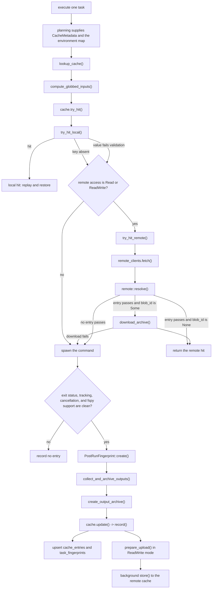
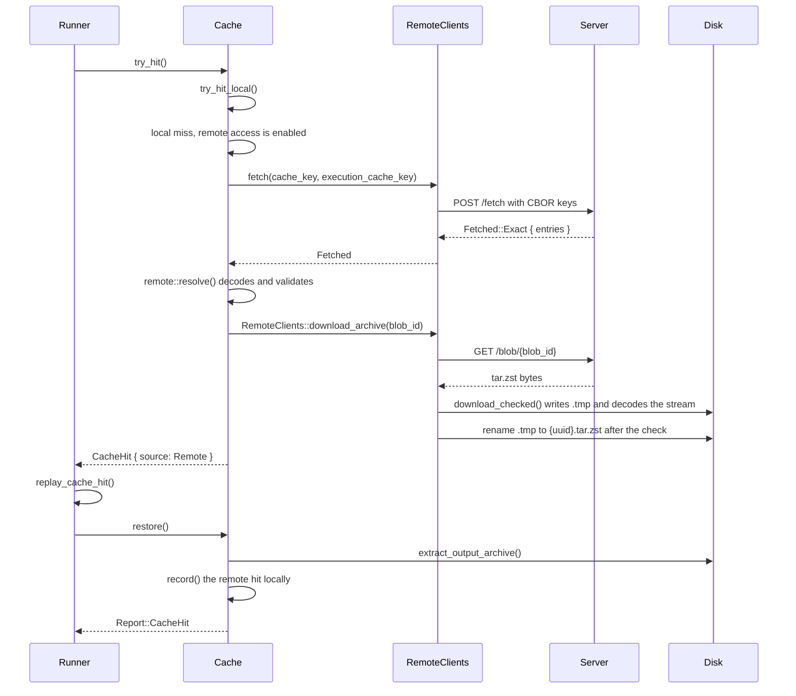

# 07 Vite Task Caching: Identity, Validation, and Two Artifacts

Vite Task reuses a task result when the key matches and the stored observations still agree. The key covers the command, the input configuration, and the output configuration. Validation covers the observed input files and the observed environment variables. The key match is a byte comparison of two serialized records. The validation is a separate pass over the stored result. The key is not a hash. It is the identity record itself, serialized with the `wincode` binary serializer. The stored value holds the post-run state and the name of the captured output archive. The sections below build the mechanism in order. Section 2 builds the key. Section 3 builds the input digests. Section 4 separates the two artifacts. Section 5 describes the local store. Section 6 describes the remote cache. Section 7 explains why graph serialization is a separate concern. Section 8 lists the correctness rules. Sections 9 and 10 show the miss and hit paths. Section 11 lists the limits and the open questions. The thesis is that the cache is a claim about the future, and every rule protects that claim.

The key says which run this entry belongs to. The value says what the run observed. Validation compares the claim with the present state. The output archive restores the files that the run produced. A remote cache repeats the same exchange over a network. Every remote lookup failure becomes a miss, so a broken remote cache does not fail a task that can still run. A failed restore is different: the task fails, because the cache promised the outputs.

This document uses the following abbreviations. The first group is: Application Programming Interface (API), command-line interface (CLI), and HyperText Transfer Protocol (HTTP). The second group is: HTTP Secure (HTTPS), inter-process communication (IPC), JavaScript Object Notation (JSON), and Node-API (NAPI). The third group is: Node Package Manager (NPM), OpenID Connect (OIDC), Secure Hash Algorithm (SHA), and Structured Query Language (SQL). The fourth group is: SQLite (a small SQL database engine), Transport Layer Security (TLS), Uniform Resource Locator (URL), and universally unique identifier (UUID). The fifth group is: write-ahead log (WAL), Concise Binary Object Representation (CBOR), and operating system (OS). The sixth term is Unicode Transformation Format 8-bit (UTF-8). The Vite+ command is `vp`, and `vp run` starts a task.

All paths in this document are relative to the snapshot root `/Users/darkvoid/GitSources/src.voidzero`. Every source-tree path starts with the repository name, such as `vite-task/crates/vt/src/session/cache/mod.rs`. The source is the Vite Task repository at commit `95d8da2fc1f06cfe8d176b30b608ed540efab066`. Vite+ pins the Vite Task crates at a different revision, `cb1ea8d214b26a0f3ca2b2ef3b6bc471b18ffacb` (`vite-plus/Cargo.toml:197`, `vite-plus/Cargo.toml:312-315`). A statement below describes the snapshot. The pinned revision can differ in line numbers, field names, or edge cases. A reader who checks a Vite+ behaviour must check the pinned revision.

The Vite Task repository has no `docs/cache.md` file. The `vite-task/docs` directory holds `cancellation.md`, `concurrency.md`, `inputs.md`, and `stdio.md`. The input rules are in `vite-task/docs/inputs.md`. The file `vite-plus/docs/guide/cache.md` is the user-facing Vite+ guide, not a Vite Task repository document. It belongs to the user surface that document 06 describes. This document uses it only to name the visible behaviour.

Each code block starts with a label line, such as `// vite-task/crates/vt/src/session/cache/mod.rs:56-68`. The label gives the file and the exact line range. The label is not part of the source text. A `//` label marks Rust source.

## 1. What the cache stores

### 1.1 An entry is a key and a value

A cache entry has two parts. The key describes the execution. The value describes what the execution saw. The split is deliberate. The key must be stable before the run. The value can hold facts that exist only after the run.

```rust
// vite-task/crates/vt/src/session/cache/mod.rs:82-121
#[derive(Debug, SchemaWrite, SchemaRead, Serialize, PartialEq, Eq, Clone)]
pub struct CacheEntryKey {
    /// The spawn fingerprint (command, args, cwd, envs)
    pub spawn_fingerprint: SpawnFingerprint,
    /// Resolved input configuration that affects cache behavior.
    /// Glob patterns are workspace-root-relative.
    pub input_config: ResolvedGlobConfig,
    /// Resolved output configuration that affects cache restoration.
    /// Glob patterns are workspace-root-relative.
    pub output_config: ResolvedGlobConfig,
}

impl CacheEntryKey {
    fn from_metadata(cache_metadata: &CacheMetadata) -> Self {
        Self {
            spawn_fingerprint: cache_metadata.spawn_fingerprint.clone(),
            input_config: cache_metadata.input_config.clone(),
            output_config: cache_metadata.output_config.clone(),
        }
    }
}

/// Cached execution result for a task.
///
/// Contains the post-run fingerprint (from fspy), captured outputs,
/// execution duration, and explicit input file hashes.
#[derive(Debug, SchemaWrite, SchemaRead, Serialize)]
pub struct CacheEntryValue {
    pub post_run_fingerprint: PostRunFingerprint,
    pub std_outputs: Arc<[StdOutput]>,
    pub duration: Duration,
    /// Hashes of explicit input files computed from positive globs.
    /// Files matching negative globs are already filtered out.
    /// Path is relative to workspace root, value is `xxHash3_64` of file content.
    /// Stored in the value (not the key) so changes can be detected and reported.
    pub globbed_inputs: BTreeMap<RelativePathBuf, u64>,
    /// Filename of the output archive (e.g. `{uuid}.tar.zst`) stored alongside
    /// `cache.db` in the cache directory. `None` if no output files were produced.
    pub output_archive: Option<Str>,
}
```

The value holds five facts. It holds the post-run fingerprint. It holds the captured standard output and standard error. It holds the duration. It holds the content hashes of the explicit input files. It holds the name of the output archive, or no name when the task wrote no files.

A `StdOutput` is one captured output record. It holds the stream kind, either standard output or standard error, and the content bytes (`vite-task/crates/vt/src/session/execute/pipe.rs:15-25`). The value holds one record per captured chunk.

The output configuration is part of the key. A change to an output glob therefore creates a different key, even when the command and the inputs did not change. The comment above `globbed_inputs` gives the reason for the value placement. A stored value can be compared with the present state, so the runner can say which file changed. A key cannot do that, because a key that does not match is simply absent from the database. The execution-key table supplies a different path (section 2.4). That table maps one invocation to the cache key of its latest state. It can name the older key, and the runner can compare that older key with the current one.

### 1.2 When the cache is used

The Vite+ guide states the user rule. Tasks declared in the `tasks` table of `vite.config.ts` are cached by default. Scripts from `package.json` are not cached by default (`vite-plus/docs/guide/cache.md:25`). A task has a `command` field and optional `cache` fields (`vite-plus/docs/guide/cache.md:55-65`). Three controls set the policy, and the guide lists them in order (`vite-plus/docs/guide/cache.md:27`). A per-task `cache: false` is strongest; it cannot be overridden by any cache control flag (`vite-plus/docs/guide/cache.md:29-31`). The `--no-cache` and `--cache` command-line interface (CLI) flags come next. `--no-cache` disables caching for every task and script (`vite-plus/docs/guide/cache.md:35`). `--cache` enables caching for tasks and scripts for that invocation, but it cannot override a per-task `cache: false`. The `run.cache` workspace option is weakest (`vite-plus/docs/guide/cache.md:37-44`). The guide does not state whether `--no-cache` overrides a per-task opt-in, and it does not state which flag wins when both `--no-cache` and `--cache` appear.

A cache write is also conditional at run time. The runner skips the update when one of four conditions holds (`vite-task/crates/vt/src/session/execute/cache_update.rs:96-131`).

```rust
// vite-task/crates/vt/src/session/execute/cache_update.rs:96-131
    if cancel_token.is_cancelled() {
        // Cancelled (Ctrl-C or sibling failure) — result is untrustworthy.
        return (CacheUpdateStatus::NotUpdated(CacheNotUpdatedReason::Cancelled), None);
    }

    if !outcome.exit_status.success() {
        // Execution failed with non-zero exit status — don't update cache.
        return (CacheUpdateStatus::NotUpdated(CacheNotUpdatedReason::NonZeroExitStatus), None);
    }

    // The accesses, or `None` when the task was not tracked at all. An
    // `Err` means tracking could not record everything it did, so what
    // arrived is a subset of what it touched, and an entry
    // built from a subset would replay with inputs and outputs missing.
    #[cfg(fspy)]
    let Ok(path_accesses) = outcome.path_accesses.as_ref().map(Result::as_ref).transpose() else {
        return (CacheUpdateStatus::NotUpdated(CacheNotUpdatedReason::TrackingIncomplete), None);
    };

    let fspy_outcome = observe_fspy(
        #[cfg(fspy)]
        path_accesses,
        metadata,
        fspy,
        &ignored_input_rels,
        &ignored_output_rels,
        workspace_root,
        cache_dir,
    );

    if fspy_outcome.is_none() && fspy.is_some() {
        // Task requested fspy auto-inference but this binary was built without
        // `cfg(fspy)`. Task ran, but we can't compute a valid cache entry
        // without tracked path accesses.
        return (CacheUpdateStatus::NotUpdated(CacheNotUpdatedReason::FspyUnsupported), None);
    }
```

The four conditions are cancellation, a non-zero exit status, incomplete tracking, and a build without the `fspy` feature. Incomplete tracking is an `Err` from the tracker; a `None` result with no `fspy` request is normal. The fourth condition is a task that requests auto-inference from a binary that was compiled without support for it (`cfg(fspy)`). `fspy` is the file-system proxy that records file access. Document 08 covers it. The rule is simple: a result enters the cache only when the runner can trust the record of the run.

When caching is disabled for an execution, the execution has no `CacheMetadata`. The lookup then returns `CacheLookup::Disabled`, the disabled-lookup variant, without a database read (`vite-task/crates/vt/src/session/execute/mod.rs:607-609`).

### 1.3 A hit is not just a key match

The database lookup finds a value by its key. The runner then validates the value against the present state. A key match alone is not enough. The command identity can match while an inferred input file changed. The validation step needs the current environment map and the current globbed input hashes. The lookup computes the globbed input hashes before it reads the cache (`vite-task/crates/vt/src/session/execute/mod.rs:611-632`). The planning step supplies the unfiltered environment map in `CacheMetadata` (`vite-task/crates/vt_plan/src/cache_metadata.rs:62-70`). The `input_changes` method re-reads each recorded path and compares the new fingerprint with the stored one (`vite-task/crates/vt/src/session/execute/fingerprint.rs:218-296`). The `env_changes` method compares the stored hashes with the current environment map (`vite-task/crates/vt/src/session/execute/fingerprint.rs:308-347`).

## 2. The cache key

### 2.1 There is no key hash function

A reader who expects a hash function will not find one. The cache key is the serialized `CacheEntryKey` record. The database stores those bytes in a binary large object (BLOB) primary-key column. The remote cache uses the same bytes, with a header in front.

```rust
// vite-task/crates/vt/src/session/cache/mod.rs:56-68
fn serialize_cache<T>(value: &T) -> WriteResult<Vec<u8>>
where
    T: SchemaWrite<TaskCacheConfig, Src = T> + ?Sized,
{
    wincode::config::serialize(value, TASK_CACHE_CONFIG)
}

fn deserialize_cache<T>(bytes: &[u8]) -> ReadResult<T>
where
    T: SchemaReadOwned<TaskCacheConfig, Dst = T>,
{
    wincode::config::deserialize_exact(bytes, TASK_CACHE_CONFIG)
}
```

`wincode` is the binary serializer. The configuration sets a preallocation limit of 256 mebibytes (`vite-task/crates/vt/src/session/cache/mod.rs:51-54`). The name suggests that the decoder refuses to reserve more than this amount before it reads a declared length. The snapshot does not show the check or its failure mode. The lookup passes the key bytes directly to SQLite.

```rust
// vite-task/crates/vt/src/session/cache/mod.rs:1106-1120
    async fn get_value_blob<K: SchemaWrite<TaskCacheConfig, Src = K>>(
        &self,
        table: &str,
        key: &K,
    ) -> anyhow::Result<Option<Vec<u8>>> {
        let key_blob = serialize_cache(key)?;
        let conn = self.conn.lock().await;
        #[expect(
            clippy::disallowed_macros,
            reason = "SQL query string for rusqlite requires String"
        )]
        let mut select_stmt =
            conn.prepare_cached(&format!("SELECT value FROM {table} WHERE key=?"))?;
        Ok(select_stmt.query_row::<Vec<u8>, _, _>([key_blob], |row| row.get(0)).optional()?)
    }
```

**Aha:** The cache key is not a digest. It is the complete identity record, serialized field by field. A hash would hide which field changed. The raw record lets the runner decode an old entry and compare fields. Two records that differ by one byte are different SQLite keys. The snapshot does not show a user-facing command that prints a key. The comparison surfaces only through the miss report, such as `Comparison::of_key` in section 2.4.

Two other hashes do appear in the cache path, and neither is the key. Environment values are hashed with SHA-256. File contents are hashed with `XxHash3_64`, the 64-bit form from the `twox-hash` crate. Both hashes are inputs to the identity record or to validation. They do not replace the record. Section 4.3 introduces a third hash, the 128-bit `xxh3_128` from the `xxhash-rust` crate, which names a materialized artifact. The cache does not use the 128-bit form.

### 2.2 The fields, in composition order

The key is the struct below. The `SchemaWrite` derive encodes it, and the table lists the fields in composition order. The `wincode` crate itself is outside this snapshot, so this document cannot show the encoder's byte layout. The table gives the composition order that the schema declares.

| Composition group | Field | Contents | Evidence |
|-------|-------|----------|----------|
| 1 | `spawn_fingerprint.cwd` | Working directory, relative to the workspace root | `vite-task/crates/vt_plan/src/cache_metadata.rs:92-98` |
| 2 | `spawn_fingerprint.program_fingerprint` | Program path inside the workspace, or the program name outside it | `vite-task/crates/vt_plan/src/cache_metadata.rs:139-146`; `vite-task/crates/vt_plan/src/plan.rs:651-683` |
| 3 | `spawn_fingerprint.args` | The argument list, as `Arc<[Str]>` | `vite-task/crates/vt_plan/src/cache_metadata.rs:92-98` |
| 4 | `spawn_fingerprint.env_fingerprints` | The hashed fingerprinted environments and the sorted untracked patterns | `vite-task/crates/vt_plan/src/envs.rs:66-82`; `vite-task/crates/vt_plan/src/envs.rs:152-157` |
| 5 | `input_config` | `includes_auto`, then the sorted positive globs, then the sorted negative globs | `vite-task/crates/vt_graph/src/config/mod.rs:123-134` |
| 6 | `output_config` | The same three fields for outputs | `vite-task/crates/vt_graph/src/config/mod.rs:123-134` |

Rows 1 to 4 expand the first field, `spawn_fingerprint`. Each row is one field of that nested struct. Rows 5 and 6 are the other two fields of the key. The byte layout of each scalar type belongs to `wincode`, so the table names the order, not the width.

```rust
// vite-task/crates/vt_plan/src/cache_metadata.rs:92-98
#[derive(SchemaWrite, SchemaRead, Debug, Serialize, PartialEq, Eq, Clone)]
pub struct SpawnFingerprint {
    pub(crate) cwd: RelativePathBuf,
    pub(crate) program_fingerprint: ProgramFingerprint,
    pub(crate) args: Arc<[Str]>,
    pub(crate) env_fingerprints: EnvFingerprints,
}
```

The input configuration and the output configuration share one type. It holds the auto-inference flag and two sorted glob sets.

```rust
// vite-task/crates/vt_graph/src/config/mod.rs:122-134
#[derive(Debug, Clone, PartialEq, Eq, Serialize, SchemaWrite, SchemaRead)]
pub struct ResolvedGlobConfig {
    /// Whether automatic file tracking is enabled
    pub includes_auto: bool,

    /// Positive glob patterns (files to include), relative to the workspace root.
    /// Sorted for deterministic cache keys.
    pub positive_globs: BTreeSet<Str>,

    /// Negative glob patterns (files to exclude, without the `!` prefix), relative to the workspace root.
    /// Sorted for deterministic cache keys.
    pub negative_globs: BTreeSet<Str>,
}
```

The glob sets are `BTreeSet<Str>` values. A sorted set gives a stable byte sequence for the same set of patterns. The comment in `ResolvedGlobConfig` gives that reason (`vite-task/crates/vt_graph/src/config/mod.rs:127-133`). The `includes_auto` flag records whether `fspy` inference is enabled for the task. The input configuration sits in the key because a changed glob changes which files are read. The output configuration sits in the key for a different reason. The value stores only the archive name, not the output path list. If the output configuration were only in the value, a changed output glob would reuse an archive built for a different output set, and validation could not detect the mismatch. The source does not state this reason; it follows from the fields of the value.

The program fingerprint has two forms. A program inside the workspace is recorded by its relative path. A program outside the workspace is recorded by its file name only (`vite-task/crates/vt_plan/src/plan.rs:651-683`). This rule has a limit. A new version of a global tool with the same file name does not change the key. The source does not add a tool version or a modification time. Section 11 returns to this limit.

The local key has no operating-system field and no architecture field. The remote key does. Section 6.2 shows the header.

### 2.3 Environment fingerprints

The environment record has a map and a sorted list. The map holds the matched environment names and their SHA-256 digests. The list holds the configured untracked patterns. It records the configuration, not the environment names that the patterns match. The list is sorted, and it is still part of the key.

```rust
// vite-task/crates/vt_plan/src/envs.rs:21-33
/// SHA-256 digest of a fingerprinted environment variable value.
#[derive(SchemaWrite, SchemaRead, PartialEq, Eq, Clone, Copy)]
pub struct EnvValueHash([u8; SHA256_DIGEST_LEN]);

impl EnvValueHash {
    #[must_use]
    pub fn new(value: &str) -> Self {
        let digest = Sha256::digest(value.as_bytes());
        let mut bytes = [0; SHA256_DIGEST_LEN];
        bytes.copy_from_slice(&digest);
        Self(bytes)
    }
}
```

```rust
// vite-task/crates/vt_plan/src/envs.rs:66-82
/// Environment variable fingerprints for a task execution.
///
/// Contents of this struct are only for fingerprinting and cache key computation.
/// The actual environment variables to be passed to the execution are in
/// `SpawnCommand::spawn_envs`.
#[derive(Debug, SchemaWrite, SchemaRead, Serialize, PartialEq, Eq, Clone)]
pub struct EnvFingerprints {
    /// Environment variables that should be fingerprinted for this execution.
    ///
    /// Use `BTreeMap` to ensure stable order.
    pub fingerprinted_envs: BTreeMap<Str, EnvValueHash>,

    /// Environment variable names that should be passed through without values being fingerprinted.
    ///
    /// Names are still included in the fingerprint so that changes to these names can invalidate the cache.
    pub untracked_env_config: Arc<[Str]>,
}
```

The reason for the split is a balance. A value such as a secret can change without a cache invalidation only if the task declares the name as untracked. The task sets the name in `cache.untrackedEnv` (`vite-plus/docs/guide/cache.md:84`). The patterns stay in the key, so adding or removing a pattern still invalidates the cache. No value digest is stored for these variables, so the key does not expose the value.

This design has a false-hit risk. If an untracked variable changes the task output, the cache returns the old output. Validation checks the globbed inputs, the inferred inputs, and the environment values that the client asked the runner to track during the run (section 3.2) (`vite-task/crates/vt/src/session/cache/validation.rs:42-53`). It cannot detect a change in an untracked variable. The task author takes that risk when the variable is untracked.

The resolver also adds a fallback. When the environment does not set `FORCE_COLOR`, the resolver inserts the value `1`. The doc comment gives the reason: cached output is always colored by default (`vite-task/crates/vt_plan/src/envs.rs:102-106`). The insertion is at `vite-task/crates/vt_plan/src/envs.rs:122-127`. The value enters the fingerprint only when `FORCE_COLOR` matches a fingerprinted pattern. When the resolver hashes a fingerprinted value, a value that is not UTF-8 returns an error (`vite-task/crates/vt_plan/src/envs.rs:129-148`). A fingerprinted name that is not UTF-8 is skipped.

### 2.4 The execution key is not the cache key

A second record exists. `ExecutionCacheKey` identifies one execution across sessions (`vite-task/crates/vt_plan/src/cache_metadata.rs:15-36`). It holds a task name, the command item index, the `&&` item index, the extra arguments, and the package path. For an API-driven execution it holds an opaque list of strings.

```rust
// vite-task/crates/vt_plan/src/cache_metadata.rs:15-36
#[derive(Debug, SchemaWrite, SchemaRead, Serialize)]
pub enum ExecutionCacheKey {
    /// This execution is from a script of a user-defined task.
    UserTask {
        /// The name of the user-defined task.
        task_name: Str,
        /// The index of the command item in the task's command array.
        command_item_index: usize,
        /// The index of the execution item within the command item split by `&&`.
        /// This is to distinguish multiple execution items from the same task.
        and_item_index: usize,
        /// Extra args provided when invoking the user-defined task (`vp [task_name] [extra_args...]`).
        /// These args are appended to the last `and_item`. Non-last `and_items` don't get extra args.
        extra_args: Arc<[Str]>,
        /// The package path where the user-defined task is defined, relative to the workspace root.
        package_path: RelativePathBuf,
    },
    /// This execution is from a synthetic task directly invoked from `Session::plan_exec` API.
    ///
    /// The cache key is an opaque value provided by the caller.
    ExecAPI(Arc<[Str]>),
}
```

The execution key is not a field of `CacheEntryKey`. It has a separate table. The table maps the execution key to the current cache key (`vite-task/crates/vt/src/session/cache/mod.rs:592-595`). The runner uses it to explain a change. When the current key is absent but the execution key maps to an older key, the miss is `Changed`, not `NotFound`. The remote protocol also uses it as a secondary key, so a server can name an older key when it has no entry under the requested key (`vite-task/crates/vt/src/session/cache/remote.rs:226-241`). That older key is used for the report only. It does not supply outputs for restore (section 6.3).

The report builds a `Comparison`. `Comparison::of_key` compares the two key records directly. It calls `old_key.changes_to(current_key)`, and it records no duration and no baseline, because the run itself was not checked (`vite-task/crates/vt/src/session/cache/mod.rs:250-255`).

**Aha:** The execution key names one invocation of a task. It includes the extra arguments, because a different argument list is a different invocation. The cache key is the fingerprint of one particular state of that invocation. The cache therefore keeps one row per state and one row that names the latest state. This second row is why `vp run` can report a changed declared program, declared argument list, or working directory. The report replaces "no cache entry" when the task definition changes under the same task name. A change to the extra arguments is different: those are part of the execution key, so that lookup has no older key to name.

## 3. Input digests

### 3.1 Explicit globs

The input configuration can name glob patterns. The runner walks each positive pattern and removes each negative match. It hashes every regular file with `XxHash3_64`. The hashing closure tests `file_type.is_file()` and skips every other type, so an input symlink is not hashed (`vite-task/crates/vt/src/session/execute/glob.rs:81-84`).

```rust
// vite-task/crates/vt/src/session/execute/glob.rs:75-103
pub fn compute_globbed_inputs(
    root: &AbsolutePath,
    positive_globs: &std::collections::BTreeSet<Str>,
    negative_globs: &std::collections::BTreeSet<Str>,
) -> anyhow::Result<BTreeMap<RelativePathBuf, u64>> {
    let mut result = BTreeMap::new();
    walk_glob_files(root, positive_globs, negative_globs, |absolute, file_type| {
        if !file_type.is_file() {
            return Ok(ControlFlow::Continue(()));
        }
        let Some(relative) = strip_root(root, &absolute)? else {
            return Ok(ControlFlow::Continue(())); // outside root
        };
        let std::collections::btree_map::Entry::Vacant(vacant) = result.entry(relative) else {
            return Ok(ControlFlow::Continue(())); // already hashed via earlier pattern
        };
        match hash_file_content(&absolute) {
            Ok(hash) => {
                vacant.insert(hash);
            }
            Err(err) if err.kind() == io::ErrorKind::NotFound => {
                // File was deleted between walk and hash, skip it
            }
            Err(err) => return Err(err.into()),
        }
        Ok(ControlFlow::Continue(()))
    })?;
    Ok(result)
}
```

The hash function reads the file through an 8 kibibyte buffer. It uses `XxHash3_64`, a fast non-cryptographic hash.

```rust
// vite-task/crates/vt/src/session/execute/hash.rs:8-20
/// Hash content using 8 KiB buffered `xxHash3_64`.
pub(super) fn hash_content(mut stream: impl io::Read) -> io::Result<u64> {
    let mut hasher = XxHash3_64::default();
    let mut buf = [0u8; 8192];
    loop {
        let n = stream.read(&mut buf)?;
        if n == 0 {
            break;
        }
        hasher.write(&buf[..n]);
    }
    Ok(hasher.finish())
}
```

One special case protects the cache from noise. `hash_file_content` wraps `hash_content` with two redaction checks. It returns the hash of empty content for two kinds of path (`vite-task/crates/vt/src/session/execute/hash.rs:23-30`). The first kind is the pnpm modules manifest, `node_modules/.modules.yaml`, which records timestamps, absolute paths, and the pnpm version (`vite-task/crates/vt/src/session/execute/redact/pnpm_modules_manifest.rs:1-13`). The second kind is a file directly inside a `node_modules/.bin` directory, where pnpm writes shims with absolute paths (`vite-task/crates/vt/src/session/execute/redact/node_modules_bin.rs:1-13`). pnpm is a package manager for Node.js, and it is not the Node Package Manager (NPM) client. Only the presence of these paths matters. A changed timestamp or a changed `prunedAt` field therefore does not invalidate every task.

The key holds the glob patterns, not the file digests. The digests live in the value. The runner computes fresh digests at lookup time and compares them with the stored map (`vite-task/crates/vt/src/session/cache/validation.rs:32-58`). The two placements have opposite reasons. The output configuration must be in the key, because a changed output glob must create a new entry (section 2.2 gives the mechanism). The input digests must be in the value, because the runner must name the changed file, and a key that does not match cannot do that.

### 3.2 Inferred inputs

When auto-inference is enabled, `fspy` records what the task read. The runner stores a `PostRunFingerprint`. The record has three maps (`vite-task/crates/vt/src/session/execute/fingerprint.rs:47-71`).

| Field | Meaning | Value type |
|-------|---------|------------|
| `inferred_inputs` | Each path the task read, as the task left it | `InferredInput` with a `PathFingerprint` and a `may_be_missing` flag |
| `tracked_envs` | Environments that the client requested with tracking | Name to optional SHA-256 value hash |
| `tracked_env_queries` | Bulk environment queries with tracking | Query to name and hash map |

```rust
// vite-task/crates/vt/src/session/execute/fingerprint.rs:45-71
/// Post-run fingerprint capturing file state after execution.
/// Used to validate whether cached outputs are still valid.
#[derive(SchemaWrite, SchemaRead, Debug, Default, Serialize)]
pub struct PostRunFingerprint {
    /// Paths inferred from fspy during execution, fingerprinted as the task
    /// left them. Only populated when `input_config.includes_auto` is true.
    pub inferred_inputs: HashMap<RelativePathBuf, InferredInput>,

    /// Env vars observed via runner-aware IPC `getEnv` with `tracked: true`.
    /// Key is the env name; value is the env value hash at execution time, or
    /// `None` if unset. Validated at cache lookup against the same plan env
    /// context that served the original request.
    pub tracked_envs: BTreeMap<Str, Option<EnvValueHash>>,

    /// Bulk env queries (`getEnvs`) made with `tracked: true`.
    /// Outer key is the query, inner map is the match-set at execution time
    /// (name -> value hash). Validated at cache lookup by re-matching against
    /// the current env context and comparing the resulting set.
    ///
    /// Non-UTF-8 env names are never matched, saved, or treated as errors:
    /// they are not returned to the client, so their existence cannot affect
    /// task behavior. Values are stricter. A matched env must have a UTF-8
    /// value; the JS client errors when querying a matched non-UTF-8 value,
    /// and cache-hit validation treats a currently matched non-UTF-8 value as
    /// a changed mismatch so stale cached output is not replayed.
    pub tracked_env_queries: BTreeMap<TrackedEnvQuery, BTreeMap<Str, EnvValueHash>>,
}
```

The term "tracked" has two meanings in this document. The key holds `EnvFingerprints`, which record the environment values in the spawn configuration. The value holds `tracked_envs`, which are the names that the task asked the client to observe during the run. The client is the JavaScript code inside the task process that calls the runner-aware API (document 09). Validation checks the second set. A change to a fingerprinted value in the first set changes the key; a change to a value in the second set makes the entry a miss. A stored `None` value means the tracked variable was absent during the run. A later run that sets the variable is a mismatch. `tracked_env_queries` records a bulk query, where the task asked for all variables that match a pattern. A query for a matched non-UTF-8 value returns an error to the client. The source does not state whether the task must stop when it receives that error. Cache-hit validation treats a currently matched non-UTF-8 value as a changed mismatch (`vite-task/crates/vt/src/session/execute/fingerprint.rs:404-410`).

A path fingerprint has three forms. A missing path is `NotFound`. A file is `FileContentHash(u64)`. A folder is `Folder(Option<DirListing>)`, where `None` means the task opened the folder without reading the entries (`vite-task/crates/vt/src/session/execute/fingerprint.rs:83-110`). A directory listing keeps sorted entries and a second sorted set of ignored names. The ignored names are paths that the task can rebuild, and paths that a tool reported as ignored through `ignoreInput` (`vite-task/crates/vt/src/session/execute/fingerprint.rs:100-110`). `ignoreInput` is the runner-aware message by which a tool reports a path that it manages. A later run compares the listing without these names, so a rebuilt file can appear or disappear without a cache miss.

A path that the task wrote can carry `may_be_missing`. A later run may find that path absent, as on a clean checkout. A path that is present must still match its fingerprint (`vite-task/crates/vt/src/session/execute/fingerprint.rs:74-80`).

This document does not explain how `fspy` observes the accesses. Document 08 covers the preload, the shared memory, and the platform mechanisms. Here it is enough to say that the observed record becomes the validation baseline.

### 3.3 Validation order

The validator checks three groups. It checks the globbed input digests first. It checks the inferred inputs second, but it skips them when `FileCheck::First` already found a globbed change. It checks the client-tracked environment values last.

```rust
// vite-task/crates/vt/src/session/cache/validation.rs:32-58
    pub(crate) fn validate(
        &self,
        unfiltered_envs: &FxHashMap<EnvName<Arc<OsStr>>, Arc<OsStr>>,
        globbed_inputs: &BTreeMap<RelativePathBuf, u64>,
        input_negative_globs: &PathGlobSet<'_>,
        workspace_root: &AbsolutePath,
        file_check: FileCheck,
    ) -> anyhow::Result<Checked> {
        // Without `-v`, the first changed file is enough to know it's a miss.
        let limit = if file_check == FileCheck::First { 1 } else { usize::MAX };
        let mut changes = globbed_input_changes(&self.globbed_inputs, globbed_inputs, limit);
        let mut partial = false;
        if changes.is_empty() || file_check != FileCheck::First {
            let input_changes = self.post_run_fingerprint.input_changes(
                workspace_root,
                input_negative_globs,
                file_check,
            );
            partial |= add_checked(&mut changes, input_changes, "inferred inputs")?;
        }
        let env_changes = self.post_run_fingerprint.env_changes(unfiltered_envs);
        partial |= add_checked(&mut changes, env_changes, "tracked envs")?;
        // Without `-v`, the file check stops at the first changed file.
        partial |= file_check == FileCheck::First
            && changes.iter().any(|change| matches!(change, Change::File { .. }));
        Ok(Checked { changes, partial })
    }
```

The `FileCheck::First` limit is a performance choice. The `FileCheck` value comes from the verbosity count. `First` is `vp run`, `All` is `vp run -v`, and `AllAndBaseline` is `vp run -vv` (`vite-task/crates/vt/src/session/cache/mod.rs:343-360`). Without the verbose flag, one changed file is enough to decide a miss. With the verbose flag, the validator collects every change so the report can list them. The `partial` flag records that the list is incomplete.

The negative globs are passed to the inferred-input check. The check needs them even though the same set is in the key. The stored listing is already filtered when it is written. The current directory listing is not. The validator copies the stored ignored names into the current listing, and it removes the current negative-glob matches, before it compares (`vite-task/crates/vt/src/session/execute/fingerprint.rs:239-247`). This step applies one filter to both sides. A name that was never recorded therefore does not appear as a change. The comment on `DirListing.ignored_entries` gives the same reason (`vite-task/crates/vt/src/session/execute/fingerprint.rs:97-110`).

## 4. The two artifacts

### 4.1 The output archive

The cache stores the files that the task wrote. The archive is a GNU tar stream inside a zstd stream. The file name is `{uuid}.tar.zst`, and the file sits next to the database.

```rust
// vite-task/crates/vt/src/session/cache/archive.rs:24-75
pub fn create_output_archive(
    workspace_root: &AbsolutePath,
    output_files: &[RelativePathBuf],
    output_folders: &[RelativePathBuf],
    archive_path: &AbsolutePath,
) -> anyhow::Result<()> {
    let file = File::create(archive_path.as_path())?;
    let encoder = zstd::Encoder::new(file, 0)?.auto_finish();
    let mut builder = tar::Builder::new(encoder);

    for rel_path in output_folders {
        let metadata = match std::fs::symlink_metadata(workspace_root.join(rel_path).as_path()) {
            Ok(m) => m,
            Err(err) if err.kind() == io::ErrorKind::NotFound => continue,
            Err(err) => return Err(err.into()),
        };
        if metadata.is_dir() {
            let mut header = tar::Header::new_gnu();
            header.set_metadata(&metadata);
            header.set_cksum();
            builder.append_data(&mut header, rel_path.as_str(), io::empty())?;
        }
    }

    for rel_path in output_files {
        let abs_path = workspace_root.join(rel_path);
        // Skip files that no longer exist (task may delete temp files between
        // glob walk and archiving). Any other error is propagated.
        let metadata = match std::fs::symlink_metadata(abs_path.as_path()) {
            Ok(m) => m,
            Err(err) if err.kind() == io::ErrorKind::NotFound => continue,
            Err(err) => return Err(err.into()),
        };
        if metadata.is_file() {
            let mut file = File::open(abs_path.as_path())?;
            let mut header = tar::Header::new_gnu();
            header.set_metadata(&metadata);
            header.set_cksum();
            builder.append_data(&mut header, rel_path.as_str(), &mut file)?;
        } else if metadata.file_type().is_symlink() {
            let target = std::fs::read_link(abs_path.as_path())?;
            let mut header = tar::Header::new_gnu();
            header.set_metadata(&metadata);
            header.set_entry_type(tar::EntryType::Symlink);
            header.set_size(0);
            builder.append_link(&mut header, rel_path.as_str(), target)?;
        }
    }

    builder.finish()?;
    Ok(())
}
```

The writer uses `symlink_metadata`, so the metadata call does not follow a link. A directory becomes an empty tar entry. The empty entry preserves the directory and its mode. A path in `output_folders` that is a symlink is not a directory, so the loop silently omits it. The source does not comment on this omission; a symlinked output folder is not archived as a folder, and its contents are not walked here. A regular file becomes a tar entry with its content and its metadata. A symlink becomes a `Symlink` entry with its target text and a size of zero. A path that vanished between the glob walk and the archive write is skipped. Any other error stops the archive. The later `File::open` call could follow a link that replaces the path between the two calls. The source does not close that window. The input glob test shows that an output symlink stays an output path (`vite-task/crates/vt/src/session/execute/glob.rs:412-442`).

The restore path is short. It opens the file, wraps it in a zstd decoder, and unpacks the tar stream.

```rust
// vite-task/crates/vt/src/session/cache/archive.rs:91-104
pub fn extract_output_archive(
    workspace_root: &AbsolutePath,
    archive_path: &AbsolutePath,
) -> anyhow::Result<()> {
    let file = File::open(archive_path.as_path())?;
    let decoder = zstd::Decoder::new(file)?;
    let mut archive = tar::Archive::new(decoder);

    #[cfg(not(windows))]
    archive.unpack(workspace_root.as_path())?;
    #[cfg(windows)]
    unpack_with_directory_links(&mut archive, workspace_root)?;
    Ok(())
}
```

The Windows branch exists for a real difference. A Windows directory symbolic link is not recreated by the plain `unpack` call. The `unpack_with_directory_links` helper recreates a link whose target is a directory as a directory link, after every entry is unpacked (`vite-task/crates/vt/src/session/cache/archive.rs:106-137`). The archive module has tests for three cases. The first case is a symlink round trip. The second case is the recreation of an empty folder. The third case is the refusal to write through a link that points outside the workspace (`vite-task/crates/vt/src/session/cache/archive.rs:176-309`). The snapshot shows a test for the refusal, not the check itself. The check is likely inside the `tar` crate's `unpack` call, because the code before it does not inspect entry paths. The source does not show the check.

The restore keeps the structure in three ways. First, each relative path in the tar header rebuilds the directory tree. Second, each folder entry keeps an empty folder that no file would recreate. Third, creation writes the mode and the modification time into each tar header, and the unpack call applies them. A symlink is recreated as a link to its stored target. The writer does not follow it, and the restore recreates it as a link.

The order of writes matters. The archive function writes folders first, then files. The output collector sorts the paths before it calls the archive function, and the archive function preserves that order (`vite-task/crates/vt/src/session/execute/cache_update.rs:460-462`). A stable order makes the entry order deterministic. The archive bytes are still not reproducible, because each header records the file metadata, such as the modification time. The file name is also a new UUID on every write. The cache does not deduplicate archives by content. The database row points to one file name, and a new run replaces that pointer.

The next subsection describes a second crate with the word "artifact" in its name. That crate serves a different purpose.

### 4.2 The materialized artifact is a different thing

The snapshot has a crate named `vt_materialized_artifact`. The name suggests the task output artifact. It is not. This crate embeds a file in the program that links the crate at compile time, and writes the file to a temporary directory when a process needs it. The call sites are the `fspy` preload library, the Node-API (NAPI) client library, and the JSON schema files (`vite-task/crates/fspy/src/unix/mod.rs:48-75`, `vite-task/crates/vt/src/napi_client.rs:20-30`, `vite-task/crates/vt/src/session/json/schema.rs:9-22`).

The crate documentation states the purpose. The file is embedded at compile time. The file is written on demand. The name includes a hash, so a file that already exists is assumed correct. The crate states three goals (`vite-task/crates/vt_materialized_artifact/src/lib.rs:14-24`). The existence check avoids a repeated write. The hash in the name ensures that a stale file from an older build is never mistaken for the current one. The hash also lets several versions share one directory without overwriting each other.

```rust
// vite-task/crates/vt_materialized_artifact/src/lib.rs:188-230
    pub fn at(self, dir: impl AsRef<Path>) -> io::Result<PathBuf> {
        let dir = dir.as_ref();
        let path =
            dir.join(format!("{}_{}{}", self.artifact.name, self.artifact.hash, self.suffix));

        // Fast path: the content is assumed correct because the hash is in the
        // filename, so existence is all there is to check. Any stat failure
        // other than not-found (permission denied, I/O error, etc.) propagates.
        if fs::exists(&path)? {
            return Ok(path);
        }

        // Slow path: write to a unique temp file in the same directory, then
        // rename into place atomically. The temp must live in `dir` (not the
        // system temp) so the final rename stays within one filesystem — cross-
        // filesystem rename isn't atomic. `NamedTempFile`'s `Drop` removes the
        // temp on any early return, so we never leak partial files on error.
        #[cfg_attr(not(unix), expect(unused_mut, reason = "only Unix sets the mode"))]
        let mut builder = tempfile::Builder::new();
        #[cfg(unix)]
        if self.executable {
            use std::os::unix::fs::PermissionsExt;
            // `Builder::permissions` sets the mode at open(2) time, so there's
            // no window where the temp exists without the executable bit.
            builder.permissions(fs::Permissions::from_mode(0o755));
        }
        let mut tmp = builder.tempfile_in(dir)?;
        tmp.as_file_mut().write_all(self.artifact.content)?;

        // `persist_noclobber` (link+unlink on Unix, MoveFileExW without
        // REPLACE_EXISTING on Windows) fails atomically if the destination
        // already exists — so two racing processes can't clobber each other
        // mid-write, and the loser sees the error below.
        if let Err(err) = tmp.persist_noclobber(&path) {
            // If another process won the race and the destination now exists,
            // treat that as success; `err.file` drops here, cleaning up our
            // temp. Otherwise propagate the original error.
            if !fs::exists(&path)? {
                return Err(err.error);
            }
        }
        Ok(path)
    }
```

The destination is a per-user temporary directory. The call sites do not call `at` directly. They call `at_user_temp_dir("vp_run")` (`vite-task/crates/fspy/src/unix/mod.rs:62`, `vite-task/crates/vt/src/napi_client.rs:26`, `vite-task/crates/vt/src/session/json/schema.rs:19`). That method builds the directory, then calls `at` with it (`vite-task/crates/vt_materialized_artifact/src/lib.rs:166-168`). On Unix the helper `user_dir_in` builds `{temp}/{prefix}-{uid}`. It creates the directory with mode `0700`. It checks the owner and rejects a directory that a group or another user can write (`vite-task/crates/vt_materialized_artifact/src/lib.rs:35-59`). The check uses `symlink_metadata`, so a planted symlink fails the directory test. On Windows the helper builds `{temp}\\{prefix}`, with no explicit access check in this function (`vite-task/crates/vt_materialized_artifact/src/lib.rs:67-74`). The block above shows `at`, which adds `{name}_{hash}{suffix}` to the directory and writes the file if it is missing.

The write is atomic. The code creates a temporary file in the same directory and writes the content. It calls `persist_noclobber`. If another process won the race, the existing file is treated as success. The executable flag, when requested, is `0o755` and is set at file creation time.

### 4.3 The macro that embeds the file

The companion crate `vt_materialized_artifact_macros` supplies the `artifact!` macro. The macro reads the file path from an environment variable at compile time. It declares the read to the compiler, reads the file, and computes a 128-bit `xxh3_128` hash (`xxhash_rust::xxh3::xxh3_128`). It then emits an `Artifact::__new` call with `include_bytes!`. The macro reads the file to compute the hash, and the compiler reads it again for `include_bytes!`. If the file changes between the two reads, the name hash and the embedded bytes can disagree. The source does not state a guard for this window.

```rust
// vite-task/crates/vt_materialized_artifact_macros/src/lib.rs:68-114
fn expand(input: proc_macro::TokenStream) -> syn::Result<TokenStream> {
    let Args { name, env_var } = syn::parse(input)?;

    // `tracked::env_var` both reads the var and declares the read to the
    // compiler (see crate docs for why that declaration matters).
    let (content, hash, guard) = if let Ok(file_path) = tracked::env_var(env_var.value()) {
        // Declare the file read before attempting it: the dependency must
        // be registered even if the read fails, so a later fix to the file
        // retriggers this macro.
        tracked::path(&file_path);
        let bytes = fs::read(&file_path).map_err(|err| {
            syn::Error::new(
                env_var.span(),
                format!(
                    "`{}` points at {file_path}, which could not be read: {err}",
                    env_var.value()
                ),
            )
        })?;
        let hash = format!("{:x}", xxhash_rust::xxh3::xxh3_128(&bytes));
        (quote!(::core::include_bytes!(::core::env!(#env_var))), hash, TokenStream::new())
    } else {
        // Env var unset. Only the compilation context itself can tell
        // whether that is fine (rust-analyzer never has artifact-dep env
        // vars) or a real error (missing artifact dependency, build script
        // not emitting the var), so the guard lets the emitted tokens branch
        // on `cfg(rust_analyzer)` instead of guessing here.
        let message = format!(
            "`{}` is not set at compile time; declare the artifact as a Cargo artifact \
             dependency under `[dependencies]`, or publish the path from a build script via \
             `cargo:rustc-env`",
            env_var.value()
        );
        let guard = quote! {
            #[cfg(not(rust_analyzer))]
            ::core::compile_error!(#message);
        };
        (quote!(&[]), String::from("rust-analyzer-stub"), guard)
    };

    Ok(quote! {
        {
            #guard
            ::vt_materialized_artifact::Artifact::__new(#name, #content, #hash)
        }
    })
}
```

The `tracked` calls are load-bearing. The macro reads the environment variable, then reads the file to compute the hash. The emitted `include_bytes!` reads the file again to embed it, and it registers the file in the dependency information. The emitted `env!` registers the variable. Without the `tracked` calls, a compiler that caches macro expansions could reuse an old hash with new bytes. The crate documentation explains this point (`vite-task/crates/vt_materialized_artifact_macros/src/lib.rs:1-59`).

**Aha:** The word "artifact" names two unrelated mechanisms. The task output artifact is a tar.zst archive of the files a task wrote. The materialized artifact is a build-time embedded file, such as the `fspy` preload, written to a user temporary directory at run time. The cache stores the first. It never stores the second. A reader who conflates them will look for an output archive in the wrong crate.

## 5. The local store

### 5.1 Location

The cache root is `node_modules/.vite/task-cache` under the workspace root. The environment variable `VITE_CACHE_PATH` replaces the root, and the value must be an absolute path (`vite-task/crates/vt/src/session/mod.rs:216-223`). A relative value panics at this point, because the code calls `expect`.

```rust
// vite-task/crates/vt/src/session/mod.rs:216-223
fn get_cache_path_of_workspace(workspace_root: &AbsolutePath) -> AbsolutePathBuf {
    std::env::var("VITE_CACHE_PATH").map_or_else(
        |_| workspace_root.join("node_modules/.vite/task-cache"),
        |env_cache_path| {
            AbsolutePathBuf::new(env_cache_path.into()).expect("Cache path should be absolute")
        },
    )
}
```

A version directory sits under the root. The directory name is `v` plus the schema version. The version is the constant `CACHE_SCHEMA_VERSION`, and its present value is 23.

```rust
// vite-task/crates/vt/src/session/cache/mod.rs:459-478
/// On-disk schema version of the cache database.
///
/// Bump this whenever the database layout (table structure, serialization
/// format, or fingerprint semantics) changes in an incompatible way.
///
/// The version is encoded *only* in the cache directory name (see
/// [`cache_schema_dir_name`], e.g. `v14`); there is no in-database version
/// marker. Keying the storage location on this version means Vite+ builds that
/// pin different schema versions never open each other's database: each keeps
/// its own cache warm across branch switches, and a cache from a different
/// version is simply ignored (it lives in a directory this build never looks
/// at) rather than aborting the run. Bumping the version starts a fresh cache.
const CACHE_SCHEMA_VERSION: u32 = 23;

/// Name of the per-version subdirectory (e.g. `v14`) under the task-cache
/// directory that holds the database and output archives for the current
/// [`CACHE_SCHEMA_VERSION`].
pub fn cache_schema_dir_name() -> Str {
    vt_str::format!("v{CACHE_SCHEMA_VERSION}")
}
```

The comment example says `v14`, but the constant is 23. The constant controls the directory name. The example text is stale. A reader must use the constant, not the example. There is no version marker inside the database. An old version directory stays on disk until a user removes it. The `vp cache clean` command removes the whole root, not only the current version (`vite-task/crates/vt/src/session/mod.rs:408-419`).

### 5.2 The database

The database file is `cache.db`. `load_from_path` creates the directory, creates and locks the file `db_open.lock`, opens the database, calls `enable_wal`, and creates the two tables (`vite-task/crates/vt/src/session/cache/mod.rs:573-603`). The lock file drops when `load_from_path` returns, so the lock covers the whole initialization. When SQLite confirms WAL mode, `enable_wal` sets `synchronous=NORMAL`. When SQLite does not confirm WAL mode, the helper leaves the journal mode unchanged and returns no error. The comment states that SQLite then keeps its current mode, usually a rollback journal, and `synchronous` stays at `FULL` (`vite-task/crates/vt/src/session/cache/mod.rs:480-498`).

```rust
// vite-task/crates/vt/src/session/cache/mod.rs:592-595
        conn.execute_batch(
            "CREATE TABLE IF NOT EXISTS cache_entries (key BLOB PRIMARY KEY, value BLOB);
             CREATE TABLE IF NOT EXISTS task_fingerprints (key BLOB PRIMARY KEY, value BLOB);",
        )?;
```

Two tables exist. `cache_entries` holds the serialized key and value. `task_fingerprints` holds the execution key and the current cache key. The `IF NOT EXISTS` form makes the statement safe on every open. The directory name already guarantees that the schema matches the build, so there is no migration step.

### 5.3 Archives and eviction

The output archives live beside `cache.db` in the same version directory. The file name is a new UUID plus `.tar.zst` (`vite-task/crates/vt/src/session/execute/cache_update.rs:464-465`). The database value holds the name, not the archive bytes.

The store has one cleanup rule. When a new value replaces an old value under the same key, and the archive name differs, the old archive file is removed.

```rust
// vite-task/crates/vt/src/session/cache/mod.rs:949-972
    /// (best-effort) so it doesn't accumulate on disk.
    async fn record(
        &self,
        cache_key: &CacheEntryKey,
        execution_cache_key: &ExecutionCacheKey,
        cache_value: &CacheEntryValue,
        cache_dir: &AbsolutePath,
    ) -> anyhow::Result<()> {
        // If a previous entry exists with a stale output archive, delete the
        // old file so the cache directory doesn't accumulate orphaned archives.
        if let Some(old_value) = self.get_by_cache_key(cache_key).await?
            && let Some(old_archive) = old_value.output_archive
            && cache_value.output_archive.as_ref() != Some(&old_archive)
        {
            let old_archive_path = cache_dir.join(old_archive.as_str());
            // Best-effort cleanup: a missing file (e.g. after a crash or manual
            // cache clear) is fine, so we ignore the error.
            let _ = std::fs::remove_file(old_archive_path.as_path());
        }

        self.upsert_cache_entry(cache_key, cache_value).await?;
        self.upsert_task_fingerprint(execution_cache_key, cache_key).await?;
        Ok(())
    }
```

There is no age limit and no size limit. A search of the session code finds no eviction routine. The Vite+ guide states the same fact for the task cache: it can clear the whole cache, but it does not evict individual entries by age or size (`vite-plus/docs/guide/github-actions-cache.md:159`). The guide then compares this behaviour with the GitHub Actions cache, which has its own retention and scope rules (`vite-plus/docs/guide/github-actions-cache.md:155-165`). A long-lived local cache grows with each new key and its archive. The only bound is disk space.

The stale-archive rule has a gap. An archive whose key is never written again stays forever. The rule removes an archive only when the same key is written again with a different archive name.

### 5.4 Restore

A local hit replays the stored standard output and standard error. It then extracts the archive into the workspace root when the value names one. A value with no output archive skips the extraction. If the extraction fails, the task fails. The code comment gives the reason: the cache promised the outputs, so a silent miss would leave the workspace wrong (`vite-task/crates/vt/src/session/execute/mod.rs:679-682`).

```rust
// vite-task/crates/vt/src/session/execute/mod.rs:670-677
    for output in hit.value.std_outputs.iter() {
        let writer: &mut dyn std::io::Write = match output.kind {
            pipe::OutputKind::StdOut => &mut stdio_config.writers.stdout_writer,
            pipe::OutputKind::StdErr => &mut stdio_config.writers.stderr_writer,
        };
        let _ = writer.write_all(&output.content);
        let _ = writer.flush();
    }
```

The loop writes each stored output to the stream that its kind names. The `replay_cache_hit` function then calls `restore`.

```rust
// vite-task/crates/vt/src/session/cache/mod.rs:1040-1081
    /// A remote hit is recorded locally once its outputs are restored. If
    /// they can't be, its downloaded archive is removed instead, so the next
    /// run fetches it again. Returns an error if the outputs can't be
    /// restored.
    pub async fn restore(
        &self,
        cache_metadata: &CacheMetadata,
        hit: &CacheHit,
        workspace_root: &AbsolutePath,
        cache_dir: &AbsolutePath,
    ) -> anyhow::Result<()> {
        let start = Instant::now();
        if let Some(archive_name) = &hit.value.output_archive {
            let archive_path = cache_dir.join(archive_name.as_str());
            if let Err(err) = archive::extract_output_archive(workspace_root, &archive_path) {
                if hit.source == CacheHitSource::Remote {
                    // Best-effort: the file may already be missing.
                    let _ = std::fs::remove_file(archive_path.as_path());
                }
                return Err(err.context("failed to extract the output archive"));
            }
            tracing::debug!(
                bytes = archive::file_size(&archive_path),
                elapsed = ?start.elapsed(),
                "extracted the output archive"
            );
        }

        if hit.source == CacheHitSource::Remote {
            let cache_key = CacheEntryKey::from_metadata(cache_metadata);
            if let Err(err) = self
                .record(&cache_key, &cache_metadata.execution_cache_key, &hit.value, cache_dir)
                .await
            {
                // The outputs are restored, so the task still succeeds. The
                // next run fetches the entry from the remote cache again.
                tracing::warn!(?err, "failed to record a remote cache hit locally");
            }
        }
        tracing::debug!(source = ?hit.source, elapsed = ?start.elapsed(), "restored the outputs");
        Ok(())
    }
```

A remote hit becomes a local entry after a successful restore. This rule warms the local cache. If the local record write fails after a remote restore, the task still succeeds. The next run fetches from the remote cache again. The write has two upserts, and it is not one transaction (`vite-task/crates/vt/src/session/cache/mod.rs:949-972`). A failure can leave a `cache_entries` row without its `task_fingerprints` row, or leave both absent. In either case the downloaded archive stays on disk. The cleanup rule in section 5.3 does not run for it. The source does not reconcile this partial state.

A local hit has no such cleanup. The restore code removes the archive only when the hit source is remote (`vite-task/crates/vt/src/session/cache/mod.rs:1054-1060`). If a local archive is corrupt, the file stays, the database row stays, and every later run fails the same way. Section 11 returns to this limit.

## 6. The remote cache

### 6.1 Modes and configuration

A remote cache has three modes: `off`, `read`, and `read-write`. The mode comes from the environment variable `VP_REMOTE_CACHE`. The URL comes from `VP_REMOTE_CACHE_URL` or from the workspace `cache.remote.url` setting (`vite-task/crates/vt_graph/src/config/user.rs:407-410`). An unset mode with a URL means `read`. A mode of `read` or `read-write` with no URL is an error. A mode of `off` disables the remote cache, even when a URL exists (`vite-task/crates/vt_plan/src/remote_cache.rs:121-151`).

```rust
// vite-task/crates/vt_plan/src/remote_cache.rs:121-151
pub(crate) fn resolve(
    configured_url: Option<&Arc<str>>,
    envs: &FxHashMap<EnvName<Arc<OsStr>>, Arc<OsStr>>,
) -> Result<Option<ResolvedRemoteCacheConfig>, Error> {
    let mode = match env_value(envs, MODE_ENV) {
        None => None,
        Some(value) => Some(match value.to_str() {
            Some("off") => RemoteCacheMode::Off,
            Some("read") => RemoteCacheMode::Read,
            Some("read-write") => RemoteCacheMode::ReadWrite,
            _ => return Err(Error::InvalidRemoteCacheModeEnv(Arc::clone(value))),
        }),
    };
    let url = match env_value(envs, URL_ENV) {
        Some(value) => Some(Arc::<str>::from(
            value.to_str().ok_or_else(|| Error::InvalidRemoteCacheUrlEnv(Arc::clone(value)))?,
        )),
        None => configured_url.filter(|url| !url.is_empty()).cloned(),
    };

    let (access, url) = match (mode, url) {
        (Some(RemoteCacheMode::Off), _) | (None, None) => return Ok(None),
        (Some(RemoteCacheMode::Read) | None, Some(url)) => (RemoteCacheAccess::Read, url),
        (Some(RemoteCacheMode::ReadWrite), Some(url)) => (RemoteCacheAccess::ReadWrite, url),
        (Some(RemoteCacheMode::Read | RemoteCacheMode::ReadWrite), None) => {
            return Err(Error::MissingRemoteCacheEndpoint);
        }
    };
    let auth = resolve_auth(&url, envs)?;
    Ok(Some(ResolvedRemoteCacheConfig { access, url, auth }))
}
```

The environment names are `VP_REMOTE_CACHE` for the mode and `VP_REMOTE_CACHE_URL` for the URL (`vite-task/crates/vt_plan/src/remote_cache.rs:12-13`). The module documentation also names a `--remote-cache` flag for the same mode (`vite-task/crates/vt_plan/src/remote_cache.rs:1-2`). The local cache path uses a different prefix, `VITE_CACHE_PATH` (section 5.1). The source does not explain why the two cache settings use different prefixes. The URL must use HTTP or HTTPS. The client rejects every other scheme (`vite-task/crates/vt_remote_cache/src/lib.rs:164-183`). The client also does not follow redirects. An HTTP URL is accepted, so a bearer token can travel without TLS. The client does not require HTTPS. The source does not state a reason for this choice. The HTTP connection time is 10 seconds and the read time is 60 seconds (`vite-task/crates/vt_remote_cache/src/lib.rs:27-31`).

### 6.2 Encoding

The remote cache exchanges opaque byte strings. The crate does not parse the key or the value. The caller supplies the meaning (`vite-task/crates/vt_remote_cache/src/lib.rs:1-2`). Four parts make up one entry.

| Part | Encoding | Evidence |
|------|----------|----------|
| Key | Header bytes followed by the serialized `CacheEntryKey` | `vite-task/crates/vt/src/session/cache/remote.rs:542-546` |
| Secondary key | Header bytes followed by the serialized `ExecutionCacheKey` | `vite-task/crates/vt/src/session/cache/remote.rs:226-241` |
| Value | zstd compression of the serialized `CacheEntryValue` | `vite-task/crates/vt/src/session/cache/remote.rs:1-14` |
| Blob | The `.tar.zst` output archive, without a key | `vite-task/crates/vt/src/session/cache/remote.rs:1-14` |

```rust
// vite-task/crates/vt/src/session/cache/remote.rs:518-553
/// Bump this whenever the remote value encoding changes incompatibly. Both
/// keys carry it, so clients that encode values differently never share
/// entries, and never push out each other's.
const REMOTE_VALUE_FORMAT: u32 = 1;

#[derive(SchemaWrite)]
struct KeyHeader {
    cache_schema_version: u32,
    remote_value_format: u32,
    os: Str,
    arch: Str,
}

/// The key header for this build.
fn encode_header() -> WriteResult<Vec<u8>> {
    serialize_cache(&KeyHeader {
        cache_schema_version: CACHE_SCHEMA_VERSION,
        remote_value_format: REMOTE_VALUE_FORMAT,
        os: Str::from(std::env::consts::OS),
        arch: Str::from(std::env::consts::ARCH),
    })
}

/// Encode a key with the header for this build.
fn encode_key<K: SchemaWrite<TaskCacheConfig, Src = K>>(key: &K) -> WriteResult<Vec<u8>> {
    let mut bytes = encode_header()?;
    bytes.extend(serialize_cache(key)?);
    Ok(bytes)
}

/// Decode a key stored with the header for this build.
fn decode_key(bytes: &[u8]) -> Result<CacheEntryKey, ReadError> {
    let header = encode_header()?;
    let key = bytes.strip_prefix(header.as_slice()).ok_or(ReadError::CorruptKey(None))?;
    deserialize_cache(key).map_err(|err| ReadError::CorruptKey(Some(err)))
}
```

The header carries four values: the cache schema version, the remote value format, the OS name, and the architecture. The header is the same for every key that this build produces. A build with a different header stores and requests different key bytes, because the header is part of the key. Such a build should therefore receive no exact entry. The client does not check the header of an exact entry; it decodes the value and validates it (`vite-task/crates/vt/src/session/cache/remote.rs:168-189`). The decode of a fallback key is a different path. A fallback response carries a raw key, not a value. `decode_key` strips this build's header from that raw key (`vite-task/crates/vt/src/session/cache/remote.rs:139-142`). If the header does not match, the strip fails and the fallback becomes a corrupt-key miss (`vite-task/crates/vt/src/session/cache/remote.rs:549-552`). The remote cache is partitioned by platform. This partition is the reason a remote entry from Linux is never applied on macOS.

The value encoding has two size limits. A serialized value larger than 32 mebibytes before compression is not uploaded (`vite-task/crates/vt/src/session/cache/remote.rs:489-502`). `encode_value` returns `UploadError::TooLarge`. `update` puts that error in the upload slot, and the local entry stays (`vite-task/crates/vt/src/session/cache/mod.rs:1009-1020`). A value that decompresses to more than 32 mebibytes is rejected by a bounded reader (`vite-task/crates/vt/src/session/cache/remote.rs:504-516`). That error makes the remote entry a corrupt value, so the entry is skipped as a miss. The comment gives the reason: a broken or hostile server must not exhaust memory with a zstd bomb. The value is compressed with the zstd default level (`vite-task/crates/vt/src/session/cache/remote.rs:483-487`). The snapshot does not show a size limit for the blob itself. The download streams the blob to disk as it arrives.

The remote entry has no content hash for the archive. The value names a blob identifier, and the entry check compares only presence (`vite-task/crates/vt/src/session/cache/remote.rs:168-189`). A server that returns a different blob under the same identifier is not detected before extraction. The download check validates the tar and zstd framing, not the intended file set. The client therefore trusts the server to return the archive that the value describes.

### 6.3 Fetch and resolve

The fetch call sends both keys in a CBOR body to `POST {endpoint}/fetch`. A 404 response means no entry. Any other non-success status is an error (`vite-task/crates/vt_remote_cache/src/lib.rs:199-222`).

The client builds three route URLs from the endpoint. `route_url` appends the route name to the endpoint path and keeps any existing path prefix (`vite-task/crates/vt_remote_cache/src/lib.rs:344-349`). An endpoint `https://host/cache` therefore calls `https://host/cache/fetch`, `https://host/cache/store`, and `https://host/cache/blob`. A test in the same file checks that the namespace path is kept (`vite-task/crates/vt_remote_cache/src/lib.rs:389-397`).

```rust
// vite-task/crates/vt_remote_cache/src/lib.rs:199-222
    pub async fn fetch(&self, key: &[u8], secondary_key: &[u8]) -> Result<Option<Fetched>, Error> {
        let start = Instant::now();
        let headers = self.auth_headers(Operation::Fetch).await?;
        let body = encode_cbor(&FetchRequest { key, secondary_key });
        let response = self
            .http
            .post(self.fetch_url.clone())
            .headers(headers)
            .header(CONTENT_TYPE, "application/cbor")
            .body(body)
            .send()
            .await
            .map_err(network_error)?;
        log_response(&response, start);
        if response.status() == StatusCode::NOT_FOUND {
            // Read the body so the connection can be reused. It doesn't matter
            // if that fails, because the status alone is the answer.
            let _ = response.bytes().await;
            return Ok(None);
        }
        let body = check_status(response).await?.bytes().await.map_err(network_error)?;
        tracing::debug!(bytes = body.len(), elapsed = ?start.elapsed(), "remote cache fetch received");
        decode_fetched(&body).map(Some)
    }
```

The response has two forms. An `Exact` response lists the entries under the requested key, newest first. The list must not be empty. A `Fallback` response names a different key that has entries for the secondary key (`vite-task/crates/vt_remote_cache/src/lib.rs:124-142`). The client treats an exact list as a version history for one key. It validates each value and uses the first valid one. The local store keeps one value per key, so the list matters only for a server that keeps older stores. The snapshot does not show how the server orders the entries or why one key can have several entries. The client trusts the order and tries each entry in turn.

```rust
// vite-task/crates/vt_remote_cache/src/lib.rs:124-142
/// The body of a 200 fetch response: an exact or fallback match.
#[derive(Debug, PartialEq, Eq, Deserialize)]
#[serde(tag = "kind", rename_all = "snake_case")]
pub enum Fetched {
    /// The entries stored under the requested key, newest first.
    Exact {
        /// At least one entry. An empty list is a malformed response.
        #[serde(deserialize_with = "non_empty")]
        entries: Vec<Entry>,
    },
    /// No entry is stored under the requested key, but the secondary key is
    /// associated with the entries stored under `key`. Their values and blob
    /// IDs aren't decoded.
    Fallback {
        /// The key the fallback entry is stored under.
        #[serde(with = "serde_bytes")]
        key: Vec<u8>,
    },
}
```

The resolver walks the exact entries in order. It decodes each value. It checks the blob rule. It validates the value. The first entry that passes becomes the hit. A failed entry is remembered, and the newest failure becomes the reported miss when no entry passes.

Three report types appear in this code. A `Checked` value holds the list of changes and a `partial` flag (`vite-task/crates/vt/src/session/cache/mod.rs:263-270`). A `Comparison` value holds the change list, the baseline duration, the partial flag, and an optional baseline description (`vite-task/crates/vt/src/session/cache/mod.rs:208-229`). `BaselineDetails` describes what the cached run depends on and what it produced (`vite-task/crates/vt/src/session/cache/mod.rs:132-145`). The `validate` closure returns `Checked`; the resolve function turns that value into a `Comparison` for the miss report.

```rust
// vite-task/crates/vt/src/session/cache/remote.rs:131-166
pub(super) fn resolve(
    fetched: Result<Option<Fetched>, ReadError>,
    cache_key: &CacheEntryKey,
    mut validate: impl FnMut(&CacheEntryValue) -> anyhow::Result<Checked>,
    mut describe: impl FnMut(&CacheEntryValue) -> Option<Arc<BaselineDetails>>,
) -> Result<Restore, CacheMiss> {
    let entries = match fetched.map_err(ReadError::into_miss)? {
        Some(Fetched::Exact { entries }) => entries,
        Some(Fetched::Fallback { key }) => {
            let key = decode_key(&key).map_err(ReadError::into_miss)?;
            return Err(CacheMiss::Changed(Comparison::of_key(&key, cache_key)));
        }
        None => return Err(CacheMiss::NotFound),
    };
    let mut newest_miss = None;
    for (index, entry) in entries.into_iter().enumerate() {
        let start = Instant::now();
        let value_bytes = entry.value.len();
        let checked = check_entry(entry, &mut validate, &mut describe);
        tracing::debug!(
            index,
            value_bytes,
            valid = checked.is_ok(),
            elapsed = ?start.elapsed(),
            "checked a remote cache entry"
        );
        match checked {
            Ok(restore) => return Ok(restore),
            Err(miss) => {
                newest_miss.get_or_insert(miss);
            }
        }
    }
    // An exact match has at least one entry, so there is a newest miss.
    Err(newest_miss.unwrap_or(CacheMiss::NotFound))
}
```

The entry check has three rules. The value must decode. The presence of an output archive in the value must match the presence of a blob identifier. The value must validate (`vite-task/crates/vt/src/session/cache/remote.rs:168-189`). The second rule stops a server from adding or removing outputs.

```rust
// vite-task/crates/vt/src/session/cache/remote.rs:168-189
/// Check one entry of an exact match, as [`resolve`] describes.
fn check_entry(
    Entry { value, blob_id }: Entry,
    validate: &mut impl FnMut(&CacheEntryValue) -> anyhow::Result<Checked>,
    describe: &mut impl FnMut(&CacheEntryValue) -> Option<Arc<BaselineDetails>>,
) -> Result<Restore, CacheMiss> {
    let value = decode_value(&value).map_err(|err| ReadError::CorruptValue(err).into_miss())?;
    if value.output_archive.is_some() != blob_id.is_some() {
        return Err(ReadError::MismatchedBlob.into_miss());
    }
    match validate(&value) {
        Ok(checked) if checked.changes.is_empty() => {
            let baseline = describe(&value);
            Ok(Restore { value, blob_id, baseline })
        }
        Ok(checked) => {
            let baseline = describe(&value);
            Err(CacheMiss::Changed(Comparison::of_value(&value, checked).with_baseline(baseline)))
        }
        Err(err) => Err(ReadError::Validate(err).into_miss()),
    }
}
```

A fallback entry is never used as a hit in this path. It is used only to report the key that changed. The entries that the fallback names are not decoded. The source does not state why the client does not fetch the fallback key. The response carries only the key, not the entries, so a second fetch would be necessary to use them.

### 6.4 Download

A remote hit with outputs needs the archive. The download call writes to a temporary file and checks the archive while the bytes arrive. When the check passes, the code renames the temporary file to `{uuid}.tar.zst`. When the check fails or the run is cancelled, the code removes the temporary file.

The check is a full decode of the tar and zstd stream. `read_output_archive` reads every entry, copies each entry to a sink, and then decodes the rest of the stream after the tar data (`vite-task/crates/vt/src/session/cache/archive.rs:147-160`). The final step catches a truncated zstd frame that follows the end of the tar data. The check proves that the stream is well formed. It does not extract the files.

```rust
// vite-task/crates/vt/src/session/cache/remote.rs:226-276
    pub(super) async fn fetch(
        &self,
        remote_config: &ResolvedRemoteCacheConfig,
        cache_key: &CacheEntryKey,
        execution_cache_key: &ExecutionCacheKey,
        cancel_token: &CancellationToken,
    ) -> Result<Option<Fetched>, ReadError> {
        let client = self.client(remote_config).map_err(ReadError::Fetch)?;
        let key = encode_key(cache_key)?;
        let secondary_key = encode_key(execution_cache_key)?;
        cancel_token
            .run_until_cancelled(client.fetch(&key, &secondary_key))
            .await
            .ok_or(ReadError::Cancelled)?
            .map_err(ReadError::Fetch)
    }

    /// Download the blob `blob_id` from the remote cache that `remote_config`
    /// configures into `cache_dir`, checking that it decodes as an output
    /// archive as it arrives. It's downloaded to a `.tmp` file, which is
    /// renamed once the check passes and removed otherwise, such as when
    /// `cancel_token` is cancelled. Returns the archive's file name.
    pub(super) async fn download_archive(
        &self,
        remote_config: &ResolvedRemoteCacheConfig,
        blob_id: &str,
        cache_dir: &AbsolutePath,
        cancel_token: &CancellationToken,
    ) -> Result<Str, ReadError> {
        let start = Instant::now();
        let client = self.client(remote_config).map_err(ReadError::Download)?;
        let archive_name = vt_str::format!("{}.tar.zst", uuid::Uuid::new_v4());
        let archive_path = cache_dir.join(archive_name.as_str());
        let temp_path = cache_dir.join(vt_str::format!("{archive_name}.tmp").as_str());
        let result =
            download_checked(&client, blob_id, &temp_path, cancel_token).await.and_then(|()| {
                std::fs::rename(temp_path.as_path(), archive_path.as_path())
                    .map_err(ReadError::WriteArchive)
            });
        if result.is_err() {
            // Best-effort cleanup: the file may not have been created.
            let _ = std::fs::remove_file(temp_path.as_path());
        }
        tracing::debug!(
            ok = result.is_ok(),
            bytes = result.as_ref().ok().and_then(|&()| archive::file_size(&archive_path)),
            elapsed = ?start.elapsed(),
            "downloaded an output archive"
        );
        result.map(|()| archive_name)
    }
```

The download uses `GET {endpoint}/blob/{blob_id}` (`vite-task/crates/vt_remote_cache/src/lib.rs:233-241`). A dry run is a lookup that reports the hit without writing outputs. The code selects it with `RunKind::Dry`. In that mode the code returns the hit before the download, and the hit says whether outputs exist (`vite-task/crates/vt/src/session/cache/mod.rs:845-854`).

The returned value must name the local file, not the producer's file. The cache code replaces the field before it returns the hit.

```rust
// vite-task/crates/vt/src/session/cache/mod.rs:881-882
        let value = CacheEntryValue { output_archive, ..cache_value };
        Ok(Ok(CacheHit { value, source: CacheHitSource::Remote, baseline }))
```

The `restore` function in section 5.4 reads this field, so the local path is correct.

### 6.5 Upload

The store call sends a multipart body to `POST {endpoint}/store`. The body has two parts. The `metadata` part is CBOR and holds the key, the secondary key, and the value. The `blob` part is `application/octet-stream` and holds the archive. The call succeeds only on status 200 (`vite-task/crates/vt_remote_cache/src/lib.rs:253-291`).

```rust
// vite-task/crates/vt_remote_cache/src/lib.rs:253-291
    pub async fn store(
        &self,
        key: &[u8],
        secondary_key: &[u8],
        value: &[u8],
        blob: Option<&AbsolutePath>,
    ) -> Result<(), Error> {
        let start = Instant::now();
        let headers = self.auth_headers(Operation::Store).await?;
        let auth = start.elapsed();
        let metadata = StoreMetadata { key, secondary_key, value };
        let mut form = Form::new().part("metadata", metadata_part(&metadata));
        let blob_bytes = if let Some(blob) = blob {
            let (part, length) = blob_part(blob).await?;
            form = form.part("blob", part);
            Some(length)
        } else {
            None
        };
        tracing::debug!(
            value_bytes = value.len(),
            blob_bytes,
            ?auth,
            "sending a remote cache store"
        );
        let response = self
            .http
            .post(self.store_url.clone())
            .headers(headers)
            .multipart(form)
            .send()
            .await
            .map_err(network_error)?;
        log_response(&response, start);
        // The response's blob ID isn't needed. Read the body anyway, so the
        // connection can be reused.
        check_status(response).await?.bytes().await.map_err(network_error)?;
        Ok(())
    }
```

The upload runs in the background, so a task result does not wait for the network while other tasks run. The update call records the entry locally first, then starts the upload when the mode is `read-write` (`vite-task/crates/vt/src/session/cache/mod.rs:983-1023`). Each update creates one slot for the upload result, an `Arc<OnceLock<UploadError>>`. The summary reporter reads the first error from the slot and attaches it to the task summary (`vite-task/crates/vt/src/session/reporter/summary_reporter.rs:141-143`). The run calls `wait_for_uploads` before it returns the run result (`vite-task/crates/vt/src/session/mod.rs:788`). The process therefore does not exit with an upload still in flight. `wait_for_uploads` waits for the background tasks. If the interrupt token is cancelled first, it cancels the uploads, and the local entries stay (`vite-task/crates/vt/src/session/cache/mod.rs:1025-1036`). A failure does not undo the local record.

### 6.6 Failure behaviour

The failure rules differ by phase. The table below states each rule.

| Failure | Result | Evidence |
|---------|--------|----------|
| Local entry absent | Continue to the remote lookup | `vite-task/crates/vt/src/session/cache/mod.rs:679-687` |
| Remote fetch returns 404 | Miss, `NotFound` | `vite-task/crates/vt/src/session/cache/remote.rs:136-144` |
| Remote fetch fails | Miss, `RemoteReadFailed` | `vite-task/crates/vt/src/session/cache/remote.rs:131-166` |
| Remote value does not decode | That entry is a miss, the next entry is tried | `vite-task/crates/vt/src/session/cache/remote.rs:168-176` |
| Remote value fails validation | That entry is a miss, the next entry is tried | `vite-task/crates/vt/src/session/cache/remote.rs:178-188` |
| Blob and value disagree | That entry is a miss | `vite-task/crates/vt/src/session/cache/remote.rs:174-176` |
| Archive download fails | Miss, the task runs | `vite-task/crates/vt/src/session/cache/mod.rs:856-866` |
| Archive extraction fails after a remote hit | The task fails | `vite-task/crates/vt/src/session/cache/mod.rs:1054-1060` |
| Archive extraction fails after a local hit | The task fails | `vite-task/crates/vt/src/session/execute/mod.rs:679-698` |
| Upload fails | The local entry stays, the error is reported | `vite-task/crates/vt/src/session/cache/mod.rs:1009-1020` |

The local miss reason wins except when it is `NotFound`. After a remote miss, the runner reports the local miss unless the local miss was `NotFound`; in that case the remote miss is reported (`vite-task/crates/vt/src/session/cache/mod.rs:714-718`). This rule gives the more useful message. A changed local input is a better explanation than a remote miss.

A corrupt remote archive is deleted. The download check and the extraction failure path both remove the file, so the next run fetches it again (`vite-task/crates/vt/src/session/cache/remote.rs:265-269`, `vite-task/crates/vt/src/session/cache/mod.rs:1054-1060`).

The download check and the extraction are separate steps. The check proves that the stream decodes. The extraction writes files to the workspace. A permission error or a full disk appears only at extraction. For a remote hit, any extraction error deletes the downloaded file, because the handler does not match on the error kind (`vite-task/crates/vt/src/session/cache/mod.rs:1054-1060`). The next run downloads the same archive and can fail again. The source does not separate a corrupt archive from a local write error.

### 6.7 Authentication

The remote cache supports two authentication modes. The first mode is anonymous. The second mode is a GitHub Actions OIDC token. The token is sent as `Authorization: Bearer <token>` on stores only. Fetches and downloads carry no credentials (`vite-task/crates/vt_remote_cache/src/auth/github_oidc.rs:31-38`). The source does not state why reads are unauthenticated while writes are authenticated. The tests enforce the split, but no comment gives the reason. The resolver selects the OIDC mode only when both `ACTIONS_ID_TOKEN_REQUEST_URL` and `ACTIONS_ID_TOKEN_REQUEST_TOKEN` are present. Otherwise it selects anonymous access (`vite-task/crates/vt_plan/src/remote_cache.rs:157-175`).

The token request reads `ACTIONS_ID_TOKEN_REQUEST_URL` and `ACTIONS_ID_TOKEN_REQUEST_TOKEN`. It adds the audience to the query string. The audience is the cache endpoint URL without a trailing slash, not the token request URL (`vite-task/crates/vt_plan/src/remote_cache.rs:157-175`). The token is reused until 120 seconds before its expiry (`vite-task/crates/vt_remote_cache/src/auth/github_oidc.rs:25-29`). Concurrent stores wait for one request. A failed request is latched, so later stores fail without another request.

The code does not verify the token signature. It reads the `exp` claim only to decide when to refresh (`vite-task/crates/vt_remote_cache/src/auth/github_oidc.rs:206-218`). The code marks the header as sensitive and leaves the token out of the debug output. The tests check that fetches and downloads carry no authorization header and that the token is absent from debug output (`vite-task/crates/vt_remote_cache/src/auth/github_oidc.rs:303-343`).

## 7. Graph serialization

### 7.1 The mechanism

The crate `vt_graph_ser` serializes a directed graph in a stable order. A node implements `GetKey`, which returns a value that is both serializable and sortable (`vite-task/crates/vt_graph_ser/src/lib.rs:9-17`). The serializer sorts the nodes by key. It sorts each neighbour list by key. It ignores edge weights. Each neighbour list holds the outgoing edges of the node, because `graph.edges(node_idx)` yields the edges that start at that node (`vite-task/crates/vt_graph_ser/src/lib.rs:58-62`). The source shows the duplicate-key error only in the crate documentation, not in the serializer body (`vite-task/crates/vt_graph_ser/src/lib.rs:36-46`).

```rust
// vite-task/crates/vt_graph_ser/src/lib.rs:50-72
pub fn serialize_by_key<N: GetKey + Serialize, E, Ix: petgraph::graph::IndexType, S: Serializer>(
    graph: &DiGraph<N, E, Ix>,
    serializer: S,
) -> Result<S::Ok, S::Error> {
    let mut items = Vec::<DiGraphNodeItem<'_, N>>::with_capacity(graph.node_count());
    for (node_idx, node) in graph.node_references() {
        let mut neighbors = Vec::<N::Key<'_>>::new();

        for edge in graph.edges(node_idx) {
            let target_idx = edge.target();
            let target_node = graph.node_weight(target_idx).unwrap();
            neighbors.push(target_node.key().map_err(serde::ser::Error::custom)?);
        }
        neighbors.sort_unstable();
        items.push(DiGraphNodeItem {
            key: node.key().map_err(serde::ser::Error::custom)?,
            node,
            neighbors,
        });
    }
    items.sort_unstable_by(|a, b| a.key.cmp(&b.key));
    items.serialize(serializer)
}
```

The crate documentation states the guarantee and the failure case. Keys in nodes and edges are sorted lexicographically. The documentation says that duplicate node keys, or duplicate edges between the same pair of keys, produce an error (`vite-task/crates/vt_graph_ser/src/lib.rs:36-46`). The serializer body above does not check for duplicates. The snapshot does not show where that error is raised. Treat the guarantee as documented but not demonstrated.

The output format is whatever the caller's serializer produces. The crate uses the `serde` framework, so it does not choose JSON by itself. The plan snapshot test calls `serde_json::to_value` after the graph is serialized (`vite-task/crates/vt_plan/tests/plan_snapshots/redact.rs:99-124`). The practical format is JSON.

### 7.2 The cache does not use it

The cache does not need `vt_graph_ser`. The source shows that the cache does not use it. A search of the repository finds one consumer: the `Serialize` implementation for `AcyclicGraph` (`vite-task/crates/vt_plan/src/execution_graph.rs:158-162`).

```rust
// vite-task/crates/vt_plan/src/execution_graph.rs:158-162
impl<N: vt_graph_ser::GetKey + Serialize, Ix: IndexType> Serialize for AcyclicGraph<N, Ix> {
    fn serialize<S: Serializer>(&self, serializer: S) -> Result<S::Ok, S::Error> {
        vt_graph_ser::serialize_by_key(&self.graph, serializer)
    }
}
```

`TaskExecution` supplies the node key: the package path and the task name (`vite-task/crates/vt_plan/src/lib.rs:89-99`). `ExecutionGraph` wraps the graph and the concurrency limit (`vite-task/crates/vt_plan/src/execution_graph.rs:172-179`). The plan snapshot tests serialize this value and compare the result with a stored file. The purpose is a stable plan snapshot, not a cache key.

**Aha:** `vt_graph_ser` exists for reproducible plan snapshots. The cache key does not serialize the graph. It serializes one task's execution identity. The two mechanisms share the `serde` framework, but they serve different goals.

## 8. Cache correctness rules

The table lists the rules that protect the cache from a stale hit, and the failure rules that decide what happens when a check fails.

| Rule | Mechanism | Evidence |
|------|-----------|----------|
| The schema version changes the directory | `CACHE_SCHEMA_VERSION` in the directory name | `vite-task/crates/vt/src/session/cache/mod.rs:459-478` |
| The remote format changes the key | `REMOTE_VALUE_FORMAT` in the key header | `vite-task/crates/vt/src/session/cache/remote.rs:518-539` |
| The platform changes the remote key | `os` and `arch` in the key header | `vite-task/crates/vt/src/session/cache/remote.rs:523-539` |
| A changed glob pattern changes the key | `input_config` and `output_config` in the key | `vite-task/crates/vt/src/session/cache/mod.rs:82-92` |
| A changed value of a fingerprinted environment variable changes the key | SHA-256 value digest in `EnvFingerprints` | `vite-task/crates/vt_plan/src/envs.rs:21-33` |
| A changed inferred input is a miss | Validation of `PostRunFingerprint` | `vite-task/crates/vt/src/session/cache/validation.rs:32-58` |
| A changed globbed input is a miss | Validation of `globbed_inputs` | `vite-task/crates/vt/src/session/cache/validation.rs:32-58` |
| A partial record is never stored | The four update guards | `vite-task/crates/vt/src/session/execute/cache_update.rs:96-131` |
| A broken local archive fails the task | The restore error is not ignored | `vite-task/crates/vt/src/session/execute/mod.rs:679-698` |
| A broken remote entry is skipped | Per-entry decode and validation | `vite-task/crates/vt/src/session/cache/remote.rs:168-189` |
| A remote error is a miss | `ReadError::into_miss` | `vite-task/crates/vt/src/session/cache/remote.rs:131-166` |
| A folder listing ignores some rebuildable or tool-ignored names | `DirListing.ignored_entries` | `vite-task/crates/vt/src/session/execute/fingerprint.rs:97-110` |

The version rules have a cost. A new build ignores the cache directory of the older schema version, and the older directory stays on disk. A schema bump also starts a new remote key space, because the key header changes. The old remote entries stay on the server. The source states both costs. The directory comment states the local effect, and the key header puts `CACHE_SCHEMA_VERSION` in the remote key. The comment on `REMOTE_VALUE_FORMAT` states the intent: clients that encode values differently never share entries and never push out each other's entries.

## 9. The miss path

The diagram shows the path from a task start to an archive write, and it marks the local hit. It uses the function names from the source.



The local lookup has two miss forms. The first form is an absent key. The second form is a value that fails validation. A local hit stops at `replay_cache_hit()` and does not reach the remote step. The planning step supplies the environment map in `CacheMetadata` before the lookup. In the first miss form, the runner reads the execution-key table to find an older cache key, so it can compare the two keys (`vite-task/crates/vt/src/session/cache/mod.rs:769-779`). In the second form, the stored value itself supplies the comparison data. The remote lookup runs only when the mode is `read` or `read-write` and the local lookup did not hit. A remote miss does not stop the run. The runner spawns the command. A failed download is also a miss, and the runner spawns the command.

The archive write happens only after a clean run. The file set is the union of two sources. The first source is the writes that `fspy` observed. Document 08 explains how the tracker records them. The second source is the paths that a positive output glob matches. The collector removes observed paths that match an output negative glob or a tool-reported ignore path (`vite-task/crates/vt/src/session/execute/cache_update.rs:265-279`). The glob walk applies the negative globs to its own matches (`vite-task/crates/vt/src/session/execute/cache_update.rs:447-454`). When auto-inference is off, the tracker supplies no writes, so only the positive globs contribute. The collector adds empty folders only when auto-inference is on, or when a positive output glob matches the folder (`vite-task/crates/vt/src/session/execute/cache_update.rs:424-478`). The archive file goes into the cache directory. The database row goes in after the archive is complete.

## 10. The hit path with a remote fetch

The second diagram shows a remote hit. It also shows the local record that follows.



The order matters. The value is validated before the archive is downloaded. A value that fails validation costs no download. The archive is checked while it arrives, and the rename happens only after the check. `RemoteClients` owns `fetch` and `download_archive` (`vite-task/crates/vt/src/session/cache/remote.rs:205-309`). `download_checked` writes the temporary file and decodes the stream at the same time, on two tasks (`vite-task/crates/vt/src/session/cache/remote.rs:403-431`). `remote::resolve` is a free function in the same module. The local record happens after the extraction. A failed extraction removes the downloaded file, so the next run does not reuse it.

## 11. Limits and open questions

The local key has no operating-system field and no architecture field. The remote key does. The source does not state whether two machines with different platforms may share one local `node_modules` cache through a network file system. The key would not separate them. The source also does not state whether SQLite WAL mode and the initialization lock are safe on a network file system. This document cannot settle the supported configurations from the source. An engineer who shares a workspace directory across platforms must treat the local cache as suspect.

The program fingerprint records only the file name of a tool outside the workspace (`vite-task/crates/vt_plan/src/plan.rs:651-683`). A tool upgrade with the same name does not change the key. The source does not add a version or a modification time. The same rule creates a collision: two different tools with the same file name produce the same fingerprint. If both binaries are outside the workspace, a `node` binary from one directory and a `node` binary from another directory share a key component. The same limit applies to a tool inside the workspace in one respect: the relative path is in the key, but not the file content. A rebuilt local tool with the same path does not invalidate the cache unless the execution tracking records the tool binary as an input read.

The local store has no eviction by age or size. The Vite+ guide states this limit for the cache directory (`vite-plus/docs/guide/github-actions-cache.md:159`). The only whole-store cleanup is `vp cache clean`, which removes the whole root (`vite-task/crates/vt/src/session/mod.rs:408-419`). The source does not state a planned eviction policy.

The archive is stored once per cache key. A new run with the same key writes a new UUID file and removes the old one. A run with a different key leaves the old archive in place. Over time, the directory holds one archive per live key. The source does not deduplicate archives by content, and it does not garbage-collect the archives of keys that are never used again.

A corrupt local archive has no automatic repair. The restore path removes the downloaded file only for a remote hit. For a local hit, the extraction error fails the task, and the database entry stays. Every later run repeats the failure until the user clears the cache. The source does not state a repair policy for this case.

The remote server is outside this snapshot. The crate defines the client side only: the routes, the encodings, and the status rules. The source does not define the server's eviction, retention, or consistency behaviour. The source also does not name the remote service. The Vite+ guide describes the GitHub Actions cache as a way to persist the local cache directory between workflow runs, with its own eviction and branch scope (`vite-plus/docs/guide/github-actions-cache.md:155-165`). The guide does not state whether that archive is the same service that `VP_REMOTE_CACHE_URL` names.

The source does not explain one choice. `vt_materialized_artifact` uses the `xxh3_128` hash in the file name, while the cache uses `XxHash3_64` for file content and SHA-256 for environment values. The crate documentation gives the purpose of the name hash, which is to detect an existing correct file. The source does not state why the bit width differs.

### 11.1 A worked example

Consider a task named `build` in the package `apps/web`. The task is declared in `vite.config.ts`, so caching is on by default. Its command is `vite build`. Its positive input glob is `src/**/*.ts`. Its positive output glob is `dist/**`. Its fingerprinted variable is `NODE_ENV`. The user runs `vp run build --mode production`.

The key has three parts. The spawn fingerprint records the working directory `apps/web`, the program fingerprint for the local `vite` program, the argument list of the spawned program, and the environment record. The environment record holds the SHA-256 digest of `NODE_ENV` and the sorted untracked patterns. The input configuration holds the auto-inference flag and the glob sets. The output configuration holds `dist/**`. The execution key is `UserTask` with the task name, both indices, the extra arguments, and the package path.

After a clean run, the value records the observed inputs. It records the output archive name and the duration. It records the digests of the files that match `src/**/*.ts`. It records the environment values that the client tracked at run time. A later run recomputes the key. If the key matches, the validator recomputes each digest and each observed fingerprint. A changed `NODE_ENV` changes the cache key. The lookup finds no entry under the current key. The execution key still names the old key, so the reported miss is `Changed`, and the report compares the two keys. A changed `src/app.ts` keeps the key and fails value validation, so the miss is also `Changed`, and this one names the file. This document does not show the exact byte sequence, because the `wincode` encoder is outside the snapshot.

Document 02 covers the Vite+ toolchain and the NAPI boundary that carries `vp run` into the Rust core. Document 06 covers the scheduler that decides which tasks run and in what order. Document 08 covers `fspy`, the file-system proxy that produces the inferred input record. Document 09 covers the client, IPC, pseudo-terminal, and shell layers that start and observe the process. Document 10 covers the Continuous Integration setup that stores the cache directory between workflow runs.

The cache is therefore a contract with four parts. The key is a serialized identity record, not a digest. The value is the observed state, validated at lookup time. The archive is a tar.zst copy of the output files. The remote cache moves the same bytes over HTTP and turns every failure into a miss. The contract holds because the runner refuses to store an untrusted run and refuses to apply a failed restore.
