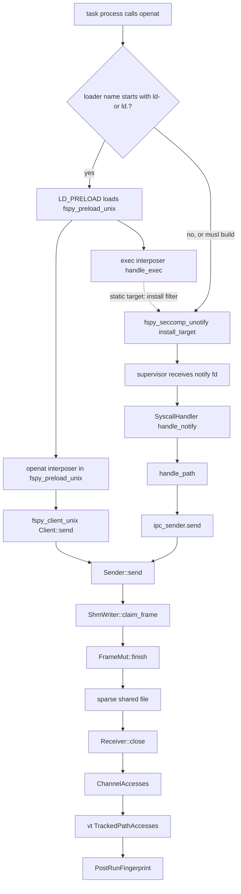
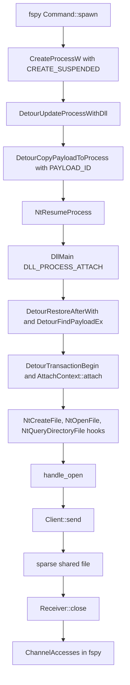
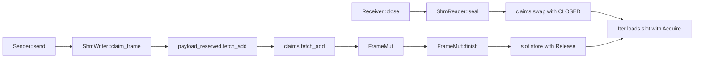

# 08 fspy: Tracing the Real File Access of a Task

Vite Task caches the result of a task. A correct cache key must name the files that the task really read. A hand-written input list can miss a file. It can also include a file that the task never opens. Vite Task therefore traces the file access of the task process. The tracing component is `fspy` (file system spy).

The thesis of this document is that `fspy` observes the program where the program asks the operating system for a file. On Linux it uses two mechanisms. A preloaded shared library intercepts library calls in a program that has a dynamic loader. A seccomp user-notification supervisor intercepts system calls in a fully static program. On a musl build of `fspy`, the same supervisor handles every child, because the preload is not built for musl. On Windows it uses the Microsoft Detours library to divert native file functions. Every record from the traced process enters one shared-memory channel. The parent's exec-resolution records are joined to them when the trace is read. Vite Task, the runner, normalizes the records and uses them as cache inputs.

All paths in this document are relative to the snapshot root `/Users/darkvoid/GitSources/src.voidzero`. Every source-tree path starts with the repository name, such as `vite-task/crates/fspy/src/lib.rs`. This file is document 08 of a series. Document [02](02-vite-plus-toolchain.md) covers the Vite+ toolchain. Document [06](06-vite-task-scheduler.md) covers the scheduler. Document [07](07-vite-task-caching.md) covers the cache key and the artifact. Document [09](09-vite-task-client-and-ipc.md) covers the client and the inter-process communication protocol. Document [10](10-setup-vp-ci.md) covers the Continuous Integration setup. This document does not repeat the cache key format or the scheduler.

The runner is Vite Task itself: the program that starts the task and reads the trace. The crates have two consumers. `vt` is the standalone Vite Task runner binary in this repository. `vp` is the Vite+ command-line interface, which embeds the same crates. seccomp (secure computing mode) is a Linux system-call filter. A seccomp user notification is a feature built on it. A process installs a filter that names system calls. When the process makes one of those calls, the kernel stops it and sends a message to the Vite Task process. The supervisor task in that process reads the call, records it, and tells the kernel to continue.

The source is the Vite Task repository at commit `95d8da2fc1f06cfe8d176b30b608ed540efab066`. Vite+ builds the same crates at a different revision, `cb1ea8d214b26a0f3ca2b2ef3b6bc471b18ffacb` (`vite-plus/Cargo.toml:197`, `vite-plus/Cargo.toml:312-315`). A statement below describes the snapshot. The pinned revision can differ in line numbers, field names, or edge cases. A reader who checks a Vite+ behaviour must check the pinned revision.

This document spells out each abbreviation at its first use. The main spellings are in the first table. The table lists the abbreviations of the series, so it can hold an entry that this document does not use.

| Abbreviation | Spelling |
|---|---|
| API | Application Programming Interface |
| CLI | command-line interface |
| HTML | HyperText Markup Language |
| IPC | inter-process communication |
| JSON | JavaScript Object Notation |
| `LD_PRELOAD` | the Linux dynamic-loader preload variable |
| NAPI | Node-API |
| NPM | Node Package Manager |
| PTY | pseudo-terminal |
| SHM | shared memory |
| URL | Uniform Resource Locator |
| WASM | WebAssembly |

The text also spells out Executable and Linkable Format (ELF), dynamic-link library (DLL), and foreign function interface (FFI). It spells out globally unique identifier (GUID) and input/output (I/O). Environment variable names and function names stay unchanged.

Some names are library or platform names, not abbreviations. The table gives their meaning.

| Name | Meaning |
|---|---|
| glibc | GNU C Library, the usual C library on Linux |
| musl | a small C library, often linked statically |
| cdylib | a C-compatible dynamic library that Cargo can build |
| PLT | procedure linkage table, the table that the dynamic loader fills |
| `dlsym` | the dynamic-loader function that finds a symbol |
| `RTLD_NEXT` | the `dlsym` handle that asks for the next definition |
| `PATH_MAX` | the kernel limit on a path length |
| `DYLD_INSERT_LIBRARIES` | the macOS dynamic-loader variable that injects a library |
| pnpm | a Node.js package manager |
| libuv | the event loop library that Node.js uses |
| io_uring | a Linux asynchronous input/output interface |
| Detours | the Microsoft library that redirects function calls |
| reparse point | a Windows file or folder tag that redirects access, such as a symbolic link |
| oxlint | a JavaScript linter |
| seccomp | secure computing mode, a Linux system-call filter |
| `PT_INTERP` | the ELF program-interpreter segment |
| `LazyLock` | a standard-library cell that initializes once on first use |
| dyld | the macOS dynamic loader |
| shim | a small library that stands in front of another library |
| glob | a path pattern with wildcard characters |
| workspace | the root folder of the project that the runner builds |
| `cache.input`, `cache.output` | the task configuration fields for input and output filtering |

Three words have more than one meaning here. "Payload" means the `FSPY_PAYLOAD` environment value, the seccomp configuration, the Windows injected block, or the record bytes in a frame. Each use names the one it means. "Descriptor" means a file descriptor, a notification file descriptor, a directory file descriptor, or an 8-byte slot descriptor. "Snapshot" means the source checkout at the commit above, or a recorded access list in `fspy_e2e`. Each use says which. Section 5.1 defines the frame and the slot.

Each code block starts with a label line, such as `// vite-task/crates/fspy/src/lib.rs:28-34`. The label gives the file and the exact line range. The label is not part of the source text. A `#` label marks a non-Rust file. A `//` label marks Rust source. Some blocks use a four-backtick fence because their source contains a three-backtick fence.

The document uses four terms for the parties around the channel. The "receiver" is the `fspy` object inside the Vite Task process. The "sender" is the preload library or the supervisor task. The "traced process" is the program that Vite Task runs. The "supervisor" is a task inside the Vite Task process, not a separate program (`vite-task/crates/fspy_seccomp_unotify/src/supervisor/mod.rs:33-37`).

## 1. The problem: a cache key from real access

### 1.1 A declared list is a guess

A task can read a configuration file, a generated file, a toolchain file, or an environment-dependent data file. The task author does not always know that list. The list can also change between releases of a tool. Vite Task makes automatic input detection the default. The user document states the default.

```json
# vite-task/docs/inputs.md:10-16
{
  "tasks": {
    "build": {
      "command": "tsc"
    }
  }
}
```

The document states that when `input` is omitted, Vite Task tracks the files
that the command reads during execution, and that a reader usually does not need
to configure `input` (`vite-task/docs/inputs.md:7-19`).

The document also states the design intent. Auto-inference is cautious. It tracks every file that a command reads, including auxiliary files. A positive pattern that adds a file that `fspy` missed is a sign of a bug, not the normal remedy (`vite-task/docs/inputs.md:208-228`). The user filters the trace with negative patterns.

### 1.2 An incomplete trace must not become a cache entry

An incomplete trace is worse than no trace. A subset of the inputs can produce a cache hit for a run that would read a file that is absent from the key. The `TrackingIncomplete` type states the rule.

```rust
// vite-task/crates/fspy/src/error.rs:34-47
/// A tracked process could not record a file access it went on to perform,
/// so the accesses collected for the run are a subset of what it really
/// touched.
///
/// The tracking channel can be full, or a process can continue untracked
/// because the seccomp filter could not be installed.
///
/// The run itself is unaffected: recording must never stop the program
/// doing the work. What cannot be done is anything that needs every
/// access, caching above all, which has to treat the run as untracked
/// rather than as having touched only the paths that fit.
#[derive(thiserror::Error, Clone, Copy, PartialEq, Eq, Debug)]
#[error("automatic file tracking could not record every file access")]
pub struct TrackingIncomplete;
```

The consumer applies this rule before it builds any cache value. An `Err` result stops the cache update with the reason `TrackingIncomplete` (`vite-task/crates/vt/src/session/execute/cache_update.rs:106-113`).

```rust
// vite-task/crates/vt/src/session/execute/cache_update.rs:106-113
    // The accesses, or `None` when the task was not tracked at all. An
    // `Err` means tracking could not record everything it did, so what
    // arrived is a subset of what it touched, and an entry
    // built from a subset would replay with inputs and outputs missing.
    #[cfg(fspy)]
    let Ok(path_accesses) = outcome.path_accesses.as_ref().map(Result::as_ref).transpose() else {
        return (CacheUpdateStatus::NotUpdated(CacheNotUpdatedReason::TrackingIncomplete), None);
    };
```

A run also escapes caching for other reasons. A tool can disable the cache, the run can be cancelled, or the exit status can be non-zero. A binary can also lack the `fspy` build feature. Three of these checks come before the trace check, and the feature check comes after (`vite-task/crates/vt/src/session/execute/cache_update.rs:79-104`, `vite-task/crates/vt/src/session/execute/cache_update.rs:126-131`).

### 1.3 How a record becomes a cache input

The path from a record to a cache input goes through four stages. Stage one: a sender writes one `PathAccess` value into the shared-memory channel. Stage two: the receiver closes the channel and gets a `PathAccessIterable`. Stage three: `TrackedPathAccesses::from_raw` converts each variant into a read, a write, a rename target, or a mkdir, and drops paths outside the workspace (`vite-task/crates/vt/src/session/execute/tracked_accesses.rs:31-91`). `observe_fspy` then filters the reads and the writes with the user globs (`vite-task/crates/vt/src/session/execute/cache_update.rs:248-278`). Stage four: `PostRunFingerprint::create` hashes the read files and the written files to form the post-run key (`vite-task/crates/vt/src/session/execute/cache_update.rs:149-173`). A write, a rename target, and a mkdir also feed `Rebuildable`, which decides what the output archive holds (`vite-task/crates/vt/src/session/execute/cache_update.rs:241-249`, `vite-task/crates/vt/src/session/execute/cache_update.rs:424-478`). [Document 07](07-vite-task-caching.md) owns the key format and the `*.tar.zst` archive.

The important property is the direction. The declared positive globs are hashed before the run. The observed reads are added after the run. A new file that the tool reads therefore enters the next key without a configuration change. The key does not come only from a declaration.

## 2. The crate family

The `fspy` directory holds seventeen packages. Fifteen are libraries or test tools. Two produce a loadable image for a platform: `fspy_preload_unix` and `fspy_preload_windows`. The table gives the role of each package.

| Crate or package | Role | Platform | Mechanism |
|---|---|---|---|
| `fspy` | Public `Command`, spawn, wait, record collection | all | selects the platform spy |
| `fspy_shared` | Event types, channel, Windows payload type | all | shared data model |
| `fspy_shared_unix` | Exec resolution, payload encoding, Unix spawn decisions | Unix | environment and ELF |
| `fspy_preload_unix` | Interposed library calls, constructors, exec hooks | Unix, non-musl | `LD_PRELOAD` or `DYLD_INSERT_LIBRARIES` |
| `fspy_preload_windows` | Injected DLL, `DllMain`, Detours hooks | Windows | Detours |
| `fspy_client_unix` | Reusable client for a Unix preload | Unix, non-musl | reports to the channel |
| `fspy_shm` | Sparse-file shared-memory mapping | Unix, Windows | file mapping |
| `fspy_seccomp_unotify` | Supervisor and target sides of seccomp user notification | Linux | seccomp |
| `fspy_detours_sys` | FFI bindings and build script for Detours | Windows | Detours |
| `fspy_nostd` | Low-level operations for early or lock-sensitive contexts | Linux, macOS, Windows | raw syscalls or Win32 |
| `fspy_nostd_alloc` | Allocator that never calls `malloc` | all | mmap or `VirtualAlloc` |
| `fspy_test_bin` | Synthetic access actions for tests | Linux | library calls |
| `fspy_e2e` | Snapshot harness over real repositories | all | `fspy::Command` |
| `fspy_benchmark` | Compares two `fspy` builds | all | three-arm rotation |
| `fspy_benchmark_target` | Timed opens inside the traced process | all | `File::open` |
| `fspy_benchmark_static_target` | Same target for the musl build | Linux x86-64 | `include!` |
| `fspy_benchmark_launcher` | Tracks or does not track the target | all | `fspy::Command` |

The `fspy` package is version `0.1.0` and sets `publish = false` (`vite-task/crates/fspy/Cargo.toml:1-6`). The public crate is consumed through a Git revision, not through the NPM registry.

### 2.1 `fspy`

`fspy` is the front door. `Command` has the same builder methods as a standard process command. `Command::spawn` accepts a cancellation token, which stops the child when the caller cancels the run. The crate owns a global `SpyImpl`, the platform implementation object, which it initializes one time (`vite-task/crates/fspy/src/lib.rs:60-61`). The wait future returns a `ChildTermination`, which holds the exit status and the path accesses (`vite-task/crates/fspy/src/lib.rs:28-34`). The platform code lives behind `os_impl`. On Unix the file is `vite-task/crates/fspy/src/unix/mod.rs`. On Windows the file is `vite-task/crates/fspy/src/windows/mod.rs` (`vite-task/crates/fspy/src/lib.rs:5-11`). The crate re-exports `IpcPath` and `PathAccess` so a consumer does not depend on `fspy_shared` directly (`vite-task/crates/fspy/src/lib.rs:21`).

### 2.2 `fspy_shared`

`fspy_shared` holds the data that both sides must agree on. It defines `AccessMode` and the six `PathAccess` variants (`vite-task/crates/fspy_shared/src/ipc/mod.rs:17-56`). It defines the channel: creation, sender, receiver, sealing, and loss reporting (`vite-task/crates/fspy_shared/src/ipc/channel/mod.rs:26-379`). It also holds the Windows payload type and its `PAYLOAD_ID` GUID (`vite-task/crates/fspy_shared/src/windows/mod.rs:6-27`). The crate uses `wincode`, a binary serialization crate, to serialize the records and the payload (`vite-task/crates/fspy_shared/Cargo.toml:9`). The channel format is therefore binary.

### 2.3 `fspy_shared_unix`

`fspy_shared_unix` holds the Unix logic that runs in the Vite Task process and in the preload. It resolves an executable with a `PATH` search and optional interpreter handling (`vite-task/crates/fspy_shared_unix/src/exec/mod.rs:1-251`). It reads a `#!` interpreter line when the program is a script. It then replaces the program with the interpreter and moves the script path into the argument list (`vite-task/crates/fspy_shared_unix/src/exec/mod.rs:155-176`; `vite-task/crates/fspy_shared_unix/src/exec/shebang.rs:8-12`). This is the spawn-time resolver, and it changes the program that the runner starts. It encodes and decodes the `FSPY_PAYLOAD` environment value with base64 (`vite-task/crates/fspy_shared_unix/src/payload.rs:45`, `vite-task/crates/fspy_shared_unix/src/payload.rs:76-141`). Its Linux `handle_exec` decides between preload and seccomp (`vite-task/crates/fspy_shared_unix/src/spawn/linux/mod.rs:34-65`). The crate is compiled only for Unix, and `fspy_preload_unix` uses its exec helpers.

### 2.4 `fspy_preload_unix`

This crate is a `cdylib` (a C-compatible dynamic library) (`vite-task/crates/fspy_preload_unix/Cargo.toml:8`). It contains only the code of the injected shared library. The `fspy` crate performs the injection (`vite-task/crates/fspy_preload_unix/README.md:3-5`). A constructor function, which the dynamic loader calls when it loads the library, reads the payload from the environment and installs a global client (`vite-task/crates/fspy_preload_unix/src/client.rs:28-44`). An interposer is a function that replaces a library function. Interposers cover file opens, status calls, directory listings, namespace changes, exec calls, the `syscall` function, and on macOS the dyld image-index functions (`vite-task/crates/fspy_preload_unix/src/interceptions`). The library is built only for non-musl Unix targets (`vite-task/crates/fspy_preload_unix/src/lib.rs:1-11`).

### 2.5 `fspy_preload_windows`

This crate is also a `cdylib`. Its `DllMain` (the function that Windows calls when it loads or unloads a DLL) attaches the Detours hooks when Windows loads the DLL (`vite-task/crates/fspy_preload_windows/src/windows/mod.rs:28-98`). The hooks are the `CreateProcess` pair (`vite-task/crates/fspy_preload_windows/src/windows/detours/create_process.rs:46`, `vite-task/crates/fspy_preload_windows/src/windows/detours/create_process.rs:168`), `NtCreateUserProcess`, and ten native file functions (`vite-task/crates/fspy_preload_windows/src/windows/detours/nt.rs:729-741`). It is compiled only for Windows (`vite-task/crates/fspy_preload_windows/src/lib.rs:1-2`). The crate README states that the injection belongs to `fspy` (`vite-task/crates/fspy_preload_windows/README.md:3-5`).

### 2.6 `fspy_client_unix`

`fspy_client_unix` is the reusable part of a Unix client. It decodes the payload from the environment, opens the sender, and reports one access (`vite-task/crates/fspy_client_unix/src/lib.rs:43-88`). It also owns the exec transformation and the loss report (`vite-task/crates/fspy_client_unix/src/lib.rs:90-152`). The README says the preload keeps the interception-specific initialization and the re-entry guards (`vite-task/crates/fspy_client_unix/README.md:3-8`). Section 3.2 explains why the Linux open handler needs none. That split lets another Unix injection mechanism use the same client.

### 2.7 `fspy_shm`

`fspy_shm` owns the bytes. It creates a zero-initialized sparse file at a caller-chosen path, opens the file in another process, maps it, and removes it (`vite-task/crates/fspy_shm/src/unix.rs:53-112`). The Windows implementation supplies the same create, open, map, and remove operations. This section describes the Unix file design. The crate is `no_std`. Paths arrive as platform C strings, and errors are raw operating-system codes (`vite-task/crates/fspy_shm/README.md:31`). The README records the rejected alternatives and the reason for each (`vite-task/crates/fspy_shm/README.md:45-53`). POSIX shared memory is rejected because sandboxes deny it on macOS and Linux stores the objects under `/dev/shm`. A `memfd` with a descriptor broker is rejected because it needs a Unix-domain socket and an asynchronous runtime. System V shared memory is rejected because of namespace limits and manual removal. A paging-file-backed section is rejected because it charges the full size against the commit limit. A reserved section is rejected because writers must coordinate commits. A Mach memory entry is rejected because it needs a separate port service. The selected design is a sparse temporary file opened by path.

### 2.8 `fspy_seccomp_unotify`

This crate wraps the Linux seccomp user-notification feature. Two Cargo features split the two sides. The `supervisor` feature holds code for the process that tracks children. The `target` feature holds code for a tracked child (`vite-task/crates/fspy_seccomp_unotify/README.md:3-6`). The target installs a filter and sends the notification descriptor to the supervisor (`vite-task/crates/fspy_seccomp_unotify/src/target.rs:21-33`). The supervisor builds the filter, listens on a temporary Unix socket, receives one descriptor for each target process, and answers each notification (`vite-task/crates/fspy_seccomp_unotify/src/supervisor/mod.rs:68-135`).

### 2.9 `fspy_detours_sys`

This crate supplies raw FFI bindings to Microsoft Detours (`vite-task/crates/fspy_detours_sys/README.md:1-3`). Its build script compiles five C++ files when the target operating system is Windows: `detours.cpp`, `modules.cpp`, `disasm.cpp`, `image.cpp`, and `creatwth.cpp` (`vite-task/crates/fspy_detours_sys/build.rs:1-18`).

The Detours source is a Git submodule at `vite-task/crates/fspy_detours_sys/detours` (`vite-task/.gitmodules:1-3`). The submodule is not checked out in this snapshot. `git submodule status` prints a leading minus sign and the expected commit `9764cebcb1a75940e68fa83d6730ffaf0f669401`. The directory is empty. This document does not describe the contents of Detours. It cites only the wrapper crate and the calls that the wrapper exports.

### 2.10 `fspy_nostd`

`fspy_nostd` holds operations that must work before the process runtime is ready, or in a context where normal runtime code can deadlock (`vite-task/crates/fspy_nostd/README.md:1-3`). The crate is `no_std` outside its tests (`vite-task/crates/fspy_nostd/src/lib.rs:8`). Section 6 explains the three contexts and the reasons.

### 2.11 `fspy_nostd_alloc`

This crate is the allocator for the same early contexts. It never calls `malloc` (`vite-task/crates/fspy_nostd_alloc/src/lib.rs:1-13`). It stacks three layers. A page allocator maps anonymous pages on Unix or allocates a `VirtualAlloc` region on Windows. A process-wide `ChunkPool` caches 64 KiB chunks. A bump arena draws its chunks from the pool. A bump arena hands out memory by moving a pointer, and it does not free one block at a time. The function `page_bump()` returns a bump that bypasses the pool when a caller needs memory that must never be recycled. Section 6 gives the deadlock reason.

### 2.12 `fspy_test_bin`

`fspy_test_bin` is a Linux-only binary for tests (`vite-task/crates/fspy_test_bin/src/main.rs:1-5`). One argument selects an action. The action takes one or two paths. The actions cover read, write, and read-write opens, and the `openat2` forms. They also cover a directory read, a stat, an exec, a mkdir, and a rename. The last actions are `renameat2`, a hard link, and a symbolic link (`vite-task/crates/fspy_test_bin/src/main.rs:22-82`). The `fspy` tests use it as an artifact dependency, which Cargo builds before the test and passes by an environment variable, for the musl target. An artifact dependency is a Cargo dependency on a binary that Cargo builds for another package. The seccomp path therefore has a fully static subject (`vite-task/crates/fspy/Cargo.toml:71-72`).

### 2.13 `fspy_e2e`

`fspy_e2e` runs real commands through `fspy::Command` and writes a sorted snapshot of the accesses (`vite-task/crates/fspy_e2e/src/main.rs:61-127`). Section 7.2 describes the cases and the stored snapshots.

### 2.14 `fspy_benchmark`

The harness measures what `fspy` costs a process it tracks. It never compares two runs on two machines. It builds the launcher twice, once against the `fspy` under review and once against the merge-base `fspy`. The merge base is the common ancestor commit of the two branches. It then interleaves the two builds on one machine (`vite-task/crates/fspy_benchmark/src/main.rs:1-19`). Section 7.3 gives the suites.

### 2.15 `fspy_benchmark_target`

The target opens missing paths from several threads. It prints one median batch time in nanoseconds (`vite-task/crates/fspy_benchmark_target/src/main.rs:9-13`, `vite-task/crates/fspy_benchmark_target/src/main.rs:62-71`). It does not link `fspy`, so the measurement covers the interception and not the harness (`vite-task/crates/fspy_benchmark/README.md:22`).

### 2.16 `fspy_benchmark_static_target`

This package compiles the same source for the musl target. The file contains one `include!` of the dynamic target's source (`vite-task/crates/fspy_benchmark_static_target/src/main.rs:1-5`). The comment gives the reason. Cargo names artifact environment variables after the package. One package cannot be an artifact dependency for two target triples. On Linux x86-64 the harness measures both the dynamic target and this static target (`vite-task/crates/fspy_benchmark/src/main.rs:121-127`).

### 2.17 `fspy_benchmark_launcher`

The launcher is the only benchmark piece that links `fspy` (`vite-task/crates/fspy_benchmark_launcher/src/main.rs:1-9`). It runs the target in one of three modes. `Tracked` uses `fspy::Command`. `Untracked` uses a standard process command. `Validate` asserts that the trace contains the missing path (`vite-task/crates/fspy_benchmark_launcher/src/main.rs:36-63`, `vite-task/crates/fspy_benchmark_launcher/src/main.rs:160-194`).

## 3. Linux: two interception mechanisms

Linux has two mechanisms because one mechanism cannot cover every program. `LD_PRELOAD` changes the library lookup of a program that uses the dynamic loader. The spawn decision asks whether the ELF image has a `PT_INTERP` segment whose loader name starts with `ld-` or `ld.` (`vite-task/crates/fspy_shared_unix/src/elf.rs:15-24`). A fully static program has no such segment. A musl program has a loader. These are two different cases: the traced program can use musl while `fspy` itself is built with glibc. However, `fspy` cannot build the preload for a musl target, because cdylib support is absent on musl (`vite-task/crates/fspy_shared_unix/src/spawn/linux/mod.rs:38-39`). On a musl build of `fspy`, the preload is not compiled at all, so the seccomp path handles every child.

### 3.1 The spawn decision

The `fspy` crate resolves the program and calls `handle_exec` (`vite-task/crates/fspy/src/unix/mod.rs:127-137`). That function opens the executable, maps it, and asks whether the ELF image names a dynamic loader (`vite-task/crates/fspy_shared_unix/src/spawn/linux/mod.rs:42-47`). The test is a name test: the loader file name must start with `ld-` or `ld.` (`vite-task/crates/fspy_shared_unix/src/elf.rs:15-24`). The answer selects the mechanism.

```rust
// vite-task/crates/fspy_shared_unix/src/spawn/linux/mod.rs:38-65
    // On musl targets, LD_PRELOAD is not available (cdylib not supported).
    // Always use seccomp-based tracking instead.
    #[cfg(not(target_env = "musl"))]
    {
        let executable_fd = open_executable(Path::new(OsStr::from_bytes(&command.program)))?;
        // SAFETY: The file descriptor is valid and we only read from the mapping.
        let executable_mmap = unsafe { Mmap::map(&executable_fd) }.map_err(|io_error| {
            nix::Error::try_from(io_error).unwrap_or(nix::Error::UnknownErrno)
        })?;
        if elf::is_dynamically_linked_to_libc(executable_mmap)? {
            // Append (don't overwrite) so a user-provided LD_PRELOAD keeps
            // working. fspy's shim goes last so user preloads that
            // short-circuit a libc call stay invisible to fspy — what the
            // OS actually executed is what we want to record.
            append_path_env(
                &mut command.envs,
                LD_PRELOAD,
                encoded_payload.payload.preload_path.as_os_str().as_bytes(),
            );
            ensure_env(&mut command.envs, PAYLOAD_ENV_NAME, encoded_payload.encoded_string)?;
            return Ok(None);
        }
    }

    command
        .envs
        .retain(|(name, _)| name != LD_PRELOAD.as_bytes() && name != PAYLOAD_ENV_NAME.as_bytes());
    Ok(Some(PreExec(encoded_payload.payload.seccomp_payload.clone())))
```

The dynamic case returns `Ok(None)`, so the seccomp `PreExec` is absent. The program starts with `LD_PRELOAD` and `FSPY_PAYLOAD` in its environment. The static case removes both variables and returns a `PreExec`. A `PreExec` is a function that runs in the child after the fork and before the exec. The pre-exec function installs the seccomp filter and connects to the supervisor (`vite-task/crates/fspy/src/unix/mod.rs:143-151`).

`append_path_env` appends the `fspy` library as the last entry. It does not overwrite an existing value, and it is idempotent when the value is already last (`vite-task/crates/fspy_shared_unix/src/exec/mod.rs:222-251`).

**Aha:** the position is deliberate. A user preload can replace a C library call and never reach the real implementation. If `fspy` came first, the trace would describe the call that the user library replaced, not the call that the operating system executed. The source comment states this rule (`vite-task/crates/fspy_shared_unix/src/spawn/linux/mod.rs:48-52`).

### 3.2 The preload path

The constructor runs when the dynamic loader loads the library. It reads the current environment, decodes the base64 payload, creates a `PageBump` in static storage, and sets a global `Client<'static>` (`vite-task/crates/fspy_preload_unix/src/client.rs:28-44`). A `PageBump` is a bump arena that never returns its memory to the chunk pool. It gives the client a `'static` allocator without a retained allocator handle (`vite-task/crates/fspy_preload_unix/src/client.rs:34-43`).

Every interposer reports an access and then calls the original function. The `openat` interposer is typical.

```rust
// vite-task/crates/fspy_preload_unix/src/interceptions/open.rs:43-63
intercept!(openat(64): unsafe extern "C" fn(c_int, *const c_char, c_int, ...) -> c_int);
unsafe extern "C" fn openat(
    dirfd: c_int,
    path: *const c_char,
    flags: c_int,
    mut args: ...
) -> c_int {
    // SAFETY: dirfd is -1 or a valid file descriptor, and path is a valid C string, provided by the caller of the interposed function
    unsafe { handle_open(PathAt::borrow_raw(dirfd, path), OpenFlags(flags)) };

    if has_mode_arg(flags) {
        // https://github.com/tailhook/openat/issues/21#issuecomment-535914957
        // SAFETY: when O_CREAT or O_TMPFILE is set, a mode_t argument is required by the openat() contract
        let mode: Mode = unsafe { args.next_arg() };
        // SAFETY: calling the original libc openat() with the same arguments forwarded from the interposed function
        unsafe { openat::original()(dirfd, path, flags, mode) }
    } else {
        // SAFETY: calling the original libc openat() with the same arguments forwarded from the interposed function
        unsafe { openat::original()(dirfd, path, flags) }
    }
}
```

The `intercept!` macro exports the named function and, for the `(64)` form, also a 64-bit alias. The alias is a naked assembly trampoline. On x86-64 it jumps to the named function. On aarch64 it branches to the named function (`vite-task/crates/fspy_preload_unix/src/macros/linux.rs:1-31`). `original()` resolves the next definition of the symbol with `dlsym(RTLD_NEXT)` and caches it in a `LazyLock` (`vite-task/crates/fspy_preload_unix/src/macros/linux.rs:96-127`).

The interposer must not call a function that can bind back to itself. The client comments this rule.

```rust
// vite-task/crates/fspy_preload_unix/src/client.rs:12-26
// The handler needs no re-entry guard: on Linux everything it calls is a
// raw syscall — nothing binds through the PLT, where LD_PRELOAD would
// resolve to our own interposers — and on macOS dyld never applies
// `__interpose` tuples to the interposing image's own bindings, the same
// exemption every `original()` forward relies on. Keep the handler free of
// bindable libc calls on Linux: a call that binds to an interposer here
// recurses until the traced process overflows its stack.
pub unsafe fn handle_open(path: impl ToAbsolutePath, mode: impl ToAccessMode) {
    if let Some(client) = global_client() {
        let allocator = fspy_nostd_alloc::pooled_bump();
        // SAFETY: path and mode contain valid pointers/values forwarded
        // from the interposed function's caller.
        unsafe { client.try_handle_open(path, mode, allocator) }.unwrap();
    }
}
```

The preload covers open calls: `open`, `openat`, `open64`, `openat64`, `fopen`, and `freopen`. It covers status and access calls: `stat`, `lstat`, `fstatat`, `statx`, `access`, and `faccessat`. It covers directory calls: `scandir`, `opendir`, `fdopendir`, and `getdirentries`. It covers namespace calls: `mkdir`, `mkdirat`, `rename`, `renameat`, `renameat2`, `link`, `linkat`, `symlink`, and `symlinkat`. It covers exec calls: `execve`, `execveat`, `fexecve`, `execl`, `execlp`, `execle`, `execv`, `execvp`, `execvpe`, `posix_spawn`, and `posix_spawnp`. It also covers the `syscall` function for the `statx` case (`vite-task/crates/fspy_preload_unix/src/interceptions`).

The open interposer has three failure paths. First, when the global client is absent, it records nothing. Second, `try_handle_open` returns an error only from path resolution; the caller uses `unwrap()`, so such an error would panic the traced process (`vite-task/crates/fspy_preload_unix/src/client.rs:19-26`). The source comment states that the library must never panic its host, and this document cannot find a guard around that call. Third, the sender has no error return. A failed claim drops the record and sets the gate, so the receiver reports `RecordsLost` (`vite-task/crates/fspy_shared/src/ipc/channel/mod.rs:244-258`). If the sender was never attached, `send` returns without a record and without a loss report (`vite-task/crates/fspy_client_unix/src/lib.rs:74-88`). Section 9 lists these limits.

**Aha:** the preload does not interpose `openat2`. A search of the interceptions directory finds no `openat2` symbol. A program that calls `openat2` through the C library is therefore not traced by the preload. The seccomp handler does cover `openat2`, and the static test binary exercises it (`vite-task/crates/fspy_test_bin/src/main.rs:22-82`; `vite-task/crates/fspy/tests/static_executable.rs:49-61`). This is a real gap between the two Linux mechanisms.

The exec hooks do more than record. They resolve the new program and record the program path as a read. They then arrange tracking for the new image. A dynamic image keeps the preload through the inherited `LD_PRELOAD` value. For a static image, `handle_exec` returns a `PreExec`. The hook calls `PreExec::run()` in the current process, before the original `execve`. That call installs the seccomp filter in the process that is about to exec. A seccomp filter survives the exec, so the new static image starts with it (`vite-task/crates/fspy_preload_unix/src/interceptions/spawn/exec/mod.rs:72-91`; `vite-task/crates/fspy_shared_unix/src/spawn/linux/mod.rs:22-31`). The filter also survives every later exec in that process subtree. A later dynamic image in that subtree is therefore traced by seccomp, not by the preload. If the filter cannot be installed, the hook calls `report_loss` and runs the original call untracked. `posix_spawn` and `posix_spawnp` follow the same pattern (`vite-task/crates/fspy_preload_unix/src/interceptions/spawn/posix_spawn.rs:72-94`).

### 3.3 The seccomp path

The target installs the filter after the fork and before the exec. It first sets the no-new-privileges flag, which the kernel requires before an unprivileged process installs a filter. It then installs the filter, connects to the supervisor's temporary Unix socket, and sends the notification descriptor (`vite-task/crates/fspy_seccomp_unotify/src/target.rs:21-33`).

The filter marks each listed system call as a user notification. When the target makes such a call, the kernel stops the target and sends a message on the notification descriptor. The supervisor reads the call arguments, writes any record it can, and replies CONTINUE. The target then performs the call. The target cannot pass the call before the supervisor replies.

```rust
// vite-task/crates/fspy_seccomp_unotify/src/target.rs:21-33
pub fn install_target(payload: &SeccompPayload) -> nix::Result<()> {
    set_no_new_privs()?;
    let sock_filters =
        payload.filter.0.iter().copied().map(sock_filter::from).collect::<Vec<sock_filter>>();
    let notify_fd = install_unotify_filter(&sock_filters)?;
    let ipc_path = OsStr::from_bytes(&payload.ipc_path);
    let ipc_unix_stream = UnixStream::connect(ipc_path)
        .map_err(|err| nix::Error::try_from(err).unwrap_or(nix::Error::UnknownErrno))?;
    ipc_unix_stream
        .send_fd(notify_fd.as_raw_fd())
        .map_err(|err| nix::Error::try_from(err).unwrap_or(nix::Error::UnknownErrno))?;
    Ok(())
}
```

The filter makes each listed system call a user notification, and it allows every other call (`vite-task/crates/fspy_seccomp_unotify/src/supervisor/mod.rs:77-83`). The supervisor creates the filter in `supervise` and stores it in the payload (`vite-task/crates/fspy_seccomp_unotify/src/supervisor/mod.rs:77-91`). The supervisor is an asynchronous task in the Vite Task process (`vite-task/crates/fspy_seccomp_unotify/src/supervisor/mod.rs:33-37`). It accepts one notification descriptor for each target process. It then runs a handler loop for that process.

```rust
// vite-task/crates/fspy_seccomp_unotify/src/supervisor/mod.rs:97-133
    let handling_loop = async move {
        let mut join_set: JoinSet<io::Result<H>> = JoinSet::new();

        loop {
            let accept_future = notify_listener.as_file().accept();
            pin_mut!(accept_future);
            let (incoming_stream, _) = match select(&mut cancel_rx, accept_future).await {
                Either::Left((Err(_), _)) => break,
                Either::Right((incoming, _)) => incoming?,
            };
            let notify_fd = incoming_stream.recv_fd().await?;
            // SAFETY: `recv_fd` returns a valid file descriptor received via
            // Unix domain socket fd passing
            let notify_fd = unsafe { OwnedFd::from_raw_fd(notify_fd) };
            let mut listener = NotifyListener::try_from(notify_fd)?;

            let mut handler = new_handler();
            let mut resp_buf = alloc_seccomp_notif_resp();

            join_set.spawn(async move {
                while let Some(notify) = listener.next().await? {
                    let _span = span!(Level::TRACE, "notify loop tick");
                    // Errors on the supervisor side could be caused by a target process aborting.
                    // It shouldn't break the syscall handling loop as there might be target processes.
                    let _handle_result = handler.handle_notify(notify);
                    let req_id = notify.id;
                    listener.send_continue(req_id, &mut resp_buf)?;
                }
                io::Result::Ok(handler)
            });
        }
        let mut handlers = Vec::<H>::new();
        while let Some(handler) = join_set.join_next().await.transpose()? {
            handlers.push(handler?);
        }
        Ok(handlers)
    };
```

**Aha:** the constraint is that `handler.handle_notify` must complete before `listener.send_continue` runs (`vite-task/crates/fspy_seccomp_unotify/src/supervisor/mod.rs:121-123`). The handler writes any record it can before the supervisor replies. The target cannot proceed with the system call until that reply. The channel requires this order, and the handler's own comment states it (`vite-task/crates/fspy/src/unix/syscall_handler/mod.rs:24-28`).

The handler result is discarded (`let _handle_result = ...`). The syscall handler does not call `report_loss` when it returns an error. This document cannot find a path that marks the trace incomplete after a failed `process_vm_readv` or a failed descriptor lookup. A reader must treat that as an open question about completeness.

The handler's system-call list is the contract. It covers `open`, `openat`, `openat2`, `getdents`, `getdents64`, `stat`, `lstat`, `newfstatat`, `fstatat`, `statx`, `access`, `faccessat`, `faccessat2`, `mkdir`, `mkdirat`, `rename`, `renameat`, `renameat2`, `link`, `linkat`, `symlink`, `symlinkat`, `execve`, and `execveat` (`vite-task/crates/fspy/src/unix/syscall_handler/mod.rs:88-120`). Some entries exist only on x86-64, because aarch64 has only the `*at` forms. The x86-64-only entries are `open`, `getdents`, `stat`, `lstat`, `newfstatat`, `access`, `mkdir`, `rename`, `link`, and `symlink` (`vite-task/crates/fspy/src/unix/syscall_handler/mod.rs:91-115`).

### 3.4 The record shape

Both mechanisms produce the same value. `PathAccess` has six variants. The variant names the kind of access. The payload is one path.

```rust
// vite-task/crates/fspy_shared/src/ipc/mod.rs:41-56
/// A file system access made by a traced process, with the paths it touched.
// TODO: add follow_symlinks (O_NOFOLLOW)
#[derive(SchemaWrite, SchemaRead, Debug, Clone, Copy, PartialEq, Eq)]
#[wincode(tag_encoding = "u8")]
pub enum PathAccess<'a> {
    Read(&'a IpcPath),
    Write(&'a IpcPath),
    ReadWrite(&'a IpcPath),
    ReadDir(&'a IpcPath),
    /// The new path of a rename. What is there after the call, a file or a
    /// whole folder, was put there without being opened.
    RenameTarget(&'a IpcPath),
    /// A folder made by `mkdir`, recorded whether or not the call succeeded,
    /// so the folder may have been there already.
    Mkdir(&'a IpcPath),
}
```

`AccessMode` is the pre-path form. The client chooses it from the call arguments, resolves the path, and calls `with_path` (`vite-task/crates/fspy_shared/src/ipc/mod.rs:17-39`). `IpcPath` stores platform-native units: bytes on Unix and UTF-16 code units on Windows (`vite-task/crates/vt_ipc_str/src/lib.rs:36-52`; `vite-task/crates/fspy_shared/src/ipc/ipc_path.rs:21-32`). A record therefore keeps the exact bytes or code units that the program passed, with no lossy conversion. The Linux handler resolves a relative name against the directory descriptor before it sends the record, but it does not re-encode the name.

The enum carries a `TODO` for a `follow_symlinks` field (`vite-task/crates/fspy_shared/src/ipc/mod.rs:42`). A record therefore does not say whether the open followed a symbolic link. Section 9 treats this as an open question.

The Linux syscall handler maps the open flags and resolves a relative path.

```rust
// vite-task/crates/fspy/src/unix/syscall_handler/mod.rs:39-75
    fn handle_open(
        &mut self,
        caller: Caller,
        dir_fd: Fd,
        path_ptr: CStrPtr,
        flags: c_int,
    ) -> io::Result<()> {
        let mode = match flags & libc::O_ACCMODE {
            libc::O_RDWR => AccessMode::ReadWrite,
            libc::O_WRONLY => AccessMode::Write,
            _ => AccessMode::Read,
        };
        self.handle_path(caller, dir_fd, path_ptr, mode)
    }

    fn handle_path(
        &mut self,
        caller: Caller,
        dir_fd: Fd,
        path_ptr: CStrPtr,
        mode: AccessMode,
    ) -> io::Result<()> {
        let Some(path_len) = path_ptr.read(caller, &mut self.path_read_buf)? else {
            // Ignore paths that are too long to fit in PATH_MAX
            return Ok(());
        };
        let mut path = Cow::Borrowed(Path::new(OsStr::from_bytes(&self.path_read_buf[..path_len])));
        if !path.is_absolute() {
            let mut resolved_path = PathBuf::from(dir_fd.get_path(caller)?);
            if !nix::NixPath::is_empty(path.as_ref()) {
                resolved_path.push(&path);
            }
            path = Cow::Owned(resolved_path);
        }
        self.ipc_sender.send(&mode.with_path(path.as_os_str().into()));
        Ok(())
    }
```

The path bytes are read from the target process with `process_vm_readv` (`vite-task/crates/fspy_seccomp_unotify/src/supervisor/handler/arg.rs:45-60`, `vite-task/crates/fspy_seccomp_unotify/src/supervisor/handler/arg.rs:75-90`). A relative path is resolved against the directory descriptor. The current directory appears as `AT_FDCWD`. The reader maps that value to `/proc/<pid>/cwd`, and maps an open descriptor to `/proc/<pid>/fd/<n>` (`vite-task/crates/fspy_seccomp_unotify/src/supervisor/handler/arg.rs:169-178`). A path longer than `PATH_MAX` is ignored (`vite-task/crates/fspy/src/unix/syscall_handler/mod.rs:61-64`). The kernel rejects such a path with `ENAMETOOLONG` before it opens a file. The ignored path therefore cannot describe a real access.

### 3.5 What each call records

The two mechanisms use the same rules for the access kind. The preload gets the open mode from `OpenFlags::to_access_mode`, which tests the same three flag values (`vite-task/crates/fspy_client_unix/src/convert.rs:215-223`). The table gives the rules with a source.

| Call or action | Recorded value | Evidence |
|---|---|---|
| `open` with read access | `Read` | `vite-task/crates/fspy/src/unix/syscall_handler/mod.rs:46-50`; the preload interposes the call at `vite-task/crates/fspy_preload_unix/src/interceptions/open.rs:28-41` |
| `open` with write access | `Write` | the same lines |
| `open` with read and write | `ReadWrite` | the same lines |
| `stat`, `lstat`, `access`, `statx` | `Read` | `vite-task/crates/fspy_preload_unix/src/interceptions/stat.rs:11-19`; `vite-task/crates/fspy_preload_unix/src/interceptions/stat.rs:21-30`; `vite-task/crates/fspy_preload_unix/src/interceptions/stat.rs:47-82`; `vite-task/crates/fspy_preload_unix/src/interceptions/access.rs:9-17`; `vite-task/crates/fspy_preload_unix/src/interceptions/linux_syscall.rs:26-49` |
| directory listing | `ReadDir` | `vite-task/crates/fspy/src/unix/syscall_handler/getdents.rs:7-16`; `vite-task/crates/fspy_preload_unix/src/interceptions/dirent.rs:7-21` |
| `mkdir` | `Mkdir`, even if the folder exists | `vite-task/crates/fspy/src/unix/syscall_handler/namespace.rs:17-29`; `vite-task/crates/fspy_shared/src/ipc/mod.rs:53-55` |
| `rename` destination | `RenameTarget`; the source is ignored | `vite-task/crates/fspy/src/unix/syscall_handler/namespace.rs:31-56` |
| hard link destination | `Write`; the source is ignored | `vite-task/crates/fspy/src/unix/syscall_handler/namespace.rs:58-73` |
| symbolic link name | `Write`; the link text is ignored | `vite-task/crates/fspy/src/unix/syscall_handler/namespace.rs:75-90` |
| `execve` program | `Read` | `vite-task/crates/fspy/src/unix/syscall_handler/execve.rs:7-11` |
| delete, unlink, rmdir | no record | `vite-task/crates/fspy_preload_unix/src/interceptions` has no `unlink` or `rmdir`; `vite-task/crates/fspy/src/unix/syscall_handler/mod.rs:88-120` has no `unlinkat`; the Windows source states the Unix rule (`vite-task/crates/fspy_preload_windows/src/windows/winapi_utils.rs:96-103`) |

The source gives a reason for the ignored inputs. A rename source needs no record, and neither does the target of a symlink, because the target is stored as text and is not accessed (`vite-task/crates/fspy/src/unix/syscall_handler/namespace.rs:1-6`). The destination is recorded as a write or a rename target. The post-run fingerprint then hashes the destination content. A later change to the source of a hard link or a rename changes that same content, so the hash changes. The source does not state a separate reason for the hard-link source. A deletion is different: the trace has no record, so the document cannot show how the cache key notices that a file is absent. Section 9 records that limit.

The namespace module states the rules. The source of a rename needs no record, and neither does the target of a symbolic link, which is stored as text and not accessed (`vite-task/crates/fspy/src/unix/syscall_handler/namespace.rs:1-8`). The module does not give a further reason for the ignored hard-link source. The seccomp `execve` handler has a TODO to parse an interpreter line. That handler covers an `execve` made by the traced process, not the initial spawn. An interpreted script executed this way currently records the script path and not the interpreter (`vite-task/crates/fspy/src/unix/syscall_handler/execve.rs:9-10`). The spawn-time resolver does handle the interpreter, as section 2.3 describes.

Deletion is not recorded on either Unix mechanism. The Windows source states that `unlink`, `rmdir`, and a rename source are not recorded on Unix (`vite-task/crates/fspy_preload_windows/src/windows/winapi_utils.rs:96-100`). That design means a task that deletes a file does not add a write. The source does not state a further reason.

### 3.6 Data path to the parent

All records go to one channel. The `fspy` crate creates the channel before the spawn, with the capacity from `crate::ipc::shm_capacity()` (`vite-task/crates/fspy/src/unix/mod.rs:91-92`). On Linux it also creates the supervisor and gives it a sender on the same channel (`vite-task/crates/fspy/src/unix/mod.rs:96-101`).

```rust
// vite-task/crates/fspy/src/unix/mod.rs:91-101
        let ipc_receiver = channel(crate::ipc::shm_capacity(), allocator_api2::alloc::Global)
            .map_err(SpawnError::ChannelCreation)?;

        // The supervisor records the accesses it intercepts into the same
        // channel as the preload library.
        #[cfg(target_os = "linux")]
        let supervisor = {
            let ipc_sender = Arc::new(ipc_receiver.sender().map_err(SpawnError::ChannelCreation)?);
            supervise(move || SyscallHandler::new(Arc::clone(&ipc_sender)))
                .map_err(SpawnError::Supervisor)?
        };
```

The wait task stops the supervisor before it closes the channel (`vite-task/crates/fspy/src/unix/mod.rs:176-184`). This order matters. A supervisor notification that is still in flight must be recorded before the receiver draws the boundary. The close returns `ChannelAccesses`, which holds the frames read from the closed channel.

The supervisor exists in both Linux cases. In the preload case, the payload carries its seccomp configuration, so a later exec of a static image can install the filter (`vite-task/crates/fspy/src/unix/mod.rs:97-115`). It also gives the seccomp path a sender in the parent process.

On Unix, `FSPY_PAYLOAD` carries three fields: the channel configuration, the preload path, and the seccomp payload (`vite-task/crates/fspy_shared_unix/src/payload.rs:18-40`). The channel configuration holds the shared-memory file name (`vite-task/crates/fspy_shared/src/ipc/channel/mod.rs:49-51`). The preload constructor decodes the payload and calls `ChannelConf::sender`, which opens that file and maps it (`vite-task/crates/fspy_client_unix/src/lib.rs:59-71`; `vite-task/crates/fspy_shared/src/ipc/channel/mod.rs:165-211`). The sender is therefore attached before the constructor returns.

Some records exist before the channel. The parent resolves the program and records each path that the resolution touches. It calls `command.get_exec()`, creates a `PathAccessArena`, and passes a callback to `handle_exec`. The callback adds a `Read` record for each path (`vite-task/crates/fspy/src/unix/mod.rs:127-137`). The arena is a bump arena that owns the record path bytes (`vite-task/crates/fspy/src/arena.rs:7-27`). `PathAccessIterable` holds the arena and the `ChannelAccesses`. Its `iter` yields the arena records first, then the channel records (`vite-task/crates/fspy/src/unix/mod.rs:194-209`).

The capacity is 4 GiB by default. It is the size of the whole mapping, not only the payload area. It is sparse address space, not 4 GiB of real memory (`vite-task/crates/fspy/src/ipc.rs:9-14`). A test can override it with `VP_RUN_INTERNAL_FSPY_SHM_CAPACITY` (`vite-task/crates/fspy/src/ipc.rs:16-34`).

### 3.7 The Linux path in one view



The two mechanisms meet at `Sender::send`. The preload reaches it through `Client::send`. The supervisor holds an `Arc<Sender>` and calls it directly. The receiver does not need to know which one produced a record. It also does not know which process produced it. The record carries only the kind and the path.

## 4. Windows: Detours and a suspended start

The Windows design uses the native system-call interface, not the C library. Most Windows file calls pass through `ntdll.dll`, and many higher-level functions forward to the same implementation in `KernelBase.dll`. A hook on the C library would miss direct native calls. The Detours library rewrites the first instructions of a target function and redirects calls to a replacement function. The replacement calls the original when it is ready.

### 4.1 The suspended start

`fspy` cannot set an environment variable and expect the loader to act on it. It must inject a DLL into a process that has not run any of its own code. The reason is completeness: a process that runs before the hooks attach could open a file with no record, and the trace would look complete. The solution is a suspended start.

```rust
// vite-task/crates/fspy/src/windows/mod.rs:102-119
        let mut command = command.into_tokio_command();
        command.creation_flags(CREATE_SUSPENDED);
        let mut child = command.spawn().map_err(SpawnError::OsSpawn)?;

        let preparation = (|| {
            // Duplicate the process handle before the child is moved into the background
            // task so it stays valid after Tokio closes its copy when the process exits.
            // SAFETY: the child owns this handle and is not waited on during this borrow.
            let process = unsafe { BorrowedHandle::borrow_raw(child.raw_handle().unwrap()) };
            let process_handle = process.try_clone_to_owned().map_err(SpawnError::OsSpawn)?;
            let raw_process = process_handle.as_raw_handle().cast::<winapi::ctypes::c_void>();
            let mut dll_paths = ansi_dll_path_with_nul.as_ptr().cast::<c_char>();
            // SAFETY: raw_process is a valid handle to the suspended child process,
            // dll_paths points to a valid null-terminated ANSI string.
            let success = unsafe { DetourUpdateProcessWithDll(raw_process, &raw mut dll_paths, 1) };
            if success != TRUE {
                return Err(SpawnError::Injection(io::Error::last_os_error()));
            }
```

`DetourUpdateProcessWithDll` writes the DLL path into the suspended process. `fspy` then copies a separate payload into the process. The payload holds the channel configuration and the DLL path.

```rust
// vite-task/crates/fspy/src/windows/mod.rs:121-137
            // SAFETY: raw_process is valid, PAYLOAD_ID is a static GUID,
            // payload_bytes is a valid buffer with the correct length.
            let success = unsafe {
                DetourCopyPayloadToProcess(
                    raw_process,
                    &PAYLOAD_ID,
                    payload_bytes.as_ptr().cast(),
                    payload_len,
                )
            };
            if success != TRUE {
                return Err(SpawnError::Injection(io::Error::last_os_error()));
            }

            // Resume using the process handle, without the nightly main-thread handle API.
            // SAFETY: raw_process is a valid child process handle with PROCESS_SUSPEND_RESUME access.
            let status = unsafe { NtResumeProcess(raw_process) };
```

The payload type has two fields. The first is the channel configuration. The second is the DLL path as bytes (`vite-task/crates/fspy_shared/src/windows/mod.rs:23-27`). The payload travels by value, so the child does not read the parent's environment. The DLL path is a single-byte string with a terminating zero byte (`vite-task/crates/fspy/src/windows/mod.rs:63-73`).

If preparation fails, `fspy` kills the suspended child. It does not leave a suspended process behind (`vite-task/crates/fspy/src/windows/mod.rs:150-153`).

### 4.2 The DLL attach

Windows calls `DllMain` with `DLL_PROCESS_ATTACH` while it holds the loader lock. The DLL must not call code that can take another lock or load another DLL. The attach path uses Detours calls, the `Client` constructor, `AttachContext`, and the allocation pool that does not call `malloc`. It does not use the Rust standard library (`vite-task/crates/fspy_preload_windows/src/windows/mod.rs:34-69`). `DetourRestoreAfterWith` restores the Detours state in the injected DLL before the hooks attach (`vite-task/crates/fspy_preload_windows/src/windows/mod.rs:37-38`). The source gives no more detail on that state.

```rust
// vite-task/crates/fspy_preload_windows/src/windows/mod.rs:34-69
    match reason {
        winnt::DLL_PROCESS_ATTACH => {
            // dbg!((current_exe(), std::process::id()));
            // SAFETY: FFI call to restore Detours state after DLL injection
            ck(unsafe { DetourRestoreAfterWith() })?;

            let mut payload_len: DWORD = 0;
            // SAFETY: FFI call to find the injected payload by GUID
            let payload_ptr =
                unsafe { DetourFindPayloadEx(&PAYLOAD_ID, &raw mut payload_len).cast::<u8>() };
            // SAFETY: creating a static slice from the payload pointer; lifetime is valid for process duration
            let payload_bytes = unsafe {
                slice::from_raw_parts::<'static, u8>(payload_ptr, payload_len.try_into().unwrap())
            };
            let client = Client::from_payload_bytes(payload_bytes, fspy_nostd_alloc::pooled_bump());
            // SAFETY: setting the global client during single-threaded DLL_PROCESS_ATTACH
            unsafe { set_global_client(client) };

            let ctx = AttachContext::new().map_err(|error| {
                // SAFETY: every raw Windows error code is a valid `ERROR` value.
                unsafe { winsafe::co::ERROR::from_raw(error.raw_os_error()) }
            })?;

            // SAFETY: FFI call to begin a Detours transaction
            ck_long(unsafe { DetourTransactionBegin() })?;
            // SAFETY: FFI call to update the current thread in the Detours transaction
            ck_long(unsafe { DetourUpdateThread(GetCurrentThread().cast()) })?;

            for d in DETOURS {
                // SAFETY: attaching each detour within the active Detours transaction
                unsafe { d.attach(&ctx) }?;
            }

            // SAFETY: FFI call to commit the Detours transaction
            ck_long(unsafe { DetourTransactionCommit() })?;
        }
```

Every hook attaches in one transaction. The transaction commits once. This keeps the process consistent between hooks (`vite-task/crates/fspy_preload_windows/src/windows/mod.rs:57-68`).

The attach logic resolves every hook symbol with the same order (`vite-task/crates/fspy_preload_windows/src/windows/detour.rs:76-116`). It first prefers `KernelBase.dll`. A stub in `kernel32.dll` often forwards to the shared implementation in `KernelBase`. A hook on the shared implementation covers every stub. If the symbol is absent there, the code tries `kernel32.dll`, then `ntdll.dll` (`vite-task/crates/fspy_preload_windows/src/windows/detour.rs:93-108`). An `Nt*` symbol is exported by `ntdll.dll`, so it reaches the last step. The `ntdll.dll` fallback also catches a program that calls the native function directly.

### 4.3 The file hooks

The hook set covers process creation, the file opens, the file information calls, the directory queries, the symbolic-link open, and the reparse-point control call. The exact list is `NtCreateUserProcess`, `NtCreateFile`, `NtOpenFile`, `NtSetInformationFile`, `NtFsControlFile`, `NtQueryAttributesFile`, `NtQueryFullAttributesFile`, `NtOpenSymbolicLinkObject`, `NtQueryInformationByName`, `NtQueryDirectoryFile`, and `NtQueryDirectoryFileEx` (`vite-task/crates/fspy_preload_windows/src/windows/detours/nt.rs:729-741`). `CreateProcessW` and `CreateProcessA` are the other two (`vite-task/crates/fspy_preload_windows/src/windows/detours/create_process.rs:46`, `vite-task/crates/fspy_preload_windows/src/windows/detours/create_process.rs:168`).

A hook records a read of the executable image before it forwards `NtCreateUserProcess`. Some Windows versions resolve the image entirely inside that call, so the image never reaches `NtCreateFile` (`vite-task/crates/fspy_preload_windows/src/windows/detours/nt.rs:36-44`).

The query hooks follow one pattern. `NtQueryAttributesFile` and `NtQueryFullAttributesFile` record a read of the queried name. `NtOpenSymbolicLinkObject` records an access of the link, with the access mask of the open. The kind follows that mask: a read mask gives `Read`, a write mask gives `Write`, and both give `ReadWrite` (`vite-task/crates/fspy_preload_windows/src/windows/winapi_utils.rs:117-123`). `NtQueryInformationByName` records a read of the name. `NtQueryDirectoryFile` and `NtQueryDirectoryFileEx` record a `ReadDir` of the folder (`vite-task/crates/fspy_preload_windows/src/windows/detours/nt.rs:473-495`, `vite-task/crates/fspy_preload_windows/src/windows/detours/nt.rs:529-554`, `vite-task/crates/fspy_preload_windows/src/windows/detours/nt.rs:556-584`, `vite-task/crates/fspy_preload_windows/src/windows/detours/nt.rs:586-620`, `vite-task/crates/fspy_preload_windows/src/windows/detours/nt.rs:622-726`).

Every hook records before it forwards. The `NtQueryFullAttributesFile` wrapper calls `handle_open`, then calls the saved original (`vite-task/crates/fspy_preload_windows/src/windows/detours/nt.rs:538-550`). The publish-before-act rule therefore holds for Windows too.

The common open helper resolves the path, maps the access mask, and handles a wildcard.

```rust
// vite-task/crates/fspy_preload_windows/src/windows/detours/nt.rs:497-527
unsafe fn handle_open(access_mode: impl ToAccessMode, path: impl ToAbsolutePath) {
    // SAFETY: converting access mask to AccessMode via FFI-aware trait
    let Some(access_mode) = (unsafe { access_mode.to_access_mode() }) else {
        return;
    };
    // SAFETY: accessing the global client which was initialized during DLL_PROCESS_ATTACH
    let client = unsafe { global_client() };
    // SAFETY: resolving path from Windows object attributes or handle for access tracking
    unsafe {
        path.to_absolute_path(|path| {
            let Some(path) = path else {
                return Ok(());
            };
            let path = path.as_slice();
            let path_access = path.iter().rposition(|c| *c == u16::from(b'*')).map_or_else(
                || access_mode.with_path(IpcPath::from_wide(path)),
                |wildcard_pos| {
                    let path_before_wildcard = &path[..wildcard_pos];
                    let slash_pos = path_before_wildcard
                        .iter()
                        .rposition(|c| *c == u16::from(b'\\') || *c == u16::from(b'/'))
                        .unwrap_or(0);
                    PathAccess::ReadDir(IpcPath::from_wide(&path[..slash_pos]))
                },
            );
            client.send(path_access);
            Ok(())
        })
    }
    .unwrap();
}
```

The helper takes the last `*` as the wildcard. It finds the last `\` or `/` before that position, and slices the path up to, but not including, that separator (`vite-task/crates/fspy_preload_windows/src/windows/detours/nt.rs:511-521`). For `C:\*.txt`, the slice is `C:`, not `C:\`. For a name with no separator before the wildcard, the slice is empty. The source does not explain these two edge cases. A `?` is treated as a literal path character. The source does not state whether that is deliberate.

A wildcard name becomes a `ReadDir` of the parent folder. Windows uses a wildcard in a directory query, and the query reads the folder listing, not a file with an asterisk in its name. The code treats `*` as a wildcard. It does not treat `?` as a wildcard in this snapshot (`vite-task/crates/fspy_preload_windows/src/windows/detours/nt.rs:511-521`).

The access mask mapping has one special case. An open that asks for `DELETE` and no data access does not count as a read or a write. Such an open is the first step of a delete or a rename. The change itself happens in a later call. The mapping returns no record (`vite-task/crates/fspy_preload_windows/src/windows/winapi_utils.rs:96-124`). A write request becomes `Write`, a read request becomes `Read`, and a request for both becomes `ReadWrite` (`vite-task/crates/fspy_preload_windows/src/windows/winapi_utils.rs:117-123`).

`NtSetInformationFile` covers a rename and a hard link. The handler records the new name as `RenameTarget` for a rename, and as a `Write` for a hard link. A bare sibling name is resolved against the folder of the source file (`vite-task/crates/fspy_preload_windows/src/windows/detours/nt.rs:330-345`). `NtFsControlFile` records a reparse-point change as a write (`vite-task/crates/fspy_preload_windows/src/windows/detours/nt.rs:407-410`).

### 4.4 Child processes

A traced process can start another process. The child must receive the DLL and the payload. `fspy` replaces `CreateProcessW` and `CreateProcessA` with `DetourCreateProcessWithDllExW` and `DetourCreateProcessWithDllExA` (`vite-task/crates/fspy_preload_windows/src/windows/detours/create_process.rs:1`, `vite-task/crates/fspy_preload_windows/src/windows/detours/create_process.rs:146-166`, `vite-task/crates/fspy_preload_windows/src/windows/detours/create_process.rs:267-287`). The replacement uses a payload callback. The callback copies the parent's payload bytes into the child before the child runs (`vite-task/crates/fspy_preload_windows/src/windows/detours/create_process.rs:106-121`; `vite-task/crates/fspy_preload_windows/src/windows/detours/create_process.rs:146-162`). A re-entrance guard prevents the hook from calling itself (`vite-task/crates/fspy_preload_windows/src/windows/detours/create_process.rs:27-44`, `vite-task/crates/fspy_preload_windows/src/windows/detours/create_process.rs:124`).

The `NtCreateUserProcess` hook is different. It records the image, but it does not inject the DLL into the child (`vite-task/crates/fspy_preload_windows/src/windows/detours/nt.rs:100-108`). A program that starts a child through `NtCreateUserProcess` directly, without the `CreateProcess` functions, can therefore start a child without tracking. The source does not show another path that covers this case.

### 4.5 The Windows path in one view



The Windows path has the same receiver and the same event type as the Linux path. The difference is the point of interception and the payload transport.

## 5. The shared-memory channel

The channel must satisfy three requirements. A writer can die at any instruction. A writer can outlive the channel. The receiver must know whether it received every record. The design meets all three with one mapped region and two counters (`vite-task/crates/fspy_shared/src/ipc/channel/shm_io/README.md:5-9`).

A writer can outlive the channel in two ways. The receiver can seal while a writer still runs. The seal is the atomic close that fixes the record boundary (section 5.3). The receiver can also remove the backing path while a writer still holds a mapping. In both cases the writer still reaches the same bytes. Its next claim finds the gate set, so it drops the record and does not block (`vite-task/crates/fspy_shared/src/ipc/channel/shm_io/writer.rs:130-138`). Removal unlinks the path; it does not unmap or stop an existing writer (`vite-task/crates/fspy_shm/src/unix.rs:101-112`).

### 5.1 The backing file

`fspy_shm` creates the bytes. On Unix it opens a new file with read and write access, exclusive creation, close-on-exec, and mode `0o600`. The close-on-exec flag keeps the descriptor out of an executed child. It sets the file length with `ftruncate` (`vite-task/crates/fspy_shm/src/unix.rs:53-73`).

```rust
// vite-task/crates/fspy_shm/src/unix.rs:53-73
pub fn create(path: OsCStr<'_, Thin>, size: usize) -> Result<ShmHandle> {
    let file = fspy_nostd::fs::openat(
        fspy_nostd::CWD,
        path,
        fspy_nostd::fs::OFlags::RDWR
            | fspy_nostd::fs::OFlags::CREATE
            | fspy_nostd::fs::OFlags::EXCL
            | fspy_nostd::fs::OFlags::CLOEXEC,
        // Only the creating user may open the mapping.
        fspy_nostd::fs::Mode::RUSR | fspy_nostd::fs::Mode::WUSR,
    )?;

    // Every byte reads as zero because the file is all holes.
    if let Err(error) = fspy_nostd::fs::ftruncate(file.as_fd(), size as u64) {
        // Do not hand the caller an unusable partial file to clean up.
        let _ = remove(path);
        return Err(error);
    }

    Ok(ShmHandle { file, size })
}
```

The file is all holes, so only written pages cost memory or disk (`vite-task/crates/fspy_shm/src/unix.rs:65-66`; `vite-task/crates/fspy_shm/README.md:27-29`). The map call disables read-ahead with `madvise(..., MADV_RANDOM)`. When one page of a shared mapping faults in, Linux may read the pages after it. In a sparse file those pages are holes. A read that fills them with zeros allocates them. The source gives the cost as about half a millisecond per first-touched page on Linux (`vite-task/crates/fspy_shm/src/unix.rs:143-149`).

A process that knows the path can open the same bytes. Removal unlinks the path. It is cleanup, not a stop signal. Existing handles and mappings keep working (`vite-task/crates/fspy_shm/src/unix.rs:101-112`). The channel stops writers with a gate in the shared bytes, not with the file removal (`vite-task/crates/fspy_shm/src/unix.rs:103-105`).

The `fspy_shm` README also says that the channel adds a file lock: senders hold a shared lock, and the receiver takes an exclusive lock (`vite-task/crates/fspy_shm/README.md:21`). The channel source in this snapshot has no lock call. It uses only the atomic protocol described below (`vite-task/crates/fspy_shared/src/ipc/channel/mod.rs:165-211`, `vite-task/crates/fspy_shared/src/ipc/channel/mod.rs:324-368`). The README sentence does not match the code in this snapshot.

### 5.2 The region

The channel creates a sparse file in the system temporary directory. The name starts with `vite-task-fspy-`, followed by a random identifier and `.shm` (`vite-task/crates/fspy_shared/src/ipc/channel/mod.rs:26-32`, `vite-task/crates/fspy_shared/src/ipc/channel/mod.rs:118-128`). The region has three parts in this order: the two 64-bit counters, the descriptor table, and the payload area. A frame is one record. A slot is the 8-byte descriptor for one frame. A descriptor gives the payload offset and the payload length.

```text
# vite-task/crates/fspy_shared/src/ipc/channel/shm_io/README.md:19-22
Two `AtomicU64` counters sit at the front, followed by one 8-byte descriptor slot per frame.

- The **claim counter** counts frames ever claimed. Bit 63 is the CLOSED gate: the receiver sets it when it seals, and so does any writer whose claim failed or that went on to do something it could not record, which is how the receiver hears about a lost record.
- The **payload counter** counts payload bytes ever reserved.
```

The two counters have a fixed order and a fixed size. The descriptor table follows them. Payloads take the rest (`vite-task/crates/fspy_shared/src/ipc/channel/shm_io/layout.rs:24-34`).

```rust
// vite-task/crates/fspy_shared/src/ipc/channel/shm_io/layout.rs:22-34
pub const CLOSED: u64 = 1 << 63;

/// The two counters at the start of the region, as one `repr(C)` struct
/// that starts zeroed. The descriptor table follows them, and payloads
/// take the rest of the mapping.
#[repr(C)]
pub struct Counters {
    /// Bit 63 is the CLOSED gate. The low bits count claims that got as
    /// far as reserving payload space, which is where a slot is taken.
    pub claims: AtomicU64,
    /// Payload bytes ever reserved, failed claims included.
    pub payload_reserved: AtomicU64,
}
```

The channel has `SLOTS = 1 << 26`, which is 67,108,864 descriptor slots (`vite-task/crates/fspy_shared/src/ipc/channel/mod.rs:34-41`). The default capacity is 4 GiB, and it covers the whole region (`vite-task/crates/fspy/src/ipc.rs:9-14`). The two counters take 16 bytes. The table takes 512 MiB, which is 67,108,864 times 8. The payload area is the rest, about 3.5 GiB. At that size there are about 56 payload bytes per slot. A record of a few hundred bytes uses payload space faster than slot space. The source therefore says that payload space runs out first (`vite-task/crates/fspy_shared/src/ipc/channel/mod.rs:34-41`; `vite-task/crates/fspy_shared/src/ipc/channel/shm_io/layout.rs:202-212`).

One descriptor is a 64-bit value. The low 32 bits hold the payload offset. The high 32 bits hold the payload length. A zero value means that the slot is claimed but not committed, or that no writer has claimed it yet. A nonzero length means that the frame is committed. A zero-length frame is impossible, so a committed slot can never read as an unclaimed slot (`vite-task/crates/fspy_shared/src/ipc/channel/shm_io/layout.rs:54-74`).

### 5.3 Claim, fill, commit

A sender claims a frame with two atomic additions. The payload counter reserves bytes first. The claim counter then reserves a slot. The order is deliberate. A payload-capacity failure does not consume a slot (`vite-task/crates/fspy_shared/src/ipc/channel/shm_io/writer.rs:118-128`).

```rust
// vite-task/crates/fspy_shared/src/ipc/channel/shm_io/writer.rs:103-128
    pub fn claim_frame(&self, frame_size: NonZeroUsize) -> Result<FrameMut<'_>, ClaimError> {
        let mapped = self.mapped;

        // The loss report (rule 1): the gate marks the frames incomplete
        // and shuts the channel down for later claims.
        let report_loss = || {
            self.report_loss();
            ClaimError::Capacity
        };

        // A frame too long for the descriptor's 32-bit length field cannot
        // be described, so this conversion is the oversize check.
        let Ok(frame_size) = NonZeroU32::try_from(frame_size) else {
            return Err(report_loss());
        };
        // The payload space this claim takes, as the counter's `u64`.
        // Widening a 32-bit size never loses anything.
        let reservation = u64::from(frame_size.get());
        // Payload bytes first, so a payload-capacity failure does not burn a
        // slot.
        let payload_start = mapped.payload_reserved().fetch_add(reservation, Ordering::Relaxed);
        let Some(payload_offset) =
            fitted_offset(payload_start, frame_size.get(), mapped.payload_len)
        else {
            return Err(report_loss());
        };
```

The writer then increments the claim counter. A set gate bit gives `ClaimError::Closed`. An index past the table gives `ClaimError::Capacity`, and that path also sets the gate (`vite-task/crates/fspy_shared/src/ipc/channel/shm_io/writer.rs:130-138`). The writer fills its payload span. No other writer can reach that span, because every reservation is distinct.

`fitted_offset` accepts a reservation only when its start and length fit inside the payload area. The start must convert to a 32-bit offset. The end must not pass the payload length (`vite-task/crates/fspy_shared/src/ipc/channel/shm_io/writer.rs:178-182`). If the reservation does not fit, the claim fails and sets the gate.

`FrameMut::finish` publishes the frame with one store. The store uses the `Release` order, so every payload write happens before the descriptor becomes visible (`vite-task/crates/fspy_shared/src/ipc/channel/shm_io/writer.rs:213-224`). The receiver loads each descriptor with the `Acquire` order, so a descriptor it sees brings the payload bytes with it (`vite-task/crates/fspy_shared/src/ipc/channel/shm_io/reader.rs:169-177`). The ordering contract has three named rules (`vite-task/crates/fspy_shared/src/ipc/channel/shm_io/layout.rs:87-103`).

The first rule is claim versus seal. The seal swaps the gate into the claim counter and reads the old value in one atomic step. The boundary and the gate are therefore one point in that counter's modification order. A claim at or before that point is inside the boundary. A later claim fails on the gate. Claims publish no payload data, so the `Relaxed` order is sufficient. A failed claim sets the gate before it performs the operation whose record it lost. The low bits of the claim counter are also the slot index of the claim. The writer uses the value from `fetch_add` as its index (`vite-task/crates/fspy_shared/src/ipc/channel/shm_io/writer.rs:130-138`).

The seal returns the old claim count. The reader slices the table to that count. If the count is past the table, the reader uses the whole table (`vite-task/crates/fspy_shared/src/ipc/channel/shm_io/reader.rs:107-125`). It then visits the slots in order. A zero descriptor is skipped, so a writer that died before it finished leaves no frame (`vite-task/crates/fspy_shared/src/ipc/channel/shm_io/reader.rs:167-180`). When the count is inside the table, the slice excludes every slot at or past the boundary.

The second rule is writer commit. The writer that claimed a slot is the only writer that writes that slot. A single `Release` store of the descriptor is therefore sufficient to publish the payload.

The third rule is receiver read. The receiver reads a descriptor before it reads the payload bytes. An `Acquire` load of the descriptor makes the payload writes visible.

### 5.4 What happens when the region is full

A claim that does not fit does not block and does not retry. It sets the `CLOSED` gate and returns `ClaimError::Capacity` (`vite-task/crates/fspy_shared/src/ipc/channel/shm_io/writer.rs:36-49`, `vite-task/crates/fspy_shared/src/ipc/channel/shm_io/writer.rs:108-111`). The sender drops that record and continues. Recording must never stop the program (`vite-task/crates/fspy_shared/src/ipc/channel/shm_io/README.md:43`).

The loss is not silent. The receiver's seal swaps `CLOSED` into the claim counter and reads the old value. If the old value already has the gate bit, the seal fails (`vite-task/crates/fspy_shared/src/ipc/channel/shm_io/reader.rs:101-113`). `Receiver::close` maps that failure to `RecordsLost` (`vite-task/crates/fspy_shared/src/ipc/channel/mod.rs:347-368`).

```rust
// vite-task/crates/fspy_shared/src/ipc/channel/mod.rs:347-368
    pub fn close(self) -> Result<FrameReader, RecordsLost> {
        let Self { keeper, handle, mapping } = self;
        drop(handle);
        // SAFETY: `mapping` was created zero-initialized by `channel`, its
        // address is stable and independently owned, and all attached
        // processes access it only through the `shm_io` protocol.
        let sealed = unsafe { ShmReader::seal(mapping, SLOTS) };
        // Remove the backing file only after the gate is shut. A process
        // that attaches in between finds a closed channel and gives up
        // cleanly; one that found the file already gone could not attach at
        // all, and so could not report whatever it then failed to record.
        drop(keeper);
        match sealed {
            Ok(reader) => Ok(reader),
            // This receiver is the only one that could have sealed, and it
            // is gone by now, so the gate can only be a sender's report.
            Err(SealError::Closed) => Err(RecordsLost),
            Err(SealError::UnsupportedRegion) => {
                panic!("the shared-memory region cannot hold the channel")
            }
        }
    }
```

`handle` maps the same region again for senders in this process. `keeper` owns the backing path and removes it when it drops (`vite-task/crates/fspy_shared/src/ipc/channel/mod.rs:151-163`, `vite-task/crates/fspy_shared/src/ipc/channel/mod.rs:274-279`). The receiver drops `handle` before the seal and `keeper` after it, so the file stays visible until the gate is shut.

`ChannelAccesses::try_from` converts `RecordsLost` into `TrackingIncomplete` (`vite-task/crates/fspy/src/ipc.rs:41-58`). The chain then reaches the cache gate of section 1.2. The run is not cached.

A process can also report a loss without filling the region. This happens when the preload cannot install the seccomp filter for a child, or when a `posix_spawn` cannot install it. The client calls `report_loss`, which sets the gate bit in the claim counter at once. The receiver's later seal sees the bit. No separate message is needed (`vite-task/crates/fspy_client_unix/src/lib.rs:90-99`; `vite-task/crates/fspy_preload_unix/src/interceptions/spawn/exec/mod.rs:79-88`).

### 5.5 Why a writer can die at any point

The channel asks one thing of a writer: publish the record before the operation that it describes. A writer that dies before it publishes leaves a zero slot. The receiver ignores that slot, because it cannot distinguish a death from an abandoned claim (`vite-task/crates/fspy_shared/src/ipc/channel/shm_io/README.md:34-39`). The argument then has two branches. The safe branch is a writer that published and then died before it acted. Its record names an access that did not happen, so the trace over-approximates and stays safe. The unsafe branch is a writer that acted before it published. The action happened without a record, and the channel cannot see it. The rule makes that order a violation; it does not make it impossible. The README states this limit directly (`vite-task/crates/fspy_shared/src/ipc/channel/shm_io/README.md:39`).

**Aha:** the publish-before-act rule is what makes a crash safe. Under the rule, a writer that never published has not acted yet, so the missing record is safe. A record that is published after the operation is not safe. If a writer records after it acts, a crash can leave an operation with no record, and the receiver would accept an incomplete trace as complete. The publish-before-act rule is the reason that a crash cannot make the trace wrong in that direction. Sealing is one atomic swap. It touches no slot, so sealing a channel with ten million frames costs the same as sealing an empty one (`vite-task/crates/fspy_shared/src/ipc/channel/shm_io/README.md:53-59`). Reading is lazy. A committed frame is borrowed directly from the mapping, with no copy (`vite-task/crates/fspy_shared/src/ipc/channel/shm_io/reader.rs:1-13`).

### 5.6 The frame life cycle



The `CLOSED` bit serves two purposes. It is the boundary of the receiver, and it is the loss report of a sender. One bit is enough because a receiver that finds the bit already set must discard the whole trace. An incomplete trace cannot make a cache key.

## 6. Code that runs without the standard library

### 6.1 The three contexts

`fspy_nostd` exists because three contexts cannot use normal runtime code. The crate README gives the contexts and the required property of each.

```markdown
# vite-task/crates/fspy_nostd/README.md:10-14
| Context                 | Required properties                      |
| ----------------------- | ---------------------------------------- |
| Windows preload         | Loader-lock-safe and safe before `main`  |
| Linux and macOS preload | Async-signal-safe and safe before `main` |
| Linux injected runtime  | No libc dependency                       |
```

"Safe before `main`" means that the code cannot depend on constructors or initialized global state of the target runtime (`vite-task/crates/fspy_nostd/README.md:16`).

The Windows reason is the loader lock. Windows calls `DllMain` while it holds the loader lock, and it can call the function before the executable entry point. Rust `std` initializes some global state on first use. That initialization can take a lock or load another DLL. The README cites a known `DllMain` deadlock caused by a lazy `HashSet` initialization (`vite-task/crates/fspy_nostd/README.md:18-24`). Rust treats `std` support in `DllMain` as best effort.

The Linux and macOS reason is signal safety. `fspy` interposes functions that the POSIX standard marks as async-signal-safe. A program can call such a function from a signal handler, or from the child of `fork()` in a multithreaded process (`vite-task/crates/fspy_nostd/README.md:26-32`). `malloc` is not async-signal-safe. A signal can interrupt a thread while it holds the allocator lock. A `fork()` can copy that lock without the thread that would release it. A call to `malloc` from the interposer can then deadlock (`vite-task/crates/fspy_nostd_alloc/src/lib.rs:3-5`).

The third context is the injected Linux runtime. The README says that such code cannot assume that the target process has a C library. Linux operations in `fspy_nostd` use raw system calls, so injected code can reuse them without linking or calling the C library (`vite-task/crates/fspy_nostd/README.md:34-43`). The preload crate is such an artifact. It depends on `fspy_nostd`, and its handler path avoids bindable C library calls (`vite-task/crates/fspy_preload_unix/Cargo.toml:17`; `vite-task/crates/fspy_preload_unix/src/client.rs:12-26`). The crate uses `linux-raw-sys` for the constants and structures, and the `syscalls` crate for the calls (`vite-task/crates/fspy_nostd/src/fs/linux.rs:1-18`).

### 6.2 The allocator

`fspy_nostd_alloc` provides memory without `malloc`. The crate documentation states the reason directly.

```rust
// vite-task/crates/fspy_nostd_alloc/src/lib.rs:1-13
//! Allocation that never touches libc malloc.
//!
//! Taking malloc's lock is the classic way for interposed code to deadlock a
//! traced program (see the crate docs), so the preload library allocates
//! through this crate instead. It stacks three layers: a stateless page
//! allocator at the bottom, where every allocation is fresh pages from
//! [`fspy_nostd::mm`] — an anonymous mapping on Unix, a `VirtualAlloc`
//! region on Windows; a process-wide `ChunkPool` above it that caches
//! fixed-size chunks; and `bump_scope::Bump`s on top. [`pooled_bump`]
//! creates a bump that draws its chunks from the pool and returns them on
//! drop, so frequent short-lived bumps reuse memory instead of paying two
//! syscalls each. [`page_bump`] bypasses the pool for bumps whose chunks
//! must never be recycled into other bumps.
```

The bottom layer is stateless. Every allocation is a fresh anonymous mapping, and every deallocation unmaps it. The kernel owns all bookkeeping, so a signal or a `fork()` cannot catch the allocator with a lock or a half-written list (`vite-task/crates/fspy_nostd_alloc/src/mmap.rs:14-24`). The cost is one system call for each allocation and one for each deallocation, and whole pages for every allocation (`vite-task/crates/fspy_nostd_alloc/src/mmap.rs:43-48`).

The middle layer is a fixed array of atomic pointers. A take swaps a slot to null. A return swaps null back to a chunk. No operation waits, and no list can be left half-linked (`vite-task/crates/fspy_nostd_alloc/src/pool.rs:39-51`). Every chunk is 64 KiB. The pool holds at most 64 chunks, so it retains at most 4 MiB (`vite-task/crates/fspy_nostd_alloc/src/lib.rs:43-61`).

The top layer is a bump arena. The function `pooled_bump()` returns a bump backed by the process-wide chunk pool. The function `page_bump()` returns a `PageBump`, which bypasses the pool, so its memory is never recycled into another bump. The preload constructor puts a `PageBump` in a static cell. That gives the client a `'static` allocator without a retained handle (`vite-task/crates/fspy_preload_unix/src/client.rs:34-43`; `vite-task/crates/fspy_nostd_alloc/src/lib.rs:91-134`).

The pool works in a signal handler, in the child of `fork()`, and under the Windows loader lock (`vite-task/crates/fspy_nostd_alloc/src/lib.rs:115-127`). That property is the reason for the three-layer shape.

### 6.3 The boundary

`fspy_nostd` does not remove every C library reference from the final image. The README states that the final artifact must reject libc references introduced by other dependencies or by compiler-generated memory operations (`vite-task/crates/fspy_nostd/README.md:41-43`). The crate can guarantee its own code. A link check must enforce the whole artifact.

## 7. Tests and benchmarks

### 7.1 `fspy_test_bin`

The test binary has one job for each Linux mechanism. Each action performs one file operation and then exits. The actions cover the variants that the handlers distinguish: `open_read`, `open_write`, `open_readwrite`, the three `openat2` forms, `readdir`, `stat`, `execve`, `mkdir`, `rename`, `renameat2`, `hard_link`, and `symlink` (`vite-task/crates/fspy_test_bin/src/main.rs:22-82`). The binary is Linux only. On another platform it stops with `unimplemented!` (`vite-task/crates/fspy_test_bin/src/main.rs:1-5`). The `fspy` tests build it for the musl target, so the seccomp path has a subject with no dynamic loader (`vite-task/crates/fspy/Cargo.toml:71-72`).

The test directory covers both mechanisms. The dynamic tests exercise the preload: `node_fs.rs`, `rust_std.rs`, `rust_tokio.rs`, `shebang.rs`, `node_sea.rs`, and `oxlint.rs`. The file `static_executable.rs` exercises the seccomp path with the musl artifact (`vite-task/crates/fspy/tests/static_executable.rs:15-125`). That file includes `openat2` cases, which the preload does not cover (`vite-task/crates/fspy/tests/static_executable.rs:49-61`).

The `node_sea.rs` test builds a Node.js single executable application. That is one file that contains a Node.js program and its runtime (`vite-task/crates/fspy/tests/node_sea.rs:24-27`). The test then checks that the preload reports the read of the input file (`vite-task/crates/fspy/tests/node_sea.rs:76-91`). The test is ignored by default, because it needs Node.js and the workspace packages (`vite-task/crates/fspy/tests/node_sea.rs:72-75`).

### 7.2 `fspy_e2e`

The end-to-end harness reads `e2e_config.toml`. Each case has a name, which is the table key, a directory, and a command. The stored cases are `outline-oxlint`, which runs `yarn lint`, and `outline-rolldown-vite-build`, which runs `yarn vite:build`. Both run in `repos/outline` (`vite-task/crates/fspy_e2e/e2e_config.toml:1-7`). The name becomes the file name `snaps/<name>.txt` (`vite-task/crates/fspy_e2e/src/main.rs:113-125`). The harness runs the command with the current environment, an empty standard input, and piped output (`vite-task/crates/fspy_e2e/src/main.rs:80-99`). It removes the case directory prefix from each path and keeps a sorted set of `path: Kind` lines (`vite-task/crates/fspy_e2e/src/main.rs:26-59`). It writes the set to `snaps/<name>.txt` (`vite-task/crates/fspy_e2e/src/main.rs:113-125`).

```rust
// vite-task/crates/fspy_e2e/src/main.rs:113-125
        let mut collector = AccessCollector::new(dir);
        for access in termination
            .path_accesses
            .expect("the tracking region holds every record this run makes")
            .iter()
        {
            collector.add(access);
        }
        let snap_file = File::create(manifest_dir.join(format!("snaps/{name}.txt"))).unwrap();
        let mut snap_writer = BufWriter::new(snap_file);
        for line in collector.iter() {
            writeln!(snap_writer, "{line}").unwrap();
        }
```

The snapshots are the only recorded results. `snaps/outline-oxlint.txt` has 1,918 lines. `snaps/outline-rolldown-vite-build.txt` has 9,953 lines. The snapshot keeps unnormalized paths such as `app/../.oxlintrc.json: Read`, because the harness removes only the case-directory prefix (`vite-task/crates/fspy_e2e/snaps/outline-oxlint.txt:1-15`). The consumer in `vt` resolves `..` later, as section 8 explains.

The snapshot directory is present, but `vite-task/crates/fspy_e2e/repos` is absent in this snapshot. The harness needs that directory and its `outline` checkout to run. The snapshot files were produced outside this snapshot, or the checkout was removed before the snapshot was taken. This document cannot verify which one.

### 7.3 The benchmark packages

The benchmark answers one question: did a change to `fspy` change what a tracked process pays? It never compares a run on one machine with a run on another machine. The workflow builds the launcher twice, once against the revision under review and once against the merge-base revision. The merge base is the common ancestor commit of the two branches. The harness then runs both builds in one job and cycles the order (`vite-task/crates/fspy_benchmark/README.md:16-26`). The three arms are head-tracked, baseline-tracked, and untracked. The harness runs the head launcher in `Tracked` mode for the head arm. It runs the baseline launcher in `Tracked` mode for the baseline arm. It runs the head launcher in `Untracked` mode for the untracked arm (`vite-task/crates/fspy_benchmark/src/main.rs:197-208`). The untracked arm gives the cost of tracking itself (`vite-task/crates/fspy_benchmark/src/main.rs:14-19`). The launcher's `Validate` mode is a check, not an arm. The harness runs it before the suites (`vite-task/crates/fspy_benchmark/src/main.rs:129-135`).

The suites and their sizes are constants in the source. The launch suite opens nothing, because it measures the start and the end of a tracked process. It runs 300 measured iterations on platforms other than Windows, and 150 on Windows. The access suite opens 2,048 paths on two threads over 102 iterations. The relative-access suite uses the same numbers and a relative path. The contended suite opens 1,024 paths on eight threads over 54 iterations (`vite-task/crates/fspy_benchmark/src/main.rs:60-111`).

An iteration starts the target once. A batch is one timed set of opens inside the target. The `Wall` metric measures the whole launch. The `Typical` metric uses the target's median batch. The launch suite always passes two threads, but it opens no file, so the thread count has no effect there (`vite-task/crates/fspy_benchmark/src/main.rs:32-39`, `vite-task/crates/fspy_benchmark/src/main.rs:41-58`, `vite-task/crates/fspy_benchmark/src/main.rs:60-111`).

```rust
// vite-task/crates/fspy_benchmark/src/main.rs:60-85
/// Opens nothing, so the whole launch is the cost of starting a tracked
/// process. Launches cost several times more wall clock on Windows, so it
/// affords fewer of them in the same time.
const LAUNCH_SUITE: Suite = Suite {
    name: "launch",
    threads: "2",
    opens: "0",
    iterations: if cfg!(windows) { 150 } else { 300 },
    warmup: 5,
    metric: Metric::Wall,
    relative: false,
};

/// Opens timed from inside the target, so they price interception rather than
/// the launch around it. The absolute path takes the tracker's borrow-only
/// lane; the relative variant prices working-directory resolution and path
/// joining on top.
const ACCESS_SUITE: Suite = Suite {
    name: "access",
    threads: "2",
    opens: "2048",
    iterations: 102,
    warmup: 3,
    metric: Metric::Typical,
    relative: false,
};
```

The harness reports the median head/base ratio for each row, with the lower quartile and the upper quartile. It reports the head/untracked ratio as the overhead (`vite-task/crates/fspy_benchmark/src/main.rs:220-236`). The benchmark only reports. It never fails the job (`vite-task/crates/fspy_benchmark/README.md:26`).

The benchmark package stores no timing number. It has no result file, no baseline JSON, and no recorded median. The numbers that the package contains are the suite sizes and the printed format. A reader must not treat the suite sizes as measurements. The README gives one qualitative fact: running the same `fspy` on both sides stays within a couple of percent (`vite-task/crates/fspy_benchmark/README.md:26`). That sentence is the only stated tolerance in the source.

The target opens a missing path. A missing path is deliberate, because a failed open still records an access and the benchmark does not depend on file contents (`vite-task/crates/fspy_benchmark_launcher/src/main.rs:17-34`). The launcher also validates the capture in both the absolute and relative modes (`vite-task/crates/fspy_benchmark_launcher/src/main.rs:160-194`).

## 8. From raw records to cache inputs

### 8.1 The hand-off

The Vite Task executor calls `spawn` with a flag that requests `fspy`. The function builds an `fspy::Command` and copies the program, the arguments, the environment, and the working directory (`vite-task/crates/vt/src/session/execute/spawn.rs:91-107`). It clears the close-on-exec flag on the three standard descriptors. Vite Task can run inside a Node.js process, and Node.js uses libuv. libuv sets close-on-exec on its standard descriptors. The kernel would close them at the exec, and the child would open `/dev/null` for descriptors 0, 1, and 2. The task output would be lost. The runner installs a descriptor-setup closure with `pre_exec`, and that closure clears the flag (`vite-task/crates/vt/src/session/execute/spawn.rs:109-121`, `vite-task/crates/vt/src/session/execute/spawn.rs:222-246`). This closure belongs to the runner. It is not the seccomp `PreExec` from section 3.1. The outcome carries the raw accesses as `Option<Result<PathAccessIterable, fspy::TrackingIncomplete>>` (`vite-task/crates/vt/src/session/execute/spawn.rs:41-48`). The three states are distinct. `None` means that the run was not tracked. `Some(Ok)` means a complete trace. `Some(Err)` means an incomplete trace that must not reach the cache.

`None` reaches `observe_fspy` as `None`. If the task requested automatic inference, `update_cache` returns `FspyUnsupported` and does not cache (`vite-task/crates/vt/src/session/execute/cache_update.rs:106-124`). If the task did not request inference, the run can still cache from declared inputs, with empty inferred sets (`vite-task/crates/vt/src/session/execute/cache_update.rs:149-155`).

### 8.2 Normalization

`TrackedPathAccesses::from_raw` is the only translator from raw records to runner data. It has four fields: `path_reads`, `path_writes`, `rename_targets`, and `mkdirs` (`vite-task/crates/vt/src/session/execute/tracked_accesses.rs:15-29`). The mapping is direct. A read becomes a read. A write becomes a write. A read-write becomes both. A directory read becomes a read with `read_dir_entries = true`. A rename target and a mkdir go to their own sets (`vite-task/crates/vt/src/session/execute/tracked_accesses.rs:55-89`).

The paths are made workspace-relative. `tracked_workspace_path` resolves `..` and strips the workspace prefix with `clean_and_strip_path_prefix`, then calls `normalize_tracked_workspace_path`. This order matters. A path such as `<workspace>/packages/sub-pkg/../shared/dist/output.js` must become `packages/shared/dist/output.js`. A relative open of `../site/index.html` from the workspace root must become outside the workspace and must be dropped (`vite-task/crates/vt/src/session/execute/tracked_accesses.rs:100-114`).

```rust
// vite-task/crates/vt/src/session/execute/tracked_accesses.rs:120-143
fn normalize_tracked_workspace_path(
    stripped_path: &std::path::Path,
    cache_root: Option<&RelativePath>,
) -> Option<RelativePathBuf> {
    // Ignore paths that aren't portable, like ones with non-UTF-8 names.
    let relative = RelativePathBuf::new(stripped_path).ok()?;

    // Skip .git directory accesses (workaround for tools like oxlint)
    if relative.as_path().strip_prefix(".git").is_ok() {
        return None;
    }

    if is_pnpm_workspace_state(&relative) {
        return None;
    }

    // Skip the task cache. vp rewrites it after every run, so a task that
    // reads it, like a tool crawling the project, would never hit.
    if cache_root.is_some_and(|cache_root| relative.strip_prefix(cache_root).is_some()) {
        return None;
    }

    Some(relative)
}
```

### 8.3 The filter rules

The table states each rule and its reason.

| Rule | Effect | Evidence |
|---|---|---|
| Path outside the workspace | dropped | `vite-task/crates/vt/src/session/execute/tracked_accesses.rs:112` |
| Path with `..` | resolved first, then tested | `vite-task/crates/vt/src/session/execute/tracked_accesses.rs:106-112` |
| Non-UTF-8 name | dropped as not portable | `vite-task/crates/vt/src/session/execute/tracked_accesses.rs:124-125` |
| `.git/*` | dropped; the source calls it a workaround for tools such as oxlint | `vite-task/crates/vt/src/session/execute/tracked_accesses.rs:127-130` |
| `node_modules/.pnpm-workspace-state-*.json` | dropped; pnpm rewrites it with a new timestamp and it holds absolute project paths | `vite-task/crates/vt/src/session/execute/tracked_accesses.rs:132-134`, `vite-task/crates/vt/src/session/execute/tracked_accesses.rs:145-157` |
| Path under the task cache | dropped, because `vp` rewrites the cache after every run | `vite-task/crates/vt/src/session/execute/tracked_accesses.rs:136-140` |
| Read | enters the input fingerprint | `vite-task/crates/vt/src/session/execute/cache_update.rs:248-265` |
| Write | enters `Rebuildable` and the output archive | `vite-task/crates/vt/src/session/execute/cache_update.rs:241-249`, `vite-task/crates/vt/src/session/execute/cache_update.rs:435-445` |
| Rename target | enters `Rebuildable`; a renamed folder expands to its files | `vite-task/crates/vt/src/session/execute/cache_update.rs:44-49`, `vite-task/crates/vt/src/session/execute/cache_update.rs:241-249` |
| Mkdir | enters `Rebuildable`; an empty folder can be archived | `vite-task/crates/vt/src/session/execute/cache_update.rs:44-49`, `vite-task/crates/vt/src/session/execute/cache_update.rs:435-445` |
| Delete (Unix) | never enters the trace, because neither Unix mechanism records `unlink` or `rmdir` | `vite-task/crates/fspy_preload_windows/src/windows/winapi_utils.rs:96-103` |
| User negative input glob | applied to reads after normalization | `vite-task/crates/vt/src/session/execute/cache_update.rs:254-260` |
| User negative output glob | applied to writes after normalization | `vite-task/crates/vt/src/session/execute/cache_update.rs:266-278` |
| Tool-reported ignore path | applied to reads and outputs separately | `vite-task/crates/vt/src/session/execute/cache_update.rs:87-94`, `vite-task/crates/vt/src/session/execute/cache_update.rs:254-278` |

Two rules need emphasis. First, reads and writes use independent configuration. The user-facing keys are `cache.input` and `cache.output` (`vite-task/docs/inputs.md:166`). A negative pattern in `cache.input` does not filter an output, and a pattern in `cache.output` does not filter an input (`vite-task/crates/vt/src/session/execute/tracked_accesses.rs:1-5`). A negative pattern is a glob entry with a `!` prefix (`vite-task/docs/inputs.md:55-65`). Second, a directory listing becomes a read record, and that record is an input in its own right. A negative pattern removes a matching entry from the listing input. The file can then appear or disappear without invalidating the cache (`vite-task/docs/inputs.md:65`).

The tool-reported ignore path needs more context. A runner-aware tool can report paths to exclude. The report has two separate lists, `ignored_inputs` and `ignored_outputs` (`vite-task/crates/vt/src/session/execute/cache_update.rs:87-94`). The runner makes each absolute path relative to the workspace. It drops a path outside the workspace (`vite-task/crates/vt/src/session/execute/cache_update.rs:326-334`). A listed entry matches itself and every path below it (`vite-task/crates/vt/src/session/execute/cache_update.rs:336-344`).

### 8.4 The cache decision

`update_cache` applies the gates in priority order. A tool-requested cache disable comes first. Cancellation comes next. A non-zero exit status comes next. An incomplete trace comes next. A missing `fspy` build feature comes next (`vite-task/crates/vt/src/session/execute/cache_update.rs:79-131`). Only a run that passes every gate reaches `observe_fspy`.

`observe_fspy` builds the `Rebuildable` value before it filters anything. The comment states the reason: what the task can rebuild does not depend on what is archived (`vite-task/crates/vt/src/session/execute/cache_update.rs:211-220`). The reads are gated on `input_config.includes_auto`, the flag that enables automatic inference for the input side. The writes are gated on `output_config.includes_auto`, the same flag for the output side. A task can request automatic inference for the input side only or for the output side only. In that mode the other side must stay empty (`vite-task/crates/vt/src/session/execute/cache_update.rs:248-295`).

`PostRunFingerprint::create` receives the filtered reads, the rebuildable set, the input negative globs, the tool-reported ignores, the workspace root, the previously globbed inputs, and the tracked environment values (`vite-task/crates/vt/src/session/execute/cache_update.rs:149-173`). The result, the captured standard output bytes, the duration, the globbed inputs, and the output archive form the new cache value (`vite-task/crates/vt/src/session/execute/cache_update.rs:190-196`).

### 8.5 What the runner does not receive

The channel carries only the six `PathAccess` variants (`vite-task/crates/fspy_shared/src/ipc/mod.rs:41-56`). It does not carry a file size, a modification time, a hash, or the content of the path. The fingerprint computes a value from the files after the run. The record carries no content, so the fingerprint reads each file once after the run. That design keeps the record small. Document 07 covers the hash and the archive.

The trace also does not carry an error code from the intercepted call. A `Read` record exists whether the open succeeded or failed (`vite-task/crates/fspy_preload_unix/src/interceptions/open.rs:43-63`; `vite-task/crates/fspy/src/unix/syscall_handler/mod.rs:39-75`). A missing path is therefore an input, and the cache fingerprint must represent its absence. Document 07 covers that representation. The benchmark depends on the property that a failed open is recorded, and it opens a path that does not exist (`vite-task/crates/fspy_benchmark_launcher/src/main.rs:17-34`).

## 9. Limits and open questions

This document describes the snapshot at `95d8da2`. Vite+ builds the same crates at `cb1ea8d` (`vite-plus/Cargo.toml:197`, `vite-plus/Cargo.toml:312-315`). The mechanisms above are visible in the snapshot. The pinned revision can differ in a line number, a field, or an edge case.

The Detours submodule is absent from this snapshot (`vite-task/.gitmodules:1-3`; `git submodule status` reports `-9764ceb`). This document cites the wrapper crate and the exported calls. It does not describe the internals of Microsoft Detours, because the source is not present. A reader who needs the detour algorithm must read the submodule at commit `9764cebcb1a75940e68fa83d6730ffaf0f669401`.

The benchmark package stores no timing result. The suite sizes, the iteration counts, and the output format are present. A measured overhead is not. The README gives one tolerance statement, a couple of percent for the same `fspy` on both sides (`vite-task/crates/fspy_benchmark/README.md:26`). That statement is not a measurement of the current tree.

The end-to-end fixtures are absent. `vite-task/crates/fspy_e2e/repos` does not exist in the snapshot, although the configuration names `repos/outline` (`vite-task/crates/fspy_e2e/e2e_config.toml:1-7`). The stored snapshots have 1,918 lines and 9,953 lines. This document cannot rerun the harness from this checkout.

The Unix mechanisms do not record deletion. The preload list has no `unlink` or `rmdir` interposer, and the seccomp handler list has no `unlinkat` (`vite-task/crates/fspy_preload_unix/src/interceptions`; `vite-task/crates/fspy/src/unix/syscall_handler/mod.rs:88-120`). The Windows source states that this is intentional on Unix (`vite-task/crates/fspy_preload_windows/src/windows/winapi_utils.rs:96-100`). The source does not state why the Unix side omits deletion. A task that deletes a file therefore has no write record for that file.

The deletion gap has two cache consequences. A task that reads a file and then deletes it still has a read record. The fingerprint runs after the task, and a missing file becomes `PathFingerprint::NotFound` (`vite-task/crates/vt/src/session/execute/fingerprint.rs:546-570`). The key then describes a missing input. A later run with the file still absent matches the key. A later run with the file present names an `Added` change (`vite-task/crates/vt/src/session/execute/fingerprint.rs:429`). A task that only deletes a file has no record at all. The deletion alone therefore cannot change the key.

The Linux seccomp list covers the named system calls only (`vite-task/crates/fspy/src/unix/syscall_handler/mod.rs:88-120`). The filter sends a notification only for those calls (`vite-task/crates/fspy_seccomp_unotify/src/supervisor/mod.rs:77-83`). The list contains no `io_uring_enter`, no `open_by_handle_at`, and no `statfs`. A file access made through a system call that is absent from the list is not traced. This document did not test those cases.

The supervisor ignores the result of the handler (`vite-task/crates/fspy_seccomp_unotify/src/supervisor/mod.rs:121`). It then sends `CONTINUE` for the notification (`vite-task/crates/fspy_seccomp_unotify/src/supervisor/mod.rs:123`). If the handler fails to record an access, the source does not set the loss gate. The seccomp handler crate contains no call to `report_loss`. A handler error is therefore a trace that continues without a record. The trait returns `io::Result` (`vite-task/crates/fspy_seccomp_unotify/src/supervisor/handler/mod.rs:8-15`), so an error is possible. The source does not say which errors can occur in this loop.

A path longer than `PATH_MAX` is not recorded. The handler ignores it and returns `Ok(())` (`vite-task/crates/fspy/src/unix/syscall_handler/mod.rs:61-64`). The kernel refuses a path that does not fit the limit with `ENAMETOOLONG`, so the open cannot succeed. The ignore is the reason that this case does not lose a real access. The source states the ignore only. The kernel rule is outside the source.

The Linux preload has a second gap. It has no `openat2` interposer in this snapshot. The interceptions directory contains no `openat2` symbol. A dynamically linked program that calls `openat2` is therefore not traced by the preload. The seccomp path does handle `openat2`, and the static test covers it (`vite-task/crates/fspy/tests/static_executable.rs:49-61`). The source does not state why the preload omits `openat2`.

The preload also misses a raw system call. It interposes the libc `syscall` function, but it handles only `SYS_statx` and forwards every other call to the kernel (`vite-task/crates/fspy_preload_unix/src/interceptions/linux_syscall.rs:26-70`). A dynamic program that calls `syscall(SYS_openat, ...)` therefore opens a file with no record. The spawn decision tests the ELF loader name only (`vite-task/crates/fspy_shared_unix/src/elf.rs:15-24`), so it cannot see which system calls the program uses. A static program does not have this gap. Its seccomp filter matches the system call number (`vite-task/crates/fspy_shared_unix/src/spawn/linux/mod.rs:62-65`). An inline assembly system call also bypasses the libc symbol. The source does not discuss this case.

The `AccessMode` record has no field for the `O_NOFOLLOW` flag. The source has a task comment for this gap (`vite-task/crates/fspy_shared/src/ipc/mod.rs:42`). The fingerprint opens the recorded path and hashes the target content (`vite-task/crates/vt/src/session/execute/fingerprint.rs:546-589`). A symbolic link that moves to a different file with the same content therefore gives the same key. The source does not record the identity of the link itself.

The preload covers a program whose ELF image has a `PT_INTERP` segment with a loader name that starts with `ld-` or `ld.` (`vite-task/crates/fspy_shared_unix/src/elf.rs:15-24`). A fully static program uses the seccomp path. On a musl build of `fspy`, every child uses the seccomp path, because the preload is not compiled. The loader test is a name test, and the function name `is_dynamically_linked_to_libc` is wider than the test. The source does not state what happens when a glibc-built `fspy` meets a dynamically linked musl program.

The seccomp path depends on the kernel's user-notification feature and on a supervisor task in the Vite Task process. A sandbox that denies the `seccomp` system call can make the filter installation fail. During the initial spawn, that failure fails the spawn, so there is no run to cache (`vite-task/crates/fspy/src/unix/mod.rs:143-151`). In the preload exec hook, the code reports a loss and continues untracked (`vite-task/crates/fspy_preload_unix/src/interceptions/spawn/exec/mod.rs:79-88`). The run then reaches the cache decision as incomplete, and an incomplete trace is not cached (`vite-task/crates/vt/src/session/execute/cache_update.rs:106-113`).

The preload has three quiet failure paths. First, `global_client()` returns `None` when the constructor did not run, and the handler then records nothing (`vite-task/crates/fspy_preload_unix/src/client.rs:19-26`). Second, `from_env` returns a client with no sender when the receiver already removed or sealed the region (`vite-task/crates/fspy_client_unix/src/lib.rs:66-71`; `vite-task/crates/fspy_shared/src/ipc/channel/mod.rs:195-209`). `send` then returns with no record and no loss report (`vite-task/crates/fspy_client_unix/src/lib.rs:74-77`). The comment gives the reason: a preload library must not write to the traced program's standard error (`vite-task/crates/fspy_client_unix/src/lib.rs:66-71`). Third, the handler calls `.unwrap()` on `try_handle_open` (`vite-task/crates/fspy_preload_unix/src/client.rs:24`). The only `?` in that function is the path resolution (`vite-task/crates/fspy_client_unix/src/lib.rs:138-152`), so a resolution error panics here. A nearby comment says that a preload library can never panic its host process (`vite-task/crates/fspy_client_unix/src/lib.rs:85-86`). That comment speaks about sending a record, and it does not cover this `unwrap`. This document cannot show which paths fail to resolve.

The macOS path is outside the main scope of this document. The source uses `DYLD_INSERT_LIBRARIES`. It also replaces three dyld image functions: `_dyld_get_image_header`, `_dyld_get_image_vmaddr_slide`, and `_dyld_get_image_name`. The wrappers map each index, so the main executable appears at index 0, the index that Node.js expects (`vite-task/crates/fspy_preload_unix/src/interceptions/dyld.rs:1-8`, `vite-task/crates/fspy_preload_unix/src/interceptions/dyld.rs:27-68`).

The macOS artifacts are a packaged coreutils image and a packaged `oils_for_unix` image, not the host tools (`vite-task/crates/fspy/src/unix/macos_artifacts.rs:3-4`). When the child program is in `/bin` or `/usr/bin` and its name is `sh`, `bash`, or a coreutils name, the spawn replaces it with a packaged image (`vite-task/crates/fspy_shared_unix/src/spawn/macos.rs:38-57`). The wrapper then injects the library into that image (`vite-task/crates/fspy_shared_unix/src/spawn/macos.rs:65-75`). The source does not state why the host tools are replaced. This document does not guess the reason. A full macOS comparison would need its own document.

An executable image outside the workspace is not a cache input. On Windows the `NtCreateUserProcess` hook records the image (`vite-task/crates/fspy_preload_windows/src/windows/detours/nt.rs:36-108`). The consumer then drops every path outside the workspace (`vite-task/crates/vt/src/session/execute/tracked_accesses.rs:98-114`). A compiler or an interpreter in a system directory is therefore not a tracked input. The source does not show how a changed toolchain binary changes a cache key. This document did not test that case.

The Windows path is a source reading in this document. The snapshot has no Windows run. The hook list, the access mask mapping, and the child propagation are visible in the source. Their behaviour on a live Windows system was not tested here.

The Windows path does not inject the DLL from the `NtCreateUserProcess` hook. `CreateProcessW` and `CreateProcessA` inject the DLL into the child, but a direct `NtCreateUserProcess` caller does not pass through those hooks (`vite-task/crates/fspy_preload_windows/src/windows/detours/nt.rs:100-108`). A program that starts a child through the native call directly can therefore start an untracked child. The source does not show another path that covers this case. This document did not test it on Windows.

The file-system proxy is therefore a small, careful mechanism. It intercepts at the boundary of the operating system. It publishes each record before the operation. It seals the channel with one atomic swap. It reports an incomplete trace instead of guessing. The runner then turns the complete trace into a cache key that describes what the task really read and wrote.

Document [02](02-vite-plus-toolchain.md) covers the Vite+ toolchain that embeds this runner. Document [06](06-vite-task-scheduler.md) covers the scheduler that decides when a task runs. Document [07](07-vite-task-caching.md) covers the cache key and the artifact that this trace feeds. Document [09](09-vite-task-client-and-ipc.md) covers the client, the inter-process communication protocol, the pseudo-terminal, and the terminal interface. Document [10](10-setup-vp-ci.md) covers the Continuous Integration setup that builds and tests these crates.
