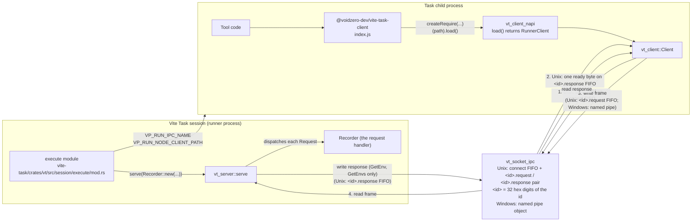
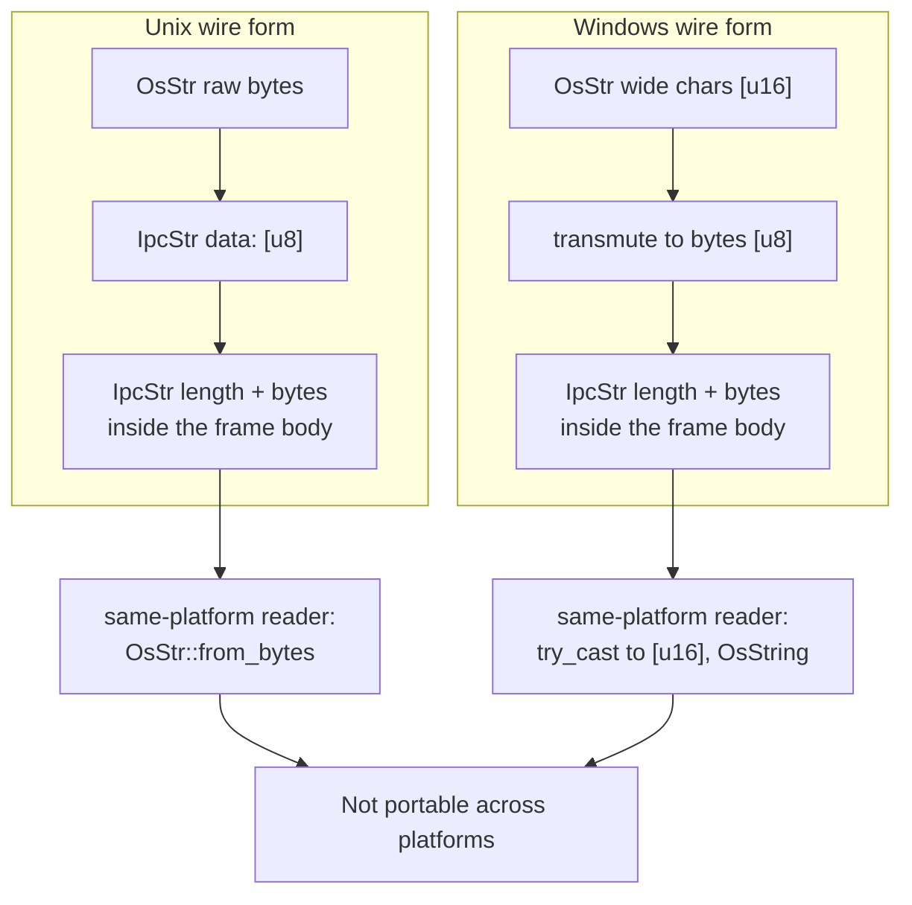
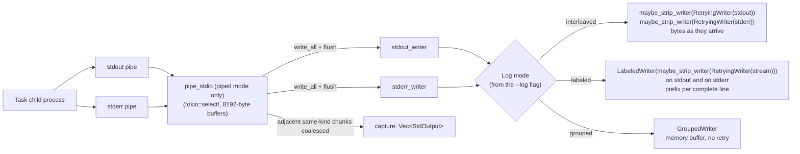
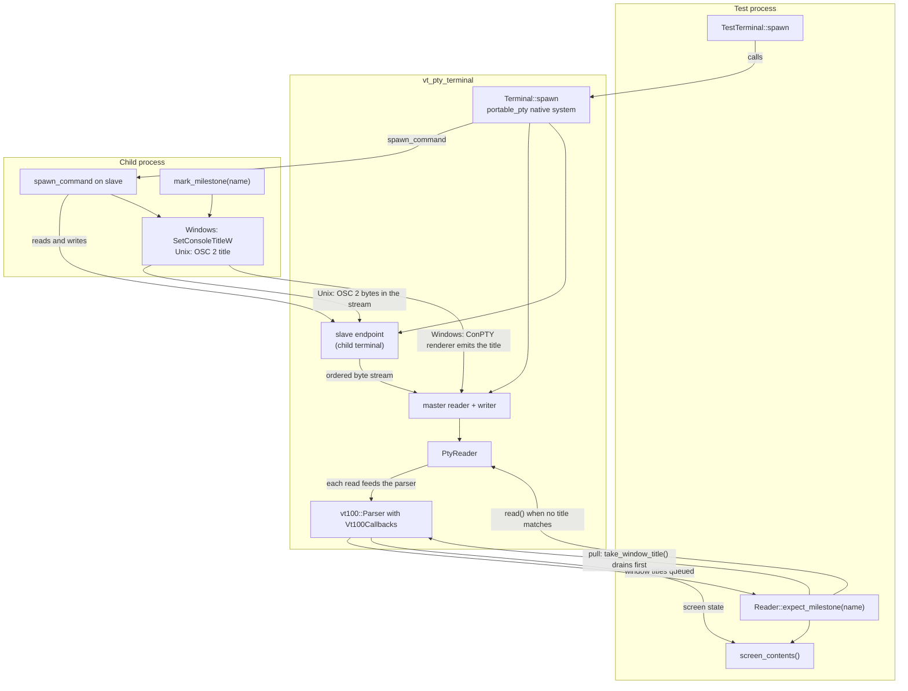
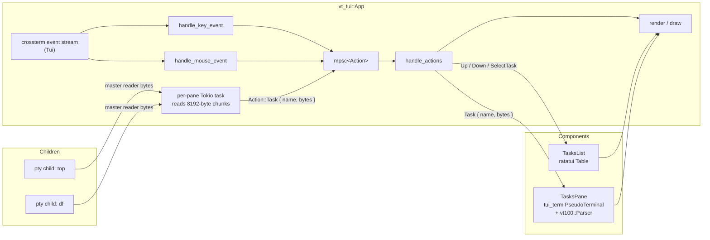

# 09 The Vite Task Client: How a Tool Talks to a Running Session

A Vite Task session runs a graph of tasks. Some tasks run as child processes. Those processes need a way to report facts back to the session that started them. The session also needs a way to show a process's output. The thesis of this document is that the session and each child process form a small request-response system. The session is the object that owns the task graph and starts the task processes. The "runner" is the session code that starts and observes a task process. The runner hosts a server. A named pipe is a byte-stream channel with a name that the operating system owns. On Unix the transport is a set of first-in, first-out (FIFO) files: one `connect` FIFO and one request/response FIFO pair for each client. On Windows it is a named pipe object. The child process attaches a client to that channel. The client sends typed requests. The session records every request, and it answers only the two requests that ask for an environment value. A cache dependency is a fact that the runner stores with the task result, so a change to that fact makes the next run a cache miss. A "handler" is the object in the server that receives each decoded request. A fire-and-forget request is one that gets no reply. Several further mechanisms handle input and display. Pipes carry task output. A pseudo-terminal gives a child a terminal device, and the tests and one demonstration program use it; the runner does not start tasks on one. A terminal interface shows tasks in panes, and it is also a demonstration. The runner also parses the task command before it starts the process; section 7 covers that parser and the Windows `.cmd` route.

All paths in this document are relative to the snapshot root `/Users/darkvoid/GitSources/src.voidzero`. Every source-tree path starts with the repository name, such as `vite-task/crates/vt_client/src/lib.rs`. This file is document 09 of a series. Document [02](02-vite-plus-toolchain.md) covers the Vite+ toolchain and the `vp` command. Document [06](06-vite-task-scheduler.md) covers the scheduler. Document [07](07-vite-task-caching.md) covers the cache key and the artifact. Document [08](08-fspy-file-system-proxy.md) covers the file-system proxy. Document [10](10-setup-vp-ci.md) covers the Continuous Integration (CI) setup. This document does not repeat the scheduler or the cache key format.

The source is the Vite Task repository at commit `95d8da2fc1f06cfe8d176b30b608ed540efab066`. Vite+ builds the same crates at a different revision, `cb1ea8d214b26a0f3ca2b2ef3b6bc471b18ffacb` (`vite-plus/Cargo.toml:197`, `vite-plus/Cargo.toml:312-321`). A statement below describes the snapshot. The pinned revision can differ in line numbers, field names, or edge cases. A reader who checks a Vite+ behaviour must check the pinned revision. This snapshot does not contain the pinned revision, so this document cannot compare the two revisions in detail.

This document spells out each abbreviation at its first use. The main spellings are in the table.

| Abbreviation | Spelling |
|---|---|
| API | Application Programming Interface |
| CI | Continuous Integration |
| CLI | command-line interface |
| Ctrl+C | Control-C |
| EOF | end of file |
| FD | file descriptor |
| FIFO | first-in, first-out |
| HTML | HyperText Markup Language |
| I/O | input/output |
| IPC | inter-process communication |
| JSON | JavaScript Object Notation |
| LE | little-endian |
| NAPI | Node-API |
| NPM | Node Package Manager |
| OSC | Operating System Command |
| POSIX | Portable Operating System Interface |
| PTY | pseudo-terminal |
| SGR | Select Graphic Rendition |
| SIGPIPE | signal pipe |
| stderr | standard error |
| stdin | standard input |
| stdout | standard output |
| TUI | terminal user interface |
| URL | Uniform Resource Locator |
| UTF-8 | Unicode Transformation Format, 8-bit |
| UUID | universally unique identifier |

The text also spells out Device Status Report (DSR), signal interrupt (SIGINT), signal window change (SIGWINCH), and Terminal Type 100 (VT100). Environment variable names and function names stay unchanged.

The text also explains names that are not abbreviations. These names come from the operating system or the Rust ecosystem. This document gives their common meaning and does not quote a definition from the source. `PIPE_BUF` is the largest write that a pipe keeps atomic. `ENXIO`, `ENOENT`, and `EAGAIN` are operating-system error codes: no such device or address, no such file or directory, and try again. `POLLIN` is a poll request for read readiness. `POLLOUT` is a poll request for write readiness. `POLLERR` and `POLLHUP` are poll reports for an error and a hang-up. `O_NONBLOCK` is the open flag that makes an operation return instead of waiting. `kqueue` is the kernel event queue of macOS. `SIGSEGV` and `SIGBUS` are operating-system signals for an invalid memory access and a bus error. `mpsc` means multi-producer, single-consumer. `FxHashMap` is a fast hash map from the `rustc-hash` crate. `PEG` is a Parsing Expression Grammar. `base64url` is the Uniform Resource Locator-safe base64 encoding. `ConPTY` is the Windows Console Pseudo-Terminal. `fspy` is the file-system proxy that records the file accesses of a task; document [08](08-fspy-file-system-proxy.md) covers it. `cdylib` is a Rust dynamic library with a C-compatible interface.

Each code block starts with a label line, such as `// vite-task/crates/vt_client/src/lib.rs:39-49`. The label gives the file and the exact line range. The label is not part of the source text. A `#` label marks a non-Rust file, such as JavaScript or JSON. A `//` label marks Rust source.

The document uses four names for the parts of the system. The "session" and the "runner" are defined above. The "tool" is a program inside a task that calls the client library. The "server" is the per-task inter-process communication (IPC) listener that the runner hosts. A tool and a server never share memory.

Two terms describe caching. A "cached task" is a task whose result may be cached, because caching is enabled for it. A "cache hit" is a stored result that the runner reuses without running the task. A cached task can still be a cache miss, and then the runner runs it.

## 1. The problem and the shape of the answer

### 1.1 Two directions of information

Information moves in two directions between a session and a task.

The session sends information into the task. It supplies environment variables. It decides whether the task inherits the session's standard input (stdin) or gets `/dev/null`. A pseudo-terminal can carry terminal input and a terminal size, but only a test or a demonstration creates one. The session does not forward keystrokes or standard-input bytes to a task (`vite-task/crates/vt/src/session/execute/spawn.rs:111-123`, `vite-task/crates/vt/src/session/execute/spawn.rs:205-217`).

The task sends information out. It emits standard output (stdout) and standard error (stderr). The protocol defines five request kinds. Two mark a path as an ignored input or an ignored output. One asks for an environment variable and marks that variable as a cache dependency (`vite-task/packages/vite-task-client/README.md:25-27`). One asks for a set of variables. The fifth asks the session to disable caching for the run; the client in this snapshot never sends it.

The outbound direction is the reason for the IPC system. Standard output cannot carry these reports, because a task can write anything to standard output. A separate channel gives a typed message boundary. The body of the report also needs to carry file-system paths that can contain bytes which are not valid UTF-8. A plain text channel cannot carry such a path without a lossy conversion.

### 1.2 The actors

The table names the crates and their jobs.

| Crate or package | Job |
|---|---|
| `vite-task/crates/vt_socket_ipc` | Byte-stream transport on named pipes. Four public operations: bind, name, accept, connect. |
| `vite-task/crates/vt_ipc_shared` | Request and response types, plus two environment variable name constants: `IPC_ENV_NAME` (value `VP_RUN_IPC_NAME`) and `NODE_CLIENT_PATH_ENV_NAME` (value `VP_RUN_NODE_CLIENT_PATH`) (`vite-task/crates/vt_ipc_shared/src/lib.rs:5-15`). |
| `vite-task/crates/vt_ipc_str` | `IpcStr`, a platform-native string that survives the wire losslessly. |
| `vite-task/crates/vt_client` | Typed client. Connects, encodes a request, reads the response. |
| `vite-task/crates/vt_client_napi` | Node-API addon, which is a compiled native Node.js module. Exposes the client to JavaScript and TypeScript. |
| `vite-task/crates/vt_server` | The server. Accepts clients and dispatches requests to a handler. |
| `vite-task/packages/vite-task-client` | The published NPM wrapper `@voidzero-dev/vite-task-client` 0.2.0. |
| `vite-task/crates/vt` | The session and execution engine. Wires the server into a task run. |
| `vite-task/crates/vt_pty_terminal` | Headless terminal on a pseudo-terminal. |
| `vite-task/crates/vt_pty_terminal_test` | Test harness with named milestones. A milestone is a synchronization point in the child output. |
| `vite-task/crates/vt_pty_terminal_test_client` | Child-side milestone emitter. |
| `vite-task/crates/vt_shell` | Parser for simple commands and `&&` chains. |
| `vite-task/crates/vt_powershell` | Windows helpers that route `.cmd` files through PowerShell. |
| `vite-task/crates/vt_tui` | A terminal user interface that shows tasks in panes. |
| `vite-task/crates/vt_bin` | The `vt` and `vtt` binaries. |

The table lists the crates that this document follows. Other crates appear only as dependencies. Examples are `vt_plan` for task planning, `vt_str` for the string type, `vt_path` for path types, and `vt_select` for the task selector. Further examples are `vt_workspace` for the workspace model, `vt_casefold` for environment name comparison, `vt_materialized_artifact` for the embedded addon, and `vt_glob` for environment glob matching.

### 1.3 The main flow in one view

The sequence is short. When a cached task is a cache miss, the runner starts it as a child process. The runner binds a server. On Unix the transport is the connect FIFO and the per-client FIFO pair, and on Windows it is a named pipe object. `serve` returns one environment entry whose name is `VP_RUN_IPC_NAME` and whose value is the transport name. The execution engine adds `VP_RUN_NODE_CLIENT_PATH`, whose value is a `.node` file on disk. The runner passes both variables to the child. A tool in the child loads the addon, and the addon connects to the transport. The tool sends requests. The server records the requests. The child exits. The runner signals the server to stop accepting clients. The server drains open clients and returns the recorded reports. An uncached task can also run as a child process. It gets no server and no IPC variables (section 4.4). The runner uses the reports when it computes or updates the cache entry. The body of each frame is a `wincode` encoding, and `wincode` is an external Rust serialization crate (section 2.1).



## 2. The client layer

### 2.1 `vt_client`: attach to a running server

`vt_client` is a small synchronous client. It holds a transport stream and one scratch buffer (`vite-task/crates/vt_client/src/lib.rs:18-21`). It has no background thread and no event loop.

The entry point is `Client::from_envs`. It scans an iterator of name-value pairs for `IPC_ENV_NAME`. That constant is `VP_RUN_IPC_NAME` (`vite-task/crates/vt_ipc_shared/src/lib.rs:5`). When the name matches, it connects to the value as a transport name. When the name is absent, it returns `Ok(None)`. That `None` is the "not inside a runner" signal.

```rust
// vite-task/crates/vt_client/src/lib.rs:39-49
    pub fn from_envs(
        envs: impl Iterator<Item = (impl AsRef<OsStr>, impl AsRef<OsStr>)>,
    ) -> io::Result<Option<Self>> {
        for (name, value) in envs {
            if EnvName::from_ref(name.as_ref()) == EnvName::from_ref(IPC_ENV_NAME) {
                let stream = Stream::connect(value.as_ref())?;
                return Ok(Some(Self::from_stream(stream)));
            }
        }
        Ok(None)
    }
```

The comparison uses `EnvName`, a name type that folds case under a per-platform rule (`vite-task/crates/vt_casefold/src/lib.rs:54-70`). On Windows the rule ignores the case of ASCII letters only (`vite-task/crates/vt_casefold/src/lib.rs:39-52`, `vite-task/crates/vt_casefold/src/lib.rs:60-61`). On other platforms the rule compares bytes exactly (`vite-task/crates/vt_casefold/src/lib.rs:63-65`). The rule is an approximation: it does not fold non-ASCII letters, but the Windows lookup does fold them (`vite-task/crates/vt_casefold/src/lib.rs:54-60`). The client does not read the process environment itself. The caller passes an iterator. The Node-API addon passes `std::env::vars_os()` (`vite-task/crates/vt_client_napi/src/lib.rs:146`).

Four operations send a request. `ignore_input` and `ignore_output` resolve a relative path against the current directory and send a fire-and-forget message. `get_env` and `get_envs` send a request and read a response. `disable_cache` is a local no-op in this snapshot, and it never sends the `DisableCache` variant.

```rust
// vite-task/crates/vt_client/src/lib.rs:150-176
    fn send(&self, request: &Request<'_>) -> io::Result<()> {
        let bytes = wincode::serialize(request)
            .map_err(|err| io::Error::new(io::ErrorKind::InvalidData, err))?;
        let len = u32::try_from(bytes.len())
            .map_err(|_| io::Error::new(io::ErrorKind::InvalidData, "request too large"))?;
        let mut stream = self.stream.borrow_mut();
        stream.write_all(&len.to_le_bytes())?;
        stream.write_all(&bytes)?;
        stream.flush()?;
        Ok(())
    }

    fn recv<T>(&self) -> io::Result<T>
    where
        for<'de> T: SchemaRead<'de, DefaultConfig, Dst = T>,
    {
        let mut stream = self.stream.borrow_mut();
        let mut scratch = self.scratch.borrow_mut();
        let mut len_bytes = [0u8; 4];
        stream.read_exact(&mut len_bytes)?;
        let len = u32::from_le_bytes(len_bytes) as usize;
        scratch.clear();
        scratch.resize(len, 0);
        stream.read_exact(&mut scratch)?;
        wincode::deserialize_exact(&scratch)
            .map_err(|err| io::Error::new(io::ErrorKind::InvalidData, err))
    }
```

`wincode` is an external Rust serialization crate at version 0.6.0 (`vite-task/Cargo.toml:51`). The repository does not define it. `send` serializes the request with `wincode`, checks that the body fits a 32-bit length, and writes the length in little-endian order before the body. `recv` reads the same shape and asks `deserialize_exact` to refuse trailing bytes. The client is synchronous. It blocks the calling thread for a round trip. That is correct for a tool that calls `getEnv` at startup, but it means the server must be alive and must answer.

The client also resolves a relative path before it sends an ignore report (`vite-task/crates/vt_client/src/lib.rs:179-187`). It uses `AbsolutePath::new` to test for an absolute path. If the path is relative, it joins the path to `vt_path::current_dir()`. The server rejects a path that is not absolute (`vite-task/crates/vt_server/src/lib.rs:406-411`), so this step moves a possible error from the server to the caller.

`disable_cache` is deliberately inert in this snapshot. The comment says the call causes too many false opt-outs, because tools call it during configuration before they know whether they will start an uncached operation (`vite-task/crates/vt_client/src/lib.rs:84-102`). The request variant and the server handler exist, but the client never sends the variant. A caller of `disableCache` therefore gets no effect from this snapshot. This is a fact about the code, not a statement that caching is always on.

### 2.2 The modes a client can run in

The source supports three execution positions. They are different in who owns the process boundary.

| Position | Who calls what | Process boundary | Source |
|---|---|---|---|
| Attach to a running server | A tool calls `Client::from_envs`, or the NPM wrapper calls `load()` | Tool process to runner process | `vite-task/crates/vt_client/src/lib.rs:39-49`; `vite-task/crates/vt_client_napi/src/lib.rs:140-157` |
| Host a server | The runner calls `vt_server::serve(handler)` | Runner process | `vite-task/crates/vt_server/src/lib.rs:253-278` |
| In-process execution | The runner runs an `InProcessExecution` and writes the output itself | No child process, no IPC client | `vite-task/crates/vt_plan/src/in_process.rs:21-40` |

The first position is the normal one. The second is not a client mode in the strict sense, but it is the other half of the same contract, and the two halves must agree on the types. The third position has no client at all. The runner executes a built-in such as `echo` inside its own process and produces the standard output directly. There is no `VP_RUN_IPC_NAME` for such a task, because there is no child to read it. The source does not define a fourth mode.

An important detail follows from the table. The NPM wrapper runs inside the tool process. The addon also runs inside the tool process. The server runs inside the runner process. The only shared state is the pipe and the child environment.

### 2.3 `vt_client_napi`: the Node addon

The addon exists because most tools in the web ecosystem are JavaScript or TypeScript programs. The addon is a Rust `cdylib`, which is a dynamic library with a C-compatible interface (`vite-task/crates/vt_client_napi/Cargo.toml:9-10`). Its only public entry point is a `load()` factory.

```rust
// vite-task/crates/vt_client_napi/src/lib.rs:140-157
#[napi]
pub fn load() -> Result<RunnerClient> {
    #[expect(
        clippy::disallowed_methods,
        reason = "client bootstrap reads the live process env to find runner IPC handoff"
    )]
    let client = Client::from_envs(std::env::vars_os())
        .map_err(|err| {
            err_string(vt_str::format!("vp run client: failed to connect to runner IPC: {err}"))
        })?
        .ok_or_else(|| {
            err_static(
                "vp run client: runner IPC env is not set; this module is only usable \
                 inside a `vp run` task",
            )
        })?;
    Ok(RunnerClient { client })
}
```

The factory exists for a compatibility reason. The module comment says a future wrapper can pass an options argument, such as a version field, and receive a different addon shape without breaking older addons (`vite-task/crates/vt_client_napi/src/lib.rs:8-12`). The current wrapper passes nothing.

`RunnerClient` holds a `Client` and exposes five methods. The `get_env` method accepts `name` and an optional `GetEnvOptions`. The `tracked` field defaults to true. The method returns a string or `Undefined`. The `get_envs` method accepts either a glob string or a `GetEnvsPrefixQuery` object, plus the same options. It returns a JavaScript object with string keys and string values (`vite-task/crates/vt_client_napi/src/lib.rs:86-135`). The addon type `GetEnvsPrefixQuery { prefix: String }` is exposed in the generated wrapper as the `{ prefix: string }` member of `GetEnvsQuery` (`vite-task/crates/vt_client_napi/src/lib.rs:54-57`; `vite-task/packages/vite-task-client/src/index.d.ts:66-71`).

The addon converts a non-UTF-8 environment value into an error at the JavaScript boundary (`vite-task/crates/vt_client_napi/src/lib.rs:98-104`). The wire format can carry such a value, but JavaScript strings cannot. This is a limit of the Node-API boundary, not of the transport.

The module comment says the addon is not intended to be published directly (`vite-task/crates/vt_client_napi/src/lib.rs:1-6`). The source shows no NPM package for the addon. Its compiled bytes are an artifact dependency of the `vt` crate (`vite-task/crates/vt_client_napi/build.rs:16-17`; `vite-task/crates/vt/Cargo.toml:56-61`). The `artifact!` macro reads the file path in the environment variable named by its second argument. It embeds the file content at compile time as a `&'static [u8]`, as `include_bytes!` does (`vite-task/crates/vt_materialized_artifact/src/lib.rs:1-10`, `vite-task/crates/vt_materialized_artifact_macros/src/lib.rs:38-47`). Cargo provides `CARGO_CDYLIB_FILE_VT_CLIENT_NAPI` while it compiles `vt` (`vite-task/crates/vt/Cargo.toml:59-61`). The `vt` crate writes the bytes to a content-addressed file in the user's temporary directory on first use.

```rust
// vite-task/crates/vt/src/napi_client.rs:20-31
#[must_use]
pub fn napi_client_path() -> &'static AbsolutePath {
    static PATH: LazyLock<AbsolutePathBuf> = LazyLock::new(|| {
        let path = artifact!("vt_client_napi", "CARGO_CDYLIB_FILE_VT_CLIENT_NAPI")
            .materialize()
            .suffix(".node")
            .at_user_temp_dir("vp_run")
            .expect("materialize vt_client_napi");
        AbsolutePathBuf::new(path).expect("system temp dir yields an absolute path")
    });
    PATH.as_absolute_path()
}
```

The path is computed once and reused. `LazyLock` is a standard-library type that computes its value on the first access. `AbsolutePathBuf` is an owned absolute path type. The artifact helper writes a content-addressed file, so a second run does not rewrite it (`vite-task/crates/vt/src/napi_client.rs:9-13`). The code adds the `.node` suffix (`vite-task/crates/vt/src/napi_client.rs:20-31`), which is the Node.js native-addon suffix. The temporary directory is the per-user `vp_run` directory.

### 2.4 `@voidzero-dev/vite-task-client`: the NPM wrapper

The published package is `@voidzero-dev/vite-task-client` version 0.2.0. It is a pure JavaScript package with no dependencies. The `package.json` sets `"type": "module"`, `main` and `types` point at `src`, and `engines.node` is `>=18` (`vite-task/packages/vite-task-client/package.json:2-31`). The readme states that every call is a graceful no-op outside a runner-managed task, so a tool can use the package without runtime detection (`vite-task/packages/vite-task-client/README.md:8-10`).

The wrapper is lazy. It reads `VP_RUN_NODE_CLIENT_PATH` only on the first call. It loads the addon with `createRequire(import.meta.url)(path).load()`. It memoizes the result. If the variable is absent or the addon throws, it memoizes `null` and every later call is a no-op.

```js
# vite-task/packages/vite-task-client/src/index.js:32-52
function load() {
  if (addon !== undefined) return addon;
  try {
    const path = process.env['VP_RUN_NODE_CLIENT_PATH'];
    if (path) {
      // The addon exports a `load(options?)` factory rather than the
      // methods directly, so the addon shape can evolve in lockstep with
      // this wrapper: a future wrapper can pass `{ version: N }` to opt
      // into a new shape without breaking older addons that only know v1.
      // Today's wrapper passes nothing and accepts whatever the addon's
      // current default version returns.
      addon = createRequire(import.meta.url)(path).load();
      return addon;
    }
  } catch {
    // Fall through — the runner's IPC env is absent or the addon refused to
    // load. Memoize the unavailable decision so subsequent calls don't retry.
  }
  addon = null;
  return addon;
}
```

The exported functions use optional chaining, so a missing addon is silent. `getEnv` returns `undefined` when the addon is absent. `getEnvs` returns an empty object (`vite-task/packages/vite-task-client/src/index.js:103-134`). This shape matches the documented no-op contract.

The JSDoc comments in `src/index.js` are the source of truth for the public types. The comment block at the top of the file says that `src/index.d.ts` is generated from the JSDoc by `pnpm run build:types`. That command runs `tsc` with `@tsconfig/strictest`. The comment also says that CI fails if the committed `.d.ts` drifts from a fresh regeneration (`vite-task/packages/vite-task-client/src/index.js:1-4`). The generated file declares two types, `GetEnvOptions` and `GetEnvsQuery`, and five functions (`vite-task/packages/vite-task-client/src/index.d.ts:9-71`). A reader must not edit `index.d.ts` by hand.

The five JavaScript exports map to the five addon methods and the five Rust methods. The JavaScript names use camel case, and the Rust names use snake case.

| JavaScript export | Addon method | Rust method | Value outside a runner |
|---|---|---|---|
| `ignoreInput(path: string): void` | `ignoreInput` | `ignore_input` | no value |
| `ignoreOutput(path: string): void` | `ignoreOutput` | `ignore_output` | no value |
| `disableCache(): void` | `disableCache` | `disable_cache` | no value; no effect |
| `getEnv(name: string, options?: { tracked?: boolean }): string \| undefined` | `getEnv` | `get_env` | `undefined` |
| `getEnvs(query: string \| { prefix: string }, options?: GetEnvOptions): Record<string, string>` | `getEnvs` | `get_envs` | `{}` |

The wrapper calls each addon method through optional chaining, so a missing addon produces the value in the last column (`vite-task/packages/vite-task-client/src/index.js:62-134`).

The package readme documents a development convenience. A consuming tool can install an unpublished commit with a Git URL and a subpath, because the package has no dependencies (`vite-task/packages/vite-task-client/README.md:59-73`). That is a distribution property, not a runtime mechanism.

### 2.5 The call path in the tool process

The call path has four steps.

1. The tool calls `getEnv('MY_API_VERSION')`.
2. The wrapper calls `load()`.
3. `load()` requires the `.node` file and calls the addon's `load()`. On this first call, the addon calls `Client::from_envs` and connects. The result is cached in the wrapper.
4. The cached client sends `GetEnv`, reads `GetEnvResponse`, and returns the value.

A single `getEnv` call both fetches the value and records a cache dependency. The server records the name and the value under `tracked_get_env` (`vite-task/crates/vt_server/src/lib.rs:147-153`). The caller does not need a separate registration call. A call with `tracked: false` records nothing; the default is true. Section 4.3 gives the exact rule for repeated calls.

The readme calls this the main value of the package. The runner already scans the declared inputs and environment, but that scan can be too coarse or too narrow. The package gives a tool a precise way to correct the record from the inside (`vite-task/packages/vite-task-client/README.md:33-50`).

## 3. The IPC protocol

### 3.1 Transport: named pipes on each platform

`vt_socket_ipc` provides a socket-like byte stream without a network socket. The readme gives the reason. Coding-agent sandboxes block Unix domain sockets. On Unix the transport uses FIFOs, which are file-system entries that the sandboxes allow. On Windows it uses a named pipe object (`vite-task/crates/vt_socket_ipc/README.md:3-9`; `vite-task/crates/vt_socket_ipc/src/unix.rs:1-6`).

The public surface is four items. `Server::bind` creates a server. `Server::name` returns the opaque name. `Server::accept` waits for one connection. `Client::connect` connects to a name (`vite-task/crates/vt_socket_ipc/src/lib.rs:29-53`, `vite-task/crates/vt_socket_ipc/src/lib.rs:88-102`). The name is an operating-system string, not a URL. On Unix it is a directory path. On Windows it is a pipe path that starts with `\\.\pipe\`.

On Unix the server creates a private temporary directory with mode `0700` (`vite-task/crates/vt_socket_ipc/src/unix.rs:6-7`). The directory holds one well-known `connect` FIFO. The source also calls this FIFO the rendezvous FIFO. A client creates two FIFOs in the same directory. Their names are `<id>.request` and `<id>.response`. The client announces itself by writing a 16-byte identifier to `connect`. The server reads the identifier, opens the request FIFO for reading and the response FIFO for writing, and writes one ready byte into the response FIFO (`vite-task/crates/vt_socket_ipc/src/unix.rs:100-116`). The client sees the ready byte, and the connection is up.

The 16-byte identifier is a UUID. The client converts it to 32 lowercase hexadecimal digits with no hyphens, and that string is `<id>` (`vite-task/crates/vt_socket_ipc/src/unix.rs:191-195`, `vite-task/crates/vt_socket_ipc/src/unix.rs:349-359`). The server reads the 16 bytes, rebuilds the UUID, and calls the same function, so both sides derive the same two paths (`vite-task/crates/vt_socket_ipc/src/unix.rs:100-102`).

```rust
// vite-task/crates/vt_socket_ipc/src/unix.rs:62-66
const CONNECTION_ID_LEN: usize = 16;
const READY_BYTE: u8 = 1;
const CONNECT_FIFO_NAME: &str = "connect";
const REQUEST_FIFO_SUFFIX: &str = ".request";
const RESPONSE_FIFO_SUFFIX: &str = ".response";
```

```rust
// vite-task/crates/vt_socket_ipc/src/unix.rs:349-359
fn connection_paths(root: &AbsolutePath, id: Uuid) -> ConnectionPaths {
    let mut encoded = [0; 32];
    let encoded = id.simple().encode_lower(&mut encoded);

    let mut request_name = OsString::from(&*encoded);
    request_name.push(REQUEST_FIFO_SUFFIX);
    let mut response_name = OsString::from(&*encoded);
    response_name.push(RESPONSE_FIFO_SUFFIX);

    ConnectionPaths { request: root.join(request_name), response: root.join(response_name) }
}
```

The client opens four descriptors in a fixed order. The first descriptor is a liveness probe: `connect` opened for writing with `O_NONBLOCK`, because a failure means that the server is gone (`vite-task/crates/vt_socket_ipc/src/unix.rs:179-189`). The client keeps this descriptor open while it waits for the ready byte, and the poll loop watches it for the death of the server (`vite-task/crates/vt_socket_ipc/src/unix.rs:243-287`). The second and third descriptors are the request writer and the response reader. The client creates the two per-client FIFOs, opens the request end read-write, and opens the response end read-only and nonblocking (`vite-task/crates/vt_socket_ipc/src/unix.rs:191-215`). The fourth descriptor is the announcement. The client opens `connect` a second time with read-write access, writes the identifier, and drops this descriptor at once (`vite-task/crates/vt_socket_ipc/src/unix.rs:217-238`). The read-write access is deliberate. This descriptor holds read access, so the client has a reader on `connect` for the whole write, and the write cannot raise `SIGPIPE` when the server dies (`vite-task/crates/vt_socket_ipc/src/unix.rs:217-224`). The client drops the first descriptor only after the ready byte arrives (`vite-task/crates/vt_socket_ipc/src/unix.rs:287`).

The 16-byte identifier is smaller than `PIPE_BUF`, and the kernel writes it as one unit. Two clients that announce at the same time therefore cannot interleave their identifiers (`vite-task/crates/vt_socket_ipc/src/unix.rs:12-13`, `vite-task/crates/vt_socket_ipc/src/unix.rs:217-224`). The client opens the request FIFO read-write. The Portable Operating System Interface (POSIX) leaves a read-write FIFO open undefined, but Linux and macOS treat it as a plain open that does not block (`vite-task/crates/vt_socket_ipc/src/unix.rs:20-26`). The client opens the response read end in nonblocking mode, so it can see end of file when the server dies.

The first open is the liveness probe (`vite-task/crates/vt_socket_ipc/src/unix.rs:179-189`). A write-open of a FIFO succeeds only when a reader holds the FIFO (`vite-task/crates/vt_socket_ipc/src/unix.rs:174-178`). The probe opens the rendezvous FIFO with the `O_NONBLOCK` flag. A failed open therefore shows that the server is gone, and the open cannot block while the server is not ready. `ENXIO` means no process holds the read end, and `ENOENT` means the directory was removed (`vite-task/crates/vt_socket_ipc/src/unix.rs:269-285`).

The client waits for the ready byte with `poll` and a 100-millisecond timeout. The same poll also watches the rendezvous FIFO for `POLLERR` or `POLLHUP`. A timeout runs the probe. The client repeats this poll-and-probe loop until the ready byte arrives or the probe reports that the server is gone. A server that is not ready yet causes another loop pass, not a failure (`vite-task/crates/vt_socket_ipc/src/unix.rs:240-287`). The readme states the result: a client whose server is gone gets an error, not a hang, on both platforms (`vite-task/crates/vt_socket_ipc/README.md:11-13`).

Tokio is the asynchronous runtime that the runner uses. The connection uses blocking file I/O on a Tokio blocking thread, not registration with the event reactor. The source gives the reason. The `kqueue` event system on macOS does not deliver events for FIFOs reliably, so a reactor-registered reader never wakes up (`vite-task/crates/vt_socket_ipc/src/unix.rs:118-124`). The server converts the blocking file handles into `tokio::fs::File` values, which move the blocking work to the blocking thread pool.

The Unix code also explains how it avoids the signal named `SIGPIPE`. A write to a FIFO with no read end raises `SIGPIPE`, and the default action kills the process. The client never writes into that state, because every FIFO it writes to has read access held for the whole write. The server relies on the Rust runtime, which ignores `SIGPIPE` at startup, so a vanished client turns a server write into a plain error (`vite-task/crates/vt_socket_ipc/src/unix.rs:32-38`).

On Windows the server creates a named pipe object with a random name and the `first_pipe_instance` option (`vite-task/crates/vt_socket_ipc/src/windows.rs:30-31`). The source does not explain the option. The Windows named-pipe API makes the create fail if another server already owns the name, so the name is genuinely unique.

```rust
// vite-task/crates/vt_socket_ipc/src/windows.rs:25-33
    pub fn bind() -> io::Result<Self> {
        #[expect(
            clippy::disallowed_macros,
            reason = "the generated pipe name exceeds Str inline capacity"
        )]
        let name = OsString::from(format!(r"\\.\pipe\vt_socket_ipc_{}", uuid::Uuid::new_v4()));
        let pending = ServerOptions::new().first_pipe_instance(true).create(&name)?;
        Ok(Self { name, pending })
    }
```

The server always keeps one pending instance. `accept` waits on the pending instance, creates the next instance before it returns the accepted one, and swaps the two (`vite-task/crates/vt_socket_ipc/src/windows.rs:16-43`). That order means a concurrent connect attempt never finds the pipe without an instance. The client opens the pipe with `WaitNamedPipeW`. That call makes the kernel do the waiting when the pipe is busy, so the client has no polling loop and no arbitrary timeout (`vite-task/crates/vt_socket_ipc/src/windows.rs:82-90`). If the server dies after a connection is open, a client read sees end of file and a client write sees a broken pipe. The server side treats both as a normal client end (`vite-task/crates/vt_server/src/lib.rs:397-404`).

### 3.2 The handshake has no version field

On Unix the handshake has two messages. The client sends a 16-byte connection identifier. The server sends one ready byte. The identifier selects the two FIFOs, and the ready byte confirms that the server opened them. On Windows there is no application-level handshake. The named pipe connect itself is the handshake, and the code sends no identifier and no ready byte (`vite-task/crates/vt_socket_ipc/src/windows.rs:39-43`, `vite-task/crates/vt_socket_ipc/src/windows.rs:91-115`). The handshake therefore has no protocol version, no feature list, and no schema identifier on either platform. The Unix message sizes are fixed: 16 bytes and 1 byte (`vite-task/crates/vt_socket_ipc/src/unix.rs:62-66`). The body encoding is the `wincode` schema of the types in `vt_ipc_shared`. That schema is a property of the compiled crate version, not a value on the wire.

The consequence is important. The tool and the runner must be built from compatible crates. The NPM wrapper can be a different version from the addon, and the source anticipates that with the `load(options?)` factory. But the addon and the server must agree on the serialized shape of `Request` and the two response types. The source does not state a compatibility rule for a mismatch, and it has no runtime check. A mismatch is a decode failure or a wrong-field read, not a version error.

### 3.3 Framing and encoding

Every request or response frame is a 4-byte unsigned length in little-endian order, followed by that many bytes of body. The body is a `wincode` serialization of one type. The two Unix handshake messages are not frames; they have fixed sizes of 16 bytes and 1 byte.

```rust
// vite-task/crates/vt_ipc_shared/src/lib.rs:29-42
#[derive(Debug, SchemaWrite, SchemaRead)]
pub enum Request<'a> {
    IgnoreInput(&'a IpcStr),
    IgnoreOutput(&'a IpcStr),
    GetEnv { name: &'a IpcStr, tracked: bool },
    GetEnvs { query: EnvQuery<'a>, tracked: bool },
    DisableCache,
}

#[derive(Debug, Clone, Copy, SchemaWrite, SchemaRead)]
pub enum EnvQuery<'a> {
    Glob(&'a str),
    Prefix(&'a str),
}
```

The `Request` type borrows its string data, so the caller does not copy a path or a value to build the request. `send` then serializes the request into a new buffer, so the borrow does not avoid a copy at the wire boundary (`vite-task/crates/vt_client/src/lib.rs:150-162`). The `EnvQuery` type borrows a `&str`, so a glob pattern and a prefix must be valid UTF-8. A path and an environment value do not have that requirement, because they use `IpcStr`.

The response types are separate structs. `GetEnvResponse` contains an optional boxed `IpcStr`. `GetEnvsResponse` contains a map from boxed `IpcStr` to boxed `IpcStr` (`vite-task/crates/vt_ipc_shared/src/lib.rs:44-54`). The map is an `FxHashMap`, so the order of entries is not defined.

The server reads a frame with the same four-byte length rule.

```rust
// vite-task/crates/vt_server/src/lib.rs:413-421
async fn read_frame(stream: &mut Stream, buf: &mut Vec<u8>) -> io::Result<()> {
    let mut len_bytes = [0u8; 4];
    stream.read_exact(&mut len_bytes).await?;
    let len = u32::from_le_bytes(len_bytes) as usize;
    buf.clear();
    buf.resize(len, 0);
    stream.read_exact(buf).await?;
    Ok(())
}
```

The server reads into one reusable buffer. A frame length comes from the peer and becomes an allocation size. The source has no explicit maximum. A hostile or broken peer could therefore ask for a large allocation. The source does not discuss this case.

### 3.4 Request and response pairs

Three variants are fire-and-forget. `IgnoreInput`, `IgnoreOutput`, and `DisableCache` produce no response. Two variants are round trips. `GetEnv` pairs with `GetEnvResponse`. `GetEnvs` pairs with `GetEnvsResponse`.

The fire-and-forget design is safe for a specific reason, and the type comment states it. The server handles each frame as it arrives. Nothing in the runner reads the recorded set live. The recorded set is collected only after the per-task driver has drained the connection, and the drain happens after the child process exits. A tool can flush and exit, and the drain still consumes every frame that reached the pipe (`vite-task/crates/vt_ipc_shared/src/lib.rs:17-28`; `vite-task/crates/vt_server/src/lib.rs:328-395`).

The words "arrived" and "buffered" have different meanings here. A frame has arrived when the in-flight `handle_client` future has read it and handled it. A buffered frame is still in the pipe or the socket and has not been read. The same future reads a buffered frame during the drain, because its read loop continues until end of file. The drain therefore includes reading and handling, not only waiting.

In the diagram, `Option<Arc<OsStr>>` is the optional value that `Recorder::get_env` returns. `Option<T>` is a value that is either present or absent, `Arc<T>` is a shared pointer with reference counting, and `OsStr` is an operating-system string.

```mermaid
sequenceDiagram
    autonumber
    participant Tool as Tool program
    participant Wrap as "@voidzero-dev/vite-task-client"
    participant Addon as vt_client_napi RunnerClient
    participant Client as vt_client::Client
    participant Pipe as vt_socket_ipc<br/>(connect FIFO + per-client pair, or named pipe)
    participant Server as vt_server handle_client
    participant Rec as Recorder (Handler)

    Tool->>Wrap: getEnv("MY_API_VERSION")
    opt First call only
        Wrap->>Addon: load()
        Note over Wrap: process.env["VP_RUN_NODE_CLIENT_PATH"]<br/>holds the .node path
        Addon->>Client: Client::from_envs(std::env::vars_os())
        Client->>Pipe: connect(VP_RUN_IPC_NAME)
        Pipe-->>Client: ready byte (Unix only)
    end
    Wrap->>Addon: addon.getEnv(name, options)
    Addon->>Client: get_env(name, tracked)
    Client->>Pipe: [u32 LE length][wincode GetEnv]
    Pipe->>Server: read_frame
    Server->>Server: wincode::deserialize_exact
    Server->>Rec: get_env(name, tracked)
    Note over Server,Rec: tracked defaults to true
    Rec-->>Server: "Option&lt;Arc&lt;OsStr&gt;&gt;"
    Server->>Pipe: [u32 LE length][wincode GetEnvResponse]
    Pipe->>Client: read_exact(4), read_exact(len)
    Client-->>Addon: "Option&lt;Arc&lt;OsStr&gt;&gt;"
    Addon-->>Wrap: string or undefined
    Wrap-->>Tool: value
    Note over Wrap,Client: Later calls skip load()<br/>and reuse this client and pipe

    Note over Tool,Rec: Fire-and-forget path
    Tool->>Wrap: ignoreInput("./node_modules/.cache/tool")
    Wrap->>Addon: addon.ignoreInput(path)
    Addon->>Client: ignore_input(path)
    Client->>Pipe: [u32 LE length][wincode IgnoreInput]
    Note over Client: returns after flush<br/>no response is read
    Pipe->>Server: read_frame while the driver is polled
    Server->>Rec: ignore_input(path) on arrival
    Note over Server: Frames still buffered are handled<br/>when the driver drains after child exit
```

The round trip is synchronous and single-threaded on the client side. `send` and `recv` each take a short `borrow_mut` on the stream, and `recv` also borrows the scratch buffer (`vite-task/crates/vt_client/src/lib.rs:166-176`). The client is therefore not `Sync`. Safe Rust cannot share one client between threads. A reentrant call on one thread would hit the run-time borrow check of `RefCell`. `RefCell` is a cell that enforces its borrow rule at run time, not at compile time. A tool that needs concurrent requests must use separate clients or serialize the work before it calls the client. The source does not state this constraint, but the borrow types imply it.

The server's response path is equally direct. Only the two get variants call `write_response`. The three fire-and-forget variants fall through the match without a write (`vite-task/crates/vt_server/src/lib.rs:340-393`).

`Recorder::get_env` returns that `Option<Arc<OsStr>>` value. `handle_client` converts it with `as_deref().map(Into::into)` into the optional boxed `IpcStr` that `GetEnvResponse` holds (`vite-task/crates/vt_server/src/lib.rs:357-367`).

### 3.5 `IpcStr`: a string that survives the wire

`IpcStr` is a `#[repr(transparent)]` wrapper over `[u8]`. It represents an operating-system string in its native encoding. On Unix the bytes are the raw bytes of the `OsStr`. On Windows the bytes are a transmuted `&[u16]` slice of wide characters (`vite-task/crates/vt_ipc_str/src/lib.rs:28-53`).

The type exists because `wincode` serializes an `OsStr` through a valid-UTF-8 path. `OsStr` itself can hold non-UTF-8 bytes on Unix. A file path on Unix can contain any byte except zero, and an environment value can also contain non-UTF-8 bytes. `IpcStr` serializes and deserializes those bytes without a lossy conversion (`vite-task/crates/vt_ipc_str/src/lib.rs:28-34`; `vite-task/crates/vt_ipc_str/README.md:10-12`).

This lossless path is available to a Rust caller of `vt_client`. A JavaScript caller cannot use it for a path or for a value that is not valid UTF-8. The addon accepts a JavaScript string for each path and each environment name (`vite-task/crates/vt_client_napi/src/lib.rs:69-80`, `vite-task/crates/vt_client_napi/src/lib.rs:88-92`). The Node-API boundary is the limit, not the transport.

The type has one hard limit. The binary representation is platform-specific. Deserializing a value that was serialized on a different platform gives unspecified behavior, though not unsafe behavior. The type is designed for same-platform IPC, not for cross-platform data exchange or persistent storage (`vite-task/crates/vt_ipc_str/src/lib.rs:41-45`).



The frame has its own 4-byte length (section 3.3). The `IpcStr` length in the diagram is a field inside the frame body. On Windows the code reinterprets the wide-character slice as bytes and does not convert characters (`vite-task/crates/vt_ipc_str/src/lib.rs:28-53`).

### 3.6 The build step for the Node addon

The addon crate compiles as a `cdylib`. A `build.rs` file is a Rust build script that Cargo runs before it compiles the crate. The addon's `build.rs` calls `napi_build::setup()` and redirects `NAPI_TYPE_DEF_TMP_FOLDER` to a directory under `OUT_DIR` (`vite-task/crates/vt_client_napi/build.rs:10-41`). The redirect keeps this crate's generated type definitions out of a consumer's binding file. Section 2.3 describes how the compiled library reaches the temporary directory. Section 2.4 describes how `index.d.ts` is generated and checked.

## 4. The server side

### 4.1 `serve` and the `Handler` trait

The server is generic over a handler. The trait has five methods: `ignore_input`, `ignore_output`, `disable_cache`, `get_env`, and `get_envs` (`vite-task/crates/vt_server/src/lib.rs:21-36`). The handler is synchronous. It does not return a future.

`serve` binds the transport, builds a driver future, and returns two values. The first value is an iterator of environment entries for the child. The second value is a `ServerHandle` with the driver and a stop signal.

The terms in the code have these meanings. A future is a value that represents work that is not complete yet, and the runtime polls it until it returns a value. The driver is the future that runs the server accept loop and all client work. An `async move` block creates a future and takes ownership of the values that the block uses. `FuturesUnordered` is a collection that polls many futures and yields each result as that future completes. `.boxed_local()` puts a future in a heap allocation as a `LocalBoxFuture`, which is a boxed future that cannot move between threads. Tokio is defined in section 3.1.

```rust
// vite-task/crates/vt_server/src/lib.rs:253-278
pub fn serve<'h, H: Handler + 'h>(
    handler: H,
) -> io::Result<(impl Iterator<Item = (&'static OsStr, OsString)>, ServerHandle<'h, H>)> {
    let stop_token = CancellationToken::new();
    let server = TransportServer::bind()?;
    let name = server.name().to_owned();

    let run_stop = stop_token.clone();
    let driver = async move {
        // Multiple per-client futures coexist inside `FuturesUnordered` and each
        // calls `&mut self` handler methods. `RefCell` provides the interior
        // mutability that makes these shared-access method calls compile; at
        // runtime the `borrow_mut()` never conflicts because we're on a
        // single-threaded runtime and handler methods are synchronous (no
        // awaits, so no borrow spans a yield point).
        let handler = RefCell::new(handler);
        let first_err = run(server, &handler, run_stop).await;
        first_err.map_or_else(|| Ok(handler.into_inner()), Err)
    }
    .boxed_local();

    Ok((
        std::iter::once((OsStr::new(IPC_ENV_NAME), name)),
        ServerHandle { driver, stop_accepting: StopAccepting { token: stop_token } },
    ))
}
```

The environment iterator yields exactly one entry. Its name is `IPC_ENV_NAME`, and its value is the transport name. The server does not put the `.node` path in this iterator. The execution engine adds that second variable itself.

The driver owns the handler until the driver completes. It returns the handler on success and an error on failure. On an error, the handler is lost. The reason is that a protocol failure means the recorded set can be incomplete, and an incomplete set must not update the cache.

### 4.2 Acceptance, drain, and errors

The `run` function has two phases. It accepts clients until the stop token fires. It then drops the listener and waits for every in-flight client future to finish (`vite-task/crates/vt_server/src/lib.rs:280-326`).

`tokio::select!` is a macro from Tokio. It waits on several futures at once and runs the branch of the first future that becomes ready.

The accept loop uses `tokio::select!` over three branches. One branch is the stop token. One branch is the next accepted connection. One branch is the next completed client future. The third branch exists so that a client error can cancel the stop token and end the accept phase. The code retains the first error only (`vite-task/crates/vt_server/src/lib.rs:288-311`).

`ServerHandle` documents the contract. The driver resolves only after `StopAccepting::signal` has been called and all in-flight tasks have drained. Dropping the driver before it resolves tears everything down at once (`vite-task/crates/vt_server/src/lib.rs:203-218`). `StopAccepting::noop` exists for a path where the runner has no server but still needs a value of the type (`vite-task/crates/vt_server/src/lib.rs:230-242`).

The `handle_client` function reads frames in a loop. It handles each frame at once, while the driver is polled. A frame that has arrived is not deferred to the drain. The drain phase waits for each in-flight client future to read its remaining buffered frames and reach end of file. A read error that reports a closed client is a normal end, not a failure. The `is_client_gone` check treats `UnexpectedEof` and `BrokenPipe` as the two such errors (`vite-task/crates/vt_server/src/lib.rs:397-404`). A bad frame or an invalid request becomes a protocol error (`vite-task/crates/vt_server/src/lib.rs:328-395`). That error ends the driver future with `Err`. The `run` function returns the first error, and `serve` returns it instead of the handler (`vite-task/crates/vt_server/src/lib.rs:253-278`, `vite-task/crates/vt_server/src/lib.rs:288-311`).

The per-client futures share one handler through a `RefCell`. The comment explains why that is sound. There is one runtime thread, and the handler methods do not await, so no borrow spans a yield point (`vite-task/crates/vt_server/src/lib.rs:260-268`). A change that adds an await inside a handler method would break that argument. A change that moves the driver to a multithreaded runtime would also break it.

### 4.3 `Recorder`: the handler the runner uses

The runner uses `Recorder`. It holds six fields: a set of ignored inputs, a set of ignored outputs, the tracked `get_env` calls, the tracked `get_envs` queries, a cache-disabled flag, and the environment map (`vite-task/crates/vt_server/src/lib.rs:72-81`).

The environment map is fixed for the life of a task. The server never re-reads the live process environment. The comment on the field states that the runner supplies the map to the `Recorder` so that the server can answer the spawned task's requests (`vite-task/crates/vt_server/src/lib.rs:78-80`). The map is not passed to the child process. Section 4.4 gives the child's own map. This design keeps the answer stable across calls, and it means a `getEnv` cannot observe a variable that the task process changed after it started.

`get_env` reads the value first. It records only when `tracked` is true. The record uses `or_insert_with`. Five cases follow. A first call with `tracked: true` records the value. A first call with `tracked: false` records nothing, and a later tracked call then records the value. A tracked call for an absent name records `None`. A second tracked call keeps the first record. A second untracked call changes no record (`vite-task/crates/vt_server/src/lib.rs:147-153`).

`get_envs` has a special rule. A query that matches every name returns an empty map and records nothing. The two such queries are `Prefix("")` and `Glob("*")`. The comment gives the reason. Vite's `loadEnv(mode, dir, '')` sends that query. Recording it would put every variable of the parent environment in the cache key, including per-run values such as a CI run identifier. Every run would then miss the cache (`vite-task/crates/vt_server/src/lib.rs:160-166`). This is the "eager-empty" rule.

A glob query uses `vt_glob::env::EnvGlob`. The characters `*`, `?`, `[...]`, and `{a,b}` are wildcards, and a separator has no special meaning. Matching is case-sensitive on Unix and case-insensitive on Windows, and the pattern must match the whole name. A prefix query is a literal prefix test. Both kinds skip a name that is not valid UTF-8 (`vite-task/crates/vt_glob/src/env.rs:1-10`, `vite-task/crates/vt_glob/src/env.rs:23-52`; `vite-task/crates/vt_server/src/lib.rs:174-195`).

A non-empty query is recorded with the name-to-value map that the query returns. A repeated identical query returns the stored map without recomputing it, because the environment map is immutable (`vite-task/crates/vt_server/src/lib.rs:167-199`). The stored-map return happens before the `tracked` check, so an untracked repeat returns the map and leaves the record in place (`vite-task/crates/vt_server/src/lib.rs:171-174`).

`Recorder::into_reports` converts the handler into a `Reports` value (`vite-task/crates/vt_server/src/lib.rs:99-131`). The execution engine consumes that value after the driver completes.

### 4.4 How the runner wires the server into a task

The execution engine binds the server for every cached task that it runs as a child process. The in-process mode has no child process and no IPC client, so the rule below concerns spawned tasks. The in-code comment gives a forward-looking reason: the merged cache-control API (`disableCache`) must work even when a task uses explicit inputs and does not need fspy inference (`vite-task/crates/vt/src/session/execute/mod.rs:192-197`). The comment calls the API "merged" but does not say which APIs were merged. In this snapshot `disable_cache` is a no-op on the client, so that reason has no effect today. The server is still necessary for the two get requests and the two ignore reports. The source does not say whether the comment predates the no-op or whether `disableCache` will return. Section 10 lists this as an open question.

```rust
// vite-task/crates/vt/src/session/execute/mod.rs:192-199
        // Bind runner IPC for every cached task. The merged cache-control API
        // (`disableCache`) must work even when a task uses explicit inputs and
        // therefore does not need fspy auto-input inference.
        let (ipc_envs, ServerHandle { driver, stop_accepting }) =
            serve(Recorder::new(Arc::clone(&metadata.unfiltered_envs)))
                .map_err(ExecutionError::IpcServerBind)?;
        let tracking =
            Tracking { fspy, ipc_envs: ipc_envs.collect(), ipc_server_fut: driver, stop_accepting };
```

The server gets `metadata.unfiltered_envs`. That is the planning environment before spawn-env filtering, and it includes command prefix entries from this command and from enclosing nested `vp run` expansions (`vite-task/crates/vt_plan/src/cache_metadata.rs:62-70`). A command prefix entry is an environment assignment written in front of the command, such as `CI=1` in `CI=1 vp run build`. The child receives a different map, `SpawnCommand::spawn_envs`, which the execution engine passes to the child process (`vite-task/crates/vt_plan/src/lib.rs:52-55`; `vite-task/crates/vt/src/session/execute/spawn.rs:81-85`). `SpawnCommand` is the value that holds the program, arguments, working directory, and environment map for one child process (`vite-task/crates/vt_plan/src/lib.rs:43-59`). A cache configuration is the per-task cache settings. `untracked_env` and `fingerprinted_envs` are two name sets in that configuration (`vite-task/crates/vt_graph/src/config/mod.rs:377-383`). `vt_plan` builds the child map from a full copy of the planning environment (`vite-task/crates/vt_plan/src/plan.rs:629-633`). When the task has a cache configuration, it replaces the map with only the names that match a pattern in `untracked_env` or `fingerprinted_envs` (`vite-task/crates/vt_plan/src/envs.rs:107-120`, `vite-task/crates/vt_plan/src/envs.rs:162-174`). It then inserts `FORCE_COLOR=1` when that name is absent (`vite-task/crates/vt_plan/src/envs.rs:122-127`). The comment gives the reason: cached output is always colored by default (`vite-task/crates/vt_plan/src/envs.rs:102-106`, `vite-task/crates/vt_plan/src/envs.rs:122-127`). It inserts the task marker `VP_RUN=1` (`vite-task/crates/vt_plan/src/plan.rs:708-713`). The marker lets a tool tell that it runs inside a task (`vite-task/crates/vt_plan/src/envs.rs:15-19`). Last, it applies the command prefix assignments (`vite-task/crates/vt_plan/src/plan.rs:715-722`). When the task has no cache configuration, the map keeps every entry (`vite-task/crates/vt_plan/src/plan.rs:635-706`). A tool therefore cannot read a filtered planning name from `process.env`, unless the code inserts that name. The client can ask the runner for such a value. The cache validation compares tracked values against the same unfiltered map, so a value can enter the cache record even when the child never saw it (`vite-task/crates/vt/src/session/execute/fingerprint.rs:301-311`). The source does not state the purpose of the filtering. Section 10 treats the confidentiality question as open.

The injected environment has two parts. The first part is the transport name. The second part is the addon path. `injected_envs` copies the transport entry and pushes `NODE_CLIENT_PATH_ENV_NAME` with the value from `napi_client_path` (`vite-task/crates/vt/src/session/execute/mod.rs:210-223`). The execution engine, not the server, adds that second entry. An uncached task gets an empty list, because an uncached task has no server (`vite-task/crates/vt/src/session/execute/mod.rs:207-223`).

The driver and the child must run together. The engine uses `tokio::join!` on the child work and the driver.

```rust
// vite-task/crates/vt/src/session/execute/mod.rs:507-528
    // 6. Drain the pipes and wait for exit, concurrently with the IPC driver.
    //    The driver must be polled during pipe drain — otherwise a tool doing
    //    a blocking `getEnv` can deadlock: child stalls on IPC, stdout stays
    //    open, pipe_stdio waits for EOF, driver never runs. `stop_accepting`
    //    fires after child.wait so the driver drains any in-flight clients.
    //    Box::pin keeps the child-and-pipe stack off the enclosing future:
    //    pipe_stdio alone makes the combined future large enough to trip
    //    clippy::large_futures in every caller otherwise.
    let RunHandles { sinks, ipc } = mode.run_handles();
    let (wait_result, ipc_server_result) = if let Some(IpcHandles { stop_accepting, driver }) = ipc
    {
        let child_work =
            Box::pin(run_child(child, sinks, Some(stop_accepting), fast_fail_token.clone()));
        let (wait_result, join_result) = tokio::join!(child_work, driver);
        if let Err(e) = &join_result {
            tracing::warn!(?e, "IPC server failed; cache will not be updated");
        }
        (wait_result, Some(join_result.map(Recorder::into_reports)))
    } else {
        let child_work = Box::pin(run_child(child, sinks, None, fast_fail_token.clone()));
        (child_work.await, None)
    };
```

The comment names the deadlock. Suppose the child calls `getEnv` and blocks. The child's standard output stays open. The pipe drain waits for end of file. If the driver is not polled at the same time, it never answers, and the child never exits. The `join!` removes that cycle. The stop signal is sent after the child exits, so the driver then drains any clients that are still open.

An IPC server error skips the cache update. The code logs a warning and treats the reports as absent. The reason is the same as on the server side: an incomplete record must not produce a cache entry (`vite-task/crates/vt/src/session/execute/mod.rs:521-540`).

### 4.5 How a report reaches the cache

The path from a report to a cache entry is short.

1. The tool sends an ignore report, or asks for a value with tracking on.
2. The server calls the matching `Recorder` method.
3. The driver returns the `Recorder` after the child exits.
4. `Recorder::into_reports` produces a `Reports` value.
5. The execution engine passes the reports to the cache-key computation.

The report types do not carry a file hash or a modification time. The ignored paths are names. The tracked environment records are names and values. Document [07](07-vite-task-caching.md) covers how those records enter the key. The client does not compute a key and does not write a cache entry. That separation keeps the protocol small.

**Aha:** The task never receives an unsolicited push message from the runner. The word "IPC" suggests a general message bus, but the protocol has no push channel and no subscription. A client sends a request and, for two variants only, reads a reply. Each report is recorded when its frame arrives. The runner collects the recorded reports after a drain of the pipe at task exit. The drain only ensures that no frame stays unread. That is why a tool can send a report and exit immediately without waiting for an acknowledgment. The "eventually recorded" property is the design, not a race.

## 5. Standard input and standard output

### 5.1 The three log modes

The `--log` flag selects one of three modes. The flag belongs to the `run` subcommand. The `run` subcommand is the `vt run` command that executes tasks (`vite-task/crates/vt/src/cli/mod.rs:160-164`). The flag must come before the task name, and anything after the task name goes to the task (`vite-task/docs/stdio.md:5-11`). A task name is the name of one task in the workspace, such as `build`, and the full form is `packageName#taskName` (`vite-task/crates/vt/src/cli/mod.rs:146-151`). The mode type is an enum with three variants.

The type derives `clap::ValueEnum`. `clap` is the command-line parser crate, and `clap::ValueEnum` is a derive macro that makes an enum usable as an argument value (`vite-task/crates/vt/Cargo.toml:21`).

```rust
// vite-task/crates/vt/src/cli/mod.rs:10-20
/// Controls how task output is displayed.
#[derive(Debug, Clone, Copy, Default, PartialEq, Eq, clap::ValueEnum)]
pub enum LogMode {
    /// Output streams directly to the terminal as tasks produce it.
    #[default]
    Interleaved,
    /// Each line is prefixed with `[packageName#taskName]`.
    Labeled,
    /// Output is buffered per task and printed as a block after each task completes.
    Grouped,
}
```

| Mode | Display | Buffering |
|---|---|---|
| `interleaved` (default) | Bytes go to the terminal as they arrive. | None. |
| `labeled` | Each complete line gets a `[package#task]` prefix. | Per line. A partial line waits for more bytes. |
| `grouped` | Each task's output appears as one block after the task completes. | Per task. |

The documentation gives the same table (`vite-task/docs/stdio.md:13-17`).

### 5.2 `PipeSinks` and `pipe_stdio`

When the runner uses piped standard output, it drains the child's two output streams concurrently. `PipeSinks` holds three destinations: a standard-output writer, a standard-error writer, and an optional capture list (`vite-task/crates/vt/src/session/execute/pipe.rs:27-34`).

```rust
// vite-task/crates/vt/src/session/execute/pipe.rs:47-94
pub async fn pipe_stdio(
    mut stdout: ChildStdout,
    mut stderr: ChildStderr,
    mut sinks: PipeSinks<'_>,
    cancellation_token: CancellationToken,
) -> std::io::Result<()> {
    let mut stdout_buf = [0u8; 8192];
    let mut stderr_buf = [0u8; 8192];
    let mut stdout_done = false;
    let mut stderr_done = false;

    loop {
        if stdout_done && stderr_done {
            return Ok(());
        }
        tokio::select! {
            result = stdout.read(&mut stdout_buf), if !stdout_done => {
                match result? {
                    0 => stdout_done = true,
                    n => {
                        let bytes = &stdout_buf[..n];
                        sinks.stdout_writer.write_all(bytes)?;
                        sinks.stdout_writer.flush()?;
                        if let Some(capture) = &mut sinks.capture {
                            append_output_chunk(capture, OutputKind::StdOut, bytes);
                        }
                    }
                }
            }
            result = stderr.read(&mut stderr_buf), if !stderr_done => {
                match result? {
                    0 => stderr_done = true,
                    n => {
                        let bytes = &stderr_buf[..n];
                        sinks.stderr_writer.write_all(bytes)?;
                        sinks.stderr_writer.flush()?;
                        if let Some(capture) = &mut sinks.capture {
                            append_output_chunk(capture, OutputKind::StdErr, bytes);
                        }
                    }
                }
            }
            () = cancellation_token.cancelled() => {
                return Ok(());
            }
        }
    }
}
```

Each read uses an 8192-byte buffer. The loop ends when both streams report end of file, or when the cancellation token fires. On cancellation the function returns without killing the child, because the child-wait future inside `run_child` observes the same token and performs the kill (`vite-task/crates/vt/src/session/execute/pipe.rs:36-45`).

The capture list exists for cache replay. The function appends each chunk to the list and coalesces adjacent chunks of the same kind (`vite-task/crates/vt/src/session/execute/pipe.rs:96-104`). The stored output is a sequence of `StdOutput` values, each with a kind and a byte vector. Document [07](07-vite-task-caching.md) covers the stored artifact.

The reporter and the execution engine share a small contract. `LeafExecutionReporter` is the reporter interface for one leaf task. `StdioConfig` is the value that `start` returns, and `StdioSuggestion` is the enum that names the stdio choice (`vite-task/crates/vt/src/session/reporter/mod.rs:79-116`). The returned value holds a `suggestion` and a `writers` field. The `writers` field is a `PipeWriters` with one boxed writer for standard output and one for standard error. The engine always receives the writers, because it can override the suggestion. For example, caching forces piped mode even when the reporter suggested inherited (`vite-task/crates/vt/src/session/reporter/mod.rs:99-116`).

The diagram shows the piped path only. When a stream is inherited, `pipe_stdio` does not run, and the writer and log-mode nodes do not exist.



### 5.3 Labeled mode: attribution per line

Labeled mode always requests piped standard output. Its reporter returns `StdioSuggestion::Piped` and wraps each writer in a `LabeledWriter` (`vite-task/crates/vt/src/session/reporter/labeled/mod.rs:105-121`). The prefix comes from `format_task_label`, and the command line is printed once before the first output line (`vite-task/crates/vt/src/session/reporter/labeled/mod.rs:87-103`).

The writer buffers bytes and writes only complete lines with the prefix. It finds the last newline in the buffer, splits the complete part from the trailing partial line, and batches the prefix and the line into one inner write (`vite-task/crates/vt/src/session/reporter/labeled/writer.rs:29-51`).

```rust
// vite-task/crates/vt/src/session/reporter/labeled/writer.rs:29-51
    fn flush(&mut self) -> io::Result<()> {
        // Find the last newline — everything up to (and including) it can be
        // split into complete lines and written with prefixes.
        let last_nl = self.buffer.iter().rposition(|&b| b == b'\n');
        let Some(last_nl) = last_nl else {
            // No complete lines yet — keep buffering.
            return Ok(());
        };

        // Split off the complete portion (0..=last_nl) from any trailing partial line.
        let remaining = self.buffer.split_off(last_nl + 1);
        let complete = std::mem::replace(&mut self.buffer, remaining);

        // Batch prefix + line into a single write to reduce syscall overhead.
        let mut prefixed = Vec::new();
        for line in complete.split_inclusive(|&b| b == b'\n') {
            prefixed.extend_from_slice(&self.prefix);
            prefixed.extend_from_slice(line);
        }
        self.inner.write_all(&prefixed)?;

        self.inner.flush()
    }
```

The `Drop` implementation flushes a final partial line with the prefix, so a program that prints a prompt without a newline still gets the label (`vite-task/crates/vt/src/session/reporter/labeled/writer.rs:54-64`). The documentation example shows an empty line that receives a prefix, because the prefix is applied to every line including an empty one (`vite-task/docs/stdio.md:42-51`).

### 5.4 Grouped mode: a block per task

Grouped mode always requests piped standard output. Standard output and standard error for one task share one `Rc<RefCell<Vec<u8>>>` buffer, so the two streams interleave in arrival order (`vite-task/crates/vt/src/session/reporter/grouped/writer.rs:9-14`). `Rc<T>` is a reference-counted pointer for one thread, `RefCell<T>` is a cell with a run-time borrow check, and `Vec<u8>` is a growable byte array.

```rust
// vite-task/crates/vt/src/session/reporter/grouped/writer.rs:25-35
impl Write for GroupedWriter {
    fn write(&mut self, buf: &[u8]) -> io::Result<usize> {
        self.buffer.borrow_mut().extend_from_slice(buf);
        Ok(buf.len())
    }

    fn flush(&mut self) -> io::Result<()> {
        // No-op — output is flushed as a block by the reporter on task completion.
        Ok(())
    }
}
```

The flush is a no-op. The reporter writes the block when the task completes. The header is `── {label} ──` (`vite-task/docs/stdio.md:57-69`; `vite-task/crates/vt/src/session/reporter/grouped/mod.rs:136-152`).

The documentation makes one comparison explicit. In `npm-run-all2`, the `--aggregate-output` flag groups only standard output; standard error still streams. In Vite Task, grouped mode buffers both streams, so a task's error output stays next to its regular output (`vite-task/docs/stdio.md:86`, `vite-task/docs/stdio.md:102-106`).

### 5.5 Interleaved mode: direct or piped

Interleaved mode is the only mode that can inherit the streams. The reporter chooses the suggestion from the execution kind. A spawned task suggests `Inherited`. An in-process task suggests `Piped` (`vite-task/crates/vt/src/session/reporter/interleaved/mod.rs:71-72`).

The execution engine can override the suggestion. The reporter type documentation states the rule. `Inherited` is honoured only when caching is disabled. With caching enabled, the engine overrides to `Piped` so that it can capture the output for the cache. `Piped` is always respected (`vite-task/crates/vt/src/session/reporter/mod.rs:80-97`).

That rule produces the table in the documentation.

| Mode | stdin | stdout | stderr |
|---|---|---|---|
| `interleaved`, cache on | `/dev/null` | Piped, streamed and collected | Piped, streamed and collected |
| `interleaved`, cache off | Inherited | Inherited | Inherited |
| `labeled` | `/dev/null` | Piped, prefixed and collected | Piped, prefixed and collected |
| `grouped` | `/dev/null` | Piped, buffered and collected | Piped, buffered and collected |

The table describes spawned tasks. An in-process task always uses piped output, because the runner produces the bytes in its own process. The `Inherited` row applies only to a spawned task with caching off (`vite-task/crates/vt/src/session/reporter/mod.rs:80-97`).

The documentation states the reason for the standard-input choice in the first rule of its "Key Rules" list (`vite-task/docs/stdio.md:80-82`). The rule says that standard input is `/dev/null` except for uncached tasks in `interleaved` mode. A cached task must have deterministic behavior. Inheriting standard input would make the output depend on interactive input, and that would break cache correctness. An uncached interleaved task can inherit standard input, so an interactive prompt can work.

The second rule covers the output (`vite-task/docs/stdio.md:84`). Standard output and standard error are piped and collected when caching is enabled. Cached output is collected and replayed on a cache hit. In interleaved mode the bytes still stream to the terminal as they arrive, so the piping is not visible to a user. An uncached interleaved task inherits the output streams directly.

### 5.6 Why a retry writer sits directly on the stream

`RetryingWriter` retries a write or a flush that fails with `WouldBlock` (`vite-task/crates/vt/src/session/reporter/retrying_writer.rs:4-20`). The interleaved and labeled reporters both wrap the real standard-output and standard-error streams in it (`vite-task/crates/vt/src/session/reporter/labeled/mod.rs:108-121`; `vite-task/crates/vt/src/session/reporter/interleaved/mod.rs:121-128`). The grouped reporter writes to a memory buffer and does not use it.

The comment gives the reason as a property of a shared open file description. On Unix, the standard-output descriptor refers to an open file description. A child that inherits the descriptor shares that description and its status flags, including the non-blocking flag. If a task sets the flag, the runner's copy changes too. Node.js sets it when standard output is a pipe. A later runner write to a full pipe then fails with `EAGAIN` instead of waiting. The runner must retry instead of reporting an error. The source states the Node.js behavior and the retry rule. It does not name the exact platform call that sets the flag (`vite-task/crates/vt/src/session/reporter/retrying_writer.rs:13-20`).

The scenario needs a descriptor that a task inherits, so it explains the interleaved path. In labeled mode the child writes to its own pipes and cannot change the runner's stdout description. The source still wraps the labeled streams in `RetryingWriter`, and it does not state a separate reason for that choice (`vite-task/crates/vt/src/session/reporter/labeled/mod.rs:108-121`). The retry is harmless there, because it acts only when a write returns `WouldBlock`.

The comment explains why the retry sits at the bottom of the writer stack. A writer further up, such as `LabeledWriter`, cannot tell how many bytes a failed call wrote. It therefore cannot resume without repeating or dropping bytes (`vite-task/crates/vt/src/session/reporter/retrying_writer.rs:6-18`). The retry must wrap the real stream, and the labeling must sit above it. In the labeled stack the order from the stream upward is `RetryingWriter`, the optional color-strip writer, and `LabeledWriter` (`vite-task/crates/vt/src/session/reporter/labeled/mod.rs:108-121`).

The optional color-strip writer is `maybe_strip_writer`. When color support is false, it wraps the writer in `anstream::StripStream`, which removes ANSI escape sequences. When color support is true, it returns the writer unchanged (`vite-task/crates/vt/src/session/reporter/mod.rs:139-148`).

The wait itself is platform-specific. On Unix it polls for `POLLOUT` (`vite-task/crates/vt/src/session/reporter/retrying_writer.rs:55-69`). On Windows it yields the thread (`vite-task/crates/vt/src/session/reporter/retrying_writer.rs:81-88`). That part is in the same file and is not central to this document.

## 6. The pseudo-terminal

### 6.1 Why a PTY

The pseudo-terminal is used by `vt_pty_terminal_test`, which builds on `vt_pty_terminal`, and by the end-to-end snapshot tests in `vt_bin` (`vite-task/crates/vt_bin/tests/e2e_snapshots/main.rs:16-17`, `vite-task/crates/vt_bin/tests/e2e_snapshots/main.rs:355-356`). `vt_tui` uses the `portable-pty` crate directly for its two demonstration tasks (`vite-task/crates/vt_tui/Cargo.toml:23`; `vite-task/crates/vt_tui/src/app.rs:69-90`). The session runner does not create a pseudo-terminal for a task. It calls `vt_pty_terminal_test_client` only to emit test milestones, and that call is a no-op when the `testing` feature is off (`vite-task/crates/vt_pty_terminal_test_client/src/lib.rs:42-46`; `vite-task/crates/vt/src/session/mod.rs:593-596`).

The runner's milestone call has an observer only in the end-to-end tests. In those tests the whole `vt` process runs inside a `TestTerminal`, so the title that the runner writes to its standard output enters the test's terminal byte stream (`vite-task/crates/vt_bin/tests/e2e_snapshots/main.rs:577`, `vite-task/crates/vt_bin/tests/e2e_snapshots/main.rs:597-598`). The `testing` Cargo feature selects the emitting implementation. Without the feature, `mark_milestone` is an empty constant function (`vite-task/crates/vt_pty_terminal_test_client/src/lib.rs:5`, `vite-task/crates/vt_pty_terminal_test_client/src/lib.rs:48-51`, `vite-task/crates/vt_pty_terminal_test_client/src/lib.rs:78-82`).

A pipe is enough for a program that reads and writes plain bytes. It is not enough for a program that behaves differently on a terminal. Such a program may:

- print progress bars and colours only when the output is a terminal,
- read raw key presses instead of full lines,
- ask for the cursor position with a control sequence,
- change its layout after a window resize.

A pseudo-terminal gives the child a terminal device. The child sees a terminal and enables its interactive behavior. The parent sees a byte stream and can emulate a screen.

`vt_pty_terminal` is a headless terminal emulator. The readme names its two libraries: `portable-pty` for the operating-system terminal, and `vt100` for the screen model (`vite-task/crates/vt_pty_terminal/README.md:1-3`). The crate has no visible window. It parses the byte stream into a screen, and a caller can read the screen contents.

### 6.2 Creating a terminal on each platform

`Terminal::spawn` calls the native pseudo-terminal system, clones the reader before it starts the child, takes the writer, and starts the child on the slave side.

```rust
// vite-task/crates/vt_pty_terminal/src/terminal.rs:303-325
    pub fn spawn(size: ScreenSize, cmd: CommandBuilder) -> anyhow::Result<Self> {
        // On musl libc (Alpine Linux), concurrent PTY operations trigger
        // SIGSEGV/SIGBUS in musl internals (sysconf, fcntl). This affects
        // both openpty+fork and FD cleanup (close) from background threads.
        // Serialize all PTY lifecycle operations that touch musl internals.
        #[cfg(target_env = "musl")]
        static PTY_LOCK: std::sync::Mutex<()> = std::sync::Mutex::new(());
        #[cfg(target_env = "musl")]
        let _spawn_guard = PTY_LOCK.lock().unwrap_or_else(|e| e.into_inner());

        let pty_pair = portable_pty::native_pty_system().openpty(portable_pty::PtySize {
            rows: size.rows,
            cols: size.cols,
            pixel_width: 0,
            pixel_height: 0,
        })?;
        // Create reader BEFORE spawning child to ensure it's ready for data
        let reader = pty_pair.master.try_clone_reader()?;
        let writer: Arc<Mutex<Option<Box<dyn Write + Send>>>> =
            Arc::new(Mutex::new(Some(pty_pair.master.take_writer()?)));
        let mut child = pty_pair.slave.spawn_command(cmd)?;
        let child_killer = child.clone_killer();
        let master = Arc::new(Mutex::new(Some(pty_pair.master)));
```

`portable-pty` selects the platform mechanism. On Unix it opens a terminal pair. On a terminal pair, the master is the endpoint that the parent reads and writes, and the slave is the endpoint that the child uses as its terminal. On Windows the crate uses ConPTY, the console pseudo-terminal of Windows. The source names ConPTY in several comments (`vite-task/crates/vt_pty_terminal/src/terminal.rs:140`, `vite-task/crates/vt_pty_terminal/src/terminal.rs:211`, `vite-task/crates/vt_pty_terminal/src/terminal.rs:231`, `vite-task/crates/vt_pty_terminal/src/terminal.rs:244`). The `spawn` code calls `try_clone_reader` and `take_writer` on the master and `spawn_command` on the slave, in one function with no platform branch (`vite-task/crates/vt_pty_terminal/src/terminal.rs:303-325`). The source does not state what object the crate substitutes for the slave on Windows. The dependency does not appear in this snapshot, so this document does not describe the ConPTY objects or the two-pipe construction inside `portable-pty`.

The source contains three platform-specific workarounds.

The first is the musl lock. On the musl C library, which Alpine Linux uses, concurrent pseudo-terminal operations can crash inside `sysconf` or `fcntl`. The crate serializes the operations that touch musl internals with a static lock (`vite-task/crates/vt_pty_terminal/src/terminal.rs:304-311`, `vite-task/crates/vt_pty_terminal/src/terminal.rs:348-351`).

The second is the macOS slave lifetime. If the parent closes its slave descriptor before the child starts and the child exits quickly, all slave references close before the reader issues its first read. macOS then returns an input/output error on the master without draining the buffer, and output is lost. The crate keeps the slave alive until the background wait thread takes over (`vite-task/crates/vt_pty_terminal/src/terminal.rs:328-341`).

The third is the close order on Windows. The background thread closes the writer and the slave before the master. The comment gives a Windows reason for that order. Before version 26100, the master drop calls `ClosePseudoConsole` and can block until the output pipe is drained (`vite-task/crates/vt_pty_terminal/src/terminal.rs:352-362`).

### 6.3 Control, resize, and screen

The terminal exposes four useful operations.

`write_line` writes a line and a platform-appropriate line ending. Unix gets `\n`. Windows ConPTY gets `\r\n` (`vite-task/crates/vt_pty_terminal/src/terminal.rs:209-226`).

`send_ctrl_c` writes one byte, 0x03, which is the end-of-text control character. On Unix the terminal driver converts it to SIGINT for the child's process group. On Windows ConPTY intercepts the byte and generates a control event for the child (`vite-task/crates/vt_pty_terminal/src/terminal.rs:228-240`). The crate does not call a signal function directly. It writes to the terminal, and the terminal layer does the rest.

`resize` changes the terminal size on the master and changes the parser screen size. On Unix the size change delivers SIGWINCH to the child. On Windows ConPTY resizes synchronously (`vite-task/crates/vt_pty_terminal/src/terminal.rs:242-269`).

`screen_contents_formatted` returns the screen row by row with inline Select Graphic Rendition (SGR) escape sequences. It strips bare SGR-reset sequences, because Unix terminals emit them between styled spans and Windows ConPTY elides them. The stripping makes the output identical on both platforms while it keeps the non-reset style transitions (`vite-task/crates/vt_pty_terminal/src/terminal.rs:130-175`).

The screen state is updated by the reader. `PtyReader` is the read half of the terminal, and `PtyWriter` is the write half. `Vt100Callbacks` is the callback type that the parser calls for window titles and cursor queries (`vite-task/crates/vt_pty_terminal/src/terminal.rs:14-30`, `vite-task/crates/vt_pty_terminal/src/terminal.rs:56-59`). `PtyReader` holds a reader and a shared `vt100::Parser`. Each read feeds the parser, so the screen stays current without a separate thread (`vite-task/crates/vt_pty_terminal/src/terminal.rs:19-22`). The parser holds a `Vt100Callbacks` value. That callback records window titles and answers a cursor-position query. The callback holds the same master writer handle that `PtyWriter` uses, behind the same mutex (`vite-task/crates/vt_pty_terminal/src/terminal.rs:56-59`, `vite-task/crates/vt_pty_terminal/src/terminal.rs:100-109`). When the child sends a Device Status Report (DSR) request, the parser calls the callback during `process`, and the callback locks the writer and writes the response (`vite-task/crates/vt_pty_terminal/src/terminal.rs:66-87`). The write therefore happens on the reading thread.

### 6.4 The test client and the milestone protocol

A test that reads raw terminal bytes is nondeterministic. The test does not know when the child has reached a known point. `vt_pty_terminal_test` and `vt_pty_terminal_test_client` add explicit synchronization points. A synchronization point is called a milestone.

The child calls `mark_milestone("name")`. The function encodes a window title and writes it. The title has three fields. A colon follows the marker, and a colon follows the identifier. The fields are the fixed marker `vt-pty-terminal-test:`, a random 128-bit identifier in 32 hexadecimal digits, and the name in unpadded base64url. The marker already ends with a colon, and the format string adds the second colon (`vite-task/crates/vt_pty_terminal_test_client/src/lib.rs:6-12`).

```rust
// vite-task/crates/vt_pty_terminal_test_client/src/lib.rs:6-12
fn encode_milestone_title(name: &str) -> String {
    let mut random = [0u8; 16];
    getrandom::fill(&mut random).expect("failed to generate milestone identity");
    let id = u128::from_be_bytes(random);
    let encoded_name = URL_SAFE_NO_PAD.encode(name.as_bytes());
    format!("{MILESTONE_TITLE_MARKER}{id:032x}:{encoded_name}")
}
```

The random identifier makes every raw title unique. The test `repeated_names_get_unique_titles` encodes the same name twice and asserts that the two strings differ (`vite-task/crates/vt_pty_terminal_test_client/src/lib.rs:94-97`). The decoder discards the identifier and returns only the name (`vite-task/crates/vt_pty_terminal_test_client/src/lib.rs:14-31`). `expect_milestone` matches on that name, so a second wait for the same name returns at the next emission of that name.

On Windows the client calls `SetConsoleTitleW`. ConPTY emits the title through its renderer after the preceding text and cursor state. On other platforms the client writes an OSC 2 title update, which follows the ordered byte stream (`vite-task/crates/vt_pty_terminal_test_client/src/lib.rs:33-76`). That ordering is the source's stated guarantee for milestones. On Unix the title bytes are part of the same ordered stream. On Windows the renderer places the title update after the earlier output. This document did not run Windows; the claim comes from the comment (`vite-task/crates/vt_pty_terminal_test_client/src/lib.rs:33-43`). A decoder ignores ordinary titles and malformed titles (`vite-task/crates/vt_pty_terminal_test_client/src/lib.rs:14-31`).

The test side reads from the terminal until it sees the requested title. `TestTerminal::reader` is a `Reader`. That type wraps a `PtyReader` in a `BufReader` and owns `expect_milestone` (`vite-task/crates/vt_pty_terminal_test/src/lib.rs:22-26`, `vite-task/crates/vt_pty_terminal_test/src/lib.rs:64-84`). `Reader::expect_milestone` drains the captured titles first, then reads more bytes. When it finds the name, it returns the current screen.

```rust
// vite-task/crates/vt_pty_terminal_test/src/lib.rs:68-84
    #[must_use]
    pub fn expect_milestone(&mut self, name: &str) -> String {
        let mut buf = [0u8; 4096];

        loop {
            while let Some(title) = self.pty.get_ref().take_window_title() {
                if vt_pty_terminal_test_client::decode_milestone_title(&title)
                    .is_some_and(|milestone| milestone == name)
                {
                    return self.screen_contents();
                }
            }

            let n = self.pty.read(&mut buf).expect("PTY read failed");
            assert!(n > 0, "EOF reached before milestone '{name}'");
        }
    }
```

`TestTerminal::spawn` wraps `Terminal::spawn` and splits the result into a writer, a reader, and a child handle (`vite-task/crates/vt_pty_terminal_test/src/lib.rs:34-41`). `wait_for_exit` reads to end of file and then waits for the exit status (`vite-task/crates/vt_pty_terminal_test/src/lib.rs:86-99`).

The test crate verifies several properties.

- A milestone can be emitted and decoded on both platforms (`vite-task/crates/vt_pty_terminal_test/README.md:61-66`).
- A repeated name gets a different title (`vite-task/crates/vt_pty_terminal_test_client/src/lib.rs:94-97`).
- An ordinary title is ignored (`vite-task/crates/vt_pty_terminal_test_client/src/lib.rs:14-31`).
- A malformed title is ignored (`vite-task/crates/vt_pty_terminal_test_client/src/lib.rs:14-31`).
- The screen at a milestone is the expected screen (`vite-task/crates/vt_pty_terminal_test/tests/milestone.rs:47-53`, `vite-task/crates/vt_pty_terminal_test/tests/milestone.rs:111-121`).

The readme states the cross-platform rule: the same token decoder and the same test API run on every platform (`vite-task/crates/vt_pty_terminal_test/README.md:61-66`).



## 7. Shell parsing and execution

### 7.1 `vt_shell`: simple commands and `&&`

A task command is a string. The runner must split it into a program, arguments, and environment assignments. The runner first tries to parse the string itself with a restricted grammar. If that parse fails, it passes the whole string to the platform shell (`vite-task/crates/vt_plan/src/plan.rs:134`, `vite-task/crates/vt_plan/src/plan.rs:348-421`).

The parser is the external `brush-parser` crate. The options enable `posix_mode` and `sh_mode`, select the `Peg` parser implementation, and disable extended globbing and tilde expansion at a word start. `posix_mode` and `sh_mode` are boolean fields of `ParserOptions`. The source does not state what each field changes; the external crate defines their effect (`vite-task/crates/vt_shell/src/lib.rs:45-53`).

The parser uses the type names of `brush-parser`. This document defines each name by the part that `vt_shell` uses.

- A program is the value that `parse_program` returns. It holds a list named `complete_commands` (`vite-task/crates/vt_shell/src/lib.rs:165`).
- A complete command is one entry in that list. The parser requires exactly one (`vite-task/crates/vt_shell/src/lib.rs:166-168`).
- A compound-list item is the one entry that the parser accepts from the complete command. It holds an and-or list and a separator operator (`vite-task/crates/vt_shell/src/lib.rs:169`).
- A sequence separator is the `SeparatorOperator::Sequence` value. The parser accepts no other separator (`vite-task/crates/vt_shell/src/lib.rs:169-172`).
- A pipeline is the `first` value of the and-or list, and it is the payload of each additional `AndOr` value (`vite-task/crates/vt_shell/src/lib.rs:175-180`).
- A simple command is the one `Command::Simple` value that `pipeline_to_command` accepts (`vite-task/crates/vt_shell/src/lib.rs:121-126`).
- A program word is the `word_or_name` field of the simple command. The parser requires it (`vite-task/crates/vt_shell/src/lib.rs:124`).
- A prefix is the `prefix` field of the simple command. This parser accepts only assignment words in it (`vite-task/crates/vt_shell/src/lib.rs:128-146`).
- A plain assignment is an assignment word with `append: false`, a variable name, and a scalar value (`vite-task/crates/vt_shell/src/lib.rs:131-143`).
- A suffix is the `suffix` field of the simple command. This parser accepts only words in it (`vite-task/crates/vt_shell/src/lib.rs:148-155`).

```rust
// vite-task/crates/vt_shell/src/lib.rs:45-53
/// Parser options matching those used in [`try_parse_as_and_list`].
const PARSER_OPTIONS: ParserOptions = ParserOptions {
    enable_extended_globbing: false,
    posix_mode: true,
    sh_mode: true,
    tilde_expansion_at_word_start: false,
    tilde_expansion_after_colon: false,
    parser_impl: ParserImpl::Peg,
};
```

`try_parse_as_and_list` accepts a narrower grammar than a shell. It parses the program, then requires exactly one complete command list. It requires exactly one compound-list item with a sequence separator. It then takes the first pipeline and every additional pipeline that is joined by `&&`. The loop accepts only the `And` join, so an `||` join makes the function return `None` (`vite-task/crates/vt_shell/src/lib.rs:176-181`). A pipe is rejected later, because `pipeline_to_command` requires exactly one simple command (`vite-task/crates/vt_shell/src/lib.rs:110-157`).

Each restriction removes a shell feature. One complete command and one sequence separator remove `;` and newline command lists. The `And` match removes `||`. One simple command removes pipes. `timed: None` and `bang: false` remove `time` and `!`. The required program word removes a bare assignment list. The assignment-only prefix and the word-only suffix remove redirections and array assignments (`vite-task/crates/vt_shell/src/lib.rs:110-183`).

```rust
// vite-task/crates/vt_shell/src/lib.rs:163-183
pub fn try_parse_as_and_list(cmd: &str) -> Option<Vec<(TaskParsedCommand, Range<usize>)>> {
    let mut parser = Parser::new(cmd.as_bytes(), &PARSER_OPTIONS);
    let Program { complete_commands } = parser.parse_program().ok()?;
    let [compound_list] = complete_commands.as_slice() else {
        return None;
    };
    let [CompoundListItem(and_or_list, SeparatorOperator::Sequence)] = compound_list.0.as_slice()
    else {
        return None;
    };

    let mut commands = Vec::<(TaskParsedCommand, Range<usize>)>::new();
    commands.push(pipeline_to_command(cmd, &and_or_list.first)?);
    for and_or in &and_or_list.additional {
        let AndOr::And(pipeline) = and_or else {
            return None;
        };
        commands.push(pipeline_to_command(cmd, pipeline)?);
    }
    Some(commands)
}
```

`pipeline_to_command` applies more restrictions. It rejects a timed pipeline and a negated pipeline. It requires exactly one simple command. It requires a program word. It accepts only plain assignments in the prefix and only words in the suffix. A redirection, an array assignment, or any other item returns `None` (`vite-task/crates/vt_shell/src/lib.rs:110-157`). The result is a `TaskParsedCommand` with an ordered map of environment assignments, a program, and arguments.

Quoting is handled by a separate parse. The function `unquote` calls `brush_parser::word::parse` and then flattens the pieces. It accepts plain text, single-quoted text, quoted text in the American National Standards Institute C (ANSI-C) form, escape sequences, and double-quoted sequences. It returns `None` for a tilde prefix, a parameter expansion, a command substitution, or an arithmetic expansion, because those need a runtime value (`vite-task/crates/vt_shell/src/lib.rs:55-93`). A command that contains such an expansion is not a simple command for this parser.

The tests show the accepted cases. One test parses three commands joined by `&&`, with an escaped quote inside a double-quoted value and with a quoted argument (`vite-task/crates/vt_shell/src/lib.rs:210-239`). Another test checks that the returned ranges are byte ranges after multi-byte characters. The parser reports character indices, and the code converts them to byte indices (`vite-task/crates/vt_shell/src/lib.rs:95-108`, `vite-task/crates/vt_shell/src/lib.rs:241-250`).

The project documentation states the same limit to users. Vite Task parses simple commands and `&&` chains itself, so they behave the same on every platform. Other shell syntax, such as pipes or redirects, may behave differently across platforms (`vite-plus/docs/guide/run.md:9-11`). A command with a pipe is not split into cached sub-tasks. The restricted parser rejects it, and the fallback passes the whole string to `/bin/sh -c` or `cmd.exe /d /s /c` as one execution item (`vite-task/crates/vt_plan/src/plan.rs:348-421`). An execution item is one unit of work in the plan, and it can be a spawn execution or an expanded subcommand (`vite-task/crates/vt_plan/src/lib.rs:123-131`).

### 7.2 `vt_powershell`: routing `.cmd` through PowerShell

Windows has a separate problem with these shims. Many NPM packages install a `.cmd` shim next to a `.ps1` shim. If a program runs the `.cmd` file, `cmd.exe` handles it. On Ctrl+C, `cmd.exe` asks "Terminate batch job (Y/N)?". That prompt corrupts the terminal and leaves the process in an unknown state.

The crate routes the call through PowerShell against the `.ps1` sibling. PowerShell lets Ctrl+C propagate without the prompt (`vite-task/crates/vt_powershell/src/lib.rs:1-18`).

The fixed argument prefix skips the user profile and the logo, bypasses the execution policy so an unsigned shim can run, and passes a script file.

```rust
// vite-task/crates/vt_powershell/src/lib.rs:24-28
/// Fixed arguments prepended before the `.ps1` path. `-NoProfile`/`-NoLogo`
/// skip user profile loading; `-ExecutionPolicy Bypass` allows running the
/// unsigned shims that npm/pnpm/yarn install.
pub const POWERSHELL_PREFIX: &[&str] =
    &["-NoProfile", "-NoLogo", "-ExecutionPolicy", "Bypass", "-File"];
```

`powershell_host` prefers `pwsh.exe` and falls back to `powershell.exe`. It returns `None` on a non-Windows platform or when neither host is on `PATH` (`vite-task/crates/vt_powershell/src/lib.rs:30-55`). `find_ps1_sibling` returns the sibling only when the input extension is `.cmd` in any letter case and the `.ps1` file exists (`vite-task/crates/vt_powershell/src/lib.rs:57-78`).

The rewrite has a gate. `is_stdin_terminal` returns true only when standard input is a terminal. The comment explains the gate. The `.ps1` wrappers read standard input, and they hang forever on a non-terminal pipe or on a null device, as on a CI runner. Without a terminal there is also no Ctrl+C prompt to avoid. The caller therefore falls back to the `.cmd` file when the gate is false (`vite-task/crates/vt_powershell/src/lib.rs:80-97`).

The crate provides only the shared primitives. Higher-level wrappers in `vt_plan::ps1_shim` and in the `vp_command` crate, `vite-plus/crates/vp_command`, add their own scope rules. The `vt_plan::ps1_shim` wrapper rewrites a current-directory-relative argument and is limited to `node_modules/.bin`. The Vite+ wrapper rewrites an absolute path and applies only to the Vite+ data root and to `node_modules/.bin` directories (`vite-plus/crates/vp_command/src/ps1_shim.rs:8-18`, `vite-plus/crates/vp_command/src/ps1_shim.rs:45-46`, `vite-plus/crates/vp_command/src/ps1_shim.rs:71-76`). This document does not describe those wrappers in detail. Document [06](06-vite-task-scheduler.md) covers task planning.

## 8. The terminal interface

### 8.1 What `vt_tui` is

`vt_tui` is a terminal user interface built with `ratatui` for layout and widgets, `crossterm` for terminal events, and `tui-term` for the pseudo-terminal widget (`vite-task/crates/vt_tui/Cargo.toml:18-28`). It is a separate crate with version `0.0.0`, and it is not published (`vite-task/crates/vt_tui/Cargo.toml:2-8`).

The interface has two parts. A left list shows task names. A right pane shows the terminal screen of the selected task. The layout is horizontal: the left column has a maximum width of 20 cells, and the right column fills the rest.

```rust
// vite-task/crates/vt_tui/src/app.rs:272-284
    fn draw(&mut self, frame: &mut Frame<'_>) -> Result<()> {
        let [left, right] =
            Layout::horizontal([Constraint::Max(20), Constraint::Fill(1)]).areas(frame.area());

        // Store the left panel area for mouse event handling
        self.left_panel_area = left;

        self.tasks_list.draw(frame, left)?;
        if let Some(pane) = self.tasks_pane.get_mut(self.tasks_list.selected_task()) {
            pane.draw(frame, right)?;
        }
        Ok(())
    }
```

The list is a `Table` with a header row named "Tasks" and a footer row named "↑ ↓ - Select". The selected row has a green highlight, and the table has a right border (`vite-task/crates/vt_tui/src/components/tasks_list.rs:70-92`). The pane wraps a `vt100::Parser` in `tui_term::widget::PseudoTerminal`. It processes each byte chunk into the parser and draws the parser screen (`vite-task/crates/vt_tui/src/components/tasks_pane.rs:10-41`).

### 8.2 Keys, mouse, and actions

The event loop reads one terminal event, converts it to an action, and sends the action through an unbounded channel. The key map is small.

```rust
// vite-task/crates/vt_tui/src/app.rs:168-192
    fn handle_key_event(&self, key: KeyEvent) -> Result<()> {
        let action_tx = self.action_tx.clone();
        match key.code {
            KeyCode::Char('q') | KeyCode::Esc => {
                action_tx.send(Action::Quit)?;
            }
            KeyCode::Char('k') | KeyCode::Up => {
                action_tx.send(Action::Up)?;
            }
            KeyCode::Char('j') | KeyCode::Down => {
                action_tx.send(Action::Down)?;
            }
            _ => {
                // // If the key was not handled as a single key action,
                // // then consider it for multi-key combinations.
                // self.last_tick_key_events.push(key);

                // // Check for multi-key combinations
                // if let Some(action) = keymap.get(&self.last_tick_key_events) {
                // info!("Got action: {action:?}");
                // action_tx.send(action.clone())?;
            }
        }
        Ok(())
    }
```

The multi-key branch in the `_` arm is commented out in this snapshot. Only the single-key actions in the match are active (`vite-task/crates/vt_tui/src/app.rs:168-192`).

Each pane has a background Tokio task. That task reads the pane's master in 8192-byte chunks and sends each chunk as `Action::Task { task, bytes }` through the same channel (`vite-task/crates/vt_tui/src/app.rs:95-121`). The event loop handles the action and passes the bytes to the matching pane.

A left mouse button press inside the left panel selects the task at the clicked row. The code subtracts the header row before it converts the row to an index (`vite-task/crates/vt_tui/src/app.rs:194-221`). The `SelectTask` action updates the list selection. The selection wraps at the top and the bottom (`vite-task/crates/vt_tui/src/components/tasks_list.rs:38-49`).

The action set is `Tick`, `Render`, `Quit`, `Suspend`, `Resume`, `ClearScreen`, `Resize`, `Task`, `Up`, `Down`, `SelectTask`, and `Error` (`vite-task/crates/vt_tui/src/action.rs:1-16`; `vite-task/crates/vt_tui/src/app.rs:228-247`). The `Task` action carries a task name and a byte chunk. The pane for that name processes the bytes.

The terminal is created with the mouse enabled, a tick rate of 10 per second, and a frame rate of 60 per second (`vite-task/crates/vt_tui/src/app.rs:60`). `Tui` reads events in a background task and sends them to a channel. That design lets the event loop await a terminal event and still react to ticks and renders (`vite-task/crates/vt_tui/src/tui.rs:106-145`).

### 8.3 It is a demonstration, not the `vp run` interface

The `App::new` function creates two hard-coded tasks, `top` and `df`, and starts each one in a pseudo-terminal (`vite-task/crates/vt_tui/src/app.rs:41-55`, `vite-task/crates/vt_tui/src/app.rs:75-130`). The crate readme documents how to run it: `cargo run`, with a log file under the user's application-support directory (`vite-task/crates/vt_tui/README.md:1-12`).

The source does not connect this crate to a Vite Task session. The `vt` crate and the `vt_bin` crate do not depend on `vt_tui` (`vite-task/crates/vt_bin/Cargo.toml:18-62`; `vite-task/crates/vt/Cargo.toml:14-84`). It is therefore a standalone demonstration of a multi-pane terminal interface. A reader must not infer from it that `vp run` shows this interface. The interactive task selector of `vp run` is a different component (`vite-task/crates/vt/src/cli/mod.rs:146-151`). The scheduler document covers task selection.



## 9. The `vt` binary compared with `vp run`

### 9.1 The `vt` binary

The `vt_bin` crate builds two binaries. The first is `vt` from `src/main.rs`. The second is `vtt` from `src/vtt/main.rs` (`vite-task/crates/vt_bin/Cargo.toml:11-18`). The crate sets `publish = false` (`vite-task/crates/vt_bin/Cargo.toml:7`).

`vt` parses the `Command` type with `clap`, initializes a session with an owned configuration, and calls `session.main(args)` (`vite-task/crates/vt_bin/src/main.rs:5-23`).

```rust
// vite-task/crates/vt_bin/src/lib.rs:148-156
impl OwnedSessionConfig {
    pub fn as_config(&mut self) -> SessionConfig<'_> {
        SessionConfig {
            command_handler: &mut self.command_handler,
            user_config_loader: &mut self.user_config_loader,
            program_name: Str::from("vt"),
        }
    }
}
```

The `program_name` is `vt`. The `CommandHandler` intercepts a `vt` or `vp` token inside a task script. A task script can call the runner itself, for example `vt run build` or `vp run lint`. When the program word is `vt` or `vp`, the handler receives the parsed script command and parses the rest with an internal `Args` enum (`vite-task/crates/vt_bin/src/lib.rs:48-90`). That enum adds a `tool` subcommand. The `tool` subcommand resolves the `vtt` test utility through `node_modules/.bin` and returns a synthesized plan with caching enabled (`vite-task/crates/vt_bin/src/lib.rs:92-105`). The top-level `vt` command does not expose `tool`, so the subcommand exists only inside script execution. The `JsonUserConfigLoader` reads the user configuration from a JSON with comments file (`vite-task/crates/vt_bin/src/lib.rs:116-139`).

The top-level command has two subcommands, `run` and `cache` (`vite-task/crates/vt/src/cli/mod.rs:160-169`). The `run` command carries `--log`, `--dry-run`, `--last-details`, and `--json` (`vite-task/crates/vt/src/cli/mod.rs:121-152`). The `cache` subcommand is a nested command type. The `RunMode` enum separates a real run, a dry run, and a dry run with JSON output (`vite-task/crates/vt/src/cli/mod.rs:228-239`). The `vt` binary also supports the `--last-details` view, which reads the saved detailed summary of the last run (`vite-task/crates/vt/src/cli/mod.rs:136-138`, `vite-task/crates/vt/src/cli/mod.rs:202-203`).

`vtt` is an internal test utility. It has many small subcommands, such as `print`, `print_env`, `exit`, `pipe_stdout`, `read_stdin`, `touch_file`, and `stat_many` (`vite-task/crates/vt_bin/src/vtt/main.rs:1-40`). It exists to test the runner. It is not a user-facing tool.

### 9.2 `vp run` and `vpr`

Vite+ exposes the task runner through the `vp` command. The `vp` script loads the command entry module (`vite-plus/packages/cli/bin/vp:1-7`). That module calls a Node-API function named `run` (`vite-plus/packages/cli/src/bin.ts:16`, `vite-plus/packages/cli/src/bin.ts:168`). The binding crate then creates a `vt::Session` and calls `session.main(command)` in the same process.

```rust
// vite-plus/packages/cli/binding/src/cli/mod.rs:285-296
    let session = Session::init(SessionConfig {
        command_handler: &mut command_handler,
        user_config_loader: &mut config_loader,
        program_name: Str::from("vp"),
    })?;

    // Main execution (consumes session). vite-task prints any errors itself
    // and returns only an exit status.
    let status = session.main(command).await;

    Ok(status)
}
```

The binding crate declares `vt`, `vt_select`, and `vt_workspace` as dependencies, and it implements its own `CommandHandler` and user-config loader (`vite-plus/packages/cli/binding/Cargo.toml:35-43`; `vite-plus/packages/cli/binding/src/cli/handler.rs:17-40`; `vite-plus/packages/cli/binding/src/cli/handler.rs:161-175`). The `vt` workspace dependency points at revision `cb1ea8d214b26a0f3ca2b2ef3b6bc471b18ffacb` (`vite-plus/Cargo.toml:312-321`), not at the snapshot head. This snapshot contains no copy of that revision, so this document did not verify a concrete difference between the two revisions.

`vpr` is a shorthand. The `vpr` shim imports the same entry file. The file checks whether the executable base name is `vpr`, and if so it prepends `run` to the argument list. The rewrite happens after the global `-C` directory flag is consumed, so `vpr -C <dir> <task>` orders the two operations correctly by construction (`vite-plus/packages/cli/src/bin.ts:111-118`).

The user documentation states the same shorthand. `vpr` is a standalone shorthand for `vp run`, and every example works with both forms (`vite-plus/docs/guide/run.md:5-7`).

The table compares the two commands.

| Property | `vt` | `vp run` / `vpr` |
|---|---|---|
| Entry point | A Rust binary from `vt_bin` (`vite-task/crates/vt_bin/src/main.rs:5-23`) | A Node.js script, then a Node-API call into Rust (`vite-plus/packages/cli/src/bin.ts:16`, `vite-plus/packages/cli/src/bin.ts:168`) |
| Program name in the session | `vt` (`vite-task/crates/vt_bin/src/lib.rs:153`) | `vp` (`vite-plus/packages/cli/binding/src/cli/mod.rs:289`) |
| Crate source | This snapshot | Git revision `cb1ea8d` (`vite-plus/Cargo.toml:312-321`) |
| Published | No (`publish = false`, `vite-task/crates/vt_bin/Cargo.toml:7`) | Yes, as part of Vite+ |
| Command surface | `run` and `cache` | `run`, plus the other `vp` commands |
| `--log` flag | Yes (`vite-task/crates/vt/src/cli/mod.rs:127-129`) | Yes through the shared `vt::Session` |
| Shorthand | None | `vpr` (`vite-plus/packages/cli/src/bin.ts:111-118`) |

The shared `Session` type is the reason the two commands reach the same session code. The `vt` binary and the Vite+ binding both call `Session::init` and `Session::main` on the `vt` crate. The Vite+ copy of that crate is at its pinned revision. The mechanisms in sections 2 to 8 come from the snapshot. Vite+ calls the same session functions, but a difference at the pinned revision would change the details. The two front ends differ in the program name, the command handler, and the config loader. Behavior can differ at the pinned revision, and this document cannot name a concrete difference. The source does not state an intended distribution for `vt`. It sets `publish = false`, and Vite+ uses the library crate rather than `vt_bin`. The product path in this snapshot is `vp run`.

### 9.3 The `vp` command shape

The public `vp` command is a Node.js script. It loads the command entry module, which handles the global commands, and every other command goes to the Rust core through Node-API bindings (`vite-plus/packages/cli/bin/vp:1-7`; `vite-plus/docs/guide/run.md:3`). The documentation says the task runner is available from both the global command-line interface and the project-local command-line interface (`vite-plus/docs/guide/run.md:3`; `vite-plus/docs/guide/local-cli.md:150`). The global interface is the machine-level installation. The project-local interface is the `vite-plus` package in the project, and the local package can run `vp run` and task caching without the global installation (`vite-plus/docs/guide/local-cli.md:143-154`). When both are installed, the global CLI delegates a development command such as `vp run` to the project's installed version (`vite-plus/docs/guide/global-cli.md:476-489`). Section 9.2 already describes the shared `Session` call path, so this section adds only that global-versus-local distinction.

Document [02](02-vite-plus-toolchain.md) covers the full `vp` dispatch and the binding boundary. This document covers only the part that reaches `vt::Session` and the task runner. The Vite+ documentation tree in this snapshot has no `run-local.md`. The `local-cli.md` file names `vp run` and task caching instead (`vite-plus/docs/guide/local-cli.md:150`).

## 10. Limits and open questions

This document describes the snapshot at `95d8da2`. Vite+ builds the same crates at `cb1ea8d` (`vite-plus/Cargo.toml:197`, `vite-plus/Cargo.toml:312-321`). The mechanisms above are visible in the snapshot. The central limits follow. The protocol has no version field, so the addon and the server must come from compatible crate versions. `IpcStr` is not portable across platforms. The JavaScript boundary requires valid UTF-8. The frame length has no maximum. The `vt` binary is not published, and `vt_tui` is a demonstration. The platform claims come from source comments, not from a live Windows or macOS run. Document [10](10-setup-vp-ci.md) covers how CI exercises the platforms. The pseudo-terminal internals live in the external `portable-pty` crate, which this snapshot does not vendor.

Concurrency has four limits. The client is synchronous and not `Sync`, so one client serves one thread at a time (`vite-task/crates/vt_client/src/lib.rs:18-21`). The server driver runs its client futures on one thread and shares the handler through a `RefCell`, so a handler method must not await (`vite-task/crates/vt_server/src/lib.rs:260-268`). The Windows server keeps one pending pipe instance, so its accept path handles one connection at a time (`vite-task/crates/vt_socket_ipc/src/windows.rs:16-43`). The frame length has no maximum, so a peer can request a large allocation (`vite-task/crates/vt_server/src/lib.rs:413-421`).

Five questions remain open.

1. Will `disableCache` return? The client method is a no-op and never sends the request (`vite-task/crates/vt_client/src/lib.rs:84-102`). The server still handles the variant (`vite-task/crates/vt_server/src/lib.rs:143-145`). The source gives no date and no design.
2. Is the environment filter a confidentiality boundary? The server answers `getEnv` from `unfiltered_envs`, and the cache validation uses the same map (`vite-task/crates/vt_plan/src/cache_metadata.rs:62-70`; `vite-task/crates/vt/src/session/execute/fingerprint.rs:301-311`). A tool can therefore retrieve a value that the child environment filtered out. The source does not state the purpose of the filter. If the filter is for determinism, the IPC path is a deliberate exception. If the filter is for secrecy, the IPC path is a leak. The source does not say which.
3. What is the maximum frame size? `read_frame` allocates the length that the peer sends, and the source has no limit (`vite-task/crates/vt_server/src/lib.rs:413-421`).
4. How does the pinned revision differ? This snapshot holds one revision, so this document cannot compare the two.
5. Does `vp run` ever create a pseudo-terminal for a task? The session does not do so in this snapshot. The pinned revision is not present, so a change there is possible but unverified.

The client and server are a small, deliberate protocol. The protocol defines five request kinds. The server records the answers. The runner joins the server with the child so that a blocking call cannot deadlock. The pseudo-terminal and the shell parser are separate supporting mechanisms. The terminal interface is a demonstration. The product surface is `vp run`, which uses the same `vt::Session` through a Node-API binding at a different revision.
