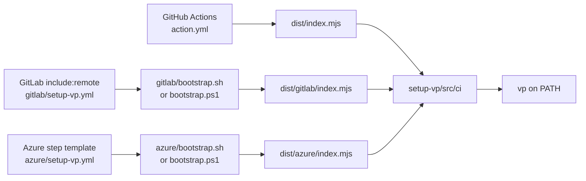
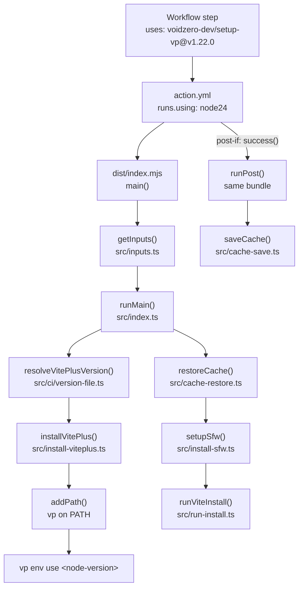
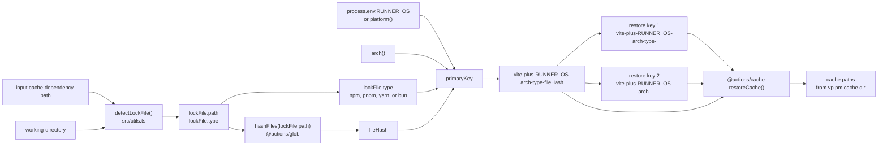

# 10 How setup-vp Installs Vite+ in Three Continuous Integration Systems

`setup-vp` is a small distribution layer for one program. It installs Vite+ (`vp`), optionally selects a Node.js version, optionally restores a package cache, and optionally runs `vp install`. The same TypeScript core serves GitHub Actions, GitLab Continuous Integration and Continuous Delivery (CI/CD), and Azure Pipelines. Each surface is a thin adapter around the core. The thesis of this document is that the adapters differ in transport, and a few options exist on one surface only. The version resolver, the lock file detector, and the Socket Firewall Free (`sfw`) wrapper are shared code. GitHub uses its own installer adapter around the shared logic. GitLab and Azure use one portable installer. The bundle in `dist/` is the shared code made portable.

This document covers installation and caching only. Vite+ itself is in document [02](02-vite-plus-toolchain.md), [04](04-vite-plus-js-runtime.md), and [05](05-vite-plus-dev-test-build.md). The task runner is in document [06](06-vite-task-scheduler.md). Document [10](10-setup-vp-ci.md) is this document.

All paths are relative to the snapshot root `/Users/darkvoid/GitSources/src.voidzero`. Every source path starts with the repository name, such as `setup-vp/src/index.ts`. The source is commit `ee6805d1c428a397d5c7d3fa4111f8a7e5af2136`, version 1.22.0, under the MIT license. The source declares no `engines` field in `setup-vp/package.json:1-14`.

Each abbreviation is spelled out at its first use. The table gives the spellings.

| Abbreviation | Spelling |
|---|---|
| API | Application Programming Interface |
| CD | Continuous Delivery |
| CI | Continuous Integration |
| CLI | command-line interface |
| HTML | HyperText Markup Language |
| HTTP | HyperText Transfer Protocol |
| JSON | JavaScript Object Notation |
| NPM | Node Package Manager |
| PATH | the search path for executable programs |
| SHA-1 | Secure Hash Algorithm 1 |
| SHA-256 | Secure Hash Algorithm, 256 bit |
| TLS | Transport Layer Security |
| URL | Uniform Resource Locator |
| XDG | XDG Base Directory Specification |
| YAML | YAML Ain't Markup Language |
| `cwd` | current working directory |
| `dotenv` | a file of `NAME=value` lines |
| `libc` | C library |

The text also spells out operating system (OS) and ES module (ECMAScript module). Environment variable names, input names, and function names stay unchanged.

The document uses these terms with fixed meanings. A *runner* is the machine that runs a continuous integration job. An *action* is a reusable GitHub step. A *step template* is a reusable Azure YAML fragment. A *hidden job* is a GitLab job template whose name starts with a dot. The *bundle* is the compiled `dist/*.mjs` file. The *Node.js engine* is the program that executes the bundle. A *shim* is a small launcher that selects a versioned program. The *payload* is a versioned Vite+ directory. A *snapshot* is the saved package store. A *manifest* is the small file that records a hash. A *publisher* is the workflow that commits `dist/`.

A code block starts with a label line, such as `// setup-vp/src/index.ts:144-157`. The label gives the file and the exact line range. The label is not part of the source text. A `#` label marks YAML, shell, or PowerShell. A `//` label marks TypeScript.

## 1. The three integration surfaces

The three surfaces have different packaging and a shared core. The table shows the transport for each surface.

| Surface | Entry artifact | Transport | Requirement on the runner |
|---|---|---|---|
| GitHub Actions | `setup-vp/action.yml` plus `setup-vp/dist/index.mjs` | The runner downloads the action and starts the compiled bundle with its Node.js 24 engine. | A Node.js 24 engine from the runner. |
| GitLab CI/CD | `setup-vp/gitlab/setup-vp.yml` plus `setup-vp/dist/gitlab/index.mjs` | A remote template downloads a bootstrap script. The script downloads the compiled bundle and runs it with the image Node.js. | Node.js, `bash`, and `curl` or `wget` in the image. |
| Azure Pipelines | `setup-vp/azure/setup-vp.yml` plus `setup-vp/dist/azure/index.mjs` | A step template downloads a bootstrap script. The script downloads the compiled bundle and every chunk file that the bundle names. | A bootstrap Node.js from `UseNode@1` or the agent. |



### 1.1 GitHub Actions: `action.yml`

The action declares its engine, its inputs, and its outputs in one file. The engine is Node.js 24. The `main` and `post` entries are the same bundle. The `post-if` condition is `success()`.

```
# setup-vp/action.yml:78-82
runs:
  using: node24
  main: dist/index.mjs
  post: dist/index.mjs
  post-if: success()
```

A workflow uses the action as one step. The basic form needs a checkout and the action (`setup-vp/README.md:34-36`).

```
# setup-vp/README.md:34-36
steps:
  - uses: actions/checkout@v7
  - uses: voidzero-dev/setup-vp@v1.22.0
```

The two phases are two separate processes. `runMain` saves the state key `IS_POST` with the value `"true"` before any other work (`setup-vp/src/index.ts:24`). The next start of the same bundle reads that state and calls `runPost` (`setup-vp/src/index.ts:144-157`). The `State.IsPost` member is the code name for the `IS_POST` key (`setup-vp/src/types.ts:42-53`). GitHub runs the post phase after the job. The `post-if: success()` value limits the post phase to a successful main step. This model is why the post phase reads its plan from saved state, not from memory.

The action has fifteen inputs. The table gives each input, the default, and the effect. The source is `setup-vp/action.yml:8-60`.

| Input | Default | Effect |
|---|---|---|
| `version` | empty | Explicit Vite+ version or dist-tag. A dist-tag is a moving version name such as `latest` or `next`. It has the highest precedence. |
| `version-file` | empty | Resolve the version from `package.json`, `pnpm-workspace.yaml`, or `.yarnrc.yml`. The input is ignored when `version` is set. |
| `run-install` | `"true"` | Run `vp install` after setup. The value is a boolean or a YAML object or list with a working directory (`cwd`) and `args`. |
| `sfw` | `"false"` | Wrap `vp install` with Socket Firewall Free. |
| `node-version` | empty | Node.js version for `vp env use`. |
| `node-version-file` | empty | File with a Node.js version. The input is ignored when `node-version` is set. |
| `node-manager` | empty | `false` keeps the runner Node.js. `true` leaves the installer default unchanged. Empty lets the installer decide, which is enabled on Continuous Integration. `false` cannot combine with a Node.js version input. |
| `package-manager` | empty | `true`, `false`, or a YAML mapping of `npm`, `pnpm`, `yarn`, and `bun` to booleans. Empty keeps management enabled on Continuous Integration. The feature needs Vite+ 0.3.1 or later. |
| `working-directory` | empty | Project directory for relative paths, lock file detection, and the default install. |
| `cache` | `"false"` | Enable the project dependency cache. |
| `cache-save` | `"true"` | Save enabled caches in the post action. |
| `cache-toolchain` | `"false"` | Cache Vite+, the managed Node.js engine, and the selected package manager. It needs an exact Vite+ version and an exact managed Node.js version, with no local installer override. |
| `cache-dependency-path` | empty | Lock file for the cache key. The action auto-detects the file when this input is empty. |
| `registry-url` | empty | Write a temporary `.npmrc` and set `NPM_CONFIG_USERCONFIG`. The token comes from `NODE_AUTH_TOKEN`. |
| `scope` | empty | Scope for an authenticated scoped registry. |

The action has seven outputs. The table gives each output and its meaning. The source is `setup-vp/action.yml:62-76`.

| Output | Meaning |
|---|---|
| `version` | Installed Vite+ version. |
| `cache-hit` | Whether the dependency cache was restored. |
| `toolchain-cache-hit` | Whether an exact toolchain cache passed validation. |
| `package-manager-cache-hit` | Whether the selected package manager passed validation. |
| `node-version` | Node.js version that Vite+ resolved for the working directory. |
| `package-manager` | Package manager that Vite+ resolved, such as `pnpm` or `bun`. |
| `package-manager-version` | Version of that package manager. |

The last three outputs come from `vp env current --json`. The action reads them at the end of setup (`setup-vp/src/index.ts:118-127`). They are `unknown` on Vite+ versions before 0.3.1 (`setup-vp/src/ci/env-current.ts:27-52`).

### 1.2 GitLab CI/CD: a remote include template

GitLab does not use the GitHub action interface. The GitLab surface is a YAML template that a job extends. The template is loaded with `include:remote` (`setup-vp/README.md:544-563`). It defines three hidden jobs. `.setup-vp-bootstrap` contains the bootstrap `before_script`. `.setup-vp` adds input variables and a second `before_script`. `.setup-vp-cached` adds a native GitLab cache and an `after_script` (`setup-vp/gitlab/setup-vp.yml:52-178`).

A project loads the template with `include:remote` and extends one hidden job. The example pins the template and `setup-ref` to the same tag (`setup-vp/README.md:553-562`).

```
# setup-vp/README.md:553-562
include:
  - remote: "https://raw.githubusercontent.com/voidzero-dev/setup-vp/v1.22.0/gitlab/setup-vp.yml"
    inputs:
      setup-ref: "v1.22.0"

test:
  extends: .setup-vp
  image: node:24
  script:
    - vp run test
```

The template has fifteen inputs. The table gives each input, the default, and the effect. The source is `setup-vp/gitlab/setup-vp.yml:1-50`.

| Input | Default | Effect |
|---|---|---|
| `version` | empty | Explicit Vite+ version or dist-tag. An empty value resolves from the project. |
| `version-file` | empty | Vite+ version file, relative to `working-directory`. |
| `node-version` | empty | Node.js version for `vp env use`. |
| `node-version-file` | empty | Node.js version file, relative to `working-directory`. |
| `cache-dependency-path` | empty | Lock file, relative to `working-directory`. The template auto-detects otherwise. |
| `cache-policy` | `pull-push` | GitLab cache policy for `.setup-vp-cached`. `pull` restores without saving. |
| `cache-namespace` | `$CI_RUNNER_ID` | Cache partition. An OS and architecture label shares a cache across compatible runners. |
| `working-directory` | `.` | Project directory for relative paths and the default install. |
| `run-install` | `"true"` | String input for `vp install`. It accepts `"true"`, `"false"`, or a YAML object or list. |
| `sfw` | `false` | Wrap `vp install` with Socket Firewall Free. The input is a boolean. |
| `package-manager` | empty | `"true"`, `"false"`, or a YAML mapping of the four manager names. The feature needs Vite+ 0.3.1 or later. |
| `node-manager` | empty | `"false"` keeps the image Node.js. `"true"` leaves the installer default. An empty value lets the installer decide. |
| `registry-url` | empty | Registry URL for a temporary `.npmrc`. The token comes from `NODE_AUTH_TOKEN`. |
| `scope` | empty | Scope for an authenticated scoped registry. |
| `setup-ref` | `v1.22.0` | Ref for the bootstrap and compiled bundle. A regular expression limits the characters. |

String inputs are not inserted into shell source. Each value goes into a GitLab variable with `expand: false`, so GitLab does not expand a dollar sign or a backtick in the value (`setup-vp/gitlab/setup-vp.yml:103-141`). The second `before_script` copies each variable into a `SETUP_VP_*` environment variable with a quoted assignment (`setup-vp/gitlab/setup-vp.yml:142-156`). A value such as `{"cwd":"apps/web"}` stays one string until the TypeScript parser reads it. The `sfw` and `cache-policy` values use direct quoting, because the template checks them against fixed values (`setup-vp/gitlab/setup-vp.yml:157-159`).

The bootstrap checks `setup-ref` against a safe character pattern before any download (`setup-vp/gitlab/setup-vp.yml:85-91`). It downloads `gitlab/bootstrap.sh` at that ref and runs it with `bash` (`setup-vp/gitlab/setup-vp.yml:93-100`). The bootstrap finds `node` in the image, downloads `dist/gitlab/index.mjs` into a temporary directory, and runs it (`setup-vp/gitlab/bootstrap.sh:7-32`).

The template creates a temporary environment file and exports its path as `SETUP_VP_ENV_FILE` (`setup-vp/gitlab/setup-vp.yml:93-97`). The bundle appends `export NAME=<quoted value>` lines to that file (`setup-vp/src/gitlab/shell.ts:10-22`). After the bootstrap exits, the template sources the file with `.` (`setup-vp/gitlab/setup-vp.yml:101`). To source a file is to run it in the current shell, so the updated `PATH` reaches the job script.

GitLab starts a new shell for `after_script`. When cache saving is on, the bundle copies itself to `.setup-vp-runtime.mjs`. It also writes `.setup-vp-cache-state.json` in the project directory (`setup-vp/src/gitlab/index.ts:114-118`). The `after_script` uses both files to save the final snapshot (`setup-vp/gitlab/setup-vp.yml:162-166`).

The native cache has this shape. The key has a namespace, the job name, and the commit ref. The fallback key uses the default branch. The cached path is `.setup-vp-cache/`.

```
# setup-vp/gitlab/setup-vp.yml:162-178
# Opt in to native GitLab persistence without replacing an existing job cache.
.setup-vp-cached:
  extends: .setup-vp
  variables:
    SETUP_VP_CACHE: "true"
  after_script:
    - |
      if [ -f "$CI_PROJECT_DIR/.setup-vp-cache-state.json" ]; then
        node "$CI_PROJECT_DIR/.setup-vp-runtime.mjs" save-cache
      fi
  cache:
    key: "setup-vp-v2-$[[ inputs.cache-namespace ]]-$CI_JOB_NAME_SLUG-$CI_COMMIT_REF_SLUG"
    fallback_keys:
      - "setup-vp-v2-$[[ inputs.cache-namespace ]]-$CI_JOB_NAME_SLUG-$CI_DEFAULT_BRANCH"
    paths:
      - .setup-vp-cache/
    policy: $[[ inputs.cache-policy ]]
```

The native cache stores `.setup-vp-cache/` and nothing else. Inside that directory the bundle keeps one snapshot for each operating system, architecture, and lock file type. The bundle copies the saved package store into the directory that `vp pm cache dir` reports. A manifest records the SHA-256 of the lock file at save time. A restore always copies packages from the snapshot. The snapshot computes a hit flag: the flag is true only when the manifest hash equals the current lock file hash (`setup-vp/src/ci/cache-snapshot.ts:69-124`). The GitLab wrapper publishes that flag as the string value `SETUP_VP_CACHE_HIT` (`setup-vp/src/gitlab/index.ts:137`). The Azure cache step uses the same name for its cache-hit variable (`setup-vp/azure/setup-vp.yml:140`). The native key is coarse, and the snapshot hash decides the exact hit. A snapshot from an older lock file can still supply packages on a miss.

### 1.3 Azure Pipelines: a step template with two phases

Azure expands a step template from an external repository but does not check out the repository files. The template therefore downloads its own bootstrap and bundle. It has a `prepare` phase and a `finalize` phase (`setup-vp/azure/setup-vp.yml:54-176`). The split is necessary for two reasons. The Azure `Cache@2` cache task must read the paths and keys that prepare computes. The cache must also restore the store before `vp install` runs in finalize (`setup-vp/azure/setup-vp.yml:122-140`).

A pipeline references the template from a repository resource. The example pins the resource `ref` and `setupRef` to the same tag (`setup-vp/README.md:739-760`).

```
# setup-vp/README.md:739-760
resources:
  repositories:
    - repository: setupVp
      type: github
      endpoint: github
      name: voidzero-dev/setup-vp
      ref: refs/tags/v1.22.0

pool:
  vmImage: ubuntu-latest

steps:
  - checkout: self

  - template: azure/setup-vp.yml@setupVp
    parameters:
      setupRef: v1.22.0
      nodeVersion: 24.x
      cache: true
      runInstall: true

  - script: vp run test
```

The template has seventeen parameters. The table gives each parameter, the default, and the effect. The source is `setup-vp/azure/setup-vp.yml:1-52`.

| Parameter | Default | Effect |
|---|---|---|
| `version` | empty | Explicit Vite+ version or dist-tag. An empty value uses the shared version resolution. |
| `versionFile` | empty | Vite+ version file, relative to `workingDirectory`. |
| `nodeVersionFile` | empty | Node.js version file, relative to `workingDirectory`. |
| `bootstrapNodeVersion` | `24.x` | Version for `UseNode@1` to start the setup bundle. An empty value uses the agent Node.js. |
| `stepName` | `setupVp` | Prefix for the named finalize tasks and their outputs. |
| `workingDirectory` | `.` | Project directory for lock detection and the default install. |
| `runInstall` | `true` | Run `vp install`. The value is a boolean or an object or list with `cwd` and `args`. |
| `sfw` | `false` | Wrap `vp install` with Socket Firewall Free. |
| `registryUrl` | empty | Optional registry URL for a temporary `.npmrc`. |
| `authEnv` | `{}` | Extra environment mappings for custom registry secrets. |
| `scope` | empty | Optional scope for a scoped registry. |
| `setupRef` | `v1.22.0` | Ref for the bootstrap and `dist/azure/index.mjs`. A regular expression limits the characters. |
| `nodeVersion` | empty | Node.js version for `vp env use`. It takes precedence over `nodeVersionFile`. |
| `packageManager` | empty | Boolean or mapping for `npm`, `pnpm`, `yarn`, and `bun`. The feature needs Vite+ 0.3.1 or later. |
| `nodeManager` | empty | `false` keeps the agent Node.js. `true` leaves the installer default. Empty lets the installer decide, which is enabled on Continuous Integration. |
| `cache` | `false` | Enable Azure `Cache@2` for the package-manager cache directory. |
| `cacheDependencyPath` | empty | Explicit lock file, relative to `workingDirectory`. The template auto-detects otherwise. |

The template starts with the Azure `UseNode@1` Node.js tool installer task when `bootstrapNodeVersion` is not empty (`setup-vp/azure/setup-vp.yml:55-59`). It then runs a PowerShell or Bash prepare step. That step downloads `azure/bootstrap.sh` or `azure/bootstrap.ps1` at `setupRef` and runs it (`setup-vp/azure/setup-vp.yml:61-120`). The bootstrap downloads `dist/azure/index.mjs` and every chunk file that the bundle names. It then runs `node <bundle> prepare` (`setup-vp/azure/bootstrap.sh:27-43`).

The chunk loop reads the bundle text for `../*.mjs` names (`setup-vp/azure/bootstrap.sh:36-41`). The bundle in this snapshot has no such name, so the loop downloads nothing here. The table in section 1 describes the general transport, not this build.

The prepare phase writes pipeline variables with `setVariable`. The values include `SETUP_VP_CACHE_READY`, the store path, the lock file path, and the lock type (`setup-vp/src/azure/index.ts:81-85`, `setup-vp/src/azure/index.ts:150-159`). It also sets `SETUP_VP_BOOTSTRAP_NODE` to `process.execPath`, so finalize starts the same Node.js engine (`setup-vp/src/azure/index.ts:84-85`). Azure keeps pipeline variables across steps in the same job.

The dependency cache key has the operating system, the architecture, the lock type, and the lock file. The restore keys drop the lock file first, then the lock type.

```
# setup-vp/azure/setup-vp.yml:130-140
  - ${{ if eq(parameters.cache, true) }}:
      - task: Cache@2
        displayName: Cache Vite+ package-manager data
        condition: and(succeeded(), eq(variables['SETUP_VP_CACHE_READY'], 'true'))
        inputs:
          key: '"vite-plus" | "$(Agent.OS)" | "$(Agent.OSArchitecture)" | "$(SETUP_VP_LOCK_TYPE)" | $(SETUP_VP_LOCK_FILE)'
          restoreKeys: |
            "vite-plus" | "$(Agent.OS)" | "$(Agent.OSArchitecture)" | "$(SETUP_VP_LOCK_TYPE)"
            "vite-plus" | "$(Agent.OS)" | "$(Agent.OSArchitecture)"
          path: $(SETUP_VP_CACHE_PATH)
          cacheHitVar: SETUP_VP_CACHE_HIT
```

The `SETUP_VP_LOCK_FILE` value is a file path. The README names the Azure pipeline caching documentation for the effect of a file path in a `Cache@2` key (`setup-vp/README.md:810`). This document does not restate that rule. When the lock file or the store path is absent, `SETUP_VP_CACHE_READY` stays false, and the cache task does not run (`setup-vp/azure/setup-vp.yml:130-133`).

The finalize phase runs `node <bundle> finalize` (`setup-vp/azure/setup-vp.yml:142-176`). It configures authentication, runs `vp install`, and sets the named outputs. The outputs are `version`, `cacheHit`, `nodeVersion`, `packageManager`, and `packageManagerVersion` (`setup-vp/src/azure/index.ts:214-228`). The `cacheHit` output is true only for an exact match. The job variable keeps Azure's `inexact` value (`setup-vp/README.md:803`). A missing lock file or cache path produces a warning and `SETUP_VP_CACHE_READY=false`. It does not fail the setup (`setup-vp/src/azure/index.ts:137-159`).

## 2. The TypeScript core

The core lives in `setup-vp/src/`. The table names the parts that this document uses.

| Path | Job |
|---|---|
| `setup-vp/src/index.ts` | GitHub entry point. Parses inputs and runs the main and post phases. |
| `setup-vp/src/inputs.ts` | GitHub input parsing and validation. |
| `setup-vp/src/types.ts` | Input types, state keys, output keys, and package names. |
| `setup-vp/src/ci/version-file.ts` | Vite+ version resolution from inputs, project files, catalogs, and lock files. |
| `setup-vp/src/ci/install-script-urls.ts` | Install script URL selection and version-to-git-ref mapping. |
| `setup-vp/src/install-viteplus.ts` | GitHub installer with reuse checks and retries. |
| `setup-vp/src/ci/install-viteplus.ts` | Shared portable installer for GitLab and Azure. |
| `setup-vp/src/ci/installer-env.ts` | Installer environment variables. |
| `setup-vp/src/cache-restore.ts` | GitHub dependency cache restore and key construction. |
| `setup-vp/src/cache-save.ts` | GitHub dependency cache save. |
| `setup-vp/src/ci/toolchain-cache.ts` | Toolchain cache key, paths, and validation. |
| `setup-vp/src/ci/package-manager-cache.ts` | Managed package manager cache key and validation. |
| `setup-vp/src/install-sfw.ts` | GitHub Socket Firewall Free installation and selection. |
| `setup-vp/src/ci/install-sfw.ts` | Shared Socket Firewall Free download and cache logic. |
| `setup-vp/src/run-install.ts` | GitHub `vp install` execution. |
| `setup-vp/src/gitlab/index.ts` | GitLab entry module. |
| `setup-vp/src/azure/index.ts` | Azure entry module with prepare and finalize phases. |

### 2.1 Entry point and post-action model

The GitHub bundle starts at `main()`. The function reads the inputs. A saved state value tells the same bundle whether this run is the main phase or the post phase. The state key is `IS_POST`, which the `State.IsPost` member names (`setup-vp/src/types.ts:42-53`). `runMain` writes that state first (`setup-vp/src/index.ts:24`).

```
// setup-vp/src/index.ts:144-157
async function main(): Promise<void> {
  const inputs = getInputs();

  if (getState(State.IsPost) === "true") {
    await runPost(inputs);
  } else {
    await runMain(inputs);
  }
}

main().catch((error) => {
  console.error(error);
  setFailed(error instanceof Error ? error.message : String(error));
});
```

The two-phase model has three consequences. First, the bundle must be self-contained. The build inlines every dependency (`setup-vp/vite.config.ts:27-52`). Second, the post phase must receive its plan through saved state, because the process is new. Third, the post phase runs only when the main step succeeded. The `post-if: success()` line enforces that rule (`setup-vp/action.yml:82`).

The bundle expects Node.js 24 on GitHub. The `runs.using: node24` value selects that engine. GitLab uses the `node` command from the image (`setup-vp/gitlab/bootstrap.sh:7-10`). Azure uses `process.execPath` as the bootstrap Node.js engine and keeps that path across phases (`setup-vp/src/azure/index.ts:85`). The package manifest declares no `engines` range (`setup-vp/package.json:1-14`).

### 2.2 Input parsing

`getInputs` reads each value with `getInput` or `getBooleanInput` from `@actions/core`. It validates one forbidden combination. `node-manager: false` cannot combine with `node-version` or `node-version-file`, because a Node.js installation needs the Vite+ Node.js manager (`setup-vp/src/inputs.ts:9-17`).

`parseRunInstall` accepts three shapes. It accepts the boolean `true`, a YAML object with `cwd` and `args`, or a list of such objects (`setup-vp/src/inputs.ts:40-67`). The schema is in `setup-vp/src/types.ts:5-18`. The value `false`, `null`, or an empty string becomes an empty list.

`parsePackageManager` accepts `true`, `false`, or a YAML mapping. Every mapping key must be `npm`, `pnpm`, `yarn`, or `bun`. Every value must be a boolean (`setup-vp/src/ci/package-manager.ts:8-33`). `parseNodeManager` accepts the YAML boolean forms and rejects every other value (`setup-vp/src/ci/node-manager.ts:14-19`).

### 2.3 Main flow from input to `vp install`

`runMain` is the orchestrator. The order matters for cache and environment reasons.

1. Save the post state and resolve the project directory (`setup-vp/src/index.ts:24-25`).
2. Resolve the Node.js version from the input or the version file (`setup-vp/src/index.ts:28-31`).
3. Resolve the Vite+ version (`setup-vp/src/index.ts:35`).
4. Restore the toolchain cache when `cache-toolchain` is set (`setup-vp/src/index.ts:37-44`).
5. Install Vite+ and put it on `PATH` (`setup-vp/src/index.ts:46-49`).
6. Apply Node.js and package manager modes (`setup-vp/src/index.ts:52-70`).
7. Configure registry authentication (`setup-vp/src/index.ts:73-77`).
8. Restore the selected managed package manager, then the dependency cache. The first restore also needs `cache-toolchain` (`setup-vp/src/index.ts:80-85`).
9. Select or install Socket Firewall Free (`setup-vp/src/index.ts:89`).
10. Run `vp install` for each entry (`setup-vp/src/index.ts:92-94`).
11. Read and publish the final outputs (`setup-vp/src/index.ts:97`).

The Node.js and package manager step has a deliberate order. The installer enables its own managers on Continuous Integration by default. The action changes a mode only after installation. This order keeps package manager management enabled when the user disables only the Node.js manager (`setup-vp/src/index.ts:58-70`).

```
// setup-vp/src/index.ts:58-70
  // Step 3: Configure Node.js after installation so opting out leaves package managers enabled.
  // Inputs validation guarantees nodeVersion is unset when node-manager is false.
  if (inputs.nodeManager === false) {
    info("Disabling Vite+ Node.js version management...");
    await exec("vp", nodeManagerOffArgs(versionOutput));
  } else if (nodeVersion) {
    info(`Setting up Node.js ${nodeVersion} via vp env use...`);
    await exec("vp", ["env", "use", nodeVersion], { cwd: projectDir });
  }

  for (const args of packageManagerCommands) {
    await exec("vp", args);
  }
```

`nodeManagerOffArgs` returns `["env", "off", "node"]` on Vite+ 0.3.1 or later. It returns `["env", "off"]` on older versions (`setup-vp/src/ci/node-manager.ts:33-40`). `packageManagerArgs` returns `["env", "off", "pm"]` for `false`. It returns one `["env", "off", name]` command for each manager that the mapping sets to `false` (`setup-vp/src/ci/package-manager.ts:35-51`).

The cache, firewall, and install sequence is the last part of the main phase.

```
// setup-vp/src/index.ts:82-94
  // Step 5: Restore cache if enabled
  if (inputs.cache) {
    await restoreCache(inputs);
  }

  // Step 6: Install Socket Firewall Free if requested (must run before vp install).
  // Use the resolved version so preview pins in files also disable sfw.
  const installCommand = await setupSfw({ ...inputs, version });

  // Step 7: Run vp install if requested
  if (inputs.runInstall.length > 0) {
    await runViteInstall(inputs, installCommand);
  }
```

The diagram shows the same order for GitHub. The post branch runs only after a successful main step.



The GitLab and Azure entry modules follow the same order with different publishers. `setup-vp/src/gitlab/index.ts:48-154` resolves the directory and parses inputs. It then resolves both versions, installs Vite+, applies modes, and runs `vp env use`. It also configures authentication, prepares and restores the snapshot, sets up the firewall, runs the installs, and writes outputs. `setup-vp/src/azure/index.ts:63-160` does the prepare half. `setup-vp/src/azure/index.ts:162-229` does the finalize half.

## 3. How Vite+ is installed

The action does not use a package manager to install `vp`. It runs the official Vite+ install script. The script is `install.sh` on Unix-like systems and `install.ps1` on Windows (`setup-vp/src/ci/install-script-urls.ts:53-68`).

### 3.1 Version resolution

The version comes from five sources in a fixed order. The first source that yields a value wins. This section uses five version terms. A *dist-tag* is a moving name such as `latest` or `next`. A *semver range* is a version expression such as `^0.2.0` or `0.2.x`. An *alias* is a non-registry specification such as `npm:` or `git:`. A *catalog* is a shared version list in a workspace file. The *workspace root* is the top directory of the project.

A `catalog:` value is a reference to a catalog entry. A `catalog:name` value names a non-default catalog. A value without a name means the `default` catalog (`setup-vp/src/ci/version-file.ts:272-273`).

| Order | Source | Behaviour |
|---|---|---|
| 1 | `version` input | Used unchanged. |
| 2 | `version-file` input | Resolved from the named file. A failure warns and becomes `latest`. |
| 3 | Project `package.json` | Reads the `vite-plus` entry from `devDependencies` first, then `dependencies`. |
| 4 | Lock file | Resolves a project range or a `catalog:` reference to the locked version. |
| 5 | `latest` | The fallback dist-tag. |

The precedence is in `setup-vp/src/ci/version-file.ts:51-80`.

```
// setup-vp/src/ci/version-file.ts:61-80
  function resolveVitePlusVersion(inputs: Inputs, projectDir: string): string {
    if (inputs.version) return inputs.version;

    if (inputs.versionFile) {
      return tryResolveVitePlusVersionFile(inputs.versionFile, projectDir) ?? "latest";
    }

    const projectVersion = tryResolveVitePlusVersionFromProject(projectDir);
    if (projectVersion !== undefined) return projectVersion;

    // Consult the lockfile only when the project declares a direct vite-plus
    // dependency the lockfile can legitimately resolve to a published version,
    // so a transitive/other-workspace entry or a non-registry spec isn't
    // mistaken for this project's pin.
    if (!shouldConsultLockfile(projectDir)) return "latest";

    return (
      tryResolveVitePlusVersionFromLockfile(projectDir, inputs.cacheDependencyPath) ?? "latest"
    );
  }
```

A `catalog:` entry resolves through the nearest catalog source. At each directory the resolver checks `pnpm-workspace.yaml`, then `.yarnrc.yml`, then `package.json` (`setup-vp/src/ci/version-file.ts:44`, `setup-vp/src/ci/version-file.ts:285-291`). The first entry that names the catalog wins. The walk starts at the manifest directory and stops at the workspace root (`setup-vp/src/ci/version-file.ts:281-305`). A `package.json` catalog can be at the top level or under `workspaces` (`setup-vp/src/ci/version-file.ts:356-363`). The source does not describe a case where two catalogs of the same name at the same level differ.

`assertInstallableVersion` accepts only an exact version or a dist-tag for a `version-file` value. A semver range or an alias in that file is rejected with an actionable error (`setup-vp/src/ci/version-file.ts:376-391`). In auto-detection, a project `package.json` range is not rejected. It goes to the lock file resolver, which resolves it against the recorded version.

The lock file is consulted only when the project declares a direct `vite-plus` dependency. The dependency spec must be a `catalog:` reference or a plain semver range. A `file:`, `git:`, `workspace:`, `link:`, or `npm:` alias is excluded, because the lock file version would not describe the NPM package (`setup-vp/src/ci/version-file.ts:82-109`).

### 3.2 The install script and its URL

The action does not download a binary directly. It downloads the install script and lets that script install `vp`. The install script receives the target version through `VP_VERSION`. The environment builder also sets `VITE_PLUS_VERSION` for older releases.

```
// setup-vp/src/ci/installer-env.ts:9-19
  const env: Record<string, string> = {
    ...Object.fromEntries(
      Object.entries(parentEnv).filter(
        (entry): entry is [string, string] => entry[1] !== undefined,
      ),
    ),
    ...nodeEnv,
    VP_VERSION: version,
    // Keep compatibility with releases before the VP_* variable rename.
    VITE_PLUS_VERSION: version,
  };
```

The URL selection has a pinned group and a latest group. A pinned URL uses the release tag for an exact version, or the commit for a preview build. The latest group uses `viteplus.dev` first, then the `main` branch of the Vite+ repository. The two groups are tried in order, and each group gets two rounds (`setup-vp/src/install-viteplus.ts:22-26`, `setup-vp/src/install-viteplus.ts:53-84`).

```
// setup-vp/src/ci/install-script-urls.ts:53-68
export function getInstallScriptUrls(
  version: string,
  platform: NodeJS.Platform = process.platform,
): InstallScriptUrls {
  const script = isWindows(platform) ? "install.ps1" : "install.sh";
  const ref = installScriptRef(version);
  return {
    pinned: ref
      ? [
          `${REPO_RAW_BASE}/${ref}/${SCRIPT_DIR}/${script}`,
          `${REPO_CDN_BASE}@${ref}/${SCRIPT_DIR}/${script}`,
        ]
      : [],
    latest: [`https://viteplus.dev/${script}`, `${REPO_RAW_BASE}/main/${SCRIPT_DIR}/${script}`],
  };
}
```

The version-to-ref rule maps only two shapes. A preview version `0.0.0-commit.<40 hex characters>` maps to the commit SHA. An exact release version maps to the `v<version>` tag. A dist-tag such as `latest` or `next` maps to no ref, so only the latest group applies (`setup-vp/src/ci/install-script-urls.ts:27-34`, `setup-vp/src/ci/install-script-urls.ts:70-78`).

```
// setup-vp/src/ci/install-script-urls.ts:70-78
function installScriptRef(version: string): string | undefined {
  // Git SHAs are lowercase, so lowercase the extracted SHA before it becomes
  // the ref. Check the commit shape first: it also matches the exact-version
  // regex but must resolve to the commit, not a `v0.0.0-commit.*` tag.
  const sha = pkgPrNewCommitSha(version);
  if (sha) return sha.toLowerCase();
  if (EXACT_RELEASE_VERSION_RE.test(version)) return `v${version}`;
  return undefined;
}
```

**Aha:** The installer script is selected by the version, not by the action's newest release. A script from `main` can install an older CLI incorrectly. The source names one example. The change `voidzero-dev/vite-plus#2346` adopted the XDG Base Directory Specification layout. That change moved where fresh installs land. A script at the release tag and a CLI at the same tag use one layout. The source states that the two then always match (`setup-vp/src/ci/install-script-urls.ts:1-10`). The action falls back to the latest script only after every pinned source fails. It warns that the fallback may be incompatible (`setup-vp/src/install-viteplus.ts:100-108`).

### 3.3 The install command and the `PATH` update

The install command is a shell or PowerShell wrapper around the downloaded script. On Unix, it downloads the script to a temporary file and sources it. To source the script is to run it in the current shell, so the installer can change `PATH` for the next command. The wrapper then probes the installed `vp`. The probe writes `vp --version` and `VP_DUMP_DIRS=1 vp` to a temporary file. `parseVitePlusDirs` reads that file to find the `data`, `bin`, `cache`, `config`, and `state` directories (`setup-vp/src/ci/vp-dirs.ts:195-209`, `setup-vp/src/ci/vp-dirs.ts:113-132`).

The wrapper runs the script with bounded network timeouts. The curl flags are `--connect-timeout 5 --max-time 15`. PowerShell uses a 15-second timeout (`setup-vp/src/ci/vp-dirs.ts:12-14`). The wrapper clears the `nounset` shell option for the upstream script. That option stops a shell when it reads an unset variable. The upstream script reads optional positional arguments without defaults, so it needs the option off (`setup-vp/src/ci/vp-dirs.ts:174-209`).

After a successful install, `ensureVitePlusBinInPath` resolves the binary directory. It calls `addPath` when the directory is absent. It prepends the directory again when a reusable installation must not be shadowed. It also exports the full `PATH` when a fallback shim directory exists (`setup-vp/src/install-viteplus.ts:138-153`). A fallback shim directory holds launcher files for commands that the installer does not manage. The path helper moves that directory to the end, so system programs stay first (`setup-vp/src/ci/vp-dirs.ts:40-48`).

The install has two URL groups. Each group gets `INSTALL_MAX_ROUNDS` attempts for each URL in that group, and `INSTALL_MAX_ROUNDS * totalUrls` is the budget across both groups (`setup-vp/src/install-viteplus.ts:22-26`, `setup-vp/src/install-viteplus.ts:56-84`). An exact release version maps to two pinned URLs and two latest URLs, so each group gets four attempts and the total budget is eight. The delay between attempts is 2,000 milliseconds (`setup-vp/src/install-viteplus.ts:22-26`, `setup-vp/src/install-viteplus.ts:56-84`). The error reports the attempt count and the last failure reason (`setup-vp/src/install-viteplus.ts:115-117`).

Before any install, `installVitePlus` calls `findReusableVitePlus`. That function accepts only an exact version with a complete, active installation. It probes the data directories from `VP_HOME`, `VP_DATA_DIR`, the user home default, and the XDG data home (`setup-vp/src/reuse-viteplus.ts:108-123`). The `VP_DUMP_DIRS` output decides whether a candidate is the active installation (`setup-vp/src/reuse-viteplus.ts:57-92`). The checks require payload dependencies for the exact version and absolute directories. They also require a matching version output and the installer-default shim modes in `config.json`. Every required shim must exist, and the native binding must load (`setup-vp/src/reuse-viteplus.ts:66-90`). A valid installation is put first on `PATH`, and no installer runs (`setup-vp/src/install-viteplus.ts:34-41`). This path works with `cache: false`. It never copies an installation to a fresh runner (`setup-vp/README.md:394-405`).

### 3.4 Selecting Node.js with `vp env use`

The action resolves a Node.js version from `node-version`, then `node-version-file`. The file resolver supports `.nvmrc`, `.node-version`, `.tool-versions`, and `package.json` (`setup-vp/src/ci/node-version-file.ts:31-68`). For `package.json`, it checks `devEngines.runtime` first and `engines.node` second (`setup-vp/src/ci/node-version-file.ts:126-154`). It strips a leading `v`. It maps the values `node` and `stable` to `latest` (`setup-vp/src/ci/node-version-file.ts:77-93`).

The installer can receive the same selection. `createInstallerNodeContext` sets `VP_SETUP_NODE_VERSION` to the selector. It sets `VP_SETUP_NODE_VERSION_FILE` to a temporary result file (`setup-vp/src/ci/installer-node.ts:9-25`). An installer that supports the exchange reads these variables and installs the Node.js engine with `vp`. The context is used for every install, so the action does not test the installer first. The result file holds one exact version line. The action reads it only for an explicit `node-version` input. When the file is present, the action uses that version for the later step (`setup-vp/src/ci/installer-node.ts:29-37`). When the file is absent, the action keeps the original selector (`setup-vp/src/ci/installer-node.ts:38-41`).

After installation, the action runs `vp env use <version>` in the project directory (`setup-vp/src/index.ts:63-66`). This command selects the version for the project scope. If the user sets `node-manager: false`, the action runs the off command instead. The input cannot combine with an explicit Node.js version (`setup-vp/src/inputs.ts:12-17`).

## 4. The dependency cache

The dependency cache stores the package manager store, not `node_modules`. The action asks `vp` for the store directory. `getViteCacheDir` runs `vp pm cache dir` and returns the single path that the command prints (`setup-vp/src/utils.ts:186-189`). The path is used for all four package managers.

### 4.1 Lock file detection

The action detects six lock file names in a fixed priority order. The order decides the result when a directory holds more than one lock file. The two Bun names map to the same type. The source does not state the difference between them.

| Priority | File | Type |
|---|---|---|
| 1 | `pnpm-lock.yaml` | `pnpm` |
| 2 | `bun.lockb` | `bun` |
| 3 | `bun.lock` | `bun` |
| 4 | `package-lock.json` | `npm` |
| 5 | `npm-shrinkwrap.json` | `npm` |
| 6 | `yarn.lock` | `yarn` |

```
// setup-vp/src/utils.ts:77-84
const LOCK_FILES: Array<{ filename: string; type: LockFileType }> = [
  { filename: "pnpm-lock.yaml", type: LockFileType.Pnpm },
  { filename: "bun.lockb", type: LockFileType.Bun },
  { filename: "bun.lock", type: LockFileType.Bun },
  { filename: "package-lock.json", type: LockFileType.Npm },
  { filename: "npm-shrinkwrap.json", type: LockFileType.Npm },
  { filename: "yarn.lock", type: LockFileType.Yarn },
];
```

Automatic detection reads the project directory once. It does not search a parent directory or a package subdirectory. It returns the first known name that is present (`setup-vp/src/utils.ts:115-131`). An explicit `cache-dependency-path` is resolved against the workspace. If the base name is known, its type comes from the table. If the base name is unknown, `inferLockFileType` guesses from the name. A name that contains `pnpm` becomes pnpm, a name that contains `yarn` becomes yarn, and a name that starts with `bun.` becomes bun. Every other name becomes npm (`setup-vp/src/utils.ts:90-146`).

The cache directory is resolved from the lock file directory. This rule lets a lock file in a subdirectory use the store for that subdirectory (`setup-vp/src/cache-restore.ts:24-29`). A lock file at `apps/web/pnpm-lock.yaml`, for example, makes the action run `vp pm cache dir` in `apps/web`. The cache then holds the store for that subdirectory, not for the repository root. The path list has one entry in the current code (`setup-vp/src/utils.ts:151-161`).

### 4.2 The cache key

The key has four parts. The table lists every input to the key. There are no other inputs.

| Part | Source | Example |
|---|---|---|
| Runner OS | `process.env.RUNNER_OS`, or `platform()` when the variable is empty | `Linux` |
| Runner architecture | `arch()` | `x64` |
| Lock file type | `lockFile.type` from the table above | `pnpm` |
| Lock file hash | `hashFiles(lockFile.path)` from `@actions/glob` | a 64-character hexadecimal digest |

```
// setup-vp/src/cache-restore.ts:41-54
  // Generate cache key: vite-plus-{platform}-{arch}-{lockfile-type}-{hash}
  const runnerOS = process.env.RUNNER_OS || platform();
  const runnerArch = arch();
  const fileHash = await hashFiles(lockFile.path);

  if (!fileHash) {
    throw new Error(`Failed to generate hash for lock file: ${lockFile.path}`);
  }

  const primaryKey = `vite-plus-${runnerOS}-${runnerArch}-${lockFile.type}-${fileHash}`;
  const restoreKeys = [
    `vite-plus-${runnerOS}-${runnerArch}-${lockFile.type}-`,
    `vite-plus-${runnerOS}-${runnerArch}-`,
  ];
```

The key does not include the Vite+ version, the Node.js version, or the package manager version. The source does not state why. The store content is keyed by the lock file, and the action does not add a toolchain input to this key. A reader must not infer a version guarantee from this key.

The restore keys enable a partial match. The first key matches any lock file of the same type on the same OS and architecture. The second key matches any lock file on the same OS and architecture. A successful restore from either prefix sets `cache-hit` to true (`setup-vp/src/cache-restore.ts:62-71`). The output does not distinguish an exact match from a prefix match.



### 4.3 Restore and save

The main phase stores the cache plan in runner state. It saves the path list, the primary key, and the matched key (`setup-vp/src/cache-restore.ts:38-66`). The post phase calls `saveCache`. That function skips the save when the primary key matched, when the path list is empty, or when another job owns the key (`setup-vp/src/cache-save.ts:5-44`). A save failure produces a warning and does not fail the job.

`cache-save: false` skips every post save but keeps every restore. The input covers the dependency cache, the toolchain cache, and the package manager cache (`setup-vp/src/index.ts:129-142`). The README documents this table (`setup-vp/README.md:519-542`). The `cache` and `cache-toolchain` switches are independent.

GitLab and Azure do not use this key. GitLab uses the native key from section 1.2. Azure uses the key from section 1.3. Both still use the same lock file detector and the same `vp pm cache dir` path (`setup-vp/src/ci/cache.ts:77-107`).

## 5. Toolchain and package manager caches

The `cache-toolchain` input adds two GitHub-only caches. The first holds the versioned Vite+ payload and the managed Node.js engine. The second holds the selected managed package manager. The input is independent of the dependency cache (`setup-vp/action.yml:48-51`). It controls both restores. The package manager restore also needs a toolchain plan (`setup-vp/src/index.ts:37-44`, `setup-vp/src/index.ts:80`).

### 5.1 Toolchain cache key

The toolchain key has seven parts. The table lists every input. The parts are built in `setup-vp/src/ci/toolchain-cache.ts:58-94`. The C library value comes from `defaultLibc` at `setup-vp/src/ci/toolchain-cache.ts:58-61`. The C library is the system library that a Linux binary links against. `glibc` is the GNU C Library. `musl` is the small C library that Alpine Linux uses. The value `native` means that the platform has no Linux C library variants.

| Part | Source |
|---|---|
| Format marker | The literal `setup-vp-toolchain-v2` |
| Platform | `process.platform` |
| Architecture | `process.arch` |
| C library | `native` on non-Linux systems, or `glibc` or `musl` on Linux |
| Vite+ version | The resolved `version` |
| Node.js version | An exact version from `node-version`, `node-version-file`, or the project files |
| Identity suffix | The first 24 hexadecimal characters of a SHA-256 over the data directory, the NPM registry, and the Node.js distribution mirror |

```
// setup-vp/src/ci/toolchain-cache.ts:76-94
  const data = dataDirectory(env, platform);
  if (!data || !isAbsolute(data)) return;
  const identity = JSON.stringify([
    data,
    env.NPM_CONFIG_REGISTRY || env.npm_config_registry || "https://registry.npmjs.org",
    env.VP_NODE_DIST_MIRROR || "",
  ]);
  const suffix = createHash("sha256").update(identity).digest("hex").slice(0, 24);
  const payload = join(data, version);
  const runtime = join(data, "js_runtime", "node", nodeVersion);
  return {
    key: `setup-vp-toolchain-v2-${platform}-${arch}-${libc}-${version}-node-${nodeVersion}-${suffix}`,
    version,
    nodeVersion,
    data,
    payload,
    runtime,
    paths: [payload, runtime],
  };
```

The suffix changes when one of its three parts changes. The source gives no other reason for these three parts. The cache has no restore keys. The key must match exactly (`setup-vp/src/toolchain-cache.ts:41-51`). The cached paths are the Vite+ payload directory and the Node.js engine directory (`setup-vp/src/ci/toolchain-cache.ts:84-93`). A restore is skipped when either directory already exists, so the action preserves a persistent runner (`setup-vp/src/ci/toolchain-cache.ts:112-115`).

A restore is accepted only after validation. The validator requires both directories and a `.vp-setup-complete` marker. It also requires the Vite+ dependencies, a self-setup support probe, and matching data directories. It checks the version output, a Windows shim when applicable, the Node.js version, and the native binding (`setup-vp/src/ci/toolchain-cache.ts:117-164`). A failed validation removes the restored files and falls back to the installer (`setup-vp/src/toolchain-cache.ts:45-57`).

The cache is skipped in six cases. The cases are a moving version, a range, an unsupported release, `node-manager: false`, a non-exact Node.js version, and a local installer override (`setup-vp/src/ci/toolchain-cache.ts:63-110`). An unsupported release is a Vite+ release before 0.3.0, which cannot report `VP_DUMP_DIRS` (`setup-vp/src/ci/vp-dirs.ts:52-63`, `setup-vp/README.md:394-405`). The local override names are `VP_LOCAL_TGZ`, `VP_LOCAL_BINARY`, `VP_SKIP_DEPS_INSTALL`, and `VITE_PLUS_HOME` (`setup-vp/src/ci/toolchain-cache.ts:17-22`). These names are environment variables, not inputs. The source states the rule as "use an exact Vite+ version and an exact managed Node.js version without local installer overrides" (`setup-vp/src/toolchain-cache.ts:29-34`).

### 5.2 Package manager cache key

The package manager cache reuses the toolchain key and adds the manager name, the manager version, and a configuration hash. The plan takes a toolchain plan as an argument, so this cache exists only with `cache-toolchain` (`setup-vp/src/ci/package-manager-cache.ts:48-52`). The configuration hash reads the NPM registry variable and every `.npmrc` from the project directory upward, plus the user `.npmrc` (`setup-vp/src/ci/package-manager-cache.ts:26-37`).

```
// setup-vp/src/ci/package-manager-cache.ts:74-80
  return {
    key: `${toolchain.key}-pm-${name}-${version}-${configurationHash(projectDir, env)}`,
    name,
    version,
    path,
    node: join(toolchain.runtime, platform === "win32" ? "node.exe" : "bin/node"),
  };
```

The cache applies only to a manager that Vite+ reports as `managed`. A managed manager is one that Vite+ installed. The manager name must be `npm`, `pnpm`, `yarn`, or `bun`. The version must be exact. The reported binary path must be the expected path under the Vite+ data directory (`setup-vp/src/ci/package-manager-cache.ts:48-81`). A system manager, the npm bundled with Node.js, an unresolved version, or an unknown layout is not cached.

The cache path is `<data>/package_manager/<name>/<version>` (`setup-vp/src/ci/package-manager-cache.ts:66`). Validation runs the cached executable or its JavaScript entry point and compares the output with the planned version (`setup-vp/src/ci/package-manager-cache.ts:89-127`). The configuration hash is a SHA-256 digest, so the key holds no readable `.npmrc` text. The cached path is the manager installation directory, so the archive has no `.npmrc` (`setup-vp/src/ci/package-manager-cache.ts:24-37`).

## 6. The optional install and Socket Firewall Free

`vp install` is optional. The `run-install` input defaults to `"true"`. The parser turns `true` into one empty entry. It turns `false` into an empty list. It accepts a list of entries with `cwd` and `args` (`setup-vp/src/inputs.ts:40-67`). The action loops over the entries in order (`setup-vp/src/run-install.ts:52-96`).

For each entry, the arguments are `install` plus the entry arguments. The working directory is the entry `cwd` resolved against the project directory (`setup-vp/src/run-install.ts:52-55`). On a non-zero exit, the action logs the last 4,000 characters of the error and calls `setFailed` (`setup-vp/src/run-install.ts:8`, `setup-vp/src/run-install.ts:86-95`). It does not stop the other entries in the loop. Each failing entry adds a failure.

### 6.1 What `sfw` blocks

Socket Firewall Free is a proxy for package downloads. The action describes the effect as blocking malicious dependency fetches (`setup-vp/action.yml:21`). The README states that the underlying NPM, pnpm, and yarn fetches are inspected before packages are installed (`setup-vp/README.md:258-260`). The action does not inspect packages itself. It starts `sfw`, and `sfw` performs the inspection. The source does not show how `sfw` inspects a fetch. It shows only that the action runs `sfw vp install` (`setup-vp/src/run-install.ts:52-56`). The README names NPM, pnpm, and yarn. It does not say whether bun fetches are inspected.

The wrapper applies to `vp install` only. `setupSfw` returns an install command with an executable and a boolean. When `sfw` is active, the executable is the `sfw` binary and the boolean is true. `runViteInstall` then builds the arguments as `["vp", "install", ...]` and runs the `sfw` executable with those arguments (`setup-vp/src/run-install.ts:47-55`). Every other `vp` command runs without the wrapper (`setup-vp/README.md:271`).

```
// setup-vp/src/run-install.ts:52-56
  for (const options of inputs.runInstall) {
    const installArgs = ["install", ...(options.args || [])];
    const args = sfw ? ["vp", ...installArgs] : installArgs;
    const cwd = getInstallCwd(projectDir, options.cwd);
    const commandLabel = `${executable} ${args.join(" ")}`;
```

### 6.2 Selection, download, and cache

`setupSfw` has five branches. The table gives each branch and its result.

| Condition | Result |
|---|---|
| `sfw` is false, or the Vite+ version is a preview build | Plain `vp`, no wrapper. |
| `run-install` is empty | Plain `vp`, with an informational message. |
| An `sfw` binary is already on `PATH` | Use that binary. This supports a SHA-pinned `socketdev/action` step. |
| No published asset exists for the platform and architecture | Plain `vp`, with a warning. |
| A supported asset is needed | Download it, or restore it from cache, then use it. |

The source is `setup-vp/src/install-sfw.ts:138-166`. The preview branch is in `setup-vp/src/ci/sfw.ts:4-12`. The preview version shape is `0.0.0-commit.<40 hex characters>`. The source gives no reason for the preview exclusion.

```
// setup-vp/src/install-sfw.ts:138-166
export async function setupSfw(inputs: Inputs): Promise<InstallCommand> {
  if (!resolveSfwEnabled(inputs.sfw, inputs.version, warning))
    return { executable: "vp", sfw: false };

  if (inputs.runInstall.length === 0) {
    info("sfw was requested but `run-install` is disabled; sfw will not be invoked.");
    return { executable: "vp", sfw: false };
  }

  // Prefer an externally-provided sfw — typically installed by a prior
  // `socketdev/action@<sha>` step. That path lets users SHA-pin sfw via
  // Renovate against the upstream action repo, which is stricter than our
  // bundled releases/download URL.
  const existing = findSfwOnPath();
  if (existing) {
    info(`Using existing sfw on PATH: ${existing}`);
    return { executable: existing, sfw: true };
  }

  if (!isSfwSupported()) {
    const env = `process.platform=${process.platform}, process.arch=${process.arch}, musl=${isMuslLinux()}`;
    warning(
      `sfw has no published binary for this runner's platform/architecture (${env}) and none was found on PATH; falling back to plain \`vp install\`. To enable sfw here, install a working sfw binary on PATH in an earlier step (e.g. via \`socketdev/action@<sha>\` or a custom install).`,
    );
    return { executable: "vp", sfw: false };
  }

  return { executable: await installSfw(), sfw: true };
}
```

Each integration pins one `sfw` version. The version is `v1.15.4` for all three surfaces. The release base URL uses that version. A comment states that Renovate updates the pin, so a rerun of the same commit downloads the same release (`setup-vp/src/ci/install-sfw.ts:12-15`).

```
// setup-vp/src/ci/install-sfw.ts:14-15
export const SFW_VERSION = "v1.15.4";
export const SFW_RELEASE_BASE = `https://github.com/SocketDev/sfw-free/releases/download/${SFW_VERSION}`;
```

The asset name depends on the platform, the architecture, and the Linux C library. The table gives the mapping.

| Platform | Architecture | Linux C library | Asset |
|---|---|---|---|
| macOS | arm64 | not applicable | `sfw-free-macos-arm64` |
| macOS | x64 | not applicable | `sfw-free-macos-x86_64` |
| Linux | arm64 | glibc | `sfw-free-linux-arm64` |
| Linux | arm64 | musl | `sfw-free-musl-linux-arm64` |
| Linux | x64 | glibc | `sfw-free-linux-x86_64` |
| Linux | x64 | musl | `sfw-free-musl-linux-x86_64` |
| Windows | arm64 | not applicable | `sfw-free-windows-arm64.exe` |
| Windows | x64 | not applicable | `sfw-free-windows-x86_64.exe` |

The source is `setup-vp/src/ci/install-sfw.ts:19-52`. The musl detector checks the Node.js report for a `glibcVersionRuntime` field. If the field is absent, it checks for `/etc/alpine-release` (`setup-vp/src/ci/install-sfw.ts:19-32`).

On GitHub, the downloaded binary goes into `$RUNNER_TEMP/sfw-bin`. The cache key is `sfw-<version>-<platform>-<arch>-<libc>`. There are no restore keys, so the action never accepts a binary from a different version (`setup-vp/src/install-sfw.ts:44-76`). On macOS and Windows, `isMuslLinux()` returns false, so the key contains `glibc` even though the asset has no C library variant (`setup-vp/src/install-sfw.ts:61-63`, `setup-vp/src/ci/install-sfw.ts:19-21`).

```
// setup-vp/src/install-sfw.ts:61-63
  const cacheKey = `sfw-${SFW_VERSION}-${process.platform}-${process.arch}-${isMuslLinux() ? "musl" : "glibc"}`;
  try {
    const matchedKey = await restoreCache([binDir], cacheKey);
```

**Aha:** The `sfw` cache uses no restore keys on purpose. A restore key would let the action accept a binary from a different `sfw` version. The comment states that this must never happen (`setup-vp/src/install-sfw.ts:56-63`). The version, platform, architecture, and C library are all in the key, so an incompatible binary cannot enter through a prefix match.

GitLab and Azure do not use the GitHub cache. GitLab enables the cache through `.setup-vp-cached`, which sets `SETUP_VP_CACHE=true` (`setup-vp/gitlab/setup-vp.yml:163-166`). The bundle then puts the binary under `.setup-vp-cache/sfw` (`setup-vp/src/gitlab/index.ts:103-105`). Azure sets `SETUP_VP_SFW_READY`, `SETUP_VP_SFW_CACHE_DIR`, and `SETUP_VP_SFW_CACHE_KEY` in the prepare phase (`setup-vp/src/azure/index.ts:119-135`). A separate `Cache@2` task reads them and runs before finalize (`setup-vp/azure/setup-vp.yml:122-128`). Both portable bundles download the asset on a cache miss and check for a non-empty file before use (`setup-vp/src/ci/install-sfw.ts:203-244`).

### 6.3 The known Windows lookup failure

The wrapper has one documented workaround. `sfw` resolves the wrapped command on Windows by running a PowerShell `Get-Command` lookup. That lookup has a hard 10-second timeout. A cold PowerShell start can exceed the timeout. `sfw` then reports `Command 'vp' not found in PATH` even though `vp` exists (`setup-vp/src/run-install.ts:10-19`).

The action detects that exact message. It warms the PowerShell command cache with `powershell.exe -NoProfile -Command Get-Command vp`, then retries the install once (`setup-vp/src/run-install.ts:22-35`, `setup-vp/src/run-install.ts:73-79`). The portable GitLab and Azure entry module has the same detection and retry (`setup-vp/src/ci/run-install.ts:66-68`, `setup-vp/src/ci/run-install.ts:89-109`).

## 7. The `dist/` directory and its build

The `dist/` directory is a build output that is committed to the repository. The three files are tracked in Git. The `.gitignore` lists only `node_modules/`, `.vitest/`, and `.fallow/` (`setup-vp/.gitignore:1-3`). The sizes in this snapshot are 1,314,501 bytes for `dist/index.mjs`, 163,571 bytes for `dist/gitlab/index.mjs`, and 163,936 bytes for `dist/azure/index.mjs`.

The GitHub action points at `dist/index.mjs` for both the main and post phases (`setup-vp/action.yml:80-81`). The GitLab bootstrap downloads `dist/gitlab/index.mjs` (`setup-vp/gitlab/bootstrap.sh:29-32`). The Azure bootstrap downloads `dist/azure/index.mjs` and any referenced `../*.mjs` chunk (`setup-vp/azure/bootstrap.sh:33-41`).

The build uses `vp pack`. `vp pack` is the Vite+ bundling command, which document [05](05-vite-plus-dev-test-build.md) explains. The manifest script is `"build": "vp pack"` (`setup-vp/package.json:9`). The Vite+ configuration defines three pack entries. Each entry is a standalone ES module. Every dependency is bundled, and only the first entry cleans the output directory.

```
// setup-vp/vite.config.ts:27-52
  pack: [
    {
      entry: { index: "./src/index.ts" },
      format: ["esm"],
      outDir: "dist",
      deps: { alwaysBundle: [/.*/], onlyBundle: false },
      clean: true,
      minify: minifyOptions,
    },
    {
      entry: { "gitlab/index": "./src/gitlab/index.ts" },
      format: ["esm"],
      outDir: "dist",
      deps: { alwaysBundle: [/.*/], onlyBundle: false },
      clean: false,
      minify: minifyOptions,
    },
    {
      entry: { "azure/index": "./src/azure/index.ts" },
      format: ["esm"],
      outDir: "dist",
      deps: { alwaysBundle: [/.*/], onlyBundle: false },
      clean: false,
      minify: minifyOptions,
    },
  ],
```

The entries are separate on purpose. A shared chunk would be absent when GitLab or Azure downloads only its entry point (`setup-vp/vite.config.ts:24-26`). The minifier keeps class and function names. `minifyOptions` is the settings object at the top of the same file (`setup-vp/vite.config.ts:3-12`). The comment explains that `@actions/cache` compares `error.name` with a class name. A mangled name would route a benign cache-race error to the wrong log level.

The rebuild workflow runs only for a pull request with the `needs-bundle-rebuild` label. It installs the locked dependencies, runs `pnpm build`, and uploads the three bundles as artifacts. It has read-only repository permission (`setup-vp/.github/workflows/rebuild-bundle.yml:25-62`).

```
# setup-vp/.github/workflows/rebuild-bundle.yml:47-62
      - name: Install dependencies
        run: pnpm install --frozen-lockfile

      - name: Rebuild the action bundle
        run: pnpm build

      - name: Upload rebuilt bundles
        uses: actions/upload-artifact@cf430e030ddbb5b0abf93d22962f4752f3646cd9 # v7.0.2
        with:
          name: rebuilt-bundles-${{ github.run_attempt }}
          path: |
            dist/index.mjs
            dist/gitlab/index.mjs
            dist/azure/index.mjs
          if-no-files-found: error
          retention-days: 1
```

A maintainer then dispatches `publish-bundle.yml` on `main`. The publisher accepts only a completed, successful `pull_request` run of `rebuild-bundle.yml` from the same repository (`setup-vp/.github/workflows/publish-bundle.yml:25-60`). The run title must be `Rebuild PR #<n> at <sha>`, and the SHA must equal the run head SHA. The workflow file at the PR head must have the same Git blob SHA as the default branch copy. The pull request must be open, from the same repository, and carry the `needs-bundle-rebuild` label (`setup-vp/.github/workflows/publish-bundle.yml:62-78`). The publisher then downloads the artifact and rejects unexpected paths or non-regular files. It computes a Git blob SHA-1 for each bundle. It commits only the bundles whose content changed (`setup-vp/.github/workflows/publish-bundle.yml:80-169`). This process is why `dist/` stays in step with `src/` without a build on the user's machine.

## 8. The four package managers

The action supports NPM, pnpm, yarn, and bun. It supports them in three places. It detects their lock files for the dependency cache. It can turn their Vite+ management on or off. It can cache a managed installation. The action never runs `npm install`, `pnpm install`, `yarn install`, or `bun install` directly. It runs `vp install`, and Vite+ selects the manager.

### 8.1 Detection

Detection uses the lock file table in section 4.1. The type drives the cache key and the reported manager. For the package manager cache, the action asks Vite+ for the active manager. `vp env current --json` reports `package_manager.name`, `package_manager.version`, `package_manager.mode`, and `package_manager.bin_paths` (`setup-vp/src/ci/package-manager-cache.ts:55-73`, `setup-vp/src/ci/env-current.ts:6-17`).

The package manager cache knows the expected binaries and JavaScript entry points for each manager. The table gives the mapping. The `PACKAGE_MANAGERS` name exists in two modules with two shapes. In `setup-vp/src/ci/package-manager-cache.ts` it is an object with binaries and a script. In `setup-vp/src/ci/package-manager.ts` it is an array of names (`setup-vp/src/ci/package-manager.ts:4`).

| Manager | Binaries | JavaScript entry point |
|---|---|---|
| `npm` | `npm`, `npx` | `npm-cli.js` |
| `pnpm` | `pnpm`, `pnpx` | `pnpm.cjs` |
| `yarn` | `yarn`, `yarnpkg` | `yarn.js` |
| `bun` | `bun`, `bunx` | none |

```
// setup-vp/src/ci/package-manager-cache.ts:9-14
const PACKAGE_MANAGERS = {
  npm: { binaries: ["npm", "npx"], script: "npm-cli.js" },
  pnpm: { binaries: ["pnpm", "pnpx"], script: "pnpm.cjs" },
  yarn: { binaries: ["yarn", "yarnpkg"], script: "yarn.js" },
  bun: { binaries: ["bun", "bunx"], script: undefined },
} as const;
```

### 8.2 Invocation

`vp install` is the only install command in the action. The action adds `install` and the per-entry arguments, then runs the selected executable (`setup-vp/src/run-install.ts:52-55`, `setup-vp/src/ci/run-install.ts:83-90`). Vite+ uses the project lock file and configuration to choose the manager. The action does not pass a manager name to the install command. The `PACKAGE_MANAGERS` constant in this section is the array, so `.filter` is valid (`setup-vp/src/ci/package-manager.ts:4`).

The `package-manager` input changes management, not invocation. An unset value runs no mode command and keeps the installer default, which is enabled on Continuous Integration (`setup-vp/src/ci/package-manager.ts:39`). `false` runs `vp env off pm`, which prefers the system package managers. A mapping runs one `vp env off <name>` command for each manager that is set to `false`. A manager set to `true` keeps the installer default.

```
// setup-vp/src/ci/package-manager.ts:35-51
export function packageManagerArgs(
  config: PackageManagerConfig | undefined,
  versionOutput: string,
): string[][] {
  if (config === undefined) return [];
  if (!supportsScopedEnv(versionOutput)) {
    throw new Error("package-manager configuration requires Vite+ 0.3.1 or newer.");
  }

  // Installation enables management by default; only apply requested opt-outs.
  if (typeof config === "boolean") return config ? [] : [["env", "off", "pm"]];
  return PACKAGE_MANAGERS.filter((name) => config[name] === false).map((name) => [
    "env",
    "off",
    name,
  ]);
}
```

The package manager management feature requires Vite+ 0.3.1 or later. The probe parses the installed version. A preview build is treated as supported (`setup-vp/src/ci/node-manager.ts:21-31`). Any explicit configuration, including `true`, throws the version error on an older release (`setup-vp/src/ci/package-manager.ts:40-42`).

## 9. Limits and open questions

The three surfaces do not have identical features. GitHub has `cache-toolchain`, `cache-save`, and the separate package manager archive. GitLab has a native cache and an optional dotenv report. A dotenv report is a file of `NAME=value` lines that GitLab reads as job variables. Azure has `Cache@2`, with no restore-only policy. The README states that Azure does not expose a `cache-save` control, because `Cache@2` has no restore-only input (`setup-vp/README.md:807-813`). GitLab caching and outputs need setup-vp version 1.21.0 or later (`setup-vp/README.md:688-690`).

The dependency cache key is coarse. It identifies the OS, the architecture, the lock file type, and the lock file hash. It does not identify the Vite+ version, the Node.js version, or the package manager version. A prefix restore key can match a cache from a different lock file. A `cache-hit: true` does not prove an exact lock file match. The source does not explain this design choice.

The install path depends on a shell and on network access. GitHub uses the action engine. GitLab needs `bash`, Node.js, and `curl` or `wget` in the image (`setup-vp/gitlab/bootstrap.sh:7-20`). Azure needs a bootstrap Node.js, which the template installs with `UseNode@1` unless the parameter is empty (`setup-vp/azure/setup-vp.yml:55-59`). A runner without these tools cannot start the setup.

The install script URLs use the public GitHub raw host and the jsDelivr mirror. A private mirror is not an input. The source does not expose a way to override the two base URLs (`setup-vp/src/ci/install-script-urls.ts:11-14`).

The `sfw` wrapper covers `vp install` only. It does not cover other package downloads in later steps. It also does not run for preview builds, even when the input is true (`setup-vp/src/ci/sfw.ts:4-12`). The macOS and Windows Transport Layer Security (TLS) requirement is a Vite+ version condition, not a check in the code. `TLS` is the protocol that secures the proxy connection. The README states that Vite+ 0.1.23 or later is needed, because older releases ignored the proxy and certificate variables (`setup-vp/README.md:296-297`). The README names NPM, pnpm, and yarn as inspected sources. It does not say whether bun fetches are inspected (`setup-vp/README.md:258-260`).

The source does not declare an `engines` field. That `package.json` field states the supported Node.js versions. The GitHub engine is fixed at `node24` (`setup-vp/action.yml:79`). The GitLab and Azure bundles use top-level `await` in their entry modules (`setup-vp/src/gitlab/index.ts:160-166`, `setup-vp/src/azure/index.ts:247-255`). A reader must supply a Node.js engine that supports ES modules with top-level `await`.

## 10. Related documents

| Document | Topic |
|---|---|
| [02](02-vite-plus-toolchain.md) | The `vp` command, its dispatch, and the Rust crates. |
| [04](04-vite-plus-js-runtime.md) | Node.js versions, the Vite+ environment, and shims. |
| [05](05-vite-plus-dev-test-build.md) | Development, check, test, build, pack, format, and lint. |
| [06](06-vite-task-scheduler.md) | The Vite Task scheduler that `vp run` uses. |
| [07](07-vite-task-caching.md) | The Vite Task cache and its artifact key. |
| [10](10-setup-vp-ci.md) | This document: the three Continuous Integration surfaces and their caches. |

The toolchain that this document installs is explained in documents 02, 04, and 05. The Node.js selection that `vp env use` performs is explained in document 04. The task cache is separate from the package cache in this document, and document 06 explains the task scheduler. Document 07 explains the Vite Task cache key, which is a different key from the dependency cache key here.
