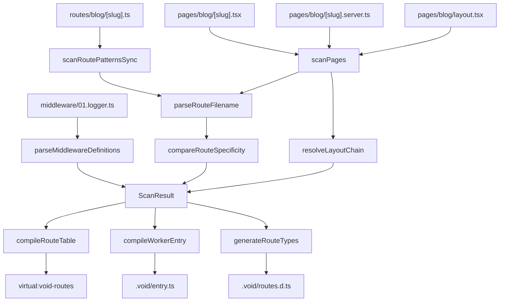
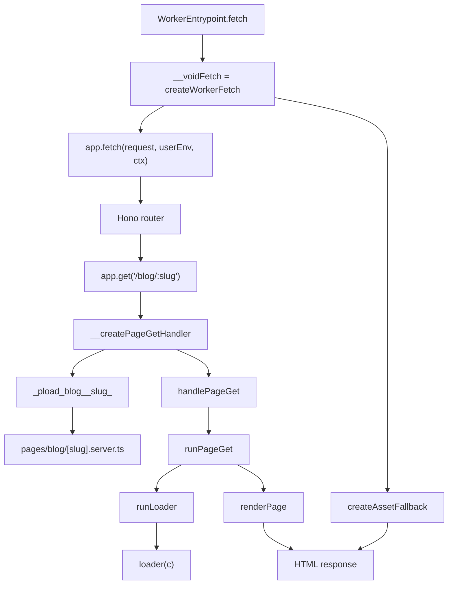

# 11 — Void: File Routing, Pages, and Inference

Void turns a file tree into one Hono application. Files under `routes/` become HyperText Transfer Protocol (HTTP) endpoints. Files under `pages/` become rendered pages. A Vite plugin scans both directories at build time, builds a route table as a virtual module, and writes a Cloudflare Worker entry file. The worker entry loads that route table and sends every request through the same Hono router. This document follows that chain from the file name to the response.

All paths in this document are relative to `/Users/darkvoid/GitSources/src.voidzero`. The first segment names the Git repository, which is `void` here. The remaining segments are the path inside that repository.

## 1. The package map for routing

Three modules start the work. `void/packages/void/src/application-routing.ts` joins the application analysis to the route scan. `void/packages/void/src/router/` holds the route scanner and the route table compiler. `void/packages/void/src/pages/` holds the page scanner and the page protocol. The `void/packages/void/src/runtime/` directory holds the functions that answer a request.

| File | Role |
|------|------|
| `void/packages/void/src/application-routing.ts` | Calls `scanRoutes` with the configuration, the paths, and the resource inventory. Returns the complete application analysis plus the scan. |
| `void/packages/void/src/application-analysis.ts` | Builds the inventory: configuration, paths, bindings, jobs, queues, WebSockets, email, route patterns, and middleware. |
| `void/packages/void/src/router/scan.ts` | Globs `routes/` and `middleware/`, calls `scanPages`, detects exported HTTP method names, and sorts every route by specificity. |
| `void/packages/void/src/router/parse-filename.ts` | Converts one file path into a route pattern, a parameter list, a `.dev` or `.prod` environment limit, and a catch-all flag. |
| `void/packages/void/src/router/route-order.ts` | Ranks two route patterns. Static segments rank before parameter segments. Catch-all routes come last. |
| `void/packages/void/src/router/detect-exports.ts` | Reads a route file with Vite `parseSync` and returns the exported HTTP method names. It does not run the file. |
| `void/packages/void/src/router/compile.ts` | Writes the `virtual:void-routes` module, the `.void/entry.ts` Worker entry, the Node.js entries, and the two client modules. |
| `void/packages/void/src/pages/scan.ts` | Globs `pages/`, detects layouts, named layouts, error boundaries, islands (partly hydrated pages), page components, and `.server` companions. |
| `void/packages/void/src/pages/manifest.ts` | Writes the client page manifest, the layout chains, the route identifiers, and the `matchRoute` function. |
| `void/packages/void/src/pages/protocol.ts` | Runs page loaders and actions. Chooses between a HyperText Markup Language (HTML) response and a JavaScript Object Notation (JSON) page object. |
| `void/packages/void/src/pages/navigation-engine.ts` | Runs client navigation. Sends the page protocol headers and reads the page object. |
| `void/packages/void/src/pages/layout-resolution.ts` | Builds the layout chain for a component and resolves named layouts. |
| `void/packages/void/src/pages/action-key.ts` | Marks a named action in the request and removes the action key from a copied query string. |
| `void/packages/void/src/pages/plugin.ts` | Emits `virtual:void-pages-renderer` and `virtual:void-pages-client`. |
| `void/packages/void/src/inference/walk.ts` | Infers the Cloudflare bindings that a source file needs. It reads imports and `env` access. |
| `void/packages/void/src/plugin-inference.ts` | Scans the convention directories and merges the inferred binding sets. |
| `void/packages/void/src/codegen/route-types.ts` | Writes the `.void/routes.d.ts` declaration file for routes, WebSocket routes, and page actions. |
| `void/packages/void/src/codegen/prepare.ts` | Writes the other project declarations, such as `env.d.ts`, `bindings.d.ts`, `auth.d.ts`, and `queues.d.ts`. |
| `void/packages/void/src/cli/headers.ts` | Parses `_headers` and `_redirects` and merges them with the `routing` configuration. |
| `void/packages/void/src/index.ts` | Exports `voidPlugin` and builds the final Vite plugin array. |
| `void/packages/void/src/plugin-routing.ts` | Exports `routingPlugin`. Holds the Vite hooks and the generated route table. |
| `void/packages/void/src/runtime/routing.ts` | Creates the routing runtime, the context middleware, the header middleware, and `createHttpRouteHandler`. |
| `void/packages/void/src/runtime/routing-pages.ts` | Creates the page GET handler, the page mutation handler, and the page fallback. |
| `void/packages/void/src/runtime/routing-worker.ts` | Creates the Worker fetch function. Runs environment checks, internal routes, HyperText Transfer Protocol Secure (HTTPS) rules, Incremental Static Regeneration (ISR), and asset fallthrough. |
| `void/packages/void/src/runtime/handler.ts` | Defines `CloudBindings`, `CloudContext`, `TypedHandler`, `defineHandler`, and `defineMiddleware`. |
| `void/packages/void/src/ssr/entry.ts` | Finds `src/main.ssr.ts` or `src/main.ssr.tsx` and `src/main.client.ts` or `src/main.client.tsx`. |
| `void/packages/void/src/project-paths.ts` | Resolves the convention directories, including `routesDir`, `pagesDir`, `middlewareDir`, `cronsDir`, and `queuesDir`. |
| `void/packages/void/src/shared/convention-files.ts` | Lists route files and convention files. Skips paths with a `_` or `.` segment, except `.well-known`. |

The `src/inference` directory needs one warning. Its name does not mean server-route inference. `inferBindingsFromSource` infers Cloudflare bindings, such as D1, KV, R2, Artificial Intelligence (AI), and queues (`void/packages/void/src/inference/walk.ts:37-94`). Server routes are discovered by `scanRoutePatternsSync` and `listRouteFiles` (`void/packages/void/src/router/scan.ts:94-103`, `void/packages/void/src/shared/convention-files.ts:50-53`). The source shows no separate inference step for route inputs or outputs. The type generator reads the route modules directly, as section 8 shows.

## 2. How the Vite plugin registers

`voidPlugin` is the only public plugin factory. The framework exports no function named `void()`. The guides place `voidPlugin()` in the Vite `plugins` array (`void/docs/guide/server-routing.md:100-104`). The factory resolves the project root from the process working directory (`void/packages/void/src/index.ts:93-98`). It then sets the Cloudflare Worker entry path to `.void/entry.ts` (`void/packages/void/src/index.ts:949`). Next it creates the routing plugin (`void/packages/void/src/index.ts:975-1000`). The returned array also contains the Cloudflare environment plugin, the environment plugin, and the other framework plugins (`void/packages/void/src/index.ts:1002`).

```ts
// void/packages/void/src/index.ts:949-949
  workerConfig.main = join(root, '.void', 'entry.ts');
```

The routing plugin uses these Vite hooks (`void/packages/void/src/plugin-routing.ts:711-1119`):

| Hook | Work |
|------|------|
| `config` | Applies the plugin configuration to the Vite configuration. |
| `configResolved` | Records the resolved build, the assets directory, the React refresh state, and the public directory (`void/packages/void/src/plugin-routing.ts:713-735`). |
| `generateBundle` | Stamps the client asset cache policy in the client environment (`void/packages/void/src/plugin-routing.ts:804-818`). |
| `buildStart` | Rescans the application, writes the route types, writes the queue types, and rewrites the Worker or Node.js entries (`void/packages/void/src/plugin-routing.ts:820-887`). |
| `watchChange` | Drops the cached source analysis for the changed file (`void/packages/void/src/plugin-routing.ts:891-893`). |
| `resolveId` | Maps `virtual:void-routes`, `virtual:void-client-worker`, `virtual:void-client-browser`, bare `void`, `void/queues`, and `void/client` (`void/packages/void/src/plugin-routing.ts:895-919`). |
| `load` | Returns the compiled route table for `virtual:void-routes`. It returns the client modules for the two client identifiers (`void/packages/void/src/plugin-routing.ts:922-960`). |
| `hotUpdate` | Suppresses the default update for the auth configuration environment (`void/packages/void/src/plugin-routing.ts:962-968`). |
| `configureServer` | Watches the convention directories and regenerates on a change (`void/packages/void/src/plugin-routing.ts:970-1119`). |

The plugin writes an initial `.void/entry.ts` during plugin creation, not in `buildStart`. The source gives the reason in a comment. The Cloudflare plugin needs the `main` file to exist at config resolution time (`void/packages/void/src/plugin-routing.ts:682-686`). `buildStart` writes the entry again after the scan completes (`void/packages/void/src/plugin-routing.ts:853-882`).

The work has five phases. The phase order explains why the entry file exists before the scan.

| Phase | What runs | Result |
|-------|-----------|--------|
| Plugin creation | `voidPlugin` and `routingPlugin` build `compileOptions` and write a placeholder entry | `.void/entry.ts` exists for the Cloudflare plugin. |
| `buildStart` | `rescan` scans the tree, writes the types, and rewrites the entry | `.void/entry.ts` and `.void/routes.d.ts` hold the current scan. |
| Module load | The `load` hook compiles `virtual:void-routes` | Vite receives the route table source. |
| Development change | `watchChange` drops the cached analysis; `configureServer` watches and rescans | The next load gets a new table. |
| Request | The Worker entry calls `createWorkerFetch` | One response leaves the application. |

The route table is a virtual module. It has no file on disk. Void compiles the table when Vite loads the module, not on each HTTP request (`void/packages/void/src/plugin-routing.ts:922-960`). In development, Vite can load the module again after an invalidation. The plugin checks `this.environment.name`, which Vite sets to `client` or `server` (`void/packages/void/src/plugin-routing.ts:938`). The `load` hook refuses the `client` environment because the table embeds `options.devTriggerToken` (`void/packages/void/src/plugin-routing.ts:935-940`). The email development inbox supplies that token (`void/packages/void/src/plugin-email-dev-inbox.ts:52`, `void/packages/void/src/plugin-worker-bindings.ts:248`). The source does not define the token value in the routing plugin.

The two client identifiers become one import. `resolveId` sends `void/client` to `virtual:void-client-browser` in the browser environment and to `virtual:void-client-worker` in the server environment (`void/packages/void/src/plugin-routing.ts:916-918`). Bare `void` maps to the lightweight handler module at `#self/handler` instead of the full plugin (`void/packages/void/src/plugin-routing.ts:234`, `void/packages/void/src/plugin-routing.ts:907-911`).

## 3. Build-time scan: from file names to route records

`completeApplicationAnalysis` is the one call that adds routes to the existing resource inventory. It passes the routes, middleware, jobs, queues, WebSockets, and email handlers into `scanRoutes` (`void/packages/void/src/application-routing.ts:7-27`).

```ts
// void/packages/void/src/application-routing.ts:7-27
export async function completeApplicationAnalysis(
  analysis: ApplicationAnalysis,
): Promise<CompleteApplicationAnalysis> {
  const scan = await scanRoutes(analysis.root, {
    trailingSlash: analysis.config.routing?.trailingSlash,
    output: analysis.config.output,
    paths: analysis.paths,
    // A framework app's pages/ follows that framework's rules, not Void Pages.
    checkPageRoutes: !analysis.framework,
    environment: analysis.framework ? undefined : analysis.environment,
    inventory: {
      routes: analysis.routes,
      middleware: analysis.middleware,
      jobs: analysis.jobs,
      queues: analysis.queues,
      websockets: analysis.websockets,
      email: analysis.email,
    },
  });
  return { ...analysis, scan };
}
```

`scanRoutes` is the full scan. It calls `scanPages` first (`void/packages/void/src/router/scan.ts:65-71`). It then reads the exported method names from every route file (`void/packages/void/src/router/scan.ts:72-84`). Finally it sorts the routes with `compareRouteSpecificity` (`void/packages/void/src/router/scan.ts:83`). `scanRoutePatternsSync` is a smaller helper that scans only the route files (`void/packages/void/src/router/scan.ts:94-103`). It does not collect pages or middleware. `scanApplication` uses that helper and `scanMiddlewareSync` to build the inventory (`void/packages/void/src/application-analysis.ts:129-130`). `scanRoutes` then reads the exports of those same route files (`void/packages/void/src/router/scan.ts:72-84`).

Route records have one producer. `scanApplication` calls `scanRoutePatternsSync`, which globs `routes/` once and parses each file (`void/packages/void/src/application-analysis.ts:129`, `void/packages/void/src/router/scan.ts:94-103`). `completeApplicationAnalysis` passes that inventory into `scanRoutes` (`void/packages/void/src/application-routing.ts:16-26`). `scanRoutes` does not glob `routes/` again. It reads the exported method names for each inventory record and sorts the list (`void/packages/void/src/router/scan.ts:72-84`).

Four inputs shape the scan. `root` is the project root. `paths` holds the convention directories. `trailingSlash` comes from the routing configuration. `output` is `server` or `static` (`void/packages/void/src/router/scan.ts:53-62`). `environment` is `dev` or `prod`.

The environment filter runs in the scanner, not at request time. `scanRoutePatternsSync` drops a route for the other environment (`void/packages/void/src/router/scan.ts:99-103`), and `scanPages` does the same for a page (`void/packages/void/src/pages/scan.ts:460-463`). An `undefined` environment keeps both. In framework mode `completeApplicationAnalysis` passes `undefined` (`void/packages/void/src/application-routing.ts:16`).

`analysis.framework` marks a meta-framework project. `detectFramework` reads `package.json` and returns an entry for a dependency such as `@sveltejs/kit`, `nuxt`, `astro`, or `@react-router/dev` (`void/packages/void/src/application-analysis.ts:58`, `void/packages/void/src/plugin-inference.ts:82-103`). In that mode `checkPageRoutes` is false, so the framework owns `pages/` and Void does not apply its page rules (`void/packages/void/src/application-routing.ts:14-16`).

### 3.1 The exact file-name rules

`parsePath` is the private worker (`void/packages/void/src/router/parse-filename.ts:22`). `parseRouteFilename` and `parseWebSocketFilename` are the two public wrappers. Each wrapper calls `parsePath` with its own boolean (`void/packages/void/src/router/parse-filename.ts:114-120`). The worker applies these operations in a fixed order (`void/packages/void/src/router/parse-filename.ts:22-101`):

| Code comment | Operation | Example |
|--------------|-----------|---------|
| 1 | Strip a known route extension from `ROUTE_EXTENSIONS`. | `about.ts` becomes `about`. |
| 1b | Strip `.ws` for a WebSocket route. | `chat.ws.ts` becomes `chat`. |
| 2 | Strip `.dev` or `.prod` and record the environment. | `status.dev.ts` becomes `status` in development. |
| 3 | Remove a trailing `index` segment. | `blog/index.ts` becomes `blog`. |
| 4 | Remove route group segments such as `(marketing)`. | `(marketing)/about.ts` becomes `about`. |
| 5 | Convert dynamic segments. | `[slug]` becomes `:slug`. |
| 6 | Add a leading `/`. | `about` becomes `/about`. |

The source comments number the operations 1 to 6, with step 1b for WebSocket routes (`void/packages/void/src/router/parse-filename.ts:103-113`). The table follows the source order. The parser also normalizes `\` to `/` before step 1 (`void/packages/void/src/router/parse-filename.ts:25-26`).

Two extension sets apply. `ROUTE_EXTENSIONS` is `ts`, `tsx`, `js`, `jsx`, `mjs`, and `mts` (`void/packages/void/src/shared/route-extensions.ts:2`). A page component uses `vue`, `tsx`, `jsx`, `svelte`, and `md` (`void/packages/void/src/pages/scan.ts:48`). A `.md` page is always an island (`void/packages/void/src/pages/scan.ts:422-424`).

```ts
// void/packages/void/src/router/parse-filename.ts:58-91
  // 3. Strip trailing "index"
  if (segments[segments.length - 1] === 'index') {
    segments.pop();
  }

  // 4. Remove route groups: (groupname)
  const filtered = segments.filter((s) => !s.startsWith('(') || !s.endsWith(')'));

  // 5. Convert dynamic segments
  const params: Array<string> = [];
  let catchAll = false;

  const converted = filtered.map((segment) => {
    // [...param] - catch-all with named param
    if (segment.startsWith('[...') && segment.endsWith(']')) {
      const paramName = segment.slice(4, -1);
      catchAll = true;
      if (paramName) {
        params.push(paramName);
        return `:${paramName}{.+}`;
      }
      return '*';
    }
    // [param] - single dynamic param
    if (segment.startsWith('[') && segment.endsWith(']')) {
      const paramName = segment.slice(1, -1);
      params.push(paramName);
      return `:${paramName}`;
    }
    return segment;
  });

  // 6. Build pattern with leading /
  const pattern = '/' + converted.join('/');
```

The rules produce these results. The evidence is `parse-filename.ts:22-101`.

| File under `routes/` or `pages/` | Route pattern | Notes |
|----------------------------------|---------------|-------|
| `routes/index.ts` | `/` | The trailing `index` is removed. |
| `routes/about.ts` | `/about` | A static segment stays as written. |
| `routes/blog/[slug].ts` | `/blog/:slug` | One parameter matches one Uniform Resource Locator (URL) segment. |
| `routes/files/[...path].ts` | `/files/:path{.+}` | The named catch-all matches the rest of the path. |
| `routes/files/[...].ts` | `/files/*` | The anonymous catch-all matches the rest of the path. |
| `routes/(admin)/users.ts` | `/users` | The group segment does not appear in the URL. |
| `routes/status.dev.ts` | `/status` | The route exists only in the development environment. |
| `pages/blog/[slug].tsx` | `/blog/:slug` | A page uses the same parser after its component extension is replaced. |
| `pages/(shop)/cart.tsx` | `/cart` | A page route group is also removed. |
| `pages/[...rest].tsx` | `/:rest{.+}` | A page catch-all matches every path below the root. |
| `pages/index.tsx` | `/` | The page component identifier becomes `index`. |

A page file is parsed as a route after the component extension is changed to `.ts` (`void/packages/void/src/pages/scan.ts:453-459`). The page scanner skips any path segment that starts with `_`, except `_layouts` (`void/packages/void/src/pages/scan.ts:403-406`). It treats a file named `layout` as a layout, and a file inside `_layouts/` as a named layout (`void/packages/void/src/pages/scan.ts:427-451`).

A page also receives a component identifier. The scanner removes the extension, the `.island` suffix, and a trailing `/index` (`void/packages/void/src/pages/scan.ts:464-469`). A result of exactly `index` falls back to `index`, so `pages/index.tsx` keeps the identifier `index`. A file `pages/blog/[slug].tsx` gets the identifier `blog/[slug]`, brackets included. That string is the manifest key. A route group stays in the identifier. `pages/(shop)/cart.tsx` has the identifier `(shop)/cart`, but the pattern `/cart`. The layout chain follows the identifier directories, so `pages/(shop)/layout.tsx` applies to that page (`void/packages/void/src/pages/layout-resolution.ts:36-56`).

### 3.2 Route order and specificity

The source comment states that Hono and the Pages client matcher both use the first match (`void/packages/void/src/router/route-order.ts:22-30`). Void therefore sorts both lists with `compareRouteSpecificity` (`void/packages/void/src/router/route-order.ts:31-60`). The function applies four rules:

1. A catch-all route comes after a route that is not a catch-all.
2. A fully static route comes before a route with a parameter.
3. The first segment with a different rank decides. Static ranks 0, parameter ranks 1, and rest ranks 2.
4. Parameter names never decide the order. Static text only keeps the order stable.

```ts
// void/packages/void/src/router/route-order.ts:31-60
export function compareRouteSpecificity(
  a: { pattern: string; catchAll: boolean },
  b: { pattern: string; catchAll: boolean },
): number {
  if (a.catchAll !== b.catchAll) {
    return a.catchAll ? 1 : -1;
  }
  const aSegments = a.pattern.split('/');
  const bSegments = b.pattern.split('/');
  const aKinds = aSegments.map(routeSegmentKind);
  const bKinds = bSegments.map(routeSegmentKind);
  // A static route never shares a URL with a more specific one, and Pages looks
  // up the leading run of static routes exactly.
  const aStatic = aKinds.every((kind) => kind === 'static');
  const bStatic = bKinds.every((kind) => kind === 'static');
  if (aStatic !== bStatic) {
    return aStatic ? -1 : 1;
  }
  const shared = Math.min(aSegments.length, bSegments.length);
  for (let i = 0; i < shared; i++) {
    const rank = SEGMENT_RANK[aKinds[i]] - SEGMENT_RANK[bKinds[i]];
    if (rank !== 0) {
      return rank;
    }
    if (aKinds[i] === 'static' && aSegments[i] !== bSegments[i]) {
      return compareText(aSegments[i], bSegments[i]);
    }
  }
  return aSegments.length - bSegments.length || compareText(a.pattern, b.pattern);
}
```

The ranking function `routeSegmentKind` classifies `*` and `:name{.+}` as `rest`, `:name` as `param`, and every other segment as `static` (`void/packages/void/src/router/route-order.ts:9-18`). The same function is used by the client matcher, so build order and client matching agree (`void/packages/void/src/router/route-order.ts:4-7`).

The client does not sort again. `scanPages` sorts the page list with `compareRouteSpecificity` (`void/packages/void/src/pages/scan.ts:556`). The manifest writes the dynamic pages in that order, and `matchRoute` tests them in that order (`void/packages/void/src/pages/manifest.ts:53-56`, `void/packages/void/src/pages/manifest.ts:114-121`). The first pattern that matches wins. The client matcher has two parts. `__voidStaticRouteIds` is a `Map` from an exact path to one identifier. The loop tests `__voidDynamicRoutes` in order and returns the first RegExp match (`void/packages/void/src/pages/manifest.ts:114-121`). A static page enters the exact map under its pattern (`void/packages/void/src/pages/manifest.ts:68-73`).

### 3.3 Middleware files

Middleware lives in `middleware/`. `scanMiddlewareSync` globs every `.ts`, `.mts`, `.js`, and `.mjs` file in that directory (`void/packages/void/src/router/scan.ts:87-92`). `parseMiddlewareDefinitions` drops a file when its relative path starts with `_` (`void/packages/void/src/router/scan.ts:37-49`). It reads the numeric prefix and sorts by that number. A file without a number gets `Infinity`, so it runs last.

```ts
// void/packages/void/src/router/scan.ts:37-49
function parseMiddlewareDefinitions(files: Array<string>): Array<MiddlewareDefinition> {
  return files
    .filter((f) => !f.startsWith('_'))
    .map((f) => {
      const basename = f.split('/').pop()!;
      const match = basename.match(/^(\d+)\./);
      return {
        order: match ? parseInt(match[1], 10) : Infinity,
        filePath: f,
      };
    })
    .sort((a, b) => a.order - b.order);
}
```

### 3.4 Page companions

A page component can have a companion file with the same base name and a `.server` suffix. The scanner tries every route extension (`void/packages/void/src/pages/scan.ts:471-496`). `detectPageServerMetadata` reads the export names with Vite `parseSync` (`void/packages/void/src/pages/scan.ts:232-286`). It does not run the module.

The companion can export `loader`, `action`, and `actions`. These three names control route registration. It can also export `getPrerenderPaths`. It can export `head`, which the page handler reads at run time (`void/packages/void/src/runtime/routing-pages.ts:103-112`, `void/docs/guide/pages-routing/head.md:29`). It can declare `revalidate`, `prerender`, and `ssr` as static constants. `readPageSettings` reads those three names (`void/packages/void/src/pages/scan.ts:182-184`, `void/packages/void/src/pages/scan.ts:191-233`).

```ts
// void/packages/void/src/pages/scan.ts:471-496
    // Check for a server companion — server files never have .island suffix
    let serverPath: string | null = null;
    const methods: Array<string> = [];
    let revalidate: number | undefined;
    let prerender: ExplicitBoolean;
    let ssr: ExplicitBoolean;
    let hasGetPrerenderPaths: boolean | undefined;
    const serverBase = hasIslandSuffix ? file.replace(`.island${ext}`, '') : file.replace(ext, '');
    for (const serverExt of ROUTE_EXTENSIONS) {
      const candidate = `${serverBase}.server.${serverExt}`;
      if (existsSync(join(pagesDir, candidate))) {
        serverPath = candidate;

        const metadata = deriveFromSource(join(pagesDir, candidate), 'page-server', (source) =>
          detectPageServerMetadata(source, candidate),
        );

        methods.push(...metadata.methods);
        revalidate = metadata.revalidate;
        prerender = metadata.prerender;
        ssr = metadata.ssr;
        hasGetPrerenderPaths = metadata.hasGetPrerenderPaths;
        warnPageSettings(pagesDir, metadata.warnings);
        break;
      }
    }
```

`PAGE_METHODS` contains exactly `loader`, `action`, and `actions` (`void/packages/void/src/pages/scan.ts:49`). The scan records all three. Only `action` or `actions` add the mutation route (`void/packages/void/src/router/compile.ts:1149-1153`). `loader` is recorded because an island page with a loader or a dynamic pattern is not treated as a static island (`void/packages/void/src/pages/scan.ts:295`). Any companion file gets the lazy loader, even one that exports only `head` or `getPrerenderPaths` (`void/packages/void/src/router/compile.ts:1114-1121`). A page with both `action` and `actions` is rejected by the declaration writer, which runs on every build regardless of `typedRoutes` (`void/packages/void/src/codegen/route-types.ts:404-412`).

### 3.5 Layouts

A layout is a file named `layout` in a page directory. The scanner records its directory relative to `pages/` (`void/packages/void/src/pages/scan.ts:442-451`). A named layout is a file directly inside a `_layouts/` directory, and its name is the file base name (`void/packages/void/src/pages/scan.ts:427-440`).

`resolveLayoutChain` returns the root layout first, then one layout for each ancestor directory, in order (`void/packages/void/src/pages/layout-resolution.ts:36-56`). For example, `pages/blog/post.tsx` gets the root layout, then `pages/blog/layout.tsx` when both exist. The innermost layout is the last entry in the chain. The manifest stores the chain per component. The React adapter wraps the page from the end of the chain to the start, so the innermost layout is the first wrapper (`void/packages/void/src/pages/manifest.ts:67-78`, `void/packages/react/src/runtime/pages-server.ts:63-72`). A page selects a named layout with its `layout` setting. A Markdown page uses frontmatter, the metadata block at the top of the file. A component page uses a static export (`void/packages/void/src/pages/scan.ts:517-534`). A value of `false` disables the layout. An exclusive name, written with a leading `!`, returns only that named layout (`void/packages/void/src/pages/layout-resolution.ts:78-125`). The scanner reports a missing named layout as an error. It throws during the scan, so the build stops (`void/packages/void/src/pages/scan.ts:603-606`).

### 3.6 The build-time transformation

The scan is the single input to three outputs. It feeds the route table, the type writer, and the Worker entry.



`compileRouteTable` receives the scan and builds a string of JavaScript source (`void/packages/void/src/router/compile.ts:167`). The string is served as `virtual:void-routes` by the `load` hook (`void/packages/void/src/plugin-routing.ts:922-960`). `compileWorkerEntry` builds a separate string that becomes `.void/entry.ts` (`void/packages/void/src/router/compile.ts:1247-1468`). `generateRouteTypes` builds the declaration file (`void/packages/void/src/codegen/route-types.ts:56`).

## 4. The generated route table

The route table imports Hono and the routing runtime (`void/packages/void/src/router/compile.ts:195-198`). It creates `const app = new Hono()` (`void/packages/void/src/router/compile.ts:259`). It installs the context middleware and the request middleware (`void/packages/void/src/router/compile.ts:288-289`). It installs the header middleware before the user middleware (`void/packages/void/src/router/compile.ts:330-337`). Then it registers each route file with a lazy module loader.

The two installed middleware functions are not user middleware. `contextMiddleware` wraps the rest of the chain with the routing context (`void/packages/void/src/runtime/routing.ts:280-353`). It tracks an explicit not-found when asset misses are on. It records the original URL from `X-Void-Original-URL`, adds `c.rewrite` for path-absolute destinations, and wraps `c.redirect` so a named action keeps its key. `requestMiddleware` runs the rest of the chain inside `requestContext.run(...)`, an `AsyncLocalStorage` that holds the current `Request` and `ExecutionContext` (`void/packages/void/src/runtime/routing.ts:178`, `void/packages/void/src/runtime/routing.ts:376-383`). The raw `env` has a separate store, described in section 5.

The installed order is: the context middleware, the request middleware, the redirect and rewrite middleware, and the named-action marker. Then come the header middleware for auth errors, the auth middleware, the normal header middleware, and the user middleware (`void/packages/void/src/router/compile.ts:288-340`).

```ts
// void/packages/void/src/router/compile.ts:372-399
  // Register routes with lazy-loaded handlers (shared loader per file)
  const seenFiles = new Set<string>();
  const routeNames = createIdentifierNames();
  for (const route of scan.routes) {
    const filePath = `${routesDir}/${route.filePath}`;
    const loaderName = `_load_${routeNames(route.filePath)}`;

    if (!seenFiles.has(route.filePath)) {
      seenFiles.add(route.filePath);
      lines.push(
        `const ${loaderName} = __createModuleLoader(() => import(${JSON.stringify(filePath)}), ${JSON.stringify(options.dev !== true)});`,
      );
    }

    if (route.methods.length === 0) {
      // No recognized HTTP exports — register as all()
      lines.push(
        `app.all(${JSON.stringify(route.pattern)}, __createHttpRouteHandler(${loaderName}, "default"));`,
      );
    } else {
      for (const method of route.methods) {
        const honoMethod = method.toLowerCase();
        lines.push(
          `app.${honoMethod}(${JSON.stringify(route.pattern)}, __createHttpRouteHandler(${loaderName}, ${JSON.stringify(method)}));`,
        );
      }
    }
  }
```

A route file with no recognized method export becomes an all-method handler on `default`. A file with method exports becomes one Hono registration per method. `HEAD` is rejected during the scan, because Hono answers `HEAD` from the `GET` handler and cannot register a separate handler (`void/packages/void/src/router/scan.ts:74-80`).

`compilePageRoutes` writes the page registrations, and `compileRouteTable` calls it (`void/packages/void/src/router/compile.ts:457`, `void/packages/void/src/router/compile.ts:983`). The page table imports `renderPage` from `virtual:void-pages-renderer` (`void/packages/void/src/router/compile.ts:991`). Each page is registered as `app.get`, and each page with an action is also registered on `POST`, `PUT`, `PATCH`, and `DELETE` (`void/packages/void/src/router/compile.ts:1147-1153`).

```ts
// void/packages/void/src/router/compile.ts:1147-1153
    const routeOptions = `{ ${serverImportPath ? 'load: _pload_' + safeId + ', ' : ''}${mdHeadRef ? 'head: ' + mdHeadRef + ', ' : ''}${trailingCatchAll ? `trailingSlash: true, catchAllParam: ${JSON.stringify(catchAllParam)}, ` : ''}componentId: ${JSON.stringify(page.componentId)}, render: ${renderer}, assets: ${assetTags}, headConfig: __voidHeadConfig, renderOptions: ${JSON.stringify({ renderMode: page.renderMode, ...(options.dev === true ? { dev: true } : {}), ...(boundaryManifest.pages[page.componentId] && { boundaries: boundaryManifest.pages[page.componentId] }) })} }`;
    lines.push(`app.get(${JSON.stringify(pattern)}, __createPageGetHandler(${routeOptions}));`);
    if (page.methods.includes('action') || page.methods.includes('actions')) {
      lines.push(
        `app.on(["POST", "PUT", "PATCH", "DELETE"], ${JSON.stringify(pattern)}, __createPageMutationHandler({ ...${routeOptions}, namedActions: ${JSON.stringify(page.methods.includes('actions'))} }));`,
      );
    }
```

The route options have these parts (`void/packages/void/src/router/compile.ts:1138-1147`):

- `serverImportPath` is the `.server` companion path, when the companion exists.
- `_pload_<id>` is the lazy loader for that companion.
- `mdHeadRef` is an inline head function for a Markdown page with no companion.
- `trailingCatchAll` and `catchAllParam` handle a trailing slash on a catch-all page. With `trailingSlash`, `scanPages` appends `/` to a page pattern (`void/packages/void/src/pages/scan.ts:537`). Hono cannot match a named catch-all followed by a slash, so the compiler removes that slash for Hono and records the parameter name (`void/packages/void/src/router/compile.ts:1144-1146`, `void/packages/void/src/runtime/routing-pages.ts:35-37`). `preparePageRequest` then requires the slash and trims the separator from the parameter (`void/packages/void/src/runtime/routing-pages.ts:38-51`).
- `componentId` is the key in the component manifest.
- `renderOptions` carries `renderMode`, an optional `dev` flag, and the page boundary plan (`void/packages/void/src/router/compile.ts:1147`). `runPageGet` reads `renderMode` from it (`void/packages/void/src/pages/protocol.ts:686`).
- `headConfig` is the merged head configuration (`void/packages/void/src/router/compile.ts:1147`).
- `renderer` is `renderPage`, or `renderIslandPage` for an island (`void/packages/void/src/router/compile.ts:1139`).
- `assetTags` is `getPagesAssetTags`, or `getIslandsAssetTags` for an island (`void/packages/void/src/router/compile.ts:1140-1143`).
- `boundaryManifest` holds the error and not-found boundaries for the page. The protocol uses the plan to render the page, error, or not-found boundary (`void/packages/void/src/pages/protocol.ts:404-407`, `void/packages/void/src/pages/protocol.ts:711`).
- `namedActions` is true when the companion exports `actions`.

`renderPage` does not receive the component module. It receives `componentId` and the page object. The adapter's renderer module imports a component map from `generateComponentManifest` (`void/packages/void/src/pages/manifest.ts:15`, `void/packages/void/src/pages/manifest.ts:51-55`). The React adapter closes over that map in `renderPage` (`void/packages/react/src/plugin-pages.ts:189-210`). `renderReactPage` reads `pageObj.component` and calls `components[pageObj.component]()` (`void/packages/react/src/runtime/pages-server.ts:62-65`). The page object sets `component: componentId` (`void/packages/void/src/pages/protocol.ts:906-916`). Document 12 covers the other adapters.

A page with a `.server` companion gets a lazy loader named `_pload_<id>` (`void/packages/void/src/router/compile.ts:1114-1121`). The loader is passed into the page options as `load`. The page handler calls it only when a request arrives.

```ts
// void/packages/void/src/router/compile.ts:1114-1121
    // Generate lazy loader for server module (if any)
    if (serverImportPath && !seenServerFiles.has(serverImportPath)) {
      seenServerFiles.add(serverImportPath);
      const loaderName = `_pload_${safeId}`;
      lines.push(
        `const ${loaderName} = __createModuleLoader(() => import(${JSON.stringify(serverImportPath)}));`,
      );
    }
```

## 5. The Worker entry

`compileWorkerEntry` writes a default export class that extends `WorkerEntrypoint` (`void/packages/void/src/router/compile.ts:1411-1430`). The class always delegates `fetch` to `__voidFetch` and `scheduled` to `handleScheduled`. It delegates `queue` and `email` only when the scan contains those handlers (`void/packages/void/src/router/compile.ts:1416-1426`).

```ts
// void/packages/void/src/router/compile.ts:1411-1430
  // The default export remains a WorkerEntrypoint for platform fetch dispatch.
  // Its email method accepts only native events on direct Cloudflare deploys;
  // platform mail enters through the authenticated receipt fetch endpoint.
  const entryImport = `import { WorkerEntrypoint } from "cloudflare:workers";\n`;
  const fetchDeclaration = `const __voidFetch = ${fetchHandler};`;
  const queueMethodBody = hasQueues
    ? `  async queue(batch) { return __voidQueue(batch, this.env, this.ctx); }\n`
    : '';
  const emailMethodBody = hasEmail
    ? `  async email(message) {
    if (this.env.__VOID_EMAIL_DEPLOYMENT_ID || !__isForwardableEmailMessage(message)) {
      throw new TypeError("Native email event required");
    }
    await handleEmail(message, this.env, this.ctx);
  }\n`
    : '';
  const entryClass = `export default class extends WorkerEntrypoint {
  async fetch(request) { return __voidFetch(request, this.env, this.ctx); }
  async scheduled(controller) { return handleScheduled(controller, this.env, this.ctx); }
${queueMethodBody}${emailMethodBody}}`;
```

The generated entry imports `app`, `scheduled`, four helpers, and one class for each WebSocket route from `virtual:void-routes` (`void/packages/void/src/router/compile.ts:1457`). The helpers are `__voidCollectPrerenderPaths`, `__voidRenderStaticNotFound`, `__voidHandleInternalRoute`, and `__withRawEnv`. The entry then re-exports each WebSocket class (`void/packages/void/src/router/compile.ts:1463`). `fetchHandler` is source text, not a runtime value. The template builds the text of a `__createWorkerFetch({...})` call. These fields are always present (`void/packages/void/src/router/compile.ts:1346-1352`):

| Field | Value |
|-------|-------|
| `app` | The Hono application from `virtual:void-routes`. |
| `assets` | `serveWithAssets`, the asset fallback. |
| `withRawEnv` | A helper that stores the raw `env` for the request. |
| `withRuntimeEnv` | A helper that sets the runtime environment. |
| `staticNotFound` | `__voidRenderStaticNotFound`. |
| `filterBindings` | `__filterInternalBindings`, which removes the internal binding names. |
| `internalRoute` | `__voidHandleInternalRoute`, the migration gate. |
| `collectPrerenderPaths` | `__voidCollectPrerenderPaths`, the prerender discovery gate. |

The template adds `alwaysUseHttps`, `versionMetadataBinding`, `validateEnv`, `remoteEnv`, `emailReceipt`, and `isr` only when the feature is on. `validateEnv` is the check that gate 1 calls, and `remoteEnv` is the replacement that gate 2 calls (`void/packages/void/src/runtime/routing-worker.ts:243-249`).

`createWorkerFetch` calls `options.withRawEnv(env, ...)` once for each request (`void/packages/void/src/runtime/routing-worker.ts:254`). The generated `__withRawEnv` stores `env` in an `AsyncLocalStorage` (`void/packages/void/src/router/compile.ts:870-872`). The Hono application receives `filterBindings(env)` as its second argument, so `c.env` is the filtered environment (`void/packages/void/src/runtime/routing-worker.ts:291-293`). Internal handlers read the raw `env` through `__getRawEnv()` (`void/packages/void/src/router/compile.ts:872`).

A Node.js target writes different entries. The plugin writes `.void/app.ts` from `compileNodeApp` and `.void/index.ts` from `compileNodeServer` (`void/packages/void/src/plugin-routing.ts:641-645`). `compileNodeApp` mounts the same Hono application with `serveStatic` for Node.js, Bun, or Deno. `compileNodeServer` starts the HTTP server (`void/packages/void/src/router/compile.ts:1474-1560`). The source does not name the bundler environment for `.void/entry.ts`. The `load` hook does show that the route table is server-only (`void/packages/void/src/plugin-routing.ts:935-940`).

## 6. The runtime request path

`createWorkerFetch` runs these gates in a fixed order (`void/packages/void/src/runtime/routing-worker.ts:228-308`):

1. `validateEnv` runs on a normal request (`void/packages/void/src/runtime/routing-worker.ts:243-245`).
2. A remote environment replaces the local one when `__VOID_REMOTE` is `1` (`void/packages/void/src/runtime/routing-worker.ts:246-249`).
3. The email receipt endpoint is answered (`void/packages/void/src/runtime/routing-worker.ts:256-258`).
4. `/__void/ready` is answered (`void/packages/void/src/runtime/routing-worker.ts:259-269`).
5. The static not-found request is answered (`void/packages/void/src/runtime/routing-worker.ts:270-274`).
6. `internalRoute` gets a chance to answer (`void/packages/void/src/runtime/routing-worker.ts:275-278`).
7. The build-time prerender discovery request is answered (`void/packages/void/src/runtime/routing-worker.ts:279-281`).
8. A configured HTTPS redirect runs (`void/packages/void/src/runtime/routing-worker.ts:285-290`).
9. The binding filter and the Hono application run (`void/packages/void/src/runtime/routing-worker.ts:291-304`).

The gate terms have exact meanings:

- A remote environment is a deployment where the platform serves the bindings through a proxy. The platform sets `__VOID_REMOTE` to `1`, and `remoteEnv` replaces the local binding objects with proxy-backed versions (`void/packages/void/src/plugin-worker-bindings.ts:491`, `void/packages/void/src/router/compile.ts:1240-1247`).
- A static not-found is a GET request to `/__void/static-not-found` when `env.__VOID_PRERENDER` is `1`. Gate 1 skips environment validation for it, and gate 5 answers it (`void/packages/void/src/runtime/routing-worker.ts:239-245`, `void/packages/void/src/runtime/routing-worker.ts:270-274`).
- An intentional not-found is a 404 response from the application that did not come from an explicit `c.notFound()` call. The context middleware records it, and `createAssetFallback` then skips its asset probe (`void/packages/void/src/runtime/routing-worker.ts:6`, `void/packages/void/src/runtime/routing.ts:345-351`, `void/packages/void/src/runtime/routing-worker.ts:109-117`).
- `internalRoute` is `__voidHandleInternalRoute`. It answers the `/__void/migrate` paths and returns `null` for every other request (`void/packages/void/src/router/compile.ts:798-826`).
- `alwaysUseHttps` is added to the options only when the project configures it. It sends an HTTP request to the HTTPS address (`void/packages/void/src/router/compile.ts:1351`, `void/packages/void/src/runtime/routing-worker.ts:285-290`).

Gate 9 uses two environments. `options.assets` receives the full `env`, because it needs the `ASSETS` binding. `options.app.fetch` receives `filterBindings(env)`, so the application cannot see the internal binding names (`void/packages/void/src/runtime/routing-worker.ts:291-293`, `void/packages/void/src/runtime/routing-worker.ts:149-165`).

Incremental Static Regeneration is not a separate gate. Gate 9 wraps the Hono call in `options.isr.handle` when the build wires ISR and `env.ISR_CACHE` exists (`void/packages/void/src/runtime/routing-worker.ts:296-303`). Page `revalidate` values become the `__VOID_ISR_*` constants in the route table (`void/packages/void/src/router/compile.ts:884-894`). The entry adds `isr` only for a self-host build (`void/packages/void/src/router/compile.ts:1338-1341`, `void/packages/void/src/router/compile.ts:1351`). `handleIsr` reads and writes the cache around the render call. The cache implementation is in `packages/isr`, outside this document.

Prerender settings connect to the same build. `resolvePageRendering` turns `ssr` and `prerender` into a render mode and a prerender flag (`void/packages/void/src/pages/scan.ts:298-315`). `compilePrerenderCollector` writes `__voidCollectPrerenderPaths`. It reads explicit paths, static page patterns, and `getPrerenderPaths()` on each dynamic page and on the SSR entry (`void/packages/void/src/router/compile.ts:901-975`). The prerender runner sends a POST to `/__void/prerender-paths` with `__VOID_PRERENDER` set to `1`; gate 7 answers it (`void/packages/void/src/runtime/routing-worker.ts:231-236`, `void/packages/void/src/runtime/routing-worker.ts:279-281`).

When no Hono route matches, the last `app.notFound` registration supplies the handler. Hono documents one not-found handler (`https://hono.dev/docs/api/hono#not-found`). The pages fallback is registered when pages exist. The SSR fallback is registered after it when an SSR entry exists, so the SSR fallback wins that pair. `createAssetFallback` then wraps the final response. It acts only on a 404 that the application did not mark intentional, and it can return an SPA `index.html` or the custom 404 page (`void/packages/void/src/runtime/routing-worker.ts:105-146`).

```ts
// void/packages/void/src/runtime/routing-worker.ts:291-304
        const userEnv = options.filterBindings(env);
        const render = async (req: Request): Promise<Response> =>
          options.assets(req, env, await options.app.fetch(req, userEnv, ctx));
        if (
          options.isr &&
          env.ISR_CACHE &&
          request.headers.get('upgrade')?.toLowerCase() !== 'websocket'
        ) {
          const cached = await options.isr.handle(request, env, ctx, render);
          if (cached) {
            return cached;
          }
        }
        return render(request);
```

The `assets` field of `WorkerFetchOptions` is the function from `createAssetFallback` (`void/packages/void/src/runtime/routing-worker.ts:175`, `void/packages/void/src/runtime/routing-worker.ts:105-146`). The `render` closure calls it on every application response (`void/packages/void/src/runtime/routing-worker.ts:292-293`). It returns the response unchanged unless the status is 404, the request is not an intentional not-found, the `ASSETS` binding exists, and the method is GET or HEAD (`void/packages/void/src/runtime/routing-worker.ts:109-117`). It then asks `env.ASSETS` for the same path (`void/packages/void/src/runtime/routing-worker.ts:118-123`). A hit gets the asset cache policy. A miss can become the single-page application `index.html` or the custom 404 page, according to the options (`void/packages/void/src/runtime/routing-worker.ts:124-143`). The source does not say why the fallback sits outside the Hono application.



## 7. One end-to-end trace for `GET /blog/hello`

This trace uses a real URL, `https://example.com/blog/hello`. The page file is `pages/blog/[slug].tsx`. The companion is `pages/blog/[slug].server.ts` with an exported `loader`. The file produces the pattern `/blog/:slug` (`void/packages/void/src/router/parse-filename.ts:82-86`).

Three terms apply. `renderMode` is a build-time value: `server`, `client`, or `island` (`void/packages/void/src/pages/scan.ts:298-315`). A Pages request is one with `X-VoidPages: true`; a document request has no such header (`void/packages/void/src/pages/protocol.ts:92-94`). A deferred group is a loader value that the client resolves after the first response (`void/packages/void/src/pages/protocol.ts:711-735`).

1. The Worker runtime calls `fetch(request)` on the generated entry class. The class calls `__voidFetch(request, this.env, this.ctx)` (`void/packages/void/src/router/compile.ts:1427-1430`).
2. `__voidFetch` is the function from `createWorkerFetch` (`void/packages/void/src/runtime/routing-worker.ts:228-308`). It validates the environment, applies the binding filter, and enters `render`.
3. `render` calls `options.app.fetch(req, userEnv, ctx)` (`void/packages/void/src/runtime/routing-worker.ts:292-293`). `app` is the Hono application from `virtual:void-routes`.
4. At dispatch time Hono compares the request path with the patterns registered in the table. The table has `app.get("/blog/:slug", __createPageGetHandler({...}))`, because the page scanner produced that pattern and `compilePageRoutes` registered it (`void/packages/void/src/router/compile.ts:1147-1148`). Hono is the external router that Void uses (`void/docs/guide/server-routing.md:8`). Hono matches the pattern and stores the captured text `hello` as the route parameter `slug`. The Hono documentation at `https://hono.dev` defines request parameter access.
5. `createPageGetHandler` calls `preparePageRequest` first (`void/packages/void/src/runtime/routing-pages.ts:88-92`). That function only changes parameters for a trailing-slash catch-all. This route needs no change, so it returns `true` at line 40. When the function returns `false`, the handler returns `context.notFound()` (`void/packages/void/src/runtime/routing-pages.ts:90-92`).
6. The handler loads the companion module through `options.load`, which is `_pload_blog__slug_` (`void/packages/void/src/runtime/routing-pages.ts:93-102`, `void/packages/void/src/router/compile.ts:1114-1121`). The name comes from `createIdentifierNames`, which replaces each non-alphanumeric character of the component identifier `blog/[slug]` with `_` (`void/packages/void/src/router/compile.ts:135-159`). The module is `pages/blog/[slug].server.ts`. `__createModuleLoader` takes a second argument, `cache`. Route files pass `options.dev !== true`, so a development request imports the module again and a production request keeps the first module (`void/packages/void/src/router/compile.ts:382`, `void/packages/void/src/runtime/routing.ts:581-592`). A page companion loader passes no second argument, so it caches in both modes (`void/packages/void/src/router/compile.ts:1119`). The source does not explain the difference. The handler then calls `handlePageGet(mod.loader, mod.head, context, ...)` (`void/packages/void/src/runtime/routing-pages.ts:103-112`).
7. `handlePageGet` passes the same Hono `Context` to `runPageGet` as a `CloudContext` (`void/packages/void/src/pages/protocol.ts:649-674`). `runPageGet` calls `runLoader` with the loader (`void/packages/void/src/pages/protocol.ts:695-698`). The loader receives that context, so `c.req.param('slug')` returns `hello` from Hono's match.
8. `runLoader` calls the loader inside the composed handler chain (`void/packages/void/src/pages/protocol.ts:342-378`). A plain object or array return value becomes the page props. `null` or `undefined` becomes `{}`. A `Response` with a JSON content type becomes props. Any other `Response` passes through (`void/packages/void/src/pages/protocol.ts:311-320`, `void/packages/void/src/pages/protocol.ts:353-367`).
9. `runPageGet` reads `renderMode` from the route options, which `compilePageRoutes` set from the page at build time (`void/packages/void/src/pages/protocol.ts:686`, `void/packages/void/src/router/compile.ts:1147`). The request has no `X-VoidPages` header, so `isPagesRequest` is false (`void/packages/void/src/pages/protocol.ts:738`). The loader callback, named `render` in the source, builds the page object (`void/packages/void/src/pages/protocol.ts:698-735`). It then calls `renderPageHtml`, which calls its `renderFn` argument (`void/packages/void/src/pages/protocol.ts:792-799`). `renderFn` is the imported `renderPage` (`void/packages/void/src/router/compile.ts:991`).
10. `renderPage` is not a Void core function. The Void pages plugin serves `virtual:void-pages-renderer` and asks the adapter for its content (`void/packages/void/src/pages/plugin.ts:104-109`). The React adapter supplies that content through `generateRendererModule`, which calls `renderReactPage` with the component manifest (`void/packages/react/src/plugin-pages.ts:189-210`). `renderReactPage` reads the component identifier and calls the matching function from the map that `generateComponentManifest` produced (`void/packages/react/src/runtime/pages-server.ts:62-65`, `void/packages/void/src/pages/manifest.ts:15`). The call resolves the component; it does not import the module at request time.
11. The adapter returns the HTML `Response`. `render` then passes it to `options.assets`, which is `createAssetFallback` (`void/packages/void/src/runtime/routing-worker.ts:292-293`). A 200 response passes through unchanged (`void/packages/void/src/runtime/routing-worker.ts:109-117`).

The same URL from the browser client uses a different response shape. `navigation-engine.ts` sends `X-VoidPages: true`, `X-VoidPages-Version`, and `Accept: application/json` (`void/packages/void/src/pages/navigation-engine.ts:712-716`). The protocol detects the header with `isPagesRequest` (`void/packages/void/src/pages/protocol.ts:92-94`). It returns a serialized page object with the same three headers (`void/packages/void/src/pages/protocol.ts:290-300`). The client finds the component with `matchRoute` from the generated manifest (`void/packages/void/src/pages/manifest.ts:114-121`). A prefetch request adds `Purpose: prefetch` (`void/packages/void/src/pages/navigation-engine.ts:603`).

The page object is not plain JSON text. `serializePageData` writes a `devalue` envelope, `{"__void":"devalue","data":...}`, and adds a `deferred` flag when the page has deferred groups (`void/packages/void/src/pages/serialize.ts:9-18`). `devalue` keeps values that JSON cannot carry. Both sides use protocol version `2`, from `PAGES_PROTOCOL_VERSION` (`void/packages/edge/src/pages-protocol.ts:2`). `void/packages/edge` is the shared protocol package. `needsPageReload` compares the `X-VoidPages-Version` header with that constant (`void/packages/void/src/pages/protocol.ts:96-98`). A mismatch does not return a page object. `legacyPageResponse` returns status 200 with an empty text body when `errors` is `null`, and status 422 with a JSON `errors` body when errors exist (`void/packages/void/src/pages/protocol.ts:100-115`). The client then sees no `X-VoidPages` header. For a GET it tries the static page data and otherwise sets `window.location.href`. For a non-GET request it always sets `window.location.href` (`void/packages/void/src/pages/navigation-engine.ts:814-828`).

A client visit starts with `prepareVisit` on the navigation engine (`void/packages/void/src/pages/navigation-engine.ts:129-143`). The engine resolves the matched identifier with `matchRoute`. It preloads the component with `resolveComponent` and the layouts with `resolveLayouts`, then sends the page request (`void/packages/void/src/pages/navigation-engine.ts:515-530`, `void/packages/void/src/pages/navigation-engine.ts:700-716`). The response page object selects the component, and the adapter commits it (`void/packages/void/src/pages/navigation-engine.ts:928-945`). A history move enters through the `popstate` listener (`void/packages/void/src/pages/navigation-engine.ts:1327-1344`). The adapter supplies the link interception.

`renderMode` comes from `resolvePageRendering` at build time. It is `island` for an island page, `client` when `ssr` is false, and `server` otherwise (`void/packages/void/src/pages/scan.ts:298-315`). An island page always renders HTML, so the JSON branch is skipped (`void/packages/void/src/pages/protocol.ts:737-738`). The client also uses `matchRoute` to select the component, although the page object carries `component`. The source does not say why both values exist.

For a prefetch request on a page with deferred groups, `runPageGet` resolves every deferred function inline before it writes the JSON (`void/packages/void/src/pages/protocol.ts:740-772`). The client gets one complete page object. A deferred error moves into `deferredErrors`, and its key is removed from the props.

## 8. Server routes, the server entry, and type generation

### 8.1 Server routes

A server route is a file under `routes/` with `.ts`, `.tsx`, `.js`, `.jsx`, `.mts`, or `.mjs` (`void/packages/void/src/shared/convention-files.ts:50-53`). `detectHttpExports` reads the file with Vite `parseSync` and returns every exported name that is in `HTTP_METHODS` (`void/packages/void/src/router/detect-exports.ts:20-28`, `void/packages/void/src/router/detect-exports.ts:30-70`). It accepts exported variables, exported functions, and export specifiers. It skips type-only exports.

| Export in `routes/api/users.ts` | Registered Hono call |
|---------------------------------|----------------------|
| `export const GET` | `app.get("/api/users", ...)` |
| `export function POST` | `app.post("/api/users", ...)` |
| no method export | `app.all("/api/users", ...)` with `"default"` |
| `export const HEAD` | Build error. Hono answers HEAD from GET. |

The handler wrapper is small. It loads the module, selects the method, calls it with the Hono context, and converts the return value (`void/packages/void/src/runtime/routing.ts:563-570`).

```ts
// void/packages/void/src/runtime/routing.ts:563-570
export function createHttpRouteHandler(
  load: () => Promise<Record<string, (c: CloudContext) => unknown>>,
  method: string,
): (c: Context) => Promise<Response> {
  return markRouteHandler(async (c: Context) =>
    convertReturnValue(await (await load())[method](c as unknown as CloudContext)),
  );
}
```

A handler can use `defineHandler`. A single argument is returned unchanged. Multiple arguments form a middleware chain with the last argument as the leaf (`void/packages/void/src/runtime/handler.ts:321-335`). `defineHandler.withValidator` attaches Standard Schema (a shared validation interface) validators for `body`, `query`, and `params` (`void/packages/void/src/runtime/handler.ts:349-375`). The validators run in `runValidation` (`void/packages/void/src/runtime/validator.ts:202-269`). The typed result carries phantom fields.

```ts
// void/packages/void/src/runtime/handler.ts:237-246
/**
 * A typed handler with phantom type carriers for validators and return type.
 * `__validators` and `__output` exist at the type level only —
 * TypeScript's `typeof import(...)` reads them for codegen.
 */
export type TypedHandler<V extends ValidatorSlots = {}, R = unknown> = {
  (c: CloudContext): Promise<Response> | Response | unknown | Promise<unknown>;
  readonly __validators: V;
  readonly __output: R;
};
```

`withValidator` returns a handler whose leaf calls `runValidation` (`void/packages/void/src/runtime/handler.ts:357-363`). On failure the leaf returns `result.response`; on success it calls the user handler with the original context and the typed `input` (`void/packages/void/src/runtime/handler.ts:358-362`). `runValidation` validates `params`, then `query`, then `body`, and returns a 400 response with all issues (`void/packages/void/src/runtime/validator.ts:212-266`).

`createHttpRouteHandler` converts every handler result with `convertReturnValue` (`void/packages/void/src/runtime/routing.ts:522-524`). That function passes a `Response` through unchanged. It turns `null` and `undefined` into a 204, a string into `text/html`, and any other value into JSON (`void/packages/void/src/runtime/response.ts:13-38`).

A file with no method export registers on `"default"`, so its default export is called as a function with the Hono context (`void/packages/void/src/router/compile.ts:386-390`, `void/packages/void/src/runtime/routing.ts:563-570`). The source shows no other contract for that export. A missing default export would fail at the call.

The request context is `CloudContext`. It is Hono `Context` typed with `CloudEnv` (`void/packages/void/src/runtime/handler.ts:151-165`). `CloudEnv` carries `CloudBindings` (`void/packages/void/src/runtime/handler.ts:71-74`). `CloudBindings` lists `DB`, `KV`, `STORAGE`, `AI`, `SANDBOX`, and `ASSETS` (`void/packages/void/src/runtime/handler.ts:60-69`). The response type is Hono `Response` for a raw response, or any serializable value that `convertReturnValue` accepts.

### 8.2 The server entry for custom Server-Side Rendering (SSR)

Server routes answer with a handler. A project can also answer every unmatched request with a custom render entry. Void can use a framework render adapter. In that mode the project supplies a server entry and a client entry. `validateSsrEntries` looks for `src/main.ssr.ts` or `src/main.ssr.tsx` (`void/packages/void/src/ssr/entry.ts:20-28`). It also looks for `src/main.client.ts` or `src/main.client.tsx`. The server entry must export `render(c, assetTags)` or `export default defineRender(...)` (`void/packages/void/src/ssr/entry.ts:172-176`). The check walks the Abstract Syntax Tree (AST) and does not run the module (`void/packages/void/src/ssr/entry.ts:75-177`). The routing plugin calls this check on every rescan (`void/packages/void/src/plugin-routing.ts:212-225`). A failed check throws, so the rescan fails and the build stops (`void/packages/void/src/ssr/entry.ts:172-176`).

At run time the SSR entry answers the Hono not-found path. The compiler first registers the pages fallback, when the scan has pages (`void/packages/void/src/router/compile.ts:483-497`). `createPagesFallback` answers a request that no route matched (`void/packages/void/src/runtime/routing-pages.ts:173-266`). It returns 404 text for `/api` and for a method other than GET or HEAD. It asks `ASSETS` for the path and serves a static file when one exists. It finally renders the custom 404 page, and it redirects a directory path to add or remove the trailing slash (`void/packages/void/src/runtime/routing-pages.ts:173-266`).

After that the compiler registers `createSsrFallback` (`void/packages/void/src/router/compile.ts:478-481`, `void/packages/void/src/router/compile.ts:502-508`). Each `app.notFound` call supplies the not-found handler, so the last call is the one that answers. The SSR fallback therefore replaces the pages fallback when both exist. It loads the server entry, selects `mod.render` or `mod.default`, and calls it with the Hono `Context` and the asset tags from `createClientAssetTags` (`void/packages/void/src/runtime/routing-pages.ts:315-322`, `void/packages/void/src/router/compile.ts:504`). `defineRender` is an identity helper that types a render function; it returns its argument unchanged (`void/packages/void/src/runtime/handler.ts:490-496`).

### 8.3 Type generation

The routing plugin writes the route declaration during `buildStart` (`void/packages/void/src/plugin-routing.ts:820-831`). `writeRouteTypes` calls `generateRouteTypes` and writes `.void/routes.d.ts` only when the content changes (`void/packages/void/src/plugin-routing.ts:194-202`).

```ts
// void/packages/void/src/plugin-routing.ts:194-202
  function writeRouteTypes() {
    if (!scan) {
      return;
    }
    const { dts } = generateRouteTypes(scan, routesDir, outDir, pagesDir, {
      typedRoutes: options.routing?.typedRoutes,
    });
    writeFileIfChanged(join(outDir, 'routes.d.ts'), dts);
  }
```

`generateRouteTypes` declares a module augmentation for `void/routes` (`void/packages/void/src/codegen/route-types.ts:117-124`). The `RouteMap` interface has one key per route pattern. Each method entry takes its input type from `typeof import(...)["__validators"]` and its output type from `typeof import(...)["__output"]` (`void/packages/void/src/codegen/route-types.ts:341-361`). The generator writes those two fields for every route source (`void/packages/void/src/codegen/route-types.ts:341-361`). A plain `export const GET` has neither field, and the source shows no fallback type for that case.

```ts
// void/packages/void/src/codegen/route-types.ts:341-361
  for (const [pattern, methods] of routesByPattern) {
    lines.push(`    ${JSON.stringify(publicRoutePattern(pattern))}: {`);

    for (const [method, sources] of methods) {
      const imports = sources.map((route) => {
        const importPath = relative(outDir, `${routesDir}/${route.filePath}`);
        return `(typeof import(${JSON.stringify(importPath)}))["${method}"]`;
      });
      lines.push(`      ${method}: {`);
      lines.push(
        `        input: ${imports.map((source) => `ExtractInput<${source}["__validators"]>`).join(' & ')};`,
      );
      lines.push(
        `        output: ${imports.map((source) => `Serialize<Awaited<${source}["__output"]>>`).join(' | ')};`,
      );
      lines.push('      };');
    }

    lines.push('    };');
    legacyRouteAlias(lines, 'RouteMap', pattern);
  }
```

Four helper types make those lines work. `publicRoutePattern` writes the router pattern back as the public bracket form, so `:slug` becomes `[slug]` and `:rest{.+}` becomes `[...rest]` (`void/packages/void/src/codegen/route-types.ts:10-22`). `ExtractInput` reads each validator from `__validators` (`void/packages/void/src/codegen/route-types.ts:104-108`). `Serialize` removes values that JSON cannot carry, such as `Response`, `bigint`, and a function, and it turns `Date` into `string` (`void/packages/void/src/codegen/route-types.ts:91-101`). `Awaited` unwraps a promised output.

`sources` holds more than one entry when two files produce the same pattern and method. A `.dev` file and a `.prod` file are the usual pair (`void/packages/void/src/router/parse-filename.ts:45-56`). The input types join with `&`, so a caller must satisfy all of them. The output types join with `|`, so a caller can receive any of them (`void/packages/void/src/codegen/route-types.ts:350-355`). The generator also writes each internal pattern as a deprecated key (`void/packages/void/src/codegen/route-types.ts:24-33`).

The build emits a typed client in two parts. The declaration file gives the types. The client module gives the code. `void/client` resolves to a virtual module (`void/packages/void/src/plugin-routing.ts:916-918`). In the browser environment, `load` returns the string from `compileBrowserClient` (`void/packages/void/src/router/compile.ts:1565-1574`). In the server environment, it returns the string from `compileWorkerClient` (`void/packages/void/src/router/compile.ts:1591-1607`).

```ts
// void/packages/void/src/router/compile.ts:1565-1574
/** Generate the browser client module: re-exports the HTTP fetch, stream, and auth clients. */
export function compileBrowserClient(
  authClientPath: string,
  fetchPath: string,
  fetchStreamPath: string,
): string {
  return `export { fetch, FetchError } from ${JSON.stringify(fetchPath)};
export { fetchStream, StreamError } from ${JSON.stringify(fetchStreamPath)};
export { auth, createAuthClient } from ${JSON.stringify(authClientPath)};`;
}
```

Both client variants export `fetch`. The browser variant uses the `ofetch` library (a `fetch` wrapper) over `globalThis.fetch` (`void/packages/void/src/runtime/fetch.ts:64-92`). The server variant calls the Hono application directly through `createServerFetch`. It does not open a network connection (`void/packages/void/src/router/compile.ts:1591-1607`). The `fetch` overloads read `RouteMap` from `void/routes`, so the generated declaration controls the accepted path and the result type (`void/packages/void/src/runtime/fetch.ts:6-92`).

`fetch` takes the public bracket path, not the router pattern. The documented example is `fetch("/api/users/[id]", { params: { id: "1" } })` (`void/packages/void/src/runtime/fetch.ts:76-89`). The `params` type comes from the route `params` validator. Without that validator the option type falls back to `Record<string, string>` (`void/packages/void/src/runtime/fetch.ts:26-28`).

`generateRouteTypes` also writes `PageActionMap`. It has one key for each page pattern that has an action, with a `body` type and the page `params` (`void/packages/void/src/codegen/route-types.ts:393-458`). The body type comes from the `action` or `actions` validator. Without a `body` validator it falls back to `Record<string, unknown>` (`void/packages/void/src/codegen/route-types.ts:415-430`). `RouteUrl` and `Href` accept only a known route path when `routing.typedRoutes` is true. Otherwise both types are `string` (`void/packages/void/src/codegen/route-types.ts:159-179`).

**Aha:** The server-side `void/client` is not an HTTP client. It imports the application and calls `app.fetch()` in the same process. The browser and the server share one typed surface, but only the browser uses the network. The evidence is `void/packages/void/src/router/compile.ts:1591-1607`.

The server client still takes the public bracket path. `createRouteFetch` calls `interpolateRouteParams` before dispatch. That function replaces `[id]`, `[...rest]`, `:id`, and `*` with the matching `params` values (`void/packages/void/src/runtime/fetch.ts:95-113`, `void/packages/void/src/runtime/route-url.ts:18-66`). `createServerFetch` builds a `Request` from that path and calls `app.fetch` in the same process (`void/packages/void/src/runtime/fetch-server.ts:5-44`).

## 9. Loaders and actions

Page registration is the build half. Loaders and actions are the run half. A loader is a function in a `.server` companion. The page GET handler receives it as `mod.loader` (`void/packages/void/src/runtime/routing-pages.ts:93-112`). `handlePageGet` is a thin wrapper: it casts the context and forwards every argument to `runPageGet` (`void/packages/void/src/pages/protocol.ts:653-674`). `runPageGet` calls `runLoader` (`void/packages/void/src/pages/protocol.ts:695-698`). `runLoader` calls the loader inside the composed handler chain and then calls `extractProps` to make the props (`void/packages/void/src/pages/protocol.ts:332-380`).

`runPageHandler` reads the composition that `defineHandler` attached to the loader (`void/packages/void/src/pages/protocol.ts:515-524`). With a composition it runs the middleware chain around the loader endpoint; without one it calls the loader directly (`void/packages/void/src/pages/protocol.ts:520-523`). `runLoader` calls `runPageHandler` with the loader as the leaf and a callback that builds the page (`void/packages/void/src/pages/protocol.ts:332-380`). The composition is a non-enumerable property, and a nested composed leaf is flattened into one chain (`void/packages/void/src/runtime/handler-composition.ts:11-29`). A middleware that returns a `Response` sets `c.res`, as in Hono (`void/packages/void/src/runtime/handler-composition.ts:31-41`).

`extractProps` has five cases (`void/packages/void/src/pages/protocol.ts:311-320`, `void/packages/void/src/pages/protocol.ts:353-367`):

| Loader result | Props |
|---------------|-------|
| Plain object or array | The value itself. |
| `null` or `undefined` | `{}`. |
| `Response` with a JSON content type | The parsed JSON body. |
| `Response` with status 300 or more, or a non-JSON content type | The response passes through unchanged. It is not props. |
| No loader | `{}` from the early return at line 340. |

`extractProps` does not test for a primitive. A string return value becomes `props` as a string, and the source shows no guard for that case (`void/packages/void/src/pages/protocol.ts:311-319`).

The order explains the `null` case. A loader written with `defineHandler.withValidator` runs `convertReturnValue` first, so its plain values become a `Response` before `runLoader` sees them (`void/packages/void/src/runtime/handler.ts:364-368`). `runLoader` recognizes that response with `isConvertedResponse` and skips the pass-through rule (`void/packages/void/src/pages/protocol.ts:353`, `void/packages/void/src/runtime/response.ts:6-11`). `extractProps` then reads the body. A 204 has no JSON content type, so the result is `{}` (`void/packages/void/src/pages/protocol.ts:312-317`). A raw loader that returns `null` never calls `convertReturnValue`, so the fallback at line 319 gives `{}` too.

An action is a function in the same companion. It is either `action` or `actions`. The compiler registers the mutation route only when the page metadata contains `action` or `actions` (`void/packages/void/src/router/compile.ts:1149-1153`). The mutation handler selects the action name from the first query key of the request (`void/packages/void/src/runtime/routing-pages.ts:52-59`).

The first query key is the action name. `POST /blog/hello?delete` selects `delete`, and `POST /blog/hello?delete&page=2` also selects `delete` (`void/packages/void/src/pages/action-key.ts:1-3`). The client can copy the page query onto the action URL. It records that copied part in `X-VoidPages-Preserved-Query`, and it sends the header only on a request that is not GET (`void/packages/void/src/pages/action-key.ts:40-44`, `void/packages/void/src/pages/navigation-engine.ts:717-719`). `actionNameOf` removes that part before it reads the first key (`void/packages/void/src/runtime/routing-pages.ts:52-58`, `void/packages/void/src/pages/action-key.ts:81-90`). The mutation handler then calls `markActionKey`, so redirects and the browser history can leave the key out (`void/packages/void/src/runtime/routing-pages.ts:152-154`, `void/packages/void/src/pages/action-key.ts:6-8`). `markActionKey` adds the `Request` object to a `WeakSet`; `hasActionKey` reads that set (`void/packages/void/src/pages/action-key.ts:4-12`).

The browser builds that URL in `submitAction`. It calls `withPageQuery`, which appends the page query after the action's own query and returns the added part (`void/packages/void/src/pages/action-key.ts:50-79`, `void/packages/void/src/pages/client.ts:284-296`). The added part is the raw query text without `?`, for example `page=2`. The client sends it in `X-VoidPages-Preserved-Query`, and `searchWithoutPreservedQuery` removes a trailing `?page=2` or `&page=2` before the name lookup (`void/packages/void/src/pages/action-key.ts:81-90`). A redirect then drops the key with `searchWithoutActionKey` (`void/packages/void/src/runtime/routing.ts:483-500`).

```ts
// void/packages/void/src/runtime/routing-pages.ts:128-171
export function createPageMutationHandler(
  options: PageRouteOptions,
): (c: Context) => Promise<Response> {
  const mutationHandler = async (context: Context) => {
    if (!preparePageRequest(context, options)) {
      return context.notFound();
    }
    const mod = options.load ? await options.load() : {};
    const actionName = options.namedActions ? actionNameOf(context.req.raw) : undefined;
    // The name comes from the query string, so only own function properties
    // count; `?constructor` or `?valueOf` must not reach Object.prototype.
    const name = actionName || 'default';
    const named = mod.actions;
    const candidate = named && Object.hasOwn(named, name) ? named[name] : undefined;
    const handler = options.namedActions
      ? typeof candidate === 'function'
        ? candidate
        : undefined
      : mod.action;
    if (options.namedActions && !handler) {
      return new Response('Unknown action' + (actionName ? ': ' + actionName : ''), {
        status: 404,
      });
    }
    if (actionName) {
      markActionKey(context.req.raw);
    }
    return handlePageMutation(
      handler,
      mod.loader,
      mod.head,
      context as PageGetArguments[2],
      options.componentId,
      options.render,
      options.assets,
      options.headConfig ?? undefined,
      options.renderOptions,
    );
  };
  if (options.namedActions) {
    namedActionHandlers.add(mutationHandler);
  }
  return markRouteHandler(mutationHandler);
}
```

`markRouteHandler` adds the handler to a `WeakSet`. `createNamedActionMarker` receives `matchedRoutes` from `hono/route`, the same Hono copy as the application (`void/packages/void/src/router/compile.ts:307-310`). It skips the current route index, finds the first handler in the route-handler set, and marks the request only when that handler is also a named-action handler (`void/packages/void/src/runtime/routing-pages.ts:67-87`). This prevents a broad page pattern from marking a request that another route answers.

The name must be an own property of the `actions` object. The source comment gives the reason: a name such as `constructor` or `valueOf` must not reach `Object.prototype` (`void/packages/void/src/runtime/routing-pages.ts:137-139`). An unknown name returns a 404 text response (`void/packages/void/src/runtime/routing-pages.ts:147-151`). A page with only the plain `action` export uses `mod.action` instead (`void/packages/void/src/runtime/routing-pages.ts:142-146`).

`handlePageMutation` enforces a same-origin request first (`void/packages/void/src/pages/protocol.ts:893-895`). `isSameOriginAction` compares the `Origin` header with the request origin. If `Origin` is absent, it rejects a `Sec-Fetch-Site` value other than `same-origin` or `none`. If that header is absent too, it compares the `Referer` origin. A request with none of the three headers is allowed (`void/packages/void/src/pages/protocol.ts:835-855`). A cross-origin request gets a 403 response (`void/packages/void/src/pages/protocol.ts:894`).

`runPageMutation` then runs the action and chooses the response (`void/packages/void/src/pages/protocol.ts:952-1000`):

| Result | Response |
|--------|----------|
| A `ValidationError` | A 422 JSON response with `errors` on an island page. A re-rendered page with `errors` on any other page (`void/packages/void/src/pages/protocol.ts:952-957`). |
| A `Response` with status 300 to 399 | The redirect passes through (`void/packages/void/src/pages/protocol.ts:975-977`). |
| A `Response` with status 400 and an `issues` array | The issues become the same validation response (`void/packages/void/src/pages/protocol.ts:979-987`). |
| A `Response` with another status except 204 | The response passes through (`void/packages/void/src/pages/protocol.ts:990-992`). |
| A `void` result or a 204 | An island page returns `{"success": true}`. Any other page re-runs the loader and renders (`void/packages/void/src/pages/protocol.ts:995-999`). |

The island client checks only `response.ok`. It maps that result to success and a 422 to validation errors (`void/packages/void/src/pages/island-action.ts:28-36`). The source does not state why the server returns a compact JSON object instead of an empty 204.

## 10. Middleware, redirects, and headers

User middleware runs in the order set by the numeric prefix. A middleware file exports a default function. The compiler imports it as `middlewareN` and calls `app.use(middlewareN)` in the sorted order (`void/packages/void/src/router/compile.ts:239`, `void/packages/void/src/router/compile.ts:336`). Two files with the same number keep the glob order, because `Array.prototype.sort` is stable. A per-route middleware chain from `defineHandler` wraps the loader too, because `runPageHandler` runs the recorded composition (`void/packages/void/src/pages/protocol.ts:515-524`). `defineMiddleware` is the typed wrapper for a global middleware module (`void/packages/void/src/runtime/handler.ts:377`).

Redirects and headers come from two sources. `mergeRoutingRules` reads `_redirects` and `_headers` from the public directory and merges them with the `routing` configuration (`void/packages/void/src/cli/headers.ts:252-299`). A `_headers` file has a path line and indented `Name: value` lines, and its output is sorted from the shortest pattern to the longest (`void/packages/void/src/cli/headers.ts:31-43`). A `_redirects` line has a source, a destination, and a status, and a `!` suffix marks a forced redirect (`void/packages/void/src/cli/headers.ts:18-24`). Header rules are last-match-wins, so configuration rules go after file rules (`void/packages/void/src/cli/headers.ts:281-282`). Redirect rules are first-match-wins, so configuration rules go before file rules (`void/packages/void/src/cli/headers.ts:283-289`).

The compiled table installs the redirect middleware before the header middleware (`void/packages/void/src/router/compile.ts:303-305`, `void/packages/void/src/router/compile.ts:330-331`). `headerMiddleware` applies matching rules after `next()`. For each header name the last matching rule wins (`void/packages/void/src/runtime/routing.ts:401-440`). `Set-Cookie` is the exception: its value is appended, so a rule adds a cookie and keeps the response's own cookies (`void/packages/void/src/runtime/routing.ts:440-458`). An auth error phase runs before the normal header phase (`void/packages/void/src/router/compile.ts:320-328`). It calls `headerMiddleware` with `phase` equal to `auth-error`. That phase changes only a response that has an error (`void/packages/void/src/runtime/routing.ts:401-406`). It also sets `Cache-Control: no-store` and `Pragma: no-cache` (`void/packages/void/src/runtime/routing.ts:410-419`).

The auth-error phase exists for one case. Auth middleware can stop the chain before the normal header pass. The phase applies the same header rules to the error response that auth marks with `c.error` (`void/packages/void/src/router/compile.ts:320-331`, `void/packages/void/src/runtime/routing.ts:401-406`).

`mergeRoutingRules` writes three lists into `compileOptions`: `headerRules`, `redirectRules`, and `fallbackRules` (`void/packages/void/src/plugin-routing.ts:294-299`). `compileRouteTable` serializes the redirect and header lists into the generated table, and the table installs them (`void/packages/void/src/router/compile.ts:303-305`, `void/packages/void/src/router/compile.ts:315-332`). The Worker entry does not receive them separately.

## 11. Limits

The source does not contain a route trie. Void builds an ordered list of patterns and gives that list to Hono. Hono owns the server-side matching. For page navigation, `patternToRegex` turns the same pattern into a RegExp literal (`void/packages/void/src/pages/manifest.ts:145-164`). That literal goes into the client manifest for every dynamic page (`void/packages/void/src/pages/manifest.ts:53-56`). It also goes into the server page fallback when trailing slashes are on. The fallback uses the regex to decide whether a path without its slash would match a page, then redirects to the slash form (`void/packages/void/src/router/compile.ts:492-494`, `void/packages/void/src/runtime/routing-pages.ts:204-232`). Without `trailingSlash`, the compiler passes `undefined`, because the fallback does not need the check (`void/packages/void/src/router/compile.ts:492`). The two sides agree because they use one function, not because they share one router (`void/packages/void/src/router/route-order.ts:4-7`).

```ts
// void/packages/void/src/pages/manifest.ts:145-164
/** The RegExp literal a page pattern matches with, the same on the client and the server. */
export function patternToRegex(pattern: string): string {
  // An empty anonymous catch-all uses the prefix's slash as its final separator.
  const trailingWildcard = pattern.endsWith('/*/');
  const regexSource = (trailingWildcard ? pattern.slice(0, -2) : pattern)
    .split('/')
    .map((segment) => {
      const group = captureGroup(segment);
      if (group) {
        return group;
      }
      let literal = '';
      for (const char of segment) {
        literal += REGEX_SYNTAX.includes(char) ? '\\' + char : char;
      }
      return literal;
    })
    .join('\\/');
  return `/^${regexSource}${trailingWildcard ? '(?:(.*)\\/)?' : ''}$/`;
}
```

`patternToRegex` has three parts. `captureGroup` maps a segment to a group: `*` becomes `(.*)`, `:name{.+}` becomes `(.+)`, and `:name` becomes `([^\/]+)` (`void/packages/void/src/pages/manifest.ts:128-138`). Static segments are escaped through `REGEX_SYNTAX`, which lists the regular expression metacharacters (`void/packages/void/src/pages/manifest.ts:126`). The `/*/` suffix marks an empty anonymous catch-all, so its final slash becomes an optional group (`void/packages/void/src/pages/manifest.ts:147-148`). The function runs at build time and returns the text of a RegExp literal. The manifest writes that text without quotes (`void/packages/void/src/pages/manifest.ts:53-56`). `matchRoute` then tests the literal with `r.pattern.test(path)` (`void/packages/void/src/pages/manifest.ts:114-121`).

Three limits follow from the source. First, `src/inference` is binding inference, not route inference. The source shows no automatic route input or output inference. Second, the build writes a declaration file for the client types. It does not generate a new client module for each route. The client code is a fixed module, and only the types are generated. Third, a route group is removed from the URL (`void/packages/void/src/router/parse-filename.ts:63-64`). Two route groups can therefore produce the same pattern. The page scanner checks for a duplicate page pattern (`void/packages/void/src/pages/scan.ts:556-566`), but the source does not show a duplicate check for server routes with the same pattern and the same method. Hono uses the first match, so it would keep the first registration in that case (`void/packages/void/src/router/route-order.ts:22-30`).

Another collision is possible between route kinds. A server route and a page can produce the same pattern, and the source shows no check for that pair. `compileRouteTable` registers the server routes first and calls `compilePageRoutes` after them (`void/packages/void/src/router/compile.ts:372-399`, `void/packages/void/src/router/compile.ts:457`). Hono answers with the first match, so the server route answers that path (`void/packages/void/src/router/route-order.ts:22-30`). The source does not say why pages are registered second.

The render adapters, including React, Vue, Solid, Svelte, Markdown, islands, Static Site Generation (SSG), and SSR, are in [Document 12 — Render adapters](12-void-render-adapters.md). The bindings that `src/inference` detects, and the database and storage runtime behind them, are in [Document 13 — Resources and bindings](13-void-resources-and-bindings.md).

## 12. Other route kinds

The same scanner also records WebSocket routes, cron jobs, queue handlers, and email handlers. They appear in `ScanResult` (`void/packages/void/src/router/scan.ts:20-28`). The non-HTTP kinds have these conventions.

| Kind | Directory | Discovery | Worker export |
|------|-----------|-----------|---------------|
| Cron job | `crons/` | Each file exports `cron`, a string or a string array (`void/packages/void/src/crons/scan.ts:24-49`). | `scheduled` |
| Queue consumer | `queues/` | Each file names one queue; the binding is `QUEUE_<NAME>` (`void/packages/void/src/queues/scan.ts:25-30`, `void/packages/void/src/queues/scan.ts:72`). | `queue` |
| Email handler | `email/` | The local part selects the file: `support.ts`, `[user].ts`, or `_default.ts` (`void/packages/void/src/router/email.ts:1-26`, `void/packages/void/src/router/email.ts:253`). | `email` |

The compiler registers WebSocket patterns before the HTTP routes, so a shared path gives the WebSocket upgrade priority (`void/packages/void/src/router/compile.ts:342-356`). The upgrade enters Hono, so the global auth and user middleware run before the Durable Object (a Cloudflare stateful class) receives the request (`void/packages/void/src/router/compile.ts:342-353`). A request without the `upgrade` header calls `next()` and continues to the normal route (`void/packages/void/src/router/compile.ts:348-352`). A WebSocket pattern is parsed with `parseWebSocketFilename`, which strips a `.ws` segment before the normal route parsing (`void/packages/void/src/router/parse-filename.ts:36-39`, `void/packages/void/src/router/parse-filename.ts:118-120`). The Worker entry imports one Durable Object class for each WebSocket route and re-exports it (`void/packages/void/src/router/compile.ts:1457-1463`). Those classes and their storage model are outside this document.

An internal route prefix, `/__void/*`, carries migration, readiness, binding, and platform requests. The source does not list the split in one place. Two mechanisms share the prefix. First, the Worker fetch function answers several endpoints before Hono runs: the email receipt, `/__void/ready`, the static not-found request, the prerender path request, and the migration function (`void/packages/void/src/runtime/routing-worker.ts:256-281`, `void/packages/void/src/router/compile.ts:798-820`). Second, the compiler registers Hono routes for the same migration paths, and a `/__void/*` catch-all sends other requests to the binding handler. That handler is `createBindingHandler`, and the catch-all removes the first seven characters before it forwards the request (`void/packages/void/src/router/compile.ts:827-843`, `void/packages/void/src/router/compile.ts:850-863`). The ready gate returns `{ready:true}` and, when a version metadata binding is configured, its `versionId` (`void/packages/void/src/runtime/routing-worker.ts:259-269`). The email receipt gate answers `/__void/email/receipt/v1` with `options.emailReceipt` (`void/packages/void/src/runtime/routing-worker.ts:256-258`). The pre-Hono call runs first (`void/packages/void/src/runtime/routing-worker.ts:275-278`). If it returns a response, Hono never runs. The Hono `/__void/*` catch-all therefore answers only a request that `__voidHandleInternalRoute` did not take. The source does not say why the migration paths are registered in both places. The command line and deployment flow that uses them is in [Document 14 — Command line and deployment](14-void-cli-and-deployment.md).
