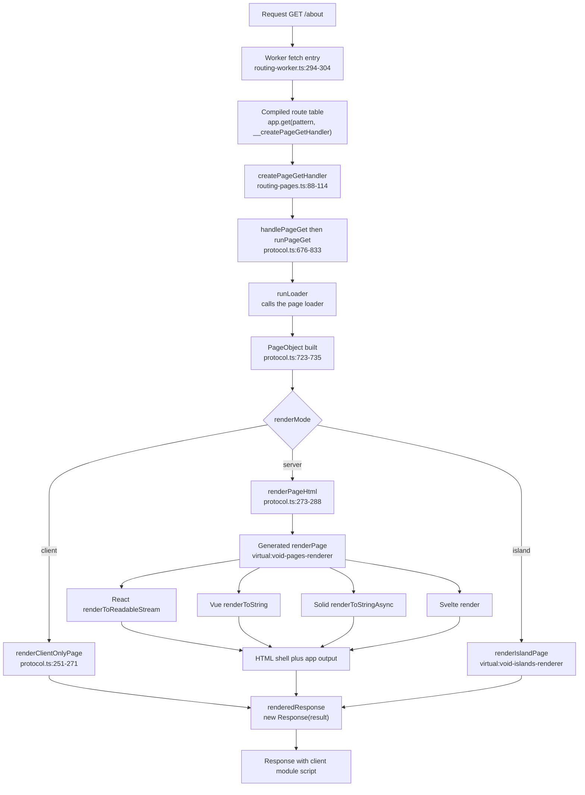
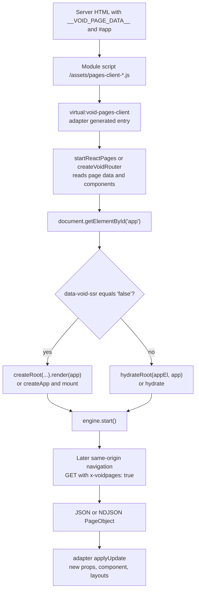

# 12 How Void Renders a Page on the Server and in the Browser

Void does not own a renderer. It owns a protocol. The core package `void` builds a route table, calls one function named `renderPage`, and sends the result as a HyperText Transfer Protocol (HTTP) response. Each adapter package supplies that function and the matching browser hydration call. React returns a stream. Vue, Solid, and Svelte return a string. Markdown is an adapter of a different kind: it turns a `.md` file into component code for whichever adapter is installed. The thesis of this document is that the adapter boundary is three shared definitions: a page data type, a server render function, and a client navigation adapter. A new user-interface library therefore needs no change in the router.

This document covers rendering only. File-based routing, loaders, and actions are in document [11](11-void-framework-routing.md). Database, storage, and bindings are in document [13](13-void-resources-and-bindings.md). The command-line interface (CLI) and deployment are in document [14](14-void-cli-and-deployment.md).

All paths are relative to the snapshot root `/Users/darkvoid/GitSources/src.voidzero`. Every source path starts with the repository name. The source is `void` at commit `f254d1ec477b6b2af2c02fa427bd9d196316ee07`, npm package version 1.7.0, MIT license, copyright Cloudflare, Inc.

Each abbreviation is spelled out at its first use. The table gives the spellings.

| Abbreviation | Spelling |
|---|---|
| API | Application Programming Interface |
| CDN | Content Delivery Network |
| CLI | command-line interface |
| HTML | HyperText Markup Language |
| HTTP | HyperText Transfer Protocol |
| ISR | incremental static regeneration |
| JSON | JavaScript Object Notation |
| KV | key-value store |
| NDJSON | newline-delimited JSON |
| SSR | server-side rendering |
| SSG | static site generation |
| TTL | time to live |
| URL | Uniform Resource Locator |

The document also spells out Continuous Integration (CI), ReadableStream (a browser and Worker byte stream), and same-origin (same scheme, host, and port). Function names, header names, and file names stay unchanged.

Eight platform terms appear in the code and the text. A Vite virtual module is a module that exists only in the build, not as a file. A Cloudflare Worker is the server program that Cloudflare runs at the edge. Miniflare is the local runtime that the build uses to start that Worker. Shiki is the syntax highlighter. `gray-matter` is the front-matter parser. An import attribute is the `with { ... }` clause on an import statement. `caches.default` is the per-location Cloudflare cache. `ctx.waitUntil` lets a Worker finish work after it sends the response. The `ASSETS` binding is the Worker binding that serves built files.

A code block starts with a label line, such as `// void/packages/void/src/pages/protocol.ts:82-86`. The label gives the file and the exact line range. The label is not part of the source text. A `//` label marks TypeScript. A `#` label marks shell or configuration.

## 1. The five adapters in this snapshot

Five adapter packages exist. Four render components. The fifth compiles Markdown. The table lists the package name, version, plugin entry, server render function, browser hydration call, and the part that the adapter supplies.

| Adapter | Package | Version | Plugin entry | Server render | Browser hydration | Supplied by the adapter |
|---|---|---|---|---|---|---|
| React | `@void/react` | 1.7.0 | export map `./plugin` resolves to `dist/plugin.mjs`, source `src/plugin.ts` | `renderReactPage` with `renderToReadableStream` | `startReactPages` with `hydrateRoot` | A stream renderer and a hydration runtime, both exported from the package |
| Vue | `@void/vue` | 1.7.0 | export map `./plugin` resolves to `dist/plugin.mjs`, source `src/plugin.ts` | generated `renderPage` with `renderToString` | generated entry with `createSSRApp` or `createApp` and `mount` | Generated source strings for the server and the client |
| Solid | `@void/solid` | 1.7.0 | export map `./plugin` resolves to `dist/plugin.mjs`, source `src/plugin.ts` | generated `renderPage` with `renderToStringAsync` and `generateHydrationScript` | generated entry with `hydrate` or `render` | Generated source strings for the server and the client |
| Svelte | `@void/svelte` | 1.7.0 | export map `./plugin` resolves to `dist/plugin.mjs`, source `src/plugin.ts` | generated `renderPage` with `render` from `svelte/server` | generated entry with `hydrate` or `mount` | Generated source strings for the server and the client |
| Markdown | `@void/md` | 1.7.0 | export map `./plugin` resolves to `dist/plugin.mjs`, source `src/plugin.ts` | none of its own | none of its own | A `.md` transform that emits the detected adapter's component code |

The version and export map come from each manifest. React declares `./pages-client` and `./pages-server` exports (`void/packages/react/package.json:1-40`). Vue, Solid, and Svelte declare no page runtime export (`void/packages/vue/package.json:1-40`, `void/packages/solid/package.json:1-40`, `void/packages/svelte/package.json:1-40`). Markdown declares `./pages` and two theme stylesheets (`void/packages/md/package.json:1-50`).

### 1.1 React

React is the only adapter whose server and client rendering live in package runtime files. The plugin is a factory named `voidReact`. It installs the React Vite plugin, the pages plugin, and the islands plugin (`void/packages/react/src/plugin.ts:13-25`). The pages plugin name is `void-react:pages` (`void/packages/react/src/plugin-pages.ts:40-44`).

The generated server module imports `renderReactPage` from the package export `@void/react/pages-server`. The generated client module imports `startReactPages` from `@void/react/pages-client`.

```ts
// void/packages/react/src/plugin-pages.ts:199-209
	export async function renderPage(pageObj, assetTags, requestUrl) {
	  return renderReactPage({
	    pageObj,
	    assetTags,
	    components,
	    layoutTree,
	    requestUrl,
	    preambleScript: PREAMBLE_SCRIPT,
	  });
}
renderPage.preambleScript = PREAMBLE_SCRIPT;
```

The block above is the generator's returned template, not a runtime file. `components` and `layoutTree` come from `generateComponentManifest`. `PREAMBLE_SCRIPT` is the React Fast Refresh preamble in development (`void/packages/react/src/plugin-pages.ts:31-38`). The server render returns `Promise<ReadableStream<Uint8Array>>` (`void/packages/react/src/runtime/pages-server.ts:54-61`). The client render is an async function that returns a router (`void/packages/react/src/runtime/pages-client.ts:802-902`).

### 1.2 Vue

Vue generates all rendering code as strings. The plugin is `voidVue` (`void/packages/vue/src/plugin.ts:13-25`). The pages plugin name is `void-vue:pages` (`void/packages/vue/src/plugin-pages.ts:235-237`).

The generated server module imports `createSSRApp`, `h`, `reactive`, and `provide` from `vue`. It imports `renderToString` from `vue/server-renderer` (`void/packages/vue/src/plugin-pages.ts:286-290`). The render function creates a server application and calls `renderToString`.

```ts
// void/packages/vue/src/plugin-pages.ts:323-338
  const html = await renderToString(app);
  if (renderFailure) throw renderFailure.error;
  const pageData = serializePageData(pageObj);
  const headHtml = pageObj.head ? renderHeadToString(pageObj.head) : "";
  const htmlAttrs = pageObj.head ? renderHtmlAttrs(pageObj.head) : "";
  const bodyAttrs = pageObj.head ? renderBodyAttrs(pageObj.head) : "";

  return \`<!doctype html>
<html\${htmlAttrs}>
<head>\${headHtml}\${assetTags.css}\${assetTags.preloads}</head>
<body\${bodyAttrs}>
  \${pageObj.documentOnly ? "" : '<script id="__VOID_PAGE_DATA__" type="application/json">' + pageData + '</script>'}
  <div id="app">\${html}</div>
  \${assetTags.body}
</body>
</html>\`;
```

The backslashes in the block belong to the outer template literal in the source file. The generated module receives the unescaped text. The application is built from `PageComponent` and the layout chain (`void/packages/vue/src/plugin-pages.ts:303-319`). `renderFailure` is set by the error handler at lines 321-324, so a boundary error becomes a thrown server error.

The generated client entry chooses `createApp` for a client-only page and `createSSRApp` for a server-rendered page. It then calls `mount` (`void/packages/vue/src/plugin-pages.ts:426-456`).

```ts
// void/packages/vue/src/plugin-pages.ts:426-428
const appEl = document.getElementById("app");
if (!appEl) throw new Error("pages: Missing #app element for Void Vue pages hydration.");
const createVoidApp = appEl.getAttribute("data-void-ssr") === "false" ? createApp : createSSRApp;
```

### 1.3 Solid

Solid uses the same generated-code design. The plugin is `voidSolid` (`void/packages/solid/src/plugin.ts:43-56`). The pages plugin name is `void-solid:pages` (`void/packages/solid/src/plugin-pages.ts:14-18`).

The generated server module imports `renderToStringAsync` and `generateHydrationScript` from `solid-js/web` (`void/packages/solid/src/plugin-pages.ts:66`). It calls `renderToStringAsync` at line 125. The shell adds `generateHydrationScript()` in the head unless the page is document-only.

```ts
// void/packages/solid/src/plugin-pages.ts:132-140
  return \`<!doctype html>
<html\${htmlAttrs}>
<head>\${headHtml}\${assetTags.css}\${assetTags.preloads}\${pageObj.documentOnly ? "" : generateHydrationScript()}</head>
<body\${bodyAttrs}>
  \${pageObj.documentOnly ? "" : '<script id="__VOID_PAGE_DATA__" type="application/json">' + pageData + '</script>'}
  <div id="app">\${html}</div>
  \${assetTags.body}
</body>
</html>\`;
```

The generated client entry chooses `render` or `hydrate` from `solid-js/web` (`void/packages/solid/src/plugin-pages.ts:313-317`).

```ts
// void/packages/solid/src/plugin-pages.ts:311-317
const appEl = document.getElementById("app");
if (!appEl) throw new Error("pages: Missing #app element for Void Solid pages hydration.");
if (appEl.getAttribute("data-void-ssr") === "false") {
  render(() => createComponent(App, {}), appEl);
} else {
  hydrate(() => createComponent(App, {}), appEl);
}
```

### 1.4 Svelte

Svelte also generates code. The plugin is `voidSvelte` (`void/packages/svelte/src/plugin.ts:13-25`). The pages plugin name is `void-svelte:pages` (`void/packages/svelte/src/plugin-pages.ts:46-50`).

The generated server module imports `render` from `svelte/server` and the root `App` component (`void/packages/svelte/src/plugin-pages.ts:93-99`). It calls `render(App, { props: ... })` and receives `{ html, head }`.

```ts
// void/packages/svelte/src/plugin-pages.ts:130-138
  return \`<!doctype html>
<html\${htmlAttrs}>
<head>\${headHtml}\${head}\${assetTags.css}\${assetTags.preloads}</head>
<body\${bodyAttrs}>
  \${pageObj.documentOnly ? "" : '<script id="__VOID_PAGE_DATA__" type="application/json">' + pageData + '</script>'}
  <div id="app">\${html}</div>
  \${assetTags.body}
</body>
</html>\`;
```

The generated client entry chooses `mount` for a client-only page and `hydrate` otherwise. It then waits for Svelte to settle before it commits the first render (`void/packages/svelte/src/plugin-pages.ts:249-258`).

```ts
// void/packages/svelte/src/plugin-pages.ts:249-258
if (appEl.getAttribute("data-void-ssr") === "false") {
  mount(App, appOptions);
} else {
  hydrate(App, appOptions);
}

export { reactiveRouter as router };
start();
await tick();
commitInitialRender();
```

### 1.5 Markdown is an adapter of a different kind

`@void/md` has no `renderPage`. It detects the installed framework adapter by plugin name and emits component code for that adapter (`void/packages/md/src/plugin.ts:25-30`). It throws when no known adapter is present.

```ts
// void/packages/md/src/plugin.ts:25-30
const ADAPTER_PLUGIN_NAMES: Record<string, FrameworkAdapter> = {
  'void-vue:pages': 'vue',
  'void-react:pages': 'react',
  'void-svelte:pages': 'svelte',
  'void-solid:pages': 'solid',
};
```

The detection loop reads every resolved plugin name in `configResolved` (`void/packages/md/src/plugin.ts:209-225`). The error text names the four supported packages.

The `.md` transform then calls one of four emitters (`void/packages/md/src/plugin.ts:392-418`). Vue and React receive code directly. Svelte and Solid use a virtual module, because their compilers need a separate file extension.

```ts
// void/packages/md/src/plugin.ts:392-398
          if (adapter === 'vue') {
            return { code: emitVueComponent(result, islands), map: null };
          }

          if (adapter === 'react') {
            return { code: emitReactComponent(result, islands), map: null };
          }
```

The Svelte and Solid branches create a virtual module with the right extension (`void/packages/md/src/plugin.ts:400-415`). `createVirtualModuleId` adds `.svelte` or `.tsx`, so the framework compiler can process the emitted source (`void/packages/md/src/plugin.ts:100-109`).

The Markdown file is still a page module. The scanner lists it (`void/packages/void/src/pages/scan.ts:521-527`), and the route table imports the transformed module like any other page (`void/packages/void/src/router/compile.ts:991`, `void/packages/void/src/router/compile.ts:1147`). The component identifier is the relative path without the `.md` suffix (`void/packages/md/src/plugin.ts:46-51`). It also removes a trailing `/index` and a leading `index`. The fallback identifier is `index` (`void/packages/md/src/plugin.ts:134`).

## 2. The shared contract

The contract has three parts: the page data object, the server render function, and the client navigation adapter. The core owns all three type definitions.

The page data object is `PageObject`. It carries the component identifier, the loader props, the route parameters, and the shared middleware data. It also carries the request URL, the error map, the head descriptor, and the deferred keys (`void/packages/void/src/pages/protocol.ts:32-48`).

```ts
// void/packages/void/src/pages/protocol.ts:32-48
export type PageObject = {
  /** Build-only server document; never bootstraps an interactive Pages root. */
  documentOnly?: boolean;
  component: string;
  props: Record<string, unknown>;
  params: Record<string, string>;
  shared: Record<string, unknown>;
  url: string;
  errors: Record<string, string> | null;
  head?: HeadDescriptor;
  deferred?: Array<string>;
  deferredKeys?: Record<string, string>;
  /** Error message per failed deferred group in a prefetch payload. */
  deferredErrors?: Record<string, string>;
};

export type PageRenderResult = string | ReadableStream<Uint8Array>;
```

A deferred group is one loader promise. The `deferred` array names the groups. The `deferredKeys` record maps each prop key to its group. `HeadDescriptor` is the resolved head value. `DevCssAsset` is a development stylesheet record. Both are internal types, not values that an adapter receives directly.

The server render function is `RenderPage`. It receives the page object, the asset tags, and the request URL. It returns a string or a byte stream.

```ts
// void/packages/void/src/pages/protocol.ts:75-89
type AssetTags = {
  css: string;
  preloads: string;
  body: string;
  devCss?: Array<DevCssAsset>;
  devCssNonce?: string;
};
type RenderPage = (
  pageObj: PageObject,
  assetTags: AssetTags,
  requestUrl: string,
) => Promise<PageRenderResult>;
type RenderPageWithMetadata = RenderPage & {
  preambleScript?: string;
};
```

The string return is why Vue, Solid, and Svelte need no stream utilities. The stream return is why React can use `renderToReadableStream` without buffering the whole document.

The client navigation adapter is `VoidRouterAdapter`. It abstracts deferred values and their loading state. The page navigation engine calls these methods and never imports a framework.

```ts
// void/packages/void/src/pages/navigation-engine.ts:78-84
export type VoidRouterAdapter = {
  createDeferred(): unknown;
  resolveDeferred(ref: unknown, value: unknown): unknown;
  rejectDeferred(ref: unknown, error: string): unknown;
  isLoading(ref: unknown): boolean;
  onDeferredUpdate?(props: Record<string, unknown>): void;
};
```

There are two adapter types with the same name. The engine defines the minimal one shown above. The client module in `void/packages/void/src/pages/client.ts` imports it as `PageNavigationAdapter` and extends it with one required method, `applyUpdate`. That method installs new page data, a new component, and new layouts into the framework's reactive state.

```ts
// void/packages/void/src/pages/client.ts:103-110
export type VoidRouterAdapter = PageNavigationAdapter & {
  applyUpdate(
    pageData: PageData,
    component: unknown,
    layouts: Array<unknown>,
    options: { preserveState: boolean },
  ): void | Promise<void>;
};
```

An adapter registers by supplying two generator functions to `createPagesPlugin`. The core calls them to fill the virtual modules `virtual:void-pages-renderer` and `virtual:void-pages-client`. There is no global registry and no runtime lookup.

```ts
// void/packages/void/src/pages/plugin.ts:104-119
        if (id === '\0' + RENDERER_ID) {
          if (!pageScan) {
            return "export function renderPage() { throw new Error('No pages found'); }";
          }
          return options.generateRenderer(pageScan, isDev);
        }
        if (id === '\0' + CLIENT_ENTRY_ID) {
          if (!pageScan) {
            return '';
          }
          // Static page-data files are emitted only during production prerendering.
          const staticPageData = isDev
            ? { enabled: false, fastPath: false }
            : resolveStaticPageDataBuildOptions(root, { publicDir: viteConfig?.publicDir });
          return options.generateClient(pageScan, staticPageData);
        }
```

**Aha:** The adapter is not a plugin that the core calls at runtime. The adapter is a code generator that the core calls at build time. The router imports one generated module, `virtual:void-pages-renderer`, and the generated module imports the adapter. This keeps the Worker bundle free of a framework switch.

## 3. The server-side render path

The server path has seven stages. The compiled route table selects the handler. The handler runs the loader. The protocol builds a `PageObject`. The protocol asks the adapter to render. The adapter returns a string or a stream. The protocol wraps the result in a `Response`. The generated shell embeds the client script that the asset helper supplies.



A page gets the render mode `island` when its file name marks it as an island. It gets `client` when it exports `ssr = false`. It gets `server` in every other case (`void/packages/void/src/pages/scan.ts:298-315`).

The route table is generated, not hand written. For each page, the generator chooses `renderIslandPage` for an island page and `renderPage` otherwise. It also chooses the island asset helper or the page asset helper.

```ts
// void/packages/void/src/router/compile.ts:1138-1148
    // Choose renderer and asset tags based on normalized render mode
    const renderer = page.renderMode === 'island' ? 'renderIslandPage' : 'renderPage';
    const assetTags =
      page.renderMode === 'island' && pages.islandClientEntryId
        ? 'getIslandsAssetTags'
        : 'getPagesAssetTags';
    const trailingCatchAll = options.trailingSlash && page.catchAll;
    const pattern = trailingCatchAll ? page.pattern.slice(0, -1) : page.pattern;
    const catchAllParam = page.pattern.match(/:([^/{}]+)\{\.\+\}\/$/)?.[1];
    const routeOptions = `{ ${serverImportPath ? 'load: _pload_' + safeId + ', ' : ''}${mdHeadRef ? 'head: ' + mdHeadRef + ', ' : ''}${trailingCatchAll ? `trailingSlash: true, catchAllParam: ${JSON.stringify(catchAllParam)}, ` : ''}componentId: ${JSON.stringify(page.componentId)}, render: ${renderer}, assets: ${assetTags}, headConfig: __voidHeadConfig, renderOptions: ${JSON.stringify({ renderMode: page.renderMode, ...(options.dev === true ? { dev: true } : {}), ...(boundaryManifest.pages[page.componentId] && { boundaries: boundaryManifest.pages[page.componentId] }) })} }`;
    lines.push(`app.get(${JSON.stringify(pattern)}, __createPageGetHandler(${routeOptions}));`);
```

The handler is thin. It resolves the page module and forwards the render function and the asset helper to `handlePageGet`.

```ts
// void/packages/void/src/runtime/routing-pages.ts:88-114
export function createPageGetHandler(options: PageRouteOptions): (c: Context) => Promise<Response> {
  return markRouteHandler(async (context: Context) => {
    if (!preparePageRequest(context, options)) {
      return context.notFound();
    }
    let mod: PageModule;
    try {
      mod = options.load ? await options.load() : { head: options.head };
    } catch (error) {
      mod = {
        loader: () => {
          throw error;
        },
      };
    }
    return handlePageGet(
      mod.loader,
      mod.head,
      context as PageGetArguments[2],
      options.componentId,
      options.render,
      options.assets,
      options.headConfig ?? undefined,
      options.renderOptions,
    );
  });
}
```

`options.load` imports the page's server module. The `mod.loader` field is the data loader. The two are different functions with similar names.

`runPageGet` builds the `PageObject` after the loader resolves. It reads the shared middleware data at render time. It also resolves the head descriptor from three sources: the route configuration, middleware defaults, and the per-request head function.

The protocol then separates immediate props from deferred props. It records a key-to-group map for the browser. That map lets the client resolve one deferred group that contains several props.

```ts
// void/packages/void/src/pages/protocol.ts:723-735
        const pageObj: PageObject = {
          component: componentId,
          props: immediateProps,
          params: requestParams(c),
          shared,
          url: requestPathWithSearch(c),
          errors: null,
          ...(head && { head }),
          ...(hasDeferred && {
            deferred: Object.keys(deferredMap),
            deferredKeys,
          }),
        };
```

Two response modes share this object. A normal browser request renders HTML. A client navigation request with `x-voidpages: true` returns the object as JSON. That is the Pages protocol.

```ts
// void/packages/void/src/pages/protocol.ts:775-790
          if (!hasDeferred) {
            return pageJsonResponse(c, pageObj);
          }
          // Stream NDJSON: first line is PageObject, subsequent lines are deferred groups
          c.header('X-VoidPages', 'true');
          c.header('X-VoidPages-Version', PAGES_PROTOCOL_VERSION);
          return streamDeferredResponse(
            serializePageData(pageObj) + '\n',
            deferredMap,
            c,
            'application/x-ndjson',
            options?.dev === true,
            (group, data) => serializePageData({ __deferred: group, data }) + '\n',
            (group, error) => serializePageData({ __deferred: group, error }) + '\n',
          );
        }
```

When the request is not a Pages request, `renderPageHtml` selects the render mode. A client-only page uses a shell with an empty `<div id="app" data-void-ssr="false">`. Every other mode calls the adapter.

```ts
// void/packages/void/src/pages/protocol.ts:273-288
async function renderPageHtml(
  c: CloudContext,
  pageObj: PageObject,
  componentId: string,
  renderMode: PageRenderMode,
  renderFn: RenderPageWithMetadata,
  getAssetTags: GetAssetTags,
): Promise<{ html: PageRenderResult; assetTags: AssetTags }> {
  const assetTags = prepareAssetTags(await getAssetTags(c.req.raw, c.env, componentId));
  // Keep the request origin in render context, rather than serialized navigation URLs.
  const html =
    renderMode === 'client'
      ? renderClientOnlyPage(pageObj, assetTags, renderFn)
      : await renderWithAssetTags(renderFn, pageObj, assetTags, c.req.url);
  return { html, assetTags };
}
```

React renders to a stream. The stream starts before the component tree is complete. The stream can grow after the call returns, when a suspended part resolves. The protocol cancels the stream when an error occurs before the shell is sent. `shellSent` becomes true after the stream exists. `shellError` collects an error before that point. `renderedAppStream` wraps the stream when deferred keys exist (`void/packages/react/src/runtime/pages-server.ts:127`). `concatStreams` and `textStream` are helpers in `page-streams.ts`.

```ts
// void/packages/react/src/runtime/pages-server.ts:110-121
  const appStream = await renderToReadableStream(renderElement, {
    onError(error) {
      if (error === DEFERRED_SHELL_CANCEL_REASON) {
        return;
      }
      if (shellSent) {
        console.error(error);
        return;
      }
      shellError ??= { error };
    },
  });
```

The React shell is three streams joined in order. The first stream contains the document start and the opening `<div id="app">`. The second stream is the React output. The third stream closes the document. The browser can paint the head and the page data before the app stream finishes.

```ts
// void/packages/react/src/runtime/pages-server.ts:133-146
  return concatStreams([
    textStream(`<!doctype html>
<html${htmlAttrs}>
<head>${headHtml}${preambleScript}${assetTags.css}${assetTags.preloads}</head>
<body${bodyAttrs}>
  ${pageObj.documentOnly ? '' : `<script id="__VOID_PAGE_DATA__" type="application/json">${pageData}</script>`}
  <div id="app">`),
    renderedAppStream,
    textStream(`</div>
  ${assetTags.body}
</body>
</html>`),
  ]);
}
```

Every adapter writes the same page data script. The identifier `__VOID_PAGE_DATA__` is the contract between the server and the browser. The client entry reads that element and never parses the visible HTML for data.

The protocol wraps the adapter result in a `Response`. It sets the content type and the standard page headers. It also adjusts the development Content Security Policy (CSP) for injected styles.

```ts
// void/packages/void/src/pages/protocol.ts:577-592
function renderedResponse(
  c: CloudContext,
  result: PageRenderResult,
  contentType: string,
  assetTags?: AssetTags,
): Response {
  return new Response(result, {
    headers: adjustDevCssCsp(
      pageResponseHeaders(c, {
        'content-type': contentType,
        ...POWERED_BY,
      }),
      assetTags?.devCssNonce,
    ),
  });
}
```

The client bundle is not hard coded in the adapter. `createClientAssetTags` reads the Vite manifest through `createManifestLoader` and selects the page entry (`void/packages/void/src/runtime/routing-assets.ts:55-88`). It then writes one module script, a set of module preload links, and the stylesheet links (`void/packages/void/src/runtime/routing-assets.ts:165-246`).

```ts
// void/packages/void/src/runtime/routing-assets.ts:232-244
    let body = script('/' + entry.file);
    if (hasExtra) {
      body += '\n' + script('/' + extraEntry.file!);
    }
    return {
      css: [...css]
        .map((file) => `<link rel="stylesheet" href="/${escapeAttribute(file)}">`)
        .join('\n'),
      preloads: [...preloads]
        .map((file) => `<link rel="modulepreload" href="/${escapeAttribute(file)}">`)
        .join('\n'),
      body,
    };
```

The result is a `Response` whose body can be a string or a stream. The Worker runtime returns it unchanged. The asset tags are resolved before the adapter runs and are passed into the render call. The generated shell writes them into the document head and body.

## 4. The client hydration path

The browser loads the module script that the asset helper wrote. That script is the generated `virtual:void-pages-client` entry. It reads `__VOID_PAGE_DATA__`, starts the navigation engine, finds `#app`, and hydrates or mounts.



React performs the decision in one place. It reads the attribute `data-void-ssr`. The server writes `false` only for a client-only page. Every other page hydrates.

```ts
// void/packages/react/src/runtime/pages-client.ts:839-844
  const appEl = document.getElementById('app');
  if (!appEl) {
    throw new Error('pages: Missing #app element for Void React pages hydration.');
  }

  const isSsr = appEl.getAttribute('data-void-ssr') !== 'false';
```

A missing `#app` element is a hard error. `renderClientOnlyPage` writes `data-void-ssr="false"` in the server template (`void/packages/void/src/pages/protocol.ts:267`). The client navigation engine also sets the attribute when it recovers from an initial import failure (`void/packages/void/src/pages/navigation-engine.ts:1084-1095`). A server-rendered page has no such attribute, so the client hydrates it.

```ts
// void/packages/void/src/pages/protocol.ts:251-271
function renderClientOnlyPage(
  pageObj: PageObject,
  assetTags: AssetTags,
  renderFn: RenderPageWithMetadata,
): string {
  const pageData = serializePageData(pageObj);
  const headHtml = pageObj.head ? renderHeadToString(pageObj.head) : '';
  const htmlAttrs = pageObj.head ? renderHtmlAttrs(pageObj.head) : '';
  const bodyAttrs = pageObj.head ? renderBodyAttrs(pageObj.head) : '';
  const preambleScript = typeof renderFn.preambleScript === 'string' ? renderFn.preambleScript : '';

  return `<!doctype html>
<html${htmlAttrs}>
<head>${headHtml}${preambleScript}${assetTags.css}${assetTags.preloads}</head>
<body${bodyAttrs}>
  <script id="__VOID_PAGE_DATA__" type="application/json">${pageData}</script>
  <div id="app" data-void-ssr="false"></div>
  ${assetTags.body}
</body>
</html>`;
}
```

React also detects a deferred initial page. In that case it adds a `template` marker so the streamed shell and the hydrated tree agree (`void/packages/react/src/runtime/pages-client.ts:855-864`). `DEFERRED_SHELL_END_ID` marks the point where the server stopped writing deferred content. `readDeferredShell` reads the stream up to that marker. The client uses the same marker so both trees have the same shape (`void/packages/react/src/runtime/pages-server.ts:14-15`, `void/packages/react/src/runtime/pages-server.ts:99-103`, `void/packages/react/src/runtime/pages-server.ts:127`).

```ts
// void/packages/react/src/runtime/pages-client.ts:893-897
    if (!isSsr) {
      createRoot(appEl, rootOptions).render(app);
    } else {
      hydrateRoot(appEl, app, rootOptions);
    }
```

After hydration, the adapter starts the engine. The engine owns all later navigation. It fetches the next page as JSON, updates the framework state, and calls `applyUpdate`. The adapter never fetches a page itself.

The engine is `createPageNavigationEngine` in `void/packages/void/src/pages/navigation-engine.ts`. `createVoidRouter` in `client.ts` builds that engine, adds the router facade, and returns `start` and `commitInitialRender` (`void/packages/void/src/pages/client.ts:386-576`). React calls the engine directly. Vue, Solid, and Svelte call `createVoidRouter`. `engine.start()` runs after hydration because the engine needs the hydrated tree (`void/packages/react/src/runtime/pages-client.ts:899`).

The React adapter installs four deferred operations on the engine. The framework-specific deferred value is a promise resource, so the adapter passes the resource constructors.

```ts
// void/packages/react/src/runtime/pages-client.ts:810-830
  const engine = await createPageNavigationEngine({
    adapter: {
      createDeferred: createDeferredResource,
      resolveDeferred: resolveDeferredResource,
      rejectDeferred: rejectDeferredResource,
      isLoading: isDeferredResourceLoading,
    },
    components: config.components,
    layoutTree: config.layoutTree,
    routeMeta: config.routeMeta,
    matchRoute: config.matchRoute,
    staticPageData: config.staticPageData,
    staticPageDataFastPath: config.staticPageDataFastPath,
    viewTransitions: config.viewTransitions,
    prefetchHoverDelay: config.prefetchHoverDelay,
    prefetchDefaultCacheFor: config.prefetchDefaultCacheFor,
    prefetchDefaultStrategy: config.prefetchDefaultStrategy,
    cacheVisitedPageData: config.cacheVisitedPageData,
    boundaryManifest: config.boundaryManifest,
    dev: config.dev,
  }).catch((error) => {
```

Vue provides the same shape inline. It creates reactive objects for shared data, parameters, and navigation state. It also supplies an `applyUpdate` function that replaces those records and increments the page key.

```ts
// void/packages/vue/src/plugin-pages.ts:379-397
const { router, initialPageData, initialComponent, initialLayouts, start, commitInitialRender } =
  await createVoidRouter({
    adapter: {
      createDeferred: () => createDeferred(),
      resolveDeferred(ref, value) { resolveDeferred(ref, value); return ref; },
      rejectDeferred(ref, error) { rejectDeferred(ref, error); return ref; },
      isLoading: (ref) => ref.loading,
      applyUpdate(pageData, comp, layouts, options) {
        currentPageId = pageData.component;
        boundaryGeneration.value++;
        if (!options?.preserveState) currentPageKey.value++;
        replaceRecord(shared, pageData.shared || {});
        replaceRecord(params, pageData.params || {});
        currentProps.value = pageData.props;
        currentLayouts.value = layouts;
        currentComponent.value = comp;
        return nextTick();
      },
    },
```

Solid and Svelte call `createVoidRouter` with their own reactive stores. Their generated entries then call `hydrate` or `render`. Svelte waits one tick before it commits the initial render, so its page structure matches the server output. `appEl`, `appOptions`, `reactiveRouter`, `start`, and `commitInitialRender` are declared earlier in the generated entry. `start` and `commitInitialRender` come from `createVoidRouter` (`void/packages/svelte/src/plugin-pages.ts:143-259`).

**Aha:** Hydration is not a second render. The browser already has the server output and the page data. The adapter only attaches event handlers and reactive state to the existing nodes. A client-only page is the exception, and the `data-void-ssr="false"` attribute marks it.

## 5. Deferred streaming

A loader can return a promise for one prop. Void calls that prop deferred. `runPageGet` calls `separateDeferred` (`void/packages/void/src/pages/defer.ts:50-72`). For each deferred key it puts a placeholder `{ value: null, loading: true, error: null }` into the props. Vue, Solid, and Svelte render that placeholder into the string. React replaces the key with a promise that never resolves, so React suspends that part of the tree (`void/packages/react/src/runtime/pages-server.ts:29-42`). The protocol then sends the rest of the page and later writes a small script that resolves the prop.

The non-Pages HTML path appends one `<script>` per deferred group. The script calls a global function if the client has installed it. It pushes to a queue otherwise. This handles a deferred value that resolves before hydration starts.

```ts
// void/packages/void/src/pages/protocol.ts:806-821
        return streamDeferredResponse(
          html,
          deferredMap,
          c,
          'text/html; charset=utf-8',
          options?.dev === true,
          (group, data) => {
            const g = safeJsonStringify(group);
            return `\n<script>(function(d){window.__resolveDeferred?window.__resolveDeferred(${g},d,true):(window.__deferredQueue??=[]).push([${g},d,0,true])})(${serializePageData(data)})</script>`;
          },
          (group, error) => {
            const g = safeJsonStringify(group);
            return `\n<script>(function(e){window.__rejectDeferred?window.__rejectDeferred(${g},e):(window.__deferredQueue??=[]).push([${g},0,e])})(${safeJsonStringify(error)})</script>`;
          },
          assetTags,
        );
```

The Pages JSON path uses NDJSON instead. The first line is the page object. Each later line is one deferred group. The client reads lines as they arrive and resolves the matching props.

The queue entries have two shapes. A resolve entry has four elements: group, data, zero, and a `true` flag that marks the data as already serialized. A reject entry has three: group, zero, and the error. `navigation-engine.ts:648` installs `window.__resolveDeferred`. The engine drains `window.__deferredQueue` when it starts (`void/packages/void/src/pages/navigation-engine.ts:1312-1324`).

## 6. How a Markdown file becomes a page

The Markdown adapter has four steps. It removes a leading `<script>` block. It parses the front matter. It compiles the body with MarkdownExit. It emits component code for the detected adapter.

The leading script detection uses one regular expression. The pattern anchors the script at the start of the file.

```ts
// void/packages/md/src/extract-script.ts:1-3
import { editIslandSource, findIslandImports } from 'void/pages-islands-plugin';

const SCRIPT_RE = /^<script\b[^>]*>([\s\S]*?)<\/script>\s*\n?/;
```

The function also finds island imports in that script. It removes them from the emitted client code. The remaining code becomes the page's browser script. `void/pages-islands-plugin` is a subpath export of the core `void` package, not an `@void` package (`void/packages/void/package.json`).

Front matter uses `gray-matter`. The options object is empty on purpose. An empty object skips the module cache. Without it, a second read of invalid front matter returns empty data instead of an error.

```ts
// void/packages/md/src/metadata.ts:52-65
export function parseFrontmatter(
  source: string,
): Readonly<{ frontmatter: Record<string, unknown>; content: string }> {
  try {
    // Passing options skips gray-matter's cache. It stores a source before parsing it,
    // so without them a second read of invalid frontmatter returns empty data and
    // leaves the fences in the content instead of throwing again.
    const { data: frontmatter, content } = matter(source, {});
    return { frontmatter, content };
  } catch (error) {
    const message = error instanceof Error ? error.message : String(error);
    throw new Error(`Invalid frontmatter: ${message}`, { cause: error });
  }
}
```

The title comes from front matter first. If the field is absent, it uses the first level-one heading. If both are absent, the title is an empty string (`void/packages/md/src/metadata.ts:67-79`).

The parser is `markdown-exit`, a fork of `markdown-it`. The compiler enables raw HTML and link detection. It adds Shiki with the JavaScript regular-expression engine, so no WebAssembly is needed. It then adds plugins for containers, images, links, line numbers, and GitHub alerts.

```ts
// void/packages/md/src/compile.ts:60-72
async function createCompiler(options?: CompileOptions): Promise<MarkdownExit> {
  const markdown = new MarkdownExit({ html: true, linkify: true });

  // Shiki highlighting with JS RegExp engine (no WASM) + lazy language loading
  const themes = options?.shiki?.themes ?? {
    light: 'github-light',
    dark: 'github-dark',
  };
  const highlighter = await createHighlighter({
    engine: createJavaScriptRegexEngine(),
    themes: [themes.light, themes.dark],
    langs: [],
  });
```

The React emitter shows the island contract. An island import becomes a wrapper `div` with three data attributes. The wrapped component is the real island. The wrapper holds the identifier, the serialized props, and the hydration strategy.

```tsx
// void/packages/md/src/emit-react.ts:20-30
    code += `function ${islandImport.name}(props) {
  return React.createElement(
    "div",
    {
      "data-island": ${JSON.stringify(islandImport.islandId)},
      "data-props": JSON.stringify(props),
      "data-hydrate": ${JSON.stringify(islandImport.strategy)}
    },
    React.createElement(_raw_island_${islandIndex}, props)
  );
}\n`;
```

The page module also exports `frontmatter` and `headings`. A layout or a component can import those values. The React emitter wraps the page in `FrontmatterContext.Provider` so `useFrontmatter` works during server rendering and in islands.

## 7. Islands

Islands exist in this snapshot. The convention uses an import attribute, not a directive string. The attribute key must be `island`. The attribute value must be a string that names the hydration strategy.

```tsx
// void/playground/react-pages/pages/blog/index.island.tsx:1-2
import Counter from './_Counter.tsx' with { island: 'load' };
import PostForm from './_PostForm.tsx' with { island: 'load' };
```

This attribute marks an island inside a page. It is separate from the `.island.*` file suffix, which sets `renderMode: 'island'` for a whole page (`void/packages/void/src/pages/scan.ts:298-315`).

The scanner accepts one default import with exactly one attribute. Any other shape is ignored. The scan runs over JavaScript, TypeScript, a component script block, or a Markdown leading script.

```ts
// void/packages/void/src/pages/island-imports.ts:160-177
      if (
        specifiers?.length !== 1 ||
        first?.type !== 'ImportDefaultSpecifier' ||
        !isIdentifier(first.local as AstNode | undefined) ||
        attributes?.length !== 1 ||
        !isIdentifier(key) ||
        key.name !== 'island' ||
        !isLiteral(value) ||
        typeof value.value !== 'string' ||
        !isLiteral(source) ||
        typeof source.value !== 'string' ||
        source.start === undefined ||
        source.end === undefined ||
        node.start === undefined ||
        node.end === undefined
      ) {
        continue;
      }
```

The framework island plugins replace the import with a wrapper element. The React transform produces a `div` with `data-island`, `data-props`, and `data-hydrate` (`void/packages/react/src/plugin-islands.ts:132-180`). The Markdown emitter produces the same shape.

The island client entry imports every island with a dynamic import. It also imports the framework hydration function. It then calls `initIslands` with the map and the function.

```ts
// void/packages/void/src/pages/islands-plugin.ts:427-434
  lines.push('import { initIslands } from "void/pages-client";');
  lines.push('const islands = {');
  for (const [id, path] of uniqueIslands) {
    lines.push(`  ${JSON.stringify(id)}: () => import(${JSON.stringify(path)}),`);
  }
  lines.push('};');
  lines.push(options.hydrateIsland);
  lines.push('initIslands(islands, hydrateIsland);');
```

The shared bootstrap finds every element with `data-island`. It reads the identifier, the props, and the strategy. It looks up the loader and schedules hydration. An unknown identifier is ignored.

```ts
// void/packages/void/src/pages/client.ts:634-644
  document.querySelectorAll('[data-island]').forEach((el) => {
    const id = el.getAttribute('data-island')!;
    const props = deserializePageData<Record<string, unknown>>(
      el.getAttribute('data-props') || '{}',
    );
    const strategy = el.getAttribute('data-hydrate') || 'load';
    const loader = islands[id];
    if (loader) {
      scheduleHydration(el, loader, props, strategy, hydrate);
    }
  });
```

Four strategies exist. `load` hydrates at once. `visible` waits for an intersection observer. `idle` waits for `requestIdleCallback`, with a timeout fallback. `media:<query>` waits for a media query to match. The implementation is in `void/packages/void/src/pages/client.ts:580-615`.

Each island hydrates as its own root. The React hydration function imports `react-dom/client` and calls `hydrateRoot` on the wrapper element (`void/packages/react/src/plugin-islands.ts:27-44`). A page can therefore have many independent interactive regions.

The islands client entry is added to the client build only when at least one page needs it. The build input is `islands-client` (`void/packages/void/src/pages/islands-plugin.ts:189-209`). The route generator adds the island script only to pages that need client JavaScript (`void/packages/void/src/pages/islands-plugin.ts:448-516`).

## 8. What `@void/edge` adds

`@void/edge` is not part of server-side rendering. It is the runtime for a static deployment. It supplies five groups of helpers: HyperText Transfer Protocol Secure (HTTPS) redirect, header rules, pattern matching, routing rules, and a static edge handler.

A routing rule maps a source pattern to a redirect or a rewrite. A header rule sets a response header for a path pattern (`void/packages/edge/src/headers.ts:163-180`). The handler deletes a `Clear-Site-Data` header only when no safe value exists (`void/packages/edge/src/headers.ts:168-176`). The header parser skips an unset directive (`void/packages/void/src/cli/headers.ts:38`, `void/packages/void/src/cli/headers.ts:68-71`). The handler applies redirects and rewrites before it fetches assets. A fallback rewrite runs only after an asset miss. Header rules apply last, to the effective pathname (`void/packages/edge/src/runtime.ts:35-38`, `void/packages/edge/src/runtime.ts:61-103`).

The package version of the Pages protocol is a plain constant. It is the value that every Pages request and response compares.

```ts
// void/packages/edge/src/pages-protocol.ts:1-2
/** Current Pages wire version; a missing header identifies legacy clients. */
export const PAGES_PROTOCOL_VERSION = '2';
```

The static handler performs the work that a Worker must do when no server application exists. It answers a readiness endpoint. It redirects HTTP to HTTPS when configured. It applies redirect and rewrite rules. It fetches from the `ASSETS` binding. It applies a fallback rewrite after a miss. It then applies response header rules.

```ts
// void/packages/edge/src/runtime.ts:39-54
export function createStaticEdgeHandler(config: StaticEdgeConfig): StaticEdgeHandler {
  return {
    async fetch(request, env): Promise<Response> {
      const originalUrl = new URL(request.url);
      if (request.method === 'GET' && originalUrl.pathname === '/__void/ready') {
        if (!config.versionMetadataBinding) {
          return Response.json({ ready: true });
        }
        const metadata = (env as unknown as Record<string, { id?: unknown } | undefined>)[
          config.versionMetadataBinding
        ];
        return Response.json(
          { ready: true, versionId: metadata?.id },
          { headers: { 'cache-control': 'no-store' } },
        );
      }
```

The deploy package writes a thin Worker entry that imports this handler. The generated entry has two lines: one import and one default export.

```ts
// void/packages/deploy-cloudflare/src/static.ts:42-46
  return [
    `import { createStaticEdgeHandler } from ${JSON.stringify(options.runtimeImport ?? '@void/edge')};`,
    `export default createStaticEdgeHandler(${config});`,
    '',
  ].join('\n');
```

In the build, `@void/edge` sits after SSG. The prerender step writes static files. The deploy step writes a Worker that serves those files through the edge handler. The edge package does not render a page and does not hydrate a page.

## 9. How SSG is selected and where output goes

SSG is selected by one configuration value. The value is `output`. The only two values are `server` and `static` (`void/packages/void/src/config.ts:180-184`). The parser accepts only those values (`void/packages/void/src/config.ts:203`).

The prerender plugin reads that value. It returns immediately when the value is not `static`. It also returns when a managed deploy sets `VOID_DEPLOY_BUILD=1`, because the parent CLI runs the same step.

```ts
// void/packages/void/src/plugin-prerender.ts:18-33
export function prerenderPlugin(root: string, config: VoidConfig): Plugin {
  const run = async () => {
    if (config.output !== 'static') {
      return;
    }
    // A managed deploy runs prerender in the trusted parent CLI after the
    // build. This keeps every platform credential out of arbitrary Vite
    // plugins while preserving the same built-worker execution path.
    if (process.env.VOID_DEPLOY_BUILD === '1') {
      return;
    }
    setShowTimestamp(false);

    // Prerender only applies to void apps (not meta-frameworks), so no preset needed
    const distDir = resolveDistDir(root);
    const clientDir = join(distDir, 'client');
```

A page is prerendered when its setting says so, or when the automatic rule says so. With `output: 'static'`, every page without dynamic parameters is prerendered. A dynamic page is prerendered only when it exports `getPrerenderPaths`. Without static output, only an island page with no loader and no dynamic parameters is prerendered.

```ts
// void/packages/void/src/pages/scan.ts:288-296
function inferAutoPrerender(page: PageRenderingSource, options?: PageScanOptions): boolean {
  const isDynamic = page.params.length > 0 || page.catchAll;

  if (options?.output === 'static') {
    return !isDynamic || page.hasGetPrerenderPaths === true;
  }

  return page.island === true && !page.methods.includes('loader') && !isDynamic;
}
```

The prerender runner starts the built Worker in Miniflare (`void/packages/void/src/prerender.ts:289`). It sends a `POST` request to `/__void/prerender-paths` at `http://localhost`. The Worker answers with a JSON path list. The runner then fetches each path at the same origin. It writes the response body as an HTML file. It also requests the page data with `X-VoidPages: true` and writes a JSON file.

```ts
// void/packages/void/src/prerender.ts:291-309
  return {
    async collectPaths(): Promise<Array<string>> {
      return readPrerenderPathsResponse(
        await mf.dispatchFetch(`http://localhost${PRERENDER_PATHS_ENDPOINT}`, { method: 'POST' }),
      );
    },
    async fetchPath(path: string): Promise<Response> {
      return mf.dispatchFetch(`http://localhost${path}`);
    },
    async fetchPageData(path: string): Promise<Response> {
      return mf.dispatchFetch(`http://localhost${path}`, {
        headers: {
          Accept: 'application/json',
          Purpose: 'prefetch',
          'X-VoidPages': 'true',
          'X-VoidPages-Version': PAGES_PROTOCOL_VERSION,
        },
      });
    },
```

The output path follows the URL shape. The root becomes `index.html`. A path with a trailing slash becomes `<path>/index.html`. A path without a trailing slash becomes `<path>.html`. The not-found path becomes `404.html`.

```ts
// void/packages/void/src/prerender-render.ts:67-75
export function outputFileForPath(path: string, host: PrerenderHost = 'cloudflare'): string {
  if (path === '/404/') {
    return '404.html';
  }
  if (path.endsWith('/')) {
    return `${filePathForPath(path, host).slice(1)}index.html`;
  }
  return path === '/' ? 'index.html' : `${filePathForPath(path, host).slice(1)}.html`;
}
```

The page data file mirrors the HTML path under `_void/pages`. The root becomes `_void/pages/index.json`. This lets a client navigation read the same data without a server render. The client enables this path only when the build sets `staticPageData`. `resolveStaticPageDataBuildOptions` sets it when `output` is `static` (`void/packages/void/src/pages/static-data.ts:14-48`). The engine fetches `/_void/pages/<path>.json` (`void/packages/void/src/pages/navigation-engine.ts:146`, `void/packages/void/src/pages/navigation-engine.ts:334`). The fast path is disabled when a configuration redirect or rewrite exists.

```ts
// void/packages/void/src/prerender-render.ts:97-101
function pageDataFileForPath(path: string, host: PrerenderHost): string {
  return path === '/'
    ? '_void/pages/index.json'
    : `_void/pages/${filePathForPath(path, host).slice(1)}${path.endsWith('/') ? 'index' : ''}.json`;
}
```

The plugin then copies `dist/client` into the Worker asset directory. That copy is what the edge handler serves (`void/packages/void/src/plugin-prerender.ts:81-85`).

## 10. How ISR works in this snapshot

ISR is implemented in `@void/isr`. The package provides cache keys, cache entry encoding, and the request handler. Void wires it into the Worker only for a direct production build.

The cache key has five scoped parts: the project identifier, the key version, the deployment identifier, the host, and the normalized path. The version is the constant `v3` (`void/packages/isr/src/index.ts:9`). `isrCachePrefix` inserts it (`void/packages/isr/src/index.ts:54-72`). The runtime helper `isrKey` calls `isrCacheKey` with the project identifier `__void_direct__` (`void/packages/isr/src/runtime.ts:82-100`). A rewritten request adds a `#rw=` suffix with a hash of the original URL.

```ts
// void/packages/isr/src/index.ts:96-108
export function isrCacheKey(
  projectId: string,
  deploymentId: string,
  host: string,
  pathname: string,
  originalUrl?: string | null,
): string {
  const base = `${isrCachePrefix(projectId, deploymentId)}${host}/${normalizeIsrPath(pathname)}`;
  if (!originalUrl) {
    return base;
  }
  return `${base}${ISR_VARIANT_SEPARATOR}${hashOriginalUrl(originalUrl)}`;
}
```

The deployment identifier keeps cached HTML from outliving its hashed assets. The host keeps a custom domain, a `workers.dev` name, an apex domain, and a `www` name apart. The root path becomes `__index__` to avoid a trailing-slash ambiguity (`void/packages/isr/src/index.ts:24-35`).

Storage has two levels. Level one is the Cloudflare edge cache, reached through `caches.default`. Level two is the KV namespace `ISR_CACHE`. The edge cache is fast but per location. The KV store is global and authoritative.

The writer clones the response before any asynchronous read. This lets the caller stream the original body to the client while the write continues.

```ts
// void/packages/isr/src/runtime.ts:170-207
export async function writeIsrCache(
  env: IsrCacheEnv,
  host: string,
  pathname: string,
  response: Response,
  ttl: number,
  variantUrl?: string | null,
): Promise<void> {
  const kv = env.ISR_CACHE;
  if (!kv) {
    return;
  }
  const responseClone = response.clone();
  const headers = serializeHeaders(responseClone);
  const status = responseClone.status;

  const id = env.__VOID_ISR_DEPLOYMENT_ID ?? '';
  try {
    const key = isrKey(id, host, pathname, variantUrl);
    if (variantUrl && !(await isVariantWriteAllowed(kv, id, host, pathname, key))) {
      await registerIsrHost(kv, id, host);
      return;
    }
    const body = await responseClone.arrayBuffer();
    const packed = packIsrValue(headers, body);
    await kv.put(key, packed, {
      metadata: {
        s: status,
        c: Date.now(),
        t: ttl,
        p: SHARED_CACHE_POLICY_VERSION,
      } satisfies IsrCacheMetadata,
    });
  } catch {
    // Fail open.
  }
  await registerIsrHost(kv, id, host);
}
```

The TTL comes from the route table or from the response header `x-revalidate`. A header value must be a non-negative integer. An absent or invalid value falls back to the page TTL (`void/packages/isr/src/core.ts:250-257`). A resolved TTL of zero or less makes `handleIsrInternal` return null. The request then renders live, and the cache is not read or written (`void/packages/isr/src/runtime.ts:548-551`).

An entry is stale when the current time minus the creation time is greater than the TTL in seconds. The comparison uses milliseconds.

```ts
// void/packages/isr/src/core.ts:217-220
/** Check whether an ISR cache entry has passed its freshness lifetime. */
export function isStale(entry: IsrCacheEntry, now: number = Date.now()): boolean {
  return now - entry.createdAt > entry.ttl * 1000;
}
```

A stale hit is served immediately. The server marks it with `x-isr-cache: STALE`. The response also gets a short shared-cache lifetime, so a second stale copy is not kept for long. A fresh hit gets the remaining lifetime.

```ts
// void/packages/isr/src/core.ts:229-244
  headers.set('x-isr-cache', stale ? 'STALE' : 'HIT');
  if (stale) {
    headers.set(
      'Cache-Control',
      `public, s-maxage=${Math.min(10, entry.ttl)}, max-age=0, must-revalidate`,
    );
  } else {
    const remainingSeconds = Math.max(
      0,
      Math.floor((entry.createdAt + entry.ttl * 1000 - now) / 1000),
    );
    headers.set(
      'Cache-Control',
      `public, s-maxage=${remainingSeconds}, max-age=0, must-revalidate`,
    );
  }
```

The stale response keeps a shared copy for at most ten seconds, even when the page TTL is longer. The background refresh starts after the stale response is chosen. The Worker passes the work to `ctx.waitUntil`, so the response returns without waiting for the new render.

```ts
// void/packages/isr/src/runtime.ts:617-639
      if (stale) {
        ctx.waitUntil(
          revalidateInBackground(
            env,
            // Refresh from the key's own URL, not the triggering one.
            unlisted
              ? new Request(normalizedVariantUrl, {
                  method: request.method,
                  headers: request.headers,
                  cf: request.cf,
                })
              : request,
            host,
            pathname,
            isrTtl,
            { htmlKey, jsonKey },
            render,
            variantUrl,
            htmlOnly,
            cached.createdAt + cached.ttl * 1000,
          ),
        );
      }
```

The refresh function renders the page again. A successful, cacheable response replaces the KV entry and both edge variants. An explicit opt-out, such as a private response or `ttl` zero, deletes the entry and both variants. A `404` or `410` deletes the entry only after a 24-hour grace period from expiry. The grace preserves the last good page during a transient failure.

```ts
// void/packages/isr/src/runtime.ts:459-480
    if (isStorableRender(response, ttl, htmlOnly)) {
      await writeIsrCache(env, host, pathname, response, ttl, variantUrl);
      await safeCachePut(
        cache,
        keys.htmlKey,
        new Response(response.clone().body, {
          status: response.status,
          headers: sharedHtmlCacheHeaders(response, ttl, 'HIT'),
        }),
      );
      if (!htmlOnly) {
        await populateJsonEdgeCache(cache, keys.jsonKey, response, ttl, 'HIT');
      }
    } else if (
      isUncacheableRender(response, ttl, htmlOnly) ||
      ((response.status === 404 || response.status === 410) &&
        Date.now() - staleSinceMs > ISR_STALE_EVICT_GRACE_MS)
    ) {
      // Preserve the last good render during transient failures. Confirmed
      // removals converge after the grace measured from expiry, not creation.
      await deleteSharedIsrVariants(env, cache, host, pathname, keys, variantUrl);
    }
```

The request handler reads level one, then level two, then renders live. A cached entry must carry the current shared-cache policy version. An entry from an older policy is deleted, because its private headers were stripped at write time and it cannot be proven safe to share (`void/packages/isr/src/core.ts:3-19`).

Requests with credentials bypass the cache. A `Cookie`, an `Authorization` header, a `Cf-Access-Jwt-Assertion` header, or an event-stream request is never served from the shared entry (`void/packages/isr/src/core.ts:270-277`). A range request also bypasses the cache, because a partial response must not replace a full entry.

The Worker wires the handler only when all conditions hold. The build must have emitted ISR options. The environment must bind `ISR_CACHE`. The request must not be a WebSocket upgrade.

```ts
// void/packages/void/src/runtime/routing-worker.ts:294-304
        if (
          options.isr &&
          env.ISR_CACHE &&
          request.headers.get('upgrade')?.toLowerCase() !== 'websocket'
        ) {
          const cached = await options.isr.handle(request, env, ctx, render);
          if (cached) {
            return cached;
          }
        }
        return render(request);
```

The build emits ISR options only for a non-managed production build with at least one revalidate setting. The code comments state the reason: managed deploys leave ISR to the platform.

```ts
// void/packages/void/src/plugin-routing.ts:857-864
          // Only a non-managed production build bakes ISR in; managed deploys leave it to the platform.
          const buildConfig = readConfig(root);
          const merged = collectRevalidate(buildConfig, scan!.pages);
          const configuredRevalidate = buildConfig.routing?.revalidate;
          const emitIsr =
            resolvedConfig?.command === 'build' &&
            !process.env.VOID_DEPLOY_PROJECT_ID &&
            hasRevalidate(merged);
```

The runtime path is resolved only when ISR is emitted. A development build, a managed build, or an application with no revalidate setting never depends on `@void/isr/runtime` (`void/packages/void/src/plugin-routing.ts:873-880`).

Two environment variables appear in this section. `VOID_DEPLOY_BUILD=1` marks a managed build and stops the prerender plugin. `VOID_DEPLOY_PROJECT_ID` marks a managed project and stops the ISR emission. Their different names reflect two different decisions, not one setting.

**Aha:** The ISR cache key contains the deployment identifier. A new deployment therefore starts with a cold cache instead of serving HTML that points to old hashed assets. The platform does not need a purge step for correctness.

## 11. Limits and open questions

The source does not say why the static handler omits ISR. The handler in `@void/edge` has no cache reads and no cache writes (`void/packages/edge/src/runtime.ts:39-106`). The ISR handler is a separate runtime for a server Worker. A static deployment gets its freshness from the cache headers that the prerender step writes, not from `@void/isr`.

The source does not say how a managed deployment performs ISR. The build deliberately omits the runtime when `VOID_DEPLOY_PROJECT_ID` is set (`void/packages/void/src/plugin-routing.ts:857-864`). Document [15](15-void-platform.md) covers the platform, but this document did not confirm the platform's cache algorithm.

The source does not give a maximum page size for the React stream. It also does not state a timeout for a deferred prop. The deferred response keeps the connection open until every group resolves or rejects.

The source does not document a public extension point for a sixth adapter. The generated-module design suggests one. An adapter must supply `generateRenderer` and `generateClient` to `createPagesPlugin`, and it must use the shared `PageObject`, `AssetTags`, and `RenderPage` types. The Markdown adapter must also learn the new plugin name in `ADAPTER_PLUGIN_NAMES`.

For routing and loaders, read document [11](11-void-framework-routing.md). For database, storage, and bindings, read document [13](13-void-resources-and-bindings.md). For the CLI and deployment, read document [14](14-void-cli-and-deployment.md).
