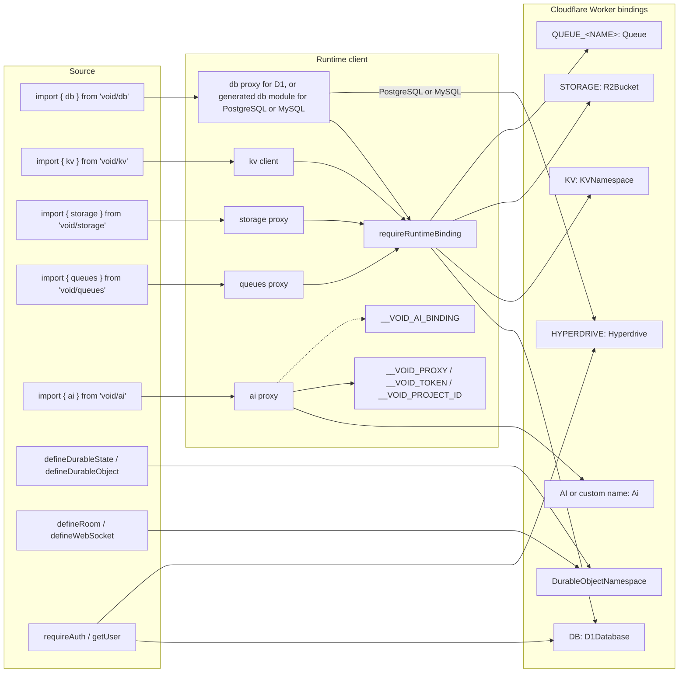
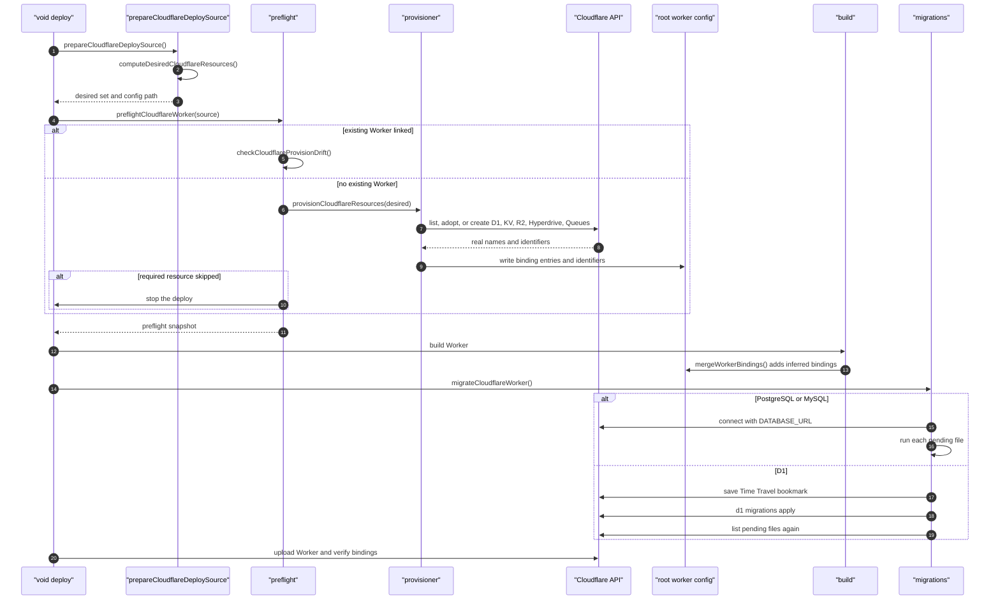
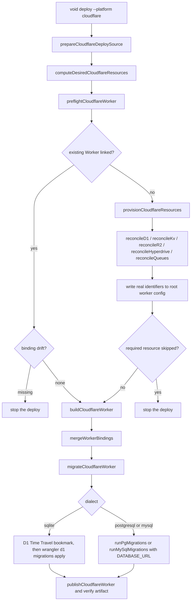

# 13 How Void Binds a Database, a Store, a Queue, a Socket, and Artificial Intelligence

Void turns a source import into a Cloudflare resource. A resource is one Cloudflare service instance, such as a D1 database, a KV namespace, a R2 bucket, a queue, or a Durable Object namespace. A binding is a Worker configuration entry that gives the Worker access to one resource. The binding name is the property that the Worker reads from its environment. The resource name is the provider's name for the resource. The Worker environment is the object that Cloudflare passes to the Worker as `env`; each binding name is a property on that object (`void/packages/void/src/runtime/env.ts:110-124`). A route imports `void/db`, `void/kv`, `void/storage`, `void/queues`, `void/auth`, `void/ai`, `void/durable`, or `void/ws`. A build scan records the need as a set of flags. A flag is a boolean field such as `needsD1` that records one detected need (`void/packages/void/src/inference/walk.ts:37-44`). A configuration map turns a flag into a binding name. A deploy preflight computes the desired resource set. The desired resource set is the list of resources and names that the deploy must ensure exist (`void/packages/void/src/cli/provision.ts:40-54`). A provisioner creates or adopts each resource and writes its identifier. An identifier is the provider's unique value for a resource, such as a D1 database identifier (`void/packages/void/src/cli/provision.ts:227-262`). A generator writes the binding into the Worker configuration. The runtime client reads the same name from the Worker environment. Section 3 follows the four stages in order: discovery, binding-name resolution, provisioning, and runtime lookup. Sections 4 to 13 then cover each resource and provisioning in detail. Type generation is a parallel step, and section 5 covers it. A custom name changes stages two, three, and four for a database, a key-value store, or a storage bucket. It changes stages two and four for Artificial Intelligence. A default name changes no stage.

This document covers resources and bindings only. File-based routing, loaders, and actions are in document [11](11-void-framework-routing.md). Server and browser rendering are in document [12](12-void-render-adapters.md). The command-line interface (CLI), deployment order, and migration commands are in document [14](14-void-cli-and-deployment.md). This document repeats only the deploy steps that a resource needs.

All paths are relative to the snapshot root `/Users/darkvoid/GitSources/src.voidzero`. Every source path starts with the repository name. The source is `void` at commit `f254d1ec477b6b2af2c02fa427bd9d196316ee07`, Node Package Manager (npm) package version 1.7.0, Massachusetts Institute of Technology (MIT) license, copyright Cloudflare, Inc. An initial reading of the repository name might say that Void is a VoidZero product. The source corrects that reading in two ways. The repository remote is `voidzero-dev/void`. The license names Cloudflare, Inc. as the copyright holder.

Each abbreviation is spelled out at its first use. The table gives the spellings.

| Abbreviation | Spelling |
|---|---|
| AI | Artificial Intelligence |
| API | Application Programming Interface |
| CLI | command-line interface |
| HTTP | HyperText Transfer Protocol |
| HTTPS | HyperText Transfer Protocol Secure |
| JSON | JavaScript Object Notation |
| KV | key-value store |
| SQL | Structured Query Language |
| URL | Uniform Resource Locator |
| WSS | WebSocket Secure |
| CPU | central processing unit |
| MIT | Massachusetts Institute of Technology |
| npm | Node Package Manager |
| SPA | single-page application |
| TTL | time to live |

Cloudflare service names recur in this document. D1 is Cloudflare's SQL database. R2 is Cloudflare's object storage. KV is Cloudflare's key-value store. Queues is Cloudflare's message queue. Durable Objects is Cloudflare's stateful compute primitive. Hyperdrive is Cloudflare's database connection pooler. Workers AI is Cloudflare's model runtime. AI Gateway is Cloudflare's proxy for model providers. Time Travel is Cloudflare's D1 restore feature. Wrangler is Cloudflare's command-line tool. Miniflare is the local Cloudflare simulator.

A code block starts with a label line, such as `// void/packages/void/src/config.ts:181-197`. The label gives the file and the exact line range. The label is not part of the source text. A `//` label marks TypeScript. A `#` label marks shell, JSON, or configuration. The text names every mechanism that the source does not explain.

## 1. The resource surface in one table

Void has no single `resources` directory. Each resource has a public module, a runtime file, and a generator or scanner. The table lists the modules that this document covers. The last column names the binding for each module. A binding name is the Worker environment property; a resource name is the provider's name for the resource. The table writes full paths from the snapshot root. Every file path starts with `void/packages/void/src/`. A trailing `/` names a module directory. Drizzle is the TypeScript SQL query builder that the `void/db` client wraps (`void/packages/void/src/runtime/db.ts:1-8`).

| Module | Exported names | Cloudflare binding |
|---|---|---|
| `void/packages/void/src/database-provider.ts` and `void/packages/void/src/database-providers/neon.ts` | `DatabaseProviderDialect`, `DatabaseProvisionOptions`, `DatabaseProvisionResult`, `DatabaseProviderAdapter`, `defineDatabaseProvider`, `createNeonDatabaseProvider` | None. The adapter returns a connection string. `void db connect` saves it as `DATABASE_URL`. |
| `void/packages/void/src/runtime/db.ts` | `db`, `createDb`, Drizzle operators, `DrizzleD1Database`, `BatchItem` | `DB` for D1, or a custom D1 name. PostgreSQL and MySQL read `HYPERDRIVE` or `DATABASE_URL`. |
| `void/packages/void/src/runtime/kv.ts` | `kv`, `createKV`, `KVClient`, `KVMap`, `PutOptions`, `ListOptions`, `ListKey`, `ListResult` | `KV`, or a custom KV name. |
| `void/packages/void/src/runtime/storage.ts` | `storage`, `createStorage` | `STORAGE` for R2, or a custom R2 name. |
| `void/packages/void/src/runtime/queues.ts` and `void/packages/void/src/queues/scan.ts` | `queues`, `QueueMap`, `QueueDefinition`, `scanQueuesSync`; `defineQueue` from `void/packages/void/src/runtime/handler.ts` | `QUEUE_<NAME>`. The name comes from the file path. |
| `void/packages/void/src/runtime/durable.ts` and `void/packages/void/src/durable/scan.ts` | `defineDurableState`, `defineDurableObject`, `DurableStateDefinition`, `DurableStateMigration`, `deriveDurableResourceIdentity`, `scanDurableObjectModules` | One `DurableObjectNamespace` for each definition. The binding name is derived. |
| `void/packages/void/src/runtime/ws.ts`, `void/packages/void/src/runtime/ws-server.ts`, and `void/packages/void/src/router/websocket.ts` | `defineRoom`, `defineWebSocket`, `connect`, `VoidSocket`, `WebSocketRouteMeta` | One `DurableObjectNamespace` for each WebSocket route. The class name and binding name are equal. |
| `void/packages/void/src/migrations/` | `collectMigrations`, `readJournal`, `classifyMigration`, `buildMigrationPlanBundle`, `runMigrations`, `runPgMigrations`, `runMySqlMigrations`, `validateMigrations` | The `_void_migrations` table. The in-Worker PostgreSQL handler reads `HYPERDRIVE`. |
| `void/packages/void/src/inference/walk.ts` and `void/packages/void/src/plugin-inference.ts` | `inferBindingsFromSource`, `InferredBindings`, `mergeBindings`, `DEFAULT_SCAN_DIRS` | None. The scanner reads source files. |
| `void/packages/void/src/runtime/env.ts` | `getRuntimeEnv`, `getRuntimeBinding`, `requireRuntimeBinding`, `withRuntimeEnv`, `getRuntimeRequestResource` | Every Worker binding. |
| `void/packages/void/src/runtime/ai.ts` and `void/packages/void/src/runtime/ai-types.ts` | `ai`, `VoidAi`, `AiProviderOptions`, `PROVIDER_KEY_MAP` | `AI` for Workers AI, or a custom name. A platform deploy uses `__VOID_PROXY`, or `__VOID_TOKEN` and `__VOID_PROJECT_ID`. |
| `void/packages/void/src/runtime/auth.ts` and `void/packages/void/src/auth/` | `defineAuth`, `getUser`, `getSession`, `getAuth`, `requireAuth`, `findVoidAuthConfig`, `getVoidAuthProviderEnvNames` | The application database, `BETTER_AUTH_SECRET`, and `AUTH_*` provider variables. |

The scanner also recognizes `void/sandbox`, `void/email`, and `void/live` (`void/packages/void/src/inference/walk.ts:84-92`). This document does not cover those resources. It covers the resource groups in the table above.

## 2. Where a resource is declared

Most resources are not declared in the configuration file. Void infers them from imports and from `env.*` access. The configuration file has three jobs. It can force a resource on or off. It can give a resource a custom binding name. It can pass raw Cloudflare fields through to the generated Worker configuration.

### 2.1 The typed configuration file

A Void project has one configuration file. The typed file is `void.config.ts`. The legacy file is `void.json`. Void loads the typed file with `jiti`, a TypeScript module loader (`void/packages/void/src/config-loader.ts:17-28`). The loader maps the `void/config` import to a bundled entry file, so the project does not need the Void package installed for the configuration file (`void/packages/void/src/config-loader.ts:16-33`). A project that has both files stops with an error (`void/packages/void/src/config-loader.ts:41-45`).

```ts
// void/packages/void/src/config-loader.ts:6-14
export const LEGACY_CONFIG_FILE = 'void.json';
export const TYPED_CONFIG_FILE = 'void.config.ts';

export type LoadedVoidConfig = { source: string; value: unknown };

/** The file to name in messages about a project's settings. Only legacy projects use JSON. */
export function getConfigFileName(root: string): string {
  return existsSync(join(root, LEGACY_CONFIG_FILE)) ? LEGACY_CONFIG_FILE : TYPED_CONFIG_FILE;
}
```

The typed file exports the result of `defineConfig`. The function is an identity function with a type constraint (`void/packages/void/src/config-entry.ts:3-6`). The type checker therefore checks the object against `VoidConfig`. Runtime validation checks the same object again (`void/packages/void/src/config.ts:426-437`).

### 2.2 The exact declaration shape

The resource fields are top-level fields of `VoidConfig`. The type below is the exact shape in this snapshot.

```ts
// void/packages/void/src/config.ts:181-197
export type VoidConfig = {
  sourceDir?: string;
  target?: 'cloudflare' | 'node' | 'bun' | 'deno';
  output?: 'server' | 'static';
  auth?: AuthConfig;
  head?: HeadConfig;
  routing?: RoutingConfig;
  inference?: InferenceConfig;
  sandbox?: boolean | SandboxConfig;
  remote?: boolean;
  worker?: WranglerConfig;
  cloudflare?: CloudflareConfig;
  deploy?: DeployConfig;
  database?: 'pg' | 'mysql' | DatabaseConfig;
  ai?: AiConfig;
  email?: EmailConfig;
};
```

`database` selects the dialect. The value is a string, an object with `dialect` and `casing`, or omitted (`void/packages/void/src/config.ts:963-996`). `casing` is Drizzle's rule for the database name of a column that has no explicit name; the values are `snake_case` and `camelCase` (`void/packages/void/src/config.ts:21-29`). An omitted value means SQLite on D1. `getDatabaseDialect` turns `pg` into `postgresql`, keeps `mysql`, and returns `sqlite` for every other value (`void/packages/void/src/config.ts:1106-1116`).

`ai` has one field, `gateway`. The value is a non-empty string (`void/packages/void/src/config.ts:998-1017`). `inference.bindings` is the field that names resources. The type accepts a boolean or a string for each resource.

```ts
// void/packages/void/src/config.ts:80-92
export type InferenceConfig = {
  bindings?: {
    db?: boolean | string;
    kv?: boolean | string;
    storage?: boolean | string;
    ai?: boolean | string;
    email?: boolean;
  };
  scanDirs?: ReadonlyArray<string>;
  build?: string;
  outputDir?: string;
  appType?: 'spa' | 'static' | 'void' | 'framework';
};
```

`spa` means a single-page application (SPA). The JSON schema gives the same rule in words. A boolean `true` uses the default name. A string sets a custom binding name. `email` is the exception: it accepts only a boolean (`void/packages/void/schema.json:259-284`).

```json
# void/packages/void/schema.json:259-285
        "bindings": {
          "type": "object",
          "description": "Explicitly control inferred Cloudflare bindings. If omitted, bindings are inferred by scanning source files.",
          "properties": {
            "db": {
              "oneOf": [{ "type": "boolean" }, { "type": "string" }],
              "description": "Enable D1 database binding. `true` uses default name \"DB\", a string sets a custom binding name."
            },
            "kv": {
              "oneOf": [{ "type": "boolean" }, { "type": "string" }],
              "description": "Enable KV namespace binding. `true` uses default name \"KV\", a string sets a custom binding name."
            },
            "storage": {
              "oneOf": [{ "type": "boolean" }, { "type": "string" }],
              "description": "Enable R2 bucket binding. `true` uses default name \"STORAGE\", a string sets a custom binding name."
            },
            "ai": {
              "oneOf": [{ "type": "boolean" }, { "type": "string" }],
              "description": "Enable Workers AI binding. `true` uses default name \"AI\", a string sets a custom binding name."
            },
            "email": {
              "type": "boolean",
              "description": "Enable email support (used by void/email)."
            }
          },
          "additionalProperties": false
        },
```

`inference.bindings` has four states for each named resource. An omitted field leaves the scan result. `true` enables the resource and uses the default name. `false` disables the resource even when the scan found it. A string enables the resource and sets the name (`void/packages/void/src/application-features.ts:5-25`).

`worker` and `cloudflare` are different fields. `worker` accepts four curated build options. A compatibility date selects the Cloudflare Workers runtime behavior for a date. Compatibility flags switch individual Cloudflare Workers runtime behaviors. Vars are plain string values that Cloudflare adds to the Worker environment. The fourth option is the central processing unit (CPU) limit (`void/packages/void/src/config.ts:32-38`). `cloudflare` accepts Wrangler-shaped fields, including bindings (`void/packages/void/src/config.ts:122-178`). The two fields do not compete for one key.

The `cloudflare` field is an open record with named common fields. It accepts `d1_databases`, `kv_namespaces`, `r2_buckets`, `hyperdrive`, `queues`, `assets`, `send_email`, and other Wrangler fields (`void/packages/void/src/config.ts:122-178`). The type starts with `Record<string, unknown>`, so a field that the type does not name still passes through. A typed project materializes this field into `.void-wrangler.jsonc` (`void/packages/void/src/cloudflare-config.ts:11`, `void/packages/void/src/cloudflare-config.ts:192-210`). A legacy project uses `wrangler.jsonc` or `wrangler.json` (`void/packages/void/src/cli/wrangler.ts:42-47`). The result is the root Worker configuration that the build and deploy read. An authored entry in that file is never replaced by the generator.

### 2.3 The binding name map

`resolveBindingNames` keeps only the string values. A boolean value returns `undefined` for that resource, so the default name applies.

```ts
// void/packages/void/src/config.ts:1076-1101
export function resolveBindingNames(
  bindings: InferenceConfig['bindings'],
): { d1?: string; kv?: string; r2?: string; ai?: string } | undefined {
  if (!bindings) {
    return undefined;
  }
  const names: { d1?: string; kv?: string; r2?: string; ai?: string } = {};
  let hasCustom = false;
  if (typeof bindings.db === 'string') {
    names.d1 = bindings.db;
    hasCustom = true;
  }
  if (typeof bindings.kv === 'string') {
    names.kv = bindings.kv;
    hasCustom = true;
  }
  if (typeof bindings.storage === 'string') {
    names.r2 = bindings.storage;
    hasCustom = true;
  }
  if (typeof bindings.ai === 'string') {
    names.ai = bindings.ai;
    hasCustom = true;
  }
  return hasCustom ? names : undefined;
}
```

The analysis object stores the result once (`void/packages/void/src/application-analysis.ts:120`). Every later stage reads that one object. The default names are `DB`, `KV`, `STORAGE`, and `AI` (`void/packages/void/src/plugin-worker-bindings.ts:167-237`). The default queue prefix is `QUEUE_` (`void/packages/void/src/runtime/queues.ts:9-11`). The default Hyperdrive name is `HYPERDRIVE` (`void/packages/void/src/cli/deploy-resources.ts:287-293`). The `ISR_CACHE` name belongs to incremental static regeneration (ISR). It is a KV namespace binding, and Void adds it when a page uses `revalidate` (`void/packages/void/src/cli/deploy-resources.ts:300-305`).

**Aha:** The root Worker configuration is both a local template and a remote record. The file is `.void-wrangler.jsonc` for a typed project (`void/packages/void/src/cloudflare-config.ts:11`). Before the first deploy, it holds placeholder identifiers: `local` for D1 and KV, and `default` for R2 (`void/packages/void/src/cli/provision.ts:221-225`). After provisioning, the same fields hold real identifiers. A real identifier is a value that passes the provider validator and is not a placeholder (`void/packages/void/src/cli/provision.ts:227-262`). A later deploy reads the real identifier and reuses the resource. `reconcileD1` treats a real identifier as proof of ownership, not a name match. If the stored identifier is real and the stored name differs from the desired name, `reconcileD1` throws an error and names both values (`void/packages/void/src/cli/provision.ts:2580-2593`).

## 3. From an import to a Worker binding

The path from an import to a binding has four stages. Stage one produces flags. Stage two produces the binding name and the Worker entry. Stage three produces real identifiers. Stage four reads the name from the environment.

| Stage | Code | Result |
|---|---|---|
| 1. Discovery | `inference/walk.ts` and `plugin-inference.ts` | `InferredBindings` flags |
| 2. Binding-name resolution | `config.ts`, `plugin-worker-bindings.ts` | Binding name and Worker entries in `.void-wrangler.jsonc` |
| 3. Provisioning | `cli/deploy-resources.ts` and `cli/provision.ts` | Real resource names and identifiers |
| 4. Runtime lookup | `runtime/env.ts` and the runtime clients | `env.<binding>` |

The table shows which stages a custom name changes.

| Resource and name source | Stage 1 | Stage 2 | Stage 3 | Stage 4 |
|---|---|---|---|---|
| Database, key-value store, or storage with a custom `inference.bindings` string | The string enables the flag | `resolveBindingNames` sets the name; a generated client module embeds it | The desired set uses the name; the identifier is written | `requireRuntimeBinding(<custom name>)` |
| Artificial Intelligence with a custom `inference.bindings` string | The string enables the flag | The `ai.binding` entry uses the name, and `__VOID_AI_BINDING` records it | Void does not provision Workers AI | `resolveBackend` reads the variable |
| A custom name written only in `cloudflare.*` | No flag | The entry is preserved, but no client module is generated | The identifier is reused | The client reads the default name and throws |
| A default name | The flag is set by the scan | The default name is used | The default name is provisioned | The static client reads the default name |

### 3.1 The scanner reads imports, not configuration

The scanner walks every file in the default scan directories. The directories are `routes`, `middleware`, `queues`, `pages`, `crons`, `email`, `durable-objects`, and `src` (`void/packages/void/src/plugin-inference.ts:51-60`). The import map is a direct switch on the module source.

```ts
// void/packages/void/src/inference/walk.ts:65-93
    switch (source) {
      case 'void/db':
        result.needsD1 = true;
        break;
      case 'void/kv':
        result.needsKV = true;
        break;
      case 'void/storage':
        result.needsR2 = true;
        break;
      case 'void/auth':
        result.needsAuth = true;
        break;
      case 'void/queues':
        result.needsQueues = true;
        break;
      case 'void/ai':
        result.needsAI = true;
        break;
      case 'void/sandbox':
        result.needsSandbox = true;
        break;
      case 'void/email':
        result.needsEmail = true;
        break;
      case 'void/live':
        result.needsLive = true;
        break;
    }
```

The scanner also reads `env.<name>` access (`void/packages/void/src/inference/walk.ts:117-200`). This second path catches a binding that a project reads directly, without a Void client. Only these names set a flag: `DB`, `KV`, `STORAGE`, `AI`, `SANDBOX`, and any name with the `QUEUE_` prefix. Any other name is ignored (`void/packages/void/src/inference/walk.ts:135-157`). A dynamic import with a literal argument also counts (`void/packages/void/src/inference/walk.ts:100-111`). A computed name does not count.

The result is a set of booleans, not a set of names. The source below shows the shape at the start of the walk.

```ts
// void/packages/void/src/inference/walk.ts:37-44
export function inferBindingsFromSource(code: string, filename: string): InferredBindings {
  const result: InferredBindings = {
    needsD1: false,
    needsKV: false,
    needsR2: false,
    needsAuth: false,
    needsQueues: false,
    needsAI: false,
```

A configuration override is applied after the scan (`void/packages/void/src/plugin-inference.ts:229-232`). An omitted field keeps the scan result. `true` enables the resource. `false` disables it. A string enables it and sets the name (`void/packages/void/src/application-features.ts:5-25`). The scanner does not explain every reason for a flag in one place. The deploy code keeps a reason map for user messages (`void/packages/void/src/cli/deploy-resources.ts:225-305`).

### 3.2 The generator writes the binding

`mergeWorkerBindings` turns the flags into Worker configuration fields. The generated entries carry the binding name and a placeholder resource name.

```ts
// void/packages/void/src/plugin-worker-bindings.ts:167-194
  // D1 — auth requires the app DB only for sqlite apps
  const d1Name = bindingNames?.d1 ?? 'DB';
  const d1: Array<Record<string, unknown>> = [];
  if (
    dialect === 'sqlite' &&
    application.needsDatabase &&
    !hasBinding(resolved.d1_databases, d1Name)
  ) {
    d1.push({ binding: d1Name, database_name: 'default', database_id: 'local' });
  }
  if (d1.length > 0) {
    result.d1_databases = d1;
  }

  const kvName = bindingNames?.kv ?? 'KV';
  const kv: Array<{ binding: string; id: string }> = [];
  if (bindings.needsKV && !hasBinding(resolved.kv_namespaces, kvName)) {
    kv.push({ binding: kvName, id: 'local' });
  }
  if (kv.length > 0) {
    result.kv_namespaces = kv;
  }

  // R2
  const r2Name = bindingNames?.r2 ?? 'STORAGE';
  if (bindings.needsR2 && !hasBinding(resolved.r2_buckets, r2Name)) {
    result.r2_buckets = [{ binding: r2Name, bucket_name: 'default' }];
  }
```

A project that already declares a binding keeps it. The generator adds only a missing binding (`hasBinding`). It does not replace an authored entry. This rule lets an existing Wrangler project keep its resource identifiers.

The D1 branch tests `application.needsDatabase`, not the raw scan flag. That field is true when the scan found `needsD1`, when auth is enabled, or when a migration file exists (`void/packages/void/src/application-features.ts:28-34`). Auth and checked-in migrations therefore need a database even when no file imports `void/db`.

The same function emits the AI binding and the queue bindings. A custom AI name becomes the `ai.binding` entry, and the generator also writes the name to the private runtime variable `__VOID_AI_BINDING` (`void/packages/void/src/plugin-worker-bindings.ts:196-237`). The runtime therefore reads a binding that has the custom name; the variable only tells it which name to read. The queue entries contain producer and consumer records (`void/packages/void/src/plugin-worker-bindings.ts:279-294`). Durable Object bindings and migration entries follow (`void/packages/void/src/plugin-worker-bindings.ts:296-388`).

### 3.3 A custom name reaches the runtime client

The static runtime client hard-codes the default name. For example, `kv` reads `KV` (`void/packages/void/src/runtime/kv.ts:171-174`). A custom name therefore needs a generated module. `bindingRuntimePlugin` replaces the import when a custom KV or R2 name exists.

```ts
// void/packages/void/src/plugin-binding-runtime.ts:39-45
const namespace = new Proxy({}, {
  get(_, prop) {
    const ns = requireRuntimeBinding(${JSON.stringify(bindingNames?.kv)});
    const value = Reflect.get(ns, prop, ns);
    return typeof value === 'function' ? value.bind(ns) : value;
  },
});
```

The block above is a template, not the final module. `bindingRuntimePlugin` returns this text from a virtual module, and the `${JSON.stringify(bindingNames?.kv)}` expression becomes a literal name at build time (`void/packages/void/src/plugin-binding-runtime.ts:30-49`). A virtual module is a module whose source a build plugin supplies instead of a file on disk (`void/packages/void/src/plugin-binding-runtime.ts:30-33`). The generated module also exports `createKV` and calls it with the proxy (`void/packages/void/src/plugin-binding-runtime.ts:47-48`).

`void/db` uses the same technique. The Drizzle plugin forces a virtual module when `hasDbRuntime` is true. That condition is true when a schema exists, a casing option exists, the dialect is not SQLite, or the caller sets `forceVirtualDb` (`void/packages/void/src/plugin-drizzle.ts:81-90`). The build sets `forceVirtualDb` to true when a custom D1 name exists (`void/packages/void/src/index.ts:779-782`, `void/packages/void/src/plugin-drizzle.ts:463-471`). A custom D1 name therefore forces the module, and the module embeds the name in both lookup calls.

```ts
// void/packages/void/src/plugin-drizzle.ts:308-317
export const db = new Proxy({}, {
  get(_, prop) {
    const instance = getRuntimeRequestResource(
      _requestResourceKey,
      () => createDb(requireRuntimeBinding(${JSON.stringify(d1BindingName)})),
      () => createPrimaryDb(requireRuntimeBinding(${JSON.stringify(d1BindingName)}))
    );
    return Reflect.get(instance, prop);
  },
});
```

The proxy passes three arguments to `getRuntimeRequestResource`. The first is a key that identifies the resource kind. The second creates the value inside a request scope. The third creates the value outside a scope (`void/packages/void/src/runtime/env.ts:32-50`). Outside a scope the third function runs on every access, so two operations outside a request do not share one instance.

The AI client has a third route. It reads `__VOID_AI_BINDING` and falls back to `AI` (`void/packages/void/src/runtime/ai.ts:324-329`). A custom name therefore needs no virtual module. A binding name that the project writes by hand does not reach a client unless the project also sets `inference.bindings`. The `db` client then reads `DB`, and `requireRuntimeBinding` throws `env: Missing Cloudflare binding 'DB'.` (`void/packages/void/src/runtime/env.ts:118-124`). Void does not check this mismatch at build time.

The diagram is a whole-system view. It shows the default binding names and both database paths. Sections 4 and 8 to 12 define the resource paths.



A custom name replaces `DB`, `KV`, `STORAGE`, or `AI` in both the client and the binding.

### 3.4 The environment gate

`getRuntimeBinding` returns the value, or `undefined` when the name is internal or absent (`void/packages/void/src/runtime/env.ts:106-116`). `requireRuntimeBinding` throws `env: Missing Cloudflare binding '<name>'.` when the value is `undefined` or `null` (`void/packages/void/src/runtime/env.ts:118-124`). The predicate is `isInternalBinding`. It matches a prefix, such as `__VOID_`, and some exact names when ISR is active (`void/packages/void/src/runtime/env.ts:66-73`). `getRuntimeEnv` returns a proxy that hides those names from reads, enumeration, and `has` checks (`void/packages/void/src/runtime/env.ts:75-108`). `getRawRuntimeEnv` returns the unfiltered object, and the AI client uses it to read the platform variables (`void/packages/void/src/runtime/ai.ts:308-309`). User code that calls `getRuntimeEnv` cannot see those variables.

## 4. Database access

Void uses Drizzle as its query layer. The `void/db` module is a D1 client in the published package. A Vite plugin, a module that extends the Vite build tool, replaces it with a generated module when `hasDbRuntime` is true (`void/packages/void/src/plugin-drizzle.ts:85-90`). The generated module uses the app's schema and the selected dialect.

### 4.1 The D1 client and the request scope

The database proxy creates one Drizzle instance for each runtime request. It stores the instance in an `AsyncLocalStorage` scope (`void/packages/void/src/runtime/env.ts:31-50`). Two calls in one request share the instance. Two requests do not. Outside a request scope, the proxy creates a primary-session instance on every access.

```ts
// void/packages/void/src/runtime/db.ts:51-62
export function createDb(
  d1: D1Database,
  options?: { session?: D1SessionConstraint },
): DrizzleD1Database {
  return _drizzle(
    d1.withSession(options?.session ?? 'first-unconstrained') as unknown as D1Database,
  );
}

function createPrimaryDb(d1: D1Database): DrizzleD1Database {
  return _drizzle(d1.withSession('first-primary') as unknown as D1Database);
}
```

The default `db` proxy chooses the primary session when the request scope is absent.

```ts
// void/packages/void/src/runtime/db.ts:87-98
export const db: DrizzleD1Database = new Proxy({} as DrizzleD1Database, {
  get(_, prop) {
    const instance = getRuntimeRequestResource(
      requestDbKey,
      () => createDb(requireD1()),
      // Framework adapters do not always enter Void's request scope. Without a
      // shared session, each operation starts on primary to preserve fresh reads.
      () => createPrimaryDb(requireD1()),
    );
    return Reflect.get(instance, prop);
  },
});
```

**Aha:** The explicit `createDb` call defaults to `first-unconstrained`. The default `db` proxy uses `first-primary` when no request scope exists. The two calls pass different Cloudflare D1 session constraints. A session constraint tells D1 where a read may run. The Cloudflare D1 documentation defines `first-unconstrained` as a read that may start at a replica, and `first-primary` as a read that starts at the primary database. A replica read can be stale but can answer with lower latency. A primary read is fresh but can take longer. The source only names the constraints, and Void states no freshness guarantee for either name (`void/packages/void/src/runtime/db.ts:51-62`, `void/packages/void/src/runtime/db.ts:87-98`). The source comment gives the reason: a framework adapter can run outside Void's request scope, and a fresh read after a write matters there. The Cloudflare D1 documentation defines the constraints and the tradeoff.

The proxy does not wrap or reimplement Drizzle. It returns the Drizzle object, so query methods, `batch`, and the exported operators are Drizzle's (`void/packages/void/src/runtime/db.ts:8-45`). Void adds no separate transaction API. The source exports `BatchItem` for the D1 batch type (`void/packages/void/src/runtime/db.ts:44`). A claim about transaction semantics must therefore come from Drizzle or Cloudflare D1, not from Void. This document found one explicit SQLite transaction in the local migration runner (`void/packages/void/src/migrations/runner.ts:133-156`).

### 4.2 The provider abstraction and the one bundled provider

The database provider interface is a provisioning interface. It does not run queries.

```ts
// void/packages/void/src/database-provider.ts:22-31
export type DatabaseProviderAdapter = {
  id: string;
  label: string;
  dialects: ReadonlyArray<DatabaseProviderDialect>;
  provision(options: DatabaseProvisionOptions): Promise<DatabaseProvisionResult>;
};

export function defineDatabaseProvider(adapter: DatabaseProviderAdapter): DatabaseProviderAdapter {
  return adapter;
}
```

The result contains a connection string. `void db connect` writes that string as `DATABASE_URL` (`void/packages/void/src/cli/db.ts:316-351`). The snapshot bundles one adapter, Neon, an external PostgreSQL provider. It creates a PostgreSQL project through the Neon API.

```ts
// void/packages/void/src/database-providers/neon.ts:36-43
  const apiKey = options.apiKey ?? process.env.NEON_API_KEY;
  const apiBaseUrl = options.apiBaseUrl ?? 'https://console.neon.tech/api/v2';
  const fetchImpl = options.fetch ?? globalThis.fetch;

  return defineDatabaseProvider({
    id: 'neon',
    label: 'Neon',
    dialects: ['postgresql'],
```

`loadDatabaseProvider` resolves `neon` from the bundled module. Any other provider name is resolved from the project, as a package or a file path (`void/packages/void/src/cli/db.ts:269-292`). `void db connect` rejects SQLite and accepts a provider only for an external dialect (`void/packages/void/src/cli/db.ts:294-325`).

What does an app use at query time? The answer has a short form. A normal app uses no `DatabaseProviderAdapter` at query time. A D1 app uses the D1 binding. A PostgreSQL or MySQL app uses `DATABASE_URL` or `HYPERDRIVE`. The adapter path runs only when the operator asks `void db connect` to create a database. In this snapshot, Neon is the only bundled adapter, and it supports PostgreSQL only.

### 4.3 PostgreSQL and MySQL through Hyperdrive

A non-SQLite app gets a generated `void/db` module. The module checks `DATABASE_URL` first. When that value is absent, it reads `HYPERDRIVE.connectionString`.

```ts
// void/packages/void/src/plugin-drizzle.ts:256-262
function getConnectionString() {
  const url = getRuntimeBinding("DATABASE_URL");
  if (url) return url;
  const hd = getRuntimeBinding("HYPERDRIVE");
  if (hd?.connectionString) return hd.connectionString;
  throw new Error("db: PostgreSQL is not configured. Add DATABASE_URL to .env for local dev, or configure Hyperdrive for production.");
}
```

The MySQL module uses the same order (`void/packages/void/src/plugin-drizzle.ts:174-180`). The error message states the intent: `DATABASE_URL` from `.env` for local development, and Hyperdrive for production. The `HYPERDRIVE` binding is a Cloudflare Hyperdrive configuration. The deploy computes it from `DATABASE_URL` (`void/packages/void/src/cli/deploy-resources.ts:287-298`).

The deploy preflight stops when a PostgreSQL or MySQL app has pending migrations and no `DATABASE_URL` (`void/packages/void/src/cli/deploy-cloudflare-preflight.ts:118-133`). Void uses the string to create Hyperdrive and to apply migrations. It does not write the string into the Worker configuration (`void/packages/void/src/cli/deploy-cloudflare-preflight.ts:124-130`).

## 5. Generated types

Type generation writes files into `.void/`. The command is `void prepare` (`void/packages/void/src/cli/cli-main.ts:228-242`). `void db generate` also calls `prepareProject` before it runs Drizzle Kit, the Drizzle migration generator (`void/packages/void/src/cli/db.ts:392-415`). A build job that type-checks before deploy therefore runs `void prepare` after it installs dependencies.

`prepareProject` writes each file and removes a stale file when its source disappears.

```ts
// void/packages/void/src/codegen/prepare.ts:44-57
export async function prepareProject(root: string): Promise<PrepareProjectResult> {
  const config = readConfig(root);
  const analysis = await analyzeApplication(root, { config });
  const { paths, authConfigPath, authEnabled, dialect, scan } = analysis;
  const outDir = join(root, '.void');
  const written: Array<string> = [];
  const removed: Array<string> = [];

  const bindingTypes = generateBindingTypes(config);
  if (bindingTypes) {
    writeGeneratedFile(outDir, 'bindings.d.ts', bindingTypes, written);
  } else {
    removeGeneratedFile(outDir, 'bindings.d.ts', removed);
  }
```

The possible set of generated files is `bindings.d.ts`, `env.d.ts`, `auth.d.ts`, `routes.d.ts`, `queues.d.ts`, `db.d.ts`, `tsconfig.json`, `better-auth-schema.ts`, and `better-auth-db.ts` (`void/packages/void/src/codegen/prepare.ts:52-139`). The type files describe the project; the auth schema file becomes migration input.

`bindings.d.ts` covers explicitly configured Cloudflare bindings only. It skips the managed names `DB`, `KV`, `STORAGE`, `AI`, `SANDBOX`, and `ASSETS` (`void/packages/void/src/codegen/binding-types.ts:51-90`). The runtime clients already type those names. A custom name from `cloudflare.d1_databases` or a similar list gets its Cloudflare type from the `bindingTypes` table in the generator source (`void/packages/void/src/codegen/binding-types.ts:8-50`). A custom name that comes only from `inference.bindings` is not in `bindings.d.ts`, because `generateBindingTypes` reads only `config.cloudflare` (`void/packages/void/src/codegen/binding-types.ts:58-74`, `void/packages/void/src/codegen/prepare.ts:52-56`). Its type comes from the generated client module instead: `kv` is a `KVClient` (`void/packages/void/src/runtime/kv.ts:33-42`), `storage` is an `R2Bucket` (`void/packages/void/src/runtime/storage.ts:9-15`), and `db` uses `.void/db.d.ts` (`void/packages/void/src/codegen/db-types.ts:30-51`). The environment type for that custom name is not generated, because the generator emits only the names in `config.cloudflare` (`void/packages/void/src/codegen/binding-types.ts:65-86`). The type file and the runtime client are different objects. `.void/bindings.d.ts` makes `env.MY_BUCKET` type-check, but the `storage` client still reads `STORAGE` unless `inference.bindings.storage` also names `MY_BUCKET` (`void/packages/void/src/runtime/storage.ts:9-15`).

### 5.1 The database type follows the dialect

`db.d.ts` selects one database type from the dialect.

```ts
// void/packages/void/src/codegen/db-types.ts:10-18
const DIALECT_DB_TYPES = {
  sqlite: {
    type: 'DrizzleD1Database',
    from: 'void/_db',
    arg: 'd1: D1Database, options?: { session?: D1SessionConstraint }',
  },
  postgresql: { type: 'NodePgDatabase', from: 'void/_db-pg', arg: 'connectionString: string' },
  mysql: { type: 'MySql2Database', from: 'void/_db-mysql', arg: 'connectionString: string' },
} as const;
```

The generated file declares `db` and `createDb` with the app schema type (`void/packages/void/src/codegen/db-types.ts:30-51`). The project `tsconfig` redirects the module name to the generated file.

```ts
// void/packages/void/src/codegen/project-tsconfig.ts:56-63
  if (hasDb) {
    const paths: Record<string, Array<string>> = {};

    if (options.redirectDbModule !== false) {
      // moduleResolution "bundler" ignores ambient declarations when a specifier resolves to a
      // package file, so void/db, void/routes, void/queues and @void/md/pages map to .void/*.d.ts.
      paths['void/db'] = ['./db.d.ts'];
    }
```

The generated `db.d.ts` imports from the internal `void/_db` path, not from `void/db`. The comment in the generator gives the reason: the redirect would otherwise resolve the import back to the same file (`void/packages/void/src/codegen/db-types.ts:20-29`). This detail is small but important. Without it, TypeScript would find the generated declaration and then create a circular module resolution (`void/packages/void/src/plugin-drizzle.ts:101-103`).

## 6. Migrations

A migration is a SQL file in `db/migrations`. Void collects the files in filename order. It records each applied file in a tracking table. It rejects a destructive statement unless the file opts in. It applies the files at different times and through different runners, according to the dialect and the target.

### 6.1 Files and the journal

`collectMigrations` reads every `.sql` file except `seed.sql`. It sorts the names with a plain string sort (`void/packages/void/src/migrations/collect.ts:8-20`).

```ts
// void/packages/void/src/migrations/collect.ts:8-20
export function collectMigrations(migrationsDir: string): Array<{ name: string; sql: string }> {
  if (!existsSync(migrationsDir)) {
    return [];
  }

  return readdirSync(migrationsDir)
    .filter((f) => f.endsWith('.sql') && f !== 'seed.sql')
    .sort()
    .map((name) => ({
      name,
      sql: readFileSync(join(migrationsDir, name), 'utf-8'),
    }));
}
```

Void reads and writes a Drizzle journal at `db/migrations/meta/_journal.json` (`void/packages/void/src/migrations/collect.ts:36-58`, `void/packages/void/src/migrations/collect.ts:65-69`). The status and deploy commands call `assertJournalCoherence` before they apply files (`void/packages/void/src/cli/db.ts:428-433`, `void/packages/void/src/cli/deploy-migrations.ts:391-404`). The rule is a two-way name match. Every `.sql` file must have a journal entry, and every journal entry must have a file (`void/packages/void/src/migrations/validate.ts:263-297`). The check also rejects a malformed journal and a duplicate tag (`void/packages/void/src/migrations/validate.ts:196-261`). A missing journal is accepted when no other Drizzle metadata exists, because a hand-written SQL project uses that form (`void/packages/void/src/migrations/validate.ts:178-192`). A failure stops the command before any SQL runs. The error names the orphan files or the missing files and tells the operator to restore, delete, or regenerate (`void/packages/void/src/migrations/validate.ts:277-297`).

`void db generate` writes the files. For SQLite, it uses a validated generation path (`void/packages/void/src/cli/db.ts:407-415`). The `void gen` command can also create a custom migration through Drizzle Kit, or a timestamped SQL file when no journal exists (`void/packages/void/src/cli/gen.ts:482-618`, `runMigration`). This document cites the `db generate` path because it is the normal path.

### 6.2 Destructive SQL and the pragma

Void rejects a set of destructive patterns. A file can allow them with the pragma `-- void:allow-destructive`. The check uses `hasStandalonePragma`, so the line must stand alone, and the pragma applies to the whole file (`void/packages/void/src/migrations/validate.ts:104-108`, `void/packages/void/src/migrations/plan.ts:13`).

```ts
// void/packages/void/src/migrations/validate.ts:22-31
const DESTRUCTIVE_PATTERNS = [
  /\bDROP\s+TABLE\b/i,
  /\bDROP\s+VIEW\b/i,
  /\bDROP\s+INDEX\b/i,
  /\bDROP\s+TRIGGER\b/i,
  /\bALTER\s+TABLE\b[\s\S]*\bDROP\s+COLUMN\b/i,
  /\bALTER\s+TABLE\b[\s\S]*\bRENAME\b[\s\S]*\bTO\b/i,
  /\bTRUNCATE\b/i,
  /\bINSERT\s+OR\s+REPLACE\b/i,
];
```

The plan builder also rejects explicit transaction control. Void owns the D1 transaction boundary (`void/packages/void/src/migrations/plan.ts:61-72`). The bundle records protocol version 2, a classifier version, a migration list hash, and one plan hash for each migration (`void/packages/void/src/migrations/plan.ts:20-26`). Protocol version 2 is the execution-plan format version that the in-Worker handler accepts; the handler rejects any other value (`void/packages/void/src/runtime/migration-handler.ts:602-604`). The classifier version is the version of the SQL classifier logic; this snapshot records version 1 (`void/packages/deploy-core/src/migration-plan.ts:3`) and the handler requires it (`void/packages/void/src/runtime/migration-handler.ts:605-609`). The deploy build writes the bundle into the Worker, and the in-Worker handler verifies it before it applies a file (`void/packages/void/src/plugin-routing.ts:833-850`, `void/packages/void/src/runtime/migration-handler.ts:231`, `void/packages/void/src/runtime/migration-handler.ts:598-615`). The deploy manifest also records the bundle hashes (`void/packages/void/src/cli/package.ts:405-424`). The plan builder warns when a multi-statement file has no `--> statement-breakpoint` lines (`void/packages/void/src/migrations/plan.ts:88-93`).

### 6.3 Local application

The development server applies pending migrations when it starts. The plugin runs only for `serve`, and it skips Vitest, the test runner that `isVitestServer` detects (`void/packages/void/src/plugin-migration.ts:28-47`). For SQLite, it uses the Miniflare database path and the local runner (`void/packages/void/src/plugin-migration.ts:150-174`). For PostgreSQL or MySQL, it reads `DATABASE_URL` from `.env` (`void/packages/void/src/plugin-migration.ts:80-149`). The server still starts when a migration fails. The error is printed after the server is ready (`void/packages/void/src/plugin-migration.ts:68-76`).

`void db migrate` applies to a local SQLite database through `runMigrations` (`void/packages/void/src/cli/db.ts:1403-1414`). The local runner creates the tracking table and records each file.

```ts
// void/packages/void/src/migrations/runner.ts:224-246
export async function runMigrations(
  migrationsDir: string,
  dbPath: string,
  sourceRelative: (path: string) => string = (path) => path,
): Promise<Array<string>> {
  const allMigrations = collectMigrations(migrationsDir);
  if (allMigrations.length === 0) {
    return [];
  }

  mkdirSync(dirname(dbPath), { recursive: true });

  const db = await openSqliteDatabase(dbPath);

  try {
    upgradeTrackingTable(db);

    db.exec(`
      CREATE TABLE IF NOT EXISTS _void_migrations (
        name TEXT PRIMARY KEY,
        applied_at TEXT DEFAULT (datetime('now'))
      )
    `);
```

The local state table is `_void_migrations`. The runner also reads a legacy `_migrations` table and moves its rows (`void/packages/void/src/migrations/runner.ts:84-115`, `void/packages/void/src/migrations/runner.ts:136-156`). It refuses to continue when an applied file is missing, or when the database has application tables but no history (`void/packages/void/src/migrations/runner.ts:181-216`). This check prevents a silent replay or a silent gap.

### 6.4 Remote application

The deploy path depends on the dialect. The table names the tracking table for each path.

| Path | Dialect | Applies the files | Tracking table | Time |
|---|---|---|---|---|
| `void deploy --platform cloudflare` | SQLite | Wrangler `d1 migrations apply` | `d1_migrations`, unless the D1 entry sets `migrations_table` (`void/packages/void/src/cli/cloudflare-operation-process.ts:306-314`) | After build, before upload |
| `void deploy --platform cloudflare` | PostgreSQL or MySQL | `runPgMigrations` or `runMySqlMigrations` with `DATABASE_URL` | `_void_migrations` (`void/packages/void/src/migrations/runner-pg.ts:53`, `void/packages/void/src/migrations/runner-mysql.ts:164`) | After build, before upload |
| Void platform deploy | SQLite | In-Worker handler | `_void_migrations`, plus attempt, lock, and fence tables | During the platform deploy |
| `void db migrate --remote` | SQLite | Wrangler through `cloudflare-operations.ts` | Same as the Wrangler path | On demand |
| `void db migrate --remote` | PostgreSQL or MySQL | Direct runner with `DATABASE_URL` | `_void_migrations` | On demand; the deployment platform must be Cloudflare |
| Local development or `void db migrate` | SQLite | Local runner | `_void_migrations` | On server start or on demand |

The Wrangler path and the in-Worker path use different tables. The source shows no check that reconciles `d1_migrations` with `_void_migrations`. A project that switches between the two paths can therefore apply one file twice.

For PostgreSQL or MySQL, `migrateCloudflareWorker` applies the files before the upload. It reads `DATABASE_URL` from the deploy environment and calls the PostgreSQL or MySQL runner (`void/packages/void/src/cli/deploy-cloudflare-migrate.ts:138-162`). The comment states the rollback limits. A failed PostgreSQL file rolls back. A failed MySQL file rolls back its data changes, but MySQL commits schema changes on its own, so earlier statements can stay applied (`void/packages/void/src/cli/deploy-cloudflare-migrate.ts:134-137`).

```ts
// void/packages/void/src/cli/deploy-cloudflare-migrate.ts:138-151
  if (!input.skipMigrations && dialect !== 'sqlite' && migrations.length > 0) {
    const mysql = dialect === 'mysql';
    const label = mysql ? 'MySQL' : 'PostgreSQL';
    const databaseUrl = process.env.DATABASE_URL;
    if (!databaseUrl) {
      log.error(`deploy: DATABASE_URL disappeared before ${label} migrations could run.`);
      return exit(1);
    }
    try {
      const applyMigrations = mysql
        ? (deps.applyMySqlMigrations ?? runMySqlMigrations)
        : (deps.applyPostgresMigrations ?? runPgMigrations);
      const applied = await applyMigrations(migrationsDir, databaseUrl);
      appliedMigrations = applied.length;
```

For D1, the deploy calls `applyAndVerifyRemoteD1Migrations` (`void/packages/void/src/cli/deploy-cloudflare-migrate.ts:164-176`). That function saves a D1 Time Travel bookmark before it applies any pending file (`void/packages/void/src/cli/deploy-migrations.ts:624-703`). It then runs Wrangler's `d1 migrations apply`, lists the pending set again, and refuses the deploy when any file remains pending (`void/packages/void/src/cli/deploy-migrations.ts:704-764`). A Worker rollback does not undo a migration, so the bookmark is the restore point (`void/packages/void/src/cli/deploy-migrations.ts:640-646`).

A direct `void db migrate --remote` for D1 uses the same Wrangler operations through `cloudflare-operations.ts` (`void/packages/void/src/cli/db.ts:1208-1269`). For PostgreSQL or MySQL, the command applies directly with `DATABASE_URL`. The command requires `readDeploymentPlatform(root)` to return `cloudflare`; otherwise it prints an error and exits (`void/packages/void/src/cli/db.ts:1150-1158`). It does not require a linked platform project.

The platform path uses an in-Worker migration handler. A Void platform deploy calls it; a direct Cloudflare deploy does not. The handler accepts a request only with the internal proxy token (`void/packages/void/src/runtime/migration-handler.ts:57-61`). It creates the tracking table and three coordination tables.

```ts
// void/packages/void/src/runtime/migration-handler.ts:156-165
async function createTrackingTable(db: D1Database): Promise<void> {
  await db
    .prepare(
      `CREATE TABLE IF NOT EXISTS _void_migrations (
      name TEXT PRIMARY KEY,
      applied_at TEXT NOT NULL
    )`,
    )
    .run();
}
```

The attempt table records the plan hashes and the status. The lock table names one attempt. The fence table proves that an attempt still owns the lock (`void/packages/void/src/runtime/migration-handler.ts:167-195`). This design lets a retried deploy detect an earlier attempt that did not report a result. The source does not claim that the tables make a migration atomic. They coordinate attempts and prevent two deploys from applying the same file at the same time.

The PostgreSQL handler runs inside the Worker. It gets the connection string from `HYPERDRIVE`, opens a `pg` client, and wraps each file in `BEGIN` and `COMMIT` (`void/packages/void/src/runtime/migration-handler-pg.ts:51-109`). It records each file in `_void_migrations` with the same table name.

### 6.5 The migration sequence

The diagram shows the deploy-time order for the three database paths.



The sequence is the actual call order in `runCloudflareDeploy` (`void/packages/void/src/cli/deploy-cloudflare.ts:130-203`). `prepareCloudflareDeploySource` calls `computeDesiredCloudflareResources` before preflight starts (`void/packages/void/src/cli/deploy-cloudflare-preflight.ts:114-115`). Preflight provisions only when no existing Worker is linked (`void/packages/void/src/cli/deploy-cloudflare-preflight.ts:527-540`). A skipped required resource stops the deploy before the build (`void/packages/void/src/cli/deploy-cloudflare-preflight.ts:558-576`). Migrations run after the build and before the upload. A failed verification names the D1 restore point (`void/packages/void/src/cli/deploy-cloudflare-migrate.ts:178-195`).

## 7. Key-value and object storage

### 7.1 Key-value store

The KV client wraps a `KVNamespace`. It serializes every value as JSON. On read, it parses JSON and falls back to the raw string when parsing fails (`void/packages/void/src/runtime/kv.ts:44-57`). A string value is therefore stored as a JSON string, and it comes back as a string.

```ts
// void/packages/void/src/runtime/kv.ts:33-42
export type KVClient = {
  get<T = string>(key: string): Promise<T | null>;
  put(key: string, value: unknown, options?: PutOptions): Promise<void>;
  delete(key: string): Promise<void>;
  list<M = unknown>(options?: ListOptions): Promise<ListResult<M>>;
  getWithMetadata<T = string, M = unknown>(
    key: string,
  ): Promise<{ value: T | null; metadata: M | null }>;
  map<T = unknown>(prefix: string): KVMap<T>;
};
```

`put` maps `ttl` (time to live, TTL) to `expirationTtl`, `expiration` to the absolute expiration, and `metadata` to KV metadata (`void/packages/void/src/runtime/kv.ts:59-71`). `PutOptions` holds three fields: `ttl`, `expiration`, and `metadata` (`void/packages/void/src/runtime/kv.ts:1-5`). Both time fields are numbers, and the client passes them unchanged, so the Cloudflare KV API defines their unit. `map(prefix)` returns a typed client. It prefixes every key with `prefix:` and removes the prefix from listed names (`void/packages/void/src/runtime/kv.ts:79-121`). The default client reads the `KV` binding (`void/packages/void/src/runtime/kv.ts:171-174`). A custom name uses the generated module from section 3.3.

The source does not add caching, retries, or consistency rules. The client calls the Cloudflare KV API and returns its results. It has no try/catch around a Cloudflare call, so a Cloudflare error reaches the caller (`void/packages/void/src/runtime/kv.ts:124-160`).

### 7.2 Object storage

The object storage client is a small wrapper around an R2 bucket. It adds no methods and changes no arguments.

```ts
// void/packages/void/src/runtime/storage.ts:1-15
/** Create a storage client for a specific R2Bucket instance. */
export function createStorage(bucket: R2Bucket): R2Bucket {
  return bucket;
}

import { requireRuntimeBinding } from './env.ts';

/** Default storage client — resolves `STORAGE` from the active runtime environment. */
export const storage: R2Bucket = new Proxy({} as R2Bucket, {
  get(_target, prop) {
    const bucket = requireRuntimeBinding<R2Bucket>('STORAGE');
    const value = Reflect.get(bucket as object, prop, bucket);
    return typeof value === 'function' ? value.bind(bucket) : value;
  },
});
```

A page or a server route can call `put`, `get`, `delete`, `list`, or `head` directly. The methods belong to `R2Bucket`, so the Cloudflare R2 API reference defines their behavior. Void only resolves the binding and preserves the method receiver. A custom R2 name uses the generated storage module (`void/packages/void/src/plugin-binding-runtime.ts:52-64`).

## 8. Queues

A queue is a file in `queues/`. The file path becomes the queue name. A directory separator becomes a hyphen, and the extension is removed (`void/packages/void/src/queues/scan.ts:25-27`). The binding name is the queue name in upper case, with every non-alphanumeric character replaced by an underscore, and the prefix `QUEUE_` (`void/packages/void/src/queues/scan.ts:29-31`). For example, `queues/email/send.ts` becomes the queue name `email-send` and the binding `QUEUE_EMAIL_SEND`. The producer property is `queues['email-send']`. A file `queues/emails.ts` becomes `emails`, and the property is `queues.emails`. A dot access such as `queues.emailSend` derives the binding `QUEUE_EMAILSEND`, because the runtime upper-cases `emailSend` and adds the prefix (`void/packages/void/src/runtime/queues.ts:6-13`).

The producer client derives the binding name from the property name at runtime.

```ts
// void/packages/void/src/runtime/queues.ts:6-13
/** Typed queue producers — resolves `QUEUE_*` bindings from the active runtime environment. */
export const queues: QueueMap = new Proxy({} as QueueMap, {
  get(_, name: string) {
    const bindingName =
      `QUEUE_${name.toUpperCase().replace(/[^A-Z0-9]/g, '_')}` as `QUEUE_${string}`;
    return requireRuntimeBinding(bindingName);
  },
});
```

The consumer is a default export wrapped in `defineQueue<T>`. The function is an identity function for type inference, and it returns the handler unchanged (`void/packages/void/src/runtime/handler.ts:508-514`). The generated `.void/queues.d.ts` connects the queue name to the message type (`void/packages/void/src/codegen/queue-types.ts:20-26`).

Consumer options must appear as static exported constants. The scanner reads `maxBatchSize`, `maxBatchTimeout`, `maxRetries`, and `retryDelay` from the source. The source comment gives the reason: consumer options configure Cloudflare before any queue code runs, so the scanner reads them from the source (`void/packages/void/src/queues/scan.ts:39-43`). The scanner rejects a re-exported option or an unreadable initializer (`void/packages/void/src/queues/scan.ts:44-70`). The values must be nonnegative integer literals (`void/packages/void/src/queues/scan.ts:80-90`).

The generated Worker configuration contains both a producer and a consumer for each queue (`void/packages/void/src/plugin-worker-bindings.ts:279-294`). A Cloudflare deploy prefixes the queue name with the Worker name, because queue names are account-unique (`void/packages/void/src/cli/deploy-resources.ts:274-284`). `scopedCloudflareQueueName` joins the two strings with a hyphen, so the resource name is `<worker>-<queue>` (`void/packages/void/src/queues/cloudflare-names.ts:24-26`). The binding name stays the same.

## 9. Durable state and Durable Objects

Void has two Durable Object APIs. `defineDurableState` supplies typed state, methods, persistence, and state migrations (`void/packages/void/src/runtime/durable.ts:135-150`, `void/packages/void/src/runtime/durable.ts:237-268`). `defineDurableObject` registers a native Cloudflare Durable Object class without changing its lifecycle (`void/packages/void/src/runtime/durable.ts:25-29`). Both live in `durable-objects/`, and both default-export from a file (`void/packages/void/src/durable/scan.ts:36-64`).

### 9.1 The durable state definition

The definition type lists every part of the state contract.

```ts
// void/packages/void/src/runtime/durable.ts:135-150
export type DurableStateDefinition<
  TState,
  TEnv extends Record<string, unknown>,
  TMethods extends DurableStateMethods<TState, TEnv>,
> = {
  /** Optional persistent resource name. Pin the name reported by `void info` before moving this definition. */
  name?: string;
  initialState: TState | ((env: TEnv) => TState | Promise<TState>);
  /** Current persisted state version. Defaults to 0. */
  version?: number;
  migrations?: ReadonlyArray<DurableStateMigration<TState>>;
  methods: TMethods;
  fetch?: DurableStateMethod<TState, TEnv, [request: Request], Response>;
  alarm?: DurableStateMethod<TState, TEnv, [], void>;
  storageKey?: string;
};
```

`defineDurableState` returns `DurableStateApi`, not the definition type. The API has `class`, `__bind`, `get`, and `getById` (`void/packages/void/src/runtime/durable.ts:152-160`). A method call goes through the stub: `api.get('room-1').increment(2)` returns a promise of the method result (`void/packages/void/src/runtime/durable.ts:116-122`, `void/packages/void/src/runtime/durable.ts:372-375`). The string in `get` is the Durable Object instance name. The definition `name` is the persistent resource name that the scanner uses for the class and binding, and `void info` reports it (`void/packages/void/src/runtime/durable.ts:140-141`).

`defineDurableState` checks the state version and the migration list. Each version from 1 through the current version must have one migration (`void/packages/void/src/runtime/durable.ts:168-207`). A missing version, a duplicate version, or a version above the current version stops the definition. A missing version raises `durable: missing state migration for version N.` (`void/packages/void/src/runtime/durable.ts:187-191`). A migration has two fields, `version` and `migrate(state)` (`void/packages/void/src/runtime/durable.ts:99-103`). The storage key defaults to `__void_durable_state` (`void/packages/void/src/runtime/durable.ts:5`, `void/packages/void/src/runtime/durable.ts:203-208`).

The stored record has a marker, a version, and a value (`void/packages/void/src/runtime/durable.ts:162-166`). On load, the object runs every migration between the stored version and the current version, and then persists the result (`void/packages/void/src/runtime/durable.ts:237-268`).

```ts
// void/packages/void/src/runtime/durable.ts:237-268
    async #load(): Promise<void> {
      const stored = await this.#objectState.storage.get<StoredState<TState>>(storageKey);
      if (!stored) {
        const initial =
          typeof definition.initialState === 'function'
            ? await (definition.initialState as (env: TEnv) => TState | Promise<TState>)(
                this.#runtimeEnv,
              )
            : structuredClone(definition.initialState);
        this.#value = initial;
        await this.#persist();
        return;
      }
      if (stored.__voidDurableState !== true || !Number.isInteger(stored.version)) {
        throw new Error(`durable: invalid state record at storage key '${storageKey}'.`);
      }
      if (stored.version > version) {
        throw new Error(
          `durable: stored state version ${stored.version} is newer than supported version ${version}.`,
        );
      }

      let value: unknown = stored.value;
      // assertMigrations() guarantees a migration for every version in 1..version.
      for (let nextVersion = stored.version + 1; nextVersion <= version; nextVersion++) {
        value = await migrations.get(nextVersion)!.migrate(value);
      }
      this.#value = value as TState;
      if (stored.version !== version) {
        await this.#persist();
      }
    }
```

The constructor loads the state inside `blockConcurrencyWhile` (`void/packages/void/src/runtime/durable.ts:228-235`). Cloudflare therefore holds incoming events until the load and migration finish. Each method call runs through one promise queue (`void/packages/void/src/runtime/durable.ts:295-315`). The object copies the state before the call. It persists after a successful call. It restores the copy after a failed call. This is an in-memory rollback, not a storage transaction. A crash before the persist can lose the in-memory change.

### 9.2 Binding names for Durable Objects

The scanner reads the resource name from `defineDurableState` or `defineDurableObject`, or from the filename. It derives three names from that name (`void/packages/void/src/durable/scan.ts:22-34`).

```ts
// void/packages/void/src/durable/scan.ts:22-34
export function deriveDurableResourceIdentity(name: string): {
  bindingName: string;
  className: string;
  migrationTag: string;
} {
  const parts = resourceNameWords(name);
  const classBase = parts.map((part) => part[0]!.toUpperCase() + part.slice(1)).join('');
  return {
    bindingName: parts.join('_').toUpperCase(),
    className: `${classBase}DurableObject`,
    migrationTag: `void-durable-${parts.join('-').toLowerCase()}-v1`,
  };
}
```

A definition with the name `chat-room` gets the binding `CHAT_ROOM`, the class `ChatRoomDurableObject`, and the migration tag `void-durable-chat-room-v1`. The scanner rejects a duplicate binding or class name (`void/packages/void/src/durable/scan.ts:66-77`). The generator adds a `durable_objects` binding and a migration entry with the class in `new_sqlite_classes` (`void/packages/void/src/plugin-worker-bindings.ts:338-388`). `new_sqlite_classes` is the Cloudflare Durable Object migration field that declares new classes with SQLite storage (`void/packages/void/src/cli/cf-config-migrate.ts:234-237`). The generator always uses `new_sqlite_classes`; the source shows no `new_classes` branch (`void/packages/void/src/plugin-worker-bindings.ts:381-384`).

`defineDurableState` and `defineDurableObject` both return a `get` method. The method resolves the bound namespace and calls `namespace.get(namespace.idFromName(name))` (`void/packages/void/src/runtime/durable.ts:51-64`, `void/packages/void/src/runtime/durable.ts:372-375`). The same name always resolves to the same object.

## 10. WebSockets

A WebSocket route is a `.ws.ts` file in `routes/`. The route module default-exports `defineRoom` or `defineWebSocket`. `defineRoom` adds a room controller. `defineWebSocket` gives one connection object. Both take a client message schema and a server message schema.

```ts
// void/packages/void/src/runtime/ws.ts:126-144
export function defineRoom<
  ClientSchema extends StandardSchemaV1,
  ServerSchema extends StandardSchemaV1,
>(
  definition: Omit<RoomDefinition<ClientSchema, ServerSchema>, '__kind'>,
): RoomDefinition<ClientSchema, ServerSchema> {
  assertResourceName(definition.name);
  return { ...definition, __kind: 'room' };
}

export function defineWebSocket<
  ClientSchema extends StandardSchemaV1,
  ServerSchema extends StandardSchemaV1,
>(
  definition: Omit<SocketDefinition<ClientSchema, ServerSchema>, '__kind'>,
): SocketDefinition<ClientSchema, ServerSchema> {
  assertResourceName(definition.name);
  return { ...definition, __kind: 'socket' };
}
```

A room context adds `room.broadcast`, `room.getConnections`, and `room.getConnection` (`void/packages/void/src/runtime/ws.ts:35-39`, `void/packages/void/src/runtime/ws.ts:55-58`). A socket context adds one `socket` connection (`void/packages/void/src/runtime/ws.ts:60-62`). A room sends one event to many connections. A socket controls its own connection.

The schemas are Standard Schema validators. A Standard Schema validator is a schema object that follows the Standard Schema interface, a shared validation interface (`void/packages/void/src/standard-schema.ts:1-13`). The server validates an incoming message at runtime and closes the socket with code 1007 when validation fails (`void/packages/void/src/runtime/ws-server.ts:375-387`). It validates each outgoing event before it sends it (`void/packages/void/src/runtime/ws-server.ts:129-137`).

Each route maps to its own Durable Object class. The router builds the class name from the route file or from the definition `name`. It uses the same string for the binding name.

```ts
// void/packages/void/src/router/websocket.ts:118-138
function buildWebSocketRoute(
  root: string,
  filePath: string,
  paths = readProjectPaths(root),
): WebSocketRouteDefinition {
  const parsed = parseWebSocketFilename(filePath);
  const info = detectWebSocketDefinition(join(paths.routesDir, filePath));
  const className =
    info?.name === undefined
      ? deriveWebSocketClassName(filePath)
      : deriveWebSocketClassNameFromName(info.name);

  return {
    ...parsed,
    className,
    bindingName: className,
    mode: info?.mode ?? 'socket',
    hasAuthGate: info?.hasAuthGate ?? false,
    ...(info?.name === undefined ? {} : { name: info.name }),
  };
}
```

The route metadata carries the class name and the binding name to the Worker generator (`void/packages/void/src/runtime/ws-server.ts:15-22`). The generator adds a Durable Object binding and a `void-ws-v1` migration entry for the classes (`void/packages/void/src/plugin-worker-bindings.ts:296-336`). This is the concrete answer to the question of what a `void/ws` socket is. The socket resource is a WebSocket route backed by a Cloudflare Durable Object (`void/packages/void/src/router/websocket.ts:118-138`, `void/packages/void/src/plugin-worker-bindings.ts:296-336`). This document found no other generic socket module in the snapshot.

The runtime context includes the Durable Object storage and the authenticated user (`void/packages/void/src/runtime/ws.ts:41-62`). The generated Durable Object calls `resolveAuthState` on the upgrade request and runs each hook inside the auth context (`void/packages/void/src/runtime/ws-server.ts:307-341`). The comment on `request` is important. In `onMessage` and `onClose`, the connection can resume after hibernation, so the request is a placeholder without headers, cookies, or query (`void/packages/void/src/runtime/ws.ts:45-50`). Hibernation is the Cloudflare Durable Object state in which a WebSocket connection stays open after the object stops running (`void/packages/void/src/runtime/ws.ts:45-50`). The handler must use `params`, `user`, or connection state in those callbacks.

The browser client is `connect`. It maps the base URL to `wss:` when the base is `https:` or `wss:`, and to `ws:` otherwise (`void/packages/void/src/runtime/ws.ts:311`). It returns a `VoidSocket` (`void/packages/void/src/runtime/ws.ts:297-313`). `VoidSocket` has `send`, `close`, and `on` for `message`, `open`, `close`, and `error` (`void/packages/void/src/runtime/ws.ts:261-283`). The client buffers a message until the socket opens, and it reconnects by default (`void/packages/void/src/runtime/ws.ts:207-267`). The client parses each server message as JSON (`void/packages/void/src/runtime/ws.ts:223-229`).

## 11. Authentication and sessions

Void configures Better Auth for a native Void app. Better Auth is the authentication library that the runtime imports (`void/packages/void/src/runtime/auth.ts:1-4`). The app enables auth when a module imports from `void/auth`. `findVoidAuthConfig` looks through the candidate paths and checks each file for a `void/auth` import (`void/packages/void/src/auth/config.ts:14-49`). A file that configures Better Auth without that import is not found.

`defineAuth` is an identity function. It gives type inference to the Better Auth options (`void/packages/void/src/runtime/auth.ts:79-81`). The generated `.void/auth.d.ts` carries the inferred user and session types into the helpers (`void/packages/void/src/codegen/prepare.ts:67-72`).

The request state lives in an `AsyncLocalStorage`. The store is on `globalThis` under a shared symbol, so duplicate module loads share one store (`void/packages/void/src/runtime/auth.ts:59-77`). Without that shared symbol, the middleware and `getUser()` could read different stores.

```ts
// void/packages/void/src/runtime/auth.ts:79-89
export function defineAuth<T extends VoidAuthConfig>(config: T): T {
  return config;
}

export function getUser(): AuthUser | null {
  return authContext.getStore()?.user ?? null;
}

export function getSession(): AuthState | null {
  return authContext.getStore()?.state ?? null;
}
```

A route can require a user. `requireAuth` reads the Hono context variable and throws a 401 response when the value is absent. The Hono web framework stores per-request values on a context object; `c.get('user')` reads the `user` context variable (`void/packages/void/src/runtime/auth.ts:102-110`).

```ts
// void/packages/void/src/runtime/auth.ts:102-110
export function requireAuth<E extends Env & { Variables: { user: AuthUser | null } }>(
  c: Context<E>,
): AuthUser {
  const user = c.get('user');
  if (!user) {
    throw new HTTPException(401, { message: 'Unauthorized' });
  }
  return user;
}
```

`getAuth` returns the Better Auth instance that the middleware created for the request. It throws when auth is not enabled (`void/packages/void/src/runtime/auth.ts:91-100`).

Better Auth uses the application database client. On D1, the adapter takes the custom database binding name when one exists, and it sets the session constraint to `first-primary` (`void/packages/void/src/auth/drizzle.ts:624-640`). The instance is request-scoped. On PostgreSQL and MySQL, the adapter imports the generated `db` module (`void/packages/void/src/auth/drizzle.ts:624-640`).

A social provider needs a client identifier and a client secret. The names follow one rule: `AUTH_<PROVIDER>_CLIENT_ID` and `AUTH_<PROVIDER>_CLIENT_SECRET`, with the provider name in upper case and hyphens replaced by underscores (`void/packages/void/src/auth/providers.ts:76-85`).

```ts
// void/packages/void/src/auth/providers.ts:76-85
export function getVoidAuthProviderEnvNames(provider: VoidSocialAuthProvider): {
  clientId: string;
  clientSecret: string;
} {
  const normalized = provider.toUpperCase().replaceAll('-', '_');
  return {
    clientId: `AUTH_${normalized}_CLIENT_ID`,
    clientSecret: `AUTH_${normalized}_CLIENT_SECRET`,
  };
}
```

The Better Auth tables are ordinary migration SQL. `prepareProject` writes `.void/better-auth-schema.ts` and `.void/better-auth-db.ts` when auth is enabled (`void/packages/void/src/codegen/prepare.ts:110-138`). `void db generate` adds the schema file to the Drizzle Kit input (`void/packages/void/src/cli/db.ts:396-405`). The comment gives the reason: the tables become reviewable migration SQL instead of a deploy-time side effect. The deploy validates that the checked-in migrations produce the required auth tables (`void/packages/void/src/cli/deploy-migrations.ts:311-370`).

The deploy also creates or adopts the `BETTER_AUTH_SECRET` secret before the first migration or upload (`void/packages/void/src/cli/deploy-cloudflare-migrate.ts:85-126`). The secret name is a constant in `deploy-resources.ts` (`void/packages/void/src/cli/deploy-resources.ts:32`). The source does not say how the secret is rotated after the first deploy. It treats the existing secret as persistent.

## 12. Artificial Intelligence

Artificial Intelligence (AI) access uses the `ai` proxy from `void/ai`. The proxy resolves a backend for each call. The order is fixed. The source comment in the next block abbreviates Cloudflare as `CF`.

```ts
// void/packages/void/src/runtime/ai.ts:308-341
function resolveBackend(): AiBackend {
  const runtimeEnv = getRawRuntimeEnv();

  // Priority 1: Service binding (production via Void)
  const proxy = runtimeEnv.__VOID_PROXY as Fetcher | undefined;
  if (proxy) {
    return makeServiceBindingBackend(proxy, runtimeEnv);
  }

  // Priority 2: HTTPS to our proxy (local dev with Void auth)
  const token = runtimeEnv.__VOID_TOKEN;
  const projectId = runtimeEnv.__VOID_PROJECT_ID;
  if (typeof token === 'string' && typeof projectId === 'string') {
    return makeHttpBackend(token, projectId, runtimeEnv);
  }

  // Priority 3: Direct AI binding (user's own CF account). Void's generated
  // wrangler config stamps custom binding names into a private runtime var;
  // default and managed deployments continue to use `AI`.
  const aiBindingName =
    typeof runtimeEnv.__VOID_AI_BINDING === 'string' ? runtimeEnv.__VOID_AI_BINDING : 'AI';
  const directAi = runtimeEnv[aiBindingName] as Ai | undefined;
  if (directAi) {
    return makeDirectBackend(
      directAi,
      runtimeEnv,
      runtimeEnv.__VOID_AI_GATEWAY as string | undefined,
    );
  }

  throw new Error(
    `ai: Not available. Configure a Workers AI binding (env.${aiBindingName}) for direct Cloudflare development or deployment, or connect and link a Void platform.`,
  );
}
```

The three backends use two different credentials. The platform credential selects and authorizes the proxy. The provider key authorizes the model provider.

| Backend | Selection | Platform credential | Provider key path |
|---|---|---|---|
| Platform service binding | `__VOID_PROXY` | The service binding authenticates the call (`void/packages/void/src/runtime/ai.ts:429-445`). | The app resolves the key and sends it in the request body (`void/packages/void/src/runtime/ai.ts:349-365`). |
| HTTPS proxy | `__VOID_TOKEN` and `__VOID_PROJECT_ID` | The token identifies the project (`void/packages/void/src/runtime/ai.ts:447-466`). | The app resolves the key and sends it in the request body. |
| Direct Workers AI | `AI` or the custom name in `__VOID_AI_BINDING` | The Cloudflare binding authorizes Workers AI calls (`void/packages/void/src/runtime/ai.ts:468-498`). | The app resolves the key and sends it to the AI Gateway as a request header (`void/packages/void/src/runtime/ai.ts:504-549`). |

The `ai` proxy exposes `run`, `image`, `stream`, `models`, `toMarkdown`, and `provider().fetch()` (`void/packages/void/src/runtime/ai.ts:693-720`). Every call goes through the resolved backend. `stream` calls `run` with `stream: true` and returns the response body (`void/packages/void/src/runtime/ai.ts:695-703`). The proxy backends send each action to the platform as `run`, `provider`, `models`, or `toMarkdown` (`void/packages/void/src/runtime/ai.ts:400-426`). The direct backend calls the Workers AI binding for `run`, `image`, `models`, and `toMarkdown` (`void/packages/void/src/runtime/ai.ts:468-553`).

On the direct backend, `provider().fetch()` needs `ai.gateway`. Without that setting, the call returns status 501 and an error message (`void/packages/void/src/runtime/ai.ts:504-513`). The proxy backends do not need `ai.gateway` for `provider().fetch()`.

A direct provider call needs a provider key. `resolveProviderKey` reads the key from the runtime environment. The key name comes from `PROVIDER_KEY_MAP`, unless the caller sets `apiKeyEnv` (`void/packages/void/src/runtime/ai.ts:224-242`).

```ts
// void/packages/void/src/runtime/ai.ts:224-242
function resolveProviderKey(
  provider: string,
  runtimeEnv: RuntimeEnv,
  options?: AiProviderOptions,
): string {
  const envVar = options?.apiKeyEnv ?? PROVIDER_KEY_MAP[provider];
  if (!envVar) {
    throw new Error(
      `ai: Unknown provider '${provider}'. Use one of: ${Object.keys(PROVIDER_KEY_MAP).join(', ')}.`,
    );
  }
  const key = runtimeEnv[envVar];
  if (typeof key !== 'string' || key.length === 0) {
    throw new Error(
      `ai: Missing ${envVar} secret. Add it as a project secret for provider '${provider}'.`,
    );
  }
  return key;
}
```

The map starts with `OPENAI_API_KEY`, `ANTHROPIC_API_KEY`, `GOOGLE_API_KEY`, and more (`void/packages/void/src/runtime/ai-types.ts:54-74`). The binding does not supply those keys. The binding supplies Workers AI access. The project environment supplies the provider keys. The operator can run `void secret sync <file>` to upload values from a dotenv file as secrets (`void/packages/void/src/cli/secret.ts:47-77`, `void/packages/void/src/cli/secret.ts:84-135`). For a Cloudflare deployment, the values become Worker secrets (`void/packages/void/src/cli/cloudflare-operations.ts:150-160`). The help text documents the command (`void/packages/void/src/cli/help.ts:831`, `void/packages/void/src/cli/help.ts:838-839`). The error message tells the operator to add a project secret.

The `ai.gateway` configuration sets the AI Gateway for the direct backend. It is optional for `run`: the direct backend calls the Workers AI binding without it. It is required for `provider().fetch()` on the direct backend. The generator writes the value to `__VOID_AI_GATEWAY` (`void/packages/void/src/plugin-worker-bindings.ts:226-236`). The direct backend reads that variable (`void/packages/void/src/runtime/ai.ts:334`). The schema describes the field as the gateway for `ai.provider().fetch()`, not for `ai.run` (`void/packages/void/schema.json:431-440`).

The source shows the app resolves the provider key and sends it to the platform proxy. It does not show what the platform does with that key. A claim about platform key storage would need the platform source, which document [15](15-void-platform.md) covers.

## 13. Provisioning and deployment

The provisioner reads a desired set. The desired set contains names, not identifiers. Each reconcile function lists the account first, adopts one matching resource, and creates one only when no match exists.

### 13.1 The desired set

The desired set is the output of the deploy analysis.

```ts
// void/packages/void/src/cli/provision.ts:41-54
export interface DesiredResourceSet {
  /** `migrationsDir` is config-relative and defaults to `./db/migrations`. */
  d1?: { binding: string; name: string; migrationsDir?: string };
  /** KV namespaces (app KV + `ISR_CACHE`). Titles are NOT account-unique. */
  kvNamespaces: Array<{ binding: string; title: string }>;
  /** R2 bucket — bucket names ARE account-unique. */
  r2?: { binding: string; bucketName: string };
  /** Queue resource NAMES to ensure exist (account-unique). */
  queues: Array<string>;
  /** Each `queues/` name to its entry in `queues`; set by `void deploy`. */
  queueNames?: CloudflareQueueNames;
  /** Hyperdrive config — a connection string is required only to CREATE one. */
  hyperdrive?: { binding: string; name: string; connectionString: string };
}
```

`computeDesiredCloudflareResources` builds that set from the analysis and the existing root configuration. A stored name is a value in the root Worker configuration, such as `.void-wrangler.jsonc` (`void/packages/deploy-cloudflare/src/config.ts:55-61`). An authored name is a value in the `cloudflare` field of `void.config.ts`. The D1 entry keeps a stored name when the stored identifier is real. Otherwise it uses an authored name, a stored non-default name in a legacy project, or a generated `<worker>-db` name (`void/packages/void/src/cli/deploy-resources.ts:227-245`). KV does not read a stored title; it always uses `<worker>-kv` (`void/packages/void/src/cli/deploy-resources.ts:248-253`). R2 keeps a stored bucket name, unless the value is the generated `default` placeholder in a typed project with no authored bucket (`void/packages/void/src/cli/deploy-resources.ts:255-272`). Queues use the Worker-scoped name (`void/packages/void/src/cli/deploy-resources.ts:274-284`). Hyperdrive takes `DATABASE_URL` only when Void must create the config (`void/packages/void/src/cli/deploy-resources.ts:286-298`).

```ts
// void/packages/void/src/cli/deploy-resources.ts:227-253
  if (needsDatabase && dialect === 'sqlite') {
    const binding = bindingNames?.d1 ?? 'DB';
    // An explicitly authored name is the intended remote identity even before Void
    // has pinned its ID. Only inferred local placeholders need a generated name.
    const storedName = readStoredResourceName(config, 'd1_databases', binding, 'database_name');
    const storedId = readStoredResourceName(config, 'd1_databases', binding, 'database_id');
    const authoredName = voidConfig.cloudflare?.d1_databases?.find(
      (entry) => entry.binding === binding,
    )?.database_name;
    const name =
      storedName != null && isRealD1Id(storedId)
        ? storedName
        : authoredName?.trim() ||
          (basename(configPath) !== MATERIALIZED_CLOUDFLARE_FILE && storedName !== 'default'
            ? storedName
            : undefined) ||
          suffixedResourceName(workerName, 'db');
    desired.d1 = { binding, name, migrationsDir: migrationsDirRelative };
    reasons.set(binding, databaseReason);
  }

  // KV
  if (bindings.needsKV) {
    const binding = bindingNames?.kv ?? 'KV';
    desired.kvNamespaces.push({ binding, title: suffixedResourceName(workerName, 'kv') });
    reasons.set(binding, analysis.reasons.kv[0]!);
  }
```

The placeholder constants are the reason a fresh generated configuration is valid for local development. Each placeholder belongs to one field. The comment notes that `local` is also a valid R2 bucket name, so R2 needs a different placeholder (`void/packages/void/src/cli/provision.ts:221-225`). The validator treats each placeholder as not provisioned.

```ts
// void/packages/void/src/cli/provision.ts:221-225
// Placeholders `syncWranglerBindings` writes for a not-yet-provisioned binding. Each belongs
// to its own field only: `local` is a valid R2 bucket name.
const D1_ID_PLACEHOLDER = 'local';
const KV_ID_PLACEHOLDER = 'local';
const R2_BUCKET_NAME_PLACEHOLDER = 'default';
```

A validator decides whether a value is a real identifier. D1 identifiers must be hyphenated Universally Unique Identifiers. KV and Hyperdrive identifiers must be 32 hexadecimal characters. R2 identity is the bucket name (`void/packages/void/src/cli/provision.ts:227-262`). A placeholder or a malformed value never counts as provisioned.

### 13.2 The provision loop

`provisionCloudflareResources` takes a process slot and then a cross-process lock (`void/packages/void/src/cli/provision.ts:2427-2455`). The process slot is a module-level guard that one provision call in the process holds; a second call in the same tick fails (`void/packages/void/src/cli/provision.ts:2427-2440`). The canonical configuration path is the absolute, symlink-resolved path of the root Worker configuration. Reads, writes, the `-c` option, and the lock all use this one string (`void/packages/void/src/cli/provision.ts:2449-2455`, `void/packages/void/src/cli/provision.ts:1814-1840`). The lock prevents two deploys from provisioning the same configuration at the same time. The comment states the limit: the lock does not coordinate across machines (`void/packages/void/src/cli/provision.ts:2453-2455`).

The locked body validates every name before remote work (`void/packages/void/src/cli/provision.ts:3074-3089`). It resolves the Cloudflare account from the configuration, the option, or `CLOUDFLARE_ACCOUNT_ID` (`void/packages/void/src/cli/provision.ts:3091-3123`). It refuses to provision without a pinned account (`void/packages/void/src/cli/provision.ts:3140-3148`). Then it reconciles the resources in a fixed order.

```ts
// void/packages/void/src/cli/provision.ts:3230-3264
  await reconcileD1(
    desired,
    configPath,
    runWrangler,
    write,
    persistCreatedConfig,
    resources,
    log,
    transportAccountId,
    transportApiBaseUrl,
    opts,
  );

  await reconcileKv(desired, configPath, runWrangler, write, persistCreatedConfig, resources, log);

  await reconcileR2(desired, configPath, runWrangler, write, persistCreatedConfig, resources, log);

  await reconcileHyperdrive(
    desired,
    configPath,
    runWrangler,
    write,
    persistCreatedConfig,
    resources,
    log,
    transportAccountId,
    transportApiBaseUrl,
    redactSecrets,
    opts,
  );

  await reconcileQueues(desired, configPath, runWrangler, resources);

  return { resources, configPath, accountIdWritten };
}
```

`reconcileD1` reuses a database only when the stored identifier is real and the stored name agrees (`void/packages/void/src/cli/provision.ts:2580-2597`). It refuses to adopt an ambiguous match, and it refuses to create a possible duplicate (`void/packages/void/src/cli/provision.ts:2599-2636`). It writes the `migrations_dir` field on every run, so a crash after create cannot leave the field unset (`void/packages/void/src/cli/provision.ts:2594-2596`). The other reconcile functions use the same read-first rule for KV, R2, Hyperdrive, and Queues (`void/packages/void/src/cli/provision.ts:2732-3058`).

### 13.3 The deploy command

The command is `void deploy`. On the Cloudflare path, `runCloudflareDeploy` prepares the source, runs preflight, builds, migrates, and publishes, in that order (`void/packages/void/src/cli/deploy-cloudflare.ts:130-203`). Preflight calls `provisionCloudflareResources` unless the deploy links an existing Worker (`void/packages/void/src/cli/deploy-cloudflare-preflight.ts:526-550`). A linking deploy targets a Worker that is already in the account. It cannot provision a missing resource, and it reports each missing binding (`void/packages/void/src/cli/deploy-cloudflare-preflight.ts:528-539`). The `--provision` option asks the deploy to provision again, for example to enable D1 read replication (`void/packages/void/src/cli/help.ts:182-187`, `void/packages/void/src/cli/deploy-cloudflare.ts:69`). D1 read replication is a Cloudflare D1 option that sets `read_replication.mode` to `auto` (`void/packages/void/src/cli/provision.ts:2542-2562`). The Cloudflare D1 documentation defines the replica behavior.

The provisioner is read-first and idempotent. A second deploy reads the identifiers that the first deploy wrote. It adopts the same resources. The `resources` result records each action as `created`, `reused`, `adopted`, or `skipped` (`void/packages/void/src/cli/provision.ts:180-191`). A resource that is `skipped` is not created, so it does not exist. The example is a Hyperdrive config with no connection string (`void/packages/void/src/cli/provision.ts:2978-2982`). A skipped required resource stops the deploy, because the Worker would fail on first use (`void/packages/void/src/cli/deploy-cloudflare-preflight.ts:558-570`).

### 13.4 Provisioning and migration order

The diagram shows the relationship between the two mechanisms. Provisioning makes the resource identifiers (`void/packages/void/src/cli/provision.ts:3230-3264`). Migration changes the database schema (`void/packages/void/src/cli/deploy-cloudflare-migrate.ts:138-162`). The build emits a Worker with the resource bindings and a migration bundle (`void/packages/void/src/plugin-routing.ts:833-850`). The diagram uses internal function names from sections 13.1 through 13.3. `prepareCloudflareDeploySource` validates the source-level deploy inputs before any account operation (`void/packages/void/src/cli/deploy-cloudflare-preflight.ts:74-185`). `computeDesiredCloudflareResources` runs inside it (`void/packages/void/src/cli/deploy-cloudflare-preflight.ts:114-115`). `buildCloudflareWorker` is the build phase, and `mergeWorkerBindings` writes the bindings into the Worker output (`void/packages/void/src/plugin-worker-bindings.ts:167-237`). Preflight provisions only when no existing Worker is linked (`void/packages/void/src/cli/deploy-cloudflare-preflight.ts:527-540`). A skipped required resource stops the deploy before the build (`void/packages/void/src/cli/deploy-cloudflare-preflight.ts:558-576`).



The source order is the important fact. Provisioning runs before the build, and migrations run after the build. A build failure therefore leaves the new resource in the account. A migration failure stops the upload. The D1 path names a restore command in that failure message (`void/packages/void/src/cli/deploy-migrations.ts:611-618`). A linking deploy takes the no-provision branch and stops on binding drift (`void/packages/void/src/cli/deploy-cloudflare-preflight.ts:528-539`).

## 14. Limits and open questions

This document could not settle several points from the source.

The source does not define a generic socket resource. The only socket API is the WebSocket route in `void/ws`, and each route is a Durable Object (`void/packages/void/src/runtime/ws.ts:126-144`). A project that needs a raw `WebSocketPair` outside a route must use the Worker API directly. `WebSocketPair` is the Cloudflare Workers constructor that returns the client and server ends of one WebSocket connection (`void/packages/void/src/runtime/ws-server.ts:317-320`).

Void does not add transaction methods to `void/db`. The exported client is a Drizzle database for the dialect (`void/packages/void/src/runtime/db.ts:45-54`, `void/packages/void/src/runtime/db.ts:87`). Explicit transaction control appears elsewhere. The local SQLite runner wraps each migration file (`void/packages/void/src/migrations/runner.ts:275-285`). The PostgreSQL runner sends `BEGIN` and `COMMIT` for each file (`void/packages/void/src/migrations/runner-pg.ts:65-72`). The MySQL runner opens a transaction and uses a savepoint per file (`void/packages/void/src/migrations/runner-mysql.ts:92-107`, `void/packages/void/src/migrations/runner-mysql.ts:164-191`). The in-Worker D1 handler uses one atomic `db.batch` when it can split the SQL, and it falls back to `db.exec` for trigger bodies (`void/packages/void/src/runtime/migration-handler.ts:428-477`). A direct caller of `db` must use the Drizzle API for its dialect.

The two D1 migration paths use different tracking tables. The Wrangler path uses `d1_migrations` (`void/packages/void/src/cli/cloudflare-operation-process.ts:306-314`). The in-Worker path uses `_void_migrations` (`void/packages/void/src/runtime/migration-handler.ts:433`). The source shows no reconciliation between the tables. A project that switches paths may apply one file twice. This document did not find a command that repairs that state.

The source does not show how the Void platform stores provider keys or rotates them. The app resolves a provider key and sends it to the platform proxy in a request body, or to the AI Gateway in a header (`void/packages/void/src/runtime/ai.ts:349-365`, `void/packages/void/src/runtime/ai.ts:504-549`). The key leaves the Worker in both cases. A claim about platform key storage needs the platform source, which document [15](15-void-platform.md) covers.

The snapshot bundles one database provider adapter, Neon, and it supports PostgreSQL only. The interface can load another adapter from the project, but this document did not find a second bundled adapter. A normal deploy does not use the adapter interface at all.

The source also establishes five limits. Void does not check a custom binding-name mismatch at build time (`void/packages/void/src/runtime/env.ts:118-124`). The durable state rollback is in memory, and a crash before the persist can lose the change (`void/packages/void/src/runtime/durable.ts:295-315`). The provision lock does not coordinate across machines (`void/packages/void/src/cli/provision.ts:2449-2455`). The migration coordination tables do not make a migration atomic (`void/packages/void/src/runtime/migration-handler.ts:167-195`). The development server still starts when a migration fails (`void/packages/void/src/plugin-migration.ts:68-76`).

The source does not state a retention limit for a D1 Time Travel bookmark. It only saves the bookmark and prints the restore command. The Cloudflare documentation must supply the retention period.

For routing and loaders, read document [11](11-void-framework-routing.md). For rendering, read document [12](12-void-render-adapters.md). For the full CLI, deploy phases, and migration commands, read document [14](14-void-cli-and-deployment.md).
