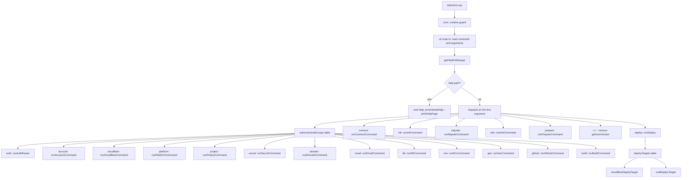
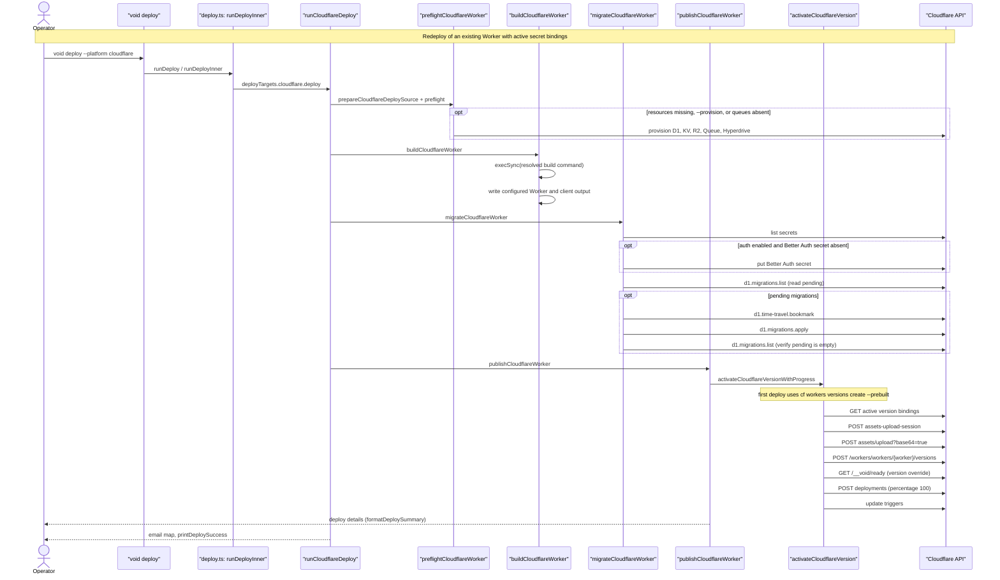

# 14 — Void: Command Line Interface and Deployment

The `void` package is a framework and a deployment Command Line Interface (CLI) in one Node Package Manager (npm) package. The same package contains the Vite plugins, the runtime, and a `void` binary. The binary has a small entry file, a strict argument parser, and a table of command groups. Two deployment targets exist: the managed Void platform and the user's own Cloudflare account. This document follows one `void deploy` command from the shell to an uploaded Cloudflare Worker Version. A Cloudflare Worker is a program that Cloudflare runs at the edge. A Worker Version is one immutable upload of that program and its bindings. A binding is a named connection from Worker code to a Cloudflare resource (`void/packages/deploy-core/src/index.ts:247-253`). The two deployment targets are the managed Void platform and the user's own Cloudflare account. A managed Void platform is a platform service that the user connects to with `void connect` (`void/docs/reference/cli/platform.md:8`). A self-hosted Void platform is an installation that the user runs and administers with `void platform` (`void/docs/guide/deployment.md:69`). This document also states what the other commands do, and where each command lives.

All paths in this document are relative to `/Users/darkvoid/GitSources/src.voidzero`. The first path segment names the Git repository. The repository is `void`. The `void` package is at version 1.7.0. The license is the Massachusetts Institute of Technology (MIT) license. The copyright holder is Cloudflare, Inc.

## 1. The command line in one view

The CLI has six layers in total. Four layers serve every command: the binary entry, `cli-main.ts`, a handler, and a command module. The handler is either a direct function or a subcommand group. Two more layers serve deployment only: a target adapter and a provider package (`void/packages/void/src/cli/deploy.ts:181-184`). The provider package is `@void/deploy-cloudflare`. The executable tool that the provider package drives is `cf`.

The package metadata names the binary. The `bin` field maps the command name `void` to the built file `dist/cli/cli.mjs` (`void/packages/void/package.json:15-17`). The package dependencies include `@void/deploy-cloudflare`, `@void/deploy-core`, and `cf` (`void/packages/void/package.json:360-370`). The package has no `wrangler` dependency. The source uses the name `wrangler` for interfaces and generated JavaScript Object Notation (JSON) files. The executable uploader is a different tool.

`cf` is a separate npm package, version `1.0.0-beta.28` (`void/pnpm-lock.yaml:6663`, `void/pnpm-workspace.yaml:36`). The lock file records `hasBin: true`, and the runner resolves the package directory plus `bin/cf` (`void/pnpm-lock.yaml:6666`, `void/packages/void/src/cli/cf-version-runner.ts:264`). The name, the binary, and the dependency list show that `cf` is a Cloudflare command-line tool. The lock file also shows that `cf` depends on `miniflare`, `@cloudflare/config`, `@cloudflare/build-output-utils`, and `blake3-wasm` (`void/pnpm-lock.yaml:14941-14947`). The source tree does not state a publisher or a description for this package. A reader must not call `cf` the `wrangler` package.

The source contains a function named `runWrangler`. That name is a legacy name. The function does not run the `wrangler` executable. It is a runner that starts a Void operation process, and that process then calls `cf` or the Cloudflare Application Programming Interface (API) (see section 8.6).

```json
// void/packages/void/package.json:15-17
  "bin": {
    "void": "dist/cli/cli.mjs"
  },
```

**Aha:** Void does not depend on `wrangler` at run time. It resolves the `cf` binary from the `cf` package and drives that binary (`void/packages/void/src/cli/cf-version-runner.ts:264`). It can also call the Cloudflare Application Programming Interface (API) directly (`void/packages/void/src/cli/cf-version-runner.ts:531`). The code verifies the uploader before each run, so a changed uploader stops the deploy (`void/packages/void/src/cli/cf-version-runner.ts:266-268`).

The uploader check is a content pin. Before the build, `createCloudflareUploaderPins` computes two Secure Hash Algorithm 256-bit (SHA-256) hashes (`void/packages/void/src/cli/deploy-cloudflare-helpers.ts:97-108`). The first hash covers the directory of the operation-process entry (`void/packages/void/src/cli/deploy-binding-snapshot.ts:350-365`). The second hash covers the package directories of `cf`, `@cloudflare/config`, `@cloudflare/build-output-utils`, and `vite` (`void/packages/void/src/cli/deploy-binding-snapshot.ts:368-393`). `hashDirectoryContents` hashes every file in name-sorted order and folds in the relative path (`void/packages/void/src/cli/deploy-binding-snapshot.ts:399-454`). It returns `undefined` on a read error. A pin of `undefined` fails closed.

`assertWranglerUploaderUnchanged` fails when either hash is `undefined` or when the two hashes differ (`void/packages/void/src/cli/deploy-binding-snapshot.ts:460-477`). `cfUploaderIsPinned` fails when the `cf` hash changed (`void/packages/void/src/cli/deploy-cloudflare-helpers.ts:111-117`). On failure, the deploy logs the refusal and stops (`void/packages/void/src/cli/deploy-cloudflare-helpers.ts:115`). The build runs project code, so the build can edit the uploader. The pin makes that edit visible before Void sends credentials.

## 2. The entry point and the runtime guard

The entry file is deliberately small. It imports one module with no dependencies, checks the Node.js or Bun version, and then loads the full CLI. The comment states the reason: an unsupported runtime must get a clear message, not a `SyntaxError` from a newer API deep in the module graph (`void/packages/void/src/cli/cli.ts:3-5`).

```ts
// void/packages/void/src/cli/cli.ts:1-15
#!/usr/bin/env node

// The bin entry. It imports only the dependency-free runtime check, so an
// unsupported Node or Bun gets a clear message instead of a link-time
// SyntaxError from a newer API somewhere in the CLI's module graph.
import { unsupportedRuntimeMessage } from './runtime-support.ts';

const message = unsupportedRuntimeMessage(process.versions, process.execPath);
if (message) {
  process.stderr.write(`${message}\n`);
  // exitCode instead of exit() so the message is flushed when stderr is a pipe.
  process.exitCode = 1;
} else {
  await import('./cli-main.ts');
}
```

The guard sets `process.exitCode = 1` and does not call `process.exit()`. The comment gives the reason: a pipe must receive the complete message (`void/packages/void/src/cli/cli.ts:11-12`). When the runtime is supported, the entry uses a dynamic `import()` of `./cli-main.ts` (`void/packages/void/src/cli/cli.ts:14`). The dynamic import means the runtime check runs before any framework module loads.

The accepted Node.js range is `^24.22.0 || >=26.12.0` (`void/packages/void/src/cli/runtime-support.ts:12`). The accepted Bun version is `1.4.0` or later (`void/packages/void/src/cli/runtime-support.ts:20`). Bun reports a Node.js version below 26.12, so it gets its own floor (`void/packages/void/src/cli/runtime-support.ts:14-19`). The error names only the runtime version and the executable path (`void/packages/void/src/cli/runtime-support.ts:99-102`). For Node.js, the message also names `bunx`, `npx`, package scripts, and `vp` as causes of a wrong runtime (`void/packages/void/src/cli/runtime-support.ts:124-128`). `vp` is a command of the Vite+ toolchain (`void/packages/void/README.md:23`). The source does not expand the letters `vp`. The entry passes only the runtime versions and the executable path to the guard (`void/packages/void/src/cli/cli.ts:8`). The source comment states that the message text names only those two values, not environment variables or command arguments (`void/packages/void/src/cli/runtime-support.ts:98-101`).

## 3. Argument parsing and dispatch

`cli-main.ts` starts with `const args = process.argv.slice(2)` (`void/packages/void/src/cli/cli-main.ts:113`). It takes the first item as the command (`void/packages/void/src/cli/cli-main.ts:114`). It also computes the help path before any command runs (`void/packages/void/src/cli/cli-main.ts:115`).

The deploy parser uses the Node.js `parseArgs` function in strict mode (`void/packages/void/src/cli/args.ts:9-26`). The parser accepts ten deploy options. Unknown options cause an error. The parser also sets `allowPositionals: true`, so it does not reject a positional argument itself. The code then rejects the first positional argument with an explicit error (`void/packages/void/src/cli/args.ts:61-63`). The parser also records `tokens`, and the code counts the `project` and `platform` option tokens to reject a duplicate option (`void/packages/void/src/cli/args.ts:46-59`).

```ts
// void/packages/void/src/cli/args.ts:9-26
    parsed = parseArgs({
      args,
      options: {
        project: { type: 'string' },
        dir: { type: 'string' },
        spa: { type: 'boolean' },
        'skip-build': { type: 'boolean' },
        'skip-migrations': { type: 'boolean' },
        debug: { type: 'boolean' },
        platform: { type: 'string' },
        provision: { type: 'boolean' },
        'require-email': { type: 'boolean' },
        atomic: { type: 'boolean' },
      },
      allowPositionals: true,
      strict: true,
      tokens: true,
    });
```

The parser then validates the combinations. It rejects a repeated `--project` or `--platform` (`void/packages/void/src/cli/args.ts:46-59`). It limits `--platform` to `cloudflare` or `void` (`void/packages/void/src/cli/args.ts:76-81`). It rejects `--provision` and `--require-email` without `--platform cloudflare` (`void/packages/void/src/cli/args.ts:83-95`). It also rejects `--project` with `--platform cloudflare`, because that platform deploys to the user's own account (`void/packages/void/src/cli/args.ts:100-107`).

The help path comes from `getHelpPath` (`void/packages/void/src/cli/help.ts:1627-1649`). The function has four forms. First, the command can be `help`, and the remaining arguments name the topic. Second, the command can be `--help` or `-h`. Third, the first argument can be a command and the second argument can be `help`, as in `void deploy help`. Fourth, any argument can be `--help` or `-h` after the command. In the fourth form, `getKnownHelpPrefix` walks the help tree and cuts the path at the first flag or unknown topic (`void/packages/void/src/cli/help.ts:1643-1648`, `void/packages/void/src/cli/help.ts:1748-1771`). A flag after a valid command therefore does not become part of the topic path.

```ts
// void/packages/void/src/cli/help.ts:1627-1649
export function getHelpPath(args: Array<string>): Array<string> | null {
  if (args.length === 0) {
    return null;
  }

  const command = args[0];
  if (command === 'help') {
    return args.slice(1);
  }
  if (command === '--help' || command === '-h') {
    return [];
  }
  if (args[1] === 'help') {
    return [command, ...args.slice(2)];
  }

  const helpIndex = args.findIndex((arg) => arg === '--help' || arg === '-h');
  if (helpIndex === -1) {
    return null;
  }

  return getKnownHelpPrefix(args.slice(0, helpIndex));
}
```

`cli-main.ts` then reads the command. If a help path exists, it prints the global help page or a command help page (`void/packages/void/src/cli/cli-main.ts:176-186`). If the command is `deploy`, it calls `parseDeployArgs` and then `runDeploy` (`void/packages/void/src/cli/cli-main.ts:187-202`). The other direct commands are `connect`, `info`, `prepare`, `init`, `migrate`, `-v`, and `--version` (`void/packages/void/src/cli/cli-main.ts:203-273`). An unknown command prints an error and exits with code 1 (`void/packages/void/src/cli/cli-main.ts:271-273`).

When there is no command, the behaviour depends on the terminal. If standard input is a terminal, the CLI prints its header and opens a top-level command prompt (`void/packages/void/src/cli/cli-main.ts:274-413`). If standard input is not a terminal, the CLI prints the global help page (`void/packages/void/src/cli/cli-main.ts:414-416`). A cancelled prompt exits with code 0 (`void/packages/void/src/cli/cli-main.ts:364-366`). This is why a Continuous Integration (CI) job that runs `void` without a subcommand gets help text, not a hang.

The subcommand groups are a record of functions. Each function calls `runSubcommandGroup` with four values: the group name, the subcommand list, the parser, and the runner (`void/packages/void/src/cli/cli-main.ts:117-174`). The record contains thirteen groups: `auth`, `account`, `platform`, `cloudflare`, `project`, `secret`, `domain`, `email`, `db`, `env`, `gen`, `github`, and `build`.

```ts
// void/packages/void/src/cli/cli-main.ts:117-174
const subcommandGroups: Record<string, () => Promise<void>> = {
  auth: () =>
    runSubcommandGroup('auth', authSubcommands, parseAuthArgs, (root, parsed) =>
      import('./auth-router.ts').then(({ runAuthRouter }) => runAuthRouter(root, parsed)),
    ),
  account: () =>
    runSubcommandGroup('account', accountSubcommands, parseAccountArgs, (root, parsed) =>
      import('./account-cmd.ts').then(({ runAccountCommand }) => runAccountCommand(root, parsed)),
    ),
  platform: () =>
    runSubcommandGroup('platform', platformSubcommands, parsePlatformArgs, (root, parsed) =>
      import('./platform-cmd.ts').then(({ runPlatformCommand }) =>
        runPlatformCommand(root, parsed),
      ),
    ),
  cloudflare: () =>
    runSubcommandGroup('cloudflare', cloudflareSubcommands, parseCloudflareArgs, (root, parsed) =>
      import('./cloudflare-cmd.ts').then(({ runCloudflareCommand }) =>
        runCloudflareCommand(root, parsed),
      ),
    ),
  project: () =>
    runSubcommandGroup('project', projectSubcommands, parseProjectArgs, (root, parsed) =>
      import('./project-cmd.ts').then(({ runProjectCommand }) => runProjectCommand(root, parsed)),
    ),
  secret: () =>
    runSubcommandGroup('secret', secretSubcommands, parseSecretArgs, (root, parsed) =>
      import('./secret.ts').then(({ runSecretCommand }) => runSecretCommand(root, parsed)),
    ),
  domain: () =>
    runSubcommandGroup('domain', domainSubcommands, parseDomainArgs, (root, parsed) =>
      import('./domain.ts').then(({ runDomainCommand }) => runDomainCommand(root, parsed)),
    ),
  email: () =>
    runSubcommandGroup('email', emailSubcommands, parseEmailArgs, (root, parsed) =>
      import('./email.ts').then(({ runEmailCommand }) => runEmailCommand(root, parsed)),
    ),
  db: () =>
    runSubcommandGroup('db', dbSubcommands, parseDbArgs, (root, parsed) =>
      import('./db.ts').then(({ runDbCommand }) => runDbCommand(root, parsed)),
    ),
  env: () =>
    runSubcommandGroup('env', envSubcommands, parseEnvArgs, (root, parsed) =>
      import('./env.ts').then(({ runEnvCommand }) => runEnvCommand(root, parsed)),
    ),
  gen: () =>
    runSubcommandGroup('gen', genSubcommands, parseGenArgs, (root, parsed) =>
      import('./gen.ts').then(({ runGenCommand }) => runGenCommand(root, parsed)),
    ),
  github: () =>
    runSubcommandGroup('github', githubSubcommands, parseGithubArgs, (root, parsed) =>
      import('./github-cmd.ts').then(({ runGithubCommand }) => runGithubCommand(root, parsed)),
    ),
  build: () =>
    runSubcommandGroup('build', buildSubcommands, parseBuildArgs, (root, parsed) =>
      import('./build-cmd.ts').then(({ runBuildCommand }) => runBuildCommand(root, parsed)),
    ),
};
```

`runSubcommandGroup` takes the project root as `process.cwd()` (`void/packages/void/src/cli/cli-main.ts:59`). It has an interactive path. When the group has no subcommand, and standard input is a terminal, the function opens a prompt (`void/packages/void/src/cli/cli-main.ts:65-79`). It combines the prompt result with the original arguments before it calls the group parser (`void/packages/void/src/cli/cli-main.ts:78`). When standard input is not a terminal, it parses the arguments directly (`void/packages/void/src/cli/cli-main.ts:80-83`). A prompt result of `undefined` exits with code 0 (`void/packages/void/src/cli/cli-main.ts:75-77`). On an error, it prints the message and exits with code 1 (`void/packages/void/src/cli/cli-main.ts:84-110`). The `platform` group has two special paths in this error handler. A `--json` request gets a JSON error object. An operator client error can include a partial result (`void/packages/void/src/cli/cli-main.ts:85-105`). An operator client error is an `OperatorClientError` from the platform client; it has a code, an optional HTTP status, and optional details (`void/packages/void/src/cli/operator-client.ts:9-27`).

### 3.1 Command map

The table below lists every top-level command. The `Source` column names the module that parses and handles the command. The `Handler` column names the exported function.

| Command | Subcommands | Source | Handler |
|---------|-------------|--------|---------|
| `void deploy` | none; options only | `void/packages/void/src/cli/args.ts` | `parseDeployArgs`, `runDeploy` in `void/packages/void/src/cli/deploy.ts` |
| `void connect` | none; one target argument | `void/packages/void/src/cli/connect-args.ts` | `runConnectCommand` in `void/packages/void/src/cli/connect.ts` |
| `void init` | none; flags | `void/packages/void/src/cli/init.ts` | `runInitCommand` |
| `void migrate` | none | `void/packages/void/src/cli/migrate.ts` | `runMigrateCommand` |
| `void prepare` | none; flags | `void/packages/void/src/cli/prepare-args.ts` | `runPrepareCommand` |
| `void info` | none; `--json` | `void/packages/void/src/cli/info-args.ts` | `runInfoCommand` in `void/packages/void/src/cli/info.ts` |
| `void auth` | `login`, `status`, `logout` | `void/packages/void/src/cli/auth-args.ts` | `runAuthRouter` in `void/packages/void/src/cli/auth-router.ts` |
| `void account` | `login`, `link`, `logout`, `whoami`, `token` | `void/packages/void/src/cli/account-args.ts` | `runAccountCommand` in `void/packages/void/src/cli/account-cmd.ts` |
| `void cloudflare` | `login`, `status`, `logout` | `void/packages/void/src/cli/cloudflare-args.ts` | `runCloudflareCommand` in `void/packages/void/src/cli/cloudflare-cmd.ts` |
| `void platform` | `config`, `auth`, `user`, `project`, `zero-trust`, `deployment`, `build`, `signup`, `invitation`, `system`, `email`, `worker`, `list`, `use`, `status`, `discover`, `domain`, `install`, `upgrade`, `rollback`, `repair`, `disable`, `enable`, `uninstall` | `void/packages/void/src/cli/platform-args.ts` | `runPlatformCommand` in `void/packages/void/src/cli/platform-cmd.ts` |
| `void project` | `status`, `link`, `list`, `token`, `team`, `zero-trust`, `logs`, `requests`, `rollback`, `cancel`, `delete`, `purge-cache` | `void/packages/void/src/cli/project-args.ts` | `runProjectCommand` in `void/packages/void/src/cli/project-cmd.ts` |
| `void secret` | `list`, `put`, `delete`, `sync` | `void/packages/void/src/cli/secret-args.ts` | `runSecretCommand` in `void/packages/void/src/cli/secret.ts` |
| `void domain` | `add`, `delete`, `list`, `status` | `void/packages/void/src/cli/domain-args.ts` | `runDomainCommand` in `void/packages/void/src/cli/domain.ts` |
| `void email` | `usage`, `logs`, `destinations`, `allow`, `disallow`, `alias`, `domain`, `status`, `setup` | `void/packages/void/src/cli/email-args.ts` | `runEmailCommand` in `void/packages/void/src/cli/email.ts` |
| `void db` | `push`, `generate`, `status`, `reset`, `seed`, `execute`, `migrate`, `studio`, `set-url`, `connect`, `restore`, `rename-migrations`, `export` | `void/packages/void/src/cli/db-args.ts` | `runDbCommand` in `void/packages/void/src/cli/db.ts` |
| `void env` | `check`, `types` | `void/packages/void/src/cli/env-args.ts` | `runEnvCommand` in `void/packages/void/src/cli/env.ts` |
| `void gen` | `model`, `migration`, `route`, `middleware`, `ssr` (server-side rendering), `cron`, `queue` | `void/packages/void/src/cli/gen-args.ts` | `runGenCommand` in `void/packages/void/src/cli/gen.ts` |
| `void github` | `install`, `installations`, `connect`, `update`, `status`, `disconnect`, `link`, `join` | `void/packages/void/src/cli/github-args.ts` | `runGithubCommand` in `void/packages/void/src/cli/github-cmd.ts` |
| `void build` | `logs` | `void/packages/void/src/cli/build-args.ts` | `runBuildCommand` in `void/packages/void/src/cli/build-cmd.ts` |
| `void help` | any command path | `void/packages/void/src/cli/help.ts` | `printGlobalHelp`, `printHelpPage` |
| `void -v`, `void --version` | none | `void/packages/void/src/cli/agents.ts` | `getOwnVersion` |

The top-level help text also lists `void help <command>` and `void <command> --help` (`void/packages/void/src/cli/help.ts:1603-1605`). The help tree has entries for `connect`, `init`, `migrate`, `deploy`, `auth`, `account`, `cloudflare`, `platform`, `project`, `secret`, `domain`, `email`, `github`, `build`, `db`, `env`, `gen`, `info`, and `prepare` (`void/packages/void/src/cli/help.ts:108-1469`).



The `helpPath` value selects the help branch before any command dispatch. An empty path prints the global help. A non-empty path prints the matching page (`void/packages/void/src/cli/cli-main.ts:176-186`).

## 4. Command details

### 4.1 `void init`

`void init` prepares a project. The handler is `runInitCommand` (`void/packages/void/src/cli/init.ts:2738`). The module imports the config writer, the Drizzle setup, the Cloudflare connection helper, the environment scaffold, the Git setup, and the project template functions (`void/packages/void/src/cli/init.ts:10-50`). The command writes `void.config.ts` through `writeVoidProjectConfig` (`void/packages/void/src/cli/init.ts:1412`, `void/packages/void/src/cli/init.ts:1425`, `void/packages/void/src/cli/init.ts:1452`). `writeVoidProjectConfig` refuses to rewrite authored TypeScript (`void/packages/void/src/config-write.ts:120-133`). The command also sets up Git through `setupGit` (`void/packages/void/src/cli/init.ts:2760`). The source does not state every prompt in one place, because the prompts are spread across the imported helpers.

### 4.2 `void connect`

`void connect` connects the directory to a deployment destination. It parses at most one platform Uniform Resource Locator (URL) and two options: `--platform` and `--no-login` (`void/packages/void/src/cli/connect-args.ts:9-30`). A URL and `--no-login` are available only for a Void platform. The parser rejects both with `--platform cloudflare` (`void/packages/void/src/cli/connect-args.ts:26-28`). The handler is `runConnectCommand` in `connect.ts` (`void/packages/void/src/cli/connect.ts:81`).

For Cloudflare, the handler calls `connectCloudflare` and then writes the platform choice with `writeDeploymentPlatform` (`void/packages/void/src/cli/connect.ts:108-112`). That function writes `.void/project.json` and keeps an existing project link (`void/packages/void/src/cli/project.ts:97-118`). For Void, the handler discovers the platform document, optionally authenticates, saves the platform connection, and writes the platform selection (`void/packages/void/src/cli/connect.ts:114-136`). Authentication uses `VOID_TOKEN` only when `VOID_API_URL` names the same origin; otherwise it uses a saved token or a login prompt (`void/packages/void/src/cli/connect.ts:42-79`). If an existing project link pins a different platform URL, `writePlatformSelection` returns false, and the command states that the existing destination still wins (`void/packages/void/src/cli/connect.ts:124-128`, `void/packages/void/src/cli/project.ts:121-155`).

### 4.3 `void deploy`

`void deploy` is the main command. The parser is `parseDeployArgs` (`void/packages/void/src/cli/args.ts:4-6`). The handler is `runDeploy` (`void/packages/void/src/cli/deploy.ts:58`). The command accepts ten options (`void/packages/void/src/cli/args.ts:12-21`):

| Option | Type | Effect |
|--------|------|--------|
| `--project` | string | Select a managed Void project by slug. Rejected for `--platform cloudflare`. |
| `--dir` | string | Select a static output directory. |
| `--spa` | boolean | Treat the build as a single-page application. |
| `--skip-build` | boolean | Reuse an existing build. The Cloudflare backend rejects it during preflight. |
| `--skip-migrations` | boolean | Skip application and authentication Structured Query Language (SQL) migrations. |
| `--debug` | boolean | Mirror the deploy log to standard error. The environment variable `VOID_DEPLOY_DEBUG=1` has the same effect. |
| `--platform` | string | Select `cloudflare` or `void`. |
| `--provision` | boolean | Force resource provisioning even when no resource is missing. Requires `--platform cloudflare`. |
| `--require-email` | boolean | Fail before upload when email setup cannot finish. Requires `--platform cloudflare`. |
| `--atomic` | boolean | Publish a Durable Object Worker in atomic mode. The same value comes from `deploy.cloudflare.mode`. |

A Durable Object is a Cloudflare object that keeps state under one name and runs near the requests that use it (`void/docs/guide/durable-state.md:8-10`). A Worker needs Durable Object migration history before Cloudflare accepts an atomic Version upload (`void/packages/void/src/cli/deploy-cloudflare-build.ts:166-176`).

`runDeploy` opens a deploy log and writes a `deploy_start` event (`void/packages/void/src/cli/deploy.ts:63-76`). It calls `runDeployInner` (`void/packages/void/src/cli/deploy.ts:79`). On a success, it writes `deploy_end` with `ok: true` (`void/packages/void/src/cli/deploy.ts:80`). On an error, it writes `deploy_end` with `ok: false`, closes the log, appends a summary, and rethrows (`void/packages/void/src/cli/deploy.ts:81-100`). The caller in `cli-main.ts` prints the error and exits with code 1 (`void/packages/void/src/cli/cli-main.ts:197-202`).

The deploy log is a JSON Lines file. `openDeployLog` writes it to `~/.void/logs/deploy-<timestamp>-<process id>-<random hex>.jsonl` with mode `0600` (`void/packages/void/src/cli/log-file.ts:132-167`). JSON Lines means one JSON object per line. Each record holds `ts`, `elapsedMs`, `lvl`, `msg`, and named fields (`void/packages/void/src/cli/log-file.ts:187-208`). The logger keeps only the first `deploy_end` record (`void/packages/void/src/cli/log-file.ts:170-174`). The log can hold account and project details, so only the owner can read the file (`void/packages/void/src/cli/log-file.ts:153-156`).

Four project files hold Cloudflare deploy state. Three are under `.void`, and one is under `.wrangler`. The candidate receipt `.void/cloudflare-candidate.json` records `{accountId, workerName, parentVersionId, versionIds}` (`void/packages/void/src/cli/cloudflare-candidate.ts:5-14`). A candidate is an uploaded Worker Version that does not yet have full traffic. The link file `.void/cloudflare-link.json` records `{accountId, workerName, candidateReceipt?}` (`void/packages/void/src/cli/cloudflare-link.ts:19-27`). The existing-Worker handoff is the path that adopts a Worker that Void did not create. The link file keeps a pending handoff across a failed build (`void/packages/void/src/cli/cloudflare-link.ts:29`, `void/docs/integrations/cloudflare.md:105-113`). The project file `.void/project.json` records the `platform` choice (`void/packages/void/src/cli/project.ts:15-17`, `void/packages/void/src/cli/project.ts:75-91`). The deploy pointer `.wrangler/deploy/config.json` tells Cloudflare tooling where the built Worker config is (`void/packages/void/src/plugin-cloudflare.ts:216-229`). The build writes this pointer. When the project has `void.config.ts`, `runDeployInner` moves the pointer to `.void/preview-deploy-config.json` and removes the `.wrangler` file (`void/packages/void/src/cli/deploy.ts:214-218`, `void/packages/void/src/cloudflare-config.ts:145-155`). After a deploy, the `.wrangler` pointer is absent. `restoreCloudflarePreviewPointer` puts it back for Vite preview (`void/packages/void/src/cloudflare-config.ts:157-166`).

The platform can also be `none`. `DeploymentPlatform` is `DeployTarget | 'none'` (`void/packages/void/src/cli/project.ts:15`). `void init` writes `none` when the user selects "Skip deployment setup". A deploy with `platform: 'none'` throws until the user passes `--platform cloudflare` or `--platform void` (`void/packages/void/src/cli/deploy.ts:204-208`).

```ts
// void/packages/void/src/cli/deploy.ts:186-219
async function runDeployInner(
  root: string,
  options: RunDeployOptions | undefined,
  cliLog: CliLogger,
): Promise<void> {
  const link = await maybeLinkCloudflareDeploy(root, options);
  if (link === 'cancelled') {
    log.info('Deployment cancelled.');
    return;
  }
  if (link === 'existing') {
    options = { ...options, platform: 'cloudflare', reuseExistingWorker: true };
  }
  const platform = resolveDeploymentPlatform(root, options);
  if (options?.atomic && platform !== 'cloudflare') {
    throw new Error('deploy: --atomic is available only for Cloudflare Workers.');
  }

  if (platform === 'none') {
    throw new Error(
      'deploy: deployment setup was skipped during `void init`. Pass `--platform cloudflare` or `--platform void` to choose a destination.',
    );
  }

  cliLog.info('deploy_target', { target: platform });

  try {
    return await deployTargets[platform].deploy(root, options ?? {}, cliLog);
  } finally {
    if (existsSync(join(root, 'void.config.ts'))) {
      stashCloudflareDeployPointer(root);
    }
  }
}
```

The platform resolution has three levels. The `--platform` option wins. The saved platform choice comes second. The default `void` platform comes last (`void/packages/void/src/cli/deploy.ts:49-55`).

```ts
// void/packages/void/src/cli/deploy.ts:49-55
export function resolveDeploymentPlatform(
  root: string,
  options?: RunDeployOptions,
): DeploymentPlatform {
  // Projects with no saved choice predate the init prompt and keep the Void default.
  return options?.platform ?? readDeploymentPlatform(root) ?? 'void';
}
```

The target table has two entries. `cloudflare` maps to `cloudflareDeployTarget`, and `void` maps to `voidDeployTarget` (`void/packages/void/src/cli/deploy.ts:181-184`). The Cloudflare target rejects `--project`. It calls `assertInstalledVoidMatchesCli`, because the build imports the project's installed Vite plugin. A different installed version can produce an unsafe deploy target, so the function throws and gives the two versions (`void/packages/void/src/cli/installed-void.ts:7-68`). The target then migrates a legacy config and calls `runCloudflareDeploy` (`void/packages/void/src/cli/deploy.ts:136-147`). The Void target calls `runManagedDeploy` (`void/packages/void/src/cli/deploy.ts:150-179`).

The three-level order applies only to the platform. Other settings have their own orders. The project slug is the flag, then `VOID_PROJECT`, then the linked file. The managed credential is `VOID_TOKEN`, then GitHub Actions OpenID Connect (OIDC), then the saved login. The atomic flag is the command option or the config value (`void/packages/void/src/cli/deploy-cloudflare.ts:59`). Section 6 states each order separately.

The managed deploy has its own credential order. `VOID_TOKEN` comes first. OIDC comes second. The saved login comes third (`void/packages/void/src/cli/deploy.ts:242-265`). The project order is the `--project` flag, then the `VOID_PROJECT` environment variable, then the linked project file (`void/packages/void/src/cli/deploy.ts:278`). The managed deploy then selects one of three paths: `runFrameworkDeploy`, `runStaticDeploy`, or `runFullDeploy` (`void/packages/void/src/cli/deploy.ts:379-467`). This document does not trace those functions. The package also exposes `prepareDeployArtifact`, which packages an already-built app for managed deployment without platform credentials (`void/packages/void/src/deploy.ts:70-79`).

The Cloudflare backend has four early decisions before account work. A `node`, `bun`, or `deno` target is refused, because this backend deploys Workers only (`void/packages/void/src/cli/deploy-cloudflare.ts:74-87`). A framework that owns its Worker request handler is refused when the project sets Void routing rules (`void/packages/void/src/cli/deploy-cloudflare.ts:85-94`). Such a framework supplies the Worker entry, so Void cannot apply redirects, rewrites, fallbacks, or headers (`void/packages/void/src/cli/deploy-cloudflare.ts:88-90`). A static preset is a build output convention for a known static site generator (`void/packages/void/src/cli/preset.ts:12-24`, `void/packages/void/src/cli/preset.ts:30-51`). The static preset goes to the separate static branch (`void/packages/void/src/cli/deploy-cloudflare.ts:96-115`). `--skip-build` is refused in `prepareCloudflareDeploySource`, because every later check reads the artifact that the build emits (`void/packages/void/src/cli/deploy-cloudflare-preflight.ts:80-96`). The parser accepts `--skip-build`; the Cloudflare backend rejects it later. The managed platform supports it.

Provisioning has four triggers. `provisionAndVerify` runs when `--provision` is set, when a resource is missing, when a first deploy needs the Cloudflare D1 database configuration reconciled, or when a queue is absent (`void/packages/void/src/cli/deploy-cloudflare-preflight.ts:619-630`). D1 is the Cloudflare SQL database, and D1 uses SQLite (`void/docs/guide/database/d1.md:8`, `void/docs/reference/config.md:131`). `--provision` is therefore a force flag, not the only trigger.

Atomic mode has constraints. The mode is `deploy.cloudflare.mode = 'atomic'` or `--atomic` (`void/packages/void/src/cli/deploy-cloudflare.ts:59`). It is refused during the existing-Worker handoff (`void/packages/void/src/cli/deploy-cloudflare.ts:60-65`). It is refused for a static preset (`void/packages/void/src/cli/deploy-cloudflare.ts:100-103`). It is refused unless the generated config declares Durable Object migrations (`void/packages/void/src/cli/deploy-cloudflare-build.ts:171-176`). For a Worker with a previous version, atomic mode publishes with `worker.deploy` and `?deploy=true`, so the new version receives traffic during the upload (`void/packages/deploy-cloudflare/src/version.ts:2101-2160`, `void/packages/void/src/cli/cf-version-api.ts:1276`). A traffic split means production is not one version at 100 percent (`void/packages/deploy-cloudflare/src/version.ts:2577-2583`). The readiness probe runs after the publish (`void/packages/deploy-cloudflare/src/version.ts:2404-2420`). A failed probe therefore cannot return traffic to the previous 100 percent state. The atomic upload already added `?deploy=true` (`void/packages/void/src/cli/cf-version-api.ts:1276`). A failed probe returns `rollback: 'unavailable'` (`void/packages/deploy-cloudflare/src/version.ts:2434`).

### 4.4 `void migrate`

`void migrate` moves legacy configuration into `void.config.ts`. The command takes no arguments (`void/packages/void/src/cli/cli-main.ts:258-262`). The handler is `runMigrateCommand` (`void/packages/void/src/cli/migrate.ts:227`). It calls `migrateLegacyVoidConfig`, adds `.cloudflare` to `.gitignore`, and prints the result (`void/packages/void/src/cli/migrate.ts:227-247`).

```ts
// void/packages/void/src/cli/migrate.ts:227-247
export async function runMigrateCommand(root: string): Promise<void> {
  console.log();
  const migrated = migrateLegacyVoidConfig(root);
  const updatedIgnore =
    ensureGitignoreLines(root, ['.cloudflare'], {
      '.cloudflare': ['/.cloudflare', '.cloudflare/', '/.cloudflare/'],
    }).length > 0;
  if (migrated) {
    log.step(
      `Migrated project settings to ${TYPED_CONFIG_FILE}. Commit it and ${VOID_LOCK_FILE} when present.`,
    );
  }
  if (updatedIgnore) {
    log.step('Added .cloudflare to .gitignore.');
  }
  if (migrated || updatedIgnore) {
    printSuccess('Project migration complete.');
  } else {
    log.info('No legacy project configuration found.');
  }
}
```

`migrateLegacyVoidConfig` reads `void.json` and the root Wrangler JSON or JavaScript Object Notation with Comments (JSONC) files (`void/packages/void/src/cli/migrate.ts:34`, `void/packages/void/src/cli/migrate.ts:102-109`). It also reads framework Wrangler files that `discoverFrameworkWranglerFiles` finds. It rejects more than one Wrangler JSON file (`void/packages/void/src/cli/migrate.ts:110-114`). It rejects `wrangler.toml` with the instruction to convert the file to JSON or JSONC first (`void/packages/void/src/cli/migrate.ts:115-117`). It validates the legacy JSON with `validateConfig` before it writes anything (`void/packages/void/src/cli/migrate.ts:130-137`).

The final write goes through `renderVoidConfig` into a temporary file (`.void.config.<uuid>.ts`) (`void/packages/void/src/cli/migrate.ts:187-190`). The code loads the temporary file with `loadTypedVoidConfigFile`, validates it, and checks that the loaded object is deep-equal to the intended object (`void/packages/void/src/cli/migrate.ts:192-198`). It then renames the temporary file to `void.config.ts` (`void/packages/void/src/cli/migrate.ts:210`). `renderVoidConfig` emits `import { defineConfig } from 'void/config'` and one default export (`void/packages/void/src/config-write.ts:13-18`).

### 4.5 `void prepare` — the type generator

There is no command named `void typegen`. The type generation command is `void prepare`. The handler calls `prepareProject` (`void/packages/void/src/cli/prepare.ts:5-22`). The command writes the `.void` artifacts and reports the written and removed files. It does not start Vite.

```ts
// void/packages/void/src/cli/prepare.ts:5-22
export async function runPrepareCommand(root: string): Promise<void> {
  console.log();

  const result = await prepareProject(root);

  if (result.written.length > 0) {
    note(result.written.join('\n'), 'Wrote');
  }
  if (result.removed.length > 0) {
    note(result.removed.join('\n'), 'Removed stale files');
  }

  if (result.written.length === 0 && result.removed.length === 0) {
    log.info('No generated files changed.');
  }

  printSuccess('Project codegen is ready.');
}
```

`prepareProject` reads the config, analyzes the application, and uses `.void` as the output directory (`void/packages/void/src/codegen/prepare.ts:44-48`). It writes each file only when its inputs exist. When an input is absent, it removes a stale file with `removeGeneratedFile` (`void/packages/void/src/codegen/prepare.ts:35-42`).

| File | Condition | Lines |
|------|-----------|-------|
| `bindings.d.ts` | The resolved config has bindings | `void/packages/void/src/codegen/prepare.ts:52-57` |
| `env.d.ts` | A local environment file exists for the project paths | `void/packages/void/src/codegen/prepare.ts:59-65` |
| `auth.d.ts` | An authentication config path exists | `void/packages/void/src/codegen/prepare.ts:67-72` |
| `routes.d.ts` | Routes, WebSocket routes, or pages exist | `void/packages/void/src/codegen/prepare.ts:74-83` |
| `queues.d.ts` | A queues directory exists | `void/packages/void/src/codegen/prepare.ts:85-92` |
| `db.d.ts` | A database schema, authentication, or database casing exists | `void/packages/void/src/codegen/prepare.ts:94-103` |
| `.void/tsconfig.json` | The project TypeScript configuration chain is ready | `void/packages/void/src/codegen/prepare.ts:105-108` |

Vite also regenerates these files during `vite dev` and `vite build` (`void/docs/guide/type-safety.md:533`).

### 4.6 `void info`

`void info` inspects persistent resource names. It does not provision, generate files, or read credentials (`void/packages/void/src/cli/info.ts:117`). The handler is `runInfoCommand` (`void/packages/void/src/cli/info.ts:189-192`). It calls `getProjectInfo`, which calls the synchronous `analyzeApplicationSync` (`void/packages/void/src/cli/info.ts:118-141`). The synchronous form is why `info` needs no Vite server. The async `analyzeApplication` in `application-routing.ts` is a thin wrapper around the same function (`void/packages/void/src/application-routing.ts:29-33`).

`ProjectInfo` has two lists (`void/packages/void/src/cli/info.ts:30-33`). `resources` holds source definitions. Each entry has `file`, `definition`, `name`, `nameSource`, `className`, `bindingName`, and an optional `route` (`void/packages/void/src/cli/info.ts:14-22`). `recordedResources` holds resources that `void.lock.json` records but the source no longer defines (`void/packages/void/src/cli/info.ts:24-29`, `void/packages/void/src/cli/info.ts:35-115`). The printed form tells the user how to preserve such a resource when moving its code (`void/packages/void/src/cli/info.ts:143-180`). The `--json` flag prints the `ProjectInfo` object as JSON (`void/packages/void/src/cli/info.ts:191`).

### 4.7 `void db`

The `db` group manages database schema and migrations. Its subcommands are `push`, `generate`, `status`, `reset`, `seed`, `execute`, `migrate`, `studio`, `set-url`, `connect`, `restore`, `rename-migrations`, and `export` (`void/packages/void/src/cli/db-args.ts:5-60`). Two commands are important for deployment.

`void db migrate --remote` applies migrations to a remote database (`void/packages/void/src/cli/db-args.ts:22-25`). For a D1 project, it reads the applied names from Cloudflare and applies the pending files (`void/packages/void/src/cli/db.ts:1208-1222`). For a PostgreSQL or MySQL project, it needs a saved `cloudflare` platform and a `DATABASE_URL` in the shell (`void/packages/void/src/cli/db.ts:1150-1196`). With any other platform, the command refuses, because remote PostgreSQL and MySQL migrations run during `void deploy` through the Hyperdrive binding (`void/packages/void/src/cli/db.ts:1150-1156`). Hyperdrive pools database connections between a Worker and PostgreSQL (`void/docs/guide/database/postgresql.md:10-12`).

`void db restore` restores a D1 database to a saved point (`void/packages/void/src/cli/db-args.ts:45-62`). It accepts `--bookmark <bookmark>` or a timestamp (`void/packages/void/src/cli/db-args.ts:47-60`). It refuses a PostgreSQL or MySQL project (`void/packages/void/src/cli/db.ts:1439-1442`). It refuses a database that is not a direct Cloudflare deploy, unless the user passes `--platform cloudflare` (`void/packages/void/src/cli/db.ts:1443-1449`). It asks for confirmation unless `--yes` is present, and it refuses a non-interactive run without `--yes` (`void/packages/void/src/cli/db.ts:1456-1471`). The restore prints a reverse bookmark when Cloudflare returns one (`void/packages/void/src/cli/db.ts:1486-1492`). A restore also rewinds the migration table, so the command warns about migrations that the next deploy will apply (`void/packages/void/src/cli/db.ts:1493-1510`).

### 4.8 `void gen`

The `gen` group scaffolds code. Its subcommands are `model`, `migration`, `route`, `middleware`, `ssr`, `cron`, and `queue` (`void/packages/void/src/cli/gen-args.ts:4-41`). Drizzle is the Object-Relational Mapping (ORM) toolkit that Void uses for database access (`void/docs/reference/api/database.md:8`). A Drizzle table is the schema definition that `gen model` writes (`void/packages/void/src/cli/gen.ts:406`). `gen model` creates that table, API routes, and database types, and it takes `name:type` or `name:type?` columns (`void/packages/void/src/cli/gen-args.ts:5-10`, `void/packages/void/src/cli/gen-args.ts:75-90`). The accepted column types are `string`, `text`, `datetime`, `integer`, `boolean`, `real`, and `blob` (`void/packages/void/src/cli/gen-args.ts:56`). `gen migration` creates an empty migration file (`void/packages/void/src/cli/gen-args.ts:11`). `gen route` creates a route with handler exports (`void/packages/void/src/cli/gen-args.ts:12-27`). Its `--methods` option takes a comma-separated list from `get`, `post`, `put`, `patch`, and `delete`, and the default is `get` (`void/packages/void/src/cli/gen-args.ts:127-137`). `gen middleware`, `gen cron`, and `gen queue` accept names with underscores or hyphens (`void/packages/void/src/cli/gen-args.ts:144-163`). `gen ssr` creates a Server-Side Rendering (SSR) entry, a client entry, and an application component, and it accepts one of `--react`, `--vue`, `--svelte`, or `--solid` (`void/packages/void/src/cli/gen-args.ts:29-38`, `void/packages/void/src/cli/gen-args.ts:165-188`).

### 4.9 `void env`

The `env` group has two subcommands. `void env check` validates a local `.env` file or the required remote secret names (`void/packages/void/src/cli/env-args.ts:5-14`). The required names come from the project `env.ts` schema, through `validateProdEnv` (`void/packages/void/src/cli/env.ts:52-60`). The `--remote` flag also checks that the required keys exist as remote secrets (`void/packages/void/src/cli/env-args.ts:8-13`). For that check, the command reads Cloudflare secrets when the platform is `cloudflare`, or platform secrets when the project is linked (`void/packages/void/src/cli/env.ts:25-50`). With the `none` platform, the command stops and asks for `void init` (`void/packages/void/src/cli/env.ts:28-31`). An invalid report exits with code 1 (`void/packages/void/src/cli/env.ts:70-78`). `void env types` regenerates `.void/env.d.ts` from the root `env.ts` (`void/packages/void/src/cli/env-args.ts:15-18`, `void/packages/void/src/cli/env.ts:81-92`).

### 4.10 `void build logs`

`void build` has one subcommand: `logs` (`void/packages/void/src/cli/build-args.ts:3-9`). It streams, tails, or downloads logs for a remote build (`void/packages/void/src/cli/build-args.ts:6-8`). Its optional arguments are a build identifier, `--follow` or `-f`, `--output` or `-o`, and `--project` or `-p` (`void/packages/void/src/cli/build-args.ts:19-66`). Without `--follow`, the command prints the current page. With `--follow`, it polls every 1000 milliseconds (`void/packages/void/src/cli/build-cmd.ts:10`). A fatal follow error exits with code 1 (`void/packages/void/src/cli/build-cmd.ts:76-79`, `void/packages/void/src/cli/cli-main.ts:84-110`). A build that is terminal but has not confirmed its final log line gets 2 minutes to drain (`void/packages/void/src/cli/build-cmd.ts:11`, `void/packages/void/src/cli/build-cmd.ts:92-98`). A completed download writes the output file (`void/packages/void/src/cli/build-cmd.ts:112-241`). The handler is `runBuildCommand`, which calls `runBuildLogsCommand` (`void/packages/void/src/cli/build-cmd.ts:106-110`).

**Aha:** `void build` is not a local build command. It only reads remote build logs (`void/packages/void/src/cli/build-args.ts:6-8`). The local build runs inside `void deploy`, through the Vite command `vite build`.

### 4.11 `auth`, `account`, and `cloudflare`

These three groups manage identity, but they act on different systems. `auth` has `login`, `status`, and `logout`, and an optional `--platform` (`void/packages/void/src/cli/auth-args.ts:3-35`). It is a router. It selects the platform from `--platform`, or from the saved platform, or from a prompt (`void/packages/void/src/cli/auth-router.ts:9-51`). For `cloudflare`, it calls `runCloudflareCommand`. For `void`, it calls `runAccountCommand`, and it maps `status` to `whoami` (`void/packages/void/src/cli/auth-router.ts:53-71`).

`account` has `login`, `link`, `logout`, `whoami`, and `token` (`void/packages/void/src/cli/account-args.ts:3-9`). It manages the Void platform account and its saved platform credentials (`void/packages/void/src/cli/auth-router.ts:65-71`). `token` copies the authentication token to the clipboard. It uses `pbcopy` on macOS, `clip` on Windows, and `xclip` on Linux (`void/packages/void/src/cli/account-cmd.ts:44-57`). It starts the login flow first when no token exists (`void/packages/void/src/cli/account-cmd.ts:36-38`).

`cloudflare` has `login`, `status`, and `logout` (`void/packages/void/src/cli/cloudflare-args.ts:3-7`). It manages the local Cloudflare browser session. `login` calls `ensureCloudflareAuthentication` with `forceLogin: true` (`void/packages/void/src/cli/cloudflare-cmd.ts:17-21`). `status` runs `auth.whoami` and prints the accessible accounts (`void/packages/void/src/cli/cloudflare-cmd.ts:22-32`). It also prints the pinned deployment account from the root config `account_id`, or from `CLOUDFLARE_ACCOUNT_ID` or `CF_ACCOUNT_ID` (`void/packages/void/src/cli/cloudflare-cmd.ts:72-88`). `logout` removes the browser session and warns when environment credentials remain active (`void/packages/void/src/cli/cloudflare-cmd.ts:33-47`).

### 4.12 `platform`, `project`, `secret`, `domain`, `email`, and `github`

These groups act on the managed platform or on Cloudflare resources. The `platform` group installs and administers a self-hosted Void platform (`void/packages/void/src/cli/platform-args.ts:12-54`). The `project` group manages projects, teams, deployments, logs, rollback, and cache (`void/packages/void/src/cli/project-args.ts:12-52`). The `secret` group manages project secrets (`void/packages/void/src/cli/secret-args.ts:4-9`). The `domain` group manages custom domains (`void/packages/void/src/cli/domain-args.ts:3-8`). The `email` group manages email activity and verified recipients (`void/packages/void/src/cli/email-args.ts:9-38`). The `github` group connects a repository for automatic deploys (`void/packages/void/src/cli/github-args.ts:3-28`). The platform itself is the subject of [Document 15 — The self-hosted Void platform](15-void-platform.md).

| Group | Handler call | Effect named by the subcommand definitions |
|-------|--------------|--------------------------------------------|
| `auth` | `runAuthRouter` | Signs in, shows the identity, or signs out. |
| `account` | `runAccountCommand` | Logs in, links a method, logs out, shows the user, or copies a token. |
| `cloudflare` | `runCloudflareCommand` | Signs in, shows the Cloudflare identity, or removes the browser session. |
| `platform` | `runPlatformCommand` | Configures, inspects, discovers, or selects a platform; adds a domain; installs, upgrades, rolls back, repairs, disables, enables, or uninstalls. |
| `project` | `runProjectCommand` | Shows status, links a directory, lists projects, manages tokens, teams, and Cloudflare Zero Trust protection, reads logs and requests, rolls back, cancels, deletes, or purges cache. |
| `secret` | `runSecretCommand` | Lists, sets, deletes, or syncs project secrets. |
| `domain` | `runDomainCommand` | Adds, deletes, lists, or checks custom domains. |
| `email` | `runEmailCommand` | Reads usage and logs, or manages verified recipients and domains. |
| `github` | `runGithubCommand` | Installs the GitHub App and connects, updates, or disconnects a repository. |

Cloudflare Zero Trust protection is the access policy that Cloudflare applies to a project (`void/packages/void/src/cli/project-args.ts:27-29`). All group commands share one error path. `runSubcommandGroup` catches the error, prints a message, and exits with code 1 (`void/packages/void/src/cli/cli-main.ts:84-110`). A cancelled prompt exits with code 0 (`void/packages/void/src/cli/cli-main.ts:75-77`). The handler modules own the exact files and remote objects that each subcommand writes. This document names those writes only where the source states them directly.

### 4.13 `void dev` and `void preview` do not exist

The `void` CLI has no `dev` command and no `preview` command. The help tree has no entries for them (`void/packages/void/src/cli/help.ts:108-1469`). The CLI reference lists no such commands (`void/docs/reference/cli.md:19-39`). Development uses the Vite development server. The quickstart runs `npm run dev`, `pnpm run dev`, `yarn run dev`, `bun run dev`, or `vpr dev` (`void/docs/guide/quickstart.md:50-72`). `vpr` is a command of the separate Vite+ toolchain, which [Document 02 — The Vite+ toolchain](02-vite-plus-toolchain.md) covers (`void/docs/guide/quickstart.md:70-72`). The source does not state what the letters `vpr` mean. The Node.js, Bun, and Deno guide uses `npx vite dev` and `vite preview` (`void/docs/integrations/nodejs-bun-deno.md:34` and `void/docs/integrations/nodejs-bun-deno.md:82`). This document states this fact because a reader may expect a framework CLI to own the development server. Void delegates that job to Vite.

## 5. The build pipeline: two Vite environments

Void builds with Vite. A Vite environment is a named build context with its own configuration and output directory. The Cloudflare plugin uses two Vite environments. The `ssr` (server-side rendering) environment builds the Worker. The `client` environment builds the browser assets. The plugin records one output directory for each environment (`void/packages/void/src/plugin-cloudflare.ts:107-126`).

```ts
// void/packages/void/src/plugin-cloudflare.ts:107-126
  const directories: Plugin = {
    name: 'void:cloudflare-output-directories',
    enforce: 'post',
    config(userConfig) {
      const environmentNames = [
        options.viteEnvironment.name ?? 'ssr',
        ...(options.viteEnvironment.childEnvironments ?? []),
      ];
      for (const name of [...environmentNames, 'client']) {
        outputDirectories.set(
          name,
          resolve(
            root,
            userConfig.environments?.[name]?.build?.outDir ??
              join(userConfig.build?.outDir ?? 'dist', name),
          ),
        );
      }
    },
  };
```

For a Void app, the default layout is therefore `dist/ssr` and `dist/client`. A user can override each directory through `environments.<name>.build.outDir` (`void/packages/void/src/plugin-cloudflare.ts:119-123`). The Worker environment name is not fixed, because the code reads `options.viteEnvironment.name` (`void/packages/void/src/plugin-cloudflare.ts:111-113`).

The second plugin hook moves the build output. The `buildApp` hook reads the Cloudflare Build Output. The Cloudflare Build Output is a disposable directory in Cloudflare's draft Build Output format (`void/packages/void/src/deploy.ts:26-35`). It holds a Worker bundle, a Worker module manifest, and optional assets (`void/packages/void/src/plugin-cloudflare.ts:154-178`). The Worker module manifest names the main module and the module list (`void/packages/void/src/plugin-cloudflare.ts:159-161`, `void/packages/void/src/plugin-cloudflare.ts:185`). The hook takes the default Worker (`void/packages/void/src/plugin-cloudflare.ts:155`). It requires a bundle directory and that module manifest (`void/packages/void/src/plugin-cloudflare.ts:159-161`). It copies the Worker bundle to the `ssr` destination and the assets to the `client` destination (`void/packages/void/src/plugin-cloudflare.ts:173-178`). It then writes a `wrangler.json` file into the Worker directory (`void/packages/void/src/plugin-cloudflare.ts:179-194`).

```ts
// void/packages/void/src/plugin-cloudflare.ts:179-194
        const config: WorkerConfig = {
          ...workerConfig,
          name: worker.config.name,
          account_id: native.accountId,
          compatibility_date: worker.config.compatibilityDate,
          compatibility_flags: worker.config.compatibilityFlags,
          main: worker.config.manifest.mainModule,
          no_bundle: true,
          rules: [{ type: 'ESModule', globs: ['**/*.js', '**/*.mjs'] }],
          ...(process.env.CLOUDFLARE_ENV ? { targetEnvironment: process.env.CLOUDFLARE_ENV } : {}),
          ...(workerConfig.assets || worker.assetsDir
            ? { assets: { ...workerConfig.assets, directory: relative(destination, client) } }
            : {}),
        };
        delete config.env;
        writeFileAtomic(join(destination, 'wrangler.json'), `${JSON.stringify(config, null, 2)}\n`);
```

The `assets.directory` value is relative to the Worker directory (`void/packages/void/src/plugin-cloudflare.ts:189-191`). The generated file thus points from `dist/ssr` to `dist/client`. The `no_bundle` field is true, because the Worker bundle is already built (`void/packages/void/src/plugin-cloudflare.ts:186`). The `targetEnvironment` field is present only when `CLOUDFLARE_ENV` is set (`void/packages/void/src/plugin-cloudflare.ts:188`). The `outputDirectories` map is filled in the `config` hook and read in the `buildApp` hook (`void/packages/void/src/plugin-cloudflare.ts:64`, `void/packages/void/src/plugin-cloudflare.ts:116-123`, `void/packages/void/src/plugin-cloudflare.ts:157-158`).

The deploy path runs the build with `execSync`. The command comes from `resolveFullDeployBuildCommand`. `inference.build` is the config string that replaces the detected build command (`void/packages/void/src/config.ts:79-92`, `void/docs/reference/config.md:573-575`). The framework preset build command is the command in the detected framework preset (`void/packages/void/src/cli/preset.ts:53-84`). The precedence is `voidConfig.inference.build`, then the framework preset build command, then `vite build` (`void/packages/void/src/cli/deploy-helpers.ts:316-328`, `void/packages/void/src/cli/deploy-cloudflare-build.ts:97-100`). The function returns a `label` and a `command`. The label is for the user, and the command is the executable path that actually runs. For the fallback, `formatProjectCommand` rewrites `vite` to `vp`, and `resolveProjectCommand` expands the local binary (`void/packages/void/src/cli/preset.ts:160-168`, `void/packages/void/src/cli/preset.ts:212-220`). A configured command is used verbatim for both (`void/packages/void/src/cli/deploy-helpers.ts:321-323`). The build runs in the project root with inherited standard input and output (`void/packages/void/src/cli/deploy-cloudflare-build.ts:101-106`).

```ts
// void/packages/void/src/cli/deploy-cloudflare-build.ts:97-106
  const runBuild =
    deps.runBuild ??
    ((env: NodeJS.ProcessEnv) => {
      const command = resolveFullDeployBuildCommand(
        root,
        voidConfig.inference?.build,
        frameworkPreset?.buildCommand,
      ).command;
      execSync(command, { cwd: root, stdio: 'inherit', env });
    });
```

The build environment has four important settings. `CLOUDFLARE_DEPLOY_BUILD_ENV` is set to `1` (`void/packages/void/src/cli/deploy-cloudflare-build.ts:83-84`). The queue names are serialized into `CLOUDFLARE_QUEUE_NAMES_BUILD_ENV` when queues exist (`void/packages/void/src/cli/deploy-cloudflare-build.ts:85-88`). `CLOUDFLARE_PRESERVE_BINDINGS_BUILD_ENV` is set to `1` for an existing Worker (`void/packages/void/src/cli/deploy-cloudflare-build.ts:89-92`). `NODE_ENV` is set to `production` (`void/packages/void/src/cli/deploy-cloudflare-build.ts:93-96`). The child environment starts from `deployChildEnv`. `deployChildEnv` copies the provision environment, removes transport overrides, and pins the Cloudflare credential-store mode (`void/packages/void/src/cli/deploy-transport.ts:198-220`). `scrubWranglerAuthCredentials` then deletes the variables that Wrangler uses for authentication, `DATABASE_URL`, and `VOID_TOKEN` (`void/packages/void/src/cli/deploy-transport.ts:222-236`). The executable that consumes this environment is the build command, not `wrangler` (`void/packages/void/src/cli/deploy-cloudflare-build.ts:97-106`).

**Aha:** The build is not trusted with credentials. It runs project code without credentials, but it can edit files, including the pinned uploader (`void/packages/void/src/cli/deploy-cloudflare-build.ts:107-108`). Void therefore re-checks the uploader after the build and before every credentialed run (`void/packages/void/src/cli/deploy-cloudflare-build.ts:108`, `void/packages/void/src/cli/deploy-binding-snapshot.ts:460-477`). The callback `assertUploaderStillPinned` passes into the activation options (`void/packages/void/src/cli/deploy-cloudflare-publish.ts:127`).

The public artifact builder is `prepareDeployArtifact`. It repeats the same layout. It resolves `dist`, the Worker directory name, and `client` (`void/packages/void/src/deploy.ts:135-137`). `resolveWorkerDirName` uses the framework preset Worker directory when a preset exists (`void/packages/void/src/cli/build-output-dir.ts:35-44`). Without a preset, it checks the literal directory names `ssr`, `rsc`, and `server` in that order (`void/packages/void/src/cli/build-output-dir.ts:46-51`). `rsc` is the environment name that the `vinext-app` preset uses (`void/packages/void/src/index.ts:489-490`, `void/packages/void/src/index.ts:698`). The source does not expand the letters `rsc` (`void/packages/void/src/cli/build-output-dir.ts:46-51`). It throws when no Worker output exists (`void/packages/void/src/cli/build-output-dir.ts:51`). The builder collects and hashes the client assets (`void/packages/void/src/deploy.ts:200`). It collects the Worker files (`void/packages/void/src/deploy.ts:150`). It then calls `createDeployArtifact` (`void/packages/void/src/deploy.ts:201-208`).

## 6. Configuration: name, loader, and precedence

The typed configuration file is `void.config.ts`. The legacy file is `void.json` (`void/packages/void/src/config-loader.ts:6-7`). A project must not contain both files. The loader throws when both exist (`void/packages/void/src/config-loader.ts:41-45`). It returns `null` when neither exists (`void/packages/void/src/config-loader.ts:46-48`).

```ts
// void/packages/void/src/config-loader.ts:36-66
export function loadVoidConfig(root: string): LoadedVoidConfig | null {
  const typedPath = join(root, TYPED_CONFIG_FILE);
  const jsonPath = join(root, LEGACY_CONFIG_FILE);
  const hasTyped = existsSync(typedPath);
  const hasJson = existsSync(jsonPath);
  if (hasTyped && hasJson) {
    throw new Error(
      `config: Found both ${TYPED_CONFIG_FILE} and ${LEGACY_CONFIG_FILE}. Move the settings from ${LEGACY_CONFIG_FILE} into ${TYPED_CONFIG_FILE}, then delete ${LEGACY_CONFIG_FILE}.`,
    );
  }
  if (!hasTyped && !hasJson) {
    return null;
  }

  if (hasTyped) {
    try {
      return { source: TYPED_CONFIG_FILE, value: loadTypedVoidConfigFile(typedPath) };
    } catch (error) {
      throw new Error(
        `config: Could not load ${TYPED_CONFIG_FILE}: ${error instanceof Error ? error.message : String(error)}`,
        { cause: error },
      );
    }
  }

  try {
    return { source: LEGACY_CONFIG_FILE, value: JSON.parse(readFileSync(jsonPath, 'utf-8')) };
  } catch (error) {
    throw new Error(`config: Invalid JSON in ${LEGACY_CONFIG_FILE}.`, { cause: error });
  }
}
```

The TypeScript loader uses `jiti`. `jiti` is a loader that evaluates TypeScript and ECMAScript Module (ESM) files in Node.js without a separate build step (`void/packages/void/src/config-loader.ts:17-28`). The loader sets an alias from `void/config` to the local config entry (`void/packages/void/src/config-loader.ts:22-26`). This alias lets a project import `defineConfig` from `void/config` when Void is not installed in the project (`void/packages/void/src/config-loader.ts:16-21`). The loader requires a default export (`void/packages/void/src/config-loader.ts:28-31`). It disables the file-system cache and the module cache, so a new CLI process reads the current file (`void/packages/void/src/config-loader.ts:22-27`).

`readConfig` calls `loadVoidConfig` and then `validateConfig` (`void/packages/void/src/config.ts:421-424`). The validation applies to TypeScript files too, because types can be bypassed at run time (`void/packages/void/src/config.ts:426-427`). The validation rejects old flat keys and gives the new path. For example, `wrangler` must become `worker`, and `bindings` must become `inference.bindings` (`void/packages/void/src/config.ts:405-418`).

The constant `CONFIG_FILE = 'void.json'` is a message label, not a second config source (`void/packages/void/src/config.ts:199`). `validateConfig` uses it as the default `source` name. When the caller passes a different source, the function replaces that label with the real file name in every error message (`void/packages/void/src/config.ts:427-435`). `readConfig` always passes the loaded source.

```ts
// void/packages/void/src/config.ts:181-199
export type VoidConfig = {
  sourceDir?: string;
  target?: 'cloudflare' | 'node' | 'bun' | 'deno';
  output?: 'server' | 'static';
  auth?: AuthConfig;
  head?: HeadConfig;
  routing?: RoutingConfig;
  inference?: InferenceConfig;
  sandbox?: boolean | SandboxConfig;
  remote?: boolean;
  worker?: WranglerConfig;
  cloudflare?: CloudflareConfig;
  deploy?: DeployConfig;
  database?: 'pg' | 'mysql' | DatabaseConfig;
  ai?: AiConfig;
  email?: EmailConfig;
};

const CONFIG_FILE = 'void.json';
```

Two similar names have different jobs. `target` selects the build and runtime: `cloudflare`, `node`, `bun`, or `deno` (`void/packages/void/src/config.ts:183`). The deployment platform selects the destination: `cloudflare` or `void`. The `cloudflare` object passes Worker fields to the generated configuration, such as `account_id`, `name`, `main`, `compatibility_date`, and `vars` (`void/packages/void/src/config.ts:122-131`). The `deploy.cloudflare.mode` field is not a Worker field. It is Void's publication choice (`void/packages/void/src/config.ts:115-117`).

The deployment mode is `deploy.cloudflare.mode`. It accepts `staged` or `atomic` (`void/packages/void/src/config.ts:115-117`). Staged is the default. In staged mode, Void keeps the previous version at 100 percent and puts the candidate at 0 percent (`void/packages/deploy-cloudflare/src/version.ts:2610-2620`). A candidate at 0 percent is not a traffic split. Production remains one version at 100 percent, and the candidate receives no production traffic (`void/packages/deploy-cloudflare/src/version.ts:2577-2583`, `void/packages/deploy-cloudflare/src/version.ts:2622-2624`). Void probes the candidate through a version override, and then moves the candidate to 100 percent (`void/packages/deploy-cloudflare/src/version.ts:1405-1413`, `void/packages/deploy-cloudflare/src/version.ts:1570`). In atomic mode, the new version receives traffic during the upload, and the readiness probe runs after the traffic move (`void/docs/reference/config.md:359-366`). The CLI option `--atomic` and the config value are combined with a logical OR (`void/packages/void/src/cli/deploy-cloudflare.ts:59`). Atomic mode needs Durable Object migration history (`void/packages/void/src/cli/deploy-cloudflare-build.ts:171-176`). It is unavailable during the existing Worker handoff (`void/packages/void/src/cli/deploy-cloudflare.ts:60-65`).

The deployment settings do not share one precedence list. Each setting has its own order.

| Setting | Order |
|---------|-------|
| Platform | `--platform`, then the saved `.void/project.json` platform, then `void` (`void/packages/void/src/cli/deploy.ts:49-55`) |
| Managed project | `--project`, then `VOID_PROJECT`, then the linked project file (`void/packages/void/src/cli/deploy.ts:278`) |
| Managed credential | `VOID_TOKEN`, then GitHub OIDC, then the saved login (`void/packages/void/src/cli/deploy.ts:242-265`) |
| Atomic mode | `--atomic` OR `deploy.cloudflare.mode === 'atomic'` (`void/packages/void/src/cli/deploy-cloudflare.ts:59`) |
| Build command | `inference.build`, then the framework preset build command, then `vite build` (`void/packages/void/src/cli/deploy-helpers.ts:316-328`) |
| Cloudflare account | Root config `account_id`, then `CLOUDFLARE_ACCOUNT_ID`, then `CF_ACCOUNT_ID` (`void/packages/void/src/cli/cloudflare-cmd.ts:72-76`) |

The first three rows are override orders. The atomic row is an OR, so a config value cannot turn off `--atomic`. The build row is a fallback chain. The account row puts the project configuration above the environment.

The JSON Schema file describes the legacy JSON form. Its title is "Void Configuration", and its description names `void.json` (`void/packages/void/schema.json:3-4`). The typed file is the recommended form, because the generator and the migration command write it (`void/packages/void/src/config-write.ts:13-18`).

## 7. `@void/deploy-core`: the target-neutral contract

`@void/deploy-core` defines the deployment vocabulary. It does not contact a provider. The package exposes three concepts: the target adapter, the deployment manifest, and the deployment intent.

The target adapter is the boundary. It has a target name, a deprecated capability record, and one `deploy` function (`void/packages/deploy-core/src/target.ts:38-49`). The comment states the division of work. Build classification and packaging stay outside the adapter. Provider credentials, resource names, remote identifiers, and execution stay inside the adapter (`void/packages/deploy-core/src/target.ts:38-43`).

```ts
// void/packages/deploy-core/src/target.ts:44-49
export type DeployTargetAdapter<TOptions, TContext> = {
  readonly target: DeployTarget;
  /** @deprecated Void ignores this field. Removed in the next major version. */
  readonly capabilities: DeployTargetCapabilities;
  deploy(root: string, options: TOptions, context: TContext): Promise<void>;
};
```

`DeployTarget` has two values: `cloudflare` and `void` (`void/packages/deploy-core/src/target.ts:2`). The CLI uses a local alias. `RunDeployTargetAdapter` is `DeployTargetAdapter<RunDeployOptions, CliLogger>` (`void/packages/void/src/cli/deploy-types.ts:271`). The `capabilities` field is deprecated. Void ignores it (`void/packages/deploy-core/src/target.ts:46-47`). The CLI still supplies it because the type requires it (`void/packages/void/src/cli/deploy.ts:106-148`).

The deployment manifest is the versioned data structure from `@void/deploy-core` (`void/packages/deploy-core/src/index.ts:240-296`). The deployment manifest has five binding lists or flags (`void/packages/deploy-core/src/index.ts:247-253`). D1 is the Cloudflare SQL database. KV (Key Value) is a key-value store. R2 is object storage. The artificial intelligence (AI) flag declares a Workers AI binding. Hyperdrive is a database connection service. Durable Objects are not in this list. They have their own `durableObjects` field (`void/packages/deploy-core/src/index.ts:289`).

The deployment manifest also lists migration facts: dialect, pending count, protocol version, classifier version, migration list hash, and stability (`void/packages/deploy-core/src/index.ts:254-261`). The type defines the names and the value ranges. The source does not explain how `protocolVersion`, `classifierVersion`, or `stability` change, and this document does not guess. The deployment manifest lists schedules, queues, Server-Side Rendering (SSR), framework name, and application type (`void/packages/deploy-core/src/index.ts:262-290`). It also lists revalidation, pages, prerender paths, asset config, variables, Worker main module, compatibility date, compatibility flags, and resource metadata (same range). The application type is one of `void`, `spa`, `static`, or `framework` (`void/packages/deploy-core/src/index.ts:266`). The legacy `static` field is deprecated (`void/packages/deploy-core/src/index.ts:267-268`).

The deployment intent is a pure interpretation of the deployment manifest. The function does no input or output, and it does not change the deployment manifest (`void/packages/deploy-core/src/intent.ts:29-32`). It computes the application type, the Worker presence, the resource plan, and the feature flags (`void/packages/deploy-core/src/intent.ts:33-62`).

```ts
// void/packages/deploy-core/src/intent.ts:33-62
export function createDeployIntent(manifest: DeployManifest): DeployIntent {
  const appType = manifest.type ?? (manifest.framework ? 'framework' : 'void');
  const webSockets = (manifest.websocket?.classes.length ?? 0) > 0;
  const live = manifest.live !== undefined;
  const sandbox = manifest.sandbox !== undefined;

  return {
    appType,
    hasWorker: appType === 'void' || appType === 'framework',
    manifest,
    resourcePlan: createDeployResourcePlan(manifest),
    features: {
      assets: manifest.assetConfig !== undefined,
      auth: manifest.auth === true,
      cron: (manifest.schedules?.length ?? 0) > 0,
      queues: (manifest.queues?.length ?? 0) > 0,
      migrations: (manifest.migrations?.pending ?? 0) > 0,
      ai: manifest.bindings.ai === true,
      durableObjects: webSockets || live || sandbox,
      webSockets,
      live,
      sandbox,
      isr:
        manifest.revalidate !== undefined ||
        manifest.pathRevalidate !== undefined ||
        (manifest.pages?.some((page) => page.revalidate !== undefined) ?? false),
      prerender: (manifest.prerender?.length ?? 0) > 0,
    },
  };
}
```

The `isr` flag means Incremental Static Regeneration (ISR). ISR caches rendered pages and refreshes them in the background (`void/docs/guide/edge/revalidation.md:8`). The `durableObjects` flag is true when a WebSocket, live, or sandbox feature exists, because each feature uses a Durable Object (`void/packages/deploy-core/src/intent.ts:39-51`). A WebSocket route instance has its own Durable Object (`void/docs/guide/websockets.md:12`). Live events use Durable Objects (`void/docs/guide/live.md:8`). A sandbox is an isolated Cloudflare Sandbox container that a Sandbox ID selects (`void/docs/guide/sandboxes.md:8`).

The resource plan is also pure. It converts manifest bindings into a list of resources: D1, KV, R2, queue, and Hyperdrive (`void/packages/deploy-core/src/resource-plan.ts:3-8`). It separates the runtime pieces: artificial intelligence, schedules, WebSocket, sandbox, and live (`void/packages/deploy-core/src/resource-plan.ts:10-19`). The plan has no provider names or identifiers, because those belong to the target adapter (`void/packages/deploy-core/src/resource-plan.ts:21-26`).

```ts
// void/packages/deploy-core/src/resource-plan.ts:27-61
export function createDeployResourcePlan(manifest: DeployManifest): DeployResourcePlan {
  const resources: Array<DeployResource> = [];

  for (const bindingName of manifest.bindings.d1 ?? []) {
    resources.push({ type: 'd1', bindingName });
  }
  for (const bindingName of manifest.bindings.kv ?? []) {
    resources.push({ type: 'kv', bindingName });
  }
  for (const bindingName of manifest.bindings.r2 ?? []) {
    resources.push({ type: 'r2', bindingName });
  }
  for (const consumer of manifest.queues ?? []) {
    resources.push({
      type: 'queue',
      bindingName: consumer.bindingName,
      resourceName: consumer.name,
      consumer,
    });
  }
  for (const bindingName of manifest.bindings.hyperdrive ?? []) {
    resources.push({ type: 'hyperdrive', bindingName });
  }

  return {
    resources,
    runtime: {
      ai: manifest.bindings.ai === true,
      schedules: manifest.schedules ?? [],
      websocket: manifest.websocket ?? null,
      sandbox: manifest.sandbox ?? null,
      live: manifest.live ?? null,
    },
  };
}
```

The adapter lifecycle has four conceptual parts. First, classify the application and build the deployment manifest. Second, create the intent and the resource plan. Third, let the target assign provider names and identifiers. Fourth, execute the provider operations. The type comments separate build classification and packaging from provider credentials and execution (`void/packages/deploy-core/src/target.ts:38-43`). The source does not define a function that runs all four steps for every target. The target boundary exposes one `deploy` method, and each adapter implements its own order (`void/packages/deploy-core/src/target.ts:38-48`).

`@void/deploy-cloudflare` implements the provider side. It exports `executeCloudflareDeploy`, which checks the uploader and runs one `worker.deploy` operation (`void/packages/deploy-cloudflare/src/execute.ts:25-43`). The application deploy path does not call this function; it calls `activateCloudflareVersion` (`void/packages/void/src/cli/deploy-cloudflare-publish.ts:109-146`). The function is exported and unit-tested (`void/packages/deploy-cloudflare/src/execute.ts:26`, `void/packages/deploy-cloudflare/test/unit/execute.test.ts:2-47`).

## 8. `@void/deploy-cloudflare`: upload, assets, bindings, secrets, and migrations

The Cloudflare package contains the provider logic. Its main entry point for a real deploy is `activateCloudflareVersion` (`void/packages/deploy-cloudflare/src/version.ts:896-918`). The chain is `activateCloudflareVersion` to `activateCloudflareVersionWithSecretsFile` to the upload, the readiness probe, and the traffic move.

A candidate is an uploaded Worker Version that does not yet carry full traffic. A staged deploy keeps the old version at 100 percent until the candidate passes the probe. An atomic deploy asks Cloudflare to make the version live during the upload.

The function accepts candidate secrets. If the list is empty, it calls the internal function directly. If the list is not empty, it writes a temporary `secrets.json` file with mode `0600` and calls the internal function with that path (`void/packages/deploy-cloudflare/src/version.ts:900-917`). The source shows the file mechanism but does not state why it uses a file instead of values in memory.

```ts
// void/packages/deploy-cloudflare/src/version.ts:896-918
/** Upload, probe, and atomically activate a verified Worker Version. */
export async function activateCloudflareVersion(
  options: CloudflareVersionActivationOptions,
): Promise<CloudflareVersionActivation> {
  const candidateSecrets = Object.entries(options.candidateSecrets ?? {});
  if (candidateSecrets.length === 0) {
    return activateCloudflareVersionWithSecretsFile(options);
  }

  const directory = mkdtempSync(join(tmpdir(), 'void-version-secrets-'));
  const path = join(directory, 'secrets.json');
  try {
    writeFileSync(path, `${JSON.stringify(Object.fromEntries(candidateSecrets))}\n`, {
      mode: 0o600,
    });
    return await activateCloudflareVersionWithSecretsFile({
      ...options,
      candidateSecretsFilePath: path,
    });
  } finally {
    rmSync(directory, { recursive: true, force: true });
  }
}
```

The internal function first verifies the uploader (`void/packages/deploy-cloudflare/src/version.ts:923-925`). It reads the current production version (`void/packages/deploy-cloudflare/src/version.ts:927`). It refuses a failed read and a traffic split (`void/packages/deploy-cloudflare/src/version.ts:928-933`). A traffic split means production percentages are not one version at 100 percent (`void/packages/deploy-cloudflare/src/version.ts:2577-2583`). The function returns `traffic-split-unsupported` and stops (`void/packages/deploy-cloudflare/src/version.ts:932-933`). It checks an expected previous version when the caller supplies one (`void/packages/deploy-cloudflare/src/version.ts:934-938`). This sequence protects against a concurrent deployment. The function checks the uploader again after the read (`void/packages/deploy-cloudflare/src/version.ts:945-947`). It refuses atomic mode when `requirePreviewForReadiness` is set and no candidate preview exists (`void/packages/deploy-cloudflare/src/version.ts:949-958`).

### 8.1 The upload call

The upload operation is `versions.upload` (`void/packages/deploy-cloudflare/src/version.ts:1260-1272`). The call passes the config path, the Worker name, the message, the optional secrets file path, the optional assets directory, and the optional preview alias (`void/packages/deploy-cloudflare/src/version.ts:1263-1270`). A preview alias is a name that Cloudflare attaches to one uploaded Worker Version; `cf` passes it as `--preview-alias` (`void/packages/void/src/cli/cf-version-runner.ts:722-723`). The first deployment can fail with a "not found" or "durable migration" error. In that case, Void falls back to `bootstrapFirstDeployment`, which uses `worker.deploy` (`void/packages/deploy-cloudflare/src/version.ts:1273-1295`). Trigger preservation keeps the triggers that the live Worker already has. The fallback requires a bootstrap error and no trigger preservation (`void/packages/deploy-cloudflare/src/version.ts:1281-1284`). It also needs one of three conditions: the previous version is absent, the caller allows bootstrap, or the previous version is a secret-only draft (`void/packages/deploy-cloudflare/src/version.ts:1281-1294`).

**Aha:** The source comment says the Versions API cannot create a Worker or its initial Durable Object migration history (`void/packages/deploy-cloudflare/src/version.ts:2101-2106`). Void therefore has a fallback path. It uses the older `worker.deploy` operation once, and later deployments use the Version API (`void/packages/deploy-cloudflare/src/version.ts:1273-1295`, `void/packages/deploy-cloudflare/src/version.ts:2107-2151`).

The function chooses the publish path in one branch (`void/packages/deploy-cloudflare/src/version.ts:1141-1198`). When a previous version exists and either atomic mode is on or the previous version is a secret-only draft, the function calls `bootstrapFirstDeployment` (`void/packages/deploy-cloudflare/src/version.ts:1146-1197`). A secret-only draft is the private placeholder that a `secret put` creates before the first application upload (`void/packages/deploy-cloudflare/src/version.ts:1146-1149`). The function passes `options.atomic === true` as the third argument (`void/packages/deploy-cloudflare/src/version.ts:1194`). Atomic mode therefore takes the `worker.deploy` path, not the ordinary `versions.upload` path. The `cf` runner maps `worker.deploy` to `uploadPinnedVersion(operation, true)` when active secrets exist (`void/packages/void/src/cli/cf-version-runner.ts:793-795`). That upload adds `?deploy=true` to the Version request (`void/packages/void/src/cli/cf-version-api.ts:1276`).

The ordinary path uploads a candidate with no traffic, stages it, probes it, and then moves traffic. Section 9 follows this path. Atomic mode skips the zero-traffic stage and probes after the publish (`void/packages/deploy-cloudflare/src/version.ts:2164-2420`).

### 8.2 Assets

The assets upload has two Cloudflare API calls. The first call creates an upload session. It sends an asset manifest of path, hash, and size to `/workers/scripts/{worker}/assets-upload-session` (`void/packages/void/src/cli/cf-version-api.ts:1047-1055`). The asset manifest hash is the first 32 hexadecimal characters of a SHA-256 digest. The digest input is the base64 content plus the file extension (`void/packages/void/src/cli/cf-version-api.ts:1038-1045`).

The session response has a `jwt` field and a `buckets` field (`void/packages/void/src/cli/cf-version-api.ts:1056-1062`). The `jwt` is a JSON Web Token (JWT), and it is the upload token for the asset service (`void/packages/void/src/cli/cf-version-api.ts:1056`). Each bucket is an array of asset hashes. When the bucket list is empty, the session token is also the asset token (`void/packages/void/src/cli/cf-version-api.ts:1060-1062`).

```ts
// void/packages/void/src/cli/cf-version-api.ts:1049-1055
  const session = await apiResult(
    `${options.accountUrl}/workers/scripts/${encodeURIComponent(options.workerName)}/assets-upload-session`,
    options.token,
    'POST',
    { manifest },
    options.verifyUploader,
  );
```

The second call sends each bucket to `/workers/assets/upload?base64=true` (`void/packages/void/src/cli/cf-version-api.ts:1083-1089`). The body is `FormData`. Each part uses the hash as the field name. The part content is base64, and the part has the correct media type (`void/packages/void/src/cli/cf-version-api.ts:1067-1082`). The comment states why the media type matters: a string field has no content type, and a browser module then fails to load (`void/packages/void/src/cli/cf-version-api.ts:1074-1075`). A bucket response can hold a completion token. The last completion token becomes the asset token for the Version request (`void/packages/void/src/cli/cf-version-api.ts:1090-1094`). The code requires that token when buckets exist (`void/packages/void/src/cli/cf-version-api.ts:1094`). Three values carry the token role. The `session.jwt` value is the session token, and the code stores it as `uploadJwt` (`void/packages/void/src/cli/cf-version-api.ts:1056`). The code sends that token with each bucket request (`void/packages/void/src/cli/cf-version-api.ts:1085`). When buckets exist, the response `uploaded.jwt` value is the completion token, stored as `completionJwt` (`void/packages/void/src/cli/cf-version-api.ts:1090-1091`). The last completion token becomes the asset token `jwt` for the Version request (`void/packages/void/src/cli/cf-version-api.ts:1094`, `void/packages/void/src/cli/cf-version-api.ts:1268`, `void/packages/void/src/cli/cf-version-api.ts:1300`).

```ts
// void/packages/void/src/cli/cf-version-api.ts:1083-1089
    const uploaded = await apiResult(
      `${options.accountUrl}/workers/assets/upload?base64=true`,
      uploadJwt,
      'POST',
      form,
      options.verifyUploader,
    );
```

The asset directory is the Cloudflare Worker assets directory, from `getWorkerAssetsDir` (`void/packages/void/src/cli/cf-version-api.ts:1011-1014`). The upload code reads `.assetsignore` and adds `.DS_Store`, `.env`, `.env.*`, `.dev.vars`, and `.dev.vars.*` to the ignore list (`void/packages/void/src/cli/cf-version-api.ts:1017-1026`). It always ignores `/.assetsignore`, `/_headers`, and `/_redirects` (`void/packages/void/src/cli/cf-version-api.ts:1026`). The source does not state why these three files are excluded.

### 8.3 Bindings

The pinned upload reads the active version bindings before it creates the new version. It calls the Cloudflare API to get the active version (`void/packages/void/src/cli/cf-version-api.ts:1183-1189`). It converts the output to a binding list with `bindingsFromOutput` (`void/packages/void/src/cli/cf-version-api.ts:109-160`). That function merges three name sets: the generated Worker environment, the active secret names, and the explicit secret names (`void/packages/void/src/cli/cf-version-api.ts:116-119`). An explicit secret becomes a `secret_text` binding (`void/packages/void/src/cli/cf-version-api.ts:123-133`). An inherited secret becomes `{type: 'inherit', version_id}` and names the active version as its source (`void/packages/void/src/cli/cf-version-api.ts:136-142`). A normal binding becomes its Cloudflare type, such as `kv_namespace`, `d1`, `r2_bucket`, `durable_object_namespace`, or `queue` (`void/packages/void/src/cli/cf-version-api.ts:146-235`).

The new version request includes those bindings (`void/packages/void/src/cli/cf-version-api.ts:1275-1303`). The pinned path exists only when an active version exists, because `activeSecrets` is its precondition (`void/packages/void/src/cli/cf-version-runner.ts:710-712`). A first deploy has no active version, so it takes the `cf` command path instead (`void/packages/void/src/cli/cf-version-runner.ts:698-728`, `void/packages/void/src/cli/cf-version-runner.ts:793-807`).

```ts
// void/packages/void/src/cli/cf-version-api.ts:1275-1313
  const uploaded = await apiResult(
    `${accountUrl}/workers/workers/${encodeURIComponent(options.workerName)}/versions${options.atomic ? '?deploy=true' : ''}`,
    options.token,
    'POST',
    {
      main_module: config.manifest.mainModule,
      modules,
      compatibility_date: config.compatibilityDate,
      compatibility_flags: config.compatibilityFlags,
      package_dependencies: await readPackageDependencies(options.output.directory),
      bindings,
      ...(config.limits
        ? { limits: { cpu_ms: config.limits.cpuMs, subrequests: config.limits.subrequests } }
        : {}),
      ...(placement ? { placement } : {}),
      ...(config.cache
        ? {
            cache_options: {
              enabled: config.cache.enabled,
              cross_version_cache: config.cache.crossVersionCache,
            },
          }
        : {}),
      ...(exports ? { exports } : {}),
      ...(containers.length ? { containers } : {}),
      ...(jwt ? { assets: { jwt, ...(assetConfig ? { config: assetConfig } : {}) } } : {}),
      annotations: { 'workers/message': options.message ?? '' },
    },
    options.verifyUploader,
  );
  const versionId = uploaded.id;
  if (
    typeof versionId !== 'string' ||
    !/^[0-9a-f]{8}-(?:[0-9a-f]{4}-){3}[0-9a-f]{12}$/i.test(versionId)
  ) {
    throw new Error(
      'Cloudflare accepted the Worker upload but returned an invalid version identity. Read back the Worker deployment before retrying.',
    );
  }
```

The version identifier check is strict. It requires a Universally Unique Identifier (UUID) shape (`void/packages/void/src/cli/cf-version-api.ts:1305-1313`). The code does not accept an arbitrary string. The atomic mode adds `?deploy=true` to the request (`void/packages/void/src/cli/cf-version-api.ts:1276`).

### 8.4 Environments and secrets

The Vite plugin reads `CLOUDFLARE_ENV`. When the variable is set, the plugin selects the matching environment from the generated Wrangler config (`void/packages/void/src/plugin-cloudflare.ts:74-89`). The selected environment can override `main`, `migrations`, and `assets.directory` (`void/packages/void/src/plugin-cloudflare.ts:82-88`). The plugin then puts the environment name into `targetEnvironment` in the generated `wrangler.json` (`void/packages/void/src/plugin-cloudflare.ts:188`). The generated config deletes its `env` object before the write, so the selected environment cannot be applied twice (`void/packages/void/src/plugin-cloudflare.ts:193`).

The authentication secret is generated once. Better Auth is the authentication library that Void configures (`void/docs/reference/api/auth.md:12`, `void/docs/reference/api/auth.md:63`). The Better Auth secret is the one persistent secret that an auth-enabled Worker needs (`void/packages/void/src/cli/deploy-cloudflare-auth.ts:254-258`). `ensureCloudflareAuthSecret` lists the remote secret names (`void/packages/void/src/cli/deploy-cloudflare-auth.ts:276-307`). If the Better Auth secret exists, the function returns `{ created: false }` (`void/packages/void/src/cli/deploy-cloudflare-auth.ts:305-308`). If it does not exist, the function generates 32 random bytes in hexadecimal form (`void/packages/void/src/cli/deploy-cloudflare-auth.ts:310`). It writes the secret through the `secret.put` operation (`void/packages/void/src/cli/deploy-cloudflare-auth.ts:316-344`). `cf` performs that operation as `workers secrets update` (`void/packages/void/src/cli/cloudflare-operation-process.ts:1067-1074`). The source comment still says `wrangler secret put`, but the executable is `cf` (`void/packages/void/src/cli/deploy-cloudflare-auth.ts:257-260`). The function verifies the secret by listing again (`void/packages/void/src/cli/deploy-cloudflare-auth.ts:346-354`). A list failure on a not-yet-deployed Worker is treated as absence, because `cf` can upload a secret with the initial Worker version (`void/packages/void/src/cli/deploy-cloudflare-auth.ts:311-315`). In that case, the secret returns as `candidateSecret`, and the upload carries it (`void/packages/void/src/cli/deploy-cloudflare-auth.ts:311-315`).

The active secret pin is separate from the candidate secret. `pinActiveWorkerSecrets` reads the live version secret bindings and validates them against the generated Worker config (`void/packages/void/src/cli/cf-version-runner.ts:95-146`). It rejects an unsafe name, a duplicate name, a missing required name, or a conflict with a non-secret binding (`void/packages/void/src/cli/cf-version-runner.ts:103-142`). An unsafe name is a value that `cf` could read as a flag or that contains a control character (`void/packages/void/src/cli/cf-command-values.ts:4-15`). On success, it sets `output.activeSecrets = { versionId, bindings }` (`void/packages/void/src/cli/cf-version-runner.ts:145`). The scripts upload API is the `cf workers versions create --prebuilt` command (`void/packages/void/src/cli/cf-version-runner.ts:713-727`). It rejects a Universally Unique Identifier (UUID) inheritance source, and the version-aware API accepts one (`void/packages/void/src/cli/cf-version-runner.ts:142-144`). The version-aware API is `uploadPinnedVersion`, which calls `/workers/workers/{worker}/versions` (`void/packages/void/src/cli/cf-version-runner.ts:515-542`, `void/packages/void/src/cli/cf-version-api.ts:1275-1303`). When `activeSecrets` exists, the runner bypasses the `cf` upload command and calls `uploadPinnedVersion` (`void/packages/void/src/cli/cf-version-runner.ts:710-712`, `void/packages/void/src/cli/cf-version-runner.ts:793-795`).

The candidate secret file is temporary and has mode `0600` (`void/packages/deploy-cloudflare/src/version.ts:905-910`). The finally block removes the temporary directory (`void/packages/deploy-cloudflare/src/version.ts:915-917`). The secret is therefore not left on disk after the activation call.

### 8.5 Migrations

The Cloudflare deploy has two migration kinds: Durable Object migrations and SQL migrations. `migrateCloudflareWorker` returns the migration facts (`void/packages/void/src/cli/deploy-cloudflare-migrate.ts:24-41`). It ensures the authentication secret before the first remote migration or upload (`void/packages/void/src/cli/deploy-cloudflare-migrate.ts:85-113`). The dialect identifies the database type, and a D1 project uses the SQLite dialect (`void/packages/void/src/cli/deploy-cloudflare-migrate.ts:138-162`, `void/docs/guide/database/d1.md:8`). It then runs PostgreSQL or MySQL migrations when the dialect is not SQLite (`void/packages/void/src/cli/deploy-cloudflare-migrate.ts:138-162`).

```ts
// void/packages/void/src/cli/deploy-cloudflare-migrate.ts:24-41
export async function migrateCloudflareWorker(input: {
  readonly root: string;
  readonly deps: CloudflareDeployDeps;
  readonly exit: (code: number) => never;
  readonly cliLog: CliLogger;
  readonly source: CloudflareDeploySource;
  readonly preflight: CloudflarePreflight;
  readonly build: CloudflareBuild;
  readonly skipMigrations?: boolean;
}): Promise<{
  workerWasMissingBeforeSecretProvisioning: boolean;
  initialAuthSecret: string | undefined;
  appliedMigrations: number;
  /** Null when SQL execution was skipped and applied history was not verified. */
  migrationHistory: ReadonlyArray<string> | null;
  /** Restores the D1 state from before this deploy's migrations, when it applied any. */
  d1RestoreCommand: string | undefined;
}> {
```

For D1, `applyAndVerifyRemoteD1Migrations` reads the pending list (`void/packages/void/src/cli/deploy-migrations.ts:663-666`). A Time Travel bookmark is a Cloudflare D1 restore point identifier (`void/docs/reference/cli/database.md:100-102`). When migrations are pending, it saves that bookmark through `d1.time-travel.bookmark` (`void/packages/void/src/cli/deploy-migrations.ts:668-675`, `void/packages/void/src/cli/cloudflare-operation-process.ts:763-773`). If the bookmark fails, the function refuses to migrate (`void/packages/void/src/cli/deploy-migrations.ts:676-684`). It reads the pending list again, because an overlapping deploy may have applied some migrations (`void/packages/void/src/cli/deploy-migrations.ts:685-698`). It then applies the migrations with `d1.migrations.apply` (`void/packages/void/src/cli/deploy-migrations.ts:704-709`).

```ts
// void/packages/void/src/cli/deploy-migrations.ts:668-709
    if (pendingBefore.length > 0) {
      const restorePoint = await Promise.resolve(
        runWrangler(
          { type: 'd1.time-travel.bookmark', database: d1MigrateToken, configPath },
          { capture: true },
        ),
      );
      const bookmark = (restorePoint.data as { bookmark?: unknown } | undefined)?.bookmark;
      if (!isCleanCloudflareExit(restorePoint) || typeof bookmark !== 'string') {
        log.error(
          `deploy: could not save a D1 restore point for "${d1MigrateToken}" before applying ` +
            `${formatCount(pendingBefore.length, 'migration')}. A Worker rollback does not undo a migration. ` +
            'Refusing to migrate without a restore point. Rerun once the restore point can be saved.' +
            cloudflareReason(restorePoint),
        );
        return false;
      }
      // An overlapping deploy may have applied some of them before the bookmark. Whatever is still
      // pending now is applied after it, so the bookmark undoes exactly those.
      const pendingAfterBookmark = await readPending();
      if (!pendingAfterBookmark) {
        return false;
      }
      if (pendingAfterBookmark.length > 0) {
        restoreCommand = `void db restore${restorePlatformFlag ? ' --platform cloudflare' : ''} --bookmark=${bookmark}`;
        restoreHint =
          '\nTo undo these migrations, restore this point (discards every later write):\n' +
          `  ${restoreCommand}`;
        log.info(
          `Saved a D1 restore point before applying ${formatCount(pendingAfterBookmark.length, 'migration')}.${restoreHint}`,
        );
      }
      if (!assertUploaderStillPinned()) {
        return false;
      }
    }
    const migrate = await Promise.resolve(
      runWrangler(
        { type: 'd1.migrations.apply', database: d1MigrateToken, configPath },
        { capture: false },
      ),
    );
```

After the apply, the code reads the pending list again (`void/packages/void/src/cli/deploy-migrations.ts:720-733`). A clean exit does not prove that the schema is current (`void/packages/void/src/cli/deploy-migrations.ts:720`). The function returns an error when the list is not empty or is not a list of names (`void/packages/void/src/cli/deploy-migrations.ts:741-765`). If a later step fails, `logD1RestoreAfterDeployFailure` prints the restore command (`void/packages/void/src/cli/deploy-migrations.ts:612-618`).

**Aha:** The restore point is taken before the migration, not after it. A Worker rollback moves traffic back to an old version, but it does not undo a SQL migration. The code says this directly: "A Worker rollback does not undo a migration" (`void/packages/void/src/cli/deploy-migrations.ts:679`). The bookmark is therefore the only correct undo mechanism. The deploy reports the restore command when any later step fails (`void/packages/void/src/cli/deploy-cloudflare.ts:171-184`).

### 8.6 The `cf` uploader

Void finds the `cf` binary from the installed package. It resolves `cf/package.json` and joins `bin/cf` (`void/packages/void/src/cli/cf-version-runner.ts:264`). It spawns the current Node.js executable with the `cf` script (`void/packages/void/src/cli/cf-version-runner.ts:286`). It sets four control variables: `CF_DELEGATION=1`, `CF_QUIET=1`, `CF_NO_OSC_PROGRESS=1`, and `CF_SEND_TELEMETRY=false` (`void/packages/void/src/cli/cf-version-runner.ts:270-279`). It also sets `CLI_VERSION` (`void/packages/void/src/cli/cf-version-runner.ts:273`). The comment gives the reason: Void owns the terminal interface, so the child must not draw progress or send telemetry (`void/packages/void/src/cli/cf-version-runner.ts:274-275`).

```ts
// void/packages/void/src/cli/cf-version-runner.ts:264-279
  const cf = join(dirname(fileURLToPath(import.meta.resolve('cf/package.json'))), 'bin', 'cf');
  return async (args, run) => {
    if (!options.verifyUploader()) {
      return failed('The Cloudflare uploader changed during deployment.');
    }
    // Keep credentials in the verified CLI even if cwd resolves another cf.
    const env: NodeJS.ProcessEnv = {
      ...options.env(options.accountId, options.apiBaseUrl),
      CF_DELEGATION: '1',
      CLI_VERSION: getCfCliVersion(),
      // Void owns the terminal UI. Keep cf's notices, progress, and telemetry out
      // of successful deploys; retain its complete output for error diagnosis.
      CF_QUIET: '1',
      CF_NO_OSC_PROGRESS: '1',
      CF_SEND_TELEMETRY: 'false',
    };
```

The runner maps each operation to a `cf` command. `versions.upload` maps to `workers versions create --prebuilt` (`void/packages/void/src/cli/cf-version-runner.ts:698-728`). `versions.deploy` maps to `workers deployments create --strategy percentage` (`void/packages/void/src/cli/cf-version-runner.ts:730-779`). `worker.deploy` maps to `deploy --prebuilt` (`void/packages/void/src/cli/cf-version-runner.ts:781-808`). When active secrets exist, `versions.upload` and `worker.deploy` bypass the command and call `uploadPinnedVersion` instead (`void/packages/void/src/cli/cf-version-runner.ts:710-712` and `void/packages/void/src/cli/cf-version-runner.ts:793-795`).

The D1 operations map in `cloudflare-operation-process.ts`. `d1.migrations.list` and `d1.migrations.apply` map to `cf d1 migrations list|apply` (`void/packages/void/src/cli/cloudflare-operation-process.ts:736-750`). `d1.time-travel.bookmark` maps to `cf d1 time-travel get-bookmark` (`void/packages/void/src/cli/cloudflare-operation-process.ts:763-765`). `secret.list` maps to `cf workers secrets list`, and `secret.put` maps to `cf workers secrets update` (`void/packages/void/src/cli/cloudflare-operation-process.ts:1065-1074`).

`uploadPinnedVersion` reads the Cloudflare session token, then calls `uploadPinnedCloudflareVersion` (`void/packages/void/src/cli/cf-version-runner.ts:515-542`). It returns the version identifier and a preview Uniform Resource Locator (URL) (`void/packages/void/src/cli/cf-version-runner.ts:543-548`). The uploader check runs before the token read (`void/packages/void/src/cli/cf-version-runner.ts:519-521`).

```ts
// void/packages/void/src/cli/cf-version-runner.ts:515-542
  const uploadPinnedVersion = async (
    operation: Extract<CloudflareOperation, { type: 'versions.upload' | 'worker.deploy' }>,
    atomic: boolean,
  ) => {
    if (!options.pinnedUpload || !options.pinnedUpload.verifyUploader()) {
      return failed('The version-aware Cloudflare uploader is unavailable.');
    }
    const credential = await readSessionToken(options.pinnedUpload);
    if (!credential.ok) {
      return credentialFailed(
        'Could not get the Cloudflare session credential for the upload',
        credential.failure,
      );
    }
    const { token } = credential;
    try {
      const version = await uploadPinnedCloudflareVersion({
        output,
        accountId: options.pinnedUpload.accountId,
        apiBaseUrl: options.pinnedUpload.apiBaseUrl,
        workerName,
        token,
        ...(operation.message ? { message: operation.message } : {}),
        ...(operation.secretsFilePath ? { secretsFilePath: operation.secretsFilePath } : {}),
        atomic,
        verifyUploader: options.pinnedUpload.verifyUploader,
        runCf,
      });
```

## 9. The complete deploy trace

This section follows `void deploy --platform cloudflare` from the shell to the uploaded Version. The trace uses the real function names.

The trace follows a redeploy of an existing Worker that has active secret bindings. In this case the runner uses the version-aware upload path (step 22). A first deploy has no active version, so it uses the `cf workers versions create --prebuilt` command instead (step 22, `void/packages/void/src/cli/cf-version-runner.ts:698-728`). A handoff deploy and an atomic deploy change some steps. Section 4.3 states the handoff and atomic constraints. Section 8.1 states the atomic upload path.

1. The shell runs `void`. The entry file `cli.ts` checks the runtime and imports `cli-main.ts` (`void/packages/void/src/cli/cli.ts:14`).
2. `cli-main.ts` reads the command `deploy` and calls `parseDeployArgs` (`void/packages/void/src/cli/cli-main.ts:187-191`).
3. `parseDeployArgs` returns a `RunDeployOptions` object (`void/packages/void/src/cli/args.ts:4-6`).
4. `cli-main.ts` imports `deploy.ts` and calls `runDeploy` (`void/packages/void/src/cli/cli-main.ts:197-198`).
5. `runDeploy` opens the deploy log with `openDeployLog` and writes `deploy_start` (`void/packages/void/src/cli/deploy.ts:63-76`).
6. `runDeploy` calls `runDeployInner` (`void/packages/void/src/cli/deploy.ts:79`).
7. `runDeployInner` resolves the platform with `resolveDeploymentPlatform` (`void/packages/void/src/cli/deploy.ts:199`).
8. `runDeployInner` calls `deployTargets['cloudflare'].deploy` (`void/packages/void/src/cli/deploy.ts:213`).
9. The adapter `cloudflareDeployTarget` rejects `--project`, checks the installed version with `assertInstalledVoidMatchesCli`, migrates a legacy config with `migrateLegacyVoidConfig`, and calls `runCloudflareDeploy` (`void/packages/void/src/cli/deploy.ts:134-147`).
10. `runCloudflareDeploy` reads the Cloudflare link and candidate, installs an `exit` wrapper, and reads the config (`void/packages/void/src/cli/deploy-cloudflare.ts:39-58`).
11. The static branch ends here for a static preset. Otherwise, `prepareCloudflareDeploySource` analyzes the application and computes the desired resources (`void/packages/void/src/cli/deploy-cloudflare.ts:130-133`).
12. `preflightCloudflareWorker` checks email, the environment schema, the existing Worker, the sandbox, and the resources (`void/packages/void/src/cli/deploy-cloudflare.ts:134-145`). It provisions the resources with `provisionAndVerify` (`void/packages/void/src/cli/deploy-cloudflare-preflight.ts:527-596`).
13. `removeDeployPointer` removes a stale deploy pointer (`void/packages/void/src/cli/deploy-cloudflare.ts:148`). The deploy pointer is `.wrangler/deploy/config.json`. It tells Cloudflare tooling where the built Worker config is (`void/packages/void/src/plugin-cloudflare.ts:216-229`).
14. `buildCloudflareWorker` resolves the build command with `resolveFullDeployBuildCommand` and runs the result with `execSync` (`void/packages/void/src/cli/deploy-cloudflare-build.ts:97-106`). The command is `inference.build`, then the framework preset build command, then `vite build`; Section 5 gives the full order (`void/packages/void/src/cli/deploy-helpers.ts:316-328`).
15. `migrateCloudflareWorker` ensures the authentication secret and applies the migrations (`void/packages/void/src/cli/deploy-cloudflare-migrate.ts:24-196`). It calls `applyAndVerifyRemoteD1Migrations` for D1 (`void/packages/void/src/cli/deploy-migrations.ts:624-768`).
16. `publishCloudflareWorker` checks that the deploy target did not change (`void/packages/void/src/cli/deploy-cloudflare-publish.ts:74-81`). It prepares the Cloudflare Build Output when the `cf` uploader is the runner (`void/packages/void/src/cli/deploy-cloudflare-publish.ts:85`). The `cf` uploader is the runner when the caller injects no `activateVersion` and no `runWrangler` dependency (`void/packages/void/src/cli/deploy-cloudflare-helpers.ts:105`). The Cloudflare Build Output is a disposable directory in Cloudflare's draft Build Output format (`void/packages/void/src/deploy.ts:26-35`).
17. `publishCloudflareWorker` calls `activateCloudflareVersionWithProgress` with `activateCloudflareVersion` (`void/packages/void/src/cli/deploy-cloudflare-publish.ts:109-146`).
18. `activateCloudflareVersion` writes the candidate secrets file when secrets exist (`void/packages/deploy-cloudflare/src/version.ts:900-915`).
19. `activateCloudflareVersionWithSecretsFile` reads the current production version (`void/packages/deploy-cloudflare/src/version.ts:927`).
20. The function calls the operation runner with `{ type: 'versions.upload', ... }` (`void/packages/deploy-cloudflare/src/version.ts:1261-1272`). The runner parameter is named `runWrangler`, but no `wrangler` executable runs. The runner is `createCfActivationRunner`, and the executable is `cf` (Section 8.6).
21. The runner is `createCfActivationRunner`. When a `cf` Build Output exists, the factory builds a `createCfVersionRunner` (`void/packages/void/src/cli/deploy-cloudflare-helpers.ts:286-328`).
22. `createCfVersionRunner` maps `versions.upload` to `workers versions create --prebuilt`, or to `uploadPinnedVersion` when active secrets exist (`void/packages/void/src/cli/cf-version-runner.ts:698-712`). The second mapping needs an active version that supplies secret bindings. A first deploy has no active version, so it uses the command. A handoff deploy also skips the pin (`void/packages/void/src/cli/cf-version-runner.ts:81-92`).
23. `uploadPinnedVersion` calls `uploadPinnedCloudflareVersion` (`void/packages/void/src/cli/cf-version-runner.ts:531-542`).
24. `uploadPinnedCloudflareVersion` calls `uploadAssets` (`void/packages/void/src/cli/cf-version-api.ts:1268-1274`). `uploadAssets` creates the asset session and uploads the buckets (`void/packages/void/src/cli/cf-version-api.ts:1049-1094`).
25. `uploadPinnedCloudflareVersion` sends the Version request to `/workers/workers/{worker}/versions` (`void/packages/void/src/cli/cf-version-api.ts:1275-1303`).
26. The function validates the returned version identifier (`void/packages/void/src/cli/cf-version-api.ts:1305-1313`).
27. `activateCloudflareVersionWithSecretsFile` stages the candidate with `stageCandidateForReadiness` (`void/packages/deploy-cloudflare/src/version.ts:1405-1413`) and calls `probeReadiness` (`void/packages/deploy-cloudflare/src/version.ts:1439-1449`). The probe function is `probeReadiness` (`void/packages/deploy-cloudflare/src/version.ts:2708-2758`). The probe uses the `Cloudflare-Workers-Version-Overrides` header to target the candidate version (`void/packages/deploy-cloudflare/src/version.ts:2745-2747`). The probe requests `/__void/ready` (`void/packages/deploy-cloudflare/src/version.ts:1440-1441`). That path is a generated runtime route. It answers `GET /__void/ready` with `{ready: true, versionId}` when the Worker entry has a `fetch` handler (`void/packages/void/src/runtime/routing-worker.ts:259-268`, `void/packages/void/src/cli/wrapper.ts:646-658`).
28. After readiness passes, the function calls `deployVersionPercentages` with the new version at 100 percent (`void/packages/deploy-cloudflare/src/version.ts:1570`). The helper is defined at `void/packages/deploy-cloudflare/src/version.ts:2888-2919`. It sends a `versions.deploy` operation, or it calls `deployCloudflareVersionTraffic` when the deploy must preserve triggers (`void/packages/deploy-cloudflare/src/version.ts:2896-2907`). The activation then calls `stabilizeCloudflareVersionTriggers` (`void/packages/deploy-cloudflare/src/version.ts:1626`). That function reconciles the routes and triggers to the version that owns production traffic (`void/packages/deploy-cloudflare/src/version.ts:386-394`). It calls `deployCloudflareVersionTriggers` (`void/packages/deploy-cloudflare/src/version.ts:438`).
29. `publishCloudflareWorker` records the activation and prints the deploy details with `formatDeploySummary` (`void/packages/void/src/cli/deploy-cloudflare-publish.ts:164-187`, `void/packages/void/src/cli/deploy-summary.ts:16-82`).
30. `runCloudflareDeploy` prints the email address map when email was set up (`void/packages/void/src/cli/deploy-cloudflare.ts:205-206`). It then calls `printDeploySuccess`, which prints `Successfully deployed!` (`void/packages/void/src/cli/deploy-cloudflare.ts:208`, `void/packages/void/src/cli/deploy-summary.ts:10-14`).



The diagram follows the redeploy case. A first deploy has no active version, so it uses the `cf workers versions create --prebuilt` command. In that case `cf` uploads the assets and the Version (Section 8.6, `void/packages/void/src/cli/cf-version-runner.ts:698-728`).

The sequence has one unusual property. The readiness probe runs against the candidate version before the traffic shift. The probe sends the `Cloudflare-Workers-Version-Overrides` header (`void/packages/deploy-cloudflare/src/version.ts:2745`). The response must contain `ready: true` and the expected version identifier (`void/packages/deploy-cloudflare/src/version.ts:2755-2757`). A failure leaves the old version at 100 percent. The deploy log records the failure.

## 10. Error handling and exit behaviour

The CLI has five error exits. The runtime guard writes its message and sets exit code 1 (`void/packages/void/src/cli/cli.ts:8-13`). A `deploy` argument parse error prints a message and exits with code 1 (`void/packages/void/src/cli/cli-main.ts:189-193`). A `deploy` failure prints a message and exits with code 1 (`void/packages/void/src/cli/cli-main.ts:197-201`). A command-group failure prints a message and exits with code 1; the `platform` group can print a JSON error or a partial result (`void/packages/void/src/cli/cli-main.ts:84-110`). An unknown command prints an error and exits with code 1 (`void/packages/void/src/cli/cli-main.ts:271-273`).

The deploy path has an explicit `exit` wrapper. The wrapper records `deploy_end` before it calls `process.exit` (`void/packages/void/src/cli/deploy-cloudflare.ts:42-53`). The comment explains the need: most failures leave through `exit()`, which skips the `deploy_end` event that `runDeploy` writes on a throw (`void/packages/void/src/cli/deploy-cloudflare.ts:43-45`). The logger keeps only the first `deploy_end`, so a path that already wrote one is not recorded twice (`void/packages/void/src/cli/deploy-cloudflare.ts:44-45`).

The deploy also writes a detailed log file. `runDeploy` closes the log before it reads the summary (`void/packages/void/src/cli/deploy.ts:83-86`). It appends the summary to the error message (`void/packages/void/src/cli/deploy.ts:87-93`). The source explains why the summary goes into the message: a Continuous Integration (CI) runner can be destroyed with the job, so the log path alone is useless (`void/packages/void/src/cli/deploy.ts:83-85`).

The Cloudflare API helper `apiResult` adds a bearer token and a user agent (`void/packages/void/src/cli/cf-version-api.ts:516-521`). The default timeout is 120,000 milliseconds (`void/packages/void/src/cli/cf-version-api.ts:510`). The helper sends one `fetch` request (`void/packages/void/src/cli/cf-version-api.ts:515`). It throws `CloudflareApiError` when the status is not successful, when `success` is not true, or when `result` is absent (`void/packages/void/src/cli/cf-version-api.ts:528-537`). The function has no loop (`void/packages/void/src/cli/cf-version-api.ts:504-539`).

## 11. Limits

### 11.1 Operational limits

The deploy has five limits that change an operation.

First, one Cloudflare API request has a 120,000 millisecond timeout (`void/packages/void/src/cli/cf-version-api.ts:510`). The helper sends one request and has no retry (`void/packages/void/src/cli/cf-version-api.ts:515`, `void/packages/void/src/cli/cf-version-api.ts:504-539`). A slow or failed request therefore fails the deploy.

Second, the readiness window differs by path. A staged candidate gets 6 attempts (`void/packages/deploy-cloudflare/src/version.ts:1449`). A bootstrap deploy gets 150 attempts, and any other deploy gets 30 attempts (`void/packages/deploy-cloudflare/src/version.ts:2417`). A bootstrap deploy is a non-atomic deploy that has a custom domain route (`void/packages/deploy-cloudflare/src/version.ts:2391-2394`). The source calls this case a first Custom Domain, because the domain needs Domain Name System (DNS) and certificate propagation (`void/packages/deploy-cloudflare/src/version.ts:2414-2416`). Its per-request timeout is 300,000 milliseconds, against 60,000 milliseconds otherwise (`void/packages/deploy-cloudflare/src/version.ts:2395`).

Third, atomic mode cannot restore the previous traffic state after a failed probe. The probe runs after the new version receives traffic (`void/packages/deploy-cloudflare/src/version.ts:2404-2420`). A failed probe returns `rollback: 'unavailable'` (`void/packages/deploy-cloudflare/src/version.ts:2434`). `publishCloudflareWorker` then clears the candidate receipt (`void/packages/void/src/cli/deploy-cloudflare-publish.ts:147-154`). The new version stays live.

Fourth, the uploader check fails closed. If the build changes the `cf` uploader, the deploy refuses to use the Cloudflare credentials (`void/packages/void/src/cli/deploy-cloudflare-helpers.ts:114-120`). If the uploader hash is not computable, the deploy also refuses (`void/packages/void/src/cli/deploy-binding-snapshot.ts:460-477`).

Fifth, a staged deploy sends no production traffic to the candidate. The candidate is at 0 percent, and production stays at one version at 100 percent (`void/packages/deploy-cloudflare/src/version.ts:2577-2583`, `void/packages/deploy-cloudflare/src/version.ts:2622-2624`). A reader must not describe the 0 percent stage as a traffic split.

### 11.2 Source gaps

Six points remain open in the source.

First, the source does not state why Void uses `cf` instead of `wrangler`. The code shows the choice and the environment controls (`void/packages/void/src/cli/cf-version-runner.ts:264-279`). It does not give a design note. The reader must not infer a reason that the source does not give.

Second, `executeCloudflareDeploy` is exported and unit-tested, but the application deploy path does not call it (`void/packages/deploy-cloudflare/src/execute.ts:26`, `void/packages/deploy-cloudflare/test/unit/execute.test.ts:2-47`). It wraps one `worker.deploy` operation. A reader must not describe it as the main upload path.

Third, the source does not state why the staged candidate gets 6 attempts. It also does not state the sleep interval between attempts. The caller supplies the sleep function (`void/packages/deploy-cloudflare/src/version.ts:2413`).

Fourth, the source does not explain why `/.assetsignore`, `/_headers`, and `/_redirects` are excluded from the asset upload (`void/packages/void/src/cli/cf-version-api.ts:1026`). The code shows the exclusion. It does not give the reason.

Fifth, this document does not trace the managed Void platform deploy beyond its entry points. `runManagedDeploy` calls `runFullDeploy`, `runStaticDeploy`, or `runFrameworkDeploy` (`void/packages/void/src/cli/deploy.ts:379-467`). Those functions live in other files. The managed platform itself is the subject of Document 15.

Sixth, the source does not contain a command named `void dev`, `void preview`, or `void typegen`. The real names are `vite dev`, `vite preview`, and `void prepare`. A reader who expects those names must use the Vite commands and the prepare command.

## 12. Cross-references

The file routing that the Worker entry serves is in [Document 11 — Void file routing, pages, and inference](11-void-framework-routing.md). The bindings that the deploy provisions, including D1, KV, R2, queues, Durable Objects, and authentication, are in [Document 13 — Void resources and bindings](13-void-resources-and-bindings.md). The self-hosted platform that the `void platform` group installs is in [Document 15 — The self-hosted Void platform](15-void-platform.md).

The render adapters, including React, Vue, Solid, Svelte, and Markdown, are in [Document 12 — Render adapters](12-void-render-adapters.md). The Vite+ toolchain that supplies `vp` and `vpr` is in [Document 02 — The Vite+ toolchain](02-vite-plus-toolchain.md).
