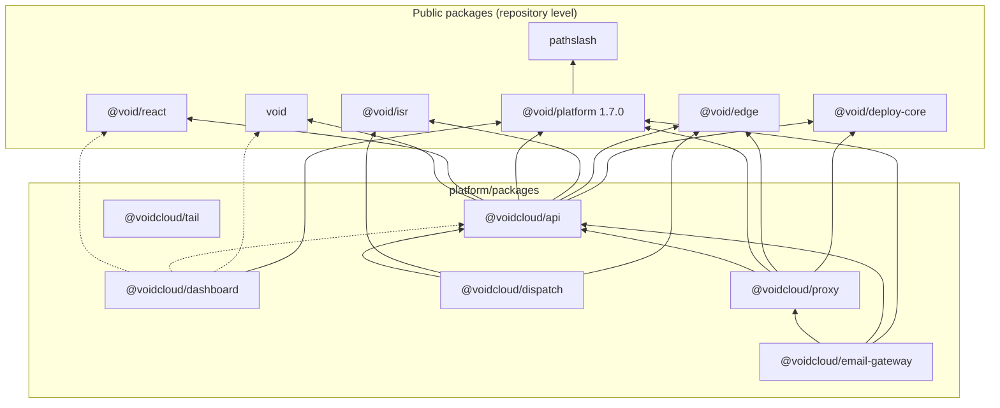
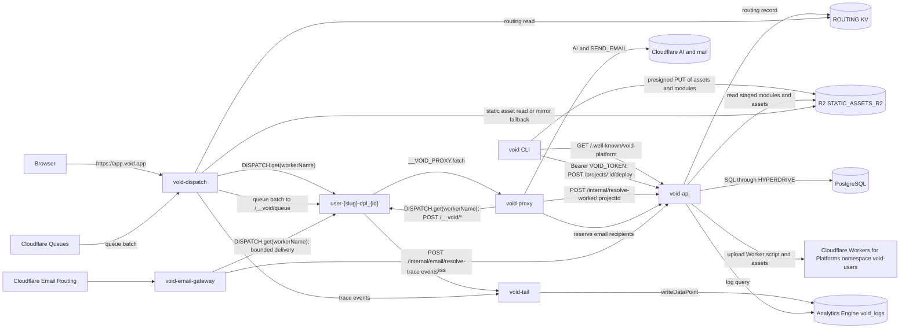

# 15 — The self-hosted Void Platform

**Thesis.** The Void Platform is an optional, self-hosted control plane. A control plane is the platform part that owns state and directs the other services. It runs inside one Cloudflare account. It adds shared team deployment, retained deployment history, platform-owned bindings, and an administrator interface. A Void application does not need it to deploy.

The source is the `void` repository at commit `f254d1ec477b6b2af2c02fa427bd9d196316ee07`. The npm package is `void` 1.7.0, under the Massachusetts Institute of Technology (MIT) license, with copyright Cloudflare, Inc. Every path below starts at `/Users/darkvoid/GitSources/src.voidzero`, and the repository name comes first. For example, `void/platform/README.md` means `/Users/darkvoid/GitSources/src.voidzero/void/platform/README.md`. Inside the repository, `platform/packages/` holds platform Workers, and `packages/` holds public packages (`void/platform/README.md:81-83`).

## Terms used in this document

| Term | Meaning in this document |
|---|---|
| Void application | A Worker built by the Void framework and deployed to Cloudflare. Documents 11 to 14 explain the framework. |
| Worker | One deployable JavaScript module on Cloudflare. Each runtime package under `platform/packages/` is one Worker. |
| Binding | A named capability attached to a Worker at deploy time, such as a key-value (KV) store, R2, a queue, a service, artificial intelligence (AI), or email (`void/packages/platform/src/worker-config.ts:94-100`). |
| Service binding | A Worker-to-Worker binding. A call goes to the target Worker's `fetch` handler without a public hostname. |
| Dispatch namespace | The Workers for Platforms container that holds tenant Workers. Workers for Platforms is a Cloudflare product that runs many customer Workers in one account (`void/docs/guide/self-hosted-platform.md:34`). A tenant Worker is a user application Worker that the platform hosts for a project. The platform binds the namespace as `DISPATCH` (`void/platform/packages/dispatch/wrangler.jsonc:16-21`). |
| Wrangler file | A Cloudflare Worker configuration file. It declares routes, bindings, and deployment settings (`void/platform/packages/api/wrangler.jsonc:1-3`). |
| Vite Plus | One of the two selectable development toolchains; it provides the `vp` command (`void/docs/reference/cli/setup.md:42`, `void/platform/packages/dashboard/package.json:7`, `void/platform/packages/dashboard/package.json:32`). |
| Void Pages mode | A routing mode that starts when a `pages/` directory exists (`void/docs/guide/pages-routing/overview.md:10`). |
| Tail consumer | A Worker that Cloudflare invokes with trace events from another Worker (`void/platform/packages/tail/README.md:7`). |
| Isolate | One execution instance of a Worker. An in-memory cache exists inside one isolate and is not shared (`void/platform/packages/proxy/src/resolve.ts:4-6`). |
| Installation | One self-hosted copy of the platform in one Cloudflare account, with its own PostgreSQL database and resource names (`void/platform/meta/architecture.md:3-6`). |
| Core installer | The part of `void platform install` that generates configurations for the five core Workers (`void/packages/platform/src/worker-config.ts:16-18`). |
| Void Cloud | The maintained hosted deployment at `api.void.cloud`. Its checked-in Wrangler files are an example, not installer output (`void/platform/meta/operations.md:3-5`). |
| Slug | The project's short name. The platform forms Worker names from it (`void/platform/packages/api/src/naming.ts:1-7`) and the default email sender from it (`void/platform/packages/api/src/provisioning/provision.ts:174-179`). |

The platform uses these Cloudflare services. D1 is a Structured Query Language (SQL) database. KV is a key-value store. R2 is object storage. Cloudflare Queues carries asynchronous messages. Hyperdrive pools connections to PostgreSQL. Analytics Engine stores time-series rows. Workers AI runs inference. AI Gateway proxies provider requests. Miniflare is the local Workers runtime used for managed prerender (`void/platform/packages/api/src/auth/deploy-token.ts:14-20`). A managed deploy is a deployment that the platform runs. Managed prerender is the prerender step of a managed deploy. The architecture document lists the stores and the stateful work (`void/platform/meta/architecture.md:74-84`).

The platform packages are private workspace packages. They live under `platform/packages/`. The public packages live under the repository-level `packages/` directory. The `@void/platform` package is also at the repository level. It holds the installation contracts and the packaged runtime, and its version is `1.7.0`, the same as the `void` package (`void/platform/README.md:81-83`, `void/packages/platform/package.json:1-4`, `void/packages/void/package.json:1-4`). The source does not show whether `@void/platform` is published to a registry.

## 1. The boundary: the platform is optional

The guide states the default path in one sentence. "For an individual app, deploy directly to Cloudflare." The guide links the phrase to its own site path `/integrations/cloudflare#deploy-to-your-own-cloudflare-account`, which is outside this repository. That sentence is at `void/docs/guide/self-hosted-platform.md:10`.

The direct path deploys to the application owner's Cloudflare account. The platform path deploys into a shared account that an operator maintains. The same application programming interfaces (APIs) serve both targets. The platform adds shared access and retained history (`void/docs/guide/self-hosted-platform.md:18`).

The source has six platform packages under `platform/packages/`. The core installer packages five of them: `api`, `dispatch`, `proxy`, `tail`, and `emailGateway` (`void/platform/README.md:7-11`). The email gateway is optional in the runtime manifest (`void/packages/platform/src/installer.ts:52-55`). An installation with email disabled deploys the other four. The installer does not provision the dashboard, and the dashboard is an optional source component (`void/platform/README.md:13-17`). The source tree does not explain why the dashboard is separate. This document records that absence rather than inventing a reason.

The documented feature difference is small. This table copies the claims at `void/docs/guide/self-hosted-platform.md:20-32`.

| Feature | Direct Cloudflare | Core self-hosted platform |
|---|---|---|
| Static sites, single-page applications (SPAs), and native Pages server-side rendering (SSR) | Supported | Supported |
| Routing rules, WebSockets, queues, cron, and Incremental Static Regeneration (ISR) | Supported | Supported |
| D1, KV, and R2 storage, plus external SQL through Hyperdrive | Supported | Supported |
| Workers AI and provider requests | User account and gateway | Installation gateway and proxy |
| Runtime logs | Live Cloudflare tail | Retained platform logs |
| Application rollback | Worker versions | Retained platform deployments |
| Typed Durable State and native Durable Objects (DOs) | Supported | Supported |
| Sandboxes | Needs Workers Paid and Docker | Needs Workers Paid on the platform account |
| Custom application domains | Supported | Enable with `void platform install --custom-domains` (`void/docs/guide/platform/installation/domains.md:62`) |
| Generated GitHub deployment workflow | Supported | Use Continuous Integration (CI) with a scoped developer token |
| User dashboard and managed GitHub builds | Not required | Not included in a standard installation |

These rows need a definition. Typed Durable State is the `defineDurableState()` application programming interface (API). Each definition becomes a SQLite-backed Durable Object (`void/docs/guide/durable-state.md:8-10`). A Durable Object is a Cloudflare class that keeps state under one name (`void/docs/guide/durable-state.md:8`). A Sandbox is a Cloudflare container that runs commands, works with files, and connects to servers (`void/docs/guide/sandboxes.md:8`). Each Sandbox identifier selects an isolated container (`void/docs/guide/sandboxes.md:8`). ISR caches a rendered page, serves the stale page, and refreshes it in the background (`void/docs/guide/edge/revalidation.md:8`). Managed GitHub builds use a GitHub App to deploy on push without a workflow file (`void/docs/guide/deployment.md:78`). The installation gateway is the AI Gateway that the platform installation owns. The direct column uses the user's own AI Gateway, with the provider key stored as a Worker secret (`void/docs/integrations/cloudflare.md:228`). The platform column sends AI traffic through the proxy to the installation gateway, and the platform chooses the gateway metadata and logging (`void/platform/packages/proxy/README.md:7`, `void/docs/guide/ai.md:145`). A Sandbox image needs Docker for local development and for a direct deployment that builds an image; a team platform builds the image for the project (`void/docs/guide/sandboxes.md:12`).

A user who skips the platform keeps a complete deployment path. The direct path uses the user's own Cloudflare account and AI gateway. The platform path adds a shared account, retained runtime logs, retained deployment rollback, an installation AI and email gateway, an optional user dashboard, and optional managed GitHub builds (`void/docs/guide/self-hosted-platform.md:18-32`). The user keeps static hosting, SSR, WebSockets, queues, cron, ISR, D1, KV, R2, Workers AI, and Durable Objects. The user must supply their own Cloudflare credentials. The direct path uses the `CLOUDFLARE_API_TOKEN` repository secret in the user's own CI system (`void/docs/guide/deployment.md:63`). Team platform CI uses a different set. It sets `VOID_TOKEN`, `VOID_API_URL`, and `VOID_PROJECT`, and it runs `void connect "$VOID_API_URL" --no-login` before `void deploy --platform void` (`void/docs/guide/deployment.md:69-74`).

The source shows the direct path in the deployment guide. For a new or unlinked app, the user can run `void connect platform.example.com` for a team platform. The `connect` command selects the platform connection for later commands (`void/docs/reference/cli/project.md:47`). The same guide also shows a direct deployment to the Cloudflare target (`void/docs/guide/deployment.md:82-101`). The dashboard's own deployment instructions run `void deploy --platform cloudflare` through Vite Plus (`void/platform/packages/dashboard/README.md:95-97`). The framework and the command-line interface (CLI) therefore do not require the platform.

## 2. Every package under `platform/packages/`

A directory scan finds exactly six packages under `platform/packages/`. Five are unversioned private workspace packages. One has version `0.0.1`. The seventh package in the table is the repository-level `@void/platform` runtime package. It is not under `platform/packages/`, but it is part of the platform story.

| Package | Version | Runtime | Entry file | Job |
|---|---|---|---|---|
| `@voidcloud/api` | none (private) | Cloudflare Worker | `void/platform/packages/api/src/worker/index.ts` (`void/platform/packages/api/wrangler.jsonc:3`) | Control plane: authentication, projects, deployments, domains, secrets, usage, administrator API and user interface. |
| `@voidcloud/dashboard` | `0.0.1` | Cloudflare Worker built as a Void Pages-mode app | `void/platform/packages/dashboard/pages/` route tree; build with `vp build` (`void/platform/packages/dashboard/package.json:7`) | Optional sign-in front end: login, callback, logout, and login-method linking. |
| `@voidcloud/dispatch` | none (private) | Cloudflare Worker | `void/platform/packages/dispatch/src/index.ts` (`void/platform/packages/dispatch/wrangler.jsonc:3`) | Application ingress: hostname routing, static assets, ISR, rules, queue relay, and request metering. |
| `@voidcloud/email-gateway` | none (private) | Cloudflare Worker with an email handler | `void/platform/packages/email-gateway/src/index.ts` (`void/platform/packages/email-gateway/wrangler.jsonc:3`) | Inbound email ingress: domain resolution, bounded delivery, and receipt handling. |
| `@voidcloud/proxy` | none (private) | Cloudflare Worker | `void/platform/packages/proxy/src/index.ts` (`void/platform/packages/proxy/wrangler.jsonc:3`) | Project capability proxy: AI, remote D1/KV/R2, ISR revalidation, and outbound email. |
| `@voidcloud/tail` | none (private) | Cloudflare Worker tail consumer | `void/platform/packages/tail/src/index.ts` (`void/platform/packages/tail/wrangler.jsonc:3`) | Runtime log ingestion into Analytics Engine. |
| `@void/platform` | `1.7.0` | Node.js library and packaged Worker bundles | `void/packages/platform/src/index.ts`; manifest exports at `void/packages/platform/package.json:19-35` | Installation contracts, discovery parsing, and the packaged runtime that the CLI installs. |

The `api` manifest has no `version` field (`void/platform/packages/api/package.json:1-16`). The `dispatch`, `proxy`, `email-gateway`, and `tail` manifests also have no `version` field (`void/platform/packages/dispatch/package.json:1-10`, `void/platform/packages/proxy/package.json:1-10`, `void/platform/packages/email-gateway/package.json:1-10`, `void/platform/packages/tail/package.json:1-10`). The dashboard manifest declares `0.0.1` (`void/platform/packages/dashboard/package.json:1-4`). The runtime package declares `1.7.0`, the MIT license, and a `dist` file set (`void/packages/platform/package.json:1-27`).

## 3. The dependency shape

The dependency graph comes from the package manifests. Solid arrows are runtime dependencies. Dashed arrows are development dependencies.

These are the nodes in the graph. `@void/edge` supplies routing, headers, and static asset helpers (`void/packages/edge/package.json:2-4`). `@void/isr` supplies incremental revalidation and cache helpers (`void/packages/isr/package.json:2-4`). `@void/deploy-core` supplies deployment contracts, manifests, and resource plans (`void/packages/deploy-core/package.json:2-4`). `@void/react` supplies React pages, server rendering, forms, and navigation (`void/packages/react/package.json:2-4`). `pathslash` is the path library that `@void/platform` imports (`void/packages/platform/src/installer.ts:4`). `@void/deploy-cloudflare` is a dependency of `void`, not of a platform package, so the graph does not include it (`void/packages/void/package.json:360`). The `api --> react` edge exists because the API server-renders the administrator pages with `renderReactPage` from `@void/react/pages-server` (`void/platform/packages/api/src/admin/react/server.ts:1`).



Three facts in this graph matter for the rest of this document. First, `@voidcloud/api` depends on `@void/platform`, `@void/edge`, `@void/isr`, `@void/deploy-core`, `@void/react`, and `void` (`void/platform/packages/api/package.json:28-56`). Second, `email-gateway` depends on `@voidcloud/proxy` (`void/platform/packages/email-gateway/package.json:8-12`). Third, `@voidcloud/tail` has no runtime dependency at all (`void/platform/packages/tail/package.json:1-16`). The other edges have the same source. `dispatch` and `proxy` depend on `@voidcloud/api` (`void/platform/packages/dispatch/package.json:11-14`, `void/platform/packages/proxy/package.json:11-15`). The dashboard lists `void`, `@void/react`, and `@voidcloud/api` as development dependencies (`void/platform/packages/dashboard/package.json:25-32`). `@void/platform` depends on `pathslash` (`void/packages/platform/package.json:50`).

The direction is deliberate. Platform packages may depend on public Software Development Kit (SDK) packages. SDK packages must not depend on `platform/` (`void/platform/README.md:83`). The rule keeps platform-only code out of the public packages, so an application can install the SDK without the control plane (`void/platform/meta/architecture.md:82-84`). Shared contracts live in the platform API package. Sibling platform packages import those contracts through subpath exports, such as `./proxy-token`, `./routing`, `./isr-store`, and `./usage-auth` (`void/platform/packages/api/package.json:5-16`). For example, the proxy imports `@voidcloud/api/proxy-token` and dispatch imports `@voidcloud/api/isr-store` (`void/platform/packages/proxy/src/resolve.ts:1`, `void/platform/packages/dispatch/src/isr.ts:18`). A public SDK package does not import a `platform/` path.

## 4. The `api` package: control plane

### 4.1 Framework and entry point

The API is a Cloudflare Worker written with Hono. Hono is the web framework that provides the router (`void/platform/packages/api/src/index.ts:192`). It uses Drizzle Object Relational Mapping (ORM) over PostgreSQL through Hyperdrive (`void/platform/packages/api/README.md:5`). The Worker entry file is `src/worker/index.ts` (`void/platform/packages/api/wrangler.jsonc:3`). That file re-exports the default Hono handler and the Durable Object classes from `src/index.ts`, because workerd validates every entry-module export (`void/platform/packages/api/src/worker/index.ts:1-13`). workerd is the Cloudflare Workers runtime (`void/platform/packages/api/src/cron-scheduler.ts:209-225`).

The Hono application starts at `void/platform/packages/api/src/index.ts:192`. The default export provides `fetch`, `scheduled`, and `queue` (`void/platform/packages/api/src/index.ts:1301-1308`).

### 4.2 Routes

The router mounts public, internal, project, operator, and administrator groups. Each route is a Uniform Resource Locator (URL) path. The administrator routes return HyperText Markup Language (HTML) pages with cookie authentication and a Cross-Site Request Forgery (CSRF) check. This is the mount block with the project, operator, and administrator routes. The block is an excerpt of the `app` chain; it starts after the `const app` assignment.

```ts
// void/platform/packages/api/src/index.ts:589-626
  .use('/projects/*', authMiddleware)
  .route('/projects', projects)
  .route('/projects', projectTokens)
  .route('/projects', projectTeamRoutes)
  .route('/projects', projectZeroTrustRoutes)
  .route('/projects', deploy)
  .route('/projects', deleteRoute)
  .route('/projects', revalidate)
  .route('/projects', secrets)
  .route('/projects', domains)
  .route('/projects', emailRoutes)
  .route('/projects', githubProjectRoutes)
  .route('/projects', projectUsage)
  .use('/usage', authMiddleware)
  .route('/usage', accountUsage);

// Versioned bearer-authenticated operator API. It has no browser cookie bypass.
app.route('/operator/v1', operatorApi);

// Admin dashboard (HTML, cookie-based auth)
app.route('/admin', adminLogin);
app.get('/admin', (context) => context.redirect(`/admin/${new URL(context.req.url).search}`, 308));
app.use('/admin/*', adminAuthMiddleware);
app.use('/admin/*', adminCsrfMiddleware);
app.post('/admin/fate', adminFateHandler);
app.get('/admin/', dashboardHandler);
app.route('/admin/users', adminUsers);
app.route('/admin/projects', adminProjects);
app.route('/admin/email', adminEmail);
app.route('/admin/zero-trust', adminZeroTrust);
app.route('/admin/builds', adminBuilds);
app.route('/admin/deployments', adminDeployments);
app.route('/admin/signup-control', adminSignupControl);
app.route('/admin/config/auth', adminAuthConfig);
app.route('/admin/connected-apps', connectedApps);
app.route('/admin/config/plans', adminPlans);
app.route('/admin/invitations', adminInvitations);
app.route('/admin', adminSystem);
```

The earlier mounts cover authentication and internal service traffic. `platformBootstrapRoutes` is at `/`, `auth` and `oidcRoutes` are at `/auth`, and `oauth` is at `/oauth` (`void/platform/packages/api/src/index.ts:557-561`). The internal routes include `/internal/revalidate`, `/internal/email/*`, `/internal/resolve-resource`, `/internal/resolve-worker`, `/internal/verify-owner`, and `/internal/verify-prerender-build` (`void/platform/packages/api/src/index.ts:562-572`). The public metadata route is `/health` and the discovery route is `/.well-known/void-platform` (`void/platform/packages/api/src/index.ts:322-409`).

`POST /projects/:id/deploy` handles worker and static deployments (`void/platform/packages/api/README.md:241-243`). The route calls `handleManifestOnlyDeploy`, which runs `runDeploymentPipeline` (`void/platform/packages/api/src/routes/deploy.ts:484`, `void/platform/packages/api/src/deploy/execute.ts:125`, `void/platform/packages/api/src/deploy/pipeline.ts:86`). The function name says manifest-only, but the route uses it for both worker and static deployments. The pipeline calls `uploadDeploymentWorker`, and that function calls `provisionBindings` to create bindings and queues (`void/platform/packages/api/src/deploy/upload-worker.ts:160`, `void/platform/packages/api/src/deploy/upload-worker.ts:238`, `void/platform/packages/api/src/provisioning/provision.ts:171-195`, `void/platform/packages/api/src/provisioning/provision.ts:302-304`). The pipeline then calls `migrateDeploymentWorker`, which sends `POST /__void/migrate` to the new Worker (`void/platform/packages/api/src/deploy/pipeline.ts:1005`, `void/platform/packages/api/src/deploy/migrate-worker.ts:34`, `void/platform/packages/api/src/deploy/migrate-worker.ts:254`). Migration applies the application's pending database migrations to the new Worker (`void/platform/packages/api/src/deploy/migrate-worker.ts:254`). The Worker's handler runs those migrations against the application's own D1 binding `DB`, with the SQLite dialect (`void/packages/void/src/runtime/migration-handler.ts:67-73`, `void/packages/void/src/runtime/migration-handler.ts:80`, `void/packages/void/src/runtime/migration-handler.ts:91-105`). It does not touch the platform PostgreSQL database. Finally, `publishWorkerDeployment` builds the routing entry with `buildRoutingJson`, writes `ROUTING` with `putTrackedRouting`, and marks the deployment live (`void/platform/packages/api/src/deploy/publish-worker.ts:64`, `void/platform/packages/api/src/deploy/publish-worker.ts:374`, `void/platform/packages/api/src/deploy/publish-worker.ts:402`, `void/platform/packages/api/src/deploy/publish-worker.ts:428-443`). Live is the deployment status in PostgreSQL, and routing points to the new Worker (`void/platform/packages/api/src/deploy/publish-worker.ts:428-443`). The worker name is `user-{slug}-{deploymentId}` (`void/platform/packages/api/src/naming.ts:5-7`, `void/platform/packages/api/README.md:263`). The generator makes a deployment identifier from `dpl_` and 12 lowercase alphanumeric characters (`void/platform/packages/api/src/id.ts:1-15`, `void/platform/packages/api/src/db/deployments.ts:53`). The log query route accepts any non-empty lowercase alphanumeric suffix after `dpl_` and does not check the length (`void/platform/packages/api/src/routes/projects.ts:2459`). The tail tag parser also accepts uppercase letters and underscores (`void/platform/packages/tail/src/index.ts:28`).

### 4.3 Data store and schema

PostgreSQL through the `HYPERDRIVE` binding is the platform database (`void/platform/packages/api/wrangler.jsonc:35-42`). The Drizzle middleware creates a database client for each request (`void/platform/packages/api/src/index.ts:298-302`). The `schema.ts` file defines 49 tables directly (`void/platform/packages/api/src/schema.ts:36`, `void/platform/packages/api/src/schema.ts:1582`). These groups list all 49:

| Group | Tables and `schema.ts` line |
|---|---|
| Identity and login | `users` (36), `oauth_accounts` (61), `oauth_clients` (78), `oauth_grants` (91), `oauth_refresh_tokens` (117), `oauth_requests` (144), `platform_auth_settings` (166), `platform_login_connections` (189), `platform_login_revisions` (223), `platform_login_identities` (241), `platform_human_sessions` (273), `platform_company_identities` (306), `platform_login_tests` (321), `platform_auth_attempts` (340), `platform_auth_bootstrap` (358), `oauth_nonces` (1167), `invitations` (1582) |
| Projects | `projects` (385), `preview_tickets` (426), `project_deploy_credentials` (441), `project_members` (469), `project_invitations` (491), `project_ownership_periods` (530), `project_access_events` (560), `project_zero_trust` (600) |
| Deployments and builds | `deployments` (641), `deployment_operations` (700), `project_cleanup_jobs` (745), `builds` (1504) |
| Resources and secrets | `project_secrets` (775), `resources` (799), `domains` (838), `project_migrations` (1220), `project_database_credentials` (1242) |
| Email | `email_destinations` (859), `email_destination_cleanups` (936), `email_domains` (985) |
| Operator and platform | `platform_settings` (1077), `operator_sessions` (1087), `operator_events` (1103), `sandbox_drain_checkpoints` (1119), `platform_events` (1136), `auth_codes` (1177), `migration_renames` (1201) |
| GitHub | `github_installations` (1268), `github_connections` (1312), `github_installation_members` (1379), `github_installation_revocations` (1431), `github_webhook_redeliveries` (1474) |

The same file also re-exports two email schema files (`void/platform/packages/api/src/schema.ts:1609-1611`). `connection-schema.ts` defines seven email tables (`void/platform/packages/api/src/email/connection-schema.ts:17`, `void/platform/packages/api/src/email/connection-schema.ts:284`). `admission-schema.ts` defines six (`void/platform/packages/api/src/email/admission-schema.ts:14`, `void/platform/packages/api/src/email/admission-schema.ts:118`). The `email_receipts` table is one of the six and records inbound email admission (`void/platform/packages/api/src/email/admission-schema.ts:40-52`).

This is the start of the user table.

```ts
// void/platform/packages/api/src/schema.ts:36-56
export const users = pgTable(
  'users',
  {
    id: text('id').primaryKey(),
    provider: text('provider').notNull().default('github'),
    provider_id: text('provider_id').notNull().default(''),
    login: text('login').notNull().default(''),
    email: text('email'),
    plan: text('plan').notNull().default('free').$type<PlanId>(),
    role: text('role').notNull().default('user').$type<'user' | 'admin'>(),
    billing_cycle_start: timestamp('billing_cycle_start', { mode: 'string' })
      .notNull()
      .defaultNow(),
    suspended_reason: text('suspended_reason'),
    created_at: timestamp('created_at', { mode: 'string' }).notNull().defaultNow(),
  },
  (table) => [
    uniqueIndex('idx_users_provider_id').on(table.provider, table.provider_id),
    index('idx_users_email').on(table.email),
  ],
);
```

The database holds users, projects, deployments, resource ownership, administrator sessions, and audit records (`void/platform/meta/architecture.md:74-80`). Application D1, KV, R2, and Queue resources are separate from the platform stores (`void/platform/meta/architecture.md:82-84`).

### 4.4 Authentication model

The API has five credentials paths. The first path is a sign-in JavaScript Object Notation (JSON) Web Token (JWT) with audience `api`. The second path is a project-scoped deploy token with audience `deploy`. The third path is an Open Authorization (OAuth) publish token with audience `oauth-deploy` or `oauth-preview`. The fourth path is an operator session with audience `operator`. The fifth path is an administrator cookie for `/admin/*`. An audience is the intended recipient identifier that the token names.

The JWT is signed with the `JWT_SECRET` Worker secret. For normal requests the middleware reads `Authorization: Bearer`, verifies the signature and expiry, and accepts only the listed audiences.

```ts
// void/platform/packages/api/src/middleware/auth.ts:94-116
  const header = context.req.header('Authorization');
  if (!header?.startsWith('Bearer ')) {
    return context.json(
      { error: 'unauthorized', message: 'Sign in to this platform before continuing.' },
      401,
    );
  }

  const token = header.slice(7);
  // Accept full `api` tokens and short-lived project-scoped `deploy` tokens
  // (minted for remote builds). Verify the signature/expiry without pinning the
  // audience, then accept only these two audiences.
  const payload = await verifyJwt(token, context.env.JWT_SECRET);
  if (!payload || !['api', 'deploy', 'oauth-deploy', 'oauth-preview'].includes(payload.aud)) {
    return context.json(
      {
        error: 'invalid or expired token',
        message:
          'Your sign-in or credential is invalid or has expired. Sign in again, or replace the credential used by your automation.',
      },
      401,
    );
  }
```

The comment at the start of the block says "accept only these two audiences". The code accepts four audiences. The comment is stale (`void/platform/packages/api/src/middleware/auth.ts:103-107`).

An `api` token is not sufficient alone. For that audience only, the middleware also requires an active human session for the `sid` claim (`void/platform/packages/api/src/middleware/auth.ts:118-130`). The check loads the session row, the login connection, and the user. It rejects a disabled connection, a session generation that no longer matches its login connection, a revoked session, and an expired session (`void/platform/packages/api/src/auth/sessions.ts:107-139`). A legacy token without `sid` is accepted only when the `sessions_required` setting is false and Cloudflare Access protection is off (`void/platform/packages/api/src/auth/sessions.ts:116-120`). The deploy token and the OAuth tokens do not take this check. A deploy token is checked by its project and build claims and by the allowlist (`void/platform/packages/api/src/auth/deploy-token.ts:38-76`, `void/platform/packages/api/src/middleware/auth.ts:41-78`). An OAuth token is checked by its approval, project, and kind (`void/platform/packages/api/src/middleware/auth.ts:175-199`).

A deploy token is more restricted than a normal API token. It is a short-lived JWT with `aud: 'deploy'` and claims for one project and one build (`void/platform/packages/api/src/auth/deploy-token.ts:38-76`). The middleware applies a default-deny allowlist of methods and paths (`void/platform/packages/api/src/middleware/auth.ts:41-78`). The list covers deploy preparation, deploy finalization, resource and deployment reads, a database route, a prerender token, and secret reads (`void/platform/packages/api/src/middleware/auth.ts:41-55`). It cannot delete a project, write secrets, or alter membership.

```ts
// void/platform/packages/api/src/auth/deploy-token.ts:55-76
export async function signDeployToken(
  {
    projectId,
    userId,
    login,
    buildId,
  }: { projectId: string; userId: string; login: string; buildId: string },
  secret: string,
  opts?: { ttlSeconds?: number },
): Promise<string> {
  return signJwt(
    {
      sub: userId,
      login,
      aud: 'deploy',
      project: projectId,
      build: buildId,
    },
    secret,
    { ttlSeconds: opts?.ttlSeconds ?? DEPLOY_TOKEN_TTL_SECONDS },
  );
}
```

Two OAuth audiences support publishing from an OAuth client. An `oauth-deploy` or `oauth-preview` token must carry an `oauthApproval` claim and a `project` claim. The middleware loads the approval and checks the actor, the project, and the approval kind (`void/platform/packages/api/src/middleware/auth.ts:175-191`). It permits only deployment upload, deployment finalization, a project read, and the deployment event stream for that approval (`void/platform/packages/api/src/middleware/auth.ts:192-226`). A preview token is not valid for a normal project (`void/platform/packages/api/src/middleware/auth.ts:155-173`).

The deploy allowlist also contains `POST /projects/:id/prerender-token` (`void/platform/packages/api/src/middleware/auth.ts:47`). The API mints a five-minute token with audience `prerender` (`void/platform/packages/api/src/auth/deploy-token.ts:14-20`, `void/platform/packages/api/src/auth/deploy-token.ts:114-152`). A managed deploy gives that token to the built application under Miniflare. The command-line interface starts Miniflare in its own process and passes the token as the `__VOID_TOKEN` binding (`void/packages/void/src/prerender.ts:127-153`, `void/packages/void/src/prerender.ts:217-233`). In a managed build, the command-line interface runs inside the build container, so Miniflare runs there (`void/platform/packages/api/src/build-manager.ts:1166-1168`). The application uses it to read remote D1, KV, R2, and AI during prerender (`void/platform/packages/api/src/auth/deploy-token.ts:14-20`). The API middleware does not accept the `prerender` audience. The proxy does (`void/platform/packages/proxy/src/index.ts:395-397`).

The operator API is separate. An administrator exchanges a full sign-in session for a one-hour operator token. The token carries a token identifier in `jti`, an audience of `operator`, and the exact API origin (`void/platform/packages/api/src/operator/auth.ts:12-26`, `void/platform/packages/api/src/operator/auth.ts:91-105`). The token does not carry the human session identifier. The operator session row stores that identifier in `human_session_id` (`void/platform/packages/api/src/operator/auth.ts:107-108`). The middleware checks the operator session row, the human session, and the administrator role (`void/platform/packages/api/src/operator/auth.ts:27-57`).

```ts
// void/platform/packages/api/src/operator/auth.ts:91-105
  const id = crypto.randomUUID();
  const expiresAt = new Date(
    (Math.floor(Date.now() / 1000) + SESSION_SECONDS) * 1000,
  ).toISOString();
  const token = await signJwt(
    {
      sub: user.id,
      login: user.login,
      aud: 'operator',
      jti: id,
      operatorOrigin: new URL(context.req.url).origin,
    },
    context.env.JWT_SECRET,
    { ttlSeconds: SESSION_SECONDS },
  );
```

Sign-in itself supports GitHub, Google, generic OpenID Connect (OIDC), and Cloudflare Access (`void/docs/guide/self-hosted-platform.md:12`). The API reads enabled login connections from the database (`void/platform/packages/api/README.md:221-229`). A dashboard redirect receives a short-lived code for `POST /auth/exchange`. A CLI redirect with Proof Key for Code Exchange (PKCE) and the Secure Hash Algorithm 256-bit (SHA-256) challenge method, labeled S256, receives a code for `POST /auth/cli/token` (`void/platform/packages/api/README.md:231-237`). Dashboard authentication stores the JWT in the `void_token` cookie (`void/platform/packages/api/README.md:239`).

The API also applies Cloudflare Access protection through the `platformAccessProtection` middleware (`void/platform/packages/api/src/index.ts:304`). An Access assertion is a JWT. An Access application is the Cloudflare Access configuration for one origin. The API finds the Access application whose origin matches the request origin, then verifies the assertion audience against that application's audience (`void/platform/packages/api/src/auth/access.ts:28-58`). Cloudflare Access has two roles. It can be a login method, and it can protect the whole platform. The installer treats those as separate choices (`void/docs/guide/platform/installation/setup.md:45-47`).

### 4.5 Background work

The API owns the queues and the Durable Objects. A Durable Object is a Cloudflare class that keeps state under one name (`void/docs/guide/durable-state.md:8-10`). A class is the exported JavaScript constructor that the `class_name` field names. A namespace is the binding that addresses all instances of one class (`void/platform/packages/api/wrangler.jsonc:69-100`). The binding `name` is the namespace name (`void/platform/packages/api/wrangler.jsonc:69-100`). A Durable Object performs background work through its `alarm()` handler. The runtime calls `alarm()` at a scheduled time. The handler can schedule the next alarm with `ctx.storage.setAlarm()` (`void/platform/packages/api/src/cron-scheduler.ts:186`, `void/platform/packages/api/src/cron-scheduler.ts:192-231`). `/poke` is an internal `POST` route on the scheduler object. A caller uses it to ask for an immediate scan (`void/platform/packages/api/src/build-scheduler.ts:51-58`). `CronScheduler` schedules the next alarm after each run. `BuildScheduler` arms an alarm on `/poke` and reschedules itself while its queue has work (`void/platform/packages/api/src/cron-scheduler.ts:228-231`, `void/platform/packages/api/src/build-scheduler.ts:39-48`, `void/platform/packages/api/src/build-scheduler.ts:57`).

The `wrangler.jsonc` declares the `USAGE_COUNTER`, `CRON_SCHEDULER`, `ERROR_ALERT_MONITOR`, `SANDBOX_CONCURRENCY_COUNTER`, `BUILD_SCHEDULER`, `BUILD_MANAGER`, and `BUILD_MANAGER_LARGE` bindings (`void/platform/packages/api/wrangler.jsonc:69-100`). It declares the `void-cron-fires`, `void-usage-events`, and `void-deployments` queues and two cron triggers (`void/platform/packages/api/wrangler.jsonc:155-193`).

The first four classes use the `new_classes` migration array: `UsageCounter`, `CronScheduler`, `ErrorAlertMonitor`, and `SandboxConcurrencyCounter`. The three build classes use the `new_sqlite_classes` migration array: `BuildScheduler`, `BuildManager`, and `BuildManagerLarge` (`void/platform/packages/api/wrangler.jsonc:101-125`). A migration array is the list of classes that one Wrangler migration creates. `new_classes` creates a class with key-value storage. `new_sqlite_classes` creates a class with SQLite storage (`void/packages/deploy-cloudflare/src/existing.ts:362-365`, `void/packages/void/AGENTS.md:132`, `void/docs/guide/durable-state.md:10`). The architecture document says the managed build subsystem keeps build logs in Durable Object SQLite storage, separately from application runtime logs (`void/platform/meta/architecture.md:77-80`).

Two build containers use the `standard-3` and `standard-4` instance types (`void/platform/packages/api/wrangler.jsonc:127-154`). `BuildManager` uses `standard-3`, and `BuildManagerLarge` uses `standard-4` (`void/platform/packages/api/wrangler.jsonc:127-154`). The scheduler sends a build to one fleet or the other by the plan that the build records (`void/platform/packages/api/src/build-scheduler.ts:112-118`). A container is a Cloudflare runtime that starts from an image (`void/platform/packages/api/wrangler.jsonc:127-132`). An instance type sets the processor, memory, and disk size of one container (`void/platform/packages/api/wrangler.jsonc:127-154`). The build scheduler chooses the class from the build's recorded instance type (`void/platform/packages/api/README.md:281-283`). This work is part of the control plane, not of the application runtime.

The managed build path runs end to end. A GitHub push reaches the webhook route, which creates the build row and calls the scheduler (`void/platform/packages/api/src/routes/webhooks.ts:450`, `void/platform/packages/api/src/routes/webhooks.ts:520`). The call is a best-effort `POST` to the scheduler object (`void/platform/packages/api/src/routes/webhooks.ts:191-202`). The `BuildScheduler` is a singleton object that drains the container build queue. It claims each startable build and hands it to a per-build `BuildManager` over a Durable Object call (`void/platform/packages/api/src/build-scheduler.ts:39-48`). `BuildManager` is a container class (`void/platform/packages/api/src/build-manager.ts:1171`). The container runs the real `void deploy` command with a short-lived project token, so the deployment uses the same finalization route as a manual deploy (`void/platform/packages/api/src/build-manager.ts:1166-1168`). After the command exits, the build manager looks up the deployment by project and commit and records the link (`void/platform/packages/api/src/build-manager.ts:2322-2360`).

## 5. The `dashboard` package: optional sign-in front end

The dashboard is a React application in Void Pages mode. Void Pages mode starts when a `pages/` directory exists (`void/docs/guide/pages-routing/overview.md:10`). Vite is the development and build tool that runs the Void plugins (`void/platform/packages/dashboard/vite.config.ts:1-12`). Vite Plus and Vite are the two toolchain choices in `void init` (`void/docs/reference/cli/setup.md:42`). The source does not state whether Vite Plus contains Vite. `voidPlugin()` returns the Vite plugins that build and serve a Void application (`void/packages/void/src/index.ts:92-96`). `voidReact()` is the React adapter plugin from `@void/react/plugin` (`void/platform/packages/dashboard/vite.config.ts:2-11`). The dashboard uses both plugins, renders on the server, and hydrates in the browser (`void/platform/packages/dashboard/README.md:8-13`). Hydration is the browser step in which React takes control of the server-rendered HTML (`void/platform/packages/dashboard/README.md:8`). The Void configuration names the Worker `void-dashboard` and serves it at `dash.void.cloud` (`void/platform/packages/dashboard/void.config.ts:14-31`). Those names describe Void Cloud, not an installer-managed installation.

The dashboard is not the administrator interface. Its pages are `/login`, `/auth/callback`, `/`, `/account`, and `/logout` (`void/platform/packages/dashboard/README.md:19-23`). The `/` page is a minimal confirmation page. The account page links another login method to the account (`void/platform/packages/dashboard/README.md:19-23`).

The dashboard calls the API through the `API` service binding in a deployed Worker. It falls back to HyperText Transfer Protocol (HTTP) for local development.

```ts
// void/platform/packages/dashboard/lib/api.ts:19-48
const API_URL = 'https://api.void.cloud';
const DEFAULT_API_TIMEOUT_MS = 10_000;

export function getPublicApiUrl(context: Context): string {
  return (context.env as Record<string, string | undefined>).API_URL ?? API_URL;
}

/**
 * Use service binding in deployed dashboard workers. In local dev, always use
 * HTTP so production-backed dashboard testing cannot accidentally route to a
 * local or unresolved service binding.
 */
function getApiFetch(context: Context): typeof fetch {
  const binding = (context.env as { API?: Fetcher }).API;
  if (binding && !isLocalDashboardHost(context.req.header('host') ?? '')) {
    return ((input: RequestInfo | URL, init?: RequestInit) => {
      // The service binding is internal. Preserve the browser's actual protected origin so
      // the API verifies the dashboard application's audience, not the API application's.
      // No forwarded-host header participates in this choice.
      const url = new URL(input instanceof Request ? input.url : String(input));
      if (context.req.header('Cf-Access-Jwt-Assertion')) {
        const source = new URL(dashboardRequestOrigin(context));
        url.host = source.host;
        url.protocol = source.protocol;
      }
      return binding.fetch(input instanceof Request ? new Request(url, input) : url, init);
    }) as typeof fetch;
  }
  return globalThis.fetch;
}
```

The `Cf-Access-Jwt-Assertion` header means Cloudflare Access has already authenticated the request. The dashboard rewrites the service-binding request host and protocol to the browser's protected origin (`void/platform/packages/dashboard/lib/origin.ts:16-36`). The API then selects the Access application by that origin and verifies the assertion against that application's audience (`void/platform/packages/api/src/auth/access.ts:28-58`). Without the rewrite, the internal API origin would select the API application, not the dashboard application (`void/platform/packages/dashboard/lib/api.ts:19-48`).

The `API_URL` variable supplies browser-facing login URLs. The `API` binding supplies server requests (`void/platform/packages/dashboard/README.md:99-102`). A self-hosted dashboard must set `API_URL` to its own API origin and change the checked-in Worker name and route (`void/platform/packages/dashboard/README.md:64-97`). The dashboard validates the `void_token` cookie by calling `GET /me` (`void/platform/packages/dashboard/middleware/01.auth.ts:26-51`). The callback exchanges a code at `/auth/exchange` for a token (`void/platform/packages/dashboard/pages/auth/callback.server.ts:43-91`).

The core platform installer does not include the dashboard (`void/platform/packages/dashboard/README.md:60-62`). An operator who wants it copies the source, changes the Worker name and route, and deploys it separately (`void/platform/packages/dashboard/README.md:64-97`).

## 6. The `dispatch` package: application ingress

The dispatch Worker receives application traffic for `*.void.app` (`void/platform/packages/dispatch/wrangler.jsonc:6-11`). That route belongs to Void Cloud. An installation derives its base hostname from `SITE_DOMAIN` or `BASE_HOSTNAME`, and the fallback is `void.app` (`void/packages/platform/src/application.ts:27-29`). It also owns the queue relay and metering (`void/platform/README.md:3-5`).

The platform has a traffic gate. The gate is closed when `PLATFORM_TRAFFIC_STATE` equals `staging` or `sandbox-drain`. A missing value, or any other value, leaves the gate open. The value `staging` marks a non-production environment. The value `sandbox-drain` marks the cleanup that removes legacy tenant Sandbox resources (`void/docs/reference/cli/platform-operations.md:57-67`). A value of `disabled` under the `__void/platform/disabled/v1` key in the `ROUTING` namespace also closes the gate (`void/packages/platform/src/installation.ts:15-16`, `void/platform/packages/dispatch/src/index.ts:706-713`). A closed gate returns a maintenance response at dispatch (`void/platform/packages/dispatch/src/index.ts:706-713`). The queue relay retries the batch after `PLATFORM_QUEUE_RETRY_DELAY_SECONDS` (`void/platform/packages/dispatch/src/index.ts:2007-2036`). The API computes the same pause from the same state. It sets a request flag named `platformTrafficPaused`. A login callback that is not an administrator callback then gets a 503 response with `Platform disabled` (`void/platform/packages/api/src/index.ts:251-265`, `void/platform/packages/api/src/index.ts:306-318`).

### 6.1 Finding the target

Dispatch resolves the hostname to a slug or to a `domain:{hostname}` key. It then reads the routing entry from the `ROUTING` KV namespace with a 60-second cache. The API writes the `domain:{hostname}` key only after Cloudflare custom-hostname ownership and certificate validation pass. It copies the project's slug route, writes the key, and then marks the domain active (`void/platform/packages/api/src/provisioning/activate-domain.ts:81-85`, `void/platform/packages/api/src/provisioning/activate-domain.ts:120-140`). A custom domain is a Cloudflare for SaaS custom hostname (`void/platform/packages/api/src/provisioning/activate-domain.ts:20-23`, `void/platform/packages/api/src/provisioning/activate-domain.ts:60`).

```ts
// void/platform/packages/dispatch/src/index.ts:735-756
    const selected = await resolveProjectHostname(url.hostname, env);
    const slug = selected.slug;
    if (selected.workersDev && !selected.projectId) {
      return createErrorResponse(request, 404, 'Not Found');
    }
    const routingKey = slug ?? `domain:${url.hostname}`;

    let routingRaw = await env.ROUTING.get(privatePreview ? 'preview:' + routingKey : routingKey, {
      cacheTtl: 60,
    });
    let previewRoute = privatePreview;
    if (!routingRaw && !privatePreview && slug?.startsWith('preview-')) {
      routingRaw = await env.ROUTING.get('preview:' + routingKey, { cacheTtl: 60 });
      previewRoute = true;
    }
    if (!routingRaw) {
      return createErrorResponse(request, 404, 'Not Found', {
        'Cache-Control': 'public, max-age=30',
      });
    }

    const routing: RoutingEntry = JSON.parse(routingRaw);
```

The routing entry contains the worker name, project identifier, optional user identifier, deployment type, ISR settings, limits, rules, static deployment identifier, asset manifest identifier, and Zero Trust settings (`void/platform/packages/dispatch/src/index.ts:68-100`). Zero Trust is Cloudflare's access-control product. Project Zero Trust puts Cloudflare Access in front of project hostnames, including custom domains (`void/docs/guide/platform/administration/zero-trust.md:8`). The API writes this entry after a successful deployment (`void/platform/packages/api/README.md:265`).

The `preview:` key prefix marks a private preview route. A private preview is a deployment served under a preview hostname. The public dispatcher passes `privatePreview` as false. The API uses a separate `PreviewDispatcher` entry point, which passes true (`void/platform/packages/dispatch/src/index.ts:2172-2177`). A slug that starts with `preview-` also selects the `preview:` entry (`void/platform/packages/dispatch/src/index.ts:746-749`). A `workersDev` result means the hostname is under the platform application's workers.dev subdomain. workers.dev is the default Cloudflare hostname form for a Worker that enables `workers_dev` (`void/platform/packages/email-gateway/wrangler.jsonc:6`). A `workersDev` hostname with no project identifier returns 404 (`void/platform/packages/dispatch/src/project-hostname.ts:13-28`, `void/platform/packages/dispatch/src/index.ts:737-739`).

### 6.2 Dispatching to the user Worker

The dispatch namespace binding is `DISPATCH`, with namespace `void-users` (`void/platform/packages/dispatch/wrangler.jsonc:16-21`). Dispatch gets the user Worker by name. It applies plan-specific limits when the routing entry carries them.

```ts
// void/platform/packages/dispatch/src/index.ts:2345-2351
/** Get a dispatch worker, applying custom limits if configured. */
function getWorker(env: Env, routing: RoutingEntry): Fetcher {
  if (routing.limits) {
    return env.DISPATCH.get(routing.workerName, {}, { limits: routing.limits });
  }
  return env.DISPATCH.get(routing.workerName);
}
```

Dispatch uses no Durable Object. Its routing state is the `ROUTING` KV namespace, and its execution target is the dispatch namespace binding (`void/platform/packages/dispatch/wrangler.jsonc:16-35`).

Dispatch blocks `/__void/*` and the legacy `/__scheduled` and `/__queue` paths from external callers (`void/platform/packages/dispatch/src/index.ts:721-733`). It serves static assets, applies redirect and fallback rules, and handles ISR with `ISR_CACHE` and the edge cache (`void/platform/packages/dispatch/README.md:5-30`). The order is fixed. Dispatch rejects a suspended project. It applies redirect rules before any asset work and serves a hashed asset or a static asset when one matches. It applies fallback rules only after an asset miss, forwards `/api/*` to the user Worker, and applies ISR on an SSR path (`void/platform/packages/dispatch/README.md:7-19`). The edge cache is the Cloudflare cache that `caches.default` names (`void/platform/packages/dispatch/README.md:7-9`).

Dispatch also has a safety net for Cloudflare asset upload dedupe poisoning. Cloudflare's asset upload deduplication can acknowledge a content hash while the asset is unavailable (`void/platform/meta/design-docs/0066-wfp-asset-r2-fallback.md:8`). Cloudflare then returns an HTTP 200 text stub with the marker `Assets have not yet been deployed to this script.` (`void/platform/packages/dispatch/src/index.ts:363-380`). The platform mirror is the platform-owned copy of the assets and its serving manifest. A serving manifest maps each asset path to a content hash. A leading `!` on the hash means the bytes are in R2 (`void/platform/packages/api/src/deploy/upload-worker.ts:367-375`, `void/platform/packages/api/src/deploy/serving-assets.ts:96-106`). The deploy writes the manifest to `ROUTING` under `manifest:{deploymentId}` and writes every current asset to `STATIC_ASSETS_R2` (`void/platform/packages/api/README.md:262`, `void/platform/packages/api/src/deploy/upload-worker.ts:333-385`). `STATIC_ASSETS` is a legacy KV binding, and `STATIC_ASSETS_R2` is an R2 binding (`void/platform/packages/api/wrangler.jsonc:53-60`). Dispatch reads a hash without `!` from `STATIC_ASSETS` and a hash with `!` from `STATIC_ASSETS_R2` (`void/platform/packages/dispatch/src/index.ts:2299-2342`). When dispatch confirms the stub, it resolves the requested path from the manifest and serves the mirrored bytes (`void/platform/packages/dispatch/src/index.ts:465-525`). If the mirror is absent or incomplete, dispatch returns an attributed 503 (`void/platform/packages/dispatch/src/index.ts:607-621`). An attributed 503 carries a `failureKind` such as `platform-static-asset-missing`. The platform meters that failure and excludes it from customer application-error email (`void/platform/packages/dispatch/src/index.ts:137-139`, `void/platform/packages/dispatch/README.md:17`). The source does not state who sends that email or who receives it. The source does not state whether Cloudflare documents the dedupe fault.

### 6.3 The queue relay

`Cloudflare Queues` delivers a batch to the dispatch Worker. Dispatch checks the platform traffic gate. It reads the `queue:{queueId}` entry from `ROUTING`. It serializes the batch and posts it to the active user Worker at `/__void/queue`. `queueId` is the Cloudflare queue name. The platform forms it as `<projectId>-<queueName>` in lowercase, with underscores replaced by hyphens (`void/platform/packages/api/src/naming.ts:9-11`). The API writes the entry during publish (`void/platform/packages/api/src/deploy/publish-worker.ts:240-249`). The code below is an excerpt of that queue handler.

```ts
// void/platform/packages/dispatch/src/index.ts:2039-2079
    // Look up which user worker handles this queue
    const routingRaw = await env.ROUTING.get(`queue:${batch.queue}`, { cacheTtl: 60 });
    if (!routingRaw) {
      console.error(
        `[queue-relay] missing routing entry for queue="${batch.queue}"; retrying all messages`,
      );
      batch.retryAll();
      return;
    }
    const { workerName, projectId, queueName, proxyToken } = JSON.parse(
      routingRaw,
    ) as QueueRoutingEntry;
    if (projectId && (await isProjectSuspended(env, projectId))) {
      console.warn(
        `[queue-relay] project suspended; retrying queue="${batch.queue}" in ${SUSPENDED_PROJECT_QUEUE_RETRY_DELAY_SECONDS}s`,
      );
      batch.retryAll({ delaySeconds: SUSPENDED_PROJECT_QUEUE_RETRY_DELAY_SECONDS });
      return;
    }

    // Serialize batch for relay
    const messages = Array.from(batch.messages, (message) => ({
      id: message.id,
      timestamp: message.timestamp.toISOString(),
      body: message.body,
      attempts: message.attempts,
    }));

    const worker = env.DISPATCH.get(workerName);
    try {
      const body = JSON.stringify({ queue: queueName, messages });
      const queueHeaders: Record<string, string> = { 'Content-Type': 'application/json' };
      if (proxyToken) {
        queueHeaders['x-void-internal'] = proxyToken;
      }
      let res = await worker.fetch(
        new Request('https://internal/__void/queue', {
          method: 'POST',
          headers: queueHeaders,
          body,
        }),
```

Dispatch does not store the batch. It holds the batch only for the life of the invocation. A success acknowledges the whole batch, and a failure retries it (`void/platform/packages/dispatch/README.md:32-42`). A long platform disable can exhaust the Queue retry count and the Cloudflare retention window (`void/platform/packages/dispatch/README.md:42`). The source does not state the length of that retention window.

Dispatch meters every request that resolves to a routing entry. It writes to the `void_requests` Analytics Engine dataset. It publishes usage events to `void-usage-events` when the routing entry has a user identifier (`void/platform/packages/dispatch/wrangler.jsonc:42-59`, `void/platform/packages/dispatch/README.md:70-88`). The `void_requests` dataset is separate from the `void_logs` dataset that the tail Worker writes. Dispatch also has a `LOGS` binding to `void_logs` for its timeout rows (`void/platform/packages/dispatch/wrangler.jsonc:42-49`, `void/platform/packages/dispatch/README.md:96`).

## 7. The `proxy` package: platform-owned capabilities

The proxy exposes four capability groups. `/ai/*` calls Workers AI or an AI Gateway. `/d1/*`, `/kv/*`, and `/r2/*` perform remote binding operations (`void/platform/packages/proxy/README.md:3-21`, `void/platform/packages/proxy/src/index.ts:328-334`). A remote binding is a D1, KV, or R2 operation that the application sends to the proxy, not to a local binding (`void/platform/packages/proxy/README.md:9`). `/revalidate` asks the API to revalidate ISR paths. `/email/send` admits and submits outbound mail. To admit a request is to check it and reserve its resources before the platform does the work (`void/platform/packages/proxy/README.md:136`).

### 7.1 Authentication

A deployed application reaches the proxy through the `__VOID_PROXY` service binding. The request body carries `projectId` and `aiToken`. Each operation also carries its own fields. For example, `/ai/run` carries `model`, optional `inputs`, and optional `options` (`void/platform/packages/proxy/README.md:98-103`). The token is the project token in `__VOID_PROXY_TOKEN` (`void/platform/packages/proxy/README.md:25-44`). The accept floor is the lowest token generation that the proxy accepts for a project (`void/platform/packages/proxy/README.md:58-64`). The field name is `aiToken`, but the proxy checks the value against that floor (`void/platform/packages/proxy/README.md:29`, `void/platform/packages/proxy/README.md:58-64`). A local or HyperText Transfer Protocol Secure (HTTPS) caller uses `Authorization: Bearer` with an API JWT. A managed prerender caller uses a prerender JWT. The proxy verifies the JWT itself (`void/platform/packages/proxy/README.md:25-37`).

```ts
// void/platform/packages/proxy/src/index.ts:367-403
async function verifyJwt(token: string, secret: string): Promise<JwtPayload | null> {
  const parts = token.split('.');
  if (parts.length !== 3) {
    return null;
  }

  const [header, body, signature] = parts;

  try {
    const key = await getVerifyKey(secret);
    const sigBytes = base64urlDecode(signature);
    const valid = await crypto.subtle.verify(
      'HMAC',
      key,
      sigBytes.buffer as ArrayBuffer,
      encoder.encode(`${header}.${body}`),
    );
    if (!valid) {
      return null;
    }

    const payload = JSON.parse(decoder.decode(base64urlDecode(body))) as JwtPayload;

    const now = Math.floor(Date.now() / 1000);
    if (payload.exp <= now) {
      return null;
    }

    if (payload.aud !== 'api' && payload.aud !== 'prerender') {
      return null;
    }

    return payload;
  } catch {
    return null;
  }
}
```

The second credential is the project token. It is derived from `JWT_SECRET`. Generation 0 is a legacy Hash-based Message Authentication Code (HMAC) of the project identifier. Generation 1 and later use an HMAC over the project identifier and generation, under a key derived with Hash-based Key Derivation Function (HKDF). A message authentication code (MAC) is the value that proves the token was made with the key. The `proxy-token:{projectId}` routing key stores the lowest accepted generation (`void/platform/packages/proxy/README.md:48-68`, `void/platform/packages/api/src/proxy-token.ts:3-21`).

```ts
// void/platform/packages/api/src/proxy-token.ts:3-21
/**
 * Tenant proxy tokens.
 *
 * A tenant Worker authenticates to the platform with `__VOID_PROXY_TOKEN`.
 * Two forms exist:
 *
 * - legacy (generation 0): base64url(HMAC-SHA256(JWT_SECRET, projectId)),
 *   43 characters, the bytes `hmacSignState` produces;
 * - `<gen>.<mac>` (generation 1 and above): the MAC is HMAC-SHA256 under a
 *   key derived from JWT_SECRET with HKDF, over the project id and the
 *   generation. The dot keeps it apart from the 43-character legacy token.
 *
 * ROUTING `proxy-token:<projectId>` holds the accept floor `{"gen": F}`. A
 * token is accepted when its MAC is valid and its generation is at least F.
 * A missing key is floor 0, which accepts the legacy token.
 *
 * Every check runs `isProjectId` and the syntax check before any crypto, and
 * the MAC before any KV read, so a forged token never costs a KV read.
 */
```

### 7.2 Finding the target and holding the connection

The proxy asks the API for the active Worker on every operation. The project identifier is stable, but a rollback changes the active deployment and therefore the Worker name (`void/platform/packages/proxy/src/dispatch.ts:21-31`). The API returns `workerName`, `deploymentId`, and the token generation (`void/platform/packages/api/src/routes/internal-resolve-worker.ts:48-52`). The proxy then gets that Worker from the `DISPATCH` namespace. The excerpt below returns `null` when the Worker rejects the call or has no `/__void/*` handler. A caller that sets `fallbackOnDispatchError` then uses the Cloudflare Representational State Transfer (REST) API for a read-only replay (`void/platform/packages/proxy/src/dispatch.ts:130-138`, `void/platform/packages/proxy/src/kv.ts:21-40`).

```ts
// void/platform/packages/proxy/src/dispatch.ts:104-139
  let worker: Fetcher;
  try {
    worker = env.DISPATCH.get(resolution.workerName);
  } catch {
    return null;
  }

  try {
    // Sent exactly once. The Worker's own middleware runs before its
    // `/__void/*` handler checks the token, so a rejected request is not free
    // to replay.
    const res = await worker.fetch(`https://worker/__void${path}`, {
      method: 'POST',
      headers: {
        'content-type': 'application/json',
        'x-void-internal': token,
      },
      body: JSON.stringify(body),
    });

    // 404 means old deploy without /__void handler → fall back
    if (res.status === 404) {
      return null;
    }

    return res;
  } catch {
    // A write may already have committed before a response/transport failure.
    // Only explicitly read-only callers may replay through a REST fallback.
    return options.fallbackOnDispatchError
      ? null
      : Response.json(
          { error: 'worker dispatch failed; operation result is unknown' },
          { status: 502 },
        );
  }
```

The proxy does not hold a long-lived connection. Each call is one request-scoped invocation. It performs one `worker.fetch` and awaits the response. It sends each call once and does not retry with another token (`void/platform/packages/proxy/README.md:73-81`). For remote bindings, read operations may fall back to that REST API only when the dispatch failed before a result was known (`void/platform/packages/proxy/src/dispatch.ts:16-19`, `void/platform/packages/proxy/src/dispatch.ts:130-139`).

Resource identifiers are cached per isolate. The first call for a project, type, and binding name reaches the API. Later calls in the same isolate return the cached identifier (`void/platform/packages/proxy/src/resolve.ts:4-52`). This is an in-memory cache, not a connection pool. The active Worker is not in this cache. Each operation resolves it again (`void/platform/packages/proxy/src/dispatch.ts:21-31`). Only the D1, KV, and R2 resource identifiers use the cache (`void/platform/packages/proxy/src/resolve.ts:18-26`).

The proxy bounds each request body. Control routes accept up to 1 mebibyte (MiB). AI and KV put and R2 put routes accept up to 8 MiB. A stalled body times out after five seconds (`void/platform/packages/proxy/README.md:39-46`).

## 8. The `email-gateway` package: inbound email

Inbound email is mail that arrives from the Internet at a platform domain. Outbound email is mail that an application asks the platform to send. The email domain model has one row for each exact Simple Mail Transfer Protocol (SMTP) envelope domain. A route assigns that domain to one project or to shared addressing (`void/platform/packages/api/src/email/connection-schema.ts:123-135`). Shared addressing means one domain serves many projects with no single project identifier on the route (`void/platform/packages/api/src/email/connection-schema.ts:171`). The local part before `+` selects a project by slug or email alias, and that project's recipient rule must be ready (`void/platform/packages/api/src/email/ingress-resolution.ts:203-239`).

The gateway is one Worker with two entry points. The `fetch` handler serves `/health`, `/email/destinations/confirm`, `/email/probe`, and `/email/ingress` (`void/platform/packages/email-gateway/src/index.ts:25`, `void/platform/packages/email-gateway/src/index.ts:731-761`). The `email` handler receives native Cloudflare Email Routing messages (`void/platform/packages/email-gateway/src/index.ts:763-793`). `/email/ingress` is the HTTPS relay path for customer-zone ingress Workers. The `email` handler is the native Email Routing path (`void/platform/packages/email-gateway/src/index.ts:315-340`, `void/platform/packages/email-gateway/src/index.ts:763-769`).

The inbound path is not an HTTP webhook. Cloudflare Email Routing calls the Worker's `email()` handler directly (`void/platform/packages/email-gateway/src/index.ts:763`).

The inbound path starts at Cloudflare Email Routing. The `email()` handler reads three shared values from `EMAIL_SHARED_ACCOUNT_ID`, `EMAIL_SHARED_ZONE_ID`, and `EMAIL_SHARED_INGRESS_NAME` (`void/platform/packages/email-gateway/src/index.ts:15-17`, `void/platform/packages/email-gateway/src/index.ts:767-769`). The account identifier names the platform Cloudflare account. The zone identifier names the mail zone. The ingress name identifies the dedicated gateway Worker (`void/platform/packages/email-gateway/src/index.ts:767-769`, `void/platform/meta/operations.md:145-146`). The handler rejects the message when any value is absent (`void/platform/packages/email-gateway/src/index.ts:770-773`). It asks the API to resolve the exact domain assignment. The proof is an HMAC over the account, zone, ingress name, and recipient.

```ts
// void/platform/packages/email-gateway/src/index.ts:128-139
  const proof = await sign(
    `email-ingress-v1\n${input.accountId}\n${input.zoneId}\n${input.ingressName}\n${input.to.toLowerCase()}`,
    env.EMAIL_SIGNING_SECRET,
  );
  const response = await beforeDeadline(() =>
    env.API.fetch('https://api/internal/email/resolve-ingress', {
      method: 'POST',
      headers: { 'content-type': 'application/json', 'x-void-internal': proof },
      body: JSON.stringify(input),
      signal: controller.signal,
    }),
  );
```

The API resolves the route to the project's active deployment. It returns `deploymentId`, `workerName`, and the dispatch limits (`void/platform/packages/api/src/email/ingress-resolution.ts:276-316`). The gateway gets that Worker from the `DISPATCH` namespace and delivers to it (`void/platform/packages/email-gateway/src/index.ts:397-403`). Delivery has a bounded concurrency of two (`void/platform/packages/email-gateway/src/index.ts:24`). A durable receipt prevents a replay after dispatch may have started (`void/platform/packages/email-gateway/src/index.ts:408-460`). The receipt is a row in the API's PostgreSQL `email_receipts` table (`void/platform/packages/api/src/email/admission-schema.ts:40-52`). The gateway claims that row through the API before it delivers (`void/platform/packages/email-gateway/src/index.ts:421-445`). The API keeps the operation records (`void/platform/packages/email-gateway/README.md:12-14`). The gateway also accepts authenticated relays from customer-zone ingress Workers (`void/platform/packages/email-gateway/README.md:9-11`). A customer-zone ingress Worker is a Worker that the platform deploys in the customer's own Cloudflare account and mail zone (`void/platform/meta/operations.md:166`).

Outbound mail uses `POST /email/send`. The proxy validates the message and asks the API to reserve each recipient. PostgreSQL checks project ownership, consent, installation policy, suspension, domain readiness, and quota in one transaction (`void/platform/packages/proxy/README.md:134-152`). Consent means the recipient destination is verified. Installation policy is the recipient mode `any` or a domain allowlist. Domain readiness means the route is active and its outbound status is `ready` or `verified_only` (`void/platform/packages/api/src/email/admission.ts:363-405`, `void/platform/packages/api/src/email/admission.ts:483-491`). `send_email` is the account-level Cloudflare binding. It lets the proxy submit mail to any verified destination on the platform account (`void/platform/packages/proxy/wrangler.jsonc:25-32`). `send_raw` is the Cloudflare Email Sending REST endpoint, and the proxy calls it with a scoped bearer credential (`void/platform/packages/proxy/src/email.ts:991-1002`). A shared sender uses the platform `send_email` binding. A custom sender uses a scoped `send_raw` credential lease for one sender domain (`void/platform/packages/proxy/README.md:11`, `void/platform/packages/proxy/src/email-lease.ts:1-14`). The proxy requests that lease from the API with an `email-lease-v1` proof (`void/platform/packages/proxy/src/email-lease.ts:56-70`). An API route issues the lease from the stored connection credential (`void/platform/packages/api/src/routes/internal-email.ts:20-94`). The source does not state a separate lease lifetime. The lease request has a five-second deadline (`void/platform/packages/proxy/src/email-lease.ts:8`, `void/platform/packages/proxy/src/email-lease.ts:21-50`). The lease returns an API token and an account identifier (`void/platform/packages/proxy/src/email-lease.ts:6`). The tenant Worker holds neither the mail binding nor the credential (`void/platform/packages/proxy/README.md:11`).

The provider is Cloudflare. The `wrangler.jsonc` declares the account-level `send_email` binding (`void/platform/packages/proxy/wrangler.jsonc:25-36`). The gateway also declares a `send_email` binding (`void/platform/packages/email-gateway/wrangler.jsonc:10`). The gateway source does not use that binding; the proxy owns outbound mail (`void/platform/packages/email-gateway/README.md:11-13`). The source does not state why the gateway declares it. The inbound handler receives `ForwardableEmailMessage`, which is the Cloudflare Email Routing type (`void/platform/packages/email-gateway/src/index.ts:763`).

## 9. The `tail` package: runtime logs

The tail Worker has no public HTTP surface. It stores events in Analytics Engine. The API provides log queries to the CLI and the administrator interface (`void/platform/packages/tail/README.md:62-63`). The API queries Analytics Engine through the Cloudflare REST SQL endpoint with the account identifier and API token, not through a binding (`void/platform/packages/api/src/routes/usage.ts:195-196`, `void/platform/packages/api/src/routes/projects.ts:2527-2531`). The dispatch Worker lists `void-tail` as a tail consumer (`void/platform/packages/dispatch/wrangler.jsonc:60`). Each user Worker upload also lists the tail Worker in its `tail_consumers` metadata (`void/platform/packages/api/src/deploy/upload-worker.ts:492`). That metadata is how Cloudflare sends the user Worker's own trace events to the tail Worker (`void/platform/packages/api/src/env.ts:93`).

The Worker parses Cloudflare script names into a project key and a deployment identifier. Versioned names are `user-{slug}-dpl_{id}`. Legacy names are `user-{slug}`. Platform dispatch names become a reserved `__platform-dispatch` key (`void/platform/packages/tail/src/index.ts:12-53`).

A Durable Object script has the name `void-do-{projectId}-{hash}` (`void/platform/packages/api/src/provisioning/durable-objects.ts:60`). Provisioning uploads each Durable Object class as its own Worker script in the dispatch namespace (`void/platform/packages/api/src/provisioning/durable-objects.ts:55-60`, `void/platform/packages/api/src/provisioning/durable-objects.ts:144-201`). That name contains the internal project identifier, not the `user-{slug}` project key. The parser therefore reads `void-project:` and `void-deployment:` tags on those scripts (`void/platform/packages/tail/src/index.ts:26-34`, `void/platform/packages/api/src/provisioning/durable-objects.ts:597`).

```ts
// void/platform/packages/tail/src/index.ts:21-53
export function parseScriptName(
  scriptName: string,
  platformDispatchWorkerName?: string,
  scriptTags?: ReadonlyArray<string>,
): { projectKey: string; deployId: string } | null {
  if (scriptName.startsWith('void-do-')) {
    const project = scriptTags?.find((tag) => /^void-project:user-[a-z0-9-]+$/.test(tag));
    const deployment = scriptTags?.find((tag) => /^void-deployment:dpl_[a-zA-Z0-9_]+$/.test(tag));
    return project && deployment
      ? {
          projectKey: project.slice('void-project:'.length),
          deployId: deployment.slice('void-deployment:'.length),
        }
      : null;
  }
  const dplIndex = scriptName.lastIndexOf('-dpl_');
  if (dplIndex > 4) {
    return {
      projectKey: scriptName.slice(0, dplIndex),
      deployId: scriptName.slice(dplIndex + 1),
    };
  }
  if (scriptName.startsWith('user-')) {
    return { projectKey: scriptName, deployId: '' };
  }
  if (platformDispatchWorkerName && scriptName === platformDispatchWorkerName) {
    return { projectKey: '__platform-dispatch', deployId: '' };
  }
  if (scriptName === 'void-dispatch' || scriptName === 'void-dispatch-staging') {
    return { projectKey: `__platform-${scriptName.slice('void-'.length)}`, deployId: '' };
  }
  return null;
}
```

The parser accepts uppercase letters and underscores in the deployment tag. The generator produces only lowercase letters and digits. The source does not state whether the wider parser is intentional (`void/platform/packages/tail/src/index.ts:28`, `void/platform/packages/api/src/id.ts:1-15`).

The handler writes one row for each trace event. An Analytics Engine data point has one index, eight blob slots, and two doubles (`void/platform/packages/tail/README.md:19-38`). A blob slot holds one text value, and a double slot holds one number (`void/platform/packages/tail/README.md:21-32`). Normal mode fills seven blobs and leaves the eighth empty. Minimal mode empties the URL blob, each log message, and each exception message. It fills the eighth blob with the request Ray identifier (`void/platform/packages/tail/README.md:34-38`, `void/platform/packages/tail/src/index.ts:64-82`). The first seven blobs have the same order in both modes: outcome, serialized logs, serialized exceptions, request URL, request method, response status as text, and deployment identifier (`void/platform/packages/tail/src/index.ts:64-82`). The outcome value comes from the Cloudflare trace event. The source does not list its possible values (`void/platform/packages/tail/src/index.ts:68`). The index holds the project key. The two doubles are the event timestamp and the numeric response status (`void/platform/packages/tail/README.md:21-32`). A Ray identifier is Cloudflare's identifier for one request (`void/platform/packages/tail/README.md:34-38`).

```ts
// void/platform/packages/tail/src/index.ts:97-117
export default {
  async tail(events: ReadonlyArray<TraceItem>, env: Env) {
    for (const event of events) {
      const scriptName = event.scriptName;
      if (!scriptName) {
        continue;
      }

      const parsed = parseScriptName(
        scriptName,
        env.PLATFORM_DISPATCH_WORKER_NAME,
        event.scriptTags,
      );
      if (!parsed) {
        continue;
      }

      env.ANALYTICS.writeDataPoint(buildLogDataPoint(event, parsed, env.PLATFORM_RUNTIME_LOGS));
    }
  },
} satisfies ExportedHandler<Env>;
```

A request that goes through the dispatch Worker arrives twice. One copy comes from the dispatch Worker and one from the user Worker. Cloudflare delivers each copy in a separate invocation. The tail Worker writes both copies, and the API's log query collapses identical rows (`void/platform/packages/tail/README.md:11-15`). The `void platform install` and `void platform upgrade` commands accept `--runtime-logs <full|minimal>` (`void/packages/void/src/cli/help.ts:565`, `void/packages/void/src/cli/help.ts:1527`). In minimal mode, the URL blob is empty, each log message and exception message is empty, and an eighth blob holds the `cf-ray` header (`void/platform/packages/tail/README.md:34-38`, `void/platform/packages/tail/src/index.ts:68-82`). That header is Cloudflare's request Ray identifier (`void/platform/packages/tail/src/index.ts:79`).

## 10. `platform/meta` and platform deployment

### 10.1 The meta documents

The `platform/meta/` directory holds maintainer documentation. It is not a runtime package.

| File | Purpose |
|---|---|
| `void/platform/meta/README.md` | Index for maintainers; links the guides. |
| `void/platform/meta/architecture.md` | Component map, request flow, and data and trust boundaries. |
| `void/platform/meta/operations.md` | Void Cloud environments, deployment order, secrets, GitHub integration, and email. |
| `void/platform/meta/release-acceptance.md` | Separates local verification from live provider signoff. |
| `void/platform/meta/lessons.md` | Operating lessons for platform changes. |
| `void/platform/meta/design-docs/` | Archived technical plans and rationale. |

The architecture document names the same six packages and the public SDK packages (`void/platform/meta/architecture.md:17-28`). It also states the trust rule. The two credentials are separate Cloudflare API tokens that the operator creates in Cloudflare, and both authenticate to the Cloudflare API (`void/docs/guide/platform/installation/credentials.md:8-14`, `void/docs/guide/platform/installation/credentials.md:24`). The management token lets the operator install and maintain the platform, including zone, Domain Name System (DNS), and Access changes (`void/docs/guide/platform/installation/credentials.md:13`, `void/docs/guide/platform/installation/credentials.md:64-66`). The installer stores it in the installation's encrypted local checkpoint and reuses it on resume and upgrade (`void/docs/guide/platform/installation/credentials.md:37-39`). The checkpoint is the installer's saved local state for one installation (`void/docs/guide/platform/installation/credentials.md:39`). The runtime token is stored as a Worker secret. The running platform uses it to provision tenant resources and deploy applications after the operator closes the terminal (`void/docs/guide/platform/installation/credentials.md:13`, `void/docs/guide/platform/installation/credentials.md:37`, `void/platform/meta/operations.md:100`). The source does not state a lifetime for either token (`void/docs/guide/platform/installation/credentials.md:8-17`). Day-to-day administration uses installation-scoped administrator credentials. These credentials serve different purposes and must not be substituted for one another (`void/platform/meta/architecture.md:86-89`).

### 10.2 Installation and upgrade

An installation starts with `void platform install`. The CLI uses `@void/platform` to install and maintain the runtime (`void/packages/platform/README.md:3-21`). The runtime manifest lists artifacts for `api`, `dispatch`, `proxy`, and `tail`, and optionally `emailGateway` (`void/packages/platform/src/installer.ts:43-68`). The installer consumes integrity-checked artifacts from `@void/platform` (`void/platform/meta/architecture.md:30-33`). The installer records resource ownership, applies compatible migrations, and preserves credentials across upgrades (`void/platform/README.md:7-11`).

The operator supplies Cloudflare management credentials and selects login methods (`void/docs/guide/platform/installation/setup.md:39-45`). The installer checks the live Cloudflare state and applies a plan (`void/docs/guide/platform/installation/setup.md:39-41`). It refreshes the plan against that state before the operator applies it (`void/docs/guide/platform/installation/setup.md:39`). A saved plan holds choices, not secrets (`void/docs/guide/platform/installation/setup.md:41`).

For each Worker, the installer stages a new version, publishes its traffic, and records the result in the installation manifest (`void/packages/void/src/cli/platform-install-workers.ts:39-125`). For a new installation, it builds a secret payload for the API, the proxy, and the email gateway only (`void/packages/void/src/cli/platform-installer-secrets.ts:519-539`). It writes a temporary Wrangler configuration and a `secrets.json` file with mode `0600`, then deploys the Worker (`void/packages/void/src/cli/platform-installer-workers.ts:501-530`, `void/packages/void/src/cli/platform-installer-workers.ts:757-760`). The source does not list every resource that the plan creates in one place.

The core installer generates configurations for exactly five Workers. The type is `Record<'api' | 'dispatch' | 'proxy' | 'tail' | 'emailGateway', ...>`.

```ts
// void/packages/platform/src/worker-config.ts:16-18
export type PlatformWorkerConfigSet = Readonly<
  Record<'api' | 'dispatch' | 'proxy' | 'tail' | 'emailGateway', Record<string, unknown>>
>;
```

The configuration type always has five keys, including `emailGateway` (`void/packages/platform/src/worker-config.ts:16-18`). The runtime manifest marks the email gateway optional in its `artifacts` map (`void/packages/platform/src/installer.ts:52-55`). The email-gateway README says the installer deploys it when the shared sender domain and mail zone are configured (`void/platform/packages/email-gateway/README.md:3-7`). An installation without email can omit that artifact.

The generated API configuration receives the routing, ISR, and legacy asset KV bindings. The legacy asset KV binding is `STATIC_ASSETS`, which holds small assets carried forward from older multipart deploys (`void/platform/packages/dispatch/README.md:7-9`). Current deploys write all asset bytes to `STATIC_ASSETS_R2` (`void/platform/packages/api/src/deploy/upload-worker.ts:333-375`). The configuration also receives the dispatch namespace and the static asset R2 bucket (`void/packages/platform/src/worker-config.ts:94-100`). The installer supplies the account identifier, API and proxy URLs, email gateway URL, installation identifier, ownership nonce, health probe token, and runtime entry points (`void/packages/platform/src/worker-config.ts:20-41`). A runtime entry point is the file path that the generated Wrangler configuration uses as the Worker's `main` entry (`void/packages/platform/src/worker-config.ts:137`, `void/packages/platform/src/worker-config.ts:239`). The ownership nonce is a random URL-safe string of 32 to 128 characters. The installer stores it in the installation manifest and in each resource ownership marker (`void/packages/platform/src/installation.ts:264-285`, `void/packages/platform/src/installation.ts:318-340`). The health probe token is a secret that the installer gives to the API. The installer sends it in the `X-Void-Platform-Probe` header when it probes the API (`void/platform/packages/api/src/index.ts:226-230`).

### 10.3 The checked-in deployment configuration

Void Cloud keeps a deployment that predates the installer. The checked-in Wrangler files describe it, and they must not be adopted by an installer-managed installation (`void/platform/meta/operations.md:3-5`). The repository deployment script uses this order: preflight, proxy, email gateway, tail, dispatch, API with migrations, then dashboard (`void/platform/package.json:8-9`).

The operations note gives a different order: proxy, email gateway, PostgreSQL migrations and API, then tail, dispatch, and dashboard (`void/platform/meta/operations.md:27`). The note explains that the email gateway goes first so it can already relay requests from pages that the new API serves, such as the email confirmation form (`void/platform/meta/operations.md:27`). The note does not describe that relay in more detail. The tail README also says to deploy the tail Worker before dispatch, because the dispatch configuration lists it as a tail consumer (`void/platform/packages/tail/README.md:55-58`). The source does not say why the script puts tail and dispatch before the API while the note puts them after it. The dashboard goes last because it uses the API for authentication (`void/platform/meta/operations.md:27`).

The hosted routes are `api.void.cloud` for the API, `*.void.app` for dispatch, and `proxy.void.cloud` for the proxy. The dashboard uses `dash.void.cloud`, and the email gateway uses a workers.dev hostname (`void/platform/packages/api/wrangler.jsonc:194`, `void/platform/packages/dispatch/wrangler.jsonc:6-11`, `void/platform/packages/proxy/wrangler.jsonc:44`, `void/platform/packages/dashboard/void.config.ts:20-31`, `void/platform/packages/email-gateway/wrangler.jsonc:6`, `void/platform/packages/api/wrangler.jsonc:206`). A workers.dev hostname is the default Cloudflare hostname for a Worker that enables `workers_dev` (`void/platform/packages/email-gateway/wrangler.jsonc:6`).

Each of the six Workers has a staging block in its checked-in configuration (`void/platform/packages/api/wrangler.jsonc:376-410`, `void/platform/packages/dispatch/wrangler.jsonc:117-160`, `void/platform/packages/email-gateway/wrangler.jsonc:33-46`, `void/platform/packages/proxy/wrangler.jsonc:72-97`, `void/platform/packages/tail/wrangler.jsonc:24-30`, `void/platform/packages/dashboard/void.config.ts:48-65`). All six blocks use `-staging` Worker names. Four blocks declare staging KV namespace identifiers: API, dispatch, email-gateway, and proxy. The tail and dashboard blocks declare no KV namespace. The staging KV identifiers differ from the production identifiers (`void/platform/packages/api/wrangler.jsonc:45-47`, `void/platform/packages/api/wrangler.jsonc:393-406`). Each environment has a separate PostgreSQL database, Hyperdrive configuration, dispatch namespace, KV namespaces, R2 buckets, usage queue, and Analytics Engine datasets (`void/platform/meta/operations.md:14`).

## 11. How an application talks to the platform

### 11.1 Variables and tokens

The command-line interface reads four environment variables. Each row cites the code that reads it.

| Name | Set by | Consumer | Purpose | Source |
|---|---|---|---|---|
| `VOID_TOKEN` | CI or the shell | `void deploy` | Platform credential for the deploy request. | `void/packages/void/src/cli/deploy.ts:245` |
| `VOID_API_URL` | CI or the shell | `void connect`, `void deploy`, operator commands | Platform origin. | `void/packages/void/src/cli/auth-router.ts:76-82`, `void/packages/void/src/cli/operator-auth.ts:24-29` |
| `VOID_OPERATOR_TOKEN` | Automation | Operator API client | Bearer credential for operator commands. | `void/packages/void/src/cli/operator-auth.ts:27-49` |
| `VOID_PROJECT` | CI or the shell | `void deploy --project` | Default project slug for deployment. | `void/packages/void/src/cli/resolve-project.ts:40-46`, `void/packages/void/src/cli/help.ts:1612-1613` |

The deploy pipeline injects six runtime bindings into a deployed application.

| Name | Set by | Consumer | Purpose | Source |
|---|---|---|---|---|
| `__VOID_PROXY` | `provisionBindings` | Application runtime | Service binding to `void-proxy`. | `void/platform/packages/api/src/provisioning/provision.ts:171` |
| `__PROJECT_ID` | `provisionBindings` | Application runtime | Project identifier. | `void/platform/packages/api/src/provisioning/provision.ts:172` |
| `__VOID_PROXY_TOKEN` | `provisionBindings` | Application runtime | Project token for proxy calls. | `void/platform/packages/api/src/provisioning/provision.ts:173` |
| `__VOID_PROJECT_SLUG` | `provisionBindings` | Application runtime | Default email sender and identity. | `void/platform/packages/api/src/provisioning/provision.ts:179` |
| `__VOID_EMAIL_DEPLOYMENT_ID` | `provisionBindings`, when `emailProtocolVersion === 1` | Application runtime | Deployment identity for signed email receipts. | `void/platform/packages/api/src/provisioning/provision.ts:180-189` |
| `__VOID_EMAIL_DOMAIN` | `provisionBindings`, when a sender domain exists | Application runtime | Shared mail domain. | `void/platform/packages/api/src/provisioning/provision.ts:190-195` |

The local development plugin injects five bindings. The AI path injects the first four rows when three conditions hold. The Vite command is `serve`, the AI feature is on, and the deployment target recorded for the project is not Cloudflare (`void/packages/void/src/index.ts:99`). The remote path injects all five when the command is `serve`, remote mode is on, and D1, KV, or R2 is needed.

| Name | Set by | Consumer | Purpose | Source |
|---|---|---|---|---|
| `__VOID_TOKEN` | Local development plugin | Application runtime | Local API JWT for the HTTPS proxy path. | `void/packages/void/src/plugin-worker-bindings.ts:459-464` |
| `__VOID_PROJECT_ID` | Local development plugin | Application runtime | Local project identifier. | `void/packages/void/src/plugin-worker-bindings.ts:465` |
| `__VOID_PROXY_URL` | Local development plugin | Application runtime | Proxy origin for local and remote binding modes. | `void/packages/void/src/plugin-worker-bindings.ts:466`, `void/packages/void/src/plugin-worker-bindings.ts:485` |
| `__VOID_ACCESS_CREDENTIALS` | Local development plugin | Application runtime | Cloudflare Access headers for local development. | `void/packages/void/src/plugin-worker-bindings.ts:467-468`, `void/packages/void/src/plugin-worker-bindings.ts:486-487` |
| `__VOID_REMOTE` | Local development plugin, remote path | Application runtime | Marks remote binding mode with the value `1`. | `void/packages/void/src/plugin-worker-bindings.ts:477-491` |

The production and local names differ for one value. A deployed Worker receives `__PROJECT_ID`. The local development plugin injects `__VOID_PROJECT_ID` (`void/platform/packages/api/src/provisioning/provision.ts:172`, `void/packages/void/src/plugin-worker-bindings.ts:465`). The AI runtime reads the local name on the HTTPS path (`void/packages/void/src/runtime/ai.ts:318-321`).

The deploy pipeline always injects the proxy service binding and the project identity. This is the exact block.

```ts
// void/platform/packages/api/src/provisioning/provision.ts:168-196
  // Always inject proxy bindings — used by AI, revalidation, email, and future
  // platform features. The AI-specific usage limit check stays in the proxy
  // (/ai/* middleware).
  bindings.push({ type: 'service', name: '__VOID_PROXY', service: aiProxyService });
  bindings.push({ type: 'plain_text', name: '__PROJECT_ID', text: projectId });
  bindings.push({ type: 'plain_text', name: '__VOID_PROXY_TOKEN', text: platform.proxyToken });
  // Project slug — the SINGLE producer of `__VOID_PROJECT_SLUG`. `void/email`
  // needs it on every worker to default an outbound `from` to
  // `<slug>+noreply@<domain>`, and the sandbox runtime reads the same name.
  // Emitted after the user's vars in the upload array, so it cannot be
  // shadowed — see `reserved-bindings.ts`.
  bindings.push({ type: 'plain_text', name: '__VOID_PROJECT_SLUG', text: platform.projectSlug });
  if (manifest.emailProtocolVersion === 1) {
    if (!platform.deploymentId) {
      throw new Error('email delivery requires a deployment identity');
    }
    bindings.push({
      type: 'plain_text',
      name: '__VOID_EMAIL_DEPLOYMENT_ID',
      text: platform.deploymentId,
    });
  }
  if (platform.emailSenderDomain) {
    bindings.push({
      type: 'plain_text',
      name: '__VOID_EMAIL_DOMAIN',
      text: platform.emailSenderDomain,
    });
  }
```

The pipeline adds `__VOID_EMAIL_DEPLOYMENT_ID` only when the deployment manifest declares `emailProtocolVersion === 1` (`void/platform/packages/api/src/provisioning/provision.ts:180-189`). Without that declaration, the binding is absent.

The binding names are reserved. A project cannot declare a variable or secret with one of these names (`void/platform/packages/api/src/reserved-bindings.ts:1-43`). This rule prevents a user value from shadowing a platform value. The set has 13 names (`void/platform/packages/api/src/reserved-bindings.ts:29-43`): `__VOID_DURABLE_OWNER`, `__VOID_DURABLE_DEPLOYMENT`, `__VOID_PROXY`, `__VOID_SANDBOX`, `__PROJECT_ID`, `__VOID_PROXY_TOKEN`, `__VOID_USER_ID`, `__VOID_PROJECT_SLUG`, `__VOID_EMAIL_DOMAIN`, `__VOID_EMAIL_DEPLOYMENT_ID`, `USAGE_EVENTS_QUEUE`, `SEND_EMAIL`, and `ASSETS`. Six of those names are the deploy bindings above. The other seven names cover Durable Object ownership, Sandbox access, user identity, usage events, outbound email, and static assets (`void/platform/packages/api/src/reserved-bindings.ts:12-24`). It does not include `__VOID_AI_BINDING` or `__VOID_AI_GATEWAY`; the generated build configuration supplies those names (`void/packages/void/src/runtime/ai.ts:324-335`).

Local development uses a different mechanism. The Vite plugin injects the local token, project identifier, and proxy URL when the AI feature is used. The comment states the production behavior.

The plugin reads saved CLI state through `readVoidDevCredentials`. That function reads the saved token, API origin, linked project, and proxy origin (`void/packages/void/src/plugin-ai-setup.ts:61-82`). The CLI writes that state during login and project linking (`void/packages/void/src/plugin-ai-setup.ts:172`).

```ts
// void/packages/void/src/plugin-worker-bindings.ts:457-494
  // AI — in local dev, inject Void credentials for the HTTPS proxy path.
  // In production, the platform adds a __VOID_PROXY service binding instead.
  if (viteCommand === 'serve' && bindings.needsAI && !directCloudflareDestination) {
    const credentials = readVoidDevCredentials(root);
    if (credentials.status === 'ok') {
      // Prefer HTTPS proxy — inject credentials, skip direct AI binding
      const vars = (result.vars as Record<string, string>) ?? {};
      vars.__VOID_TOKEN = credentials.token;
      vars.__VOID_PROJECT_ID = credentials.projectId;
      vars.__VOID_PROXY_URL = credentials.proxyUrl;
      if (credentials.accessCredentials) {
        vars.__VOID_ACCESS_CREDENTIALS = credentials.accessCredentials;
      }
      result.vars = vars;
    }
  }

  // Remote bindings — inject proxy credentials when remote mode is enabled.
  // In remote mode, D1/KV/R2 bindings are replaced with proxy-backed versions
  // that forward operations to the platform proxy over HTTPS.
  if (
    viteCommand === 'serve' &&
    remoteMode &&
    (bindings.needsD1 || bindings.needsKV || bindings.needsR2)
  ) {
    const credentials = readVoidDevCredentials(root);
    if (credentials.status === 'ok') {
      const vars = (result.vars as Record<string, string>) ?? {};
      vars.__VOID_PROXY_URL = credentials.proxyUrl;
      if (credentials.accessCredentials) {
        vars.__VOID_ACCESS_CREDENTIALS = credentials.accessCredentials;
      }
      vars.__VOID_TOKEN = credentials.token;
      vars.__VOID_PROJECT_ID = credentials.projectId;
      vars.__VOID_REMOTE = '1';
      result.vars = vars;
    }
  }
```

### 11.2 Endpoints

The first endpoint is discovery. `GET /.well-known/void-platform` returns a `PlatformDiscoveryDocument` without credentials (`void/platform/packages/api/src/index.ts:356-409`). The document carries the API origin, application domain, authentication methods, capabilities, display name, installation identifier, platform version, proxy origin, schema version, and usage protocol version (`void/packages/platform/src/discovery.ts:23-42`). The constant `PLATFORM_DISCOVERY_SCHEMA_VERSION` has the value 1 (`void/packages/platform/src/discovery.ts:12`).

```ts
// void/packages/platform/src/discovery.ts:23-42
export type PlatformDiscoveryDocument = Readonly<{
  apiUrl: string;
  applicationDomain: string;
  applicationRouting?: PlatformApplication;
  authenticationProviders: ReadonlyArray<string>;
  authentication?: PlatformAuthenticationDiscovery;
  capabilities: PlatformCapabilities;
  displayName: string;
  dashboardUrl?: string;
  /**
   * The API accepts Worker modules uploaded to R2 through
   * `POST /projects/:id/deploy/worker-upload-urls`. Older platforms omit it.
   */
  directWorkerUpload?: boolean;
  installationId: string | null;
  platformVersion: string;
  proxyUrl: string;
  schemaVersion: typeof PLATFORM_DISCOVERY_SCHEMA_VERSION | 2 | 3;
  usageProtocolVersion: 0 | 1 | 2;
}>;
```

The function `createPlatformDiscoveryDocument` chooses the discovery schema version (`void/packages/platform/src/discovery.ts:73`, `void/packages/platform/src/discovery.ts:142-147`). It emits 3 when authentication discovery exists, 2 when application routing uses a workers.dev hostname, and 1 otherwise (`void/packages/platform/src/discovery.ts:142-147`). The reader accepts 1, 2, and 3 (`void/packages/platform/src/discovery.ts:151-161`).

The CLI reads discovery without credentials to learn the platform version and the direct Worker upload capability (`void/packages/void/src/cli/client.ts:740-767`). The validator also enforces origin equality. The response origin must match the `apiUrl` in the document (`void/packages/void/src/cli/platform-discovery.ts:54-59`).

The second endpoint group is the deploy protocol. The deploy token reaches only the routes in the middleware allowlist. The allowlist covers deploy preparation, deploy finalization, resource and deployment reads, a database route, a prerender token, and secret reads (`void/platform/packages/api/src/middleware/auth.ts:41-55`). The CLI first sends `POST /projects/:id/deploy/preflight` with `{ assetManifest, hasWorker? }`. The API returns `{ needed, total, skipped }`. `needed` lists the asset paths that are absent from R2 (`void/platform/packages/api/src/routes/deploy.ts:636-702`). `total` is the number of entries in `assetManifest`, and `skipped` is `total` minus the number of needed paths (`void/platform/packages/api/src/routes/deploy.ts:685-702`). The CLI then sends `POST /projects/:id/deploy/upload-urls` with the asset list. The API returns `{ urls }`, a map from content hash to a presigned R2 PUT URL and headers. A presigned URL is an R2 URL with a signature that permits one time-limited `PUT` (`void/platform/packages/api/src/routes/deploy.ts:99-115`). The CLI uploads asset bytes directly to R2 (`void/platform/packages/api/src/routes/deploy.ts:119-228`). For Worker modules, the CLI sends `POST /projects/:id/deploy/worker-upload-urls` with a module list. The API returns `{ id, urls }`, with URLs in module order (`void/platform/packages/api/src/routes/deploy.ts:248-303`). The CLI uploads each module to its URL. Finalization is `POST /projects/:id/deploy`. The body carries `manifest`, `assetManifest`, source and commit fields, `preflight`, and `workerInput: { id, modules }` (`void/platform/packages/api/src/deploy/execute.ts:100-123`). `manifest` is the deployment manifest. It declares the version, bindings, migrations, pages, rules, schedules, queues, and application type (`void/packages/deploy-core/src/index.ts:239-290`). `pages` is the ordered route table that maps a path pattern to an optional ISR revalidation time (`void/packages/deploy-core/src/index.ts:271`, `void/platform/packages/dispatch/README.md:29`). The route calls `handleManifestOnlyDeploy`, which runs `runDeploymentPipeline` (`void/platform/packages/api/src/routes/deploy.ts:484`, `void/platform/packages/api/src/deploy/execute.ts:125`, `void/platform/packages/api/src/deploy/pipeline.ts:86`). The response is a newline-delimited JSON (NDJSON) stream with `Content-Type: application/x-ndjson`. It carries progress events, heartbeats, and a final `done` or `error` event (`void/platform/packages/api/src/deploy/pipeline.ts:138-196`, `void/platform/packages/api/src/deployment-execution.ts:388-441`).

The third group is the proxy. A deployed Worker calls the `__VOID_PROXY` service binding with a URL such as `https://ai-proxy/ai/...`, `https://proxy/revalidate`, or `https://email-proxy/email/send`. The host is a label. The path selects the operation: `/ai/*`, `/d1/*`, `/kv/*`, `/r2/*`, `/revalidate`, or `/email/send` (`void/platform/packages/proxy/README.md:25-31`, `void/platform/packages/proxy/src/index.ts:328-334`, `void/packages/void/src/runtime/ai.ts:432`, `void/packages/void/src/runtime/email.ts:807`).

The fourth group is internal. The proxy calls `POST https://api/internal/resolve-worker/:projectId` with `x-void-proxy-internal`. That value is an HMAC under a separate derived key, bound to the route and project (`void/platform/packages/proxy/README.md:89-92`). The signed text is `void-proxy-internal`, the route name, and the project identifier (`void/platform/packages/api/src/proxy-token.ts:340-344`). The email gateway uses a different proof. It sends `x-void-internal` with an `email-ingress-v1` HMAC over the account, zone, ingress name, and recipient (`void/platform/packages/email-gateway/src/index.ts:128-139`). Dispatch uses the same `x-void-internal` header for a queue batch, but the value is the project proxy token (`void/platform/packages/dispatch/src/index.ts:2068-2072`).

### 11.3 Client code in the runtime

The runtime chooses a backend in priority order. The first choice is the service binding. The second choice is the HTTPS proxy with a local token and project identifier. The third choice is a direct Workers AI binding. In the comment below, CF means Cloudflare.

```ts
// void/packages/void/src/runtime/ai.ts:308-341
function resolveBackend(): AiBackend {
  const runtimeEnv = getRawRuntimeEnv();

  // Priority 1: Service binding (production via Void)
  const proxy = runtimeEnv.__VOID_PROXY as Fetcher | undefined;
  if (proxy) {
    return makeServiceBindingBackend(proxy, runtimeEnv);
  }

  // Priority 2: HTTPS to our proxy (local dev with Void auth)
  const token = runtimeEnv.__VOID_TOKEN;
  const projectId = runtimeEnv.__VOID_PROJECT_ID;
  if (typeof token === 'string' && typeof projectId === 'string') {
    return makeHttpBackend(token, projectId, runtimeEnv);
  }

  // Priority 3: Direct AI binding (user's own CF account). Void's generated
  // wrangler config stamps custom binding names into a private runtime var;
  // default and managed deployments continue to use `AI`.
  const aiBindingName =
    typeof runtimeEnv.__VOID_AI_BINDING === 'string' ? runtimeEnv.__VOID_AI_BINDING : 'AI';
  const directAi = runtimeEnv[aiBindingName] as Ai | undefined;
  if (directAi) {
    return makeDirectBackend(
      directAi,
      runtimeEnv,
      runtimeEnv.__VOID_AI_GATEWAY as string | undefined,
    );
  }

  throw new Error(
    `ai: Not available. Configure a Workers AI binding (env.${aiBindingName}) for direct Cloudflare development or deployment, or connect and link a Void platform.`,
  );
}
```

Remote bindings use the proxy client. This is the local-development and remote-binding path, not the deployed service-binding path. The client posts JSON to the proxy origin with `Authorization: Bearer` and injects `projectId` into the body (`void/packages/void/src/runtime/remote/client.ts:90-118`). The application Worker therefore needs no Cloudflare API token and no direct D1, KV, R2, or AI binding for these calls (`void/platform/packages/proxy/README.md:11`).

### 11.4 Does the npm package contain the client?

The runtime client code is in the `void` package. `void/packages/void/src/runtime/ai.ts`, `void/packages/void/src/runtime/remote/client.ts`, and `void/packages/void/src/cli/client.ts` are all part of that package. The `void` manifest declares `@void/platform` as a dependency (`void/packages/void/package.json:350-364`). The CLI imports `parsePlatformDiscoveryDocument` from that dependency (`void/packages/void/src/cli/platform-discovery.ts:1`).

The manifest uses the workspace protocol for `@void/platform` (`void/packages/void/package.json:364`). The value is `workspace:*`. That protocol tells the package manager to resolve the dependency from the local workspace (`void/packages/void/package.json:364`). The source does not show how that protocol is resolved during publication. The source tree does not contain the published tarball. This document therefore cannot confirm the exact published layout. It can confirm the source dependency and the import.

The `@void/platform` package is itself a versioned package with a `dist` file set and a `1.7.0` version (`void/packages/platform/package.json:1-27`). Its README tells the user to install `void` and run `npx void platform install` (`void/packages/platform/README.md:9-14`). The source does not show whether the registry serves `@void/platform` as a standalone installable package. That fact remains open.

## 12. One request and one job across the platform

The diagram uses the Worker names from the checked-in Wrangler files. It uses `user-{slug}-dpl_{id}` for the tenant Worker name pattern (`void/platform/packages/api/src/naming.ts:5-7`, `void/platform/packages/tail/src/index.ts:12-17`). It shows a browser request, a queue job, an inbound email, and a log write.



The CLI sends asset and module bytes to R2 with presigned PUT URLs. The API reads the staged bytes and uploads the Worker script and assets to the dispatch namespace (`void/platform/packages/api/src/routes/deploy.ts:248-303`, `void/platform/packages/api/src/deploy/execute.ts:114-123`, `void/platform/packages/api/src/deploy/upload-worker.ts:524`).

The path has five platform packages: `api`, `dispatch`, `proxy`, `email-gateway`, and `tail`. The API owns state and deployment. Dispatch owns ingress. The proxy owns project capabilities. The email gateway owns inbound mail. The tail Worker owns logs. The dashboard is outside this path; it only signs a user in and links login methods (`void/platform/packages/dashboard/README.md:19-23`). The user Worker sits in the dispatch namespace and receives traffic through the platform Workers.

A deployment writes one new routing entry in the `ROUTING` KV namespace and updates the PostgreSQL active deployment row. The API uploads a new Worker with a new name. It then writes the new routing entry (`void/platform/packages/api/README.md:257-266`). A rollback calls `POST /projects/:id/rollback` with a `deploymentId` (`void/platform/packages/api/src/routes/projects.ts:840-851`). The route rejects a deployment that is not retained (`void/platform/packages/api/src/routes/projects.ts:864-873`). Retained release modules and encrypted binding metadata live under the deployment's private `worker-bundles/` R2 prefix (`void/platform/packages/api/src/assets.ts:694`, `void/platform/packages/api/README.md:517`). The snapshot ciphertext is bound to the project and deployment (`void/platform/packages/api/README.md:517`). The route computes the target Worker name with `getProjectDeploymentWorkerName` and builds the routing entry with `buildRoutingJson` or `buildStaticRoutingJson` (`void/platform/packages/api/src/routes/projects.ts:1205`, `void/platform/packages/api/src/routes/projects.ts:1245-1275`). It flips the active deployment in PostgreSQL, then writes `ROUTING` (`void/platform/packages/api/src/routes/projects.ts:1279-1281`, `void/platform/packages/api/src/routes/projects.ts:1305-1320`). Rollback changes code, never stored data (`void/platform/packages/api/README.md:517`). It does not reverse database migrations. The deployment guide tells the user to check that the earlier code works with the current database schema before a rollback (`void/docs/guide/deployment.md:116`). Durable Object storage also keeps its current data (`void/docs/guide/durable-state.md:164`). The user's application returns to the older release.

## 13. Aha moments

**Aha:** The dashboard is not the administrator interface. The core installer generates configurations for exactly `api`, `dispatch`, `proxy`, `tail`, and `emailGateway` (`void/packages/platform/src/worker-config.ts:16-18`). The administrator pages are React components inside the `void-api` Worker under `/admin/*` (`void/platform/packages/api/src/index.ts:608-626`). The Worker renders them to HTML on the server. A request with `X-VoidPages: true` gets the page object as JSON for client navigation (`void/platform/packages/api/src/admin/react/server.ts:47-63`). Cookie authentication and a CSRF check protect the routes (`void/platform/packages/api/src/index.ts:611-612`). The optional dashboard only signs a user in and links login methods (`void/platform/packages/dashboard/README.md:8-23`). An operator who installs the core platform gets the administrator interface. The operator does not get the user dashboard.

**Aha:** Revocation of the project proxy token uses a generation number, not a database lookup on each request. This mechanism applies to the project proxy token, not to every platform credential. The project token is an HMAC value derived from `JWT_SECRET`. The `proxy-token:{projectId}` KV key stores the lowest accepted generation (`void/platform/packages/api/src/proxy-token.ts:3-21`). Deleting a project writes a floor above every issued generation, so every old token fails (`void/platform/packages/api/src/proxy-token.ts:84-91`). The proxy caches the floor for 15 seconds in each isolate and reads KV with a 30-second cache (`void/platform/packages/api/src/proxy-token.ts:34-37`). The README also states KV propagation and gives about 105 seconds as the worst case (`void/platform/packages/proxy/README.md:66-68`). The source does not state whether these delays overlap. This document therefore repeats the source value and does not claim a tighter bound.

**Aha:** The proxy does not keep a connection open. It resolves the active Worker on every operation, because a rollback changes the Worker name (`void/platform/packages/proxy/src/dispatch.ts:21-31`). It then sends one request and awaits it. The only cached state is an in-memory resource map inside each isolate (`void/platform/packages/proxy/src/resolve.ts:4-6`). Scale-out creates more isolates and therefore more cold caches, not more connections.

## 14. Limits

The source gives these operational limits.

| Limit | Value | Source |
|---|---|---|
| Custom Durable Object classes per project | 32 | `void/platform/packages/api/README.md:515` |
| Retained Worker deployments per project | Free 1, Solo 5, Pro 25; Sponsored and Custom 0. A value of 0 keeps every deployment and skips retention cleanup | `void/packages/platform/src/plans.ts:51-120`, `void/platform/packages/api/src/deploy/publish-worker.ts:454-461` |
| Retained static deployments per project | 100 | `void/platform/packages/api/src/tiers.ts:13-14`, `void/platform/packages/api/src/deploy/publish-static.ts:252-270` |
| Concurrent builds | Free 1, Solo 2, Pro 3, Sponsored 6, Custom 0; 0 means no plan limit | `void/packages/platform/src/plans.ts:55-120`, `void/platform/packages/api/src/tiers.ts:21-24` |
| Build timeout | Free 10 minutes, Solo and Pro 15, Sponsored 20, Custom 0; platform maximum 60 minutes | `void/packages/platform/src/plans.ts:56-120`, `void/packages/platform/src/plans.ts:214-216` |
| Deploy upload URLs | 30-minute lifetime; 5,000 assets or modules per presign batch | `void/platform/packages/api/src/routes/deploy.ts:55`, `void/platform/packages/api/src/deploy/shared.ts:11` |
| Proxy request body | 1 MiB control routes; 8 MiB AI, KV put, and R2 put routes; 5-second stall timeout | `void/platform/packages/proxy/README.md:39-46` |
| Email message | 5 MiB Multipurpose Internet Mail Extensions (MIME) per message; 8 MiB total across all replies; 100 actions per action list. An action is a reject, forward, or reply that an email handler queues for one message | `void/platform/packages/proxy/README.md:152`, `void/packages/platform/src/email-protocol.ts:4`, `void/packages/platform/src/email-protocol.ts:12-15`, `void/docs/guide/email/receiving.md:28-35` |
| Queue relay retry | 5 minutes for a closed or unreadable gate; 120 seconds after a token rejection; 1 hour for a message of a project whose owner an administrator suspended; that suspended message uses one of the queue's default 3 retries | `void/platform/packages/dispatch/src/index.ts:104-110`, `void/platform/packages/dispatch/src/index.ts:126-138`, `void/platform/packages/dispatch/src/index.ts:2051-2056` |
| Project token revocation | About 105 seconds | `void/platform/packages/proxy/README.md:66-68` |

The platform needs Cloudflare Workers for Platforms, a PostgreSQL database, Hyperdrive, KV, R2, Queues, Analytics Engine, and a dispatch namespace (`void/docs/guide/self-hosted-platform.md:34`, `void/platform/meta/architecture.md:74-84`). It is tied to one Cloudflare account and one PostgreSQL database per installation (`void/platform/meta/architecture.md:3-6`). The core installer omits the dashboard and managed GitHub builds (`void/platform/README.md:13-17`). An operator who wants either one maintains a separate source build.

The source does not state several facts. It does not state a cost model or a platform-wide capacity limit. That absence is not a statement that no limit exists. It does not state why the dashboard is outside the core installer. It does not give a recovery time objective or a high-availability design for the API or PostgreSQL. It does not describe a sampling policy for tail events. It does not show the published npm registry contents for `@void/platform` or the exact published dependency specifier for `void`.

The platform also adds operational work. An operator must manage the Cloudflare management token, the `JWT_SECRET`, the `EMAIL_SIGNING_SECRET`, the project-secret keyring, the GitHub App credentials when builds are enabled, and the R2 signing keys (`void/platform/meta/operations.md:98-119`). `EMAIL_SIGNING_SECRET` signs email request proofs, receipts, and confirmation tokens (`void/platform/meta/operations.md:108`). The GitHub App credentials let the platform build connected repositories (`void/platform/meta/operations.md:113`). The project-secret keyring is a JSON object that maps key versions to base64-encoded 32-byte keys (`void/platform/meta/operations.md:109`). The R2 signing keys are the access key identifier and secret access key that sign asset-upload URLs (`void/platform/meta/operations.md:112`). The operator must rotate shared secrets as a coordinated change (`void/platform/meta/operations.md:119`). A platform rollback to release 0.26.0 or earlier breaks projects that hold a generation 1 or later token (`void/platform/meta/operations.md:73`). Those projects lose AI, email, ISR revalidation, remote D1/KV/R2, and prerendering until the operator upgrades again (`void/platform/meta/operations.md:73`, `void/platform/meta/operations.md:94-96`). These are real costs of the shared model.

The comparison with a direct deployment is therefore not a feature count. The direct path is smaller. The platform path is shared, retained, and centrally operated. The choice depends on whether a team needs one account, one log history, one rollback history, and one place to control access.

## 15. Related documents

- Document 13, `13-void-resources-and-bindings.md`, explains the database, KV, storage, queues, state, sockets, auth, and AI APIs that a deployed Worker uses.
- Document 14, `14-void-cli-and-deployment.md`, explains `void connect`, `void deploy`, `deploy-core`, `deploy-cloudflare`, and migrations.
- Document 18, `18-comparisons.md`, compares Void with Next.js on Cloudflare Workers and places the platform model in that comparison.

The shortest correct summary is this. The framework and CLI can deploy an application without the platform. The platform adds a shared control plane around the same deployment APIs.
