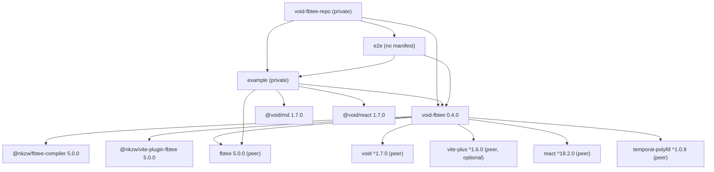
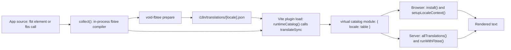

# 16. `void-fbtee`: one string from source code to screen

`void-fbtee` is an internationalization (i18n) add-on for the Void framework. It turns one `<fbt>` element in application code into a catalog entry, a compiled lookup table, and a translated string. The package does the wiring. The `fbtee` toolchain does the string compilation and the lookup. `void-fbtee` calls its compiler library and uses its runtime at request time.

## 16.1 Provenance and support

The snapshot holds seven independent Git repositories (`src.durable-streams/src.voidzero/spec.md:13-15`). `void-fbtee` is one of them. Its remote is `git@github.com:joeblew999/void-fbtee.git` (`src.durable-streams/src.voidzero/spec.md:23`). It is not part of the `voidzero-dev` organization. The snapshot is the directory `/Users/darkvoid/GitSources/src.voidzero` at the pinned commits (`src.durable-streams/src.voidzero/spec.md:13-26`). It holds seven repositories. It is not one product monorepo.

| Item | Value | Source |
|------|-------|--------|
| Owner | GitHub user `joeblew999` | `spec.md:23` |
| Commit | `6784d295baf4af878f33a73d76ec725f2f27e3a9` | `spec.md:23` |
| Commit date | 2026-11-12 | `spec.md:23` |
| Package name | `void-fbtee` | `void-fbtee/packages/void-fbtee/package.json:2` |
| Package version | 0.4.0 | `void-fbtee/packages/void-fbtee/package.json:3` |
| License | MIT license | `void-fbtee/packages/void-fbtee/package.json:19` |
| Void commit in the snapshot | `f254d1ec477b6b2af2c02fa427bd9d196316ee07` | `spec.md:19` |
| Void commit date | 2026-11-11 | `spec.md:19` |

The add-on revision is one day later than the Void revision in the same snapshot. The package declares a peer dependency on Void `^1.7.0` (`void-fbtee/packages/void-fbtee/package.json:84`). It is built for Void 1.7.0. A later Void release can change the plugin Application Programming Interface (API) or the middleware order. The reader must check the peer range before use.

The package is not published on npm (the Node Package Manager). The README says "It isn't on npm yet" and gives a GitHub release install (`void-fbtee/packages/void-fbtee/README.md:27-35`). The manifest does contain a public publish configuration (`void-fbtee/packages/void-fbtee/package.json:43-45`). This document did not consult the npm registry. The README is the only evidence in the snapshot.

Support follows ownership. The issue address is `https://github.com/joeblew999/void-fbtee/issues` (`void-fbtee/packages/void-fbtee/package.json:16-18`). VoidZero does not own this repository. A VoidZero support agreement does not cover this package. Support requests go to the owner of the `joeblew999` repository.

## 16.2 Package map

The workspace has one package, one application, and one test tree. The pnpm package manager workspace file is YAML (YAML Ain't Markup Language) and lists `packages/*` and `apps/*` (`void-fbtee/pnpm-workspace.yaml:1-3`). The `e2e` directory is not a workspace package. It has no manifest. The root test configuration includes it as a test project (`void-fbtee/vite.config.ts:87-102`).

```text
void-fbtee/
├── package.json
├── pnpm-workspace.yaml
├── vite.config.ts
├── packages/
│   └── void-fbtee/
│       ├── package.json
│       ├── tsconfig.json
│       ├── vite.config.ts
│       ├── src/
│       ├── test/
│       └── skills/void-fbtee/SKILL.md
├── apps/
│   └── example/
│       ├── package.json
│       ├── tsconfig.json
│       ├── vite.config.ts
│       ├── void.config.ts
│       ├── middleware/99.i18n.ts
│       ├── pages/
│       ├── src/
│       └── i18n/translations/
└── e2e/
    ├── setup.ts
    ├── pages.test.ts
    ├── server.test.ts
    ├── fresh/
    └── browsers/
```

The repository has three `package.json` files (`void-fbtee/package.json`, `void-fbtee/packages/void-fbtee/package.json`, and `void-fbtee/apps/example/package.json`). The manifest table gives the entry and the job of each directory. `vp` is the Vite+ command. Vite+ is the toolchain that supplies Vite and the other build commands (documents 02 to 05).

| Directory | Manifest | Name | Version | Entry | Job |
|-----------|----------|------|---------|-------|-----|
| `void-fbtee/` | `package.json` | `void-fbtee-repo` | none, private | `prepare`: `vp config` | Workspace root and task definitions |
| `void-fbtee/packages/void-fbtee/` | `package.json` | `void-fbtee` | 0.4.0 | `bin.void-fbtee`: `./dist/cli.mjs` | The add-on library and command-line interface (CLI) |
| `void-fbtee/apps/example/` | `package.json` | `example` | none, private | `build`: `vp build` | Demonstration application in three languages |
| `void-fbtee/e2e/` | none | none | none | root project `e2e` | End-to-end and browser tests |
| `void-fbtee/packages/void-fbtee/test/fixture/` | none | none | none | `src/main.tsx` | Tiny application for unit tests |

The package exports eight subpaths (`void-fbtee/packages/void-fbtee/package.json:33-42`) and one binary (`void-fbtee/packages/void-fbtee/package.json:25-27`). Seven subpaths map to build entries (`void-fbtee/packages/void-fbtee/vite.config.ts:19-29`). The command entry becomes the binary. The eighth subpath is the manifest (`void-fbtee/packages/void-fbtee/package.json:41`).

| Subpath or binary | Built file | Job |
|-------------------|------------|-----|
| `void-fbtee/plugin` | `dist/plugin.mjs` | Vite plugin and its API |
| `void-fbtee/middleware` | `dist/middleware.mjs` | Void middleware |
| `void-fbtee/react` | `dist/react.mjs` | React provider, formatter, link, hooks |
| `void-fbtee/client` | `dist/client.mjs` | Browser catalog install |
| `void-fbtee/head` | `dist/head.mjs` | Head metadata helpers |
| `void-fbtee/locales` | `dist/locales.mjs` | Locale types and helpers |
| `void-fbtee/lint` | `dist/lint.mjs` | Lint rule for plural counts |
| `void-fbtee/package.json` | `package.json` | Manifest export |
| `void-fbtee` binary | `dist/cli.mjs` | `init`, `prepare`, `check`, `translate`, `stamp` |

The versions are pinned once for the workspace. The `vite` entry is `npm:@voidzero-dev/vite-plus-core@1.6.0`, not the upstream Vite package (`void-fbtee/pnpm-workspace.yaml:20`). The `void` entry is 1.7.0, `@void/md` is 1.7.0, `@void/react` is 1.7.0, and `vitest` is 5.1.0 (`void-fbtee/pnpm-workspace.yaml:21-25`). The example depends on `void-fbtee` through `workspace:*` (`void-fbtee/apps/example/package.json:30`).

The package peers are wider than the workspace pins in some places. It accepts React `^19.2.0` (`void-fbtee/packages/void-fbtee/package.json:80`) and Vite `^8.0.0` (`void-fbtee/packages/void-fbtee/package.json:82`). It requires Node.js `^24.22.0 || >=26.12.0` (`void-fbtee/packages/void-fbtee/package.json:91-93`). The `vite-plus` peer is optional (`void-fbtee/packages/void-fbtee/package.json:83`, `void-fbtee/packages/void-fbtee/package.json:86-90`).

The workspace aliases the `vite` package name to `@voidzero-dev/vite-plus-core` 1.6.0 (`void-fbtee/pnpm-workspace.yaml:20`). That version does not match the `^8.0.0` peer range. The workspace disables the peer version check for `vite` and `vitest` (`void-fbtee/pnpm-workspace.yaml:26-32`). The alias installs without a peer error. It is not the upstream Vite package.

The compiler and the Vite plugin are direct dependencies at 5.0.0 (`void-fbtee/packages/void-fbtee/package.json:55-56`). `fbtee` is a peer dependency at 5.0.0 (`void-fbtee/packages/void-fbtee/package.json:79`). `@void/md` renders Markdown pages. `@void/react` supplies the React renderer and the shared-data context.

The `e2e` directory has no manifest. Its tests import the example's source and start the example's build, so the diagram edges show use, not a manifest dependency (`void-fbtee/e2e/setup.ts:14`, `void-fbtee/e2e/islands.test.ts:6`).



## 16.3 The string lifecycle

One path connects the source code to the screen. Three processes take part. The `void-fbtee prepare` command writes editable catalogs. The Vite plugin collects the same strings at every application build and reports gaps. The plugin then compiles each edited catalog into a lookup table. The browser and the server load that table through different entry points. A virtual module is a module that Vite creates from plugin code, not from a file on disk.



The source step uses the `<fbt>` element or the `fbs()` function. fbtee's compiler parses the string, assigns it a hash, and records its parameters and plural forms. Extraction reads every source file that matches the default patterns (`void-fbtee/packages/void-fbtee/src/catalogs.ts:20-27`) and contains the text "fbt" or "fbs" (`void-fbtee/packages/void-fbtee/src/catalogs.ts:61-69`). Collection calls `collectBatchSync` in-process for each file type (`void-fbtee/packages/void-fbtee/src/catalogs.ts:88-115`). The Vite plugin and the `void-fbtee` command use this same collection.

The editing step is a file on disk. `void-fbtee prepare` writes `i18n/translations/<locale>.json` (`void-fbtee/packages/void-fbtee/src/catalogs.ts:58-59`, `void-fbtee/packages/void-fbtee/src/catalogs.ts:120-140`). A person or a coding agent sets each `status` to `translated`. The compile step is part of the application build. The plugin's `load` hook calls `translateSync` on the phrases and the edited catalog (`void-fbtee/packages/void-fbtee/src/catalogs.ts:224-234`). It writes the result into the virtual module for that locale (`void-fbtee/packages/void-fbtee/src/plugin.ts:245-256`).

The render step depends on the environment. The browser's `install` function calls `setupLocaleContext` and `preloadLocale` once per locale (`void-fbtee/packages/void-fbtee/src/install.ts:19-38`). The server loads every catalog with `allTranslations` and wraps the request in `runWithFbtee` (`void-fbtee/packages/void-fbtee/src/middleware.ts:193-194`, `void-fbtee/packages/void-fbtee/src/middleware.ts:206-215`). fbtee's runtime then finds the translated form in the table.

## 16.4 The string primitive

The primitive is the `fbtee` JavaScript XML (JSX) element `<fbt>`. The element carries a `desc` attribute. The application imports `fbt` from `fbtee` (`void-fbtee/packages/void-fbtee/test/fixture/src/main.tsx:2`). The plugin header says that fbtee's Vite plugin compiles `<fbt>` and `fbs` (`void-fbtee/packages/void-fbtee/src/plugin.ts:4`). The workspace lint configuration adds that the compiler rewrites the element into a function call (`void-fbtee/vite.config.ts:68-69`). The `void-fbtee` package does not declare the element. It declares `fbtee` as a peer dependency at 5.0.0 (`void-fbtee/packages/void-fbtee/package.json:79`). The compiler itself is a direct dependency (`void-fbtee/packages/void-fbtee/package.json:55`). The type declarations come from `fbtee/ReactTypes` (`void-fbtee/packages/void-fbtee/tsconfig.json:11`, `void-fbtee/apps/example/tsconfig.json:10`). In every code block in this document, the first line names the source file and line range. The lines after it are the file content.

```tsx
// void-fbtee/packages/void-fbtee/test/fixture/src/main.tsx:1-5
// Test fixture: two strings, one translated into German in i18n/translations/de-DE.json.
import { fbt } from "fbtee";

export const hello = () => <fbt desc="Greeting in the test fixture">Hello</fbt>;
export const bye = () => <fbt desc="Farewell in the test fixture">Goodbye</fbt>;
```

A string outside JavaScript XML uses `fbs(text, description)`. The call declares a translatable string where a JavaScript XML element cannot appear. It returns an object that becomes text when converted to a string (`void-fbtee/packages/void-fbtee/test/head.test.ts:24-25`). `pageHead` converts its title and description to text with `String()` (`void-fbtee/packages/void-fbtee/src/head.ts:41-42`). The example also converts the description itself before it puts the text into structured data (`void-fbtee/apps/example/pages/[lang]/index.server.ts:45`). The structured-data object needs a plain string.

```ts
// void-fbtee/apps/example/pages/[lang]/index.server.ts:33-50
export const head = defineHead((c) => {
  const { locale, lang } = c.get("i18n");
  const description = fbs(
    "An example Void app in three languages: events to post and book, and docs on how it's done.",
    "Home page description, for search results",
  );
  const site: WithContext<WebSite> = {
    "@context": "https://schema.org",
    "@type": "WebSite",
    name: "void-fbtee",
    url: `${siteOrigin(c)}/${lang}`,
    inLanguage: locale,
    description: String(description),
  };
  return {
    ...pageHead({ title: fbs("i18n for Void apps", "Home page heading"), description }),
    script: [jsonLd(site)],
  };
```

A parameter uses `<fbt:param name="...">`. The name matches a placeholder in the translation. The example puts a list of language names into the sentence (`void-fbtee/apps/example/pages/[lang]/index.tsx:185-191`). `list()` comes from `fbtee` (`void-fbtee/apps/example/pages/[lang]/index.tsx:6`). A count uses `<fbt:plural count={...} many="..." showCount="yes">`. The child text is the exactly-one form. `many` is the form for every other count. `showCount="yes"` puts the count into the text. The compiler records the count token and whether the string has an exactly-one form (`void-fbtee/packages/void-fbtee/src/plurals.ts:74-111`).

```tsx
// void-fbtee/apps/example/pages/[lang]/index.tsx:154-161
          <p className="text-2xl font-medium" data-testid="plural">
            <fbt desc="How many nights are booked">
              You booked{" "}
              <fbt:plural count={count} many="nights" showCount="yes">
                night
              </fbt:plural>
            </fbt>
          </p>
```

The full type signature of `<fbt>` is not in this tree. It is in the `fbtee` package, which is not in the snapshot. The tree shows the call shapes that the example and the tests use. A `desc` value is always present in those shapes. The root lint configuration enables fbtee's `no-unhelpful-desc` rule (`void-fbtee/vite.config.ts:70-71`). The rule comes from `@nkzw/eslint-plugin-fbtee`; its source is not in the tree, so this document does not state its exact requirement (`void-fbtee/vite.config.ts:65`).

The generated identifier has two forms. The catalog key is the hash that keys the entry in the JavaScript Object Notation (JSON) file. For example, `W2S4HeMOJcq2xOy3+nXfaw==` keys one entry in the Arabic catalog (`void-fbtee/apps/example/i18n/translations/ar-EG.json:4`). The runtime key is a different hash. The source comment names it "fbtee's runtime hash" and says it is not the catalog hash (`void-fbtee/packages/void-fbtee/src/catalogs.ts:184-188`). The hash function is in `fbtee`'s compiler and is not in this tree. The compiler's `hashToLeaf` table maps each hash to the leaf text and description (`void-fbtee/packages/void-fbtee/src/catalogs.ts:37-39`). A phrase can hold more than one leaf, because one source string can have several forms. The test uses the table to map a source text to its catalog hash (`void-fbtee/packages/void-fbtee/test/plurals.test.ts:29-34`).

The tree has no `<fbt:select>` or `<fbt:enum>` usage. The example does not demonstrate select forms. This document cannot describe them from this source.

## 16.5 Extraction at build time

The extraction command is `void-fbtee prepare`. The example script `i18n:prepare` runs it (`void-fbtee/apps/example/package.json:9`). The CLI also has `init`, `check`, `translate`, and `stamp` (`void-fbtee/packages/void-fbtee/src/cli.ts:29-52`). The binary is `./dist/cli.mjs` (`void-fbtee/packages/void-fbtee/package.json:25-27`).

`prepare` first loads the application. `loadProject` reads the Vite configuration file with Vite's `loadConfigFromFile` (`void-fbtee/packages/void-fbtee/src/commands.ts:13-19`). That function evaluates the configuration file, so the plugin factory runs. It starts no build and runs no build hook. The source comment states that this avoids Void's plugin clearing the build output (`void-fbtee/packages/void-fbtee/src/commands.ts:8-12`). `loadProject` then finds the plugin object named `void-fbtee` and reads its `api` (`void-fbtee/packages/void-fbtee/src/commands.ts:20-29`). The plugin exposes a `Project` through that API (`void-fbtee/packages/void-fbtee/src/plugin.ts:70-74`). A `Project` holds the application root, the locale configuration, the source globs, and the translations folder (`void-fbtee/packages/void-fbtee/src/catalogs.ts:29-35`).

```ts
// void-fbtee/packages/void-fbtee/src/commands.ts:32-42
export function prepare(p: Project): string[] {
  const written: string[] = [];
  for (const { locale, json } of prepared(p)) {
    const file = catalogFile(p, locale);
    mkdirSync(dirname(file), { recursive: true });
    // fbtee's CLI writes catalogs with two-space indentation and a final newline; so do we.
    writeFileSync(file, JSON.stringify(JSON.parse(json), null, 2) + "\n");
    written.push(relative(p.root, file));
  }
  return written;
}
```

`prepared` collects the phrases, prepares every translated locale, and adds the plural forms (`void-fbtee/packages/void-fbtee/src/catalogs.ts:120-140`). It yields one `{ locale, json }` pair for each translated locale. It filters out the source locale (`void-fbtee/packages/void-fbtee/src/catalogs.ts:117-118`). The skill states that the source locale has no catalog, because its text comes from the code (`void-fbtee/packages/void-fbtee/skills/void-fbtee/SKILL.md:41-44`). The source does not state why this convention exists. It states the convention.

```ts
// void-fbtee/packages/void-fbtee/src/catalogs.ts:20-27
export const DEFAULT_SRC = [
  "pages/**/*.{ts,tsx,js,jsx}",
  "components/**/*.{ts,tsx,js,jsx}",
  "lib/**/*.{ts,tsx,js,jsx}",
  "routes/**/*.{ts,tsx,js,jsx}",
  "src/**/*.{ts,tsx,js,jsx}",
];
export const DEFAULT_TRANSLATIONS = "i18n/translations";
```

```ts
// void-fbtee/packages/void-fbtee/src/catalogs.ts:61-69
/** The app's source files that may hold <fbt> or fbs. */
export function sourceFiles(p: Project): string[] {
  return globSync(p.src, { cwd: p.root, exclude: (f) => f.includes("node_modules") })
    .map((f) => join(p.root, f))
    .filter((f) => {
      const text = readFileSync(f, "utf8");
      return text.includes("fbt") || text.includes("fbs");
    });
}
```

```ts
// void-fbtee/packages/void-fbtee/src/catalogs.ts:88-115
export function collect(p: Project): Collected {
  const files = sourceFiles(p);
  const key = files.map((f) => `${f}:${statSync(f).mtimeMs}`).join("|");
  if (cache?.key === key) return cache.value;
  const phrases: Phrase[] = [];
  for (const lang of LANGS) {
    const batch = files.filter((f) => langOf(f) === lang);
    if (!batch.length) continue;
    const out = collectBatchSync(
      batch.map((f) => ({ filename: relative(p.root, f), sourceText: readFileSync(f, "utf8") })),
      { lang, collectPackager: "text" },
    );
    if (out.errors.length)
      throw new Error(
        `void-fbtee: collecting strings failed: ${out.errors.map((e) => e.message).join("; ")}`,
      );
    phrases.push(...(JSON.parse(out.output ?? "{}").phrases ?? []));
  }
  const builtins = builtinPhrases(p.root);
  const builtinHashes = new Set(builtins.flatMap((ph) => Object.keys(ph.hashToLeaf ?? {})));
  const all = [...phrases, ...builtins];
  const texts: Record<string, string> = {};
  for (const ph of all)
    for (const [h, leaf] of Object.entries(ph.hashToLeaf ?? {})) texts[h] = leaf.text;
  const value = { phrases: all, builtinHashes, texts, files };
  cache = { key, value };
  return value;
}
```

The collection reads only files that match the globs and contain "fbt" or "fbs". It caches the result by the path and modification time of every file (`void-fbtee/packages/void-fbtee/src/catalogs.ts:88-91`). `LANGS` is the four file extensions tsx, ts, jsx, and js (`void-fbtee/packages/void-fbtee/src/catalogs.ts:49`). `langOf` maps a file to its parser by extension (`void-fbtee/packages/void-fbtee/src/catalogs.ts:50`). The parser matters because a `.ts` file can contain a cast that looks like JSX (`void-fbtee/packages/void-fbtee/src/catalogs.ts:83-86`). It calls `collectBatchSync` once per file type, with `collectPackager: "text"` so the compiler returns collected text (`void-fbtee/packages/void-fbtee/src/catalogs.ts:94-101`). It adds fbtee's built-in strings from `fbtee/Strings.json` (`void-fbtee/packages/void-fbtee/src/catalogs.ts:52-56`). The twelve built-in strings are fbtee's own user-interface strings. The compiler collects them with the application's strings. `builtinHashes` marks them, so the missing report counts them apart (`void-fbtee/packages/void-fbtee/src/catalogs.ts:74-75`, `void-fbtee/packages/void-fbtee/src/catalogs.ts:106-112`). The skill says every catalog has 12 built-in strings (`void-fbtee/packages/void-fbtee/skills/void-fbtee/SKILL.md:58`).

The build-time report uses the same collection. The plugin computes the missing list at `buildStart` (`void-fbtee/packages/void-fbtee/src/plugin.ts:136-145`). It always writes a warning. With `failOnMissing`, a build fails (`void-fbtee/packages/void-fbtee/src/plugin.ts:142-143`). The option defaults to false (`void-fbtee/packages/void-fbtee/src/plugin.ts:50-54`). The example does not set the option (`void-fbtee/apps/example/vite.config.ts:48`).

`void-fbtee` is this package's command-line interface (CLI). `fbtee` is the upstream library, and it has its own command-line tool. No `fbtee` command runs in this tree. The plugin imports fbtee's Vite plugin (`void-fbtee/packages/void-fbtee/src/plugin.ts:25`). It calls `collectBatchSync`, `prepareTranslationsBatchSync`, and `translateSync` from `@nkzw/fbtee-compiler` (`void-fbtee/packages/void-fbtee/src/catalogs.ts:12-16`). The header of the catalog module says "in-process with fbtee's own compiler" (`void-fbtee/packages/void-fbtee/src/catalogs.ts:1-3`). The source does not state why the package uses the library instead of the `fbtee` command. The dependency source is not in the snapshot. This document cannot rule out an internal process spawn inside `@nkzw/vite-plugin-fbtee`.

The package build is a separate step. `vp pack` builds the library entries (`void-fbtee/packages/void-fbtee/package.json:47-50`, `void-fbtee/packages/void-fbtee/vite.config.ts:18-29`). It writes `dist/*.mjs` and type declarations. It does not write catalogs. The virtual modules are made at the application's build time (`void-fbtee/packages/void-fbtee/vite.config.ts:1`).

## 16.6 Translation storage

A catalog is a JSON file. It has an `fb-locale` field and a `translations` object (`void-fbtee/apps/example/i18n/translations/ar-EG.json:1-3`). Each translation entry is keyed by the catalog hash (`void-fbtee/apps/example/i18n/translations/ar-EG.json:4`). The entry has a `description`, a `status`, `tokens`, `translations`, and `types` (`void-fbtee/apps/example/i18n/translations/ar-EG.json:4-45`). A plain string has empty `tokens` and `types` (`void-fbtee/packages/void-fbtee/test/fixture/i18n/translations/de-DE.json:4-14`). A plural string has one translation line for each category the locale needs (`void-fbtee/apps/example/i18n/translations/ar-EG.json:10-44`). When the string has an exactly-one form, the `one` category is omitted (`void-fbtee/packages/void-fbtee/src/plurals.ts:41-49`). A `variations` code names the category. The key `"0"` is the index of the count token in `tokens`. `tokens` lists the parameter names in order. `types` gives the fbtee type of each token, and type 28 is a number (`void-fbtee/packages/void-fbtee/src/plurals.ts:23`). The placeholder in the text is the token name in braces.

```json
# void-fbtee/apps/example/i18n/translations/ar-EG.json:4-45
    "W2S4HeMOJcq2xOy3+nXfaw==": {
      "description": "Text rendered from deferred loader data",
      "status": "translated",
      "tokens": [
        "number"
      ],
      "translations": [
        {
          "translation": "لاحقًا: لم تتبقَّ أي ليلة",
          "variations": {
            "0": 16
          }
        },
        {
          "translation": "لاحقًا: تبقّت ليلتان",
          "variations": {
            "0": 8
          }
        },
        {
          "translation": "لاحقًا: تبقّت {number} ليالٍ",
          "variations": {
            "0": 20
          }
        },
        {
          "translation": "لاحقًا: تبقّت {number} ليلة",
          "variations": {
            "0": 12
          }
        },
        {
          "translation": "لاحقًا: تبقّت {number} ليلة",
          "variations": {
            "0": 24
          }
        }
      ],
      "types": [
        28
      ]
    },
```

The `status` field has the value `translated` or `new` (`void-fbtee/apps/example/i18n/translations/ar-EG.json:6`, `void-fbtee/packages/void-fbtee/test/fixture/i18n/translations/de-DE.json:18`). `prepare` marks a new string `new` (`void-fbtee/packages/void-fbtee/src/catalogs.ts:120-123`). `missing` counts an entry as open when its status is `new` or it has no translations (`void-fbtee/packages/void-fbtee/src/catalogs.ts:153-164`). The built-in hashes separate application strings from fbtee's built-in strings (`void-fbtee/packages/void-fbtee/src/catalogs.ts:106-112`). The file wraps the shown entry as `{ "fb-locale": "ar-EG", "translations": { ... } }` (`void-fbtee/apps/example/i18n/translations/ar-EG.json:1-3`). The excerpt starts inside `translations`.

The translator workflow is optional. `void-fbtee translate` builds a prompt and runs the `claude` command with edit permissions (`void-fbtee/packages/void-fbtee/src/translate.ts:127-149`). The `claude` command starts Claude Code, a coding agent that can edit files. The prompt names the skill file and the files to edit (`void-fbtee/packages/void-fbtee/src/translate.ts:51-58`). A skill is an instruction file for a coding agent; the package ships one at `skills/void-fbtee/SKILL.md`. The skill tells the agent to keep placeholders (`void-fbtee/packages/void-fbtee/skills/void-fbtee/SKILL.md:23`) and to fill every plural form (`void-fbtee/packages/void-fbtee/skills/void-fbtee/SKILL.md:50-56`). The command refuses to run in Continuous Integration (CI), because it edits files with a coding agent (`void-fbtee/packages/void-fbtee/src/cli.ts:111-114`). Inside an agent session, it prints the prompt instead of starting a second agent (`void-fbtee/packages/void-fbtee/src/cli.ts:119-131`).

Markdown pages use a separate record. A translated page is a copy of the source page under the language folder, with the same relative path (`void-fbtee/packages/void-fbtee/src/check.ts:39-58`). For each source page, the check looks for the copy in each other language (`void-fbtee/packages/void-fbtee/src/check.ts:45-57`). `stamp` writes `translatedFrom: "<hash>"` into the translated copy's front matter (`void-fbtee/packages/void-fbtee/src/translate.ts:62-91`). Front matter is the metadata block at the top of a Markdown file. `check` hashes the source page with SHA-256 (Secure Hash Algorithm 256-bit) and keeps the first 12 hexadecimal characters (`void-fbtee/packages/void-fbtee/src/check.ts:16-22`). It compares the result with the record. The state is `ok` when the record matches, `stale` when the source page changed, `missing` when no translated copy exists, and `unrecorded` when the copy has no record (`void-fbtee/packages/void-fbtee/src/check.ts:35`, `void-fbtee/packages/void-fbtee/src/check.ts:39-58`). The markdown page state is a different vocabulary from the catalog status.

The fallback chain has three steps. fbtee tries the locale's natural parents, then the configured `fallbackLocales`, then the source text (`void-fbtee/packages/void-fbtee/src/plugin.ts:55-58`, `void-fbtee/packages/void-fbtee/src/runtime.ts:1-4`). The test asserts `de-AT` to `de` to the source text (`void-fbtee/packages/void-fbtee/test/runtime.test.ts:48-68`). With only the `de-AT` catalog, the word "Save" stays in English (`void-fbtee/packages/void-fbtee/test/runtime.test.ts:56-58`).

## 16.7 Runtime lookup and rendering

The server reads the locale from the first path segment. `localeFromPath` matches the segment against the configured locales (`void-fbtee/packages/void-fbtee/src/locales.ts:84-88`). `resolveLocales` canonicalizes each locale tag and gives it a Uniform Resource Locator (URL) segment; the segment equals the tag unless the configuration names another (`void-fbtee/packages/void-fbtee/src/locales.ts:70-77`). The middleware builds a `SharedI18n` object (`void-fbtee/packages/void-fbtee/src/middleware.ts:133-139`). `locale` is the canonical tag, such as `de-AT`. `lang` is the URL segment. `dir` is `ltr` or `rtl`. `now` is the server's instant. `path` is the path after the segment. The middleware sets that object on the request context and on the shared data (`void-fbtee/packages/void-fbtee/src/middleware.ts:153-156`).

The middleware loads the catalogs for a normal page. It skips the catalogs for a light request (`void-fbtee/packages/void-fbtee/src/middleware.ts:113`, `void-fbtee/packages/void-fbtee/src/middleware.ts:193-194`). A light request is a path under `/__void` or `/api`, or a path with a file extension. It still enters fbtee's state, so a not-found page with `<fbt>` can render (`void-fbtee/packages/void-fbtee/src/middleware.ts:192`). The middleware wraps the rest of the request in `runWithFbtee` (`void-fbtee/packages/void-fbtee/src/middleware.ts:206-215`). fbtee's runtime then answers every string lookup in that request.

The excerpt shows the request wrapper. `found` is the locale matched from the path, or undefined. `own` marks Void's internal and API paths (`void-fbtee/packages/void-fbtee/src/middleware.ts:205`). `answeringRoute(c)` names the route that will answer. A route whose first segment is a parameter, such as `[lang]`, matches any segment (`void-fbtee/packages/void-fbtee/src/middleware.ts:195-200`). When the path has no configured locale and the answering route is such a parameter route, `madeUp` is true. The middleware then calls `c.notFound()` instead of `next()` (`void-fbtee/packages/void-fbtee/src/middleware.ts:195-211`).

```ts
// void-fbtee/packages/void-fbtee/src/middleware.ts:206-215
  const answering = found || own ? undefined : answeringRoute(c);
  const madeUp = answering !== undefined && /^\/:[^/]+/.test(answering);
  const response = await runWithFbtee(
    { locale: current.locale, sourceLocale, fallbackLocales, translations },
    () => (madeUp ? c.notFound() : next()),
  );
  // A copy of the site at another address (a Worker Preview, the dev server): kept out of search
  // results, so it never competes with the site itself. Only when the app names its site.
  if (config.site && new URL(c.req.url).origin !== config.site) c.header("X-Robots-Tag", "noindex");
  return response;
```

The browser reads the locale from a `<meta>` element. The middleware writes the `SharedI18n` object into `<meta name="void-fbtee" content="...">` (`void-fbtee/packages/void-fbtee/src/middleware.ts:185-191`, `void-fbtee/packages/void-fbtee/src/locales.ts:90-91`). `documentI18n` reads that element (`void-fbtee/packages/void-fbtee/src/install.ts:41-45`). `install` calls `setupLocaleContext` and `preloadLocale` (`void-fbtee/packages/void-fbtee/src/install.ts:19-38`). The install is cached per locale (`void-fbtee/packages/void-fbtee/src/install.ts:20-22`, `void-fbtee/packages/void-fbtee/src/install.ts:35-37`). `Tracked` is a promise with a status field (`void-fbtee/packages/void-fbtee/src/install.ts:12`). `texts` is the development map from runtime hash to source text (`void-fbtee/packages/void-fbtee/src/install.ts:7`, `void-fbtee/packages/void-fbtee/src/plugin.ts:243-244`). `config` and `catalogs` are virtual modules (`void-fbtee/packages/void-fbtee/src/plugin.ts:227-237`). Hydration is the browser's reuse of the server's HyperText Markup Language (HTML) with client code.

```ts
// void-fbtee/packages/void-fbtee/src/install.ts:19-38
export function install(locale: string): Tracked {
  let ready = installed.get(locale);
  if (!ready) {
    // Dev only: name each string this page shows untranslated (fbtee reports each once).
    const onMissing = import.meta.env.DEV
      ? ({ hashKey }: { hashKey: string }) =>
          console.warn(
            `void-fbtee: no ${locale} translation for ${JSON.stringify(texts[hashKey] ?? hashKey)}`,
          )
      : undefined;
    const context = setupLocaleContext(localeContextOptions(config, catalogs, locale, onMissing));
    const p: Tracked = context.preloadLocale(locale).then(() => {
      p.status = "fulfilled";
    });
    p.status = "pending";
    ready = p;
    installed.set(locale, ready);
  }
  return ready;
}
```

`localeContextOptions` builds the options for the browser. The options name the available languages, the client locale, the source locale, the fallback locales, the missing-translation callback, and the catalog loader (`void-fbtee/packages/void-fbtee/src/runtime.ts:22-37`). The loader imports the locale's virtual catalog module and returns its table (`void-fbtee/packages/void-fbtee/src/runtime.ts:35`). The server does not use this function. It loads every catalog with `allTranslations` and passes the full map to `runWithFbtee` (`void-fbtee/packages/void-fbtee/src/runtime.ts:43-46`). The catalog virtual module exports an object keyed by locale; its value is the compiled table (`void-fbtee/packages/void-fbtee/src/plugin.ts:254`).

```ts
// void-fbtee/packages/void-fbtee/src/runtime.ts:22-37
/** fbtee's setupLocaleContext options for a page in `locale` (the browser). */
export function localeContextOptions(
  config: RuntimeConfig,
  catalogs: CatalogLoaders,
  locale: string,
  onMissingTranslation?: LocaleContextProps["onMissingTranslation"],
): LocaleContextProps {
  return {
    availableLanguages: availableLanguages(config),
    clientLocales: [locale],
    sourceLocale: config.sourceLocale,
    fallbackLocales: config.fallbackLocales,
    onMissingTranslation,
    loadLocale: async (l) => (await catalogs[l]?.())?.default[l] ?? {},
  };
}
```

The lookup table is compiled from the editable catalog. The plugin loads the catalog file and returns an empty object when the file is absent (`void-fbtee/packages/void-fbtee/src/plugin.ts:245-256`). For an existing file, `runtimeCatalog` calls `translateSync` with the collected phrases and the catalog (`void-fbtee/packages/void-fbtee/src/catalogs.ts:224-234`). The result is the table for one locale.

```ts
// void-fbtee/packages/void-fbtee/src/catalogs.ts:224-234
/** fbtee's runtime table for one locale, from its editable catalog. Empty if there's none. */
export function runtimeCatalog(p: Project, locale: string): Record<string, unknown> {
  const file = catalogFile(p, locale);
  if (!existsSync(file)) return {};
  const { phrases } = collect(p);
  const group = JSON.parse(readFileSync(file, "utf8"));
  const table = JSON.parse(
    translateSync(JSON.stringify({ phrases, translationGroups: [group] }), true),
  );
  return table[locale] ?? {};
}
```

A parameter is substituted from the `<fbt:param>` value. The `tokens` array names the parameter in the catalog (`void-fbtee/apps/example/i18n/translations/ar-EG.json:7-9`). The translation text contains the placeholder `{number}` (`void-fbtee/apps/example/i18n/translations/ar-EG.json:24`). The source does not show fbtee's substitution code. The observable contract is the named placeholder and the value in the element.

A plural is a set of lines. `pluralSlots` returns one slot for each count token, with its name and whether it has an exactly-one form (`void-fbtee/packages/void-fbtee/src/plurals.ts:74-111`). `pluralCategories` selects the categories that the locale needs with `Intl.PluralRules` (`void-fbtee/packages/void-fbtee/src/plurals.ts:46-52`). `withPluralForms` keeps an existing line with the same variation key, copies the fallback text into a missing line, and marks the entry `new` when it adds a line (`void-fbtee/packages/void-fbtee/src/plurals.ts:126-153`). `keyOf` builds the variation key (`void-fbtee/packages/void-fbtee/src/plurals.ts:113-118`). The variation codes are fbtee's `IntlVariations` codes: zero 16, one 4, two 8, few 20, many 12, other 24. The number type is 28 (`void-fbtee/packages/void-fbtee/src/plurals.ts:14-23`).

```ts
// void-fbtee/packages/void-fbtee/src/plurals.ts:126-153
export function withPluralForms(entry: PluralEntry, slots: Slots, locale: string): PluralEntry {
  const perToken = slots.map((s) => pluralCategories(locale, s.exactlyOne));
  if (perToken.every((c) => c.length === 1)) return entry;
  const tokens = slots.map((s) => s.token);
  const lines = entry.translations ?? [];
  const hasForms = JSON.stringify(entry.tokens ?? []) === JSON.stringify(tokens);
  const existing = new Map(hasForms ? lines.map((l) => [keyOf(l.variations), l]) : []);
  const fallback = lines.find((l) => !Object.keys(l.variations ?? {}).length) ?? lines[0];
  let added = false;
  // Every combination of categories, one line each (two counts in one string multiply).
  let combos: Record<string, number>[] = [{}];
  perToken.forEach((cats, i) => {
    combos = combos.flatMap((c) => cats.map((cat) => ({ ...c, [i]: CATEGORY_CODE[cat] })));
  });
  const translations = combos.map((variations) => {
    const line = existing.get(keyOf(variations));
    if (line) return line;
    added = true;
    return { translation: fallback?.translation ?? "", variations };
  });
  return {
    ...entry,
    ...(added ? { status: "new" } : {}),
    tokens,
    types: tokens.map(() => NUMBER_TYPE),
    translations,
  };
}
```

The Arabic entry shows the result. It has five lines because the string has an exactly-one form, so the `one` category is not needed (`void-fbtee/packages/void-fbtee/src/plurals.ts:41-49`, `void-fbtee/apps/example/i18n/translations/ar-EG.json:10-44`). The test asserts the category sets for Polish, Arabic, and German (`void-fbtee/packages/void-fbtee/test/plurals.test.ts:82-103`). The test header states that fbtee's compiler and runtime choose the right line for each count (`void-fbtee/packages/void-fbtee/test/plurals.test.ts:1-3`).

The example applies a workaround for lists inside strings. fbtee's `list()` inside an `<fbt:param>` renders as one text on the server and as separate pieces in the browser. The example says this breaks hydration with fbtee 5.0.0 (`void-fbtee/apps/example/pages/[lang]/index.tsx:14-17`). The example converts the list to a plain string before it enters the string: `String(list(items))` (`void-fbtee/apps/example/pages/[lang]/index.tsx:18`). The `oxlint-disable-next-line` comment suppresses the linter rule `no-base-to-string` (`void-fbtee/apps/example/pages/[lang]/index.tsx:17`). oxlint is the linter. The end-to-end test asserts the joined language names in Thai (`void-fbtee/e2e/pages.test.ts:24-25`).

```tsx
// void-fbtee/apps/example/pages/[lang]/index.tsx:14-18
// fbtee's list(), joined to plain text first. A list inside a string (<fbt:list>, or list() in an
// <fbt:param>) renders as one text on the server but as separate pieces in the browser, so
// hydration fails (seen with fbtee 5.0.0).
// oxlint-disable-next-line no-base-to-string
const listText = (items: string[]) => String(list(items));
```

The package does not call `Intl` to format numbers, dates, or lists. It uses `Intl` for locale canonicalization, text direction, and plural category selection (`void-fbtee/packages/void-fbtee/src/locales.ts:57-82`, `void-fbtee/packages/void-fbtee/src/plurals.ts:46-52`). It supplies `Formatted`, a span that keeps the server's already-formatted text during hydration (`void-fbtee/packages/void-fbtee/src/react.tsx:32-51`). `Intl` is the JavaScript internationalization namespace. The example does the formatting with it. The format helper uses `Intl.NumberFormat`, `Intl.DateTimeFormat`, `Intl.DisplayNames`, and `Intl.ListFormat` (`void-fbtee/apps/example/src/lib/fmt.ts:19-44`). Another helper uses `Intl.RelativeTimeFormat` (`void-fbtee/apps/example/src/lib/relative-days.ts:9`).

```ts
// void-fbtee/apps/example/src/lib/fmt.ts:19-44
export function fmt(p: FmtProps, locale: string, zone: string, now: string): string {
  if (p.num) return new Intl.NumberFormat(locale).format(Number(p.num));
  if (p.money)
    return new Intl.NumberFormat(locale, { style: "currency", currency: p.currency }).format(
      Number(p.money),
    );
  const at = (iso: string, timeZone?: string) => {
    const start = Temporal.ZonedDateTime.from(iso);
    return new Intl.DateTimeFormat(locale, {
      ...WHEN,
      timeZone: timeZone ?? start.timeZoneId,
    }).format(start.epochMilliseconds);
  };
  if (p.when) return at(p.when);
  if (p.yours) return at(p.yours, zone);
  if (p.ago)
    return relativeDays(
      locale,
      Temporal.ZonedDateTime.from(p.ago).withTimeZone(zone),
      Temporal.Instant.from(now),
    );
  if (p.langs) {
    const names = new Intl.DisplayNames(locale, { type: "language" });
    return new Intl.ListFormat(locale).format(p.langs.split(",").map((l) => names.of(l)!));
  }
  return "";
```

Temporal is the JavaScript date and time API. Cloudflare Workers supplies it natively when the `temporal` flag is on. The `temporal-polyfill` package supplies it elsewhere (`void-fbtee/packages/void-fbtee/src/plugin.ts:5-12`).

The server formats the page text. The browser keeps the server text during hydration. The `Formatted` component adds `suppressHydrationWarning` to its span (`void-fbtee/packages/void-fbtee/src/react.tsx:40-51`). The README gives the reason. Each browser engine ships its own locale data and writes some values differently (`void-fbtee/packages/void-fbtee/README.md:18-23`). Values that only the browser knows, such as the reader's time zone, are formatted after hydration (`void-fbtee/packages/void-fbtee/src/react.tsx:108-135`). The server renders an empty space instead (`void-fbtee/packages/void-fbtee/src/react.tsx:126-135`). The test asserts that the server never shows a stand-in for those values (`void-fbtee/e2e/server.test.ts:54-71`).

The page provider waits for the catalog before it renders on the client. `I18nProvider` calls `use(install(locale))` when the code does not run on the server (`void-fbtee/packages/void-fbtee/src/react.tsx:81-85`). The import side effect makes this unnecessary for many modules. The plugin appends `import "void-fbtee/client";` to every client module that contains "fbt" or "fbs" (`void-fbtee/packages/void-fbtee/src/plugin.ts:215-222`). The client module has a top-level await that installs the page catalog (`void-fbtee/packages/void-fbtee/src/client.ts:1-8`).

**Aha:** The appended import explains why an island works on its own. An island is a page component that the browser hydrates on its own, without the layout (`void-fbtee/packages/void-fbtee/src/react.tsx:10-11`). It hydrates without the layout's `I18nProvider`. The import holds the island's module until the catalog is installed. The server comment gives this as the reason for the append (`void-fbtee/packages/void-fbtee/src/plugin.ts:18-20`). The append also keeps the line numbers of the original module, because the comment says imports run first wherever they are (`void-fbtee/packages/void-fbtee/src/plugin.ts:219`).

```ts
// void-fbtee/packages/void-fbtee/src/plugin.ts:215-222
    transform: {
      filter: { id: { include: /\.[jt]sx?$/, exclude: /node_modules|^\0/ }, code: /fbt|fbs/ },
      handler(code, id) {
        if (!isClient(this.environment) || !id.startsWith(root)) return;
        // Appended: imports run before the module body wherever they are, and line numbers stay put.
        return { code: `${code}\nimport "void-fbtee/client";`, map: null };
      },
    },
```

```ts
// void-fbtee/packages/void-fbtee/src/client.ts:1-8
// Browser only. The void-fbtee plugin imports this at the top of every client module that uses
// <fbt> or fbs. Its top-level await holds those modules until the page's catalog is installed,
// so <fbt> renders translated from its first render: in islands (hydrated on their own, without
// the layout's I18nProvider) and in regular pages alike.
import { install, documentI18n } from "./install";

const i18n = documentI18n();
if (i18n) await install(i18n.locale);
```

## 16.8 Void integration

The application adds `voidFbtee()` as the first Vite plugin. The example passes the source locale, the locale list, and the site address (`void-fbtee/apps/example/vite.config.ts:45-53`). The plugin returns two plugins: its own core and fbtee's Vite plugin (`void-fbtee/packages/void-fbtee/src/plugin.ts:258-261`). The core plugin creates the virtual modules and the server alias. The fbtee plugin compiles `<fbt>` and `fbs` (`void-fbtee/packages/void-fbtee/src/plugin.ts:4`). The core resolves the locales and the fbtee server entry (`void-fbtee/packages/void-fbtee/src/plugin.ts:107-117`).

```ts
// void-fbtee/apps/example/vite.config.ts:45-53
  plugins: [
    // site: the deployed address, so the dev server and Worker Previews name it in canonical,
    // hreflang, og:url and the sitemap.
    voidFbtee({ sourceLocale, locales, site: SITE }),
    voidPlugin(),
    voidReact({ react: { compiler: true } }),
    voidMarkdown(),
    tailwindcss(),
  ],
```

```ts
// void-fbtee/packages/void-fbtee/src/plugin.ts:107-117
export function voidFbtee(options: VoidFbteeOptions): Plugin[] {
  const config: LocaleConfig = resolveLocales(options.sourceLocale, options.locales);
  if (options.site !== undefined) checkSite(options.site);
  const translationsDir = options.translations ?? DEFAULT_TRANSLATIONS;
  const src = options.src ?? DEFAULT_SRC;
  const require = createRequire(import.meta.url);
  // fbtee's own exports: index.mjs for "default"; index-server.mjs beside it.
  const fbteeServer = require.resolve("fbtee").replace(/index\.mjs$/, "index-server.mjs");
  let root = process.cwd();
  let command: "build" | "serve" = "serve";
  let devServer: ViteDevServer | undefined;
```

The core plugin creates six virtual modules and one server alias (`void-fbtee/packages/void-fbtee/src/plugin.ts:76-90`). The identifiers are declared there; the `load` hook builds the content (`void-fbtee/packages/void-fbtee/src/plugin.ts:223-256`). The modules supply the configuration, the catalog loaders, one catalog per locale, the development text map, the markdown page list, and the Hono route helper. `config`, `catalogs`, `texts`, and the per-locale catalog feed the browser install (`void-fbtee/packages/void-fbtee/src/install.ts:5-7`). The markdown page list feeds the middleware (`void-fbtee/packages/void-fbtee/src/middleware.ts:23`). The Hono route helper feeds the middleware's route lookup (`void-fbtee/packages/void-fbtee/src/middleware.ts:22`). Hono is the HTTP (HyperText Transfer Protocol) framework that Void runs on. The server alias replaces `temporal-polyfill` with a module that exposes the runtime's native `Temporal`. The module does not supply a polyfill. It throws when the global is absent (`void-fbtee/packages/void-fbtee/src/plugin.ts:95-101`, `void-fbtee/packages/void-fbtee/src/plugin.ts:206`). The alias exports `Temporal`, `Intl`, and `toTemporalInstant`, the three names that the polyfill's consumers import (`void-fbtee/packages/void-fbtee/src/plugin.ts:99-100`). The `resolveId` hook maps `fbtee/server`, `temporal-polyfill`, and the Hono route helper for the server environment (`void-fbtee/packages/void-fbtee/src/plugin.ts:193-214`). It leaves the browser environment alone (`void-fbtee/packages/void-fbtee/src/plugin.ts:204`).

The middleware is a normal Void middleware file. The example file is `middleware/99.i18n.ts`. The number 99 makes Void run it after the application's own middleware (`void-fbtee/apps/example/middleware/99.i18n.ts:1-4`). The file re-exports the package middleware (`void-fbtee/apps/example/middleware/99.i18n.ts:4`). The middleware calls `defineMiddleware` from Void (`void-fbtee/packages/void-fbtee/src/middleware.ts:125`).

The middleware adds data to three places. It sets `c.set("i18n", i18n)` for the application code (`void-fbtee/packages/void-fbtee/src/middleware.ts:153`). It adds the same object to the shared data (`void-fbtee/packages/void-fbtee/src/middleware.ts:154-156`). The shared data is the object that a page render and its islands can read. It adds the `lang` and `dir` attributes, the alternate links, the canonical link, the Open Graph locale, and the Open Graph address to the head defaults (`void-fbtee/packages/void-fbtee/src/middleware.ts:185-191`). The head defaults are the tags that Void adds to every page. Open Graph is the tag set that link previews read. An alternate link with `hreflang` names the same page in another language. `x-default` names the fallback for a reader with no language match (`void-fbtee/packages/void-fbtee/src/middleware.ts:143-152`). It also adds the `<meta name="void-fbtee">` element. The package declares the context type through module augmentation (`void-fbtee/packages/void-fbtee/src/middleware.ts:44-48`).

The package also supplies head helpers. `meta` turns a flat object into meta tags with unhead (`void-fbtee/packages/void-fbtee/src/head.ts:17-29`). Unhead is the head-tag library that Void uses. Its `unpackMeta` function maps readable keys to `name` and `property` tags (`void-fbtee/packages/void-fbtee/src/head.ts:1-8`). `pageHead` builds the title and description tags (`void-fbtee/packages/void-fbtee/src/head.ts:37-44`). `jsonLd` escapes the characters that can end a script element and the line separator characters (`void-fbtee/packages/void-fbtee/src/head.ts:57-63`).

`void-fbtee init` wires this package into an existing `void init` application (`void-fbtee/packages/void-fbtee/src/init.ts:1-3`). It adds the `fbtee` and `temporal-polyfill` peers and the lint plugin (`void-fbtee/packages/void-fbtee/src/init.ts:146-159`). It adds the three scripts `i18n:prepare`, `i18n:check`, and `i18n:translate` (`void-fbtee/packages/void-fbtee/src/init.ts:161-175`). It creates `middleware/99.i18n.ts` (`void-fbtee/packages/void-fbtee/src/init.ts:177-189`). It creates `pages/layout.tsx` with `<I18nProvider>` when no layout exists. It adds a TODO when a layout exists without the provider (`void-fbtee/packages/void-fbtee/src/init.ts:191-202`). It adds `voidFbtee()` first in the Vite plugins and creates `src/locales.ts` (`void-fbtee/packages/void-fbtee/src/init.ts:204-284`). It adds Cloudflare's `temporal` flag and the `/` redirect to `void.config.ts` (`void-fbtee/packages/void-fbtee/src/init.ts:286-315`). It adds `fbtee/ReactTypes` and the ES2025, Document Object Model (DOM), and DOM.Iterable libraries to `tsconfig.json` (`void-fbtee/packages/void-fbtee/src/init.ts:317-346`). ES2025 is the ECMAScript 2025 standard library. DOM.Iterable adds the iterable interfaces of the DOM. It creates the translation folder and adds a block to `AGENTS.md` (`void-fbtee/packages/void-fbtee/src/init.ts:348-361`).

The two bundles receive different code. The server receives fbtee's per-request build, the module that `fbtee/server` names (`void-fbtee/packages/void-fbtee/src/plugin.ts:5-6`). fbtee exports that name only under the `node` condition, and the Workers runtime is not Node.js. The plugin resolves the name to `fbtee`'s `index-server.mjs`, the build that holds per-request state in AsyncLocalStorage (`void-fbtee/packages/void-fbtee/src/plugin.ts:6`, `void-fbtee/packages/void-fbtee/src/plugin.ts:113-114`). That build lets each request read its own translations. The server's `temporal-polyfill` import resolves to the alias, not to the polyfill package (`void-fbtee/packages/void-fbtee/src/plugin.ts:8-12`, `void-fbtee/packages/void-fbtee/src/plugin.ts:206`). The browser receives the polyfill and the `void-fbtee/client` install. Both environments receive the virtual catalog modules (`void-fbtee/packages/void-fbtee/src/plugin.ts:245-256`).

**Aha:** The server cannot silently fall back to the polyfill. The plugin maps `temporal-polyfill` to a generated module. That module throws a clear error when the global `Temporal` object is missing (`void-fbtee/packages/void-fbtee/src/plugin.ts:95-101`, `void-fbtee/packages/void-fbtee/src/plugin.ts:206`). The error names the Cloudflare compatibility flag and the `init` command. The browser keeps the polyfill (`void-fbtee/packages/void-fbtee/src/plugin.ts:8-12`).

```ts
// void-fbtee/packages/void-fbtee/src/plugin.ts:95-101
const SERVER_TEMPORAL = `const Temporal = globalThis.Temporal;
if (!Temporal)
  throw new Error('void-fbtee: no Temporal on the server. Add Cloudflare\\'s "temporal" compatibility flag (void.config.ts: worker.compatibility_flags), or run void-fbtee init.');
export { Temporal };
export const Intl = globalThis.Intl;
export const toTemporalInstant = Date.prototype.toTemporalInstant;
`;
```

## 16.9 What the example and the tests prove

The example application serves three locales: `en-US`, `ar-EG`, and `th-TH` (`void-fbtee/apps/example/src/locales.ts:4-10`). It registers the list in the global `VoidFbteeRegister` interface, so the route helpers accept the language segment (`void-fbtee/apps/example/src/locales.ts:7-10`). TypeScript declaration merging adds fields to an existing global interface. It sends `/` to `/en-US` with a 301 redirect (`void-fbtee/apps/example/void.config.ts:16`). It sets Cloudflare's `temporal` compatibility flag (`void-fbtee/apps/example/void.config.ts:79-83`). The application deploys as a Cloudflare Worker (`void-fbtee/apps/example/void.config.ts:76-83`). Cloudflare Workers is the serverless runtime that Void builds for.

| Claim | Test | Assertion |
|-------|------|-----------|
| The server text is kept through hydration | `void-fbtee/e2e/pages.test.ts:16-30` | The Thai title is seen once; the plural, the deferred line, and the list text are present |
| A link in the same language stays on the client | `void-fbtee/e2e/pages.test.ts:32-44` | One page load |
| A link to another language loads a fresh page | `void-fbtee/e2e/pages.test.ts:45-51` | Two page loads, Arabic text, `dir="rtl"` |
| The first request always redirects to the source language | `void-fbtee/e2e/server.test.ts:13-20` | Status 301 for each `Accept-Language` value |
| The head has the language, direction, alternates, canonical, and social tags | `void-fbtee/e2e/server.test.ts:26-52` | `hreflang` for each locale, `x-default`, canonical, `og:url`, `og:locale` |
| The server does not show a stand-in for the reader's time | `void-fbtee/e2e/server.test.ts:54-71` | The browser-only lines are empty on the server |
| A page sets no cookie and does not vary by a request header | `void-fbtee/e2e/server.test.ts:198-219` | No `Set-Cookie`, no `Vary` on a request header |
| The web app manifest is translated | `void-fbtee/e2e/server.test.ts:345-356` | A description per locale, different from the source |
| The sitemap lists every page in every language | `void-fbtee/e2e/server.test.ts:370-401` | Every URL has all locales and `x-default` |
| The middleware leaves files and API routes alone | `void-fbtee/e2e/server.test.ts:403-418` | The file and API responses are unchanged |
| The built worker has one fbtee core and native Temporal | `void-fbtee/e2e/server.test.ts:422-457` | One `runWithFbtee`, one Temporal error, the `temporal` flag |
| Every page hydrates with no error and fits a phone | `void-fbtee/e2e/browsers/hydration.test.ts:45-76` | No failed page, 390-pixel width |
| The `Intl` page loads in each engine | `void-fbtee/e2e/browsers/intl.test.ts:28-42` | More than 100 rows, no errors, differences reported |
| The Temporal page is the same four ways | `void-fbtee/e2e/browsers/temporal.test.ts:11-44` | More than 20 rows, no differences |

The `Intl` page is `pages/[lang]/docs/intl.tsx`. It is a reference table of every `Intl` call that the example makes. The Worker formats one column. The browser formats another after hydration (`void-fbtee/apps/example/pages/[lang]/docs/intl.tsx:1-8`). The Temporal page is `pages/[lang]/docs/temporal.tsx`. It runs the same date and time arithmetic four ways: on the Worker with native Temporal and with the polyfill, and in the browser with each (`void-fbtee/apps/example/pages/[lang]/docs/temporal.tsx:1-6`). A `defer()` loader sends data after the first response. The page shows the line when the data arrives (`void-fbtee/apps/example/pages/[lang]/index.tsx:1-3`). The sitemap is a normal route, `routes/sitemap.xml.ts`. It writes the pages for every locale and adds `x-default` (`void-fbtee/apps/example/routes/sitemap.xml.ts:1-2`).

The package tests cover the parts that the browser cannot see. The catalog test separates application strings from built-in strings and checks the build failure (`void-fbtee/packages/void-fbtee/test/catalogs.test.ts`). The runtime test checks the fallback chain (`void-fbtee/packages/void-fbtee/test/runtime.test.ts:48-68`). The plural test checks the category sets for Polish, Arabic, and German (`void-fbtee/packages/void-fbtee/test/plurals.test.ts`). The plugin test checks the plugin name, the enforcement order, the API options, and the Temporal error (`void-fbtee/packages/void-fbtee/test/plugin.test.ts`). The command test checks the catalog format with two-space indentation and a final newline (`void-fbtee/packages/void-fbtee/test/commands.test.ts`).

The fresh-install check is the strongest proof of the developer experience. It builds the package, packs it, and installs it into new `void init` applications (`void-fbtee/e2e/fresh/check.ts:116-156`). It runs `void-fbtee check`, the build, and the TypeScript compiler (`void-fbtee/e2e/fresh/check.ts:158-162`). It checks the types, the lint rule, the formatting, and the development server (`void-fbtee/e2e/fresh/check.ts:165-170`). It runs this for npm and pnpm, on Vite and on Vite+ (`void-fbtee/e2e/fresh/check.ts:10-11`).

The example proves one complete path. The same source string is extracted, translated, compiled, rendered on the server, and kept in the browser. It also proves the routing, the metadata, the caching constraints, and the engine differences. It does not prove select forms. It does not prove a language that the application adds without a new build.

## 16.10 Limits

The limits of this document follow from the snapshot. The upstream `fbtee` package is a peer dependency (`void-fbtee/packages/void-fbtee/package.json:79`). `@nkzw/fbtee-compiler` is a direct dependency (`void-fbtee/packages/void-fbtee/package.json:55`). Their source is not in the tree. The hash algorithm, the runtime lookup, the parameter substitution, and the plural selection are therefore described from the calls and the tests in this tree, not from the library source. The `@nkzw/vite-plugin-fbtee` source is also absent. An internal process spawn inside that plugin cannot be ruled out.

The tree has no `<fbt:select>` or `<fbt:enum>` usage. This document cannot describe select forms. The example uses one plural count and one parameter in a string. It does not show two counts in one string, a gender variation, or a nested plural.

The package is not on npm according to its README. The reader must install it from the GitHub release. The owner is `joeblew999`, not `voidzero-dev`. Support and security fixes do not come from VoidZero.

The peer ranges require Void `^1.7.0` (`void-fbtee/packages/void-fbtee/package.json:84`), Vite `^8.0.0` (`void-fbtee/packages/void-fbtee/package.json:82`), React `^19.2.0` (`void-fbtee/packages/void-fbtee/package.json:80`), and Node.js `^24.22.0 || >=26.12.0` (`void-fbtee/packages/void-fbtee/package.json:91-93`). The example pins React 19.3.1 (`void-fbtee/apps/example/package.json:25`) and TypeScript 7.0.2 (`void-fbtee/apps/example/package.json:45`). A different combination is outside the tested set. The fresh-install check covers npm and pnpm on Vite and Vite+, but it does not cover every operating system.

The source does not state why the package uses the compiler library instead of the `fbtee` CLI. The source does not state why the source locale has no catalog file. The source does not state why the browser list workaround is necessary beyond the comment that hydration fails with fbtee 5.0.0. This document does not invent a reason for those choices.

## 16.11 Related documents

Document 11 explains the Void page routing, the loader functions, and the middleware order that this package extends: [Void framework routing](11-void-framework-routing.md). Document 18 compares Void with Next.js on Cloudflare Workers, including the internationalization story: [Comparisons](18-comparisons.md).
