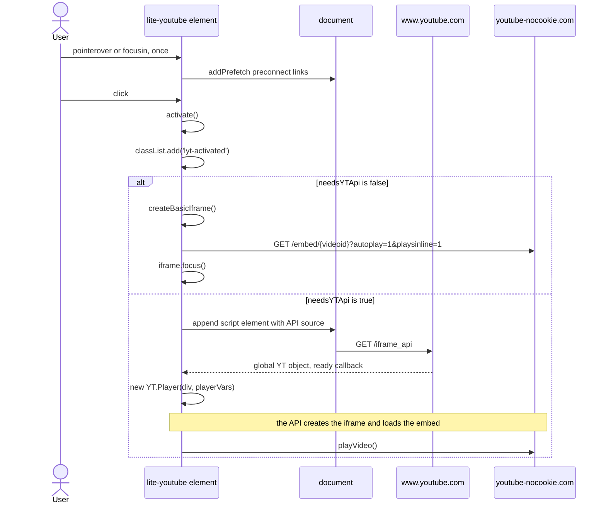

# 17 Two Browser Tools That Reach Different Parts of the Platform

`chrome-capture` and `lite-youtube-embed` are two small browser tools. Each one uses a browser capability directly. Neither one needs the VoidZero toolchain. The toolchain is the set of developer packages in this snapshot, such as Vite+, Vite Task, and Void (section 3). `chrome-capture` asks Chrome 153 or later to record a tab into an AV1 file. AV1 is AOMedia Video 1. The file is in the Moving Picture Experts Group (MPEG) MPEG-4 Part 14 (MP4) container. `lite-youtube-embed` shows a clickable poster, then creates a YouTube player only after a click. The thesis of this document is that the browser platform already contains both mechanisms. The packages only expose them, and the source shows the full mechanism.

This document covers only these two repositories. The main toolchain is in document [00-overview.md](00-overview.md) and the comparisons are in document [18-comparisons.md](18-comparisons.md). All paths are relative to the snapshot root `/Users/darkvoid/GitSources/src.voidzero`. Every source path starts with the repository name, such as `chrome-capture/src/index.ts`. The `chrome-capture` source is commit `87c3096cb8d0186cb6cb68d8b5ed00af87934bd4`, version 0.1.2. The `lite-youtube-embed` source is commit `674a402883c668066f940f08e757a11528299ef8`, version 0.3.4. Both repositories use the Apache License 2.0, and both belong to the GitHub user `paulirish`.

Each abbreviation is spelled out at its first use. The table gives the spellings.

| Abbreviation | Spelling |
|---|---|
| API | Application Programming Interface |
| AV1 | AOMedia Video 1 |
| Base64 | a binary-to-text encoding |
| CDP | Chrome DevTools Protocol |
| CI | continuous integration |
| CLI | command-line interface |
| CRF | constant rate factor |
| CSS | Cascading Style Sheets |
| DOM | Document Object Model |
| fps | frames per second |
| GPU | graphics processing unit |
| HTML | HyperText Markup Language |
| HTTP | Hypertext Transfer Protocol |
| YUV | a color model with one luma value and two chroma values |
| I420 | a planar YUV 4:2:0 pixel format |
| IPC | inter-process communication |
| JPEG | Joint Photographic Experts Group |
| JSON | JavaScript Object Notation |
| MPEG | Moving Picture Experts Group |
| MP4 | MPEG-4 Part 14 |
| POSIX | Portable Operating System Interface |
| TCP | Transmission Control Protocol |
| TLS | Transport Layer Security |
| UI | user interface |
| URL | Uniform Resource Locator |
| WebP | a Google image format |
| YAML | YAML Ain't Markup Language |

Function names, flag names, and attribute names stay unchanged.

A code block starts with a label line, such as `// chrome-capture/src/index.ts:171-179`. The label gives the file and the exact line range. The label is not part of the source text. A `#` label marks a YAML file. A `//` label marks TypeScript, JavaScript, JSON, or CSS.

## 1. chrome-capture: the browser records the tab

`chrome-capture` is a thin client for one recording command and the plumbing commands around it. The recording command is `Page.startScreenRecording`. The plumbing commands are `Page.stopScreenRecording`, `IO.read`, `IO.close`, and `Target.getTargets`. Chrome does the capture and the encoding. The Node.js program starts the command, waits, stops the command, and writes the bytes that Chrome returns. The package is small because the hard work is inside Chrome.

The CDP groups commands into domains. A domain is a named family of related commands, such as `Page`, `Target`, `IO`, or `Emulation`. A target is one browser object that Chrome lists over CDP, such as a page (`chrome-capture/src/index.ts:64-67`). An endpoint is one WebSocket URL, either the browser URL or a page URL. A session is one WebSocket connection plus the `send` and `close` methods that wrap it (`chrome-capture/src/index.ts:209-222`, `chrome-capture/src/index.ts:248-270`). The browser-level session speaks the `Target` domain and can create targets. The page-level session speaks the `Page`, `IO`, and `Emulation` domains. This document uses that model throughout.

### 1.1 Package surface and command-line interface

The package declares one command, two public entry points, and no runtime dependencies. The `bin` field maps the command name `chrome-capture` to `./dist/cli.js` at `chrome-capture/package.json:23-25`. The `exports` field exposes `"."` and `"./playwright"` at `chrome-capture/package.json:13-22`. The first entry is the core library. The second entry adds a Playwright test fixture. A test fixture is a reusable setup function that a test framework runs around each test. This fixture records each Playwright test. The source entry points are `chrome-capture/src/index.ts`, `chrome-capture/src/playwright.ts`, and `chrome-capture/src/cli.ts`. The build tool `tsdown` compiles those three files, as `chrome-capture/tsdown.config.ts:3-13` shows.

```json
// chrome-capture/package.json:13-25
  "exports": {
    ".": {
      "types": "./dist/index.d.ts",
      "default": "./dist/index.js"
    },
    "./playwright": {
      "types": "./dist/playwright.d.ts",
      "default": "./dist/playwright.js"
    }
  },
  "bin": {
    "chrome-capture": "./dist/cli.js"
  },
```

There is no `dependencies` key in the manifest. The only third-party packages are development tools, at `chrome-capture/package.json:58-66`. The runtime imports are Node.js built-in modules, such as `node:child_process`, `node:fs/promises`, `node:os`, and `node:path`. The code also uses the global `WebSocket` object at `chrome-capture/src/index.ts:210` and `Promise.withResolvers` at `chrome-capture/src/index.ts:255`. The manifest does not say which feature sets the exact `24.11.0` minimum at `chrome-capture/package.json:26-28`. Both features need a recent Node.js release, and the manifest pins a minimum that supplies them.

```json
// chrome-capture/package.json:58-66
  "devDependencies": {
    "@types/node": "26.6.6",
    "devtools-protocol": "0.0.1734725",
    "oxlint": "1.92.0",
    "playwright-core": "1.65.0",
    "puppeteer-core": "25.16.0",
    "tsdown": "^0.23.7",
    "typescript": "7.0.2"
  }
```

The CLI reads three positional arguments and a set of options. The source applies the defaults at `chrome-capture/src/cli.ts:80-95`. The help text at `chrome-capture/src/cli.ts:30-51` gives the same values. The table shows every argument and its default.

| Argument or option | Meaning | Default | Source |
|---|---|---|---|
| `url` or `--url` | Target page URL | `https://paulirish.github.io/chrome-capture/` | `chrome-capture/src/cli.ts:80` |
| `output` or `--out`, `--output` | Output MP4 file path | `demo-60fps.mp4` | `chrome-capture/src/cli.ts:81` |
| `duration` or `--duration` | Recording duration in milliseconds or seconds | 3000 milliseconds | `chrome-capture/src/cli.ts:82-83` |
| `--fps`, `--frameRate` | Target frame rate | 60 | `chrome-capture/src/cli.ts:86` |
| `--width` | Viewport width in pixels | 1280 | `chrome-capture/src/cli.ts:84` |
| `--height` | Viewport height in pixels | 720 | `chrome-capture/src/cli.ts:85` |
| `--warmup` | Delay before recording starts, in milliseconds | 1000 | `chrome-capture/src/cli.ts:87` |
| `--capture-area` | `target` for the tab viewport, or `browserWindow` | `target` | `chrome-capture/src/cli.ts:88-90` |
| `--audio` | Record tab audio | enabled | `chrome-capture/src/cli.ts:91` |
| `--no-audio` | Do not record tab audio | disabled | `chrome-capture/src/cli.ts:91` |
| `--headful`, `--headed` | Run with a visible window | off | `chrome-capture/src/cli.ts:92` |
| `--headless` | Run with `--headless=new` | on, except macOS above 60 fps | `chrome-capture/src/cli.ts:93` |
| `--with-devtools` | Record an inspector page and the tab side by side | off | `chrome-capture/src/cli.ts:94`, `chrome-capture/src/cli.ts:115-122` |
| `--chrome` | Path to the Chrome executable | automatic discovery | `chrome-capture/src/cli.ts:95`, `index.ts:278-327` |
| `-h`, `--help` | Print the help text and exit | none | `chrome-capture/src/cli.ts:29-53` |

The source does not define the exact region that `browserWindow` captures. The help text gives only the two names at `chrome-capture/src/cli.ts:43`. The code passes the string to Chrome without further interpretation at `chrome-capture/src/cli.ts:88-90`.

The `--headless` default is computed at `chrome-capture/src/cli.ts:93`. The expression is `parsed.values.headless || (!headful && !(platform() === 'darwin' && frameRate > 60))`. Headless mode is therefore off only when the host is macOS, the frame rate is above 60, and the user did not set `--headful`. The expression also shows that an explicit `--headless` wins over the exception.

The duration parser has one non-obvious rule. A unitless value below 1000 is seconds, and a unitless value of 1000 or more is milliseconds. The code is at `chrome-capture/src/index.ts:460-467`, and the tests confirm the rule at `chrome-capture/test/recorder.test.ts:74-83`. A bare `5` is 5000 milliseconds. A bare `3000` is 3000 milliseconds. A bare `500` is 500000 milliseconds, which is eight minutes and twenty seconds. That last result follows the rule, but it is easy to miss.

```ts
// chrome-capture/src/index.ts:460-467
export function parseDuration(val: string | number | undefined, defaultMs = 3000): number {
  if (val == null || String(val).trim() === '') return defaultMs;
  const match = /^([0-9]*\.?[0-9]+)\s*(ms|s)?$/i.exec(String(val).trim());
  if (!match) throw new Error(`Invalid duration value: ${val}`);
  const num = parseFloat(match[1]);
  if (num <= 0) throw new Error(`Invalid duration value: ${val}`);
  return match[2]?.toLowerCase() === 's' || (!match[2] && num < 1000) ? num * 1000 : num;
}
```

The audio rule also has a small asymmetry. `--audio` sets audio to true. `--no-audio` sets audio to false. If both flags appear, `--audio` wins, because the code tests `parsed.values.audio` first at `chrome-capture/src/cli.ts:91`. The parser stores each boolean flag under its own name. `--audio` sets `values.audio` to true, and `--no-audio` sets `values['no-audio']` to true at `chrome-capture/src/cli.ts:65-66`. The ternary tests `values.audio` first, so it never reads `values['no-audio']` when `--audio` is present.

The CLI passes two extra Chrome flags at `chrome-capture/src/cli.ts:97-100`. They are `--enable-gpu-rasterization` and `--remote-allow-origins=devtools://devtools`. Rasterization is the conversion of page content into pixels. The repository does not explain why the CLI needs GPU rasterization, so the source does not settle that point. The repository also gives only the string for the second flag, so it does not say what `--remote-allow-origins` controls. The flag string contains the `devtools://devtools` origin, and the `--with-devtools` option creates a page with that origin at `chrome-capture/src/cli.ts:115-122`. The source does not state a relation between the flag and that page.

### 1.2 The CDP command and its flags

The recording starts with the `Page.startScreenRecording` command in the `Page` domain. The code declares the request and response types at `chrome-capture/src/index.ts:47-63`. The same block declares the `IO.read` and `IO.close` commands in the `IO` domain. Those two commands drain the finished file. The block has no event types, because the program does not subscribe to frames.

The `CdpCommands` interface is a lookup table, not a runtime object. Each key is a command name. Each value is a TypeScript labeled tuple. The first tuple element is the parameter type, and the second is the return type. `ScreenRecordingOptions` is the input interface at `chrome-capture/src/index.ts:20-45`. `Omit<ScreenRecordingOptions, 'outputPath'>` removes one field from that interface before the type becomes a CDP parameter. The removal is a type-level statement of the runtime rule at `chrome-capture/src/index.ts:172`.

A stream handle is an opaque string. `IO.read` takes the handle and returns one chunk of data plus an `eof` flag. `IO.close` releases the handle. The program repeats `IO.read` until `eof` is true, then calls `IO.close`. That loop is what "drain" means in this document.

```ts
// chrome-capture/src/index.ts:47-63
export interface CdpCommands {
  'Page.startScreenRecording': [
    params: [Omit<ScreenRecordingOptions, 'outputPath'>?],
    returnType: {stream: string},
  ];
  'Page.stopScreenRecording': [
    params: [],
    returnType: {stream: string},
  ];
  'IO.read': [
    params: [{handle: string; offset?: number; size?: number}],
    returnType: {base64Encoded?: boolean; data: string; eof: boolean},
  ];
  'IO.close': [
    params: [{handle: string}],
    returnType: void,
  ];
```

The recorder sends the options almost without change. The wrapper removes `outputPath` first, because that path is local to the Node.js program and must not cross the CDP boundary. The wrapper then adds `frameRate: 60` as the default. The code is at `chrome-capture/src/index.ts:171-179`. The test asserts the exact outgoing parameters and the removal of `outputPath` at `chrome-capture/test/recorder.test.ts:152-158`.

```ts
// chrome-capture/src/index.ts:171-179
  async start(options: ScreenRecordingOptions = {}): Promise<string> {
    const {outputPath: _outputPath, ...cdpOptions} = options;
    const request = {
      frameRate: 60,
      ...cdpOptions,
    };
    const {stream} = await this.session.send('Page.startScreenRecording', request);
    return stream;
  }
```

The command uses five flags. The table states each flag and its meaning.

| Flag | Type | Meaning | Source |
|---|---|---|---|
| `frameRate` | number | Target frame rate in frames per second | `chrome-capture/src/index.ts:34-36`, `chrome-capture/src/index.ts:173-176` |
| `audio` | boolean | Record tab audio as 48 kilohertz stereo Opus | `chrome-capture/src/index.ts:21-24`, `chrome-capture/src/index.ts:173-176` |
| `maxWidth` | number | Maximum frame width in pixels | `chrome-capture/src/index.ts:25-28` |
| `maxHeight` | number | Maximum frame height in pixels | `chrome-capture/src/index.ts:29-32` |
| `captureArea` | `target` or `browserWindow` | Area to record | `chrome-capture/src/index.ts:37-40` |

The command returns a stream handle at start. The recorder returns that handle to its caller at `chrome-capture/src/index.ts:177-178`. The higher-level `startRecording` function ignores the handle at `chrome-capture/src/index.ts:537-538`. The stop path uses a second handle, the one that `Page.stopScreenRecording` returns at `chrome-capture/src/index.ts:185`. The source does not say what the start handle controls or whether it must be closed. The tests model both handles with the same identifier at `chrome-capture/test/recorder.test.ts:46-47`, so the tests do not resolve that question. The diagram labels the value `IO.StreamHandle` because the file header uses that name at `chrome-capture/src/index.ts:12`. The type block labels the wire value `{stream: string}` at `chrome-capture/src/index.ts:50`. They are the same handle, with a protocol-facing name and a type-facing name.

The CLI uses `--width` and `--height` in three places. It sets the Chrome window size at `chrome-capture/src/index.ts:344`. It sets the page device metrics at `chrome-capture/src/cli.ts:127-132`. It passes the same values as `maxWidth` and `maxHeight` to the recording at `chrome-capture/src/cli.ts:141-148`. The recording maximum and the viewport therefore start equal, but they are separate controls in the CDP request.

### 1.3 The capture pipeline

The pipeline has four stages. First, the CLI starts Chrome and finds the page target (section 1.5). Second, the recorder starts `Page.startScreenRecording` (section 1.2). Third, Chrome captures and encodes the tab inside its own processes. The compositor box and the encoder box are the two parts of that third stage. Fourth, after a timer, the program stops the recording with `Page.stopScreenRecording`. It then drains the finished MP4 and writes it to disk (section 1.4). The drain part of the diagram starts at the stop handle because the CLI ignores the start handle (section 1.2).

```mermaid
flowchart LR
    CLI["cli.ts<br/>parse arguments"] --> LAUNCH["launchChrome()<br/>Chrome 153 or later"]
    LAUNCH --> STDERR["stderr line<br/>DevTools listening on ws://..."]
    STDERR --> BROWSER["connectCdpSession(browserWsUrl)"]
    BROWSER --> TARGETS["Target.getTargets<br/>first page target"]
    TARGETS --> SESSION["connectCdpSession(pageTargetWs)"]
    SESSION --> START["Page.startScreenRecording<br/>frameRate, audio, maxWidth, maxHeight, captureArea"]
    START --> COMPOSITOR["WebContentsVideoCaptureDevice<br/>compositor frames"]
    COMPOSITOR --> ENCODER["devtools_media_encoding_server<br/>libaom-av1, Opus, MP4"]
    ENCODER --> STOP["Page.stopScreenRecording<br/>returns a second stream handle"]
    STOP --> STREAM["IO.StreamHandle"]
    STREAM --> READ["IO.read loop<br/>base64 chunks"]
    READ --> BUFFER["Buffer.concat"]
    BUFFER --> FILE["writeFile(outputPath)"]
    FILE --> CLOSE["page session close, then launched.close()"]
```



The source states the internal mechanism in the file header at `chrome-capture/src/index.ts:7-13`. The recording runs in the browser process through `WebContentsVideoCaptureDevice` and `content::protocol::MediaRecorder`. The encoder and container writer is the utility process `devtools_media_encoding_server`. The benchmark document adds the encoder library and the stream sink at `chrome-capture/benchmarks/README.md:18-21`. The architecture diagram in that document names `FrameSinkVideoCapturer`, a shared-memory `I420` pool, `LoopbackAudioInputIPC`, `libaom-av1`, stereo Opus, and `DevToolsStreamFile` at `chrome-capture/benchmarks/README.md:18-21`. The source code does not name a separate muxer library. The utility process produces the MP4 stream, and `DevToolsStreamFile` is the sink.

The two descriptions are two layers of one pipeline. The source header names the browser-side capture path. The benchmark document names the lower-level Chromium components inside that path. A frame sink is the receiving end of a video frame stream. `FrameSinkVideoCapturer` is the Chromium component that receives compositor frames through a frame sink. A YUV color model stores one brightness value and two color difference values. A luma value is the brightness value. A chroma value is a color difference value. The 4:2:0 sampling keeps the full luma resolution and stores chroma at half width and half height. `I420` is a planar YUV 4:2:0 pixel format with one luma plane and two chroma planes, and the pool is a set of shared-memory buffers. The benchmark document names the pool at `chrome-capture/benchmarks/README.md:19` and the `yuv420p` signal at `chrome-capture/benchmarks/README.md:163`, but it does not define the terms. `LoopbackAudioInputIPC` captures the audio that the tab plays, not a microphone. `IPC` is inter-process communication, the mechanism that moves data between Chrome processes. `libaom-av1` is the AV1 encoder library. A utility process is a Chrome child process that is not a renderer. A muxer combines encoded video and audio into one container. The source does not name the muxer library, so the source does not settle that detail.

```ts
// chrome-capture/src/index.ts:7-13
/**
 * Out-of-band tab video recording via CDP `Page.startScreenRecording` (shipped in Chrome M153).
 *
 * Runs in the browser process (`WebContentsVideoCaptureDevice` -> `content::protocol::MediaRecorder`)
 * and encodes AV1 video + 48kHz stereo Opus audio into MP4 inside a utility process
 * (`devtools_media_encoding_server`), returning an `IO.StreamHandle`.
 */
```

The program does not negotiate the codec. The source says that Chrome encodes AV1, and no code chooses a codec. The integration test confirms the result. It reads the file and checks the `ftyp` box and the `stsd` box. It also checks the `av01` sample entry, the width, the height, the frame count in `trun`, and the `Opus` sample entry for audio at `chrome-capture/test/integration.test.ts:44-77`.

An MP4 file is a tree of boxes. `ftyp` names the file type. `stsd` holds the sample descriptions, including the codec entries. `av01` is the AV1 visual sample entry. `trun` holds the sample count for a track fragment. `Opus` is the audio sample entry. The test reads those boxes directly from the file. A match proves that the file declares the AV1 and Opus codecs and that the video track contains at least the expected number of frames. The test does not decode pixels, so it proves the container and the declared codec, not the visual correctness of every frame.

**Aha:** The recording produces almost no WebSocket traffic. The old path is `Page.startScreencast`, the API that Playwright and Puppeteer used for about a decade at `chrome-capture/README.md:11`. That path sent every JPEG frame as Base64 JSON over the CDP socket at `chrome-capture/benchmarks/README.md:13-14`. The new command sends one stream handle at start and the finished file at stop. The benchmark table shows 10.5 megabytes of traffic for the old path and 450 kilobytes for the new path at `chrome-capture/README.md:100-105`. The benchmark uses one 6.4 second UI replay at 1280 by 800 on an M4 Max, as `chrome-capture/README.md:98` states. The live capture traffic is 6.5 kilobytes during active capture at `chrome-capture/benchmarks/README.md:44`. That is why this code has no frame loop, no image decoder, and no encoder. The frames never enter the Node.js process.

### 1.4 The encoded bytes and the MP4 container

Chrome does not stream frames to the program during the recording. The program waits for the requested duration, then calls `Page.stopScreenRecording`. That command returns a stream handle. The program reads the handle in a loop with `IO.read` until the response has `eof: true`. Each response can carry Base64 data, and the code decodes it before it appends the bytes to a list. The final step is `Buffer.concat`. The code is at `chrome-capture/src/index.ts:184-203`.

The CLI controls the timing with two waits. The warmup wait runs before `Page.startScreenRecording` at `chrome-capture/src/cli.ts:137-139`. The duration wait runs after the start call at `chrome-capture/src/cli.ts:150`. The program relies on those timers, not on a frame counter and not on a stop event. The warmup default is 1000 milliseconds at `chrome-capture/src/cli.ts:87`. The source does not explain why the warmup exists. A likely purpose is to let the page finish loading before the recording starts, but the source does not state that purpose.

```ts
// chrome-capture/src/cli.ts:137-151
    if (warmupMs > 0) {
      await new Promise(r => setTimeout(r, warmupMs));
    }

    const recording = await startRecording(session, {
      frameRate,
      audio,
      maxWidth: width,
      maxHeight: height,
      captureArea,
      outputPath: outPath,
    });

    await new Promise(r => setTimeout(r, durationMs));
    const mp4Buffer = await recording.stop();
```

```ts
// chrome-capture/src/index.ts:184-203
  async stop(): Promise<Buffer> {
    const {stream: handle} = await this.session.send('Page.stopScreenRecording');
    if (!handle) {
      throw new Error('No active stream handle from Page.stopScreenRecording.');
    }

    const chunks: Buffer[] = [];
    try {
      while (true) {
        const {data, base64Encoded, eof} = await this.session.send('IO.read', {handle});
        if (data) {
          chunks.push(Buffer.from(data, base64Encoded ? 'base64' : 'utf8'));
        }
        if (eof) break;
      }
    } finally {
      await this.session.send('IO.close', {handle}).catch(() => {});
    }
    return Buffer.concat(chunks);
  }
```

The `finally` block closes the stream handle at `chrome-capture/src/index.ts:200`. The `.catch(() => {})` swallows any rejection from `IO.close`. The close failure therefore cannot replace an error from the read loop, and it cannot replace an error from the stop command. The unit test covers the case where `IO.close` fails and no earlier error exists. It checks that the returned bytes are still correct at `chrome-capture/test/recorder.test.ts:165-170`. The test does not cover the case where an earlier error and a close failure occur together. The code structure shows that the earlier error wins in that case, because the `catch` suppresses only the close failure.

The whole MP4 is in memory before the write. The list holds every chunk, and `Buffer.concat` makes one buffer. The source has no size limit and no streaming write. A long recording therefore uses memory in proportion to the file size.

The higher-level `startRecording` function writes the buffer to disk. It creates the parent directory, then calls `writeFile`. It writes each path once, and it reuses one stop promise. The code is at `chrome-capture/src/index.ts:537-552`.

```ts
// chrome-capture/src/index.ts:537-552
  const recorder = new CdpScreenRecorder(session);
  await recorder.start(options);

  let stopPromise: Promise<Buffer> | undefined;
  const writtenPaths = new Set<string>();
  const stop = async (outPath?: string): Promise<Buffer> => {
    stopPromise ??= recorder.stop().finally(() => detachSession?.());
    const buf = await stopPromise;
    const effectiveOutPath = outPath ?? options.outputPath;
    if (effectiveOutPath && !writtenPaths.has(effectiveOutPath)) {
      writtenPaths.add(effectiveOutPath);
      await mkdir(dirname(effectiveOutPath), {recursive: true});
      await writeFile(effectiveOutPath, buf);
    }
    return buf;
  };
```

The `stop` closure runs its recorder stop once, at `chrome-capture/src/index.ts:543`. The `detachSession` variable depends on the target type. A Playwright Page or a Puppeteer Page gives a session that the library created. The code therefore sets `detachSession` to `cdpSession.detach()` at `chrome-capture/src/index.ts:521-530`. A raw CDP session belongs to the caller, so `detachSession` stays undefined at `chrome-capture/src/index.ts:531-532`. The `finally` on the stop promise calls the detach function after the stop settles. The unit test checks that a Playwright session detaches once at `chrome-capture/test/recorder.test.ts:190`, a Puppeteer session detaches once at `chrome-capture/test/recorder.test.ts:198`, and a raw session never detaches at `chrome-capture/test/recorder.test.ts:210`.

A protocol method is a method that a language runtime calls by a reserved name. `Symbol.asyncDispose` is a protocol method. The JavaScript engine calls it when an `await using` binding leaves its block. The method at `chrome-capture/src/index.ts:557-559` calls `stop()`. A caller can therefore write `await using rec = await startRecording(page)`, and the stop and the detach happen at the end of the block. This is explicit resource management, a language feature. The test covers the double stop, the detach counts, and the async dispose at `chrome-capture/test/recorder.test.ts:173-214`.

### 1.5 Browser launch, target tab, and clean shutdown

The program finds Chrome before it starts. The search order is explicit path, `CHROME_PATH`, standard operating system locations, then the Puppeteer cache. The code is at `chrome-capture/src/index.ts:278-327`. On macOS the candidate list has Canary, Dev, Beta, and stable Chrome. On a non-macOS system the list has only `/usr/bin/google-chrome-unstable` and `/usr/bin/google-chrome` at `chrome-capture/src/index.ts:302`. Both paths are Linux paths, so the list gives no Windows candidate. A missing binary produces an error that names `CHROME_PATH` and `--chrome` at `chrome-capture/src/index.ts:326`.

The Puppeteer cache is the last fallback. The code reads the directory `~/.cache/puppeteer/chrome` at `chrome-capture/src/index.ts:311`. It keeps the entries that start with `linux-`, `mac_arm-`, or `mac-`, sorts them, and takes the newest. It then builds the executable path for that entry at `chrome-capture/src/index.ts:318-321`. This step works only when a Puppeteer install has already downloaded Chrome for Testing on the same machine. The cache path has no Windows prefix, so the fallback cannot help on Windows. The source does not explain why this cache is a fallback instead of a normal candidate.

The launcher uses a temporary user data directory and port 0. Port 0 asks the operating system for a free port. The program reads the real WebSocket URL from the Chrome error stream. Two optional settings change the argument list. `uncap` adds `--disable-frame-rate-limit` and `--disable-gpu-vsync` at `chrome-capture/src/index.ts:348`. `extraArgs` appends caller-supplied strings at `chrome-capture/src/index.ts:349`. The CLI never sets `uncap`, and it passes its two extra flags through `extraArgs`. The argument list is at `chrome-capture/src/index.ts:336-351`, and the `spawn` call is at `chrome-capture/src/index.ts:353-357`.

```ts
// chrome-capture/src/index.ts:332-357
export async function launchChrome(options: LaunchChromeOptions = {}): Promise<LaunchedChrome> {
  const chromePath = await findChromeBinary(options.explicitPath);
  const userDataDir = await mkdtemp(join(tmpdir(), 'cdp-rec-'));

  const chromeArgs = [
    (options.headless ?? true) ? '--headless=new' : '',
    '--no-first-run',
    '--no-default-browser-check',
    '--disable-background-timer-throttling',
    '--disable-renderer-backgrounding',
    '--disable-backgrounding-occluded-windows',
    `--user-data-dir=${userDataDir}`,
    `--window-size=${options.width ?? 1280},${options.height ?? 720}`,
    '--remote-debugging-port=0',
    ...(platform() === 'linux' ? ['--no-sandbox', '--disable-dev-shm-usage'] : []),
    ...(options.audio ? ['--autoplay-policy=no-user-gesture-required'] : []),
    ...(options.uncap ? ['--disable-frame-rate-limit', '--disable-gpu-vsync'] : []),
    ...(options.extraArgs ?? []),
    options.url ?? 'about:blank',
  ].filter(Boolean);

  const isPosix = platform() !== 'win32';
  const proc = spawn(chromePath, chromeArgs, {
    stdio: ['ignore', 'ignore', 'pipe'],
    detached: isPosix,
  });
```

The program reads the stderr stream until a line matches `DevTools listening on ws://...`. It removes the listeners, destroys the stream, and resolves the URL. If Chrome exits first, the promise rejects with the exit code. If the stream errors, the promise rejects with that error. The code is at `chrome-capture/src/index.ts:400-420`.

The launcher then opens a browser-level session. It polls `Target.getTargets` for up to five seconds. It accepts the first target of type `page` whose URL does not start with `devtools://`. It builds the page WebSocket URL from the target identifier and the browser WebSocket URL. The code is at `chrome-capture/src/index.ts:422-439`.

The two session kinds are different. The browser-level session speaks the `Target` domain and can list and create targets. The page-level session speaks the `Page`, `IO`, and `Emulation` domains for one tab. The code builds the page endpoint as `/devtools/page/{targetId}` on the same port as the browser endpoint. It composes that path with `new URL(...)` at `chrome-capture/src/index.ts:430`. The code accepts only a target whose type is `page` at `chrome-capture/src/index.ts:428`. The source does not list the other target types, so it does not say which types the filter rejects.

The target choice has an assumption. The code takes the first page target that Chrome reports at `chrome-capture/src/index.ts:428`. If Chrome opens more than one page, the order decides which tab is recorded. The launcher starts Chrome with the requested URL at `chrome-capture/src/index.ts:350`. When a library caller omits that URL, the argument is `about:blank` at `chrome-capture/src/index.ts:350`. The code then records that blank page. The source does not state the target order rule.

```ts
// chrome-capture/src/index.ts:400-439
    const browserWsUrl = await new Promise<string>((resolve, reject) => {
      let stderrAcc = '';
      const cleanupListeners = () => {
        proc.stderr?.off('data', onData);
        proc.off('error', onError);
        proc.off('exit', onExit);
      };
      const onData = (chunk: Buffer) => {
        const match = /DevTools listening on (ws:\/\/[^\s]+)/.exec(stderrAcc += chunk.toString());
        if (match) {
          cleanupListeners();
          proc.stderr?.destroy();
          resolve(match[1]);
        }
      };
      const onError = (err: Error) => { cleanupListeners(); reject(err); };
      const onExit = (code: number | null) => { cleanupListeners(); reject(new Error(`Chrome exited early (${code})`)); };
      proc.stderr?.on('data', onData);
      proc.once('error', onError);
      proc.once('exit', onExit);
    });

    const browserSession = await connectCdpSession(browserWsUrl);
    let pageTargetWs: string | undefined;
    try {
      const deadline = performance.now() + 5000;
      while (performance.now() < deadline) {
        const {targetInfos} = await browserSession.send('Target.getTargets');
        const pageTarget = targetInfos.find(t => t.type === 'page' && !t.url.startsWith('devtools://'));
        if (pageTarget) {
          pageTargetWs = new URL(`/devtools/page/${pageTarget.targetId}`, browserWsUrl).toString();
          break;
        }
        await new Promise(r => setTimeout(r, 50));
      }
    } finally {
      browserSession.close();
    }

    if (!pageTargetWs) throw new Error('Timed out waiting for Chrome page target');
```

The target tab is the first page target that Chrome reports. The CLI can change the target when `--with-devtools` is set. It removes the `ws://` prefix from the page WebSocket URL at `chrome-capture/src/cli.ts:116`. It builds the inspector URL `devtools://devtools/bundled/inspector.html?ws=...` at `chrome-capture/src/cli.ts:117`. It opens a browser session, creates a new target for that URL, and closes the session at `chrome-capture/src/cli.ts:118-120`. It then records the new inspector page at `chrome-capture/src/cli.ts:121`. The inspector page inspects the original tab, because its `ws` parameter is the original page endpoint. The recorded video therefore shows the tab and the DevTools panels together. The selection is explicit, and the original page target is not recorded.

The clean shutdown happens in two steps, and the second step has three actions. The CLI closes the page session after the stop call at `chrome-capture/src/cli.ts:152`. The `finally` block then calls `launched.close()` at `chrome-capture/src/cli.ts:155-157`. That close function runs one shared cleanup promise. The cleanup removes the signal listeners, stops the Chrome process group, and removes the temporary user data directory. The code is at `chrome-capture/src/index.ts:374-393`.

```ts
// chrome-capture/src/index.ts:374-393
  const cleanup = () => {
    if (cleanupPromise) return cleanupPromise;
    cleanupPromise = (async () => {
      process.removeListener('SIGINT', sigintHandler);
      process.removeListener('SIGTERM', sigtermHandler);
      process.removeListener('exit', processExitHandler);
      proc.stderr?.destroy();
      if (proc.exitCode === null && proc.signalCode === null) {
        const exitPromise = new Promise<void>(resolve => proc.once('exit', () => resolve()));
        killChromeTree('SIGTERM');
        const killTimer = setTimeout(() => killChromeTree('SIGKILL'), 500);
        killTimer.unref();
        await exitPromise;
        clearTimeout(killTimer);
      }
      proc.unref();
      await rm(userDataDir, {recursive: true, force: true, maxRetries: 10, retryDelay: 100});
    })();
    return cleanupPromise;
  };
```

The stop sequence is careful. If Chrome is still running, the cleanup creates an exit promise, sends `SIGTERM` to the process group, and sets a 500 millisecond timer for `SIGKILL` at `chrome-capture/src/index.ts:381-387`. It awaits the exit, clears the timer, then removes the temporary directory with retries at `chrome-capture/src/index.ts:390`. The timer is unref'd, so it does not hold the Node.js event loop open. The process is unref'd at `chrome-capture/src/index.ts:389`.

```ts
// chrome-capture/src/index.ts:359-368
  const killChromeTree = (signal: 'SIGTERM' | 'SIGKILL') => {
    if (proc.exitCode !== null || proc.signalCode !== null) return;
    if (isPosix && proc.pid) {
      try {
        process.kill(-proc.pid, signal);
        return;
      } catch {}
    }
    try { proc.kill(signal); } catch {}
  };
```

`killChromeTree` sends the signal to the process group on a POSIX host when the process identifier exists at `chrome-capture/src/index.ts:361-365`. The negative identifier means the whole group. If the group kill throws, the code falls back to `proc.kill` at `chrome-capture/src/index.ts:367`. On Windows the function never attempts the group kill, because `isPosix` is false. The code also does not set `detached` on Windows at `chrome-capture/src/index.ts:353`.

**Aha:** The launcher uses `detached: true` on POSIX systems and kills the process group with a negative process identifier at `chrome-capture/src/index.ts:359-368`. A plain `proc.kill()` would stop only the first Chrome process. Chrome starts helper processes for rendering, the graphics device, and the utility encoder. The negative identifier sends the signal to every process in the group. That is why a failed run does not leave orphan Chrome processes behind.

### 1.6 The output file and the audio path

The default output name is `demo-60fps.mp4` at `chrome-capture/src/cli.ts:81`. The file is an MP4 container. The video track is AV1. The audio track is Opus, at 48 kilohertz and two channels, when audio is enabled. The source states the audio format at `chrome-capture/src/index.ts:21-24`. The integration test checks for the `Opus` sample entry at `chrome-capture/test/integration.test.ts:74-76`.

Audio is a second track in the same MP4. There is no separate audio file and no audio-only mode. The CLI enables audio by default. It also adds `--autoplay-policy=no-user-gesture-required` to the Chrome arguments at `chrome-capture/src/index.ts:347`. That flag lets page audio start without a user gesture, so the recording can include sound from an automated page.

When the library caller omits `outputPath`, the stop call returns the buffer and writes no file. The code checks `effectiveOutPath` before the write at `chrome-capture/src/index.ts:545-550`. The CLI always supplies a path, so it always writes a file. It then prints the byte length, the duration, the width, the height, and the frame rate at `chrome-capture/src/cli.ts:154`. The CLI does not use the returned buffer for anything else, because `stop()` already wrote the file.

### 1.7 Failure modes

The code handles several failure paths. The table lists them.

| Condition | Behaviour | Source |
|---|---|---|
| Chrome binary not found | Throws an error that names `CHROME_PATH` and `--chrome` | `chrome-capture/src/index.ts:278-285`, `chrome-capture/src/index.ts:326` |
| WebSocket connection not open within 10 seconds | Rejects with a timeout error | `chrome-capture/src/index.ts:209-222` |
| WebSocket closes with pending commands | Rejects every pending promise | `chrome-capture/src/index.ts:229-236` |
| Chrome exits before printing the WebSocket URL | Rejects with the exit code | `chrome-capture/src/index.ts:416` |
| No page target within five seconds | Throws a timeout error | `chrome-capture/src/index.ts:424-439` |
| Device metric override not supported | Ignores the error and continues | `chrome-capture/src/cli.ts:127-135` |
| No stream handle from `Page.stopScreenRecording` | Throws an error | `chrome-capture/src/index.ts:186-188` |
| `IO.close` fails | Swallows the failure and keeps the data | `chrome-capture/src/index.ts:200` |
| `stop()` called twice | Returns the same promise and writes the file once | `chrome-capture/src/index.ts:540-552` |
| Fixture recording is empty | Skips the test attachment | `chrome-capture/src/playwright.ts:109-114` |
| `SIGINT` or `SIGTERM` during launch | Runs cleanup, then exits with code 130 or 143 | `chrome-capture/src/index.ts:371-372` |

Two table rows need context. The device metric override sets the viewport width, the height, the scale factor 1, and `mobile: false` at `chrome-capture/src/cli.ts:127-132`. The CLI connects its `--width` and `--height` values to that call, so the viewport matches the recording maximum. If the target rejects the command, the program continues without the override. The recording then uses the size of the target itself, and that size can differ from the requested one.

The connection timeout has a default of 10 seconds at `chrome-capture/src/index.ts:209`. The timer closes the socket and rejects the open promise at `chrome-capture/src/index.ts:213-218`. A timeout value of 0 disables the timer.

```ts
// chrome-capture/src/index.ts:209-222
export async function connectCdpSession(wsUrl: string, connectTimeoutMs = 10_000): Promise<CdpSessionLike & {close: () => void}> {
  const ws = new WebSocket(wsUrl);

  await new Promise<void>((resolve, reject) => {
    const timer = connectTimeoutMs > 0
      ? setTimeout(() => {
          try { ws.close(); } catch {}
          reject(new Error(`WebSocket connection timed out after ${connectTimeoutMs}ms: ${wsUrl}`));
        }, connectTimeoutMs)
      : undefined;

    ws.addEventListener('open', () => { clearTimeout(timer); resolve(); }, {once: true});
    ws.addEventListener('error', () => { clearTimeout(timer); reject(new Error(`WebSocket connection failed: ${wsUrl}`)); }, {once: true});
  });
```

The Playwright fixture wraps the same API. `screenRecordingFixture` returns a fixture function and an options object at `chrome-capture/src/playwright.ts:62-71`. With `auto: true`, the fixture starts a recording when the test begins at `chrome-capture/src/playwright.ts:97-99`. In the `finally` block it stops the recording into a test output path and attaches the MP4 to the test report at `chrome-capture/src/playwright.ts:103-115`. The `testInfo.outputPath` call gives a path inside the test result directory at `chrome-capture/src/playwright.ts:106`. The `testInfo.attach` call records the file with the type `video/mp4` at `chrome-capture/src/playwright.ts:110-113`. The attachment is skipped when the buffer is empty at `chrome-capture/src/playwright.ts:109`.

The code does not handle several other conditions.
- Numeric options are not checked. `parseInt` can return `NaN` for `--fps=abc`, and the CLI does not test the result at `chrome-capture/src/cli.ts:84-87`. A `NaN` value can reach the CDP request or the device metric override.
- An unknown `--capture-area` value silently becomes `target` at `chrome-capture/src/cli.ts:88-90`.
- Automatic Chrome discovery has no Windows candidate and no Windows Puppeteer cache prefix at `chrome-capture/src/index.ts:295-324`. On Windows the search fails unless `CHROME_PATH` or `--chrome` is set.
- A failure during `IO.read` loses the chunks that the loop already collected. The `finally` closes the handle, but `Buffer.concat` never runs at `chrome-capture/src/index.ts:191-202`.
- The program buffers the whole recording in memory before the write at `chrome-capture/src/index.ts:190-202`.
- The command exposes no bitrate and no codec option. A constant rate factor (CRF) is an encoder quality setting: a lower value gives higher quality and a larger file. The README states that there is no bitrate or constant rate factor knob at `chrome-capture/README.md:112`. The encoder therefore uses its own default, and the source does not state that default.
- `startRecording` does not detach the CDP session if `recorder.start()` throws at `chrome-capture/src/index.ts:537-538`. The detach function is already set, but the stop promise that calls it is created only after the start succeeds. The session therefore stays attached until the page or the browser closes.
- `--with-devtools` builds a `devtools://` URL from the page WebSocket URL. It assumes a `ws://` prefix at `chrome-capture/src/cli.ts:116-117`.

The `uncap` option exists in `LaunchChromeOptions` at `chrome-capture/src/index.ts:139`. It adds `--disable-frame-rate-limit` and `--disable-gpu-vsync` at `chrome-capture/src/index.ts:348`. The CLI never sets it. The comment at `chrome-capture/src/index.ts:162-169` explains the result on hardware-accelerated macOS in headed mode. The in-page animation callback, which is the `requestAnimationFrame` handler, then runs at 1,600 to 9,800 frames per second. Those frames flood the graphics compositor command queue. A readback is the copy of rendered pixels back to a buffer that the encoder can read. The readback that feeds the capture then falls to 0.3 to 11.7 frames per second. The comment therefore warns against the option on that platform.

### 1.8 The dependency-free CDP client

`connectCdpSession` is a hand-written CDP client. It uses the global `WebSocket` object, not a library. It opens one socket and waits for the `open` event with a 10 second timeout. A failure at that step rejects the returned promise, and the timeout path closes the socket at `chrome-capture/src/index.ts:213-218`. The function returns an object with two methods, `send` and `close`. `close` marks the session closed, closes the socket, and rejects every pending command at `chrome-capture/src/index.ts:265-269`.

The client assigns an integer identifier to each command, stores the promise in a map, and routes each response by identifier. The message handler parses JSON, removes the entry, and resolves or rejects the promise. The code is at `chrome-capture/src/index.ts:224-246`.

The `CommandReturn` type uses indexed access. `keyof CdpCommands` is the union of the four command names. `CdpCommands[keyof CdpCommands]` is the union of the four tuples, and `[1]` takes the second element of each tuple. `CommandReturn` is therefore the union of every return type. The runtime does not check the shape; it casts the parsed JSON result to that type at `chrome-capture/src/index.ts:244`. The `send` method is generic over the command name at `chrome-capture/src/index.ts:249-252`. The method name selects one tuple, the rest parameter uses the parameter element, and the return type uses the return element. For a command with no parameters, the rest argument list is empty. The code sends `args[0] ?? {}` as `params` at `chrome-capture/src/index.ts:258`.

```ts
// chrome-capture/src/index.ts:224-246
  type CommandReturn = CdpCommands[keyof CdpCommands][1];
  let nextId = 1;
  let isClosed = false;
  const pending = new Map<number, {resolve: (val: CommandReturn) => void; reject: (err: Error) => void}>();

  const rejectAllPending = (err: Error) => {
    isClosed = true;
    for (const entry of pending.values()) entry.reject(err);
    pending.clear();
  };

  ws.addEventListener('close', () => rejectAllPending(new Error(`WebSocket connection closed: ${wsUrl}`)));
  ws.addEventListener('error', () => rejectAllPending(new Error(`WebSocket error on connection: ${wsUrl}`)));
  ws.addEventListener('message', (event) => {
    try {
      const msg = JSON.parse(String(event.data)) as {id?: number; result?: CommandReturn; error?: {code: number; message: string}};
      const entry = typeof msg?.id === 'number' ? pending.get(msg.id) : undefined;
      if (!entry || typeof msg.id !== 'number') return;
      pending.delete(msg.id);
      if (msg.error) entry.reject(new Error(`${msg.error.message} (${msg.error.code})`));
      else entry.resolve(msg.result as CommandReturn);
    } catch {}
  });
```

The `send` method rejects immediately when the socket is closed at `chrome-capture/src/index.ts:253`. It serializes `{id, method, params}` at `chrome-capture/src/index.ts:258`. If `ws.send` throws, it removes the pending entry and rejects at `chrome-capture/src/index.ts:259-262`. This client is the reason the package has no runtime dependency.

The higher-level `startRecording` function also detects the target type without a library. It uses three type guards at `chrome-capture/src/index.ts:498-508`. A Playwright Page has a `context` function. A Puppeteer Page has a `createCDPSession` function. A raw session has a `send` function. Each guard also checks that the object is not null and that the named property is a function.

The branch order is Playwright, then Puppeteer, then raw at `chrome-capture/src/index.ts:521-535`. The raw branch is last and accepts any object with a `send` function. The source does not state why that order was chosen, but the order keeps the broader raw check from taking a page object first.

The two page types give a session in different ways. Playwright gives `page.context().newCDPSession(page)` at `chrome-capture/src/index.ts:521-524`. Puppeteer gives `page.createCDPSession()` at `chrome-capture/src/index.ts:527-529`. Both calls return an object with `send`, and both objects have a `detach` method. The code stores a detach function for those two cases and leaves it undefined for a raw session. The function creates or reuses a CDP session, starts the recorder, and returns the stop handle at `chrome-capture/src/index.ts:514-561`. The Playwright fixture builds on this function. It starts a recording for each test when `auto` is true, and it attaches the MP4 to the test report when the test ends at `chrome-capture/src/playwright.ts:97-117`.

## 2. lite-youtube-embed: a facade that defers the player

`lite-youtube-embed` is one custom HTML element in one JavaScript file. The element shows a poster image and a play button. A click creates the real YouTube player. The player is an `iframe` that points at `youtube-nocookie.com`. The element is small because the browser does the rest: the custom element registry, the image loader, the CSS layout, and the iframe.

A custom element is a tag that a script defines. The script calls `customElements.define` with a tag name and a class. The browser then upgrades each matching element. The upgrade creates an instance of the class and connects it to the existing node in the DOM. The upgrade runs the class callback `connectedCallback`. An `iframe` is an inline frame, a nested browsing context that loads another document. The player is one inline frame.

### 2.1 The custom element and its lifecycle

The tag is `lite-youtube`. The class is `LiteYTEmbed`, and it extends `HTMLElement` at `lite-youtube-embed/src/lite-yt-embed.js:13`. The file registers the tag with `customElements.define('lite-youtube', LiteYTEmbed)` at `lite-youtube-embed/src/lite-yt-embed.js:241`.

The class has one lifecycle callback, `connectedCallback`, at `lite-youtube-embed/src/lite-yt-embed.js:14`. It has no `disconnectedCallback`, no `adoptedCallback`, no `attributeChangedCallback`, and no `observedAttributes` list. The element therefore reads its attributes once, when it enters the document. A later change to `videoid`, `playlabel`, or `params` does not update the element. The source does not say why the element has no attribute observer.

A lifecycle callback is a method with a reserved name that the browser calls. `connectedCallback` runs when the element enters the document. `disconnectedCallback` would run when the element leaves the document. `adoptedCallback` would run when the element moves to another document. `attributeChangedCallback` would run on an attribute change, but only for a name in the `observedAttributes` list. The class defines none of the later callbacks and no list, so the browser sends no attribute notifications.

```js
// lite-youtube-embed/src/lite-yt-embed.js:13-31
class LiteYTEmbed extends HTMLElement {
    connectedCallback() {
        this.videoId = this.getAttribute('videoid');

        let playBtnEl = this.querySelector('.lyt-playbtn,.lty-playbtn');
        // A label for the button takes priority over a [playlabel] attribute on the custom-element
        this.playLabel = (playBtnEl && playBtnEl.textContent.trim()) || this.getAttribute('playlabel') || 'Play';

        this.dataset.title = this.getAttribute('title') || "";

        /**
         * Lo, the youtube poster image!  (aka the thumbnail, image placeholder, etc)
         *
         * See https://github.com/paulirish/lite-youtube-embed/blob/master/youtube-thumbnail-urls.md
         */
        if (!this.style.backgroundImage) {
          this.style.backgroundImage = `url("https://i.ytimg.com/vi/${this.videoId}/hqdefault.jpg")`;
          this.upgradePosterImage();
        }
```

The class also has two static helpers. `addPrefetch` appends a `link` element to the document head at `lite-youtube-embed/src/lite-yt-embed.js:83-91`. `warmConnections` calls `addPrefetch` four times and sets a static guard, so the work happens once at `lite-youtube-embed/src/lite-yt-embed.js:102-115`. The guard is a property on the class, not on an instance.

```js
// lite-youtube-embed/src/lite-yt-embed.js:83-91
    static addPrefetch(kind, url, as) {
        const linkEl = document.createElement('link');
        linkEl.rel = kind;
        linkEl.href = url;
        if (as) {
            linkEl.as = as;
        }
        document.head.append(linkEl);
    }
```

`addPrefetch` takes a link relation, a URL, and an optional `as` value. It creates a `link` element, sets `rel` and `href`, and appends the element to the document head. `warmConnections` calls it only with `preconnect` and no `as` value at `lite-youtube-embed/src/lite-yt-embed.js:106-112`. A preconnect tells the browser to open the domain name lookup, the TCP connection, and the TLS handshake to an origin before a request needs them.

The static guard at `lite-youtube-embed/src/lite-yt-embed.js:103` and `lite-youtube-embed/src/lite-yt-embed.js:114` is shared by every instance. Four elements on one page therefore add the same four preconnect links once in total, not four times each. The source comment explains the choice at `lite-youtube-embed/src/lite-yt-embed.js:93-100`: requests inside the iframe cannot reuse a preload from the parent document, so the code warms connections only.

### 2.2 The facade: poster image, play button, and styles

The facade has three visible parts. The poster image is the element background. The top gradient carries the title. The play button is the click target. The styles are global CSS rules, not shadow DOM rules. Shadow DOM is a separate, encapsulated tree inside an element. A style in that tree does not leak out, and a page style does not leak in. Light DOM is the ordinary document tree. This element appends its button and iframe as normal children, and page-level rules style them. The source never calls `attachShadow`, and no `shadowRoot` appears in the repository. The README names a different project that uses shadow DOM at `lite-youtube-embed/readme.md:102`. This element uses light DOM.

The poster URL is `https://i.ytimg.com/vi/${videoId}/hqdefault.jpg` at `lite-youtube-embed/src/lite-yt-embed.js:28-31`. The code sets it only when the element has no inline `background-image`. That check lets the page author supply a custom poster at `lite-youtube-embed/src/lite-yt-embed.js:28`. The author's inline style wins because the code does not overwrite it.

The code then tries a second, larger image. It creates an `Image` object, sets `fetchPriority` to `low`, sets `referrerpolicy` to `origin`, and loads `https://i.ytimg.com/vi_webp/${videoId}/sddefault.webp`. It waits 100 milliseconds before the request. It accepts the image only when the natural size is not 120 by 90 pixels, because YouTube returns a placeholder image with a 404 status. The code is at `lite-youtube-embed/src/lite-yt-embed.js:220-238`. The thumbnail document explains the resolution tradeoff and the 404 behaviour at `lite-youtube-embed/youtube-thumbnail-urls.md:4-34` and `lite-youtube-embed/youtube-thumbnail-urls.md:57`.

`fetchPriority = 'low'` marks the request as low priority, so it does not compete with the main poster and the page resources. `referrerpolicy = 'origin'` sends only the origin of the page in the referrer header, not the full page address. The source comment at `lite-youtube-embed/src/lite-yt-embed.js:221` gives the intent of the delay: "Defer to reduce network contention." The source does not justify the exact 100 millisecond value.

```js
// lite-youtube-embed/src/lite-yt-embed.js:220-238
    upgradePosterImage() {
         // Defer to reduce network contention.
        setTimeout(() => {
            const webpUrl = `https://i.ytimg.com/vi_webp/${this.videoId}/sddefault.webp`;
            const img = new Image();
            img.fetchPriority = 'low'; // low priority to reduce network contention
            img.referrerpolicy = 'origin'; // Not 100% sure it's needed, but https://github.com/ampproject/amphtml/pull/3940
            img.src = webpUrl;
            img.onload = e => {
                // A pretty ugly hack since onerror won't fire on YouTube image 404. This is (probably) due to
                // Youtube's style of returning data even with a 404 status. That data is a 120x90 placeholder image.
                // … per "annoying yt 404 behavior" in the .md
                const noAvailablePoster = e.target.naturalHeight == 90 && e.target.naturalWidth == 120;
                if (noAvailablePoster) return;

                this.style.backgroundImage = `url("${webpUrl}")`;
            }
        }, 100);
    }
```

The play button is a `button` element with type `button`. The code creates it only when the element has no child with the class `lyt-playbtn` or the misspelled class `lty-playbtn`. It adds both class names at `lite-youtube-embed/src/lite-yt-embed.js:34-40`. It then adds a `span` with the class `lyt-visually-hidden` and the label text at `lite-youtube-embed/src/lite-yt-embed.js:41-46`. The label comes from the child button text, the `playlabel` attribute, or the string `Play` at `lite-youtube-embed/src/lite-yt-embed.js:17-19`.

```js
// lite-youtube-embed/src/lite-yt-embed.js:33-46
        // Set up play button, and its visually hidden label
        if (!playBtnEl) {
            playBtnEl = document.createElement('button');
            playBtnEl.type = 'button';
            // Include the mispelled 'lty-' in case it's still being used. https://github.com/paulirish/lite-youtube-embed/issues/65
            playBtnEl.classList.add('lyt-playbtn', 'lty-playbtn');
            this.append(playBtnEl);
        }
        if (!playBtnEl.textContent) {
            const playBtnLabelEl = document.createElement('span');
            playBtnLabelEl.className = 'lyt-visually-hidden';
            playBtnLabelEl.textContent = this.playLabel;
            playBtnEl.append(playBtnLabelEl);
        }
```

The CSS sets the facade to a black block with a centered, covered background image. `position: relative` at `lite-youtube-embed/src/lite-yt-embed.css:3` makes the element the containing block for the absolutely positioned layers. `background-size: cover` at `lite-youtube-embed/src/lite-yt-embed.css:7` scales the poster to cover the box and crops the overflow. `contain: content` at `lite-youtube-embed/src/lite-yt-embed.css:5` limits layout, paint, and style recalculation to this element. The rule also sets a maximum width of 720 pixels at `lite-youtube-embed/src/lite-yt-embed.css:1-10`.

The `::before` rule draws the gradient and shows `attr(data-title)` at `lite-youtube-embed/src/lite-yt-embed.css:13-31`. `attr(data-title)` reads the `data-title` attribute into generated content. The element sets that attribute from the `title` attribute at `lite-youtube-embed/src/lite-yt-embed.js:21`. The `::after` rule reserves a 16:9 box with `padding-bottom: calc(100% / (16 / 9))` at `lite-youtube-embed/src/lite-yt-embed.css:40-44`. A vertical padding percentage is relative to the element width, so the rule creates an empty box whose height is the width times nine sixteenths. The iframe fills that box with absolute positioning at `lite-youtube-embed/src/lite-yt-embed.css:45-52`.

```css
// lite-youtube-embed/src/lite-yt-embed.css:40-52
lite-youtube::after {
    content: "";
    display: block;
    padding-bottom: calc(100% / (16 / 9));
}
lite-youtube > iframe {
    width: 100%;
    height: 100%;
    position: absolute;
    top: 0;
    left: 0;
    border: 0;
}
```

**Aha:** The play button is much larger than the icon. The CSS gives the button `width: 100%` and `height: 100%` at `lite-youtube-embed/src/lite-yt-embed.css:55-60`. It paints the 68 by 48 pixel icon as a centered background image at `lite-youtube-embed/src/lite-yt-embed.css:61-63`. The visible icon stays small, but the click and hover target covers the whole poster. The grayscale filter changes to full color on hover at `lite-youtube-embed/src/lite-yt-embed.css:67-75`. The element therefore has one large target and no small dead areas.

### 2.3 Activation and the iframe parameters

The element listens for a click at `lite-youtube-embed/src/lite-yt-embed.js:71`. It also listens for `pointerover` and `focusin`, once each, to warm network connections at `lite-youtube-embed/src/lite-yt-embed.js:65-66`. Those two events do not create the player. They only add preconnect links.

A user activation is a browser signal that a real gesture, such as a click, has occurred. The click handler runs during that activation. The source comment at `lite-youtube-embed/src/lite-yt-embed.js:73-76` states the browser difference. Chrome and Edge desktop autoplay the basic embed. Safari desktop and most mobile browsers do not track the click through the creation and loading of the iframe, so they do not autoplay. Those browsers use the YouTube Iframe Player API instead. The API path calls `playVideo()` in the `onReady` event at `lite-youtube-embed/src/lite-yt-embed.js:156-157`.

```js
// lite-youtube-embed/src/lite-yt-embed.js:64-77
        // On hover (or tap), warm up the TCP connections we're (likely) about to use.
        this.addEventListener('pointerover', LiteYTEmbed.warmConnections, {once: true});
        this.addEventListener('focusin', LiteYTEmbed.warmConnections, {once: true});

        // Once the user clicks, add the real iframe and drop our play button
        // TODO: In the future we could be like amp-youtube and silently swap in the iframe during idle time
        //   We'd want to only do this for in-viewport or near-viewport ones: https://github.com/ampproject/amphtml/pull/5003
        this.addEventListener('click', this.activate);

        // Chrome & Edge desktop have no problem with the basic YouTube Embed with ?autoplay=1
        // However Safari desktop and most/all mobile browsers do not successfully track the user gesture of clicking through the creation/loading of the iframe,
        // so they don't autoplay automatically. Instead we must load an additional 2 sequential JS files (1KB + 165KB) (un-br) for the YT Player API
        // TODO: Try loading the the YT API in parallel with our iframe and then attaching/playing it. #82
        this.needsYTApi = this.hasAttribute("js-api") || navigator.vendor.includes('Apple') || navigator.userAgent.includes('Mobi');
```

The activation path depends on the browser and on one attribute. `needsYTApi` is true in three cases. The author set the `js-api` attribute. The browser vendor string contains `Apple`. The user agent contains `Mobi`. The source comment at `lite-youtube-embed/src/lite-yt-embed.js:73-76` explains the reason. Safari and most mobile browsers do not keep the click gesture through the creation of the iframe. Those browsers therefore need the YouTube Iframe Player API and an explicit `playVideo()` call.

The `activate` method guards against a second activation with the class `lyt-activated` at `lite-youtube-embed/src/lite-yt-embed.js:182`. It adds that class, then chooses one of two paths. The direct path creates an iframe and appends it. The API path calls `addYTPlayerIframe`. The direct path also moves focus to the iframe at `lite-youtube-embed/src/lite-yt-embed.js:193`.

```js
// lite-youtube-embed/src/lite-yt-embed.js:174-194
    getParams() {
        const params = new URLSearchParams(this.getAttribute('params') || []);
        params.append('autoplay', '1');
        params.append('playsinline', '1');
        return params;
    }

    async activate(){
        if (this.classList.contains('lyt-activated')) return;
        this.classList.add('lyt-activated');

        if (this.needsYTApi) {
            return this.addYTPlayerIframe(this.getParams());
        }

        const iframeEl = this.createBasicIframe();
        this.append(iframeEl);

        // Set focus for a11y
        iframeEl.focus();
    }
```

The code block shows a small mismatch. The `activate` method passes `this.getParams()` to `addYTPlayerIframe` at `lite-youtube-embed/src/lite-yt-embed.js:186`. The method declares no parameter at `lite-youtube-embed/src/lite-yt-embed.js:141` and recomputes the parameters at `lite-youtube-embed/src/lite-yt-embed.js:148`. The passed argument is therefore unused. The source does not explain the mismatch.

The parameter object comes from the `params` attribute, parsed as a URL query string. The code always appends `autoplay=1` and `playsinline=1` at `lite-youtube-embed/src/lite-yt-embed.js:175-177`. A caller can add other YouTube player parameters through the same attribute. The examples show `controls=0` at `lite-youtube-embed/variants/params.html:24` and a longer set at `lite-youtube-embed/readme.md:93`.

The direct iframe path sets the width to 560 and the height to 315. It sets the title to the play label. It sets an allow list for accelerometer, autoplay, encrypted media, gyroscope, and picture in picture. It sets `allowFullscreen` to true. It sets the referrer policy to `strict-origin-when-cross-origin` because YouTube requires it to fix error 153. The source is at `lite-youtube-embed/src/lite-yt-embed.js:196-210`. The source URL is `https://www.youtube-nocookie.com/embed/${encodeURIComponent(this.videoId)}?${this.getParams().toString()}`. The `autoplay=1` in that URL is the autoplay request.

The width and height attributes are intrinsic dimensions. The CSS rule for `lite-youtube > iframe` sets `width: 100%` and `height: 100%` at `lite-youtube-embed/src/lite-yt-embed.css:45-52`. The rendered iframe therefore fills the 16:9 box, and the attributes act as fallback dimensions.

The `allow` attribute is a permissions policy for the frame. Each listed feature becomes available to the frame. `allowFullscreen` is a separate boolean attribute that permits fullscreen. The source comment says the referrer policy is "Required by Youtube to fix Error 153" at `lite-youtube-embed/src/lite-yt-embed.js:204`. The source does not explain what error 153 is, so this document does not settle that point.

```js
// lite-youtube-embed/src/lite-yt-embed.js:196-210
    createBasicIframe(){
        const iframeEl = document.createElement('iframe');
        iframeEl.width = 560;
        iframeEl.height = 315;
        // No encoding necessary as [title] is safe. https://cheatsheetseries.owasp.org/cheatsheets/Cross_Site_Scripting_Prevention_Cheat_Sheet.html#:~:text=Safe%20HTML%20Attributes%20include
        iframeEl.title = this.playLabel;
        iframeEl.allow = 'accelerometer; autoplay; encrypted-media; gyroscope; picture-in-picture';
        iframeEl.allowFullscreen = true;
        // Required by Youtube to fix Error 153
        iframeEl.referrerPolicy = 'strict-origin-when-cross-origin';
        // AFAIK, the encoding here isn't necessary for XSS, but we'll do it only because this is a URL
        // https://stackoverflow.com/q/64959723/89484
        iframeEl.src = `https://www.youtube-nocookie.com/embed/${encodeURIComponent(this.videoId)}?${this.getParams().toString()}`;
        return iframeEl;
    }
```

The API path loads `https://www.youtube.com/iframe_api` as an asynchronous script at `lite-youtube-embed/src/lite-yt-embed.js:117-130`. It waits for the API promise. It creates a `div` placeholder and a `YT.Player` object with the video identifier and the parameter object as `playerVars`. In the `onReady` event it calls `event.target.playVideo()` and resolves the player promise. The code is at `lite-youtube-embed/src/lite-yt-embed.js:141-163`.

The loader creates a `script` element, sets its source to the API URL, sets `async` to true, and appends the element to the custom element at `lite-youtube-embed/src/lite-yt-embed.js:121-128`. The `onload` handler calls `YT.ready(res)`, which resolves the promise when the API is complete. The `onerror` handler rejects the promise. The YouTube script defines the global `YT` object. The early return at `lite-youtube-embed/src/lite-yt-embed.js:118` skips a second load when `YT` is already present.

```js
// lite-youtube-embed/src/lite-yt-embed.js:117-130
    fetchYTPlayerApi() {
        if (window.YT || (window.YT && window.YT.Player)) return;

        this.ytApiPromise = new Promise((res, rej) => {
            var el = document.createElement('script');
            el.src = 'https://www.youtube.com/iframe_api';
            el.async = true;
            el.onload = _ => {
                YT.ready(res);
            };
            el.onerror = rej;
            this.append(el);
        });
    }
```

```js
// lite-youtube-embed/src/lite-yt-embed.js:141-163
    async addYTPlayerIframe() {
        this.fetchYTPlayerApi();
        await this.ytApiPromise;

        const videoPlaceholderEl = document.createElement('div')
        this.append(videoPlaceholderEl);

        const paramsObj = Object.fromEntries(this.getParams().entries());

        this.playerPromise = new Promise(resolve => {
            let player = new YT.Player(videoPlaceholderEl, {
                width: '100%',
                videoId: this.videoId,
                playerVars: paramsObj,
                events: {
                    'onReady': event => {
                        event.target.playVideo();
                        resolve(player);
                    }
                }
            });
        });
    }
```

The public method `getYTPlayer` gives a caller the player object. It reads `this.playerPromise` at `lite-youtube-embed/src/lite-yt-embed.js:133-139`. If the value is falsy, it awaits `activate()` and then returns `this.playerPromise` again. The direct iframe path never sets `playerPromise`, so the method returns `undefined` on that path even after activation. The method does not force the API path. The example page sets the `js-api` attribute at `lite-youtube-embed/variants/js-api.html:12` to select the API path before the call. The source does not state this result; it follows from the code.

The example page then seeks to a time with that player at `lite-youtube-embed/variants/js-api.html:15-20`.

The sequence diagram shows the activation order.



The facade also adds a `noscript` iframe for indexing at `lite-youtube-embed/src/lite-yt-embed.js:166-172`. A `noscript` element holds markup that applies only when scripts are disabled. The method creates a basic iframe, serializes its HTML, and puts the HTML inside a `noscript` element. A crawler that does not run scripts therefore sees an iframe and can follow the video. The normal page never shows that iframe when scripts run. The source comment at `lite-youtube-embed/src/lite-yt-embed.js:165` cites issue 105 as the reason.

The element also handles a progressive-enhancement pattern. If the author supplies an anchor with the class `lyt-playbtn`, the code removes the `href` at `lite-youtube-embed/src/lite-yt-embed.js:52`. Without the script, the same anchor is a normal link to the video. When the script runs, the element adds `tabindex="0"` and `role="button"` at `lite-youtube-embed/src/lite-yt-embed.js:53-54`. Those attributes put the anchor in the tab order and tell assistive technology to announce a button. The code also listens for the Enter key and the space key at `lite-youtube-embed/src/lite-yt-embed.js:56-61`. The handler prevents the default action and calls `activate()`.

### 2.4 Attributes, accessibility, and privacy

The element reads five attributes. It also honours one child element and one inline style. The table lists each one. The line numbers are in `lite-youtube-embed/src/lite-yt-embed.js` unless the table says otherwise.

| Name | Effect | Source |
|---|---|---|
| `videoid` | The YouTube video identifier. It is used in the poster URL and the embed URL. | `lite-youtube-embed/src/lite-yt-embed.js:15`, `lite-youtube-embed/src/lite-yt-embed.js:29`, `lite-youtube-embed/src/lite-yt-embed.js:208` |
| `playlabel` | The button label. The child button text wins over this attribute. The default is `Play`. It also becomes the iframe title. | `lite-youtube-embed/src/lite-yt-embed.js:19`, `lite-youtube-embed/src/lite-yt-embed.js:41-45`, `lite-youtube-embed/src/lite-yt-embed.js:201` |
| `title` | Copied to `dataset.title`. The CSS `::before` rule shows it in the top gradient. | `lite-youtube-embed/src/lite-yt-embed.js:21`, `lite-yt-embed.css:14` |
| `params` | A URL query string. The code adds `autoplay=1` and `playsinline=1`. The API path passes it as `playerVars`. | `lite-youtube-embed/src/lite-yt-embed.js:174-179`, `lite-youtube-embed/src/lite-yt-embed.js:148-154`, `lite-youtube-embed/src/lite-yt-embed.js:208` |
| `js-api` | A boolean attribute. It forces the YouTube Iframe Player API path. | `lite-youtube-embed/src/lite-yt-embed.js:77`, `lite-youtube-embed/src/lite-yt-embed.js:185-187` |
| Child element with class `lyt-playbtn` or `lty-playbtn` | Optional. Its text becomes the label. An anchor gets button semantics and keyboard handling. | `lite-youtube-embed/src/lite-yt-embed.js:17-19`, `lite-youtube-embed/src/lite-yt-embed.js:51-62` |
| Inline `style` with `background-image` | A custom poster. The code does not overwrite it. | `lite-youtube-embed/src/lite-yt-embed.js:28-31` |
| `nocookie` | Does not exist as an attribute. The nocookie host is hardcoded. | `lite-youtube-embed/src/lite-yt-embed.js:208` |
| `shortcode` | Does not exist in this source at this commit. The file reads no such attribute. | none |

Two options that other YouTube embeds offer do not exist as real attributes in this version.

- `nocookie` is not a switch. The embed host is always `www.youtube-nocookie.com` at `lite-youtube-embed/src/lite-yt-embed.js:208`. There is no option to use `www.youtube.com` for the iframe. The README states the privacy choice at `lite-youtube-embed/readme.md:39-40`.
- `shortcode` is not present. The file reads only `videoid`, `playlabel`, `title`, `params`, and `js-api` at `lite-youtube-embed/src/lite-yt-embed.js:15`, `lite-youtube-embed/src/lite-yt-embed.js:19`, `lite-youtube-embed/src/lite-yt-embed.js:21`, `lite-youtube-embed/src/lite-yt-embed.js:175`, and `lite-youtube-embed/src/lite-yt-embed.js:77`. A search of the repository finds no `shortcode` attribute at commit `674a402883c668066f940f08e757a11528299ef8`.

The privacy result is partial, and the source shows the boundary. The element loads the poster from `i.ytimg.com` as soon as it connects at `lite-youtube-embed/src/lite-yt-embed.js:28-31`. The player host is `youtube-nocookie.com`, and the player loads only after a click. The preconnect links warm `youtube-nocookie.com`, `google.com`, `googleads.g.doubleclick.net`, and `static.doubleclick.net` at `lite-youtube-embed/src/lite-yt-embed.js:102-115`. The first host serves the player document. The second host serves a bot protection script, as the comment at `lite-youtube-embed/src/lite-yt-embed.js:107` states. The comment at `lite-youtube-embed/src/lite-yt-embed.js:110` is not certain that the two advertising hosts are in the critical path.

The preconnect links appear only after `pointerover` or `focusin` at `lite-youtube-embed/src/lite-yt-embed.js:65-66`. A page with this element therefore contacts an image host on load, but it does not contact the player or the advertising hosts until the user interacts. The API path is different. It loads the API script from `www.youtube.com` at `lite-youtube-embed/src/lite-yt-embed.js:122`, not from the nocookie host.

The accessibility features are these:

- The generated play control is a real `button` with `type="button"` at `lite-youtube-embed/src/lite-yt-embed.js:35-36`.
- The button label is a `span` with the class `lyt-visually-hidden` at `lite-youtube-embed/src/lite-yt-embed.js:41-45`. The CSS clips the span to one pixel while it stays available to assistive technology at `lite-youtube-embed/src/lite-yt-embed.css:87-95`. The rule sets the span to one pixel, clips the overflow, and takes it out of the visual flow with absolute positioning. The text is therefore not visible, but a screen reader still reads it.
- The direct iframe has a title, an allow list, and fullscreen permission at `lite-youtube-embed/src/lite-yt-embed.js:201-203`.
- The direct iframe receives focus after the swap at `lite-youtube-embed/src/lite-yt-embed.js:193`.
- An author-supplied anchor becomes a keyboard-operable button at `lite-youtube-embed/src/lite-yt-embed.js:51-61`.

The API path has a gap in this file. The `YT.Player` call passes a width, the video identifier, and the player parameters at `lite-youtube-embed/src/lite-yt-embed.js:151-161`. It does not set an iframe title or an allow list here. The YouTube API creates that iframe, so the final attributes come from the API, not from this source. The repository does not show whether the API sets a title, an allow list, or fullscreen permission. The source therefore does not settle the accessibility of the API path.

### 2.5 Build and distribution

The package has no build step. The manifest has no `scripts` key, no `devDependencies` key, and no `dependencies` key at `lite-youtube-embed/package.json:1-29`. The `main` field points at the source file `src/lite-yt-embed.js` at `lite-youtube-embed/package.json:6`. The `style` field points at the source file `src/lite-yt-embed.css` at `lite-youtube-embed/package.json:7`. The `files` list publishes the whole `src` tree plus the manifest, the lock file, and the README at `lite-youtube-embed/package.json:23-28`.

```json
// lite-youtube-embed/package.json:1-7
{
  "name": "lite-youtube-embed",
  "version": "0.3.4",
  "description": "A faster youtube embed.",
  "license": "Apache-2.0",
  "main": "src/lite-yt-embed.js",
  "style": "src/lite-yt-embed.css",
```

The single JavaScript file is therefore the distributed artifact. There is no bundler, no minifier, and no generated `dist` directory. The demonstration page loads the source files directly at `lite-youtube-embed/index.html:7` and `lite-youtube-embed/index.html:14`. The progressive-enhancement variant loads the same source file after an artificial two second delay at `lite-youtube-embed/variants/pe.html:20-29`. The comment at `lite-youtube-embed/variants/pe.html:21` says the delay simulates a `script[defer]`. The variant lets a reader see the anchor link before the element upgrades. It is a demonstration, not a production feature.

The repository contains one workflow file at `lite-youtube-embed/.github/workflows/lhci.yml:1`, and that job runs Lighthouse CI. Lighthouse CI is a tool that runs automated browser audits and can compare results between runs. The job installs the package, installs `@lhci/cli`, and runs `lhci autorun` against the `variants` directory at `lite-youtube-embed/.github/workflows/lhci.yml:12-18`. The `--collect.staticDistDir` option names the directory to serve. The workflow does not name the audited page. The `--upload.target=temporary-public-storage` option sends the report to a temporary public location. The job does not assert a score, so a low score does not fail the job. The step name includes the word `build`, but its command is only `npm install` at `lite-youtube-embed/.github/workflows/lhci.yml:12-14`. The job does not build a bundle and does not compute a speed ratio (defined below).

```yaml
# lite-youtube-embed/.github/workflows/lhci.yml:12-18
      - name: npm install, build
        run: |
          npm install
      - name: run Lighthouse CI
        run: |
          npm install -g @lhci/cli@0.12.x
          lhci autorun --collect.staticDistDir=./variants --upload.target=temporary-public-storage
```

The README makes a speed claim. It says the custom element renders "approximately 224× faster" at `lite-youtube-embed/readme.md:6`. A speed ratio compares the load time of this element with the load time of a normal YouTube iframe embed. The README table names the baseline as the normal `<iframe>` embed at `lite-youtube-embed/readme.md:12`. The README does not state the metric, the hardware, the network, or the page size behind the 224 value. The code does not contain that measurement. The repository has no benchmark result and no saved Lighthouse score. The claim is a README statement, and the source does not show how the number was produced.

What the code shows is the mechanism: a poster image and a play button replace the player at first paint, and the iframe appears only after a click. The code does not prove the size of the speed gain.

## 3. Why these two tools sit in this snapshot

The snapshot holds seven independent Git repositories. Four belong to the `voidzero-dev` organization. One belongs to `joeblew999`. These two belong to `paulirish`. The remote and the license are the evidence, and document [01-repository-map.md](01-repository-map.md) lists them. `chrome-capture` and `lite-youtube-embed` are adjacent browser tools, not core VoidZero products. Neither package imports a VoidZero package. `chrome-capture` imports only Node.js built-in modules. `lite-youtube-embed` has no imports at all.

Neither repository is part of the Vite+ toolchain. Vite+ is the unified command-line tool in this snapshot, and its command is `vp`. Vite Task is the task runner behind `vp run`. Void is the framework that turns a file tree and a Vite build into a deployed application. The two browser tools sit outside all three. The browser platform boundary is the set of capabilities that the browser itself provides, such as the custom element registry, the media pipeline, and the iframe. Each tool is useful without the toolchain because it uses only that boundary.

The two tools are in the snapshot because they show how far the browser platform reaches. `chrome-capture` shows that a modern Chromium build can capture, encode, and mux a tab without an external encoder. `lite-youtube-embed` shows that a custom element can defer a heavy third-party player without a framework. Both are small and self-contained, and both are useful without the rest of the toolchain.

### 3.1 Limits

`chrome-capture` needs Chrome 153 or later. The error message states that requirement at `chrome-capture/src/index.ts:326`, and the README states it at `chrome-capture/README.md:9`. That same error sentence also gives the two remedies, `CHROME_PATH` and `--chrome`. The command is not in older Chrome, and the package has no second command for the old screencast path. The package also needs Node.js 24.11 or later at `chrome-capture/package.json:26-28`. It buffers the whole file in memory, so the memory use grows with the recording length. It exposes no bitrate or codec control, and its automatic Chrome search does not cover Windows. On Windows the search fails unless `CHROME_PATH` or `--chrome` is set (section 1.7). The audio and video are one MP4 file, and there is no separate audio output. The source does not state a maximum recording length or a maximum file size.

`lite-youtube-embed` has no build script and no test script in its manifest at `lite-youtube-embed/package.json:1-29`. It has no benchmark for its speed claim. The element reads its attributes once, when it enters the document, and does not observe later changes. It has no shadow DOM, so page CSS rules can style its button and iframe (section 2.2). The `nocookie` behaviour is hardcoded, and there is no `nocookie` attribute. There is no `shortcode` attribute at this commit. The facade still contacts `i.ytimg.com` for the poster at page load, so the privacy gain is about the player and the advertising hosts, not about every YouTube host. The API path loads its script from `www.youtube.com` only after activation at `lite-youtube-embed/src/lite-yt-embed.js:141-143` and `lite-youtube-embed/src/lite-yt-embed.js:185-186`, so that contact follows a user click.

The two tools do not depend on each other. They share only the snapshot directory and the author. A reader who wants the main toolchain should read document [00-overview.md](00-overview.md). A reader who wants the external comparisons should read document [18-comparisons.md](18-comparisons.md).
