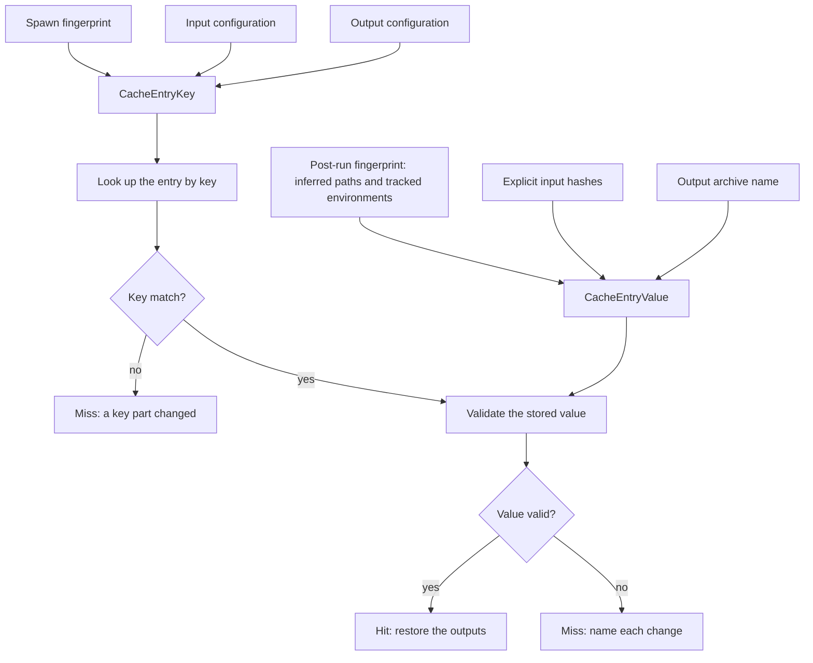
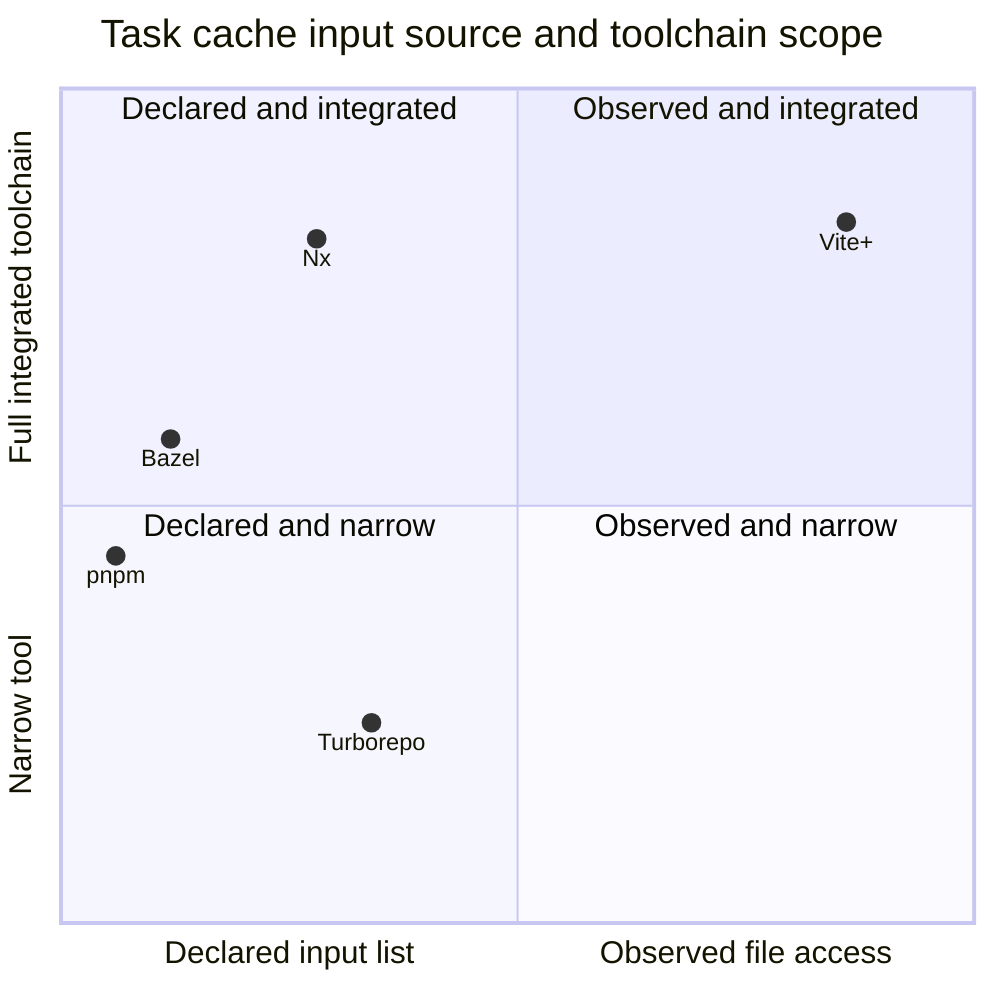
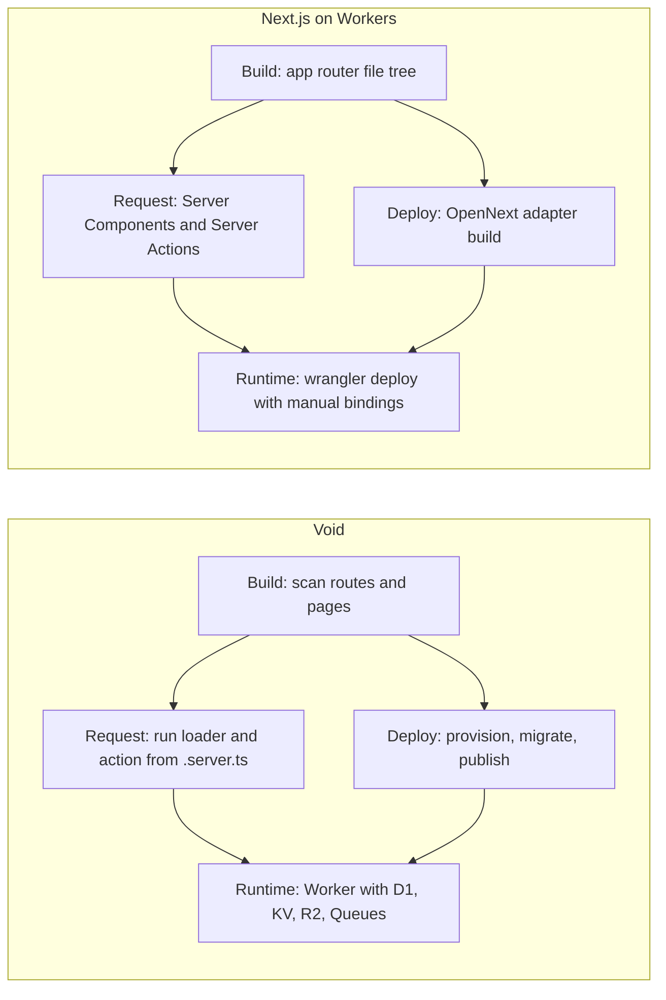

# 18 Comparisons: Vite+ Against Other Toolchains, and Void Against Next.js on Cloudflare Workers

This document compares two pairs of tools. The first pair is Vite+ against pnpm, Nx, Turborepo, and Bazel. The second pair is Void against a Next.js application deployed to Cloudflare Workers. The comparison is technical. It names the mechanism in each tool. It separates a strict advantage from a trade-off. It states where the local source settles a fact. It names external documentation where the local source cannot settle a fact.

The central argument is about cache identity. Vite Task can derive a cache entry from the file access that it observes during a run. pnpm has no task-result cache. Nx, Turborepo, and Bazel derive cache identity from declared inputs. The observed-access model removes a class of configuration error. It also imposes new limits. The sections below state both sides.

This document uses these abbreviations. Application Programming Interface (API). Continuous Integration (CI). Command-Line Interface (CLI). HyperText Transfer Protocol (HTTP). Node Package Manager (NPM, written `npm`). Structured Query Language (SQL). Uniform Resource Locator (URL). It also uses Concise Binary Object Representation (CBOR) and Content-Addressable Storage (CAS). It uses JavaScript Object Notation (JSON) and Key-Value (KV). It uses Node-API (NAPI) and OpenID Connect (OIDC). It uses Operating System (OS) and React Server Components (RSC). It uses Secure Hash Algorithm (SHA) and Server-Side Rendering (SSR). It uses Static Site Generation (SSG) and Incremental Static Regeneration (ISR). It uses YAML Ain't Markup Language (YAML). Cloudflare D1 is a SQL database. Cloudflare R2 is object storage. Cloudflare Hyperdrive accelerates PostgreSQL and MySQL connections.

All source paths in this document are relative to the snapshot root `/Users/darkvoid/GitSources/src.voidzero`. Each source path starts with the repository name, such as `vite-task/crates/vt/src/session/cache/mod.rs`. Each code block starts with a label line that gives the file and the exact line range. The label is not part of the source text. Every local-behaviour claim cites a file and a line range. External claims name external documentation. The external pages were not fetched during this offline pass. Section 18 lists the facts that the source does not settle.

## 1. Evidence rule and terms

The source is the seven repositories at the commits in the exploration specification. The Vite Task snapshot is `95d8da2fc1f06cfe8d176b30b608ed540efab066`. Vite+ pins the Vite Task crates at a different revision, `cb1ea8d214b26a0f3ca2b2ef3b6bc471b18ffacb` (`vite-plus/Cargo.toml:197`, `vite-plus/Cargo.toml:312-321`). A behaviour in this document describes the snapshot. The pinned revision can differ in line numbers, field names, and edge cases. Section 15 returns to this risk.

The comparison uses seven axes for the toolchains. The axes are install and runtime management, task graph and selection, cache key source, remote cache, monorepo filtering, configuration surface, and supply-chain checks. The comparison uses eight axes for the frameworks. The axes are routing, data loading, actions, static generation and revalidation, authentication, database, resource provisioning, and deployment.

The comparison is not a feature count. pnpm is a package manager. Nx and Turborepo are task runners for JavaScript and TypeScript monorepos. Bazel is a general build system. Vite+ is a single toolchain that contains package management, a JavaScript runtime manager, a development server, a test runner, a build command, and a task runner. A comparison across categories must name the mechanism, not only the feature list.

## 2. The five toolchains in one page

Vite+ provides one CLI, `vp`, for a Node.js project. The CLI has two layers. The first layer is a Node.js launcher that loads a TypeScript entry. The second layer is a Rust core. The TypeScript entry delegates most commands to the Rust core through NAPI bindings. The Rust core resolves the tool binaries. A separate global Rust CLI can find the project's local Vite+ installation and run it (`vite-plus/packages/cli/src/bin.ts:1-11`). Vite+ detects the package manager and drives it. It can download a managed package manager and a managed Node.js runtime. It runs tasks through Vite Task. Vite Task builds a task graph, schedules work, and caches results.

pnpm is a package manager for JavaScript. It stores each package file once in a content-addressable store. It links the file into each project that needs it. It reads a workspace definition and runs scripts across the workspace. The pnpm documentation describes the store model in "Motivation" and the workspace commands in "Workspace" (pnpm documentation, https://pnpm.io/motivation and https://pnpm.io/workspaces).

Nx is a build system for monorepos. It builds a project graph and a task pipeline. It computes a hash for each task and stores the result in a local cache. It can send the cache to a remote service. The Nx documentation describes the model in "How Caching Works" and "Task Pipeline Configuration" (Nx documentation, https://nx.dev/concepts/how-caching-works and https://nx.dev/concepts/task-pipeline-configuration).

Turborepo is a task runner for JavaScript and TypeScript monorepos. It reads task definitions from `turbo.json`. It builds a task graph, runs tasks in dependency order, and caches outputs. The Turborepo documentation describes the model in "Caching" and "Configuration" (Turborepo documentation, https://turborepo.com/docs/caching and https://turborepo.com/docs/reference/configuration).

Bazel is a general build system. It reads targets from `BUILD` files. It builds a target graph and an action graph. An action has inputs, output names, a command line, and environment variables. It computes an action key from action metadata, which can include the command, compiler flags, library locations, or system headers. It can send the action result to a remote cache or execute it on a remote machine. The Bazel documentation describes the model in "Build concepts", "Glossary", "Remote Caching", and "Remote Execution" (Bazel documentation, https://bazel.build/concepts/build-ref, https://bazel.build/reference/glossary, https://bazel.build/remote/caching, and https://bazel.build/remote/rbe).

## 3. Install and runtime management

Vite+ does not install project dependencies itself. It detects the package manager for the workspace and starts that native manager. The detection order starts with the `packageManager` field. It continues with `devEngines.packageManager`, then workspace and lock files, then configuration files (`vite-plus/crates/vp_pm_cli/src/package_manager.rs:568-664`). When no field, lockfile, or configuration selects a manager, Vite+ uses pnpm (`vite-plus/crates/vp_pm_cli/src/dispatch.rs:58-91`). A project that selects npm by a lockfile, a configuration, or a fallback type does not download npm. Vite+ resolves npm from the Node.js installation on `PATH` (`vite-plus/crates/vp_pm_cli/src/package_manager.rs:410-420`).

A managed pnpm, Yarn, or Bun download can have an integrity pin. When a pin exists, the install cache key binds the verified install to the pin. For a platform binary, the key also binds the registry origin (`vite-plus/crates/vp_pm_cli/src/package_manager.rs:147-170`). The global Vite+ installation uses a pnpm lockfile. The validator requires lockfile version 9.0 and the exact `vite-plus` specifier. It requires an integrity value for the `vite-plus` package. It also applies a tarball origin rule to every package that names a tarball (`vite-plus/packages/cli/generate-install-lockfile.ts:49-93`).

```ts
// vite-plus/packages/cli/generate-install-lockfile.ts:71-93
export function validateInstallLockfile(content: string, version: string): void {
  const lock = parse(content) as {
    lockfileVersion?: string;
    importers?: Record<
      string,
      { dependencies?: Record<string, { specifier: string; version: string }> }
    >;
    packages?: Record<string, { resolution?: PackageResolution }>;
  } | null;
  const cli = lock?.importers?.['.']?.dependencies?.['vite-plus'];
  const integrity = lock?.packages?.[`vite-plus@${version}`]?.resolution?.integrity;
  if (
    String(lock?.lockfileVersion) !== '9.0' ||
    cli?.specifier !== version ||
    (cli.version !== version && !cli.version?.startsWith(`${version}(`)) ||
    !integrity ||
    !Object.entries(lock?.packages ?? {}).every(([key, entry]) =>
      hasValidTarball(key, entry.resolution, version),
    )
  ) {
    throw new Error(`Invalid global installation lockfile for vite-plus@${version}`);
  }
}
```

Vite+ can also download a Node.js runtime. The download comes from `https://nodejs.org/dist`. A musl target uses `https://unofficial-builds.nodejs.org/download/release` (`vite-plus/crates/vp_js_runtime/src/providers/node.rs:20-26`). The runtime is cached under `<DATA>/js_runtime/<runtime>/<version>/` (`vite-plus/crates/vp_js_runtime/src/runtime.rs:209-223`).

```rust
// vite-plus/crates/vp_js_runtime/src/runtime.rs:209-223
    // Cache path: <DATA>/js_runtime/{runtime}/{version}/
    let runtime = JsRuntime {
        runtime_type,
        version: version.into(),
        install_dir: cache_dir.join(provider.name()).join(version),
        binary_relative_path: provider.binary_relative_path(platform),
        bin_dir_relative_path: provider.bin_dir_relative_path(platform),
    };
    let install_dir = &runtime.install_dir;
    let binary_path = runtime.get_binary_path();

    if tokio::fs::try_exists(&binary_path).await.unwrap_or(false) {
        tracing::debug!("{} {version} already cached at {install_dir:?}", provider.name());
        return Ok(runtime);
    }
```

| Tool | Install path | Runtime management | Basis |
|---|---|---|---|
| Vite+ | `vp install` detects pnpm, Yarn, npm, or Bun and drives that native manager. | Managed pnpm, Yarn, and Bun downloads can use an integrity pin. npm comes from `PATH` when a lockfile selects it. `vp env` downloads Node.js. | `vite-plus/crates/vp_pm_cli/src/package_manager.rs:412-420`, `vite-plus/crates/vp_pm_cli/src/package_manager.rs:568-664`; `vite-plus/crates/vp_js_runtime/src/runtime.rs:209-223`; `vite-plus/docs/guide/env.md:3` |
| pnpm | Installs packages from the registry into a content-addressable store and links them into the project. | `pnpm env` installs and selects Node.js versions. | pnpm documentation, "Motivation" and "pnpm env" (https://pnpm.io/motivation, https://pnpm.io/cli/env) |
| Nx | Installed as an npm package in the workspace or run through a global binary. | Nx does not manage the Node.js runtime. The workspace or the CI image supplies Node.js. | Nx documentation, "Installation" (https://nx.dev/getting-started/installation) |
| Turborepo | Installed as an npm package in the workspace or as a global binary. | Turborepo does not manage the Node.js runtime. | Turborepo documentation, "Installation" (https://turborepo.com/docs/getting-started/installation) |
| Bazel | Installed with Bazelisk, a package manager, or a release archive. | Toolchains select and pin language runtimes, including Node.js, in a hermetic way. | Bazel documentation, "Installing Bazel" and "Toolchains" (https://bazel.build/install, https://bazel.build/extending/toolchains) |

The Vite+ advantage is integration. One command can install dependencies, select the JavaScript runtime, start the development server, run tests, build, and run cached tasks. The pnpm advantage is focus. It does package management and does it with a mature store. The advantage of Nx, Turborepo, and Bazel is separation. They compose with the package manager that the team already uses. That separation is also a cost. The team must install and configure each part.

## 4. Task graph and selection

Vite Task has two graphs. The first is the package graph from the workspace. The second is the task graph from the task definitions. A task can declare `dependsOn`. The planner queries the package graph for the requested tasks. It then reconnects packages that do not define the task. Every predecessor connects directly to every successor, and the node without the task leaves the graph (`vite-task/crates/vt_graph/src/query/mod.rs:207-222`). This rule keeps the task order correct when only some packages define a task.

```rust
// vite-task/crates/vt_graph/src/query/mod.rs:207-222
        // Reconnect and remove each task-lacking node.
        for pkg in package_subgraph.nodes() {
            if pkg_to_task.contains_key(&pkg) {
                continue; // this package has the task — leave it in
            }
            // Read pred/succ from the live (possibly already-modified) subgraph.
            let preds: Vec<_> = subgraph.neighbors_directed(pkg, Direction::Incoming).collect();
            let succs: Vec<_> = subgraph.neighbors_directed(pkg, Direction::Outgoing).collect();
            // Bridge: every predecessor connects directly to every successor.
            for &pred in &preds {
                for &succ in &succs {
                    subgraph.add_edge(pred, succ, ());
                }
            }
            subgraph.remove_node(pkg);
        }
```

The selection flags are `-r`, `-t`, `-w`, and `-F` (`vite-task/crates/vt_workspace/src/package_filter.rs:250-289`). `-r` selects all packages. `-t` selects the current package and its transitive dependencies. `-w` selects the workspace root. `-F` passes a filter expression. The filter grammar is compatible with pnpm. It supports a leading `!` for exclusion. A trailing `...` adds transitive dependencies. A leading `...` adds transitive dependents. A `^` next to the dots removes the seed packages (`vite-task/crates/vt_workspace/src/package_filter.rs:466-489`). A task defined in `vite.config.ts` is cached by default. A `package.json` script is not cached by default (`vite-plus/docs/guide/run.md:91-124`). This is a default, not a limit. The settings `cache.tasks` and `cache.scripts` control each category, and `--cache` enables both (`vite-plus/docs/guide/cache.md:23-44`).

```rust
// vite-task/crates/vt_workspace/src/package_filter.rs:466-489
    // Step 1: strip leading `!` → exclusion filter.
    let (exclude, rest) =
        input.strip_prefix('!').map_or((false, input), |without_bang| (true, without_bang));

    // Step 2: strip trailing `...` → transitive dependencies.
    // Check for `^` immediately before `...` → exclude the seed packages themselves.
    let (include_dependencies, deps_exclude_self, rest) =
        rest.strip_suffix("...").map_or((false, false, rest), |before_dots| {
            before_dots
                .strip_suffix('^')
                .map_or((true, false, before_dots), |before_caret| (true, true, before_caret))
        });

    // Step 3: strip leading `...` → transitive dependents.
    // Check for `^` immediately after `...` → exclude the seed packages themselves.
    let (include_dependents, dependents_exclude_self, core) =
        rest.strip_prefix("...").map_or((false, false, rest), |after_dots| {
            after_dots
                .strip_prefix('^')
                .map_or((true, false, after_dots), |after_caret| (true, true, after_caret))
        });

    // exclude_self is true if either direction had `^`.
    let exclude_self = deps_exclude_self || dependents_exclude_self;
```

| Tool | Task graph | Selection | Basis |
|---|---|---|---|
| Vite+ | Package graph plus task graph. `dependsOn` adds task edges. Packages without the task are reconnected. | `-r`, `-t`, `-w`, and `-F`, with a pnpm-compatible filter grammar. | `vite-task/crates/vt_graph/src/query/mod.rs:207-222`; `vite-task/crates/vt_workspace/src/package_filter.rs:250-289`, `vite-task/crates/vt_workspace/src/package_filter.rs:466-489` |
| pnpm | Workspace script execution in dependency order. No task pipeline and no task-result cache. | `--filter` by package, directory, dependency closure, or dependents. | pnpm documentation, "pnpm run" and "Workspace" (https://pnpm.io/cli/run, https://pnpm.io/workspaces) |
| Nx | Project graph plus task pipeline. `dependsOn` and `targetDefaults` define edges. | `nx affected` from changed files. `nx run-many` by project or tag. | Nx documentation, "Task Pipeline Configuration", "Affected", and "Run Tasks" (https://nx.dev/concepts/task-pipeline-configuration, https://nx.dev/ci/features/affected, https://nx.dev/features/run-tasks) |
| Turborepo | Task graph from `turbo.json`. `dependsOn` with `^` adds dependency edges. | `--filter` by package, directory, changed-since, dependencies, and dependents. | Turborepo documentation, "Configuration" and "Filtering" (https://turborepo.com/docs/reference/configuration, https://turborepo.com/docs/core-concepts/monorepos/filtering) |
| Bazel | Target graph from `BUILD` files, then an action graph. | Target patterns, `bazel query`, and tag filters. | Bazel documentation, "Build concepts", "Glossary", and "Query guide" (https://bazel.build/concepts/build-ref, https://bazel.build/reference/glossary, https://bazel.build/query/guide) |

The Vite Task reconnection rule is notable. A package that does not define a task still passes the dependency edge through. The alternative is to require every package to define every task. That alternative produces empty tasks and extra configuration. The Nx and Turborepo task pipelines can express a similar result with `dependsOn` rules. The difference is that Vite Task derives the package edges from the workspace graph and then edits the graph.

## 5. Cache key source (central argument)

### 5.1 The key is an identity record

A Vite Task cache entry has a key and a value. The key has three parts. The first part is the spawn fingerprint: command, arguments, working directory, and environment. The second part is the resolved input configuration. The third part is the resolved output configuration (`vite-task/crates/vt/src/session/cache/mod.rs:82-121`). The key is serialized with `wincode`, a Rust binary serialization crate at version 0.6.0 (`vite-task/Cargo.toml:51`; `vite-task/crates/vt/src/session/cache/mod.rs:56-67`). The key is not a hash. The key is the identity record itself.

```rust
// vite-task/crates/vt/src/session/cache/mod.rs:82-121
#[derive(Debug, SchemaWrite, SchemaRead, Serialize, PartialEq, Eq, Clone)]
pub struct CacheEntryKey {
    /// The spawn fingerprint (command, args, cwd, envs)
    pub spawn_fingerprint: SpawnFingerprint,
    /// Resolved input configuration that affects cache behavior.
    /// Glob patterns are workspace-root-relative.
    pub input_config: ResolvedGlobConfig,
    /// Resolved output configuration that affects cache restoration.
    /// Glob patterns are workspace-root-relative.
    pub output_config: ResolvedGlobConfig,
}

impl CacheEntryKey {
    fn from_metadata(cache_metadata: &CacheMetadata) -> Self {
        Self {
            spawn_fingerprint: cache_metadata.spawn_fingerprint.clone(),
            input_config: cache_metadata.input_config.clone(),
            output_config: cache_metadata.output_config.clone(),
        }
    }
}

/// Cached execution result for a task.
///
/// Contains the post-run fingerprint (from fspy), captured outputs,
/// execution duration, and explicit input file hashes.
#[derive(Debug, SchemaWrite, SchemaRead, Serialize)]
pub struct CacheEntryValue {
    pub post_run_fingerprint: PostRunFingerprint,
    pub std_outputs: Arc<[StdOutput]>,
    pub duration: Duration,
    /// Hashes of explicit input files computed from positive globs.
    /// Files matching negative globs are already filtered out.
    /// Path is relative to workspace root, value is `xxHash3_64` of file content.
    /// Stored in the value (not the key) so changes can be detected and reported.
    pub globbed_inputs: BTreeMap<RelativePathBuf, u64>,
    /// Filename of the output archive (e.g. `{uuid}.tar.zst`) stored alongside
    /// `cache.db` in the cache directory. `None` if no output files were produced.
    pub output_archive: Option<Str>,
}
```

### 5.2 The value holds the observations

The value has five fields. The first field is the post-run fingerprint. The second field is the captured standard output and standard error. The third field is the duration. The fourth field is a map of explicit input file hashes. The fifth field is the output archive name (`vite-task/crates/vt/src/session/cache/mod.rs:104-121`). The comment states the design choice: the hashes live in the value, not in the key, so a change can be detected and reported.

The post-run fingerprint is the observation record. It holds one entry for each inferred input path. Each entry stores a path fingerprint: a content hash, a directory listing, or a not-found result. It also stores whether the path may be missing later. The fingerprint holds the tracked environment values and the tracked bulk environment queries (`vite-task/crates/vt/src/session/execute/fingerprint.rs:45-80`). Validation does not re-run the task. It reads the present tree and fingerprints each stored path again (`vite-task/crates/vt/src/session/execute/fingerprint.rs:218-294`). A stored not-found result stays valid only while the path stays absent. A stored content hash must equal the present content hash.

```rust
// vite-task/crates/vt/src/session/execute/fingerprint.rs:45-80
/// Post-run fingerprint capturing file state after execution.
/// Used to validate whether cached outputs are still valid.
#[derive(SchemaWrite, SchemaRead, Debug, Default, Serialize)]
pub struct PostRunFingerprint {
    /// Paths inferred from fspy during execution, fingerprinted as the task
    /// left them. Only populated when `input_config.includes_auto` is true.
    pub inferred_inputs: HashMap<RelativePathBuf, InferredInput>,

    /// Env vars observed via runner-aware IPC `getEnv` with `tracked: true`.
    /// Key is the env name; value is the env value hash at execution time, or
    /// `None` if unset. Validated at cache lookup against the same plan env
    /// context that served the original request.
    pub tracked_envs: BTreeMap<Str, Option<EnvValueHash>>,

    /// Bulk env queries (`getEnvs`) made with `tracked: true`.
    /// Outer key is the query, inner map is the match-set at execution time
    /// (name -> value hash). Validated at cache lookup by re-matching against
    /// the current env context and comparing the resulting set.
    ///
    /// Non-UTF-8 env names are never matched, saved, or treated as errors:
    /// they are not returned to the client, so their existence cannot affect
    /// task behavior. Values are stricter. A matched env must have a UTF-8
    /// value; the JS client errors when querying a matched non-UTF-8 value,
    /// and cache-hit validation treats a currently matched non-UTF-8 value as
    /// a changed mismatch so stale cached output is not replayed.
    pub tracked_env_queries: BTreeMap<TrackedEnvQuery, BTreeMap<Str, EnvValueHash>>,
}

/// A path the task read, as the task left it.
#[derive(SchemaWrite, SchemaRead, PartialEq, Eq, Debug, Clone, Serialize, Deserialize)]
pub struct InferredInput {
    pub fingerprint: PathFingerprint,
    /// The task wrote the path, so a later run may find it missing, as on a
    /// clean checkout. A path that is there must still match `fingerprint`.
    pub may_be_missing: bool,
}
```

Validation has three checks. First, it compares the stored explicit input hashes with hashes of the present files (`vite-task/crates/vt/src/session/cache/validation.rs:141-184`). Second, it re-fingerprints the inferred paths (`vite-task/crates/vt/src/session/execute/fingerprint.rs:218-294`). Third, it compares the stored tracked environment values with the present unfiltered environment (`vite-task/crates/vt/src/session/execute/fingerprint.rs:308-348`). A change in any check produces a miss.

The environment appears in two places for two reasons. The spawn fingerprint holds the values of the environment variables that the task config names. Those variables are part of the cache key (`vite-task/crates/vt_plan/src/cache_metadata.rs:69-97`). The tracked environment values in the post-run fingerprint are the values that the process read through the runner-aware environment call with `tracked: true`. A change in a configured variable changes the key. A change in an observed variable passes the key and fails validation.

```rust
// vite-task/crates/vt/src/session/cache/validation.rs:32-58
    pub(crate) fn validate(
        &self,
        unfiltered_envs: &FxHashMap<EnvName<Arc<OsStr>>, Arc<OsStr>>,
        globbed_inputs: &BTreeMap<RelativePathBuf, u64>,
        input_negative_globs: &PathGlobSet<'_>,
        workspace_root: &AbsolutePath,
        file_check: FileCheck,
    ) -> anyhow::Result<Checked> {
        // Without `-v`, the first changed file is enough to know it's a miss.
        let limit = if file_check == FileCheck::First { 1 } else { usize::MAX };
        let mut changes = globbed_input_changes(&self.globbed_inputs, globbed_inputs, limit);
        let mut partial = false;
        if changes.is_empty() || file_check != FileCheck::First {
            let input_changes = self.post_run_fingerprint.input_changes(
                workspace_root,
                input_negative_globs,
                file_check,
            );
            partial |= add_checked(&mut changes, input_changes, "inferred inputs")?;
        }
        let env_changes = self.post_run_fingerprint.env_changes(unfiltered_envs);
        partial |= add_checked(&mut changes, env_changes, "tracked envs")?;
        // Without `-v`, the file check stops at the first changed file.
        partial |= file_check == FileCheck::First
            && changes.iter().any(|change| matches!(change, Change::File { .. }));
        Ok(Checked { changes, partial })
    }
```

The miss carries a list of `Change` values. Each value names a changed file, environment value, argument, working directory, or configuration item (`vite-task/crates/vt/src/session/cache/mod.rs:275-296`). By default the check stops at the first changed file. The `-v` flag checks every file, and `-vv` also records a baseline (`vite-task/crates/vt/src/session/cache/mod.rs:341-363`). The `partial` flag is true when some files were not checked or the check stopped early (`vite-task/crates/vt/src/session/cache/mod.rs:263-272`).

**Aha:** The cache key holds no input hash. The input hashes live in the value. The key names the run. The value records what the run observed. A cache hit requires two agreements: the key must match, and the value must validate against the present tree. This split is why Vite Task can report a precise reason for a miss.

The split also explains the safety rule. A key match alone is not a hit. A stored value with a changed file is a miss, even when the command and configuration are identical. The validation pass is the part that makes an observed-access cache safe.

### 5.3 Observed access versus declared inputs

The default tracking mode is observed access. When `input` is omitted, Vite Task records the files that the command reads during execution (`vite-task/docs/inputs.md:5-19`). [07 Vite Task Caching](07-vite-task-caching.md) gives the cache mechanism. [08 fspy File System Proxy](08-fspy-file-system-proxy.md) gives the proxy mechanism. The Vite+ guide states that automatic data tracking records file reads, missing-file probes, directory listings, and written output files (`vite-plus/docs/guide/cache.md:23-53`). An explicit `input` list is still available. A glob list without a `{ "auto": true }` entry replaces observation with declaration. Vite Task then hashes the matched files and does not record reads, missing-file probes, or directory listings (`vite-task/docs/inputs.md:94-109`, `vite-task/docs/inputs.md:165-173`). A list with `{ "auto": true }` keeps observation and adds the globs (`vite-task/docs/inputs.md:128-144`). An empty list disables file tracking, so only the command and configured environment can cause a miss (`vite-task/docs/inputs.md:147-158`). A declared list loses the missing-file probe property in section 5.4. A team chooses the declaration when a tool reads files that the proxy cannot see.

The file-system proxy is named `fspy`. On Linux with glibc it uses `LD_PRELOAD`. On Linux with musl, and for fully static binaries, it uses `seccomp_unotify`. On macOS it uses `DYLD_INSERT_LIBRARIES`. On Windows it uses Detours, a binary instrumentation library from Microsoft Research (Microsoft Research documentation, https://www.microsoft.com/en-us/research/project/detours/; `vite-task/crates/fspy/README.md:18-20`). The proxy records file reads, writes, renames, and directory creation. It also records missing-file probes and directory listings. The records arrive over a shared-memory channel.

A tracking failure is a cache failure, not a task failure. If the proxy cannot record every access, the error is `TrackingIncomplete` (`vite-task/crates/fspy/src/error.rs:34-47`). The comment states the rule: the run must continue, but a cache entry that needs every access must treat the run as untracked.

```rust
// vite-task/crates/fspy/src/error.rs:34-47
/// A tracked process could not record a file access it went on to perform,
/// so the accesses collected for the run are a subset of what it really
/// touched.
///
/// The tracking channel can be full, or a process can continue untracked
/// because the seccomp filter could not be installed.
///
/// The run itself is unaffected: recording must never stop the program
/// doing the work. What cannot be done is anything that needs every
/// access, caching above all, which has to treat the run as untracked
/// rather than as having touched only the paths that fit.
#[derive(thiserror::Error, Clone, Copy, PartialEq, Eq, Debug)]
#[error("automatic file tracking could not record every file access")]
pub struct TrackingIncomplete;
```

The cache update path applies the rule. A cancelled run does not update the cache. A run with a non-zero exit status does not update the cache. A run with incomplete tracking does not update the cache. A build without the `fspy` feature also does not update the cache when the task asks for inference (`vite-task/crates/vt/src/session/execute/cache_update.rs:96-131`).

```rust
// vite-task/crates/vt/src/session/execute/cache_update.rs:96-131
    if cancel_token.is_cancelled() {
        // Cancelled (Ctrl-C or sibling failure) — result is untrustworthy.
        return (CacheUpdateStatus::NotUpdated(CacheNotUpdatedReason::Cancelled), None);
    }

    if !outcome.exit_status.success() {
        // Execution failed with non-zero exit status — don't update cache.
        return (CacheUpdateStatus::NotUpdated(CacheNotUpdatedReason::NonZeroExitStatus), None);
    }

    // The accesses, or `None` when the task was not tracked at all. An
    // `Err` means tracking could not record everything it did, so what
    // arrived is a subset of what it touched, and an entry
    // built from a subset would replay with inputs and outputs missing.
    #[cfg(fspy)]
    let Ok(path_accesses) = outcome.path_accesses.as_ref().map(Result::as_ref).transpose() else {
        return (CacheUpdateStatus::NotUpdated(CacheNotUpdatedReason::TrackingIncomplete), None);
    };

    let fspy_outcome = observe_fspy(
        #[cfg(fspy)]
        path_accesses,
        metadata,
        fspy,
        &ignored_input_rels,
        &ignored_output_rels,
        workspace_root,
        cache_dir,
    );

    if fspy_outcome.is_none() && fspy.is_some() {
        // Task requested fspy auto-inference but this binary was built without
        // `cfg(fspy)`. Task ran, but we can't compute a valid cache entry
        // without tracked path accesses.
        return (CacheUpdateStatus::NotUpdated(CacheNotUpdatedReason::FspyUnsupported), None);
    }
```

**Aha:** When tracking cannot see every access, Vite Task discards the entry. It does not store a partial entry. A partial entry would replay with missing inputs and missing outputs. The safe choice is a miss. This rule turns an uncertain observation into a correct but slower run.

The other tools use declared inputs. Nx computes a hash from the task command, the declared `inputs`, the project graph, and the task configuration. The declared inputs can include files, environment variables, runtime values, and external dependencies (Nx documentation, "How Caching Works", https://nx.dev/concepts/how-caching-works). Turborepo hashes the task inputs, the environment variables, the lockfile, the task configuration, and the hashes of dependency tasks (Turborepo documentation, "Caching", https://turborepo.com/docs/caching). Bazel computes an action key from action metadata, which can include the command, compiler flags, library locations, or system headers (Bazel documentation, "Glossary", https://bazel.build/reference/glossary). pnpm has no task-result cache. Its store is content-addressed by package content and integrity (pnpm documentation, "pnpm store", https://pnpm.io/cli/store).

| Tool | Cache key source | What the key covers | Basis |
|---|---|---|---|
| Vite+ | Observed file access by default. An explicit `input` list can disable inference, or combine globs with `{ auto: true }`. | Spawn fingerprint, input configuration, output configuration. The value holds the post-run fingerprint, input hashes, and output archive. | `vite-task/crates/vt/src/session/cache/mod.rs:82-121`; `vite-task/crates/vt/src/session/cache/validation.rs:32-58`; `vite-task/docs/inputs.md:5-19`, `vite-task/docs/inputs.md:43-51` |
| pnpm | No task-result cache. The package store uses content-addressable package data. | Package content and integrity. The store is not a task-result key. | pnpm documentation, "pnpm store" (https://pnpm.io/cli/store) |
| Nx | Declared inputs in the project and task configuration. | Command, files, environment variables, runtime, external dependencies, project graph, and task configuration. | Nx documentation, "How Caching Works" (https://nx.dev/concepts/how-caching-works) |
| Turborepo | Declared task inputs. | Files, environment variables, lockfile, task configuration, and dependency task hashes. | Turborepo documentation, "Caching" (https://turborepo.com/docs/caching) |
| Bazel | Declared action inputs. | Action metadata: the command, compiler flags, library locations, or system headers. | Bazel documentation, "Glossary" and "Remote Caching" (https://bazel.build/reference/glossary, https://bazel.build/remote/caching) |

### 5.4 What is strictly better

Three properties are strictly better for correctness or for maintenance.

The first property is the default. A team does not need to write an input list for the common case. The task records its reads. A forgotten declaration cannot produce a stale hit. A declared system can produce a stale hit when a task reads a file that the declaration omits. The declared system relies on the author to list every input. The observed system relies on the proxy to see every read. Both can fail, but the failures are different. A missing declaration is silent. A missing observation is detected and becomes a miss.

The second property is the recording of missing-file probes and directory listings. A glob list cannot express a probe that found no file. A task can change behavior when a file appears or disappears. The proxy records the probe. The cache then invalidates when the answer to the probe changes. The Vite+ guide names this behaviour (`vite-plus/docs/guide/cache.md:23-53`).

The third property is the safety rule for incomplete tracking. A partial observation never becomes a cache entry. The entry is discarded (`vite-task/crates/vt/src/session/execute/cache_update.rs:96-131`). A declared system does not have this failure mode, because it does not observe. But a declared system also does not detect the gap.

### 5.5 What is a trade-off

The observed-access model has costs.

The first cost is coverage. The cache works only when the proxy can load and record. A process that the proxy cannot track produces no entry. A statically linked binary on Linux can use the seccomp path. A platform outside the supported set cannot use the proxy, so it cannot produce an observed-access cache entry. The supported set in this snapshot is Linux with glibc, Linux with musl, macOS, and Windows (`vite-task/crates/fspy/README.md:5-24`). A declared system can cache on any platform that runs the task runner.

The second cost is hit rate. `TrackingIncomplete` produces a miss. A full tracking channel or a failed filter installation reduces the hit rate. The task still runs, but it does not store a result. A declared system would store a result in the same situation, possibly an unsafe one.

The third cost is cross-platform reuse. A remote Vite Task key carries a header with the cache schema version, the remote value format, the OS, and the architecture (`vite-task/crates/vt/src/session/cache/remote.rs:518-553`). A key from a Linux x86-64 machine does not match a key from a macOS arm64 machine. The Nx and Turborepo documentation names files, environment, and task configuration as hash inputs. It does not describe an automatic OS or architecture field (Nx documentation, "How Caching Works", https://nx.dev/concepts/how-caching-works; Turborepo documentation, "Caching", https://turborepo.com/docs/caching). A team can share an entry across platforms when the declared inputs are platform-neutral and the output is portable. That sharing depends on the declaration. The Vite Task header does not depend on a declaration, so it fails closed. Bazel can share an action result when the toolchain and the action key match.

The fourth cost is remote execution. Bazel can execute an action on a remote worker because the action has a declared input closure. Vite Task has a remote cache client, not a remote executor. The client comment states its scope: it is a client for the remote cache server API (`vite-task/crates/vt_remote_cache/src/lib.rs:1-2`). The snapshot does not contain the server.

The fifth cost is auditability before the first run. A reviewer can read a declared input list. A reviewer cannot see the observed input set until a run occurs. The observed set is stored in the cache value after the run, but it is not a review artifact. A team that must approve the exact input closure before a build will prefer a declared system.

The sixth cost is ecosystem. Nx has generators, plugins, and a project graph user interface (UI). Turborepo has a large set of examples and a remote cache service. Bazel has rules for many languages and a remote execution protocol. Vite+ is younger. Section 15 lists the gaps.



## 6. Remote cache

Vite Task has a remote cache client. The mode comes from `VP_REMOTE_CACHE`. The accepted values are `off`, `read`, and `read-write`. The endpoint comes from `VP_REMOTE_CACHE_URL` or from the workspace configuration (`vite-task/crates/vt_plan/src/remote_cache.rs:125-151`). A missing endpoint with a read mode is an error. A missing mode with an endpoint means read-only access.

```rust
// vite-task/crates/vt_plan/src/remote_cache.rs:125-151
    let mode = match env_value(envs, MODE_ENV) {
        None => None,
        Some(value) => Some(match value.to_str() {
            Some("off") => RemoteCacheMode::Off,
            Some("read") => RemoteCacheMode::Read,
            Some("read-write") => RemoteCacheMode::ReadWrite,
            _ => return Err(Error::InvalidRemoteCacheModeEnv(Arc::clone(value))),
        }),
    };
    let url = match env_value(envs, URL_ENV) {
        Some(value) => Some(Arc::<str>::from(
            value.to_str().ok_or_else(|| Error::InvalidRemoteCacheUrlEnv(Arc::clone(value)))?,
        )),
        None => configured_url.filter(|url| !url.is_empty()).cloned(),
    };

    let (access, url) = match (mode, url) {
        (Some(RemoteCacheMode::Off), _) | (None, None) => return Ok(None),
        (Some(RemoteCacheMode::Read) | None, Some(url)) => (RemoteCacheAccess::Read, url),
        (Some(RemoteCacheMode::ReadWrite), Some(url)) => (RemoteCacheAccess::ReadWrite, url),
        (Some(RemoteCacheMode::Read | RemoteCacheMode::ReadWrite), None) => {
            return Err(Error::MissingRemoteCacheEndpoint);
        }
    };
    let auth = resolve_auth(&url, envs)?;
    Ok(Some(ResolvedRemoteCacheConfig { access, url, auth }))
}
```

The client sends a CBOR `POST` request for a fetch. A `404` response means that neither key matched. A `200` response carries one of two results (`vite-task/crates/vt_remote_cache/src/lib.rs:199-222`). An exact result holds the entries stored under the requested key, newest first. A fallback result means that no entry exists under the requested key, but an entry exists under the secondary key. The secondary key names the execution: the task name, the command index, and the package path (`vite-task/crates/vt_plan/src/cache_metadata.rs:16-35`). A fallback is a miss, not a hit. The client compares the stored key with the current key to name the difference (`vite-task/crates/vt/src/session/cache/remote.rs:127-150`, `vite-task/crates/vt/src/session/cache/remote.rs:220-240`). The key has a header with the cache schema version, the remote value format, the OS, and the architecture. The header is prepended to the serialized key and is checked again on decode (`vite-task/crates/vt/src/session/cache/remote.rs:518-553`).

```rust
// vite-task/crates/vt/src/session/cache/remote.rs:518-553
/// Bump this whenever the remote value encoding changes incompatibly. Both
/// keys carry it, so clients that encode values differently never share
/// entries, and never push out each other's.
const REMOTE_VALUE_FORMAT: u32 = 1;

#[derive(SchemaWrite)]
struct KeyHeader {
    cache_schema_version: u32,
    remote_value_format: u32,
    os: Str,
    arch: Str,
}

/// The key header for this build.
fn encode_header() -> WriteResult<Vec<u8>> {
    serialize_cache(&KeyHeader {
        cache_schema_version: CACHE_SCHEMA_VERSION,
        remote_value_format: REMOTE_VALUE_FORMAT,
        os: Str::from(std::env::consts::OS),
        arch: Str::from(std::env::consts::ARCH),
    })
}

/// Encode a key with the header for this build.
fn encode_key<K: SchemaWrite<TaskCacheConfig, Src = K>>(key: &K) -> WriteResult<Vec<u8>> {
    let mut bytes = encode_header()?;
    bytes.extend(serialize_cache(key)?);
    Ok(bytes)
}

/// Decode a key stored with the header for this build.
fn decode_key(bytes: &[u8]) -> Result<CacheEntryKey, ReadError> {
    let header = encode_header()?;
    let key = bytes.strip_prefix(header.as_slice()).ok_or(ReadError::CorruptKey(None))?;
    deserialize_cache(key).map_err(|err| ReadError::CorruptKey(Some(err)))
}
```

A fetch and a download carry no credentials by default (`vite-task/crates/vt_remote_cache/README.md:9`). A write can carry authentication. In a GitHub Actions job, the client requests an OIDC token with the cache URL as the audience (`vite-task/crates/vt_plan/src/remote_cache.rs:153-174`). The token is sent in the authorization header for a store operation. This design avoids a long-lived shared secret in the CI job. A server that requires authentication for reads must accept another credential; the two auth modes in this snapshot send none for a read (`vite-task/crates/vt_plan/src/remote_cache.rs:48-59`).

| Tool | Remote cache | Key sharing rule | Basis |
|---|---|---|---|
| Vite+ | Modes `off`, `read`, and `read-write`. Endpoint from `VP_REMOTE_CACHE_URL`. CBOR over HTTP. OIDC for writes in GitHub Actions. | The key header includes the OS and the architecture. A key does not cross platforms. | `vite-task/crates/vt_plan/src/remote_cache.rs:125-151`; `vite-task/crates/vt/src/session/cache/remote.rs:518-553` |
| pnpm | No built-in task-result remote cache. A shared package store is possible, but it is not a task cache. | Package content and integrity. | pnpm documentation, "pnpm store" (https://pnpm.io/cli/store) |
| Nx | Nx Cloud or a self-hosted remote cache. | The task hash from the declared inputs and the project graph. | Nx documentation, "Remote Caching" (https://nx.dev/ci/features/remote-caching) |
| Turborepo | Vercel Remote Cache or a self-hosted cache. | The task hash from the declared inputs and the dependency task hashes. | Turborepo documentation, "Remote Caching" (https://turborepo.com/docs/core-concepts/remote-caching) |
| Bazel | Remote cache and remote execution over gRPC (a remote procedure call protocol). `--remote_cache` names the endpoint. | Action metadata: the command, compiler flags, library locations, or system headers. | Bazel documentation, "Glossary" and "Remote Caching" (https://bazel.build/reference/glossary, https://bazel.build/remote/caching) |

The Vite Task remote cache has a narrower scope than Bazel. It stores task results. It does not execute tasks. It also does not provide a server in this snapshot. The client uses three routes: `POST {endpoint}/fetch`, `GET {endpoint}/blob/{blob_id}`, and `POST {endpoint}/store` (`vite-task/crates/vt_remote_cache/README.md:5-15`). The local README describes the request and response bodies. It names a server-API pull request. The snapshot does not contain that server. A team must supply a compatible server. The local source does not name a managed service.

## 7. Monorepo filtering

Vite Task uses a filter grammar that is compatible with pnpm. The parser strips a leading `!` to make an exclusion. It strips a trailing `...` to add transitive dependencies. It strips a leading `...` to add transitive dependents. It reads `^` next to the `...` to remove the seed packages from the result (`vite-task/crates/vt_workspace/src/package_filter.rs:466-489`). The four flags from section 4 select the package set, and the filter grammar selects within that set (`vite-task/crates/vt_workspace/src/package_filter.rs:250-289`). A run can fail when a filter matches no package, through `--fail-if-no-match`.

The compatibility is deliberate. A team that moves from pnpm to Vite+ keeps its filter expressions. The Vite+ guide presents task names and script names as separate namespaces. A task name can come from `vite.config.ts` or from `package.json`, but not from both (`vite-plus/docs/guide/run.md:91-124`). A name in both places is a load error, `ScriptConflict` (`vite-task/crates/vt_graph/src/task_loader.rs:180-186`). The namespaces are separate because a configuration task has cache controls and a package script does not.

| Tool | Filter syntax | Transitive selection | Basis |
|---|---|---|---|
| Vite+ | pnpm-compatible grammar with `!`, `...`, and `^`. Flags `-r`, `-t`, `-w`, and `-F`. | Dependencies and dependents, with an option to exclude the seed. | `vite-task/crates/vt_workspace/src/package_filter.rs:250-289`, `vite-task/crates/vt_workspace/src/package_filter.rs:466-489` |
| pnpm | `--filter` with package name, directory, dependency closure, dependents, and changed-since. | `...` for dependencies or dependents. `[since]` for changed packages. | pnpm documentation, "Filtering" (https://pnpm.io/filtering) |
| Nx | `nx affected` from changed files. `nx run-many` by project list or tags. | The project graph supplies dependencies and dependents. | Nx documentation, "Affected" and "Run Tasks" (https://nx.dev/ci/features/affected, https://nx.dev/features/run-tasks) |
| Turborepo | `--filter` with package, directory, changed-since, dependencies, and dependents. | `...` syntax for dependencies and dependents. | Turborepo documentation, "Filtering" (https://turborepo.com/docs/core-concepts/monorepos/filtering) |
| Bazel | Target patterns, `bazel query`, and tag filters. | The target graph supplies dependencies. | Bazel documentation, "Query guide" (https://bazel.build/query/guide) |

The Nx and Turborepo selection models use change detection. Nx compares the changed files with the project graph. Turborepo accepts a changed-since range. Vite Task does not have a built-in changed-files selector in this snapshot. It has package filters and task dependencies. A CI job that wants affected selection must compute the changed packages and pass a filter. That is a real gap against Nx and Turborepo.

## 8. Configuration surface

Vite+ configuration lives in `vite.config.ts`. The `defineConfig` function comes from `vite-plus`. The `run.tasks` object holds task definitions. A task has a `command`, optional `dependsOn`, optional `cache` settings, and optional environment inputs (`vite-plus/docs/guide/run.md:91-124`). The cache controls have a fixed order. A per-task `cache: false` wins over every other control. The CLI flags come next. The workspace `run.cache` setting comes last (`vite-plus/docs/guide/cache.md:23-53`).

Vite+ also has a global installation lockfile. The file is a pnpm lockfile. The validator checks the lockfile version, the `vite-plus` specifier, the installed version, the `vite-plus` integrity, and the tarball origin rule for every package (`vite-plus/packages/cli/generate-install-lockfile.ts:49-93`). This file protects the CLI itself, not the project dependencies. The project dependencies remain under the native package manager.

Starlark is the configuration language that Bazel uses for build files (Bazel documentation, "Starlark Language", https://bazel.build/rules/language). Bzlmod is Bazel's external module system (Bazel documentation, "Bzlmod", https://bazel.build/external/module). The Bazel row below uses both terms.

| Tool | Main configuration files | Model | Basis |
|---|---|---|---|
| Vite+ | `vite.config.ts` with `run.tasks`. Native package manager files. Global install lockfile. | One TypeScript configuration for tasks, cache, and runtime. | `vite-plus/docs/guide/run.md:91-124`; `vite-plus/packages/cli/generate-install-lockfile.ts:71-93` |
| pnpm | `pnpm-workspace.yaml`, `.npmrc`, and `package.json`. | Workspace definition plus package manager settings. | pnpm documentation, "Workspace" (https://pnpm.io/workspaces) |
| Nx | `nx.json`, `project.json`, and plugin inference. | Project graph plus task pipeline plus plugin configuration. | Nx documentation, "Task Pipeline Configuration" (https://nx.dev/concepts/task-pipeline-configuration) |
| Turborepo | `turbo.json` and `package.json`. | Task graph plus cache configuration. | Turborepo documentation, "Configuration" (https://turborepo.com/docs/reference/configuration) |
| Bazel | `MODULE.bazel`, `BUILD`, `.bazelrc`, and Starlark rules. | Target graph plus toolchains plus external module resolution. | Bazel documentation, "Bzlmod" (https://bazel.build/external/module) |

The Vite+ configuration surface is smaller than the Bazel surface. It is also smaller than the Nx surface, because Nx supports plugin inference and a project graph plugin API. The smaller surface is a benefit for a JavaScript workspace. It is a limit for a polyglot repository. Bazel can describe a build for many languages in one graph. Vite Task can run any command, but its package graph comes from a JavaScript workspace.

## 9. Supply-chain checks

Vite+ lowers its package-manager commands to the native manager. `vp pm audit` starts `npm audit`, `pnpm audit`, or the equivalent. The npm lowering adds `--omit=dev` for npm 7 and later, or `--production` for npm 6 (`vite-plus/crates/vp_pm_cli/src/resolution/commands/audit.rs:33-49`). The command is a translation layer. The audit database and the decision belong to the native manager.

```rust
// vite-plus/crates/vp_pm_cli/src/resolution/commands/audit.rs:33-49
impl Resolve<AuditArgs> for Npm {
    fn resolve(&self, args: &AuditArgs, _diag: &mut Diagnostics) -> CommandResolution {
        let mut cmd = CommandBuilder::new("npm");
        cmd.arg("audit");
        if args.fix {
            cmd.arg("fix");
        }
        cmd.option("--audit-level", args.level.as_ref())
            .arg_if(
                if self.supports_v7_commands() { "--omit=dev" } else { "--production" },
                args.production,
            )
            .arg_if("--json", args.json)
            .extend(args.pass_through_args.iter());
        cmd.into()
    }
}
```

`vp pm approve-builds` writes the native trust policy. The two npm notes apply to different npm versions. In npm 11.16 through 11.x, the `allowScripts` policy is advisory: install scripts still run, and npm only warns. In npm 12, the policy is enforced, but an approval is recorded and a script that a previous install skipped does not run until `vp pm rebuild <package>` (`vite-plus/crates/vp_pm_cli/src/resolution/commands/approve_builds.rs:7-9`, `vite-plus/crates/vp_pm_cli/src/resolution/commands/approve_builds.rs:155-165`). Below npm 11.16 the command warns and performs no operation (`vite-plus/crates/vp_pm_cli/src/resolution/commands/approve_builds.rs:101-127`). The command name suggests enforcement. The npm behaviour depends on the npm version.

```rust
// vite-plus/crates/vp_pm_cli/src/resolution/commands/approve_builds.rs:7-9
const NPM_ADVISORY_NOTE: &str = "npm's allowScripts policy is advisory in npm 11.x: install scripts still run; npm only warns about unreviewed packages at install time. npm 12 enforces the policy.";

const NPM_ENFORCED_NOTE: &str = "npm records the approval in the `allowScripts` field of package.json but does not run scripts a previous install skipped. Run `vp pm rebuild <package>` to execute them.";
```

| Tool | Audit command | Build-script policy | Integrity basis |
|---|---|---|---|
| Vite+ | `vp pm audit` lowers to the native manager audit. | `vp pm approve-builds` writes the native trust policy. The npm 11.x policy is advisory. | `vite-plus/crates/vp_pm_cli/src/resolution/commands/audit.rs:33-49`; `vite-plus/crates/vp_pm_cli/src/resolution/commands/approve_builds.rs:7-9`; `vite-plus/packages/cli/generate-install-lockfile.ts:49-93` |
| pnpm | `pnpm audit`. | `pnpm approve-builds` controls dependency build scripts. | pnpm documentation, "Security" and "pnpm approve-builds" (https://pnpm.io/security, https://pnpm.io/cli/approve-builds) |
| Nx | No dedicated audit command. Use the package manager audit. | The package manager owns the build-script policy. `nx migrate` coordinates package updates. | Nx documentation, "Automate Updating Dependencies" (https://nx.dev/features/automate-updating-dependencies) |
| Turborepo | No dedicated audit command. Use the package manager audit. | The package manager owns the build-script policy. | Turborepo documentation, "Configuration" (https://turborepo.com/docs/reference/configuration) |
| Bazel | No dedicated NPM audit. Use the package manager audit for NPM packages. | External repositories are pinned with integrity hashes. | Bazel documentation, "Bzlmod" (https://bazel.build/external/module) |

The Vite+ supply-chain surface is broader than the Turborepo surface and narrower than a dedicated software composition analysis product. It offers audit, build-script approval, and licence listing. `vp pm licenses list` delegates to the native `licenses list` command. The output keeps the native schema. npm and Yarn Modern have no such command, so the command warns and exits successfully (`vite-plus/docs/guide/package-management/licenses.md:1-30`; `vite-plus/crates/vp_pm_cli/src/cli.rs:102`). It does not offer a vulnerability database of its own. The native manager remains the source of truth.

## 10. Quadrant map of the toolchains

The map places each tool on two axes. The horizontal axis measures one property: whether cache identity comes from a declared input list on the left or from file access observed at run time on the right. The vertical axis measures workflow scope: the number of stages that the tool owns from dependency install and runtime selection through development, test, build, and task cache. A tool that owns one stage sits low. A tool that owns most stages sits high. The position of pnpm on the horizontal axis is nominal. pnpm has no task-result cache, so it has no task input source.



The map shows the trade-off space. Vite+ is the only tool in the observed-access and integrated quadrant. Nx owns the project graph, task pipeline, cache, generators, and plugins, so it sits high (Nx documentation, "How Caching Works", https://nx.dev/concepts/how-caching-works). Nx is integrated but declared. Turborepo owns the task graph and the cache, so it is declared and narrow (Turborepo documentation, "Caching", https://turborepo.com/docs/caching). Bazel owns the build graph, toolchains, and remote execution (Bazel documentation, "Glossary", https://bazel.build/reference/glossary, "Toolchains", https://bazel.build/extending/toolchains, and "Remote Execution", https://bazel.build/remote/rbe). It does not own dependency install, the JavaScript runtime, the development server, or the test runner, so it sits in the middle. pnpm owns install and the store, and it has no task cache.

Vite Task is the engine behind `vp run`. The Vite Task README starts with "Install Vite+" and shows `vp run` commands (`vite-task/README.md:1-14`). The snapshot does not show a separate supported task-runner command. A team that wants a declared input closure and remote execution must choose Bazel.

## 11. Void against Next.js on Cloudflare Workers

Void is a full-stack framework for Cloudflare Workers. It scans `routes/` for server routes and `pages/` for page routes. It has a server loader and action contract. It has built-in authentication, a database client, resource provisioning, migrations, and a deploy command. Next.js is a React framework. The App Router provides routing, Server Components, Server Actions, and static generation. Next.js does not target Cloudflare Workers directly. A deployment uses an adapter. The Cloudflare guide gives the supported feature set and recommends vinext as the default. It presents OpenNext as the alternative for an existing application (Cloudflare documentation, "Next.js on Workers", https://developers.cloudflare.com/workers/framework-guides/web-apps/nextjs/). The OpenNext Cloudflare documentation describes the adapter (OpenNext Cloudflare documentation, https://opennext.js.org/cloudflare).

The comparison below names mechanisms. It does not claim that one framework is better in every case. The Next.js side is a deployment of Next.js to Cloudflare Workers, not Next.js on its native Node.js server.

### 11.1 Routing

Void has two route trees. `routes/` holds server routes. `pages/` holds page routes. The filename parser strips a trailing `index`. It removes route groups such as `(group)`. It converts `[param]` to a single dynamic segment. It converts `[...param]` to a catch-all segment (`void/packages/void/src/router/parse-filename.ts:58-91`). A `.dev` or `.prod` suffix limits a route to that environment. The two environment names are `dev` and `prod`. A route without a suffix serves every environment (`void/packages/void/src/router/parse-filename.ts:20`, `void/packages/void/src/router/parse-filename.ts:123-128`). Specificity orders the matches. A fully static route comes before a route with a parameter. A parameter comes before a catch-all. The first segment that differs decides, then the route length, then the text (`void/packages/void/src/router/route-order.ts:31-60`). Layouts are resolved from the directory tree. Middleware files are scanned from `<sourceRoot>/middleware` (`void/packages/void/src/project-paths.ts:99`). A filename prefix sets the order, such as `01.logger.ts`. A file without a prefix sorts last (`void/packages/void/src/router/scan.ts:34-49`). Document 11 gives the full routing model.

```ts
// void/packages/void/src/router/parse-filename.ts:58-91
  // 3. Strip trailing "index"
  if (segments[segments.length - 1] === 'index') {
    segments.pop();
  }

  // 4. Remove route groups: (groupname)
  const filtered = segments.filter((s) => !s.startsWith('(') || !s.endsWith(')'));

  // 5. Convert dynamic segments
  const params: Array<string> = [];
  let catchAll = false;

  const converted = filtered.map((segment) => {
    // [...param] - catch-all with named param
    if (segment.startsWith('[...') && segment.endsWith(']')) {
      const paramName = segment.slice(4, -1);
      catchAll = true;
      if (paramName) {
        params.push(paramName);
        return `:${paramName}{.+}`;
      }
      return '*';
    }
    // [param] - single dynamic param
    if (segment.startsWith('[') && segment.endsWith(']')) {
      const paramName = segment.slice(1, -1);
      params.push(paramName);
      return `:${paramName}`;
    }
    return segment;
  });

  // 6. Build pattern with leading /
  const pattern = '/' + converted.join('/');
```

Next.js uses the App Router. Folders under `app/` map to URL segments. A folder can contain `page.tsx`, `layout.tsx`, `loading.tsx`, `error.tsx`, and `route.ts`. Dynamic segments use `[slug]`. Catch-all segments use `[...slug]`. Route groups use `(group)`. The Next.js documentation describes these conventions in "Routing Fundamentals" and "Project Structure" (Next.js documentation, https://nextjs.org/docs/app/building-your-application/routing).

| Axis | Void | Next.js on Workers |
|---|---|---|
| Route tree | `routes/` for server routes and `pages/` for page routes. | `app/` for the App Router. |
| Dynamic segment | `[param]` becomes a single segment. `[...param]` becomes a catch-all. | `[slug]` for one segment. `[...slug]` for a catch-all. |
| Route group | `(group)` is removed from the URL. | `(group)` is removed from the URL. |
| Layout | Layout files are resolved from the directory tree. | `layout.tsx` wraps a segment and its children. |
| Middleware | Files in a middleware directory, ordered by numeric prefix. | `middleware.ts` at the project root or in a source directory. |
| Basis | `void/packages/void/src/router/parse-filename.ts:58-91`; document 11. | Next.js documentation, "Routing Fundamentals" (https://nextjs.org/docs/app/building-your-application/routing). |

### 11.2 Data loading

A Void page has a component file and an optional `.server.ts` companion. The companion exports `loader`. The scanner recognizes `loader`, `action`, and `actions` as page methods (`void/packages/void/src/pages/scan.ts:49`). The loader runs on the server. Its result becomes the page props. A `Response` result has two paths. A response with status 300 or higher passes through unchanged. A non-JSON response also passes through unchanged; this covers a file download or a stream. A JSON response becomes the page props (`void/packages/void/src/pages/protocol.ts:353-367`). The client receives serialized page data.

```ts
// void/packages/void/src/pages/protocol.ts:353-367
    if (result instanceof Response && !isConvertedResponse(result)) {
      if (
        result.status === 404 &&
        !result.headers.get('Content-Disposition')?.includes('attachment')
      ) {
        const recovered = await recover?.(undefined, result);
        if (recovered) {
          return recovered;
        }
      }
      const contentType = result.headers.get('content-type') || '';
      if (result.status >= 300 || !contentType.includes('application/json')) {
        return result;
      }
    }
```

The function `extractProps` handles the remaining JSON response. It reads the JSON body into the props object (`void/packages/void/src/pages/protocol.ts:311-320`).

Next.js loads data in Server Components and Route Handlers. A Server Component can be an `async` function and can await a database or a `fetch` call. A Route Handler exports `GET`, `POST`, and other HTTP methods. The Next.js documentation describes the model in "Data Fetching" and "Server Components" (Next.js documentation, https://nextjs.org/docs/app/building-your-application/data-fetching).

The difference is the unit of data loading. Void attaches a loader to a page route. Next.js attaches data fetching to a component tree. A Server Component can fetch at any level. Void has a page-level loader and deferred props. A deferred prop is a promise that the server leaves pending in the first stream and fills later (`void/docs/reference/api/pages.md:166-177`). Next.js has a component-level cache and a request-level cache. The Next.js model is more flexible. The Void model is easier to type as a page contract.

### 11.3 Actions

A Void `.server.ts` file exports `action` for a single action or `actions` for named actions. The first query key selects the action on a page with named actions. The example in the source is `/books?delete&page=2` (`void/packages/void/src/pages/action-key.ts:1-3`). The mutation handler checks the request origin. A cross-origin request receives status 403 (`void/packages/void/src/pages/protocol.ts:893-895`).

```ts
// void/packages/void/src/pages/action-key.ts:1-3
// On a page with named actions, the first query key selects the action
// (`/books?delete&page=2`). It addresses the action, not the page, so the page
// URL, history and c.redirect() leave it out.
```

```ts
// void/packages/void/src/pages/protocol.ts:893-895
  if (!isSameOriginAction(c.req.raw)) {
    return new Response('Cross-origin page actions are not allowed.', { status: 403 });
  }
```

Next.js uses Server Actions. A Server Action is an `async` function marked with the `'use server'` directive. A form or a client component can call it. The action runs on the server. The Next.js documentation describes the model in "Server Actions and Mutations" (Next.js documentation, https://nextjs.org/docs/app/building-your-application/data-fetching/server-actions-and-mutations).

The difference is the addressing model. Void addresses an action with a query key on the page URL. Next.js addresses an action with a generated action identifier. Void keeps the action on the page path. Next.js allows an action to be imported and called from a component. Void's model is closer to a form post to the current page. Next.js's model is closer to a remote function call.

### 11.4 Static generation and revalidation

Void has an `output` setting with `server` and `static` values (`void/packages/void/src/config.ts:180-186`). The setting is optional. When it is absent, the test `output === 'static'` is false, so the server model applies (`void/packages/void/src/pages/scan.ts:288-296`).

An island page is a page module with the `.island` suffix before the extension, such as `.island.tsx` or `.island.vue`. A Markdown page is also an island page (`void/packages/void/src/pages/scan.ts:414-424`). The island flag is part of the page definition (`void/packages/void/src/pages/types.ts:9`, `void/packages/void/src/pages/types.ts:42-43`). The function `inferAutoPrerender` has two branches (`void/packages/void/src/pages/scan.ts:288-296`). The first branch applies when `output` is `'static'`. It marks a page when the page has no dynamic segment, or when the page exports `getPrerenderPaths`. The second branch applies in every other case. It marks an island page when the page has no loader and no dynamic segment. A page that is not an island is not auto-prerendered in that case.

The prerender step runs the built Worker in Miniflare. Miniflare is Cloudflare's local Workers simulator (Cloudflare documentation, https://developers.cloudflare.com/workers/testing/miniflare/). The step writes HyperText Markup Language (HTML) plus data files under `_void/pages/`. Document 12 gives the render and prerender model.

```ts
// void/packages/void/src/pages/scan.ts:288-296
function inferAutoPrerender(page: PageRenderingSource, options?: PageScanOptions): boolean {
  const isDynamic = page.params.length > 0 || page.catchAll;

  if (options?.output === 'static') {
    return !isDynamic || page.hasGetPrerenderPaths === true;
  }

  return page.island === true && !page.methods.includes('loader') && !isDynamic;
}
```

Void also has ISR. The `@void/isr` package stores an entry in a KV namespace named `ISR_CACHE`. An entry has a creation time and a time-to-live. `isStale` compares the age with the time-to-live (`void/packages/isr/src/core.ts:217-220`). The time-to-live comes from a route `revalidate` value or from the `x-revalidate` response header (`void/packages/isr/src/core.ts:249-251`). A stale entry is served with the `x-isr-cache: STALE` header and a short shared-cache lifetime while a refresh runs (`void/packages/isr/src/core.ts:222-236`). On-demand revalidation purges a path or all paths (`void/packages/void/src/runtime/isr.ts:11-20`).

```ts
// void/packages/isr/src/core.ts:217-220
/** Check whether an ISR cache entry has passed its freshness lifetime. */
export function isStale(entry: IsrCacheEntry, now: number = Date.now()): boolean {
  return now - entry.createdAt > entry.ttl * 1000;
}
```

Next.js uses `generateStaticParams` to enumerate dynamic params at build time. It uses `export const revalidate` to set the ISR interval. It uses `revalidatePath` and `revalidateTag` for on-demand invalidation. The Next.js documentation describes these APIs in "generateStaticParams" and "Incremental Static Regeneration" (Next.js documentation, https://nextjs.org/docs/app/api-reference/functions/generate-static-params, https://nextjs.org/docs/app/building-your-application/data-fetching/incremental-static-regeneration).

The difference is the invalidation key. Void purges a path or all paths. Next.js can purge a path or a tag. A tag can group many paths. Void has no tag concept in the ISR source. A team that needs tag-based invalidation must build it on top of the path purge API.

On Cloudflare Workers, Next.js ISR needs an adapter cache. The OpenNext Cloudflare documentation describes the incremental cache binding and the tag cache binding that the adapter uses (OpenNext Cloudflare documentation, https://opennext.js.org/cloudflare). Void includes the ISR cache in its own deploy model. The KV namespace is part of the provisioned resource set.

### 11.5 Authentication

Void enables authentication when the application imports `void/auth`. The build infers the auth resource from the import (`void/packages/void/src/inference/walk.ts:75-77`). The integration uses Better Auth, an authentication library (Better Auth documentation, https://www.better-auth.com/). The application exports `defineAuth(config)` as the default export of `auth.ts`. `defineAuth` returns its argument unchanged. It exists to type the configuration and to carry the inferred user and session types (`void/packages/void/src/runtime/auth.ts:11-19`, `void/packages/void/src/runtime/auth.ts:79-81`). The build imports that default export and passes it to the auth runtime as `userConfig` (`void/packages/void/src/router/compile.ts:217-219`, `void/packages/void/src/router/compile.ts:249`). The runtime creates the Better Auth instance for each request, reads the session, and stores the user and session for downstream code (`void/packages/void/src/runtime/better-auth-shared.ts:640-674`). A server handler reads the current user with `getUser` and the session with `getSession`. Both read from an `AsyncLocalStorage` context (`void/packages/void/src/runtime/auth.ts:83-89`). The auth tables are part of the migration set. The runtime requires `BETTER_AUTH_SECRET` (`void/packages/void/src/runtime/better-auth-shared.ts:95`). Document 13 gives the full resource and binding model.

```ts
// void/packages/void/src/runtime/auth.ts:79-89
export function defineAuth<T extends VoidAuthConfig>(config: T): T {
  return config;
}

export function getUser(): AuthUser | null {
  return authContext.getStore()?.user ?? null;
}

export function getSession(): AuthState | null {
  return authContext.getStore()?.state ?? null;
}
```

Next.js does not provide an authentication runtime. The Next.js documentation gives patterns for session management, middleware checks, and provider integration. The application chooses a library and a session store. The documentation page is "Authentication" (Next.js documentation, https://nextjs.org/docs/app/building-your-application/authentication). On Workers, the developer must also provide the secret and the session storage through the Wrangler configuration.

The difference is the default. Void has an auth runtime and a migration set. Next.js has a documented pattern. Void reduces the wiring for a common case. Next.js gives the application more freedom and more responsibility.

### 11.6 Database

Void has a database module named `void/db`. It is a Cloudflare D1 client powered by Drizzle. Drizzle is an Object-Relational Mapper (ORM) library (Drizzle documentation, https://orm.drizzle.team/). The module is a virtual module at build time. The plugin intercepts the import and wires the D1 binding to the user schema (`void/packages/void/src/runtime/db.ts:1-9`). The build infers the D1 resource from the import (`void/packages/void/src/inference/walk.ts:60-94`). PostgreSQL and MySQL are available through Cloudflare Hyperdrive (`void/packages/void/src/config.ts:194`). A migration file with a destructive statement must carry the `-- void:allow-destructive` pragma (`void/packages/void/src/migrations/validate.ts:98-121`).

```ts
// void/packages/void/src/runtime/db.ts:1-9
/**
 * void/db — Drizzle-powered database access.
 *
 * At build time, the Void plugin intercepts this import and serves a
 * virtual module that auto-wires the D1 binding with the user's schema.
 * This stub exists for the published npm package and type declarations.
 */
import { drizzle as _drizzle, type DrizzleD1Database } from 'drizzle-orm/d1';
import { getRuntimeBinding, getRuntimeRequestResource, requireRuntimeBinding } from './env.ts';
```

```ts
// void/packages/void/src/migrations/validate.ts:98-121
export function validateMigrations(
  files: Array<{ name: string; sql: string }>,
): Array<MigrationFile> {
  const results: Array<MigrationFile> = [];
  const errors: Array<string> = [];

  for (const file of files) {
    const destructive = isDestructive(file.sql);
    if (destructive && !hasStandalonePragma(file.sql, DESTRUCTIVE_PRAGMA)) {
      errors.push(file.name);
    }
    results.push({ name: file.name, sql: file.sql, destructive });
  }

  if (errors.length > 0) {
    throw new Error(
      `Destructive migrations detected without pragma:\n` +
        errors.map((f) => `  - ${f}`).join('\n') +
        `\n\nAdd "${DESTRUCTIVE_PRAGMA}" to each file to allow the migration locally and on deploy.`,
    );
  }

  return results;
}
```

Next.js does not provide a database layer. The application chooses an ORM or a driver. On Workers, the driver must use a Workers-compatible binding. Cloudflare D1 documentation describes the D1 binding. Cloudflare Hyperdrive documentation describes the PostgreSQL and MySQL connection model (Cloudflare documentation, https://developers.cloudflare.com/d1/, https://developers.cloudflare.com/hyperdrive/). Next.js documentation describes data fetching, but the database choice belongs to the application.

The difference is the integration. Void infers D1 from the import and includes migrations in the deploy sequence. Next.js leaves the database choice and the migration step to the application. Void is more opinionated. Next.js is more portable across databases and hosts.

### 11.7 Resource provisioning

Void computes a desired resource set during deploy. The set has an optional D1 database, a list of KV namespaces, an optional R2 bucket, a list of queues, and an optional Hyperdrive configuration (`void/packages/void/src/cli/provision.ts:41-54`). Reconciliation is read-first and idempotent. The order is D1, KV, R2, Hyperdrive, and Queues (`void/packages/void/src/cli/provision.ts:3230-3263`). For local development, the binding synchronization writes placeholders: `local` for a D1 identifier, `local` for a KV identifier, and `default` for an R2 bucket name (`void/packages/void/src/cli/provision.ts:221-225`).

```ts
// void/packages/void/src/cli/provision.ts:40-54
/** The Cloudflare resources an app needs, computed by the deploy orchestrator. */
export interface DesiredResourceSet {
  /** `migrationsDir` is config-relative and defaults to `./db/migrations`. */
  d1?: { binding: string; name: string; migrationsDir?: string };
  /** KV namespaces (app KV + `ISR_CACHE`). Titles are NOT account-unique. */
  kvNamespaces: Array<{ binding: string; title: string }>;
  /** R2 bucket — bucket names ARE account-unique. */
  r2?: { binding: string; bucketName: string };
  /** Queue resource NAMES to ensure exist (account-unique). */
  queues: Array<string>;
  /** Each `queues/` name to its entry in `queues`; set by `void deploy`. */
  queueNames?: CloudflareQueueNames;
  /** Hyperdrive config — a connection string is required only to CREATE one. */
  hyperdrive?: { binding: string; name: string; connectionString: string };
}
```

```ts
// void/packages/void/src/cli/provision.ts:3230-3263
  await reconcileD1(
    desired,
    configPath,
    runWrangler,
    write,
    persistCreatedConfig,
    resources,
    log,
    transportAccountId,
    transportApiBaseUrl,
    opts,
  );

  await reconcileKv(desired, configPath, runWrangler, write, persistCreatedConfig, resources, log);

  await reconcileR2(desired, configPath, runWrangler, write, persistCreatedConfig, resources, log);

  await reconcileHyperdrive(
    desired,
    configPath,
    runWrangler,
    write,
    persistCreatedConfig,
    resources,
    log,
    transportAccountId,
    transportApiBaseUrl,
    redactSecrets,
    opts,
  );

  await reconcileQueues(desired, configPath, runWrangler, resources);

  return { resources, configPath, accountIdWritten };
```

Preflight decides when to provision. Provisioning runs when the user passes `--provision`, when a resource is missing, when the D1 migrations directory needs reconciliation, or when a queue is absent (`void/packages/void/src/cli/deploy-cloudflare-preflight.ts:620-630`). The check is read-first. An existing resource is not recreated.

Next.js does not provision Cloudflare resources. The developer creates D1, KV, R2, Queues, or Hyperdrive with Wrangler or the Cloudflare dashboard. Wrangler is Cloudflare's Command-Line Interface (CLI) for Workers (Cloudflare documentation, https://developers.cloudflare.com/workers/wrangler/). The developer writes the binding in the Wrangler configuration. The OpenNext Cloudflare documentation and the Cloudflare "Next.js on Workers" guide describe the required bindings (Cloudflare documentation, https://developers.cloudflare.com/workers/wrangler/configuration/; OpenNext Cloudflare documentation, https://opennext.js.org/cloudflare).

The difference is the ownership of provisioning. Void owns the reconciliation. Next.js leaves it to the platform tooling. Void reduces the setup steps. Next.js keeps the resource definition explicit in the Wrangler file.

### 11.8 Deployment

Void has a deploy command. `void deploy --platform cloudflare` runs prepare, preflight, build, migrate, and publish (`void/packages/void/src/cli/deploy-cloudflare.ts:130-190`). Void has two separate choices. The first is the application runtime target in `void.config.ts`: `cloudflare`, `node`, `bun`, or `deno` (`void/packages/void/src/config.ts:183`). The second is the deploy platform: `cloudflare` or `void` (`void/packages/void/src/cli/deploy.ts:181-184`). The Cloudflare backend rejects the `node`, `bun`, and `deno` runtime targets (`void/packages/void/src/cli/deploy-cloudflare.ts:74-83`). The guard runs before the static branch (`void/packages/void/src/cli/deploy-cloudflare.ts:72-92`). The static branch deploys a static build as a Cloudflare Workers Assets application (`void/packages/void/src/cli/deploy-cloudflare.ts:92-113`). Workers Assets is the static asset hosting feature of Workers (Cloudflare documentation, https://developers.cloudflare.com/workers/static-assets/). Without the guard, a non-Cloudflare project could take that branch. The default platform for a project with no saved choice is `void` (`void/packages/void/src/cli/deploy.ts:49-55`). Document 14 gives the full deploy sequence. Document 15 describes the managed Void platform.

```ts
// void/packages/void/src/cli/deploy-cloudflare.ts:74-83
  if (isNodeTarget(voidConfig.target)) {
    log.error(
      [
        `deploy: --platform cloudflare is not supported for the "${voidConfig.target}" target.`,
        'This backend deploys Cloudflare Workers only. Deploy a node/bun/deno build with its',
        'own host/runtime, or use the default Cloudflare target for --platform cloudflare.',
      ].join('\n'),
    );
    return exit(1);
  }
```

```ts
// void/packages/void/src/cli/deploy.ts:49-55
export function resolveDeploymentPlatform(
  root: string,
  options?: RunDeployOptions,
): DeploymentPlatform {
  // Projects with no saved choice predate the init prompt and keep the Void default.
  return options?.platform ?? readDeploymentPlatform(root) ?? 'void';
}
```

Next.js deploys through an adapter. The application runs `next build` with the OpenNext Cloudflare adapter. The adapter produces a Worker. The developer deploys the Worker with `wrangler deploy`. The Wrangler configuration holds the entry point, the compatibility flags, and the bindings. The Cloudflare guide and the OpenNext Cloudflare documentation describe this flow (Cloudflare documentation, https://developers.cloudflare.com/workers/framework-guides/web-apps/nextjs/; OpenNext Cloudflare documentation, https://opennext.js.org/cloudflare).

The difference is the command boundary. Void has one command with a fixed sequence. Next.js has a build step, an adapter step, and a deploy step. Void hides more of the sequence. Next.js exposes more of it. A team that already uses Wrangler for other Workers will find the Next.js flow familiar. A team that wants an integrated deploy will prefer Void.

## 12. What Void has and Next.js on Workers does not

Void has six mechanisms that a Next.js deployment on Workers does not have in the same form.

The first mechanism is import-driven resource inference. The build scans module references. An import of `void/db` sets `needsD1`. An import of `void/kv` sets `needsKV`. An import of `void/storage` sets `needsR2`. An import of `void/auth` sets `needsAuth`. An import of `void/queues` sets `needsQueues` (`void/packages/void/src/inference/walk.ts:60-94`). The same switch sets four feature flags: `needsAI`, `needsSandbox`, `needsEmail`, and `needsLive` (`void/packages/void/src/inference/walk.ts:81-92`). Those four flags configure bindings and development plugins. They are not part of the five provisioned resource kinds in section 11.7. The five flags in the paragraph above feed the desired resource set. Next.js has no equivalent inference. The developer writes every binding.

```ts
// void/packages/void/src/inference/walk.ts:60-94
  let hasClientModule = false;
  function recordModuleReference(source: string): void {
    if (CLIENT_MODULES.has(source)) {
      hasClientModule = true;
    }
    switch (source) {
      case 'void/db':
        result.needsD1 = true;
        break;
      case 'void/kv':
        result.needsKV = true;
        break;
      case 'void/storage':
        result.needsR2 = true;
        break;
      case 'void/auth':
        result.needsAuth = true;
        break;
      case 'void/queues':
        result.needsQueues = true;
        break;
      case 'void/ai':
        result.needsAI = true;
        break;
      case 'void/sandbox':
        result.needsSandbox = true;
        break;
      case 'void/email':
        result.needsEmail = true;
        break;
      case 'void/live':
        result.needsLive = true;
        break;
    }
  }
```

The second mechanism is provisioning reconciliation. Void reads the desired set, checks the account, creates missing resources, and writes the binding identifiers back to the configuration (`void/packages/void/src/cli/provision.ts:3230-3263`). Next.js leaves provisioning to Wrangler or the dashboard.

The third mechanism is the local placeholder set. Void writes `local` identifiers and a `default` bucket name for a resource that is not yet provisioned (`void/packages/void/src/cli/provision.ts:221-225`). This lets a local build run before the account has the resource. Next.js has no equivalent placeholder policy.

The fourth mechanism is the auth context. Void provides `getUser` and `getSession` from an `AsyncLocalStorage` request context (`void/packages/void/src/runtime/auth.ts:79-89`). Next.js provides a documented pattern, not a runtime.

The fifth mechanism is the destructive-migration guard. Void rejects a migration that drops or truncates data unless the file carries the allow pragma (`void/packages/void/src/migrations/validate.ts:98-121`). Next.js has no migration system, so it has no equivalent guard.

The sixth mechanism is the managed platform option. Void can deploy to the managed Void platform or to the team's own Cloudflare account (`void/packages/void/src/cli/deploy.ts:49-55`, `void/packages/void/src/cli/deploy.ts:181-184`). Next.js has no managed platform in its own project. A team chooses a host or a platform service.

## 13. What Next.js on Workers has and Void does not

A Next.js deployment on Workers has six mechanisms that Void does not have in the same form.

The first mechanism is React Server Components. The App Router uses Server Components by default. A component can run on the server, await data, and stream a result. The Next.js documentation describes the model in "Server Components" (Next.js documentation, https://nextjs.org/docs/app/building-your-application/rendering/server-components). Void uses page components with a loader and an adapter renderer. The loader contract is in `void/packages/void/src/pages/protocol.ts:311-320`. The React adapter uses `renderToReadableStream` from `react-dom/server` (`void/packages/react/src/runtime/pages-server.ts:1-2`). The page contract has no Server Component boundary. The Void workspace catalog does contain `@vitejs/plugin-rsc` (`void/pnpm-workspace.yaml:50`), so a custom Vite setup might add RSC. The built-in page contract in this snapshot does not use RSC. Document 12 gives the adapter model.

The second mechanism is Server Actions with `'use server'`. Next.js can import a server function into a client component and call it. Void uses a page action addressed by a query key (`void/packages/void/src/pages/action-key.ts:1-3`). The Next.js model is more flexible for a component-level mutation.

The third mechanism is image optimization through `next/image`. The component produces responsive image URLs and can use an image optimizer (Next.js documentation, "Image Component", https://nextjs.org/docs/app/api-reference/components/image). The Void workspace takes `packages/*` (`void/pnpm-workspace.yaml:1-3`). The workspace lockfile lists twelve importers under `packages/`: create-void, deploy-cloudflare, deploy-core, edge, isr, md, platform, react, solid, svelte, void, and vue (`void/pnpm-lock.yaml:503-751`, `void/pnpm-lock.yaml:944`). None names an image optimizer. A Void application can use a third-party image service, but the framework does not provide one.

The fourth mechanism is font optimization through `next/font`. The module self-hosts fonts and removes a network request at render time (Next.js documentation, "Font Module", https://nextjs.org/docs/app/api-reference/components/font). The same twelve package importers name no font optimizer (`void/pnpm-lock.yaml:503-751`, `void/pnpm-lock.yaml:944`).

The fifth mechanism is tag-based revalidation. Next.js provides `revalidateTag` in addition to `revalidatePath`. Void provides path purge and a purge-all operation (`void/packages/void/src/runtime/isr.ts:11-20`). Void has no tag index in the ISR source. A tag-based purge would need an application-level index.

The sixth mechanism is the Next.js ecosystem. Next.js has a large set of examples, adapters, hosting integrations, and third-party libraries. The Next.js documentation covers metadata, sitemap, robots, internationalization, and many rendering patterns. Void has a smaller set. Section 15 states the consequences.

## 14. Framework comparison diagram

The diagram shows two paths for each framework: the request path and the deploy path. Each box names its phase. A build box runs during the build. A request box runs for each request. A deploy box runs during deployment. A runtime box is the deployed result.



The diagram is not a quality ranking. It shows where each framework places the integration work. Void places provisioning and migration inside the deploy command. Next.js places them in the Wrangler configuration and the adapter.

## 15. Where this toolchain is younger

### 15.1 Version and pin risk

The source records Vite+ version 1.6.0 (`vite-plus/packages/cli/package.json:3`) and Void version 1.7.0 (`void/packages/void/package.json:3`). The exploration specification records Vite Task version 0.2.0 (`spec.md`, not a source file). Vite+ pins the Vite Task crates at `cb1ea8d214b26a0f3ca2b2ef3b6bc471b18ffacb` (`vite-plus/Cargo.toml:197`, `vite-plus/Cargo.toml:312-321`). The Vite Task snapshot is `95d8da2fc1f06cfe8d176b30b608ed540efab066`.

This difference is a real risk. A behaviour in this document describes the snapshot. The Vite+ binary uses the pinned revision. A line number, a field name, or an edge case can differ. A reader who checks a Vite+ behaviour must open the pinned revision. A reader who checks a Vite Task behaviour can use this document. Document 07 states the same rule for its cache model.

The pinned revision also affects the cache schema and the remote value format. The snapshot defines `CACHE_SCHEMA_VERSION` and `REMOTE_VALUE_FORMAT` in the remote key header (`vite-task/crates/vt/src/session/cache/remote.rs:518-553`). A difference in either value makes a snapshot entry incompatible with a pinned-revision entry. The header is designed to prevent a bad match. It does not remove the need to check the revision.

### 15.2 Missing features

Vite+ has no remote execution. It has a remote cache client (`vite-task/crates/vt_remote_cache/src/lib.rs:1-2`). Bazel can execute an action on a remote worker (Bazel documentation, "Remote Execution", https://bazel.build/remote/rbe). Vite Task cannot.

Vite+ has no built-in changed-files selector. The `PackageQueryArgs` flags cover recursive, transitive, workspace-root, filter, and fail-if-no-match selection (`vite-task/crates/vt_workspace/src/package_filter.rs:250-289`). They do not include a changed-since flag. Nx `affected` and Turborepo `--filter ...[since]` provide one. A CI job must compute the changed packages first.

Vite+ has a smaller plugin and generator ecosystem than Nx. Nx has generators, executors, and a project graph plugin API. Vite+ has task definitions and a Vite plugin surface. A team that depends on Nx generators will not find an equivalent in Vite+.

The snapshot does not contain the remote cache server. The client comment names only the client side (`vite-task/crates/vt_remote_cache/src/lib.rs:1-2`). The server API is a network contract. A team must supply a compatible server or use a managed service. Document 07 describes the client paths.

Void has no image optimizer, no font optimizer, no tag-based revalidation, and no built-in RSC page contract. A Next.js application has all four in some form. Void can integrate third-party tools, but the framework does not provide them.

The `fspy` Windows implementation uses Detours (`vite-task/crates/fspy/README.md:18-20`). The Detours submodule is declared in `vite-task/.gitmodules:1-3`. The submodule content is not present in the snapshot. Document 08 records this limit. A reader can inspect the Windows source, but cannot build the Windows preload library from the snapshot alone.

### 15.3 Narrower platform support

Vite+ is a Node.js toolchain. It detects and drives JavaScript package managers. Its task graph comes from a JavaScript workspace. It can run a command in any language, but it does not model a multi-language target graph. Bazel models targets for many languages in one graph.

Void deployment has two platforms: `cloudflare` and `void` (`void/packages/void/src/cli/deploy.ts:181-184`). Void config also accepts four application runtime targets: `cloudflare`, `node`, `bun`, and `deno` (`void/packages/void/src/config.ts:183`). The Cloudflare backend rejects the three non-Cloudflare targets (`void/packages/void/src/cli/deploy-cloudflare.ts:74-83`). The managed platform packages a Cloudflare Worker artifact. It rejects a non-Cloudflare target and a static output (`void/packages/void/src/deploy.ts:82-84`). The built-in deploy path is therefore Cloudflare Workers for both platforms. The source does not show a built-in deploy path for a Node.js, Bun, or Deno server. Next.js has a wider set of hosting integrations.

`fspy` covers Linux with glibc, Linux with musl, macOS, and Windows (`vite-task/crates/fspy/README.md:5-24`). A platform outside this set does not get observed-access caching. The task still runs. The cache does not store an entry.

### 15.4 Smaller ecosystem

The Vite+ ecosystem is younger than the Nx, Turborepo, and Bazel ecosystems. Nx has a large plugin registry. Turborepo has many examples and a remote cache service. Bazel has rules for many languages, a remote execution protocol, and a large set of toolchains. Vite+ has a smaller set of integrations.

The Void ecosystem is younger than the Next.js ecosystem. Next.js has a large set of examples, adapters, hosting integrations, and third-party libraries. Void has a smaller set. A team that needs a specific integration must check whether Void supports it. The local source settles the mechanisms. It does not settle the size or the quality of the ecosystem.

A smaller ecosystem is not only a count of packages. It is also the number of answers, examples, and experienced developers. A new toolchain imposes a learning cost. The cost is lower when the tool reuses a familiar grammar. Vite Task reuses the pnpm filter grammar (`vite-task/crates/vt_workspace/src/package_filter.rs:466-489`). That reuse reduces the cost. It does not remove it.

## 16. Decision table

The table gives six situations. Each row names a recommended choice and one reason. The recommendation is a default. A team must check its own constraints. A hermetic build is a build whose actions see only declared inputs and declared toolchain files (Bazel documentation, "Hermeticity", https://bazel.build/basics/hermeticity). A declared action closure is the transitive set of those inputs and toolchain files.

| Situation | Recommended choice | Reason |
|---|---|---|
| An existing pnpm workspace wants one CLI for runtime, install, development, test, build, and cached tasks. | Vite+ | It keeps the pnpm filter grammar and adds a managed runtime and a task cache (`vite-task/crates/vt_workspace/src/package_filter.rs:466-489`, `vite-plus/crates/vp_js_runtime/src/runtime.rs:209-223`). |
| A large polyglot monorepo needs hermetic builds and remote execution. | Bazel | It has a declared action closure, toolchains, and a remote execution protocol (Bazel documentation, "Toolchains", https://bazel.build/extending/toolchains, and "Remote Execution", https://bazel.build/remote/rbe). |
| A team depends on Nx generators, plugins, `affected`, and Nx Cloud. | Nx | It provides the project graph, the plugin API, `affected`, and a remote cache (Nx documentation, "Affected" and "Remote Caching", https://nx.dev/ci/features/affected, https://nx.dev/ci/features/remote-caching). |
| A small JavaScript monorepo wants a minimal task cache and a remote cache. | Turborepo | It has a small configuration surface, a task graph, and a remote cache (Turborepo documentation, "Caching", https://turborepo.com/docs/caching). |
| A new Cloudflare Workers application wants routing, authentication, a database, provisioning, migrations, and deploy in one tool. | Void | It integrates the resource set, the auth context, the D1 client, the migration guard, and the deploy sequence (`void/packages/void/src/cli/provision.ts:41-54`, `void/packages/void/src/runtime/auth.ts:79-89`). |
| An existing Next.js application is already deployed to Workers with OpenNext. | Next.js with OpenNext | It keeps the existing component model and adapter path (OpenNext Cloudflare documentation, https://opennext.js.org/cloudflare). |

The table does not recommend a migration for its own sake. A migration has a cost. The cost is justified when a mechanism in the new tool removes a recurring problem. For example, a team that repeatedly forgets an input declaration can benefit from observed access. A team that needs remote execution cannot get it from Vite Task. A team that needs tag-based revalidation cannot get it from Void in this snapshot.

## 17. Related documents

The following documents give the full mechanism for the claims above.

- [00 Overview](00-overview.md) gives the repository map and the exploration scope.
- [02 Vite+ Toolchain](02-vite-plus-toolchain.md) gives the two-part CLI and the Rust core.
- [03 Vite+ Package Management](03-vite-plus-package-management.md) gives the package manager detection, the managed download, and the native translation.
- [06 Vite Task Scheduler](06-vite-task-scheduler.md) gives the package graph, the task graph, the reconnection rule, and the scheduler.
- [07 Vite Task Caching](07-vite-task-caching.md) gives the cache key, the value, the validation pass, and the remote cache client.
- [08 fspy File System Proxy](08-fspy-file-system-proxy.md) gives the platform mechanisms, the syscall handler, and the tracking failure rules.
- [11 Void Framework Routing](11-void-framework-routing.md) gives the route scan, the specificity order, the layouts, and the middleware.
- [14 Void CLI and Deployment](14-void-cli-and-deployment.md) gives the deploy sequence, the preflight, and the Cloudflare target.
- [19 Glossary](19-glossary.md) gives the terms used across the exploration.

Document [12 Void Render Adapters](12-void-render-adapters.md) gives the render details. Document [13 Void Resources and Bindings](13-void-resources-and-bindings.md) gives the resource and binding details. Document [15 Void Platform](15-void-platform.md) gives the platform details. This comparison only names those mechanisms.

## 18. Facts not settled from source

The following facts are not settled by the local source in this offline pass.

1. The external documentation pages were named but not fetched. A claim about pnpm, Nx, Turborepo, Bazel, Next.js, Cloudflare, or OpenNext rests on the named documentation's stated model. The exact page content can change.
2. The remote cache server implementation is outside the snapshot. The snapshot contains the client and the protocol (`vite-task/crates/vt_remote_cache/src/lib.rs:1-2`). It does not contain the server.
3. The `fspy` runtime behaviour is a source reading, not an executed test. Document 08 records the same limit. A real run can differ on a specific kernel, macOS version, or Windows build.
4. The Detours submodule is absent from the snapshot. The Windows preload library cannot be built from the snapshot alone.
5. Void RSC support cannot be settled by absence in a search. The page and React adapter source contain no `'use server'` directive and no Server Component boundary. The workspace catalog contains `@vitejs/plugin-rsc` (`void/pnpm-workspace.yaml:50`). A custom Vite setup might add RSC outside the built-in page contract.
6. The exact Next.js version that the documentation describes is not pinned in this document. The Next.js claims name the current App Router documentation.
7. The exact Cloudflare account limits, Hyperdrive connection requirements, and OpenNext feature coverage are external facts. The local source shows the Void side of provisioning. It does not show the account-side limits.
8. The Vite Task version 0.2.0 comes from the exploration specification (`spec.md`), not from a source file in the snapshot. The `vt` crate manifest declares version 0.0.0 (`vite-task/crates/vt/Cargo.toml:3`). The 0.2.0 product version is not visible in that manifest.
