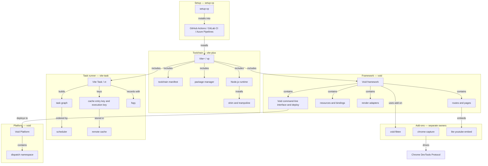
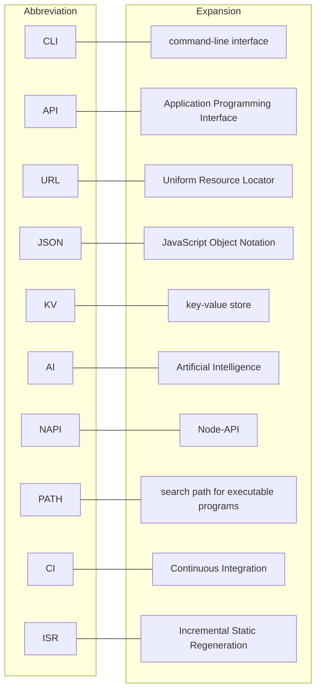

# 19 Glossary

This document is the lookup table for the VoidZero exploration. Each entry gives a short definition, the documents that treat the term, and one or more source citations.

The glossary uses ASD-STE100 (Simplified Technical English, a controlled writing standard for maintenance text). Each sentence carries one idea. Most abbreviations are spelled out on first use in this file. Each entry repeats the expansion when the entry needs it.

## How to use this glossary

The entries are in alphabetical order. The order ignores backticks, punctuation, and the case of the first letter, and a digit sorts before a letter. A command such as `vp` sorts under the letter V. Where one word has two unrelated senses, a cross-reference points to the other entry.

The bold "Aha" callouts are notes, not entries. Each callout follows the entry it explains. A callout carries no letter position, so it does not change the alphabetical order.

Each entry has four parts:

1. The term in bold.
2. A part of speech, when the entry needs it.
3. A definition of one to three sentences.
4. The document number and one or more source citations.

Every source path is relative to `/Users/darkvoid/GitSources/src.voidzero`, the separate source checkout. The repository name comes first. For example, `vite-plus/crates/vp_shared/src/env_vars.rs:177` means the file in the `vite-plus` repository. A citation can name a file, a line range, or a directory, and it can point to code, a README, or a design note in the source tree. Two entries record a finding with no code line; each one says so.

A fenced code block with a language tag gives a byte-exact quote. The comment on the first line gives the file and the line range. The comment is not part of the source text. The two Mermaid diagrams have no source comment, because they map the documents and do not quote code.

The seven repositories are independent Git repositories. They are not one monorepo. The table below gives the owner, the version, and the contribution of each repository.

## The seven repositories

| Repository | Owner | Version | What it contributes |
| --- | --- | --- | --- |
| `void` | `voidzero-dev` | `void` 1.7.0 | The Void web framework, its render adapters, its resources, its command-line interface, and the optional self-hosted Void Platform. |
| `vite-plus` | `voidzero-dev` | `vite-plus` 1.6.0 | The unified toolchain behind the `vp` command. It contains fifteen Rust crates and four TypeScript packages. |
| `vite-task` | `voidzero-dev` | `@voidzero-dev/vite-task-client` 0.2.0 (client package) | The task runner, the task graph, the cache, the file-system proxy, and the client protocol that a tool uses to send requests to a running session. |
| `setup-vp` | `voidzero-dev` | `setup-vp` 1.22.0 | The installer for Continuous Integration (CI) systems: GitHub Actions, GitLab CI, and Azure Pipelines. |
| `void-fbtee` | `joeblew999` | `void-fbtee` 0.4.0 | The internationalization add-on for Void applications. |
| `chrome-capture` | `paulirish` | `chrome-capture` 0.1.2 | A screen recorder that drives the Chrome DevTools Protocol (CDP). |
| `lite-youtube-embed` | `paulirish` | `lite-youtube-embed` 0.3.4 | A YouTube player facade that loads the real player only after a user action. |

## Term families

The diagram shows the six term families and the main links between them. An arrow points from a whole to a part, or from a product to something it uses. The family label names the repository, or says that the add-ons have separate owners.



## The ten most-used abbreviations

The diagram maps the ten abbreviations that occur most often in documents 00 to 18. The left column holds the abbreviation. The right column holds the expansion.



## Abbreviations, spelled out

The table gives the expansion, or a short description for a format name, and the first document that uses the abbreviation. A value of "none" means that no document before this glossary uses the abbreviation.

| Abbreviation | Expansion | First document |
| --- | --- | --- |
| AI | Artificial Intelligence | 00 |
| API | Application Programming Interface | 00 |
| AST | abstract syntax tree | 05 |
| AV1 | Alliance for Open Media (AOMedia) Video 1 | 00 |
| CBOR | Concise Binary Object Representation | 07 |
| CD | Continuous Delivery | 00 |
| CDN | Content Delivery Network | 12 |
| CDP | Chrome DevTools Protocol | 00 |
| CI | Continuous Integration | 00 |
| CJS | CommonJS | 05 |
| CLI | command-line interface | 00 |
| CRF | constant rate factor | 17 |
| CRT | C runtime | 02 |
| CSP | Content Security Policy | 12 |
| CSS | Cascading Style Sheets | 17 |
| DOM | Document Object Model | 16 |
| ESM | ECMAScript module | 00 |
| ETag | Entity Tag | 04 |
| FIFO | first-in, first-out | 09 |
| fps | frames per second | 17 |
| GPU | graphics processing unit | 17 |
| HMAC | hash-based message authentication code | 15 |
| HTML | HyperText Markup Language | 00 |
| HTTP | HyperText Transfer Protocol | 00 |
| HTTPS | HyperText Transfer Protocol Secure | 07 |
| i18n | internationalization | 00 |
| I420 | a planar YUV 4:2:0 pixel format | 17 |
| IPC | inter-process communication | 01 |
| ISR | Incremental Static Regeneration | 11 |
| JPEG | Joint Photographic Experts Group | 17 |
| JSON | JavaScript Object Notation | 00 |
| JSONC | JavaScript Object Notation with Comments | 14 |
| JSONL | JavaScript Object Notation Lines (JSON Lines) | none |
| JSX | JavaScript XML | 16 |
| JWT | JSON Web Token | 14 |
| KV | key-value store | 00 |
| LLM | Large Language Model | none |
| LTS | long-term support | 00 |
| MIT | Massachusetts Institute of Technology | 00 |
| MP4 | MPEG-4 Part 14 | 17 |
| MPEG | Moving Picture Experts Group | 17 |
| NAPI | Node-API | 00 |
| NFS | Network File System | 03 |
| NPM | Node Package Manager | 01 |
| OIDC | OpenID Connect | 07 |
| ORM | object-relational mapping | 14 |
| OSC | Operating System Command | 09 |
| PATH | search path for executable programs | 00 |
| PLT | procedure linkage table | 08 |
| POSIX | Portable Operating System Interface | 04 |
| PTY | pseudo-terminal | 01 |
| REST | Representational State Transfer | 15 |
| SFW | Socket Firewall Free | 10 |
| SGR | Select Graphic Rendition | 09 |
| SHA-1 | Secure Hash Algorithm 1 | 10 |
| SHA-256 | Secure Hash Algorithm 256 | 03 |
| SHA-512 | Secure Hash Algorithm 512 | 03 |
| SLSA | Supply-chain Levels for Software Artifacts | 03 |
| SPA | single-page application | 11 |
| SQL | Structured Query Language | 00 |
| SRI | Subresource Integrity | 04 |
| SSG | Static Site Generation | 01 |
| SSR | Server-Side Rendering | 01 |
| TCP | Transmission Control Protocol | 17 |
| TLS | Transport Layer Security | 03 |
| TTL | time to live | 12 |
| TUI | terminal user interface | 06 |
| UI | user interface | 00 |
| URL | Uniform Resource Locator | 00 |
| UTF-8 | Unicode Transformation Format, 8-bit | 04 |
| UUID | universally unique identifier | 07 |
| WAL | write-ahead log | 07 |
| WASM | WebAssembly | 01 |
| WebP | a Google image format | 17 |
| WSS | WebSocket Secure | 13 |
| XDG | X Desktop Group Base Directory Specification | 05 |
| XML | Extensible Markup Language | 16 |
| YAML | YAML Ain't Markup Language | 01 |
| YUV | a color model with one luma value and two chroma values | 17 |

## A

**Action** (noun) — This word has two senses in the exploration. Sense one is a step in a CI workflow, such as the `setup-vp` GitHub Action. Sense two is a Void function that changes data after a form submission. Document: 10 for sense one, 11 for sense two. Source: `setup-vp/action.yml:1` and `void/packages/void/src/pages/scan.ts:49`.

**Aha:** A reader who moves from document 10 to document 11 must change the meaning of "action". In CI, an action is a reusable workflow step. In Void, an action is a server function next to a page. The two words share no code.

**Adapter** (noun) — A package that connects the Void framework to one front-end library or format. It supplies a plugin factory (a Vite plugin, an add-on that changes the Vite build) and a server renderer (the function that turns page data into HTML). It also supplies a client entry (the browser module that starts hydration). Document: 12. Source: `void/packages/react/src/plugin.ts:13`. See also Render adapter.

**Application Programming Interface (API)** — A defined surface that one program uses to call another. The exploration uses the term for the Cloudflare API, the remote cache API, and the Void Platform API. Document: 02. Source: `vite-task/crates/vt_remote_cache/src/lib.rs:1`.

**Artifact** (noun) — This word names two unrelated records. Sense one is a task output artifact, which is the `tar.zst` archive of the files that a task wrote. Sense two is a materialized artifact, which is a file that is embedded in a binary at compile time and written to disk on demand. Document: 07. Source: `vite-task/crates/vt/src/session/cache/mod.rs:83` and `vite-task/crates/vt_materialized_artifact/src/lib.rs:1`.

**Aha:** The cache stores the task output artifact. It never stores the materialized artifact. A reader who sees the word "artifact" must check which of the two mechanisms the text means.

**Artificial Intelligence (AI)** — The general term for machine-learning models. In this exploration the term names the Workers AI binding on Cloudflare. Void can infer the binding from an import, or read the name from the configuration. Document: 13. Source: `void/packages/void/src/plugin-worker-bindings.ts:200`.

**Asset upload bucket** — A group of file content hashes that Void uploads in one request. An asset hash is the digest of one asset file. The bucket is an array of hashes, and the upload body uses each hash as a field name. Document: 14. Source: `void/packages/void/src/cli/cf-version-api.ts:1064-1078`.

**Atomic deploy** — A deployment mode in which Cloudflare makes the new Worker version live during the upload. The upload adds `?deploy=true`, so the readiness probe (the request to `/__void/ready` that checks the new version) runs after the traffic move. A failed probe cannot restore the previous version, because the upload already moved the traffic. Document: 14. Source: `void/packages/void/src/cli/cf-version-api.ts:1276`.

**Azure Pipelines** — A Microsoft CI system. `setup-vp` supplies a step template with a prepare phase and a finalize phase. Document: 10. Source: `setup-vp/azure/setup-vp.yml:1`.

## B

**Better Auth** — An authentication library that Void can attach to a Worker. Void writes the authentication binding and the route when the application asks for it. Document: 13. Source: `void/packages/void/src/plugin-worker-bindings.ts:167`.

**Binding** (noun) — A named capability that Cloudflare attaches to a Worker at deploy time. Examples are a Key-Value (KV) store, an R2 bucket, a queue, a service, and an Artificial Intelligence (AI) model. The quote shows the D1 binding name; the same function builds the other binding kinds, and Service binding covers the Worker-to-Worker case. Document: 13 and 15. Source: `void/packages/void/src/plugin-worker-bindings.ts:167-169`.

```ts
// void/packages/void/src/plugin-worker-bindings.ts:167-169
  // D1 — auth requires the app DB only for sqlite apps
  const d1Name = bindingNames?.d1 ?? 'DB';
  const d1: Array<Record<string, unknown>> = [];
```

**Build command** — The `vp build` command. It runs the Vite production build and the tool steps that the project configures. Document: 05. Source: `vite-plus/packages/cli/src/bin.ts`.

## C

**Cache entry key** — The complete identity record of one task result. It is a serialized structure: the fields are stored in order, and the value is not a hash; the `spawn_fingerprint` field is a Fingerprint record (see Fingerprint). The local cache stores the serialized value in a Structured Query Language (SQL) database column of type BLOB (binary large object). Document: 07. Source: `vite-task/crates/vt/src/session/cache/mod.rs:83-85`.

```rust
// vite-task/crates/vt/src/session/cache/mod.rs:83-85
pub struct CacheEntryKey {
    /// The spawn fingerprint (command, args, cwd, envs)
    pub spawn_fingerprint: SpawnFingerprint,
```

**Candidate** — An uploaded Worker version that does not yet carry full traffic. A staged deploy keeps the candidate at zero percent until it passes the readiness probe. Document: 14. Source: `void/packages/void/src/cli/cloudflare-candidate.ts:5-14`.

**Catalog** (noun) — This word has two senses. Sense one is a shared version list in a workspace file; a dependency refers to it as `catalog:` or `catalog:name`. Sense two is a JavaScript Object Notation (JSON) file of translated messages for internationalization. Document: 03 for sense one, 16 for sense two. Source: `vite-plus/crates/vp_migration/src/import_rewriter.rs:4886` and `void-fbtee/apps/example/pages/[lang]/index.tsx:182`.

**Aha:** The two catalogs are unrelated. The package catalog controls dependency versions. The message catalog controls translated strings. Document 03 uses the word for packages. Document 16 uses the word for text.

**Catalog file** — The message catalog file for `void-fbtee`, in JSON form. It holds the source strings, the translations, and the status of each message. The status is `new` or `translated`. Document: 16. Source: `void-fbtee/apps/example/pages/[lang]/index.tsx:182`.

**chrome-capture** — The screen recorder in the collection. It drives a headless Chrome process (a browser with no visible window) and writes an MP4 file with an AV1 video track and an Opus (an audio codec) track. Document: 17. Source: `chrome-capture/src/index.ts:1`.

**Chrome DevTools Protocol (CDP)** — The control protocol of the Chrome browser. `chrome-capture` uses it to start a screen recording and to read the result. Document: 17. Source: `chrome-capture/src/index.ts:47-50`.

```ts
// chrome-capture/src/index.ts:47-50
export interface CdpCommands {
  'Page.startScreenRecording': [
    params: [Omit<ScreenRecordingOptions, 'outputPath'>?],
    returnType: {stream: string},
```

**Cloudflare** — The cloud platform that runs Workers, D1, Key-Value (KV) storage, R2 storage, and queues. Void deploys to this platform. Document: 13. Source: `void/packages/void/src/cloudflare-config.ts:11`.

**Command-line interface (CLI)** — A program surface that a user controls with typed commands and flags. The `vp` command and the `void` command are examples. Document: 02. Source: `vite-plus/packages/cli/package.json:16-19`.

**Continuous Delivery (CD)** — The practice of keeping software ready for release after each accepted change. The exploration pairs it with Continuous Integration (CI). Document: 10. Source: `setup-vp/action.yml:1`.

**Continuous Integration (CI)** — The practice of building and testing each change on a shared server. `setup-vp` installs Vite+ on three CI systems. Document: 10. Source: `setup-vp/action.yml:1`.

**Custom element** — A browser element that a script defines with `customElements.define`. `lite-youtube-embed` defines the element `lite-youtube`. Document: 17. Source: `lite-youtube-embed/src/lite-yt-embed.js:241`.

## D

**D1** — Cloudflare's SQL database binding. The database is SQLite, a small embedded SQL engine, and the local development path uses a SQLite file. Void uses the default binding name `DB`. Document: 13. Source: `void/packages/void/src/plugin-worker-bindings.ts:168`.

**Dependency cache** — The `setup-vp` cache for the package manager store and the installed dependencies. The package manager store is the shared download and extraction directory of the package manager. The cache key includes the lock file hash. Document: 10. Source: `setup-vp/src/ci/cache.ts:1`.

**Deploy core** — The `deploy-core` package of Void. It holds the target adapter (the code for one hosting provider, not a render Adapter) and the resource plan (the list of resources to create or confirm). It also holds the build manifest (the list of build output files) and the deploy intent (the requested deploy action), and the build manifest is not the Vite+ toolchain manifest. Document: 14. Source: `void/packages/deploy-core/src/index.ts:1`.

**Deploy log** — A JSON Lines (JSONL) file under `~/.void/logs/` that records each deployment step. The file name starts with `deploy-`. Document: 14. Source: `void/packages/void/src/cli/log-file.ts:152`.

**Dispatch namespace** — The Workers for Platforms container that holds tenant Workers. Workers for Platforms is the Cloudflare product that runs many customer Workers, and a tenant Worker is one customer application. The Void Platform binds it as `DISPATCH`. Document: 15. Source: `void/platform/packages/dispatch/wrangler.jsonc:16-18`.

```jsonc
// void/platform/packages/dispatch/wrangler.jsonc:16-18
  "dispatch_namespaces": [
    {
      "binding": "DISPATCH",
```

**Durable Object** — A Cloudflare object that keeps state and runs in one location. Void can generate the class and the Durable Object migration for it. A Durable Object migration is a versioned class declaration, not a SQL schema change. Document: 13. Source: `void/packages/void/src/plugin-worker-bindings.ts:383`.

```ts
// void/packages/void/src/plugin-worker-bindings.ts:383
        new_sqlite_classes: [module.className],
```

## E

**Edge** — The `@void/edge` package, not the Cloudflare network edge. It is the runtime for a static deployment, not part of server-side rendering. It supplies redirects, header rules, pattern matching, routing rules, and a handler for static requests. Document: 12. Source: `void/packages/edge/src/runtime.ts:35-38`.

**Entry** — The generated Worker entry file `entry.ts` in the `.void` output directory. It exports the fetch handler (the function that answers an HTTP request) and the other handlers that the Worker needs. This sense of "entry" is not the cache entry key. Document: 11. Source: `void/packages/void/src/plugin-routing.ts:652`.

**Environment digest** — A Secure Hash Algorithm (SHA) digest of the environment variables that a task declares in its configuration. The digest is part of the cache identity, the set of values that decide a cache hit. Document: 07. Source: `vite-task/crates/vt_plan/src/cache_metadata.rs:97`.

**Execution key** — A key that names one invocation of a task across sessions; it includes the task name, the command item index, the execution item index, the extra arguments, and the package path. The source type is `ExecutionCacheKey`. It is not the cache entry key. Document: 07. Source: `vite-task/crates/vt_plan/src/cache_metadata.rs:16-35`.

```rust
// vite-task/crates/vt_plan/src/cache_metadata.rs:14-16
/// Key to identify an execution across sessions.
#[derive(Debug, SchemaWrite, SchemaRead, Serialize)]
pub enum ExecutionCacheKey {
```

**Aha:** A cache entry key and an execution key are different records. The execution key names the invocation. The cache entry key names one state of that invocation. A reader who treats them as one key will expect the wrong cache result.

## F

**Facade** — A thin front object that delays the load of a heavy object. `lite-youtube-embed` is a facade: it shows a poster and loads the YouTube player only after a click. Document: 17. Source: `lite-youtube-embed/src/lite-yt-embed.js:13`.

```js
// lite-youtube-embed/src/lite-yt-embed.js:13
class LiteYTEmbed extends HTMLElement {
```

**Fast-fail** — The scheduler rule that cancels the fast-fail token when a task fails. The cancellation kills the in-flight child processes. Document: 06. Source: `vite-task/crates/vt/src/session/execute/scheduler.rs:92-94`.

**File-system proxy** — The `fspy` mechanism. It records the paths that a task reads and writes. A system-call filter is a mechanism that watches and answers the calls that a process makes to the operating system. Document: 08. Source: `vite-task/crates/fspy/README.md:3`.

**Fingerprint** — A record of the inputs that affect a task result. The record includes the command, the arguments, the working directory, and the environment. The source type is `SpawnFingerprint`, and the name refers to the spawn of the task process. Document: 07. Source: `vite-task/crates/vt/src/session/cache/mod.rs:84`.

**fspy** — The file-system proxy of Vite Task, which injects a library or a system-call filter into a child process and records file access. The three methods are a preload library on Linux and macOS, seccomp user notification on Linux static and musl targets, and Microsoft Detours on Windows. A preload library is a shared library that the dynamic loader injects before the program starts, and musl is a small C standard library. Document: 08. Source: `vite-task/crates/fspy/README.md:3`.

## G

**GitHub Actions** — The GitHub CI system. `setup-vp` supplies `action.yml` and a bundled `dist/index.mjs` entry. Document: 10. Source: `setup-vp/action.yml:1`.

**GitLab CI/CD** — The GitLab CI and Continuous Delivery system. `setup-vp` supplies a remote include template. Document: 10. Source: `setup-vp/gitlab/setup-vp.yml:1`.

**Global cache** — The workspace-level cache settings. They set separate enable switches for package scripts and tasks, plus an optional remote cache URL. Document: 06. Source: `vite-task/crates/vt_graph/src/config/user.rs:378-411`.

**Global command-line interface** — The standalone Rust binary `vp_global_cli`. It handles commands that run outside a project and delegates project work to the local `dist/bin.js`. Document: 02. Source: `vite-plus/crates/vp_global_cli/src/main.rs:1`.

## H

**Hono** — A small web framework for Cloudflare Workers. The generated Void route table creates a Hono application. Document: 11. Source: `void/packages/void/src/router/compile.ts:259`.

**HTML** — HyperText Markup Language. Void can return an HTML document or a JSON page object. Document: 12. Source: `void/packages/void/src/pages/protocol.ts`.

**Hydration** — The browser process that attaches event handlers to server-rendered HTML. Void uses an island strategy to control when hydration starts. Document: 12. Source: `void/packages/void/src/pages/island-imports.ts:138`.

## I

**Incremental Static Regeneration (ISR)** — A rendering mode that serves a cached page, then regenerates it after a time to live (TTL) period. See Time to live. Void stores the cached page in the `ISR_CACHE` Key-Value (KV) namespace. Document: 12. Source: `void/packages/void/src/cli/deploy-resources.ts:303`.

```ts
// void/packages/void/src/cli/deploy-resources.ts:303
    const binding = 'ISR_CACHE';
```

**Inference** — The Void rule that derives bindings from source imports and from `env.*` reads. The user does not list every binding by hand. Document: 11 and 13. Source: `void/packages/void/src/config.ts:188`.

**Installation** — One self-hosted copy of the Void Platform in one Cloudflare account. It has its own PostgreSQL database, an open-source SQL database, and its own names for the Cloudflare resources. Document: 15. Source: `void/platform/meta/architecture.md:3-6`.

**Internationalization (i18n)** — The process of preparing an application for more than one language. `void-fbtee` is the internationalization add-on, and it extracts strings that carry the `<fbt>` translation tag. Document: 16. Source: `void-fbtee/apps/example/pages/[lang]/index.tsx:182`.

```tsx
// void-fbtee/apps/example/pages/[lang]/index.tsx:182
          <fbt desc="Home page heading">i18n for Void apps</fbt>
```

**Inter-process communication (IPC)** — The transfer of data between processes. The Vite Task client and the server use a local socket or a named pipe. Document: 09. Source: `vite-task/crates/vt_socket_ipc/src/lib.rs:1`.

**Islands** — A rendering pattern in which most of the page is static and selected components hydrate. Void marks an island with the `.island` file suffix and an import attribute. Document: 12. Source: `void/playground/react-pages/pages/blog/index.island.tsx:1`.

```tsx
// void/playground/react-pages/pages/blog/index.island.tsx:1
import Counter from './_Counter.tsx' with { island: 'load' };
```

**Isolate** — One execution instance of a Worker. An in-memory cache, a cache held in the memory of the isolate, exists inside one isolate and is not shared with another isolate. Document: 15. Source: `void/platform/packages/proxy/src/resolve.ts:4-6`.

## J

**JavaScript runtime** — The downloaded Node.js distribution that Vite+ supplies to a project. It contains the `node` binary and its files under `<DATA>/js_runtime`. See Node.js runtime for the version selection. Document: 04. Source: `vite-plus/crates/vp_js_runtime/src/cache.rs:7-12`.

```rust
// vite-plus/crates/vp_js_runtime/src/cache.rs:7-12
/// Get the cache directory for JavaScript runtimes.
///
/// Returns `<DATA>/js_runtime`.
pub fn get_cache_dir() -> Result<AbsolutePathBuf, Error> {
    Ok(vp_shared::EnvConfig::get().dirs.data.join("js_runtime"))
}
```

**JSON** — JavaScript Object Notation. The exploration uses it for configuration and for page objects. Document: 00. Source: `vite-task/crates/vt_remote_cache/src/lib.rs`.

## K

**Key-Value (KV)** — A Cloudflare store that maps a key to a value. Void uses it for the `ISR_CACHE` namespace and for the bindings that a user declares in `void.config.ts`. Document: 13. Source: `void/packages/void/src/cli/deploy-resources.ts:303`.

## L

**Large Language Model (LLM)** — A machine-learning model with many parameters that predicts and generates text. No exploration document uses the abbreviation; only this glossary uses it. The source has a Workers AI binding, but it does not name a model type. Document: none. Source: no code line; no exploration document uses the term.

**Layout** — A Void file that wraps a page or a group of pages. A named layout lives in a `_layouts` directory. Document: 11. Source: `void/packages/void/src/pages/scan.ts:432`.

**lite-youtube-embed** — The facade player in the collection. It renders a poster and a play button, then loads the YouTube iframe after activation. Document: 17. Source: `lite-youtube-embed/src/lite-yt-embed.js:13`.

**Loader** — A function that runs on the server and supplies data to a page before rendering. It lives in a companion file next to the page; that file can export `loader`, `action`, and `actions` (a map of named actions). Document: 11. Source: `void/packages/void/src/pages/scan.ts:49`.

**Lock file** — A file that records the exact resolved package versions. Vite+ owns the file `vp-install-lock.yaml` for its own installation. Vite+ does not parse a project lock file; the native package manager owns that file. Document: 03. Source: `vite-plus/crates/vp_setup/src/lockfile.rs:13`.

```rust
// vite-plus/crates/vp_setup/src/lockfile.rs:13
pub const INSTALL_LOCKFILE: &str = "vp-install-lock.yaml";
```

## M

**Manifest** — The Vite+ toolchain record in `toolchain.json`. It lists the tool nodes and the edges between them; an edge is a dependency from one node to another. See Toolchain manifest. Document: 02. Source: `vite-plus/crates/vp_toolchain/src/lib.rs:11-14`.

```rust
// vite-plus/crates/vp_toolchain/src/lib.rs:11-14
pub struct Manifest {
    pub schema_version: u32,
    pub nodes: Vec<Node>,
    pub edges: Vec<Edge>,
```

**Materialized artifact** — A file that is embedded in a binary at compile time and written to disk on demand. The `fspy` preload library is an example. It is not a task output archive. Document: 07. Source: `vite-task/crates/vt_materialized_artifact/src/lib.rs:1`.

```rust
// vite-task/crates/vt_materialized_artifact/src/lib.rs:1
//! Materialize a compile-time–embedded file to disk on demand.
```

**Middleware** — A function that runs before or after a route handler. Void supports user middleware files and installs its own context middleware (which prepares shared request context) and request middleware (which handles the request). Document: 11. Source: `void/packages/void/src/router/compile.ts:288`.

**Migration** — A SQL change that moves a database from one schema to the next. Void records applied migrations in the `_void_migrations` table. A Durable Object migration is a different record; see Durable Object. Document: 13. Source: `void/packages/void/test/unit/runner-sqlite.test.ts:139`.

**Monorepo** — One repository that holds several projects. The VoidZero collection is not a monorepo. It is seven independent repositories. Document: 01. Source: no code line; document 01 states the finding.

**MP4** — MPEG-4 Part 14, the container format that `chrome-capture` writes. Document: 17. Source: `chrome-capture/src/index.ts:1`.

## N

**Node-API (NAPI) binding** — A compiled addon that lets JavaScript call Rust code; Node-API is the stable C application programming interface of Node.js. The local `vp` path uses one NAPI binding to reach the Rust command core. Document: 02. Source: `vite-plus/packages/cli/binding/src/lib.rs:1`.

**Node.js runtime** — The JavaScript engine and standard library that runs a project. Vite+ can download and select a Node.js version for a project. See JavaScript runtime for the downloaded files. Document: 04. Source: `vite-plus/crates/vp_js_runtime/src/cache.rs:7-12`.

**Node Package Manager (NPM)** — The default package manager of Node.js. Vite+ can use NPM from the `PATH`. Document: 03. Source: `vite-plus/crates/vp_pm_cli/src/package_manager.rs:47`.

## O

**OpenID Connect (OIDC)** — An identity layer on top of Open Authorization (OAuth) 2.0, an authorization framework. A CI job can use an OIDC token as a credential for the deployment. Document: 14. Source: `void/packages/void/src/cli/github-oidc.ts:2`.

**Output archive** — The `{uuid}.tar.zst` file that holds the files a task wrote; `tar.zst` means a tar archive compressed with Zstandard. The task output artifact is this archive. Document: 07. Source: `vite-task/crates/vt/src/session/cache/mod.rs`.

## P

**Package graph** — A directed graph of workspace packages and their dependency edges. The task graph is built on top of it. Document: 06. Source: `vite-task/crates/vt_workspace/src/package_graph.rs:135`.

**Package manager** — The program that resolves and installs dependencies. Vite+ detects pnpm, NPM, Yarn, and Bun, and translates its own install request to the detected manager; Yarn and Bun are alternative package managers. Document: 03. Source: `vite-plus/crates/vp_pm_cli/src/lib.rs:1`.

**Page** — A Void file under `pages/` that renders a route. A page can have a companion file with a loader or an action. Document: 11. Source: `void/packages/void/src/pages/scan.ts:49`.

**Page object** — The typed record that Void sends from the server to the client for a page. The `documentOnly` field marks a build-only server document, which never starts an interactive Pages root (the browser-side root of an interactive page), and the `component` field names the component. The record also carries the page properties and the render options. Document: 12. Source: `void/packages/void/src/pages/protocol.ts:32-35`.

```ts
// void/packages/void/src/pages/protocol.ts:32-35
export type PageObject = {
  /** Build-only server document; never bootstraps an interactive Pages root. */
  documentOnly?: boolean;
  component: string;
```

**pnpm** — A package manager that uses a content-addressable store (a store that names each file by its content hash) and symbolic links. Vite+ bundles a pinned pnpm version for its own install path. Document: 03. Source: `vite-plus/crates/vp_setup/src/install.rs:508`.

**Preload library** — A shared library that the dynamic loader injects into a process before the program starts. The dynamic loader is the part of the operating system that starts a program and loads its libraries. `fspy` uses this mechanism on Linux and macOS. Document: 08. Source: `vite-task/crates/fspy/README.md:5`.

**Provisioning** — The creation or confirmation of the Cloudflare resources that a Worker needs. A resource is a D1 database, a KV namespace, an R2 bucket, a queue, or a similar object. Void reads a stored identifier (the saved Cloudflare identifier of an earlier resource) before it creates a resource, so a second deploy reuses the same resource. Document: 13. Source: `void/packages/void/src/cli/provision.ts:227-262`.

**Pseudo-terminal (PTY)** — A terminal device pair, a master side and a slave side, that a program can drive as if it were a real terminal. The end-to-end test harness and the `vt_tui` demonstration use one. The session runner does not create one for a task. Document: 09. Source: `vite-task/crates/vt_bin/tests/e2e_snapshots/main.rs:16-17`; `vite-task/crates/vt_tui/src/app.rs:69-90`; `vite-task/crates/vt/src/session/mod.rs:593-596`.

**Publish-before-act** — The `fspy` rule that publishes a recorded access to the shared channel before the intercepted call continues. The rule prevents a lost record when the call fails. Document: 08. Source: `vite-task/crates/fspy_shared/src/ipc/channel/shm_io/mod.rs:9-12`.

## Q

**Queue** — A Cloudflare message queue binding; a message queue receives messages and delivers them to a consumer later. Void uses the prefix `QUEUE_`, an upper-case name, and an underscore in place of each non-alphanumeric character. Document: 13. Source: `void/packages/void/src/runtime/queues.ts:8-10`.

```ts
// void/packages/void/src/runtime/queues.ts:8-10
  get(_, name: string) {
    const bindingName =
      `QUEUE_${name.toUpperCase().replace(/[^A-Z0-9]/g, '_')}` as `QUEUE_${string}`;
```

## R

**R2** — Cloudflare's R2 object storage, a service that stores files as objects with a key; this bucket is not the asset upload bucket. Void uses the default binding name `STORAGE` for R2. Document: 13. Source: `void/packages/void/src/plugin-worker-bindings.ts:191`.

**Remote cache** — A cache server that stores task results for more than one machine. The client sends a Concise Binary Object Representation (CBOR) body to the server, and the keys and blobs are opaque bytes. Document: 07. Source: `vite-task/crates/vt_remote_cache/src/lib.rs:1-2`.

```rust
// vite-task/crates/vt_remote_cache/src/lib.rs:1-2
//! Client for the remote cache server API. Keys, values, and blobs are opaque
//! bytes; the caller decides what they contain.
```

**Render adapter** — A name that document 12 uses for an Adapter, because the package supplies the server renderer. It also supplies the plugin factory and the client entry. React, Vue, Solid, and Svelte are component libraries, Markdown is a text format, and each has an adapter. Document: 12. Source: `void/packages/vue/src/plugin.ts:13`.

**Resources** — The Cloudflare service instances that a Void application uses, such as a D1 database, a KV namespace, an R2 bucket, a queue, or a Durable Object namespace. A binding gives the Worker access to one resource, and the resource name is the provider's name for it. Document: 13. Source: `void/packages/void/src/cli/provision.ts:40-54`.

**Route** — A mapping from a path pattern to a handler. Void builds a route table from the file tree under `routes/` and `pages/`. Document: 11. Source: `void/packages/void/src/router/compile.ts:389`.

**Route specificity** — The rule that orders routes by how specific their path pattern is. A static segment is a literal path part, and a dynamic segment is a placeholder such as `[id]`. A static segment wins over a dynamic segment. Document: 11. Source: `void/packages/void/src/router/route-order.ts:31`.

**runWrangler** — The internal name of the runner that starts a Void operation process, which is the short-lived child process that sends one deploy request. The name is a legacy name. The function does not run the `wrangler` executable. Document: 14. Source: `void/packages/void/src/cli/env-validation.ts:461`.

## S

**Scheduler** — The Vite Task component that decides which ready task starts next. It uses a semaphore, a counter that limits how many tasks run at the same time, for the task graph of each session. Document: 06. Source: `vite-task/crates/vt/src/session/execute/scheduler.rs:88-90`.

**Seccomp user notification** — A Linux mechanism that lets a supervisor process watch the system calls of another process and reply to them. A system call is a request from a program to the operating system, and a supervisor process is a controlling process. `fspy` uses this mechanism for static binaries and musl targets; musl is a small C standard library. Document: 08. Source: `vite-task/crates/fspy/README.md:10-16`.

**Server route** — A Void route under `routes/` that handles a request without a page component. It can return any response. Document: 11. Source: `void/packages/void/src/router/compile.ts:389`.

**Server-Side Rendering (SSR)** — The rendering of a page to HTML on the server for each request. Void supports it through a server entry; the server entry is the module that renders the page. Document: 12. Source: `void/packages/void/src/pages/scan.ts:77`.

**Service binding** — A Worker-to-Worker binding. A call reaches the fetch handler, the request function, of the target Worker without a public hostname. Document: 15. Source: `void/platform/packages/proxy/wrangler.jsonc:13`.

**setup-vp** — The action and templates that install Vite+ in a CI system. It supports GitHub Actions, GitLab CI/CD, and Azure Pipelines. Document: 10. Source: `setup-vp/action.yml:1`.

**Shared-memory channel** — The ring buffer that the `fspy` preload library and the supervisor process use to carry file-access records. A ring buffer is a fixed-size buffer with a read pointer and a write pointer. Document: 08. Source: `vite-task/crates/fspy_shared/src/ipc/channel/mod.rs:1`.

**Shim** — A small executable that carries the name of a tool such as `node` or `npm`. The shim starts the active Vite+ runtime for that tool. Document: 04. Source: `vite-plus/crates/vp_shared/src/env_vars.rs:176-177`.

```rust
// vite-plus/crates/vp_shared/src/env_vars.rs:176-177
/// Set by shell wrapper scripts to indicate which tool is being shimmed.
pub const VP_SHIM_TOOL: &str = "VP_SHIM_TOOL";
```

**Sidecar** — The `<name>.shim` data file next to a Windows shim. It records the install roots, the directories where the shim tools are installed. Document: 04. Source: `vite-plus/crates/vp_trampoline/src/main.rs:5`.

**Skip rule** — The Vite Task rule that skips a nested query when the query equals the parent query. The parent query is the query of the run that contains the nested plan. The rule prevents a recursive run from expanding the same query twice. Document: 06. Source: `vite-task/crates/vt_plan/src/plan.rs:242-243`.

**Slug** — The short project name that the Void Platform uses to form Worker names and the sender names of email messages. Document: 15. Source: `void/platform/packages/api/src/naming.ts:1-7`.

**Socket Firewall Free (SFW)** — A package-install firewall that `setup-vp` can put in front of `vp install`. It blocks known malicious packages. Document: 10. Source: `setup-vp/src/ci/install-sfw.ts:14`.

```ts
// setup-vp/src/ci/install-sfw.ts:14
export const SFW_VERSION = "v1.15.4";
```

**SQL** — Structured Query Language. Void uses it for D1 migrations. Vite Task stores its local task cache in SQLite (document 07). Document: 13. Source: `void/packages/void/test/unit/runner-sqlite.test.ts:139`.

**Staged deploy** — The default deployment mode. Void keeps the old version at 100 percent and the candidate at 0 percent until the readiness probe passes. The readiness probe is the request to `/__void/ready` that checks the candidate. Document: 14. Source: `void/packages/deploy-cloudflare/src/version.ts:2623`.

**Static Site Generation (SSG)** — The rendering of pages to files at build time. Void runs the prerender step, the build step that writes the static HTML files, when the output is `static`. Document: 12. Source: `void/packages/void/src/plugin-prerender.ts:13`.

**Supply chain** — The set of packages, downloads, and signatures that bring software into a project. Vite+ checks SLSA provenance and SHA-512 digests on its downloads. Document: 03. Source: `vite-plus/packages/cli/install.sh:523`.

## T

**Task graph** — A directed graph of tasks and their order constraints. A node is one task in one package, and the `TaskId` type in the quote names a node. Document: 06. Source: `vite-task/crates/vt_graph/src/lib.rs:22-24`.

```rust
// vite-task/crates/vt_graph/src/lib.rs:22-24
/// Uniquely identifies a task, by its name and the package where it's defined.
#[derive(Debug, PartialEq, Eq, Hash, Clone, PartialOrd, Ord)]
pub struct TaskId {
```

**Task runner** — The program that finds tasks, orders them, and runs them with a cache. Vite Task is the task runner of the collection. Document: 06. Source: `vite-task/README.md:3`.

**Time to live (TTL)** — The period for which a cached value stays valid. Void uses it for the ISR cache. See Incremental Static Regeneration. Document: 12. Source: `void/packages/void/src/cli/deploy-resources.ts:303`.

**Toolchain** — The set of tools and packages that Vite+ supplies as one product. A tool is one program in the set, such as the formatter or the test runner. The toolchain manifest records the set. Document: 02. Source: `vite-plus/crates/vp_toolchain/src/lib.rs:11`.

**Toolchain manifest** — The `toolchain.json` file that lists the nodes and edges of the Vite+ toolchain. It is not the `ToolchainCachePlan` of `setup-vp`. Document: 02. Source: `vite-plus/crates/vp_toolchain/src/lib.rs:11-14`.

**Toolchain plan** — The `ToolchainCachePlan` record in `setup-vp`. It holds the cache key and the toolchain version for a CI job. Document: 10. Source: `setup-vp/src/ci/toolchain-cache.ts:24-26`.

```ts
// setup-vp/src/ci/toolchain-cache.ts:24-26
export interface ToolchainCachePlan {
  key: string;
  version: string;
```

**Aha:** The "toolchain plan" of document 10 is not the "toolchain manifest" of document 02. The plan is a CI cache record. The manifest is the list of toolchain parts and their dependencies. A reader who searches the source for "toolchain plan" will not find the phrase.

**Trampoline** — The small Windows executable `vp-shim.exe`. Vite+ copies and renames it for each shim tool; it reads the tool name from its file name and the install roots from the `.shim` sidecar. It then sets the dispatch environment and starts the active `vp.exe`. Document: 04. Source: `vite-plus/crates/vp_trampoline/src/main.rs:1-3`.

```rust
// vite-plus/crates/vp_trampoline/src/main.rs:1-3
//! Minimal Windows trampoline for Vite+ shims.
//!
//! Vite+ copies and renames this binary for each shim tool.
```

## U

**Uniform Resource Locator (URL)** — The address of a resource on a network. The remote cache client parses an endpoint URL. Document: 00. Source: `vite-task/crates/vt_remote_cache/src/lib.rs:18`.

**UUID** — A universally unique identifier. A task output archive is named with one. Document: 07. Source: `vite-task/crates/vt/src/session/cache/mod.rs`.

## V

**Virtual module** — A module that a build plugin, a Vite plugin that runs during the build, creates at build time and that has no file on disk. Void and `void-fbtee` use virtual modules for generated route tables and message lookups. Document: 12. Source: `void/packages/void/src/plugin-routing.ts:78`.

**Vite** — The build tool and development server that Vite+ builds on. Vite+ pins Vite 8.3.7 and adds its own commands. Document: 02. Source: `vite-plus/packages/core/package.json:242`.

**Vite+** — The unified toolchain product from VoidZero. It supplies the `vp` command, the package manager path, the Node.js runtime, the task runner, and the tool commands. Document: 02. Source: `vite-plus/packages/cli/package.json:16-19`.

```json
// vite-plus/packages/cli/package.json:16-19
  "bin": {
    "vp": "./bin/vp",
    "vpr": "./bin/vpr",
    "vpx": "./bin/vpx"
```

**Vite Task** — The task runner inside Vite+ and in its own repository. It discovers tasks, builds a task graph, schedules the tasks, and caches the results. The standalone runner has the command name `vt`. Document: 06. Source: `vite-task/crates/vt_bin/Cargo.toml:10-12`.

**Aha:** Vite Task is not Vite+. Vite Task is one component of Vite+. A Vite+ project uses Vite Task through `vp run`, but Vite Task also has a standalone runner named `vt`.

**Vite Task client** — The library that a tool uses to send requests to a running Vite Task session. It speaks the local socket protocol, the request format that uses a local socket or a named pipe. Document: 09. Source: `vite-task/crates/vt_client/README.md:3`.

**Void** — The web framework from VoidZero. It provides file routing, pages, server routes, resources, render adapters, and a command-line interface. The `voidPlugin` function returns the Vite plugins that build and serve a Void application. Document: 11. Source: `void/packages/void/src/index.ts:92-94`.

```ts
// void/packages/void/src/index.ts:92-94
/** Returns the Vite plugins that build and serve a Void app for its configured target. */
export function voidPlugin(options?: {
  persistTo?: string;
```

**Void application** — A Worker that the Void framework builds and deploys to Cloudflare. Document 11 covers the build, and document 15 covers the platform view. Document: 11 and 15. Source: `void/packages/platform/src/worker-config.ts:94-100`.

**Void Cloud** — The maintained hosted deployment at `api.void.cloud`; it is not an installation that the Void Platform installer manages. Its checked-in Wrangler files describe an older deployment, not files that the installer writes. Document: 15. Source: `void/platform/meta/operations.md:3-5`.

**void.config.ts** — The configuration file of a Void project. It holds the target (the deploy platform), the inference settings (the rules that derive bindings), and the build options. Document: 13. Source: `void/packages/void/src/config.ts:181`.

**void-fbtee** — The internationalization add-on for Void. It extracts `<fbt>` strings, builds message catalogs, and supplies a runtime formatter; the runtime formatter is the function that formats a translated string at run time. Document: 16. Source: `void-fbtee/package.json:2`.

**Void Platform** — The optional self-hosted control plane (the management layer that runs applications) for Void applications. It contains six Worker packages and the repository-level `@void/platform` package. Document: 15. Source: `void/packages/platform/package.json:2`.

**Aha:** Void the framework and the Void Platform are not the same product. The framework builds and deploys one application. The platform runs many applications for many tenants. Document 14 covers the framework command-line interface. Document 15 covers the platform.

**VoidZero** — The organization that maintains Vite+, Vite Task, and Void. Its GitHub organization name is `voidzero-dev`. The add-ons have other owners. Document: 01. Source: `vite-plus/rfcs/vpx-script-execution.md:27`.

**vp** — The command name of Vite+. It is not an abbreviation with a formal expansion. It is the short form of the product name. Document: 02. Source: `vite-plus/packages/cli/package.json:17`.

**vpr** — The short command for `vp run`. It starts the Vite Task runner for a project. Document: 02. Source: `vite-plus/packages/cli/package.json:18`.

**vpx** — The command that runs a binary from the project `node_modules/.bin` directory. Document: 02. Source: `vite-plus/packages/cli/package.json:19`.

**vt** — The command name of the standalone Vite Task runner. The Vite+ binary map does not include it. Document: 06. Source: `vite-task/crates/vt_bin/Cargo.toml:10-12`.

## W

**WebSocket** — A full-duplex connection between a browser and a server. Void can register a WebSocket route and bind a Durable Object to it. Document: 13. Source: `void/packages/void/src/router/compile.ts:190`.

**Worker** — One deployable JavaScript module on Cloudflare. Each runtime package of the Void Platform is one Worker. Document: 15. Source: `void/platform/packages/dispatch/wrangler.jsonc:1`.

**Workers AI** — The Cloudflare service that supplies Artificial Intelligence (AI) models to a Worker through a binding. Document: 13. Source: `void/packages/void/src/plugin-worker-bindings.ts:200`.

**Workspace** — A directory with a workspace file that lists member packages. The usual workspace file is `pnpm-workspace.yaml`, a YAML file. Vite Task finds the workspace root and builds the package graph from it. Document: 06. Source: `vite-task/crates/vt_workspace/README.md:3-4`.

**wrangler** — The Cloudflare command-line tool. Void does not depend on it at run time. The `void` package depends on the `cf` package instead; `cf` is Void's own Cloudflare Application Programming Interface (API) client. Document: 14. Source: `void/packages/void/package.json:368`.

## Y

**YAML** — YAML Ain't Markup Language. The CI templates and the workspace files use it. Document: 01. Source: `setup-vp/gitlab/setup-vp.yml:1`.

## Terms this exploration does not define

Some words occur in the source or in the documents but have no full definition in the exploration. The list below gives the reason for each omission. The list is ordered by topic, not alphabetically.

| Term | Reason |
| --- | --- |
| Large Language Model (LLM) | This glossary gives a short definition only. No exploration document uses the abbreviation, and the source does not name a model type. |
| Vite internals | The documents treat Vite as a dependency. They do not explain the Vite plugin container or the Vite module graph. |
| Cloudflare account and billing models | The source calls the Cloudflare API. It does not define the account plans or the billing rules. |
| PostgreSQL internals | The Void Platform uses PostgreSQL. The documents cover the schema use, not the database engine. |
| Corepack | Vite+ mentions Corepack hashes. The documents do not explain the Corepack tool itself. |
| Hyperdrive | Void can infer a `HYPERDRIVE` binding. The documents name the binding and do not explain the Cloudflare service. |
| Temporal | `void-fbtee` aliases a Temporal helper. The documents state the alias and do not define the Temporal proposal. |
| Yarn and Bun internals | Vite+ detects both managers. The documents cover the detection and do not explain either manager. |
| Rust, TypeScript, JavaScript, and front-end library basics | The documents name these languages and libraries. They do not teach them. |
| Microsoft Detours | The `fspy` Windows method. Detours is a Microsoft library that intercepts function calls; the documents name it and do not explain it. |
| Zstandard | The compression algorithm behind `tar.zst`. The documents name the file extension and do not explain the algorithm. |

## Where to read next

- Start with [00-overview.md](00-overview.md) for the shape of the whole collection.
- Read [07-vite-task-caching.md](07-vite-task-caching.md) for the cache keys, the output archive, and the materialized artifact.
- Read [08-fspy-file-system-proxy.md](08-fspy-file-system-proxy.md) for the file-access record and the three interception methods: the preload library, seccomp user notification, and Microsoft Detours.
- Read [14-void-cli-and-deployment.md](14-void-cli-and-deployment.md) for the Void command-line interface, the candidate, and the two deploy modes.
- Read [18-comparisons.md](18-comparisons.md) for Vite+ against other toolchains and Void against Next.js (the React framework) on Cloudflare Workers.
