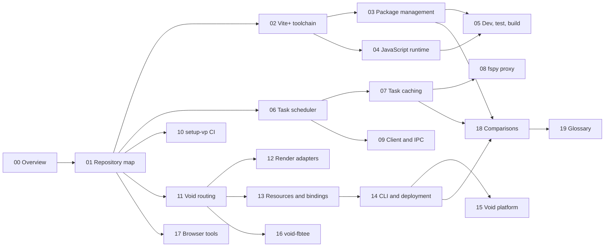

# VoidZero: one toolchain, one framework, and three adjacent tools

VoidZero is the GitHub organization `voidzero-dev`. It publishes two products.
The first product is Vite+, a toolchain for web development. Its command is
`vp`. The command manages a Node.js runtime, a package manager, a development
server, a linter, a formatter, a test runner, a bundler, and a task runner. The
second product is Void, a full-stack framework. Void builds on Vite+ and
deploys to Cloudflare Workers. It adds file-based routing, typed resources
(bindings), migrations (versioned database changes), and an optional
self-hosted team platform.

The directory at `/Users/darkvoid/GitSources/src.voidzero` is not one
repository. It holds seven independent Git repositories with three owners. Four
repositories belong to `voidzero-dev`: `void`, `vite-plus`, `vite-task`, and
`setup-vp`. The organization owns those four remotes. One repository belongs to
the GitHub user `joeblew999`: `void-fbtee`. Two belong to the GitHub user
`paulirish`: `chrome-capture` and `lite-youtube-embed`. This exploration states
that boundary in every document that touches it. It treats the directory as a
working collection of related tools, not as a monorepo.

## Terms used in this file

| Term | Meaning in this exploration |
|------|-----------------------------|
| Vite+ | The toolchain package `vite-plus`, version 1.6.0. It supplies runtime management, package management, formatting, linting, type checking, testing, and task caching through the tools it runs. It is a separate product that depends on Vite. It is not a copy of Vite. |
| `vp` | The command name of Vite+. It is a name, not an abbreviation. |
| Vite | The front-end development server and build tool that Vite+ builds on. Vite has two roles here: it is the base of Vite+, and Vite+ ships it as one of the seven tools. "Ships" means that the tool arrives inside the `vite-plus` package set. |
| Void | The full-stack framework in the `void` repository, version 1.7.0. The repository remote belongs to `voidzero-dev`. The copyright holder is Cloudflare, Inc. |
| Void Platform | The optional self-hosted control plane. It runs inside one Cloudflare account. This file also calls it "the platform" and "the self-hosted platform". All three names mean the same product. |
| Snapshot | The seven repositories at the seven commits in the table below. Every statement about these repositories comes from that set of files. |
| Crate | A Rust compilation unit and package. A workspace member is a crate that the root `Cargo.toml` lists under `[workspace] members`. |
| Worker | A Cloudflare Workers program. Workers is a server platform that runs code near the user. |
| Control plane | The part of a platform that owns state and directs the other services. |

VoidZero is an organization and a company. The organization owns the four
`voidzero-dev` remotes. Copyright differs from ownership. VoidZero Inc. is the
copyright holder in three repositories: `vite-plus`, `vite-task`, and
`setup-vp`. Gerard Webb holds the copyright in `void-fbtee`. Cloudflare, Inc.
holds it in `void`, although the remote belongs to the organization. The two
`paulirish` repositories carry the Apache License 2.0.
[Document 01](01-repository-map.md) records these facts and does not explain
their history.

[Document 19](19-glossary.md) defines every term in this exploration in one
place. A reader who meets an unfamiliar word can use the glossary first.

## The one-page thesis

The snapshot supports five claims.

**1. One command supplies eight concerns and bundles seven tools.** The eight
concerns are the Node.js version, the package manager, the development server,
linting, formatting, testing, building, and task running. "Supplies" means that
one command starts and configures the work. "Bundles" means that the tool
arrives inside the `vite-plus` package set. The seven bundled tools are Vite
(development server and application build), Rolldown (application bundler),
Vitest (test runner), Oxlint (linter), Oxfmt (formatter), tsdown (library
bundler), and Vite Task (task runner). Vite uses Rolldown for the application
bundle. tsdown produces the library bundle. Vite+ manages the Node.js runtime
and the package manager. It does not bundle them. It detects npm, pnpm, Yarn, or
Bun, and it uses pnpm when nothing selects a manager.

`vp` is not a thin wrapper. The TypeScript layer handles seven global command
paths. A global command is a command that the TypeScript entry handles itself,
rather than sending it to Rust. Six are commands and one is the `--version`
flag: `create` starts a project, `migrate`
rewrites an existing project, `sync-versions` aligns versions for external
automation, `config` manages tool configuration, `hooks` manages the Git hook
dispatcher, `staged` runs checks on staged files, and `--version` prints the
tool versions. Every other command runs in a Rust core. The core parses the
command, resolves the tool binaries, and runs the checker itself. The command
has two front doors. The first is the project package, `vite-plus` in
`node_modules`. The second is a global Rust binary. The global binary parses
every command. Inside a project, it starts the project-local `vp`. That script
sends the command back into Rust, and both parsers use the same command names.
Outside a project, the global binary runs the TypeScript entry from the global
installation, so `create` works when no project exists.

The Vite+ directory tree holds fifteen Rust crate directories. Fourteen are
workspace members. The excluded directory is `vp_trampoline`, a crate whose
build product is a separate Windows executable. The tree holds five TypeScript
directories. Four are published packages: `vite-plus`,
`@voidzero-dev/vite-plus-core`, `create-vite-plus`, and
`@voidzero-dev/vite-plus-prompts`. The fifth is a private tool package.

**2. The cache decides from observed file access, not only from a declared
list.** Vite Task runs a task through `fspy`, a file-system proxy. `fspy`
records four kinds of file access for the task process: a read, a write, a
rename target, and the creation of a directory. Those are the kinds that the
cache uses, and the record holds a path, not the file content. The runner
stores the observations in the cache entry. On a later run it computes a key
from the command identity, the input configuration, and the output configuration.
The key holds the glob patterns, not the file contents. A key match is not
enough. The runner re-reads every recorded input file and compares its new
fingerprint with the stored fingerprint. A cache hit needs both the key match
and that validation. The task also names the environment variables that the
client should track, and the runner validates those. The observation covers the
file system and the named environment variables. It does not cover network
responses or time. Within that scope, an input that the task read but did not
declare still invalidates the cache. The cached output archive holds the files
that the task wrote, and a hit restores them.

**3. The framework starts from the file tree.** Void scans the `pages/`
directory and the `src/` directory and applies a table of rules. The `pages/`
directory holds routes. The `src/` directory holds server functions.
[Document 11](11-void-framework-routing.md) gives the table and the precedence
when both roots match. The build generates the Worker entry (the
program that runs on the server), the client entry (the program that runs in the
browser), and the TypeScript declarations for the routes and resources. Document
11 shows each output. A deployment provisions the Cloudflare resources that the
code names. A resource is a service such as a D1 database (SQL storage), an R2
bucket (object storage), a queue (message buffering), or a Durable Object (a
stateful Worker class). The code names a resource by importing its binding. A
binding is a named connection to a Cloudflare service in the Worker
configuration. The deploy creates the resource when it is absent.

**4. The platform is optional.** A Void application deploys to a user's own
Cloudflare account without the Void Platform. The platform runs inside one
Cloudflare account that an operator maintains. A team then has two paths. It can
deploy to its own account directly, outside the platform. Or it can use the
platform and become a customer of that one installation. The platform adds a
shared control plane for those customers: application accounts, projects,
deployments, resources, an email gateway, and domain routing. The deploy target
stays Cloudflare Workers in both paths. The platform changes which account
receives the Worker. Document 15 states the boundary.

**5. The snapshot has edges, and the documents name them.** An edge is a fact
that a reader is likely to get wrong. Two repositories use the Apache License
2.0, not the Massachusetts Institute of Technology (MIT) License. The two are
`chrome-capture` and `lite-youtube-embed`. Vite+ pins the Vite Task crates at Git
revision `cb1ea8d214b26a0f3ca2b2ef3b6bc471b18ffacb`, while the checkout in this
snapshot is at `95d8da2fc1f06cfe8d176b30b608ed540efab066`. The pinned set is the
`fspy` crate and a subset of the `vt_*` family, declared as Cargo Git
dependencies. Three
directories that the manifests name are absent: the vendored `rolldown` and
`vite` directories, and `oxc-node`. "Vendored" means a copy of the source kept
inside the repository. The `.gitignore` files exclude those directories, so the
snapshot does not contain them. Documents 06 to 09 state the revision
difference before they describe behaviour. Document 01 lists the absent
directories.

## What is in the snapshot

The commit column gives the first seven characters of each commit. [Document
01](01-repository-map.md) gives the full hash, the date, the disk size, and the
file count for each repository.

| Repository | Owner | Commit | Version | License | What it contributes | Document |
|------------|-------|--------|---------|---------|---------------------|----------|
| `void` | `voidzero-dev` | `f254d1e` | `void` 1.7.0 | MIT, copyright Cloudflare, Inc. | The full-stack framework for Cloudflare Workers and the self-hosted platform | [11](11-void-framework-routing.md) to [15](15-void-platform.md) |
| `vite-plus` | `voidzero-dev` | `794a96a` | `vite-plus` 1.6.0 | MIT, copyright VoidZero Inc. | The `vp` command, the Rust core, and the JavaScript runtime | [02](02-vite-plus-toolchain.md) to [05](05-vite-plus-dev-test-build.md) |
| `vite-task` | `voidzero-dev` | `95d8da2` | `@voidzero-dev/vite-task-client` 0.2.0 | MIT, copyright VoidZero Inc. | The task graph, the cache, `fspy`, and the client | [06](06-vite-task-scheduler.md) to [09](09-vite-task-client-and-ipc.md) |
| `setup-vp` | `voidzero-dev` | `ee6805d` | `setup-vp` 1.22.0 (private root package) | MIT, copyright VoidZero Inc. | Installation and caching for GitHub Actions, GitLab Continuous Integration and Continuous Delivery (CI/CD), and Azure Pipelines | [10](10-setup-vp-ci.md) |
| `void-fbtee` | `joeblew999` | `6784d29` | `void-fbtee` 0.4.0 | MIT, copyright Gerard Webb | Internationalization (translation of interface text) for Void applications | [16](16-void-fbtee.md) |
| `chrome-capture` | `paulirish` | `87c3096` | `chrome-capture` 0.1.2 | Apache License 2.0 | Chrome tab recording to an AOMedia Video 1 (AV1) `.mp4` file, without `ffmpeg` (an external video tool) | [17](17-browser-tools.md) |
| `lite-youtube-embed` | `paulirish` | `674a402` | `lite-youtube-embed` 0.3.4 | Apache License 2.0 | A fast YouTube facade (a placeholder that loads the player on click) as a custom HyperText Markup Language (HTML) element | [17](17-browser-tools.md) |

The version column gives the version in the `package.json` file of the main
package in each repository. In `void` that package is `void`. In `vite-plus` it
is `vite-plus`. In `vite-task` it is `@voidzero-dev/vite-task-client`. In
`setup-vp` it is the root package, which is private and is not published to the
Node Package Manager (NPM) registry. The other three repositories publish one
package each: `void-fbtee`, `chrome-capture`, and `lite-youtube-embed`.

The `voidzero-dev` repositories are a dependency cluster. `setup-vp` installs
Vite+. Vite+ embeds Vite Task. Void uses Vite+. `vite-task` is the task runner
component inside Vite+. `setup-vp` is the installation action for CI/CD systems.
Neither is a separate product. The three other repositories are adjacent tools.
"Adjacent" means that they sit in the same directory but are separately owned.
It is a statement about ownership, not about topic. `void-fbtee` is an add-on to
Void and belongs to the Void ecosystem: an application adds it for
internationalization. `chrome-capture` and `lite-youtube-embed` have no
dependency entry in the `package.json` file of any Vite+ package. They are
standalone browser tools. [Document 17](17-browser-tools.md) covers both of them.

## Reading order

The diagram shows the main prerequisites between the documents. An arrow means
that the later document uses a term or a mechanism that the earlier document
explains. The diagram draws five edges into Document 18. Document 18 also uses
Documents 02, 06, 08, 11, and 13, which the diagram does not draw.

A reader who is new to the toolchain should read in this order:

1. [00 Overview](00-overview.md) for the problem, the vocabulary, and the
   central claims.
2. [01 Repository map](01-repository-map.md) for the shape of the source.
3. [02 Vite+ toolchain](02-vite-plus-toolchain.md) for the command, the
   dispatch, and the fifteen Rust crate directories.
4. [03 Package management](03-vite-plus-package-management.md) and
   [04 JavaScript runtime](04-vite-plus-js-runtime.md) for two subsystems that
   need their own treatment.
5. [05 Development, test, and build](05-vite-plus-dev-test-build.md) for the
   commands a developer uses each day. It also covers the project setup
   commands, including `hooks` and `staged`.
6. [06 Task scheduler](06-vite-task-scheduler.md),
   [07 Task caching](07-vite-task-caching.md), and
   [08 `fspy`](08-fspy-file-system-proxy.md) for the caching mechanism.
7. [09 Client and Inter-Process Communication (IPC)](09-vite-task-client-and-ipc.md)
   for the parts that run as processes.
8. [10 `setup-vp`](10-setup-vp-ci.md) for installation in a CI/CD pipeline.

A reader who wants the framework should read in this order:

1. [00 Overview](00-overview.md) and [01 Repository map](01-repository-map.md)
   for the terms and the repository boundary.
2. [11 Void routing](11-void-framework-routing.md) for the file tree to route
   table.
3. [12 Render adapters](12-void-render-adapters.md) for each user-interface
   library.
4. [13 Resources and bindings](13-void-resources-and-bindings.md) for the
   Cloudflare services.
5. [14 Command-Line Interface (CLI) and deployment](14-void-cli-and-deployment.md)
   for the deploy path and the migration commands.
6. [15 Void Platform](15-void-platform.md) for the optional team control plane.
7. [16 `void-fbtee`](16-void-fbtee.md) for internationalization, which an
   application adds to a Void project.

A reader who wants the browser tools should read
[17 Browser tools](17-browser-tools.md) after
[01 Repository map](01-repository-map.md), because Document 01 states that the
two tools have no dependency link to the toolchain.

A reader who wants the comparison should read documents
[02](02-vite-plus-toolchain.md), [03](03-vite-plus-package-management.md),
[06](06-vite-task-scheduler.md), [07](07-vite-task-caching.md),
[08](08-fspy-file-system-proxy.md), [11](11-void-framework-routing.md),
[13](13-void-resources-and-bindings.md),
[14](14-void-cli-and-deployment.md), and then
[18 Comparisons](18-comparisons.md). [19 Glossary](19-glossary.md) defines every
term in one place.

A reader who wants the whole set should read documents 00 to 19 in number
order. The reading order follows the dependencies that each document states.

## Key facts and measurements

The source supports these numbers. Each linked document gives the file and line
for its number.

| Fact | Value | Where |
|------|-------|-------|
| Rust crate directories in Vite+ | 15, of which 14 are workspace members | [02](02-vite-plus-toolchain.md) |
| Published TypeScript packages in Vite+ | 4, from 5 directories | [02](02-vite-plus-toolchain.md) |
| Vite Task revision that Vite+ pins | `cb1ea8d`, not the snapshot `95d8da2` | [06](06-vite-task-scheduler.md) |
| What the cache observes for a task | File-system access, plus the environment variables that the task names | [08](08-fspy-file-system-proxy.md) |
| `setup-vp` surfaces | GitHub Actions, GitLab CI/CD, Azure Pipelines | [10](10-setup-vp-ci.md) |
| Void deploy target | Cloudflare Workers; the platform changes the account, not the target | [14](14-void-cli-and-deployment.md) |
| Repository count | 7, with 3 owners | [01](01-repository-map.md) |
| Licenses | MIT for five repositories; Apache License 2.0 for `chrome-capture` and `lite-youtube-embed` | [01](01-repository-map.md) |

## What this exploration is not

It is not a user guide. It does not teach a developer to start a project. It
explains how the implementation works and why it is built that way. The
repository documents are the first source for user tasks:
`vite-plus/docs/guide/index.md` for Vite+, and `void/docs/guide/index.md` for
Void. The official sites are the second source: `https://viteplus.dev` for
Vite+, and `https://void.cloud` for Void.

It is not a security audit. Documents
[03](03-vite-plus-package-management.md), [13](13-void-resources-and-bindings.md),
and [14](14-void-cli-and-deployment.md) describe the supply-chain checks: the
integrity checks on downloaded packages and the origin rules on lockfile
entries. They do not test them.

It does not run the code. Every claim about the seven repositories comes from
reading the source, the tests, or the repository documents. Where the source
does not answer a question, the document says so.

It reports no benchmark of its own. The comparison in
[18 Comparisons](18-comparisons.md) uses the published behaviour of five build
and package toolchains, not measured speed. The five are Vite+, pnpm (a package
manager), Nx, Turborepo, and Bazel (build systems). Separately, Document 18
compares Void with Next.js (a React framework) on Cloudflare Workers. Those
statements rest on the public documentation of each project, which Document 18
cites by Uniform Resource Locator (URL). They do not come from the seven
repositories. The Snapshot row in the Terms table covers statements about the
seven repositories, so the external comparison is outside its scope, not an
exception to it.

## Related explorations

This exploration sits in `src.durable-streams`, the same parent directory as
five other explorations. Only one has a direct link to Void, and this
exploration does not compare Void with the other four. Each link goes to the
full explanation of its term.

- [Electric](../../src.electric/html/README.html) explains a durable stream as an
  ordered log with offsets. An offset is a position in the log.
- [Resonate](../../src.resonate/html/README.html) explains a durable promise as a
  named record with a lifecycle.
- [celld](../../src.celld/html/README.html) explains a self-hosted Workers
  platform with one SQLite database per cell. SQLite is an embedded database
  engine, and a cell is one isolated unit of hosting. This exploration has the
  direct link: celld hosts Workers applications, and Void deploys Workers
  applications.
- [Rivet](../../src.rivet/html/README.html) explains Actors as durable
  processes. An Actor is a process with an identity and its own state.
- [TanStack DB](../../tanstackdb/html/README.html) explains the reactive client
  store that consumes synced data. Synced data is data that a server keeps in
  step with the client. The TanStack DB directory is named `tanstackdb`, without
  the `src.` prefix that the other four have, so the link names that directory.

## Source note

A citation has the form `path:line` or `path:line-line`. A citation path is a
file path under the code snapshot at
`/Users/darkvoid/GitSources/src.voidzero`, and its first segment names the Git
repository.

A hyperlink is relative to the directory that holds this file:
`/Users/darkvoid/Dev/explorations/src.durable-streams/src.voidzero/markdown/`.
That directory has the same name as the code snapshot, but it holds the
exploration, not the source. The five related-exploration links use `../..` to
leave that directory and reach
`/Users/darkvoid/Dev/explorations/src.durable-streams/`, which is the parent of
this exploration directory and of the five others.

The seven commits in the table above and in [Document 01](01-repository-map.md)
are the only source of truth for statements about the seven repositories.
Statements that compare a repository with an external project rest on the public
documentation that [Document 18](18-comparisons.md) cites by URL.
