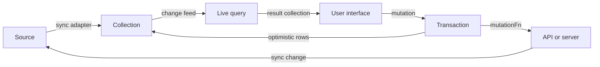
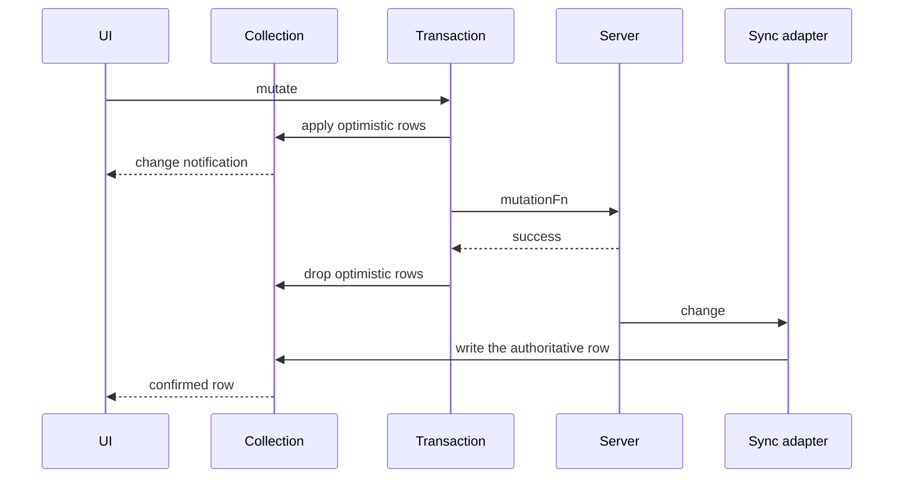

# Overview

TanStack DB is a client-side data store. It holds normalized rows in collections. It answers queries from those rows. It applies writes before the server answers. This document states the problem, the thesis, and the main concepts.

## The problem

The project names two common designs and rejects both. See `docs/overview.md:20-23`:

1. **A view-specific application programming interface (API).** Each screen gets its own endpoint. The backend grows. A screen that needs three resources makes three requests, so requests form a "network waterfall."
2. **Load everything, filter on the client.** The first load is large. Filtering and sorting a large array in the browser is slow.

The project states the two costs directly. The first cost is "endpoint sprawl and network waterfalls." The second cost is "slow loads and sluggish client performance." The citations are `docs/overview.md:10` and `docs/overview.md:23`.

## The thesis

The project proposes a third design. Load normalized rows once. Derive each view locally. Send writes immediately. The citation is `docs/overview.md:27-31`.

The thesis has five claims:

| Claim | Meaning | Citation |
| --- | --- | --- |
| Normalized collections | Rows live in typed sets, not per-screen responses | `docs/overview.md:27` |
| Query-driven sync | A query asks the source for the exact rows it needs | `docs/overview.md:28` |
| Sub-millisecond live queries | A result updates by difference, not by a full re-run | `docs/overview.md:29` |
| Optimistic writes | A write is visible before the network confirms it | `docs/overview.md:31` |
| A simple backend | The backend serves data, not screen shapes | `docs/overview.md:14` and `docs/overview.md:27` |

The root `README.md` repeats the same three benefits. See `README.md:55-61`.

The phrase "reactive client store for your API" is the shortest statement of the thesis. See `README.md:55`.

## What the store owns

The core owns four things:

1. **Collections.** A collection is a typed set with a key, a schema, and a change feed. A change feed is the stream of row change messages that subscribers receive. See `docs/overview.md:109-117`.
2. **Transactions.** A transaction groups mutations and controls when they become visible. See `packages/db/src/transactions.ts:25-60`.
3. **Live queries.** A live query is itself a collection. See `docs/overview.md:166`.
4. **Indexes.** An index maps a value or a range to row keys. Live queries use an index to find the rows that match a filter without a full scan. See `packages/db/src/indexes/base-index.ts:74-90`.

The core does not own the source of the data. A sync adapter owns that. The contract is one function, `sync`. See `packages/db/src/types.ts:446-552`.

```ts
export interface SyncConfig<T extends object, TKey extends string | number> {
  sync: (params: {
    collection: Collection<T, TKey, any, any, any>
    begin: (options?: { snapshot?: boolean }) => void
    write: (message: ChangeMessageOrDeleteKeyMessage<T, TKey>) => void
    commit: (signal?: AbortSignal) => SyncAppliedReceipt
    markReady: () => void
    // ...
  }) => void | CleanupFn | SyncConfigRes
}
```

The citation is `packages/db/src/types.ts:446-552`.

The names in the excerpt have these meanings:

- `ChangeMessageOrDeleteKeyMessage` is one row change or a delete key.
- `SyncAppliedReceipt` resolves when the committed rows become visible.
- `CleanupFn` releases adapter resources.
- `SyncConfigRes` carries the optional `loadSubset`, `unloadSubset`, and cleanup functions.
- The five type parameters of `Collection` are the row type, the key type, and three further type parameters that the excerpt fixes as `any`.

This small contract is the central design decision. A synced adapter pushes rows. The collection does not pull rows in the default mode. The one exception is an on-demand adapter: the collection asks it to load a subset through `loadSubset`. On-demand is the mode that loads rows only when a query asks for them; the "Sync modes" section below explains it. The collection still does not know the protocol, the transport, or the server. See `packages/db/src/types.ts:446-552`.

## The four main concepts

### Collection

A collection has a `getKey` function and an optional schema. It validates each row with a Standard Schema, a common validation interface with a `~standard` property. It stores rows by key. It emits change messages to subscribers. A change feed is the stream of those messages.

The constructor creates seven managers. See `packages/db/src/collection/index.ts:487-495`:

- `_events` emits status and subscriber-count events.
- `_changes` manages subscriptions and publishes row changes.
- `_lifecycle` controls status transitions and garbage collection. Garbage collection releases an unused collection after its `gcTime` expires.
- `_sync` runs the sync adapter.
- `_indexes` manages indexes.
- `_mutations` applies local writes.
- `_state` holds synced rows, the optimistic overlay, and the visible row view. The optimistic overlay is the layer of unsettled local writes over synced data.

Document [02-collections.md](02-collections.md) explains each manager.

### Sync adapter

A sync adapter receives a set of callbacks. It calls `begin` to start a batch. It calls `write` for each row change. It calls `commit` to publish the batch. It calls `markReady` after the first load.

The adapter can return a cleanup function. It can also return `loadSubset` and `unloadSubset` functions. Those functions support on-demand sync. See `packages/db/src/types.ts:400-435`.

### Live query

A live query compiles a query description into a graph of operators. Each operator receives a set of weighted rows and sends a set of weighted differences. A weighted row is a row with an integer count. A count of one means the row is present. A count of zero means the row is absent. A negative count during a computation is a retraction. The result is a new collection. Document [01-architecture.md](01-architecture.md) explains weights in full.

```ts
const { data: todos } = useLiveQuery({
  query: (q) =>
    q.from({ todo: todoCollection }).where(({ todo }) => not(todo.completed)),
})
```

The citation is `docs/overview.md:77-80`.

The engine is `d2ts`, a TypeScript implementation of differential dataflow. See `docs/overview.md:157`. The repository wraps it in the package `@tanstack/db-ivm`. This study calls the engine "D2" for short. The three names refer to one engine.

### Transaction

A transaction applies local mutations and runs a `mutationFn`. A `mutationFn` is the asynchronous server function that the transaction calls. The local rows become visible at once. The server work runs in `mutationFn`. On success, the transaction completes. On failure, the transaction rolls back. "Completes" describes the local state machine; it does not prove that the server applied the write. Document [04-mutations.md](04-mutations.md) explains the confirmation rule.

```ts
todosCollection.update(todo.id, (draft) => {
  draft.completed = true
})
```

The citation is `docs/overview.md:84-86`.

The transaction states are `pending`, `persisting`, `completed`, and `failed`. See `packages/db/src/types.ts:70`.

## The core loop



The first edge is the read path. The sync adapter writes rows into the collection. The second edge sends row changes to the live query. The third edge sends the query result to the user interface (UI). The fourth edge starts a transaction from a user action. The fifth edge writes optimistic rows back into the collection, so the UI updates at once. The sixth edge calls the server. The seventh edge closes the loop: the server sends the change back to the source, and the sync adapter then writes it into the collection.

Each edge has one direction. The whole set of edges forms a cycle. The collection never calls a component. A component subscribes to the collection. The citation for the unidirectional rule is `docs/overview.md:198-208`.



The first arrow records the write. The second arrow makes it visible. The third arrow is the immediate re-render. The fourth arrow is the network call. The fifth arrow confirms the call. The sixth arrow removes the overlay. The seventh arrow carries the change to the sync adapter. The eighth arrow writes the authoritative row into the collection. The last arrow updates the UI again.

The sixth arrow removes the overlay when the transaction settles. If the handler waits for a sync signal, such as Electric's `awaitTxId`, the eighth arrow has already happened. Without that wait, the row can disappear between the sixth and eighth arrows.

## What the project is not

The source does not describe TanStack DB as a database server. It has no server process and no wire protocol of its own. A wire protocol is a message format for a network connection. The repository contains client packages and adapter packages. The persistence packages write to SQLite, but the core also runs without persistence.

The source does not state that TanStack DB requires Electric. The core dependency list contains `@standard-schema/spec`, `@tanstack/db-ivm`, and `@tanstack/pacer-lite`. See `packages/db/package.json:57-62`. `@tanstack/pacer-lite` provides the scheduling helpers that the collection uses to pace work. A WebSocket is not a dependency; it is an example of a transport that an adapter can use.

The source does not state that TanStack DB requires TanStack Query. The `query-db-collection` package uses TanStack Query. The core does not. See `packages/query-db-collection/package.json:48-55`.

## Sync modes

The documentation lists three modes in `docs/overview.md:122-128`:

| Mode | Behavior |
| --- | --- |
| Eager | Load the entire collection before ready |
| On-demand | Load only the rows that queries request |
| Progressive | Serve query subsets at once, sync the full set in the background, and become ready after the full sync |

In progressive mode the adapter serves the rows that a query requests at once, then continues a full sync in the background. The query does not wait for the full sync. See `docs/overview.md:126-127`.

The core type has two modes. `SyncMode` is `eager` or `on-demand`. See `packages/db/src/types.ts:815`.

Electric defines the third mode. `ElectricSyncMode` is `SyncMode | 'progressive'`. See `packages/electric-db-collection/src/electric.ts:339`.

This is a real ambiguity. The source does not state that progressive mode works for every adapter. The two possible readings are:

1. Progressive mode is an Electric-only extension. The overview describes it as a general feature, but only the Electric package defines it.
2. Progressive mode is a general concept that each adapter can implement with its own type. The core `SyncMode` type is then incomplete.

The source supports the first reading. The type declaration is explicit. The source does not define a general progressive contract.

## Key insight

**Key insight:** the store has no opinion about the network. It has an opinion about rows. The `sync` function receives a collection and a set of write verbs. A WebSocket, a Hypertext Transfer Protocol (HTTP) stream, a local database, and a timer can all call those verbs. This is why the same core serves Electric, PowerSync, TrailBase, RxDB, Convex, and TanStack Query.

The cost is that the core cannot optimize a source it does not know. Each adapter must implement `loadSubset` itself. Each adapter must decide how to detect a deletion. Document [05-sync-engines.md](05-sync-engines.md) compares those decisions.

## Reading guide

Read [01-architecture.md](01-architecture.md) next. It shows where the managers live and how a row moves through them.

Read [02-collections.md](02-collections.md) and [03-live-queries.md](03-live-queries.md) as a pair. The first explains the input to a query. The second explains the query.

Read [04-mutations.md](04-mutations.md) for the write path. Read [05-sync-engines.md](05-sync-engines.md) for the shipped sources.

## Source map

| Claim | Source |
| --- | --- |
| The two rejected designs | `docs/overview.md:20-23` |
| The five-part thesis | `docs/overview.md:27-31` |
| Collections as typed sets | `docs/overview.md:109-117` |
| Live queries use differential dataflow | `docs/overview.md:155-165` |
| The sync contract | `packages/db/src/types.ts:446-552` |
| Collection managers | `packages/db/src/collection/index.ts:487-495` |
| Transaction states | `packages/db/src/types.ts:70` |
| Core dependencies | `packages/db/package.json:57-62` |

## Related documents

- [01-architecture.md](01-architecture.md): the layers and the managers.
- [02-collections.md](02-collections.md): the collection and adapter contracts.
- [08-durable-streams-and-electric.md](08-durable-streams-and-electric.md): the comparison with Electric.
- [09-critical-assessment.md](09-critical-assessment.md): the limits of the thesis.
