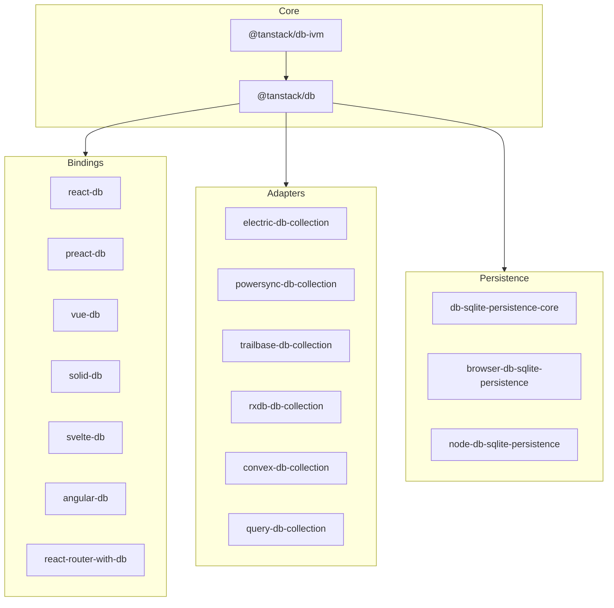
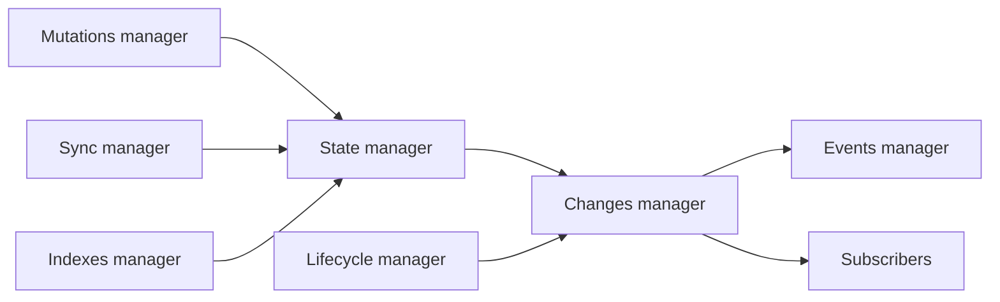

# Architecture

This document maps the repository into layers. It then follows one row from a source into a collection and one query from a description into a running graph.

## The five layers

| Layer | Packages | Job |
| --- | --- | --- |
| Differential engine | `@tanstack/db-ivm` | Execute a query as a graph of difference operators |
| Core store | `@tanstack/db` | Collections, transactions, indexes, query compiler, persistence interfaces |
| Sync adapters | `electric-db-collection`, `powersync-db-collection`, `trailbase-db-collection`, `rxdb-db-collection`, `convex-db-collection`, `query-db-collection` | Convert a source protocol into `begin`, `write`, `commit` calls |
| Persistence adapters | `db-sqlite-persistence-core` and the runtime packages | Store rows and sync metadata in SQLite |
| Bindings | `react-db`, `preact-db`, `vue-db`, `solid-db`, `svelte-db`, `angular-db`, `react-router-with-db` | Turn a collection into a reactive value for a user interface (UI) |

`begin`, `write`, and `commit` are the three steps of one sync transaction: start it, add one change, and publish it. A sync adapter converts its source protocol into those calls. Document [02-collections.md](02-collections.md) defines the full contract.

The dependency direction goes from a consumer to the package it uses. The core imports the differential engine. An adapter imports the core. The core imports no adapter. The table lists the engine first and the user-facing layers last. It is not a strict stack: bindings and persistence adapters are separate consumers of the core, and a binding does not use a persistence adapter. See `packages/db/package.json:57-62` and `packages/electric-db-collection/package.json:50-52`.



An arrow points from the package that is imported to the package that imports it. The edge from `@tanstack/db-ivm` to `@tanstack/db` is a build dependency: the core imports the differential engine. The other three edges are consumer relationships. Each one names a whole subgraph, not a single package. The edge from the core to Bindings means that `react-db`, `preact-db`, `vue-db`, `solid-db`, `svelte-db`, `angular-db`, and `react-router-with-db` each import the core. The edge from the core to Adapters means that each sync adapter package imports the core. The edge from the core to Persistence means that the SQLite persistence packages import the core. No edge points back into the core. That one-way structure is the main architectural constraint.

## The core modules

The core entry file re-exports the public surface. See `packages/db/src/index.ts:6-18`.

| Module | File | Responsibility |
| --- | --- | --- |
| Collection | `packages/db/src/collection/index.ts` | Create a collection and wire its managers |
| Sync manager | `packages/db/src/collection/sync.ts` | Run the sync adapter and stage its writes |
| State manager | `packages/db/src/collection/state.ts` | Hold synced rows and the optimistic overlay |
| Mutation manager | `packages/db/src/collection/mutations.ts` | Validate and apply local writes |
| Changes manager | `packages/db/src/collection/changes.ts` | Deduplicate and publish row changes |
| Lifecycle manager | `packages/db/src/collection/lifecycle.ts` | Control status, readiness, and cleanup |
| Indexes manager | `packages/db/src/collection/indexes.ts` | Create and drop indexes |
| Transactions | `packages/db/src/transactions.ts` | Group mutations and run the server work |
| Query builder | `packages/db/src/query/builder/index.ts` | Build the query description |
| Query compiler | `packages/db/src/query/compiler/index.ts` | Map the description to an operator graph |
| Live query | `packages/db/src/query/live/` | Subscribe sources, feed the graph, publish results |
| Scheduler | `packages/db/src/scheduler.ts` | Coalesce work by context and job |

## The collection managers

`CollectionImpl` creates seven managers in its constructor. See `packages/db/src/collection/index.ts:487-495`.

```ts
this._changes = new CollectionChangesManager()
this._events = new CollectionEventsManager()
this._indexes = new CollectionIndexesManager()
this._lifecycle = new CollectionLifecycleManager(this.config, this.id, () => ...)
this._mutations = new CollectionMutationsManager(this.config, this.id)
this._state = new CollectionStateManager(this.config)
this._sync = new CollectionSyncManager(this.config, this.id)

this._changes.setDeps({
  collection: this,
  lifecycle: this._lifecycle,
  sync: this._sync,
  events: this._events,
  state: this._state,
})
```

The citation is `packages/db/src/collection/index.ts:487-506`.

The dependency injection matters. The changes manager can ask the state manager for virtual properties. It can ask the lifecycle manager for the current status. It can ask the sync manager whether a transaction is active. The managers do not import each other's singletons.



The edges have these meanings. M to S means that a local mutation writes into the state manager. Y to S means that a sync transaction also writes into the state manager. S to C means that the state manager computes the visible rows, and the changes manager reads that visible state to emit one change per changed key. L to C means that the changes manager asks the lifecycle manager for status and for the permission to start or stop sync, and it starts and stops the garbage-collection timer there. C to E means that the changes manager tells the events manager to emit a subscriber-count event. I to S means that the indexes manager reads the visible state to answer lookups. The edge C to Sub delivers changes to subscribers, including live queries.

A virtual property is a computed field that a subscriber can add to a row without storing it in the row.

## Lifecycle

A collection has six statuses. See `packages/db/src/types.ts:797-813`:

| Status | Meaning |
| --- | --- |
| `idle` | Created, sync not started |
| `loading` | Sync started, first load not complete |
| `ready` | `markReady()` called |
| `error` | The first load failed |
| `crashed` | Local storage broke, or an internal invariant broke. An internal invariant is a condition that the code requires to remain true. |
| `cleaned-up` | Resources freed |

The normal path is `idle -> loading -> ready`. A first-load failure gives `error`. A storage failure gives `crashed` from `loading` or `ready`. Cleanup gives `cleaned-up`.

```mermaid
stateDiagram-v2
    [*] --> idle
    idle --> loading: preload or subscriber
    loading --> ready: markReady
    loading --> error: fail before ready
    error --> loading: reload
    ready --> crashed: storage failure
    loading --> crashed: storage failure
    ready --> cleaned-up: cleanup
    error --> cleaned-up: cleanup
    crashed --> cleaned-up: cleanup
```

The first edge is collection creation. The second edge starts sync. `startSync` defaults to false, and the collection starts sync only from `idle`; a subscriber starts it after creation. See `packages/db/src/types.ts:927` and `packages/db/src/collection/index.ts:464-470`. The third edge is the first ready. The fourth edge is a failed first load. The fifth edge is a reload, which starts a new sync run. The two crash edges come from persistence failures, not from a source failure: a durable write error can crash a collection in `loading` or in `ready`. The last three edges free resources.

## Starting sync

Sync starts in one of two ways:

1. `startSync: true` starts it during collection creation.
2. The first subscriber starts it.

The constructor wraps the sync configuration with a callback that starts sync when the status is `idle`. See `packages/db/src/collection/index.ts:464-470`.

`startSync` defaults to false. See `packages/db/src/types.ts:927`. The React hook calls `startSyncImmediate()` when it receives an existing collection. `startSyncImmediate()` starts sync at once instead of deferring it. See `packages/react-db/src/useLiveQuery.ts:669-671`.

The sync manager then calls the adapter's `sync` function inside a run that records adapter failures in the collection status. See `packages/db/src/collection/sync.ts:202-275`.

## The differential engine

The engine is a small dataflow runtime. It has four public pieces:

1. `D2` owns the graph.
2. `DifferenceStreamWriter` sends changes.
3. `DifferenceStreamReader` receives changes.
4. An operator reads inputs and writes an output. An operator is an object with an `addInput` method and a `run` method.

`Row` in the example is a placeholder type for one row. A writer and a reader form a pair for one edge of the graph: the writer sends, and the reader receives.

`D2` has a fixed set of methods. See `packages/db-ivm/src/d2.ts:10-68`:

```ts
const graph = new D2()
const input = graph.newInput<Row>()
graph.addOperator(operator)
graph.finalize()
graph.run()
```

The first line creates the graph. The second creates a root input. The third adds an operator. The fourth freezes the shape. The fifth runs all pending work.

`newInput` creates a `DifferenceStreamWriter`. See `packages/db-ivm/src/d2.ts:28-34`. `addOperator` appends the operator to an ordered list. See `packages/db-ivm/src/d2.ts:36-39`. `finalize` forbids later changes. See `packages/db-ivm/src/d2.ts:41-44`.

`run` is a loop. It makes a full pass over the operators. It runs each operator that has pending input. It repeats while any operator ran. See `packages/db-ivm/src/d2.ts:59-76`.

```ts
let ran = true
while (ran) {
  ran = false
  for (const op of this.#operators) {
    if (op.hasPendingWork()) {
      op.run()
      ran = true
    }
  }
}
```

The citation is `packages/db-ivm/src/d2.ts:66-75`.

The comment explains why the loop exists: "A later registered operator can send work to an earlier one." See `packages/db-ivm/src/d2.ts:64-66`. A simple topological pass is not sufficient. The loop restarts until the graph is quiet.

An operator reports pending work when any input reader is not empty. See `packages/db-ivm/src/graph.ts:72-74`.

## Weighted rows

The engine does not send rows. It sends rows with integer weights. The type is `MultiSetArray<T> = Array<[T, number]>`. See `packages/db-ivm/src/multiset.ts:4`. The type parameter `T` is the value that the graph carries. In a live query the graph carries a pair, `[key, row]`, so the concrete type is `MultiSetArray<[TKey, T]>`. The code below builds an array of `[key, row]` pairs with integer weights; the array type is inferred from those entries.

A weight of `+1` means "add one occurrence." A weight of `-1` means "remove one occurrence." An update is two entries: the old value at `-1` and the new value at `+1`.

```ts
if (change.type === `insert`) {
  multiSetArray.push([[key, change.value], 1])
} else if (change.type === `update`) {
  multiSetArray.push([[key, change.previousValue], -1])
  multiSetArray.push([[key, change.value], 1])
} else {
  multiSetArray.push([[key, change.value], -1])
}
```

The citation is `packages/db/src/query/live/utils.ts:123-146`.

This representation is the reason the engine can retract a row. A delete is not a special command. It is a negative weight. An operator that sees the negative weight removes the row from its internal index.

## Scheduling

A transaction can produce many changes. The scheduler coalesces work by context and job. A **context** is a batching boundary, for example a transaction identifier, and a **job** is a named unit of work inside that context. A context maps to a transaction identifier for live queries. Scheduling the same job identifier again replaces the earlier run function, so one job never runs twice in one flush. See `packages/db/src/scheduler.ts:1-8` and `packages/db/src/scheduler.ts:23-46`.

`Scheduler.schedule` runs work at once when it receives no context. With a context, it queues the job. A dependency is another job that must run before this job. A flush is one pass that runs the queued jobs. `Scheduler.flush` runs the jobs in order and retries a job whose dependencies are not yet met. See `packages/db/src/scheduler.ts:64-88` and `packages/db/src/scheduler.ts:94-140`.

The scheduler does not hold data. It holds order. Document [03-live-queries.md](03-live-queries.md) shows where the live query uses it.

## Key insight

**Key insight:** the architecture separates "what changed" from "who needs to know." A mutation and a sync commit both produce the same `ChangeMessage` shape. See `packages/db/src/types.ts:660-669`. The changes manager then decides visibility and deduplication. A live query subscribes to the same feed as a UI component. There is one change path, not two.

That choice keeps the system small. It also means the correctness of every consumer depends on the correctness of one change feed.

## Source map

| Area | File |
| --- | --- |
| Collection managers | `packages/db/src/collection/index.ts:487-506` |
| Status values | `packages/db/src/types.ts:797-813` |
| Sync start | `packages/db/src/collection/sync.ts:202-275` |
| Graph runtime | `packages/db-ivm/src/d2.ts:10-75` |
| Operator base | `packages/db-ivm/src/graph.ts:57-120` |
| Weighted multiset | `packages/db-ivm/src/multiset.ts:1-60` |
| Change to weight conversion | `packages/db/src/query/live/utils.ts:123-146` |
| Scheduler | `packages/db/src/scheduler.ts:39-120` |

## Related documents

- [00-overview.md](00-overview.md): the thesis that motivates these layers.
- [02-collections.md](02-collections.md): the collection and adapter contracts in detail.
- [03-live-queries.md](03-live-queries.md): the query half of the engine.
- [04-mutations.md](04-mutations.md): the transaction half of the engine.
- [09-critical-assessment.md](09-critical-assessment.md): the cost of the single change path.
