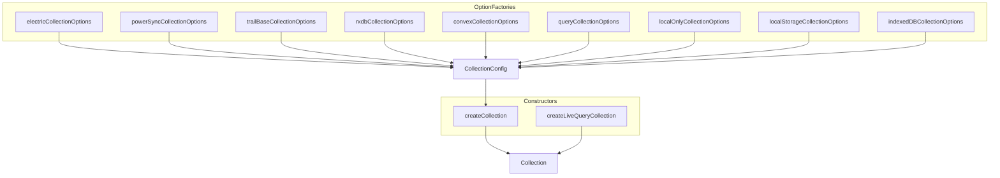
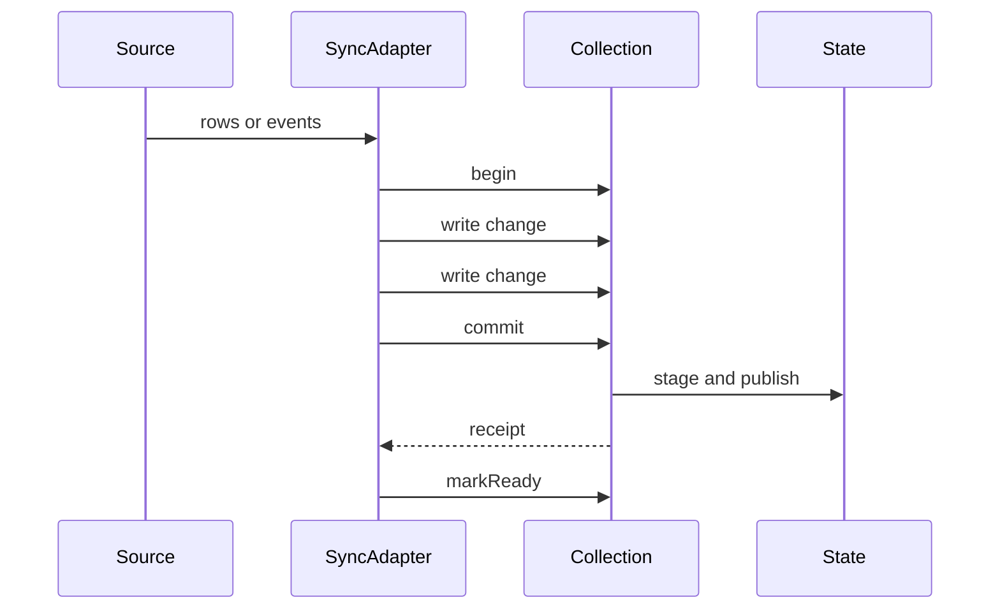

# Collections

A collection is the central data structure. It is a typed set of rows with a key, a schema, a sync adapter, and a change feed. A change feed is the ordered stream of change messages that the collection sends to its subscribers. This document explains the collection types, the sync adapter interface, and the persistence adapter interface.

## What a collection is

A collection holds objects. Each object has a key. `getKey` extracts the key from the object. See `packages/db/src/types.ts:895-903`.

```ts
const todos = createCollection({
  getKey: (todo) => todo.id,
  sync: { sync: (params) => { /* ... */ } },
})
```

The citation is `packages/db/src/types.ts:885-900` and `packages/db/src/collection/index.ts:247-260`. The configuration has a `sync` field. The value of that field is a `SyncConfig`. `SyncConfig` contains a function also named `sync`. The outer field names the adapter slot; the inner function runs the adapter.

`createCollection` has many overloads. They support a schema, an explicit row type, and a utility record. A utility record is a set of helper functions that the collection exposes to the caller. See `packages/db/src/collection/index.ts:247-349`.

A schema is a Standard Schema. Standard Schema is a common validation interface that a validation library implements through a `~standard` property. The collection validates input rows with it before a write. The mutation manager calls `validateData`. See `packages/db/src/collection/mutations.ts:112-180`.

A collection has an identifier. If the caller does not supply one, the constructor generates a universally unique identifier (UUID). See `packages/db/src/collection/index.ts:457-462`.

## Configuration defaults

`BaseCollectionConfig` defines the shared options. See `packages/db/src/types.ts:875-1000`.

| Option | Default | Effect | Citation |
| --- | --- | --- | --- |
| `gcTime` | 300000 milliseconds (5 minutes) | Delay before cleanup when no subscriber remains | `packages/db/src/types.ts:899-916` |
| `startSync` | `false` | Sync starts on first subscriber, not on creation | `packages/db/src/types.ts:917-927` |
| `autoIndex` | `off` | No automatic index for simple `where` clauses | `packages/db/src/types.ts:928-937` |
| `syncMode` | `eager` | Sync loads all data when the collection preloads. Preload is the call that starts sync and waits for the first load. | `packages/db/src/types.ts:963-971` |
| `rowUpdateMode` | `partial` | An update message carries only changed fields | `packages/db/src/types.ts:544-551` |

The `gcTime` rule has exceptions. A pending preload retains the collection. A persisting transaction also retains it. See `packages/db/src/types.ts:899-916`.

## Collection types

The repository ships two collection constructors and several option factories. `createCollection` and `createLiveQueryCollection` return a `Collection`. The option factories return a `CollectionConfig`; the caller passes that configuration to `createCollection`.

### 1. A synced collection

A synced collection supplies `sync`. The sync adapter pushes rows from a source. This is the general form. Electric, PowerSync, TrailBase, RxDB, Convex, and TanStack Query all use it.

### 2. A local-only collection

A local-only collection has no remote source. `localOnlyCollectionOptions` supplies a loopback sync adapter, an adapter that writes rows back into the same collection. The adapter captures `begin`, `write`, and `commit`. It sets `isLocalOnly` on the collection state. The state and mutation paths read that flag to treat the rows as local, with no remote origin. It also sets `localOnlyDirectWrite`, a record that names the operation types which confirm synchronously and supplies the confirming write function. See `packages/db/src/local-only.ts:320-330`.

The options set `startSync: true` and `gcTime: 0`. See `packages/db/src/local-only.ts:265-266`. With `gcTime: 0`, the collection starts cleanup as soon as its last subscriber leaves, so an unused local-only collection does not stay in memory. The adapter loads `initialData` only when the collection is not ready. See `packages/db/src/local-only.ts:326-331`.

### 3. A local storage collection

A local storage collection stores rows in `localStorage`. `localStorageCollectionOptions` accepts a storage key and the browser `Storage` interface, which supplies `getItem`, `setItem`, and `removeItem`. See `packages/db/src/local-storage.ts:496-530`.

The adapter loads stored rows, calls `begin({ snapshot: true })`, writes each row, commits, and calls `markReady()`. It then listens for `storage` events. A `storage` event is a browser event that fires in other tabs when a stored value changes. See `packages/db/src/local-storage.ts:1185-1245`.

`storage` events do not reach the tab that wrote the value. The adapter therefore keeps a same-tab listener map: a map from storage key to local listeners, which the adapter calls directly after a write. See `packages/db/src/local-storage.ts:46-50` and `packages/db/src/local-storage.ts:1230-1235`.

### 4. An IndexedDB collection

An IndexedDB collection stores rows in an IndexedDB object store. An object store is an IndexedDB table. `createIndexedDB` creates a database with named stores. See `packages/db/src/indexed-db.ts:294`.

`indexedDBCollectionOptions` requires an existing database instance and store name. See `packages/db/src/indexed-db.ts:149-165`.

The adapter watches a reserved `_versions` store. A version entry gives each key a change token, a value that changes on every write to that key. The adapter also uses a `BroadcastChannel`, a browser channel that sends messages between tabs, to notify other tabs. The version store is at `packages/db/src/indexed-db.ts:167-203`; the channel is constructed at `:545`.

### 5. A live query collection

`createLiveQueryCollection` returns a collection. Its rows are the query result. See `packages/db/src/query/live-query-collection.ts:128-160`.

The collection subscribes to its source collections. It receives changes and updates its own rows. Document [03-live-queries.md](03-live-queries.md) explains the pipeline.

### 6. An adapter collection

Each sync engine package exports an options function:

| Package | Function | Citation |
| --- | --- | --- |
| Electric | `electricCollectionOptions` | `packages/electric-db-collection/src/electric.ts:1207-1255` |
| PowerSync | `powerSyncCollectionOptions` | `packages/powersync-db-collection/src/powersync.ts:84-235` |
| TrailBase | `trailBaseCollectionOptions` | `packages/trailbase-db-collection/src/trailbase.ts:125` |
| RxDB | `rxdbCollectionOptions` | `packages/rxdb-db-collection/src/rxdb.ts:105-130` |
| Convex | `convexCollectionOptions` | `packages/convex-db-collection/src/index.ts:48-68` |
| TanStack Query | `queryCollectionOptions` | `packages/query-db-collection/src/query.ts:705-730` |

Each function returns a `CollectionConfig`. The caller passes it to `createCollection`. This is the adapter pattern: the package owns the protocol, and the core owns the collection.



The first nine edges show that every option factory produces the same configuration shape. The edge into `createCollection` is the single construction point. The last two edges produce a collection: a root collection or a derived live query collection.

## The sync adapter interface

The sync adapter is a function named `sync`. It receives a collection reference, nine functions, and an optional metadata interface. It returns a cleanup function or a result object. See `packages/db/src/types.ts:446-552`.

```ts
sync: (params: {
  collection: Collection<T, TKey, any, any, any>
  begin: (options?: { snapshot?: boolean }) => void
  write: (message: ChangeMessageOrDeleteKeyMessage<T, TKey>) => void
  commit: (signal?: AbortSignal) => SyncAppliedReceipt
  markReady: () => void
  reportError: (error: unknown) => void
  fail: (error: unknown) => void
  reportHealthy: (error?: unknown) => void
  truncate: (options?: { markReady?: boolean }) => void
  invalidateLoadedSubsets: () => void
  metadata?: SyncMetadataApi<TKey>
}) => void | CleanupFn | SyncConfigRes
```

The citation is `packages/db/src/types.ts:446-552`. `SyncAppliedReceipt` is `true` or a promise, and `SyncMetadataApi` is the interface that reads or writes adapter metadata for one key. Adapter metadata is a per-key side channel for facts such as relation information.

### The verbs

| Verb | Contract | Citation |
| --- | --- | --- |
| `begin` | Start a transaction. `snapshot: true` means the transaction carries every row. | `packages/db/src/types.ts:452-459` |
| `write` | Add one change. The change can be an insert, update, or delete. | `packages/db/src/types.ts:460` |
| `commit` | Publish the transaction in first-in, first-out (FIFO) order. The core accepts it at once, and an accepted transaction always applies. Returns `true` when the writes are visible, or a receipt that resolves when they become visible. | `packages/db/src/types.ts:461-473` |
| `markReady` | The first load is complete. A second call does nothing. | `packages/db/src/types.ts:474-478` |
| `reportError` | A problem after the first ready while the adapter still retries. Rows and status do not change; the value becomes a listed failure. | `packages/db/src/types.ts:480-489` |
| `fail` | Stop the run. Before ready this gives status `error`. After ready the rows stay. | `packages/db/src/types.ts:491-498` |
| `reportHealthy` | Clear the failure reason when called with no value, or remove only the failure whose cause matches the given value. | `packages/db/src/types.ts:500-508` |
| `truncate` | Replace all synced rows. By default this also marks the collection ready. | `packages/db/src/types.ts:510-516` |
| `invalidateLoadedSubsets` | Report that rows served for loaded subsets may have shifted between served pages after an adapter-started refetch. An ordered live query then repairs its window. | `packages/db/src/types.ts:518-525` |

A loaded subset is the set of rows that one query demand loaded. A served page is one page of an ordered result. A refetch is a new request for the same demand that the adapter starts itself. An ordered live query is a query with an order and usually a limit; its window is the rows in that order and limit.

The `commit` receipt is important. The core accepts the transaction at once. Acceptance queues it in first-in, first-out order and guarantees that it applies. Acceptance does not mean the rows are visible. `true` means the writes are visible now. A promise means they become visible later. A persisting optimistic transaction can hold a sync commit until it settles: the committed rows become visible when that transaction settles, together with the removal of its optimistic state. See `packages/db/src/types.ts:461-473`.

### The change message

A change message has a key, a value, an optional previous value, a type, and optional metadata. See `packages/db/src/types.ts:660-669`.

```ts
export interface ChangeMessage<T, TKey> {
  key: TKey
  value: T
  previousValue?: T
  type: OperationType
  metadata?: Record<string, unknown>
}
```

`OperationType` is `insert`, `update`, or `delete`. See `packages/db/src/types.ts:226`.

When `rowUpdateMode` is `partial`, the collection merges an update over the row that it replaces. When `rowUpdateMode` is `full`, the value is the whole row. See `packages/db/src/types.ts:544-551` and `packages/db/src/collection/state.ts:935-945`.

`previousValue` is not required for a partial update. It is required when an adapter changes a row object in place and writes that same object again with different content: the core cannot recover the old value, so the adapter must name it. See `packages/db/src/collection/sync.ts:151-175`.

### Subset loading

A sync adapter can return `loadSubset` and `unloadSubset`. See `packages/db/src/types.ts:400-435`.

`loadSubset` receives a `LoadSubsetOptions` record. The record holds the `where` expression, `orderBy`, `limit`, `offset`, `cursor`, `refetch`, an abort `signal`, and the requesting `subscription`. See `packages/db/src/types.ts:338-379`. The function returns `true` or a promise. The value `true` means the load completes synchronously. A promise means it completes later; the adapter must await or return every receipt from the `commit` calls that establish the loaded subset. The adapter loads the requested rows and writes them through the normal `begin`, `write`, and `commit` path. `unloadSubset` tells the adapter that a query no longer needs those rows.

```ts
export type LoadSubsetFn = (options: LoadSubsetOptions) => true | Promise<void>
```

The citation is `packages/db/src/types.ts:400-435`.

This pair implements on-demand mode. The live query asks the source for the rows the query needs. Document [03-live-queries.md](03-live-queries.md) shows the request path.



The first arrow is the protocol event. The second arrow opens a transaction. The third and fourth arrows add changes. The fifth arrow publishes. The sixth arrow applies them to state. The seventh arrow returns visibility. The last arrow declares the first load complete.

## The persistence adapter interface

The repository has two storage seams. The collection-level seam is `PersistenceAdapter`, described in this section. The offline transaction package also defines a `StorageAdapter` for its outbox; it has `get`, `set`, `delete`, `keys`, and `clear` methods. See `packages/offline-transactions/src/types.ts:140-146`. This document uses "persistence adapter" for the collection seam and names the other type in full.

A persistence adapter is not a sync adapter. It stores rows in SQLite. It does not speak a remote protocol.

`PersistenceAdapter` has required and optional methods. See `packages/db-sqlite-persistence-core/src/persisted.ts:519-632`.

| Method | Purpose | Required |
| --- | --- | --- |
| `loadSubset` | Read stored rows for a query demand | Yes |
| `loadResumeSnapshot` | Read rows and sync position for a restart | Yes |
| `applyCommittedTx` | Write one source transaction | Yes |
| `ensureIndex` | Create a stored index for a query signature | Yes |
| `claimCacheGeneration` | Reserve a cache generation for on-demand mode | No |
| `reconcileCommittedTx` | Resolve a lost write response | No |
| `scanRows` | Read rows without a query demand | No |
| `getStreamPosition` | Read the last term, sequence, and row version | No |
| `runInHydrationScope` | Run a restore as one scheduler unit | No |

The citations are `packages/db-sqlite-persistence-core/src/persisted.ts:519-632`. Four methods are required and five are optional. The required set is the minimum that a restore and a write need: one read for a query demand, one read for a restart, one write, and one index. See `packages/db-sqlite-persistence-core/src/persisted.ts:963-968`.

Some terms in the table need a definition. A query demand is the filter, order, and limit of one load. A cache generation is a named version of the on-demand cache. A lost write response is a write that may have committed but whose reply did not arrive. The last term, sequence, and row version are the durable position marks that a resume needs. A hydration scope is one restore run. A scheduler unit is one job in the scheduler queue.

The adapter runs on a `SQLiteDriver`. The driver has four required operations (`exec`, `query`, `run`, and `transaction`) and one optional operation, `transactionWithDriver`. See `packages/db-sqlite-persistence-core/src/persisted.ts:666-682`.

```ts
export interface SQLiteDriver {
  exec: (sql: string) => Promise<void>
  query: <T>(sql: string, params?: ReadonlyArray<unknown>) => Promise<ReadonlyArray<T>>
  run: (sql: string, params?: ReadonlyArray<unknown>) => Promise<void>
  transaction: <T>(fn: (driver: SQLiteDriver) => Promise<T>) => Promise<T>
  transactionWithDriver?: <T>(fn: (driver: SQLiteDriver) => Promise<T>) => Promise<T>
}
```

The citation is `packages/db-sqlite-persistence-core/src/persisted.ts:666-682`. `exec` runs a statement with no parameters and returns nothing. `run` runs one parameterized statement and returns nothing. `query` returns rows. `transaction` passes a driver to a callback and commits when the callback resolves. `transactionWithDriver` has the same signature and is optional. The source does not state a behavioral difference; the optional form lets a platform driver supply its own transaction runner.

A runtime package wraps this interface for its platform. The browser package uses WebAssembly (WASM) SQLite on the origin private file system (OPFS). See `packages/browser-db-sqlite-persistence/src/browser-persistence.ts:90-135`.

`persistedCollectionOptions` wraps a normal collection configuration and adds a `persistence` field and a `schemaVersion`. `schemaVersion` is the stored schema version; a mismatch triggers the reset rules in document [07-persistence.md](07-persistence.md). See `packages/db-sqlite-persistence-core/src/persisted.ts:7727-7800`.

Document [07-persistence.md](07-persistence.md) explains the wrapper and the restore rules.

## Key insight

**Key insight:** there are two adapters, not one. A sync adapter moves rows from a source. A persistence adapter moves rows to and from disk. A collection can have both. The SQLite wrapper wraps a sync adapter instead of replacing it. See `docs/guides/sqlite-persistence.md:185-240`.

This separation lets the same Electric collection run with or without disk persistence. It also means the persistence layer cannot send a local write to the server. The guide states that rule directly: persistence "does not define how an application sends local changes to a server." See `docs/guides/sqlite-persistence.md:419`.

## Source map

| Area | File |
| --- | --- |
| Base configuration | `packages/db/src/types.ts:875-1000` |
| Sync contract | `packages/db/src/types.ts:446-552` |
| Change message | `packages/db/src/types.ts:660-669` |
| Load subset | `packages/db/src/types.ts:400-435` |
| Collection constructor | `packages/db/src/collection/index.ts:247-360` |
| Local-only | `packages/db/src/local-only.ts:152-330` |
| Local storage | `packages/db/src/local-storage.ts:496-660` |
| IndexedDB | `packages/db/src/indexed-db.ts:99-203` |
| Persistence adapter | `packages/db-sqlite-persistence-core/src/persisted.ts:519-682` |
| Persistence wrapper | `packages/db-sqlite-persistence-core/src/persisted.ts:7727-7800` |

## Related documents

- [01-architecture.md](01-architecture.md): where the managers sit.
- [03-live-queries.md](03-live-queries.md): how a collection is queried.
- [04-mutations.md](04-mutations.md): how a collection is written.
- [05-sync-engines.md](05-sync-engines.md): the shipped sync adapters.
- [07-persistence.md](07-persistence.md): the shipped persistence adapters.
