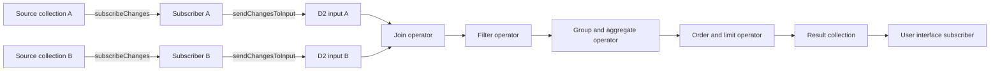
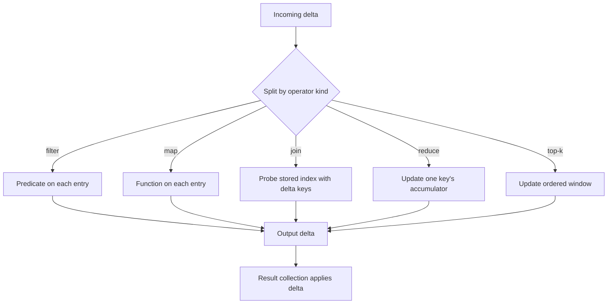

# Live Queries

A live query is a query whose result is a collection. When a source row changes, the result changes. The engine does not run the query again. It applies only the difference. This document explains the builder, the compiler, the operator graph, the indexes, and the reason a result updates without a full re-run.

## The claim

The project claims that live queries are incremental, "rather than by re-running the whole query." The citation is `docs/overview.md:155-161`.

The project also gives a performance number. It reports about 0.7 milliseconds to update one row in a sorted collection of 100,000 items. The documentation does not state the row size, the full hardware beyond an M1 Pro MacBook, or whether the time includes graph construction. This study did not run that benchmark. The citation is `docs/overview.md:159`.

This document explains the mechanism behind that claim.

## The builder

A query starts with `query.from`. `query` is the builder entry point that `@tanstack/db` exports, and `todos` is a source collection. The builder is fluent. Each method returns a new builder with a wider type context. The type context is the compile-time record of the source aliases and their row types; it is what lets the callback in `where` or `select` name a source and receive its typed row. See `packages/db/src/query/builder/index.ts:144-160`.

| Method | Purpose | Citation |
| --- | --- | --- |
| `from` | Choose one or more source collections | `packages/db/src/query/builder/index.ts:237-260` |
| `unionAll` | Combine two sources with the same shape | `packages/db/src/query/builder/index.ts:262-270` |
| `join` | Pair rows from two sources on a condition; `leftJoin`, `rightJoin`, and `fullJoin` set the join type | `packages/db/src/query/builder/index.ts:323-360` |
| `where` | Filter rows | `packages/db/src/query/builder/index.ts:492-495` |
| `select` | Project and compute fields | `packages/db/src/query/builder/index.ts:596-600` |
| `groupBy` | Group rows for aggregation | `packages/db/src/query/builder/index.ts:745-750` |
| `having` | Filter groups | `packages/db/src/query/builder/index.ts:535-538` |
| `orderBy` | Sort the result | `packages/db/src/query/builder/index.ts:653-657` |
| `limit` | Take the first N rows | `packages/db/src/query/builder/index.ts:785-788` |
| `offset` | Skip N rows | `packages/db/src/query/builder/index.ts:809-812` |
| `distinct` | Remove duplicate rows | `packages/db/src/query/builder/index.ts:826-830` |
| `findOne` | Return one row or `undefined` | `packages/db/src/query/builder/index.ts:848-851` |

The builder uses expression helpers. An expression helper is a small function that builds one node of the expression tree, for example `eq`, `gt`, `and`, `not`, and `lower`. See `packages/db/src/query/builder/functions.ts:141-220`.

```ts
const activeTodos = query
  .from({ todo: todos })
  .where(({ todo }) => eq(todo.completed, false))
  .select(({ todo }) => ({ id: todo.id, title: todo.title }))
  .orderBy(({ todo }) => todo.title)
  .limit(20)
```

The citation for each method shape is the declaration line in the table above. The example shows one chain: a filter, a projection, a sort, and a limit.

`findOne` changes the result type. It adds a `SingleResult` marker to the type context. The marker is a type-level flag that says the result is one row, not an array. See `packages/db/src/query/builder/index.ts:844-851`.

## The intermediate representation

The builder does not execute anything. It produces a `QueryIR`. The shape is in `packages/db/src/query/ir.ts:16-80`.

| Field | Type | Meaning |
| --- | --- | --- |
| `from` | `From` | The source or sources |
| `join` | `Join` | Join clauses |
| `where` | `Where` | Filter expressions |
| `select` | `Select` | Projection |
| `groupBy` | `GroupBy` | Group expressions |
| `having` | `Having` | Group filters |
| `orderBy` | `OrderBy` | Sort clauses |
| `limit` | `Limit` | Row count |
| `offset` | `Offset` | Skip count |
| `distinct` | `boolean` | Duplicate removal |

The citations are `packages/db/src/query/ir.ts:16-80`. Each left column names a type alias. Each right column gives the field that the alias carries.

Expressions are an expression tree. `PropRef` reads a property. `Value` holds a constant. `Func` applies a function. An expression tree is a nested record in which each node has a kind and its inputs. See `packages/db/src/query/ir.ts:205-263`.

## The compiler

`compileQuery` and `compileCollectionQuery` turn the intermediate representation (IR) into a differential dataflow (D2) pipeline. See `packages/db/src/query/compiler/index.ts:398-406`.

The result is a `CompilationResult`. See `packages/db/src/query/compiler/index.ts:319-360`.

```ts
export interface CompilationResult {
  collectionId: string
  pipeline: ResultStream
  valueIdentity: ValueIdentity
  sourceWhereClauses: Map<string, BasicExpression<boolean>>
  aliasToCollectionId: Record<string, string>
  aliasRemapping: Record<string, string>
  includes?: Array<IncludesCompilationResult>
}
```

The citation is `packages/db/src/query/compiler/index.ts:319-360`. `compileQuery` compiles a standalone query. `compileCollectionQuery` is the form that the live query collection calls; it also receives the source input map and the subscription records.

The types in the result have these meanings. `ResultStream` is the output stream of the graph. `ValueIdentity` is the scope that compares row values by identity. `BasicExpression<boolean>` is one expression node that returns a boolean. `IncludesCompilationResult` holds one child pipeline for a nested relation include.

Two fields matter for this document:

1. `pipeline` is the executable graph.
2. `sourceWhereClauses` is the filter for each source. The live query uses it as the subscription predicate.

The other fields carry bookkeeping. `collectionId` names the result collection. `valueIdentity` owns the runtime identity scope that the graph uses to compare row values, so the result collection can tell whether a row changed. `aliasToCollectionId` maps each source alias to a collection identifier and enables a separate subscription for each alias in a self-join. `aliasRemapping` maps an outer alias to the innermost alias in one hop when a subquery renames a source. `includes` holds the child pipeline and the metadata for each nested relation include. See `packages/db/src/query/compiler/index.ts:319-360`.

The `sourceWhereClauses` field is what makes query-driven sync possible. A source can receive the `where` clause as part of a `loadSubset` call. The source then returns only the matching rows.

## The live query collection

`createLiveQueryCollection` creates the result collection. See `packages/db/src/query/live-query-collection.ts:128-160`.

The builder object is `CollectionConfigBuilder`. It compiles the base pipeline in one place. See `packages/db/src/query/live/collection-config-builder.ts:1096-1145`.

```ts
private compileBasePipeline() {
  this.graphCache = new D2()
  const inputs = createSourceRecord<RootStreamBuilder<unknown>>()
  for (const source of this.collectionSources) {
    inputs[source.sourceId] = this.graphCache.newInput<any>()
  }
  this.inputsCache = inputs

  const compilation = compileCollectionQuery(
    this.query,
    this.inputsCache,
    this.collections,
    this.subscriptions,
    this.lazySourcesCallbacks,
    this.lazySources,
    this.optimizableOrderByCollections,
    (windowFn) => { this.windowFn = windowFn },
  )
  // ...
}
```

The citation is `packages/db/src/query/live/collection-config-builder.ts:1096-1130`. The eight arguments are the query, the source inputs, the source collections, the subscription records, the lazy-source callbacks, the lazy source map, the collections whose order can be optimized, and a callback that receives the window function.

The first statement creates a new graph. The loop creates one root input per source alias. The call compiles the query into operators that read those inputs. The compiler returns the output stream.

The builder then subscribes to each source. `CollectionSubscriber.subscribe` calls its private `subscribeToChanges`, which reads the source where clause and calls the collection's `subscribeChanges` method. See `packages/db/src/query/live/collection-subscriber.ts:73-100` and `packages/db/src/query/live/collection-subscriber.ts:316`.



Each edge has one meaning. The first two edges are change subscriptions on the source collections. Each subscriber converts a change message into a weighted entry and sends it to its graph input. The two input edges meet at the join, which pairs rows by key. The join output goes to the filter, which keeps only matching rows. The filter output goes to the group operator, which updates each group. The group output goes to the order and limit operator, which maintains the top rows. The last two edges publish the result and notify the user interface (UI).

The diagram shows one query shape. The compiler builds only the stages that the query needs. A query with no join has no join stage. A query with no `groupBy` has no group stage. A query with no `limit` and no `offset` has no top-k window. The diagram leaves out four stages: `select` becomes a map, `having` becomes a filter after the group, `distinct` becomes a reduce that keeps one copy, and `offset` becomes part of the top-k window.

## From change to weight

`sendChangesToInput` converts a change message into multiset entries. See `packages/db/src/query/live/utils.ts:123-146`.

| Change | Entries |
| --- | --- |
| Insert | `[[key, value], +1]` |
| Update | `[[key, previousValue], -1]` and `[[key, value], +1]` |
| Delete | `[[key, value], -1]` |

The citation is `packages/db/src/query/live/utils.ts:133-145`.

The collection normalizes a partial update before this step. With `rowUpdateMode: 'partial'`, the state manager merges the changed fields into the stored row, so the value that reaches `sendChangesToInput` is a full row. The `previousValue` in the table is the stored row before the change. Document [02-collections.md](02-collections.md) explains when an adapter must supply `previousValue`.

A delete does not need the old row from the source. The change message carries `value`. The adapter sets `value` to the row that is leaving.

## Why the result does not need a re-run

A relational database answers a query by reading all candidate rows. A differential engine answers it by keeping operator state and applying differences.

Consider a filter. The filter operator is a linear operator. It applies the predicate to each entry and forwards the entry with the same weight. See `packages/db-ivm/src/operators/filter.ts:13-27`.

```ts
inner(collection: MultiSet<T>): MultiSet<T> {
  return collection.filter(this.#f)
}
```

The citation is `packages/db-ivm/src/operators/filter.ts:26-28`. The type parameter `T` here is one graph entry, not one row. In a live query the entry is the pair `[key, row]`, so `MultiSet<T>` is `MultiSet<[TKey, TRow]>`. `MultiSet` is the class in `packages/db-ivm/src/multiset.ts:10` that wraps a multiset array and supplies the operator methods.

If a row enters with weight `+1` and passes the predicate, the output is `+1`. If a row leaves with weight `-1` and passes the predicate, the output is `-1`. The filter never scans the other rows.

Now consider an aggregation. The reduce operator keeps an input index and an output index. See `packages/db-ivm/src/operators/reduce.ts:24-90`.

```ts
run(): void {
  const keysTodo = new Set<K>()
  for (const message of this.inputMessages()) {
    for (const [item, multiplicity] of message.getInner()) {
      const [key, value] = item
      this.#index.addValue(key, [value, multiplicity])
      keysTodo.add(key)
    }
  }
  // For each key, compute the reduction and delta
}
```

The citation is `packages/db-ivm/src/operators/reduce.ts:42-90`.

The operator reads only the keys in the incoming delta. It updates the stored value for each key. It emits a negative weight for the old aggregate and a positive weight for the new aggregate. Other keys are untouched.

Now consider a join. The join operator keeps an index for each input. See `packages/db-ivm/src/operators/join.ts:66-105`.

On each run, it builds a delta index from each input. It emits three groups of pairs: the left delta against the stored right index, the stored left index against the right delta, and the left delta against the right delta. It then appends both deltas to the stored indexes. The citation is `packages/db-ivm/src/operators/join.ts:89-139`.

The three groups avoid two errors. If the operator used only the first two groups, a pair whose two rows changed together would be missing. If it appended the delta before pairing, the same pair would appear in both the first group and the third group. The code uses pre-append snapshots, so each pair appears once.

Now consider an ordered limit. The limit and offset compile to a top-k window operator. See `packages/db-ivm/src/operators/topKWithFractionalIndex.ts:14-81`. When a new row enters the window, the operator emits `+1` for that row and `-1` for the row that leaves. A later operator can already have seen the row that leaves, so the `-1` must travel through the graph again. The `D2.run` loop carries that retraction.

The cost of a join update is proportional to the changed keys and the rows that match them, not to the full table. A key with many matches costs more. That is the core of the incremental claim.



The first edge routes the delta by operator type. Each middle edge names the local work. The `map` edge applies `select` or a computed expression to each entry. Every operator produces an output delta, not a new table. The last edge applies the delta to the result collection. The result collection then emits a change only for rows whose value changed.

## The run loop

The graph has no fixed topological order. A later operator can send work to an earlier one. The `D2.run` method loops until no operator has pending work. See `packages/db-ivm/src/d2.ts:59-76`.

This loop matters for a join of two inputs and for a chain with a limit. A limit operator can retract a row that a later operator already saw. The loop lets the retraction propagate.

## Indexes

An index maps a value or a range to a set of keys. The interface is in `packages/db/src/indexes/base-index.ts:74-130`.

| Method | Purpose |
| --- | --- |
| `lookup(operation, value)` | Find keys for `eq`, `gt`, `gte`, `lt`, or `lte` |
| `rangeQuery(options)` | Find keys in a range; `options` holds `from`, `to`, `fromInclusive`, and `toInclusive` |
| `rangeQueryReversed(options)` | Find keys in a range in reverse order |
| `take(n, from, filterFn?)` | Take up to `n` keys from a starting value, with an optional filter |
| `supports(operation)` | Report whether the index handles an operation |

The citations are `packages/db/src/indexes/base-index.ts:74-130` and `packages/db/src/indexes/base-index.ts:251-260`.

The repository ships three index types:

1. `BasicIndex` stores a map from value to keys. See `packages/db/src/indexes/basic-index.ts:37-50`.
2. `BTreeIndex` stores ordered groups in a B-tree. It supports ranges and order. See `packages/db/src/indexes/btree-index.ts:28-40`.
3. `ReverseIndex` wraps another index and swaps the direction of each lookup and range. See `packages/db/src/indexes/reverse-index.ts:5-30`.

Auto-indexing is off by default. The allowed values are `off` and `eager`. See `packages/db/src/types.ts:937-944`. A caller can set `autoIndex: 'eager'` and supply `defaultIndexType`. The collection then creates indexes for simple `where` expressions.

The query compiler does not require an index. It can evaluate a predicate on each row. An index changes the cost, not the result. The `sourceWhereClauses` map lets the compiler pass a predicate to the source, and the source can use its own index.

## One-shot queries

`queryOnce` runs a query one time. It does not create a live collection. It accepts either a query function or a configuration object with a `query` field. It returns a promise of the result array, or of one row when the query uses `findOne`. See `packages/db/src/query/query-once.ts:59-90`.

```ts
const recentTodos = await queryOnce({
  query: (q) => q.from({ todo: todos }).orderBy(({ todo }) => todo.title).limit(20),
})
```

The distinction is simple. `createLiveQueryCollection` keeps the graph and subscriptions alive. `queryOnce` disposes them after the first result.

## Key insight

**Key insight:** a live query is not a cache of a query result. It is a second collection that receives deltas. The result collection applies each delta to its own rows. A subscriber sees a normal collection change.

This design has a cost. Every operator must store enough state to answer a delta. A join stores both input indexes. A top-k operator stores the ordered window. A group-by stores each accumulator. That state is why the first query is not free and why memory grows with the query shape.

The design also explains the weak point. A query with a non-linear expression, such as a user-defined function that reads outside the row, cannot be maintained from deltas alone. The source does not state how such a function is handled. The two possible readings are:

1. The compiler rejects the expression.
2. The compiler treats the expression as a constant per row and re-evaluates it on each delta.

The source does not state which reading is correct.

## Source map

| Area | File |
| --- | --- |
| Overview claim | `docs/overview.md:155-165` |
| Builder | `packages/db/src/query/builder/index.ts:144-860` |
| Expression helpers | `packages/db/src/query/builder/functions.ts:141-220` |
| Query IR | `packages/db/src/query/ir.ts:16-263` |
| Compiler | `packages/db/src/query/compiler/index.ts:319-410` |
| Live collection | `packages/db/src/query/live-query-collection.ts:128-160` |
| Pipeline compilation | `packages/db/src/query/live/collection-config-builder.ts:1096-1145` |
| Source subscription | `packages/db/src/query/live/collection-subscriber.ts:76-110` |
| Change conversion | `packages/db/src/query/live/utils.ts:123-146` |
| Graph loop | `packages/db-ivm/src/d2.ts:59-76` |
| Filter operator | `packages/db-ivm/src/operators/filter.ts:13-30` |
| Join operator | `packages/db-ivm/src/operators/join.ts:66-130` |
| Reduce operator | `packages/db-ivm/src/operators/reduce.ts:24-95` |
| Index interface | `packages/db/src/indexes/base-index.ts:74-130` |

## Related documents

- [02-collections.md](02-collections.md): the source collections.
- [04-mutations.md](04-mutations.md): how a write becomes a delta.
- [05-sync-engines.md](05-sync-engines.md): how a source answers a subset request.
- [06-framework-adapters.md](06-framework-adapters.md): how a UI subscribes to the result.
