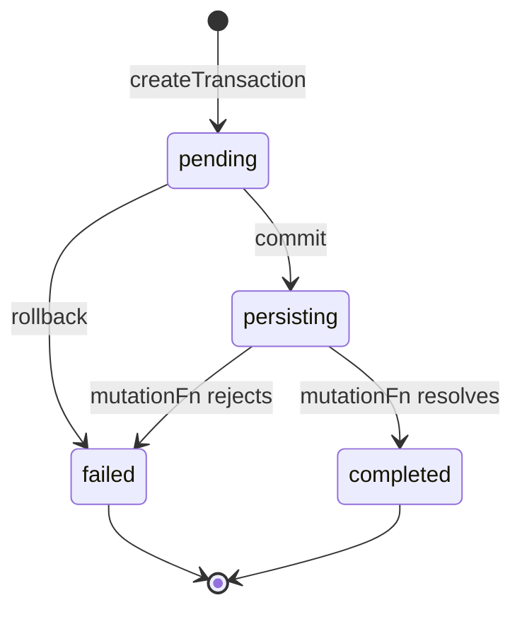
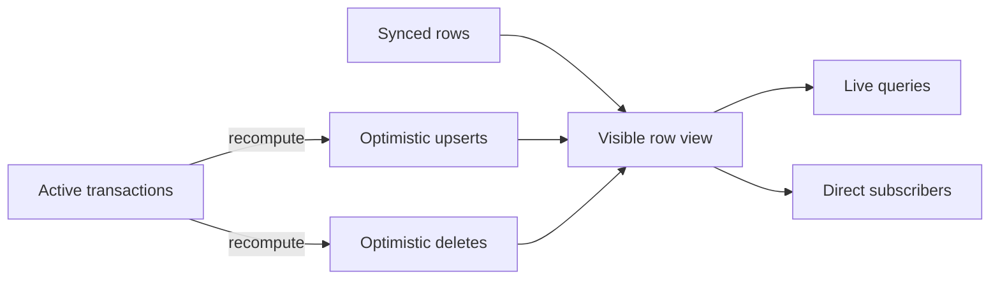
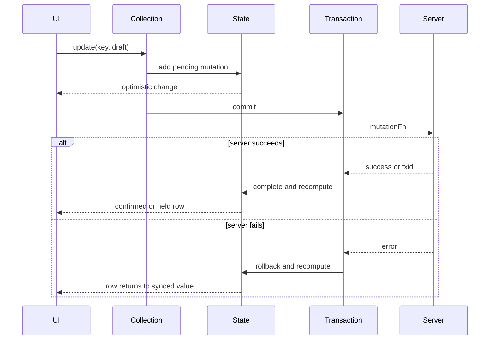

# Mutations

A mutation changes rows. TanStack DB applies the change locally at once. It then runs server work in a transaction. This document explains the optimistic overlay, the transaction states, the merge rules, rollback, and the path from a local call to a server request.

## Three write interfaces

The repository offers three ways to write:

| Interface | Use | Citation |
| --- | --- | --- |
| Collection methods | `insert`, `update`, `delete` on a collection | `packages/db/src/collection/mutations.ts:300-620` |
| Optimistic action | One named action with typed variables | `packages/db/src/optimistic-action.ts:54-81` |
| Manual transaction | Several writes that commit together | `packages/db/src/transactions.ts:25-60` |

All three end in the same transaction machinery.

### Collection methods

`collection.update(key, draft => { ... })` applies a change at once. The mutation manager validates the changed fields with the schema. It builds the full modified row. It stores a pending mutation. See `packages/db/src/collection/mutations.ts:430-480`.

A pending mutation keeps three row views. `original` is the row before the mutation; it is an empty object for an insert. `modified` is the row after all of the changes in that mutation. `changes` holds only the fields that the mutation changed. See `packages/db/src/types.ts:108-114`.

A collection write joins the active transaction. A transaction scope is the object that holds the active transactions for the code that runs inside `Transaction.mutate`. `Transaction.mutate` registers such a scope. A collection write looks up the active transaction for that collection in that scope and adds its mutation there. See `packages/db/src/collection/mutations.ts:87-99` and `packages/db/src/transactions.ts:40-46`. This is why the `mutate` example below calls `todos.insert` without passing `tx`.

Update takes a key, not an object. The key must not change during an update. The manager builds the modified row, then runs `getKey` on the original row and on the modified row. It throws `KeyUpdateNotAllowedError` when the two results differ. See `packages/db/src/collection/mutations.ts:466-479`.

Each mutation gets a global key. The format is `KEY::` followed by a JavaScript Object Notation (JSON) array of the collection identifier, the JavaScript type of the key, and the key string. See `packages/db/src/collection/mutations.ts:183-186`.

The global key lets the transaction manager detect a conflict across collections. Two mutations conflict when their global keys match. A conflict makes the rollback rule apply: if one transaction fails, the other also rolls back. The "Rollback" section below states that rule.

### Optimistic action

`createOptimisticAction` wraps a transaction factory. The caller supplies `onMutate` and `mutationFn`. `onMutate` receives the typed variables and applies the local change. `mutationFn` receives the same variables and the transaction parameters. See `packages/db/src/optimistic-action.ts:54-81`.

```ts
export function createOptimisticAction<TVariables = unknown>(
  options: CreateOptimisticActionsOptions<TVariables>,
) {
  const { mutationFn, onMutate, ...config } = options
  return (variables: TVariables): Transaction => {
    const transaction = createTransaction({
      ...config,
      mutationFn: async (params) => mutationFn(variables, params),
    })
    transaction.mutate(() => {
      const maybePromise = onMutate(variables) as unknown
      if (isPromiseLike(maybePromise)) {
        throw new OnMutateMustBeSynchronousError()
      }
    })
    return transaction
  }
}
```

The citation is `packages/db/src/optimistic-action.ts:54-81`.

`CreateOptimisticActionsOptions<TVariables>` is the option type. It holds `onMutate`, `mutationFn`, and the other transaction options. The `...config` spread copies those other options into `createTransaction`. `isPromiseLike` is a type guard; the cast to `unknown` lets the guard test any return value. The wrapper binds the variables to `onMutate` at once, and it forwards them to `mutationFn` with the transaction parameters. See `packages/db/src/types.ts:202-210` and `packages/db/src/optimistic-action.ts:54-81`.

`onMutate` must be synchronous. The code checks the return value and throws `OnMutateMustBeSynchronousError` if it is a promise. See `packages/db/src/optimistic-action.ts:61-76`.

The rule exists because the optimistic overlay must be in place before the transaction starts its server work. An asynchronous `onMutate` would leave a window where the user interface (UI) shows nothing.

### Manual transaction

`createTransaction` accepts a `mutationFn` and an `autoCommit` flag. The default for `autoCommit` is true. See `packages/db/src/transactions.ts:351-390`.

```ts
const tx = createTransaction({
  autoCommit: false,
  mutationFn: async ({ transaction }) => {
    await api.save(transaction.mutations)
  },
})

tx.mutate(() => {
  todos.insert({ id: '1', title: 'Buy milk' })
})

await tx.commit()
```

The citation is `packages/db/src/transactions.ts:25-60` and `packages/db/src/transactions.ts:430-475`.

In this example, `todos` is a collection that the caller created earlier, and `api` is the caller's server client. The example does not show their definitions.

With `autoCommit: false`, `mutate` does not call `commit`. The caller must call `commit()` to start the server work. With the default `autoCommit: true`, `mutate` calls `commit()` itself and catches any rejection, because the settlement promise reports the error. The settlement promise is the promise for the transaction's final state. See `packages/db/src/transactions.ts:539-546` and `packages/db/src/transactions.ts:683-690`.

## Transaction states

A transaction has four states. See `packages/db/src/types.ts:70`:

| State | Meaning |
| --- | --- |
| `pending` | Mutations are collecting, not yet committed |
| `persisting` | `mutationFn` is running |
| `completed` | The function returned and the transaction settled |
| `failed` | The function threw or the transaction was rolled back |



The first edge creates the transaction. The second edge starts server work. The third edge is an explicit rollback before commit. The fourth edge is success. The fifth edge is failure. The last edges end the transaction.

`mutate(callback)` is synchronous. It runs the callback, captures the mutations that the callback created, and then calls `commit()` when `autoCommit` is true. See `packages/db/src/transactions.ts:476-545`.

The code does not await the callback. The comment states that asynchronous work belongs in `mutationFn`. See `packages/db/src/transactions.ts:430-440`.

A transaction is settled when its state is `completed` or `failed`. `tx.when('settled')` observes that boundary: it takes the string `'settled'` and returns the settlement promise, which resolves on completion and rejects on failure or on a rollback without an error. See `docs/guides/mutations.md:271-275` and `packages/db/src/transactions.ts:683-690`.

## The optimistic overlay

The collection keeps two layers:

1. **Synced data.** Rows that came from the sync adapter.
2. **Optimistic state.** Rows from unsettled transactions.

The synced layer is not changed by a mutation. The visible row is an overlay. The guide states this directly: live queries "see a local view that overlays the optimistic mutations on top of the immutable synced data." See `docs/overview.md:192`.

`recomputeOptimisticState` rebuilds the overlay from the active transactions. See `packages/db/src/collection/state.ts:580-656`.

The excerpt below is shortened. It omits the skip guard, the held-row handling, the event collection, and the event filter.

```ts
public recomputeOptimisticState(triggeredByUserAction = false): void {
  const previousState = new Map(this.optimisticUpserts)
  const previousDeletes = new Set(this.optimisticDeletes)
  this.optimisticUpserts.clear()
  this.optimisticDeletes.clear()
  this.pendingLocalChanges.clear()
  this.overlayHeldAndActive(isPendingSync)
  this.size = this.calculateSize()
  // The full method collects, filters, and emits the changed events.
}
```

The citation is `packages/db/src/collection/state.ts:580-656`.

The excerpt needs seven names and one parameter defined. `optimisticUpserts` maps each optimistic row key to its row. `optimisticDeletes` holds the keys that an optimistic delete removes. `pendingLocalChanges` is the set of keys that a local mutation touched; the collection uses it for the `$origin` virtual property. `$origin` is a virtual row field with the value `local` or `remote`; `local` means that a local mutation produced the row. `isPendingSync` is a local predicate, true when a committed sync transaction touches a key. `overlayHeldAndActive` rebuilds the overlay from held rows and active transactions. `calculateSize` counts the visible rows from the synced rows and the two overlay sets. The parameter `triggeredByUserAction` is a flag. When it is true, the method does not skip a recompute during a sync batch, and it publishes every change instead of filtering out keys that the sync drain already published. See `packages/db/src/collection/state.ts:178-180`, `packages/db/src/virtual-props.ts:95-130`, and `packages/db/src/collection/state.ts:585-600`. The event filter is at `packages/db/src/collection/state.ts:649-653`.

The method clears the overlay, then walks the transactions. A delete adds the key to `optimisticDeletes`. An insert or update adds the row to `optimisticUpserts`. See `packages/db/src/collection/state.ts:703-724`.

The collection then compares the old overlay with the new overlay. It builds the union of the old and new overlay keys, and it emits one change for each key whose visible value or virtual properties changed. This is why a transaction with three writes produces three change messages, not one. See `packages/db/src/collection/state.ts:745-805`.



The first three edges build the visible view. The next two edges show that transactions supply the overlay. The last two edges show that both live queries and direct subscribers read the same view. A direct subscriber is a caller that calls `collection.subscribeChanges`; it receives the change messages without a live query. See `packages/db/src/collection/index.ts:1211-1245`.

## Concurrent transactions

Two transactions can touch the same key. The visible row comes from the newest whole-row snapshot among the unsettled transactions, not from a field-by-field merge of all pending transactions. When no unsettled transaction covers the key, the row comes from synced data. See `docs/guides/mutations.md:278-300`.

```ts
tx1 = collection.update(id, (draft) => { draft.content = 'A' })
tx2 = collection.update(id, (draft) => { draft.content = 'B' })
```

The second draft starts from the visible state, so it sees `A`. If `tx1` settles first, `B` remains visible because `tx2` is newer. If `tx2` settles first, `tx2` leaves the overlay, and only the older `tx1` remains. The visible row then falls back to `A` until `tx1` settles. The guide states this rule and warns against reading server order from it. See `docs/guides/mutations.md:282-300`.

This section and the next answer different questions. This section covers two separate transactions on one key: the newest whole row wins. The next section covers two writes inside one transaction: they collapse into one pending mutation.

## Mutation merging

Two writes to the same row inside one transaction merge into one pending mutation. `mergePendingMutations` defines the result. See `packages/db/src/transactions.ts:197-260`.

| Existing | Incoming | Result |
| --- | --- | --- |
| insert | update | insert, with the new fields |
| update | update | update, with merged fields |
| insert | delete | no mutation |
| update | delete | delete |
| delete | insert | update, if the row exists in synced data; else insert |
| delete | update | error |

The citations are `packages/db/src/transactions.ts:197-260`.

The `delete` then `insert` case is a row that a local delete removed, and the same transaction then re-creates it. If synced data still holds the row, the net effect is an update of that row, because the row already exists. The code compares the synced row with the new row, builds the changed fields, and sets the type to `update`. Two other paths exist. If synced data holds no row, the incoming insert is the result. If the values are equal, the result is no mutation. See `packages/db/src/transactions.ts:226-260`.

The insert-then-delete rule matters. A user who adds a row and removes it before commit creates no server request. The transaction is empty.

The `delete` then `update` row is an error on purpose. The code comment says that the pair "should never occur as the collection layer prevents update operations on deleted items within the same transaction." See `packages/db/src/transactions.ts:190-192`.

## Rollback

A rollback moves the transaction to `failed`, removes its overlay, and rejects its settlement promise. See `packages/db/src/transactions.ts:640-675`.

```ts
rollback(config?: { isSecondaryRollback?: boolean; error?: Error }): Transaction<T> {
  if (this.state === 'completed') throw new TransactionAlreadyCompletedRollbackError()
  if (this.state === 'failed') return this
  this.setState('failed')
  if (!isSecondaryRollback) {
    getTransactionScope(this).rollbackConflictingTransactions(this, mutationIds)
  }
  settlementFor(this).reject(this.error?.error)
  this.touchCollection(wasPersisting)
  return this
}
```

The citation is `packages/db/src/transactions.ts:640-675`.

The excerpt is shortened. In the method, `isSecondaryRollback` comes from `config` and defaults to false. `this.error` holds `config.error` when the caller supplies one. `wasPersisting` records the state before the change to `failed`. Four names also need a definition. `getTransactionScope(this)` is the scope that owns the set of active transactions. `mutationIds` is the set of `globalKey` values of this transaction's mutations. `settlementFor(this)` is the promise that `when('settled')` returns. `touchCollection(wasPersisting)` tells every collection that tracked the transaction to recompute; it also clears the tracking set once the transaction is settled, and the flag says whether the transaction was already persisting. See `packages/db/src/transactions.ts:640-715`.

The conflict rule is unusual. A rollback also rolls back other transactions that touch the same global key. See `packages/db/src/transactions.ts:658-668`. The reason is optimistic visibility: if two transactions write the same row and one fails, the other may have built on the failed value. The source does not state whether a user can opt out of this secondary rollback. The two possible readings are:

1. The secondary rollback is always active.
2. A caller can avoid it by using different keys or by committing transactions in sequence.

The code shows no opt-out flag for the conflicting transactions. The first reading is the stronger one.

## How a mutation reaches the server

The path depends on the interface.

### Collection handlers

A collection configuration can define `onInsert`, `onUpdate`, and `onDelete`. Each handler receives one argument object with a `transaction` field and a `collection` field. See `packages/db/src/types.ts:1021-1080`.

```ts
const todos = createCollection({
  getKey: (todo) => todo.id,
  onInsert: async ({ transaction }) => {
    const todo = transaction.mutations[0].modified
    const response = await api.createTodo(todo)
    await todos.utils.awaitTxId(response.txid)
  },
})
```

`createCollection` takes one `CollectionConfig` object. `getKey` is the required function in that object; it returns the key of a row. See `packages/db/src/collection/index.ts:247-340` and `packages/db/src/types.ts:896-898`. The citation for the handler arguments is `packages/db/src/types.ts:1021-1035` and `packages/electric-db-collection/src/electric.ts:371-400`. The excerpt destructures only `transaction`. The example refers to `todos` inside the initializer of `todos`. That reference is legal because the handler runs after `createCollection` returns, when the binding is set. The source does not discuss this pattern.

The handler is the server write. The source defines the three handlers as optional. It defines no default request. If the caller defines no handler, no request runs, and the row stays in the optimistic overlay until a sync write replaces it. For a local-only collection, the caller must accept the mutation through `utils.acceptMutations()` in a `mutationFn`. See `docs/guides/mutations.md:450` and `docs/guides/mutations.md:948`.

`collection.utils` is the utility record that the adapter adds to the collection. The Electric adapter puts `awaitTxId` in it. That function resolves `true` when the adapter has seen the transaction identifier in the stream, and it rejects after a timeout. The default timeout is 15000 milliseconds (ms). The utility type is at `packages/electric-db-collection/src/electric.ts:883-895`; the implementation and its default are at `packages/electric-db-collection/src/electric.ts:1064-1091`.

The Electric adapter reads a `ShapeStream` from the `@electric-sql/client` package, and the `shapeOptions` field supplies its `ShapeStreamOptions`. A `ShapeStream` is the client object that opens the request and yields the change messages. `ShapeStreamOptions` is the configuration type for that object. See `packages/electric-db-collection/src/electric.ts:1-14` and `packages/electric-db-collection/src/electric.ts:356-357`. The repository does not define the word "shape" in prose. This document uses "shape" for the streamed view of the table that the Electric protocol sends.

### Transaction function

`createTransaction` and `createOptimisticAction` use `mutationFn`. The function receives the transaction. It can read every mutation and send one request or many. See `packages/db/src/transactions.ts:690-780`.

### Confirmation

The transaction becomes `completed` when `mutationFn` returns. That does not prove the server applied the write. The guide states this rule: completion proves backend confirmation "only when the handler explicitly waited for that confirmation." See `docs/guides/mutations.md:8` and `docs/guides/mutations.md:247-260`.

Electric offers `awaitTxId`. The handler awaits the transaction identifier after the server accepts the write. The shape then returns the row with that identifier. See `packages/electric-db-collection/src/electric.ts:1064-1090`.



The first three arrows are the local path. The fourth arrow starts the server work. The fifth arrow is the request. The success branch settles the transaction and recomputes. The failure branch rolls back and recomputes. The final arrow in each branch updates the UI. In this diagram, `State` is the collection state manager: the object that holds the synced rows and the optimistic overlay. A solid arrow is a call, and a dashed arrow is a return or a notification.

## Offline writes

The `offline-transactions` package adds an outbox. `OfflineExecutor` tests whether the browser exposes IndexedDB; the probe reports availability. If IndexedDB is unavailable, the executor tries local storage. See `packages/offline-transactions/src/OfflineExecutor.ts:132-165`.

The executor owns storage, an outbox, a leader election, and a retry policy. See `packages/offline-transactions/src/OfflineExecutor.ts:46-90`.

An outbox is a durable queue of serialized transactions. The manager stores each entry under a `tx:` prefix. It receives a `collections` registry, a map from collection identifier to collection, and the serializer uses that registry to rebuild each mutation on restore. See `packages/offline-transactions/src/outbox/OutboxManager.ts:13-31` and `packages/offline-transactions/src/outbox/TransactionSerializer.ts:112-125`. Leader election is a coordination interface with `requestLeadership`, `releaseLeadership`, `isLeader`, and `onLeadershipChange`. See `packages/offline-transactions/src/types.ts:153-158`. One tab leads outbox processing, so two tabs do not send the same outbox entry; a follower uses the normal online mutation path. See `docs/guides/offline-transactions.md:174-182`. The package ships two implementations. `WebLocksLeader` uses `navigator.locks`. `BroadcastChannelLeader` uses a `BroadcastChannel`, with a heartbeat each 5000 ms and an election timeout of 10000 ms. See `packages/offline-transactions/src/coordination/WebLocksLeader.ts:1-20` and `packages/offline-transactions/src/coordination/BroadcastChannelLeader.ts:6-15`. A retry policy has `calculateDelay` and `shouldRetry`. See `packages/offline-transactions/src/types.ts:148-151`.

This package is separate from the core transaction. It persists a transaction and retries it later. The source does not state that the core transaction retries a failed `mutationFn`. It does not. A failed transaction rolls back.

## Key insight

**Key insight:** the optimistic overlay is the whole trick. The synced rows are never edited. A mutation adds a layer. A rollback removes the layer. A sync confirmation removes the layer and writes the authoritative row.

This design makes rollback trivial. It makes one thing hard: a long-running transaction can hold a stale overlay over newer synced data. The code handles this with `heldOptimisticRows` and `pendingSyncedTransactions`. See `packages/db/src/collection/state.ts:596-628`.

A held row is the optimistic row of a completed transaction that stays in the overlay while a committed sync transaction for the same key has not applied. `heldOptimisticRows` maps each key to its owner transaction and its row; a missing row means a delete. `pendingSyncedTransactions` is the queue of sync transactions that the core accepted but has not applied. A sync transaction is the collection's queued batch of writes from the sync adapter; it is a `PendingSyncedTransaction`, not the core `Transaction` class. See `packages/db/src/collection/state.ts:153-155`, `packages/db/src/collection/state.ts:186-195`, and `packages/db/src/collection/state.ts:54-80`.

The hold ends in one of two ways. `overlayHeldAndActive` drops a hold when no committed sync transaction touches the key, and the sync write drops it when that write applies. See `packages/db/src/collection/state.ts:679-688` and `packages/db/src/collection/state.ts:1320-1325`. The source does not state how long a hold can last. The two possible readings are:

1. A hold lasts until the matching sync transaction applies.
2. A hold can expire by timeout.

The code shows no timeout. The first reading is the stronger one.

## Source map

| Area | File |
| --- | --- |
| Transaction states | `packages/db/src/types.ts:70` |
| Transaction class | `packages/db/src/transactions.ts:25-60` |
| Mutate | `packages/db/src/transactions.ts:476-545` |
| Commit | `packages/db/src/transactions.ts:746-800` |
| Rollback | `packages/db/src/transactions.ts:640-675` |
| Merge rules | `packages/db/src/transactions.ts:197-260` |
| Optimistic recompute | `packages/db/src/collection/state.ts:580-656` |
| Active overlay | `packages/db/src/collection/state.ts:703-724` |
| Mutation manager | `packages/db/src/collection/mutations.ts:183-480` |
| Optimistic action | `packages/db/src/optimistic-action.ts:54-81` |
| Mutation guide | `docs/guides/mutations.md:247-300` |
| Offline executor | `packages/offline-transactions/src/OfflineExecutor.ts:46-160` |

## Related documents

- [02-collections.md](02-collections.md): the collection that owns the overlay.
- [03-live-queries.md](03-live-queries.md): how a delta reaches a query.
- [05-sync-engines.md](05-sync-engines.md): how a confirmation returns.
- [07-persistence.md](07-persistence.md): how a write survives a reload.
