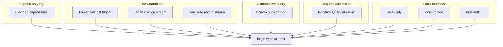
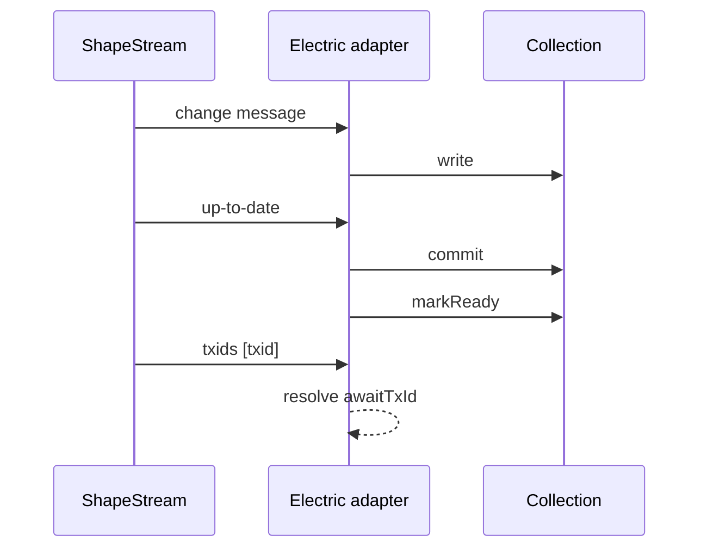

# Sync Engines

This document describes every sync engine that ships in the repository. The repository is TanStack DB, at `/Users/darkvoid/GitSources/src.Electric/src.tanstack-db/db`. All relative paths below start at that directory. For each engine the document states how the engine receives a change and how the engine reaches the `begin`, `write`, `commit` contract. The set of engines comes from the packages that export a sync adapter. The repository has no registry that declares the set complete.

The contract has nine calls. Four of them carry every sync: `begin` starts a sync transaction, `write` adds one change, `commit` publishes the transaction, and `markReady` declares the first load complete. See `packages/db/src/types.ts:446-478`. Document [02-collections.md](02-collections.md) gives the full interface.

## The engine families

The engines fall into five families:

| Family | Engines | How a change arrives |
| --- | --- | --- |
| Append-only log stream | Electric | The client reads a shape stream, an ordered change log for a filtered view of a table |
| Local database with change triggers | PowerSync, RxDB, TrailBase | The adapter reads local changes or a local subscription |
| Authoritative query subscription | Convex | The server pushes a new query result |
| Request and cache | TanStack Query | A refetch replaces a cached result |
| Local loopback | Local-only, local storage, IndexedDB | A local write returns to the collection |



Each edge means the same thing: the engine produces rows or deltas and passes them to the collection contract. The contract does not change between engines. The source of truth does.

The diagram names four external products: PowerSync, RxDB, TrailBase, and Convex. The repository does not describe them in prose. This study describes each product by the way its adapter reads it. PowerSync reads a local SQLite database. RxDB reads an observable on a local RxDB collection. TrailBase reads a server-sent record subscription. Convex reads a server query subscription. The adapter code in each section below supports each description.

## A naming note: Electric and ElectricSQL

The repository uses two names for one product. The package is `@tanstack/electric-db-collection`. Its description says "ElectricSQL collection for TanStack DB." See `packages/electric-db-collection/package.json:2-4`.

The source does not define a separate "Electric" engine and "ElectricSQL" engine. They are the same adapter. This study uses "Electric" for the package and states "ElectricSQL" only when it quotes the package description.

## Electric

### How it receives changes

Electric uses a `ShapeStream`. The repository does not define the word "shape" in prose. This document uses "shape" for the filtered view of a table that the Electric protocol streams, and "shape stream" for the ordered log of changes that a client reads for that view. The adapter creates a `ShapeStream` with the shape options, a resume offset, a handle, an abort signal, a fetch client, and an error handler. See `packages/electric-db-collection/src/electric.ts:2025-2083`.

`shapeOptions` is the caller-supplied Electric configuration of type `ShapeStreamOptions`. `fetchClient` is the option that supplies the network client for the stream. Both types come from `@electric-sql/client`. See `packages/electric-db-collection/src/electric.ts:1-14` and `packages/electric-db-collection/src/electric.ts:356-357`.

```ts
const stream = new ShapeStream({
  ...shapeOptions,
  log: usesChangesOnlyLog ? 'changes_only' : undefined,
  offset: requestedPosition.offset ?? ...,
  handle: requestedPosition.handle ?? ...,
  signal: abortController.signal,
  fetchClient: ...,
  onError: ...,
})
```

The citation is `packages/electric-db-collection/src/electric.ts:2025-2083`. Two names in the excerpt need a definition. `requestedPosition` is the saved resume position, which holds an offset and a handle. `usesChangesOnlyLog` is a boolean that the adapter computes for the uncertified on-demand cache case. See `packages/electric-db-collection/src/electric.ts:1859-1862`.

A subset is the set of rows for one query demand: the filter, order, and limit that a live query asks for. Three options need a definition. `offset` is the position in the log at which the read starts. A handle is an opaque Electric token that the client stores beside the offset and sends back on resume; the TanStack DB source does not define its contents. `changes_only` is an Electric log mode that serves changes without a full snapshot; the adapter selects it for uncertified on-demand cache rows. The comment does not define "uncertified" or "quarantined". This document reads "uncertified" as a cache row that no fresh snapshot has confirmed, and "quarantined" as marked so that normal reads do not serve the row. The comment says that such rows are loaded only through fresh subset snapshots. See `packages/electric-db-collection/src/electric.ts:1859-1862` and `packages/electric-db-collection/src/electric.ts:2027-2040`.

The stream sends change messages. An Electric change message names its operation in `message.headers.operation`, with the value `insert`, `update`, or `delete`, and it carries the row in `message.value`. The adapter reads `operation` and writes a core change message whose `type` holds the same word, because the core calls this field `type`. See `packages/electric-db-collection/src/electric.ts:2342-2357`; the write is at `:2350-2352`.

The stream also sends control messages. Two terms appear in the table. A match predicate is one filter condition that the shape applies. A snapshot identifier is the triple `xmin`, `xmax`, and `xip_list` that describes the database transaction snapshot of a full sync. See `packages/electric-db-collection/src/electric.ts:576-582`. The adapter handles these control values:

| Control | Action |
| --- | --- |
| `up-to-date` | The snapshot is complete; commit and mark the collection ready |
| `must-refetch` | Discard the current snapshot and start again |
| `snapshot-end` | Record the database snapshot identifiers |
| `subset-end` | A requested subset is complete |
| `move-out` | A row leaves the active match predicates; delete it |
| `move-in` | A row enters the active match predicates; re-activate it with no write |

The citation for the control predicates is `packages/electric-db-collection/src/electric.ts:551-577`. The citation for the match handling is `packages/electric-db-collection/src/electric.ts:1586-1640`.

An Electric on-demand shape labels each row with a tag for each match predicate that the row satisfies. A **move-out** message removes the tags that a changed predicate no longer matches and deletes a row whose tag set becomes empty. A **move-in** message re-activates the stored rows that match the returned patterns. The code comment states that move-in is silent: it emits no messages to the collection. See `packages/electric-db-collection/src/electric.ts:1586-1640` and `packages/electric-db-collection/src/electric.ts:1629-1631`.

During the initial sync the adapter buffers both message types and replays them in arrival order. Outside that phase it processes each one at once. See `packages/electric-db-collection/src/electric.ts:2571-2596` and `packages/electric-db-collection/src/electric.ts:2686-2700`.

### Sync modes

Electric defines three modes. See `packages/electric-db-collection/src/electric.ts:326-339`:

1. **Eager.** Sync all data. Ready after the full sync.
2. **On-demand.** Sync subsets that queries request. Ready after the first snapshot.
3. **Progressive.** Sync the full data in the background, but serve query subsets at once. Ready after the full sync.

The third mode is specific to Electric. The core `SyncMode` type has only `eager` and `on-demand`. See `packages/db/src/types.ts:815`.

### Mutations

An Electric mutation handler usually sends a Hypertext Transfer Protocol (HTTP) request and then waits for the transaction identifier. `awaitTxId` resolves when the shape stream delivers a message with that identifier. `collection.utils` is the utility record that the adapter adds to the collection, and `awaitTxId` is one entry in that record. See `packages/electric-db-collection/src/electric.ts:883-895` and `packages/electric-db-collection/src/electric.ts:1064-1090`.

```ts
onInsert: async ({ transaction }) => {
  const todo = transaction.mutations[0].modified
  const result = await api.createTodo(todo)
  await todos.utils.awaitTxId(result.txid)
}
```

The citation is `packages/electric-db-collection/src/electric.ts:371-400`. In this example, `todos` is the collection that the caller created, and `api` is the caller's server client. A transaction identifier (`txid`) is a value that Electric places in the message headers for a transaction. The adapter collects these values, and `awaitTxId` accepts one. See `packages/electric-db-collection/src/electric.ts:624-630` and `packages/electric-db-collection/src/electric.ts:2488-2500`.

The wait turns "server accepted" into "client observed." That is the confirmation rule from document [04-mutations.md](04-mutations.md).



The first two arrows move one change. The next three arrows complete the first snapshot. The last two arrows resolve a mutation wait. A `txids` message is an Electric control message whose headers list transaction identifiers. The dashed arrow is a local action: the adapter resolves the `awaitTxId` wait without another network call.

### Resume

The adapter stores the offset and handle of the stream. A restart uses them to resume. In on-demand mode with no saved offset, the adapter starts at `now`. The value `now` is the Electric offset for the current end of the log, so the client sees only changes from collection creation onward. See `packages/electric-db-collection/src/electric.ts:2030-2042`.

## PowerSync

### How it receives changes

PowerSync stores data in a local SQLite database. The adapter creates a diff trigger. A diff trigger is a SQLite trigger that records each changed row. The trigger writes changed rows to a destination table. That destination table is the tracked table that the adapter reads. The adapter reads the table in batches and converts each batch to change messages. See `packages/powersync-db-collection/src/powersync.ts:424-460`.

The trigger setup names the source view, the destination table, the columns, and the operations. A source view is the database view that holds the rows for the collection. See `packages/powersync-db-collection/src/powersync.ts:440-447`.

### Sync shape

A full load is one snapshot transaction. The adapter computes a local `snapshot` flag: it is true when the collection already holds accepted synced rows. The code calls `begin({ snapshot })` and reads every row in batches. A true flag marks the transaction as a complete replacement, so a row that the table no longer has is removed. A subset load commits each batch. See `packages/powersync-db-collection/src/powersync.ts:439-460` and `packages/powersync-db-collection/src/powersync.ts:628-632`.

The adapter also calls `database.onChangeWithCallback`. `database` is the PowerSync database handle that the caller supplies in the options. See `packages/powersync-db-collection/src/powersync.ts:583`. The callback receives a change and forwards it.

### Readiness and mode

The adapter supports eager and on-demand. It branches on `syncMode` at the start of the sync function: `eager` calls `runEagerSync`, and every other value calls `runOnDemandSync`. `runEagerSync` reads the whole source view. `runOnDemandSync` reads only the rows that a requested subset needs. See `packages/powersync-db-collection/src/powersync.ts:352-356`, `packages/powersync-db-collection/src/powersync.ts:614-630`, and `packages/powersync-db-collection/src/powersync.ts:718-732`.

The local database is the source of truth for the collection. The adapter reads rows from that local database, and it does not call a remote application programming interface (API) to answer a read. The source does not state how the PowerSync client fills that database; that work belongs to PowerSync.

## TrailBase

### How it receives changes

TrailBase exposes a record API with a server-sent events (SSE) stream. The adapter calls `config.recordApi.subscribe('*')` and reads the returned stream. The repository does not define the record API in prose; the `'*'` argument is the subscription pattern. See `packages/trailbase-db-collection/src/trailbase.ts:433-440`.

The adapter starts the listener before the initial fetch. The comment explains the reason: a gap between the fetch and the listener could lose a change. See `packages/trailbase-db-collection/src/trailbase.ts:444-446`.

### Initial load

The adapter waits for the listener to settle, then loads rows. In eager mode it loads every row with `load({}, true)`: the first argument is the empty filter, order, and limit set, and the second argument marks an eager load that must list every row. See `packages/trailbase-db-collection/src/trailbase.ts:244-246` and `packages/trailbase-db-collection/src/trailbase.ts:468-476`.

The adapter calls `markReady()` after the load. A failure before ready calls `fail(error)`. `fail` is one of the nine contract calls; it reports a terminal error and ends the load. See `packages/trailbase-db-collection/src/trailbase.ts:477-480` and `packages/db/src/types.ts:492-505`.

### Ordering

The adapter keeps two counters. The global event sequence increases by one for each event. The per-key sequence records, for each key, the global value at that key's last event. See `packages/trailbase-db-collection/src/trailbase.ts:205-212` and `packages/trailbase-db-collection/src/trailbase.ts:405-412`. A load in flight records the global value at its start and compares each page row against the per-key value. This prevents an older load from overwriting a newer event. For example, an event with sequence 7 for a key wins over a load that started when the global value was 5. See `packages/trailbase-db-collection/src/trailbase.ts:278-316`.

## RxDB

### How it receives changes

RxDB stores a last-write time (`_meta.lwt`) on each document. The adapter sorts by that field. It reads documents in pages of `syncBatchSize`, which defaults to 1000. See `packages/rxdb-db-collection/src/rxdb.ts:128-203`.

The first page starts with no cursor. Later pages use a compound cursor: the last write time and the primary key. See `packages/rxdb-db-collection/src/rxdb.ts:149-174`.

The adapter opens `rxCollection.$` and subscribes to changes. `rxCollection` is the RxDB collection object that the caller supplies in the options. `$` is the RxDB observable on a collection; it emits each change event as an object with `operation` and `documentData` fields. See `packages/rxdb-db-collection/src/rxdb.ts:60` and `packages/rxdb-db-collection/src/rxdb.ts:231-247`.

### Buffering

The adapter subscribes before the initial load completes. It buffers live changes while `buffering` is true, a flag that holds events until the initial snapshot is committed. After the initial commit, it flushes each buffered change as its own transaction. See `packages/rxdb-db-collection/src/rxdb.ts:205-216`.

The adapter maps an `INSERT` or `UPDATE` event to an `update` message. It maps `DELETE` to a `delete` message. See `packages/rxdb-db-collection/src/rxdb.ts:236-247`.

The comment explains why an insert becomes an update: the initial read can already hold the document, and the core treats an update for a missing key as an insert. See `packages/rxdb-db-collection/src/rxdb.ts:237-242`.

### Update mode

RxDB sets `rowUpdateMode: 'full'`. See `packages/rxdb-db-collection/src/rxdb.ts:298-300`. The core has two values for this option: `partial` means an update message carries only the changed fields, and `full` means it carries the whole row. See `packages/db/src/types.ts:544-551`. With `full`, the whole document arrives on each event. A change message also has an optional `previousValue` field, which holds the row before the change. The adapter does not need to send it, because the full row replaces the stored row. See `packages/db/src/types.ts:660-669`.

## Convex

### How it receives changes

Convex sends a full query result on each update. The adapter subscribes to a query. See `packages/convex-db-collection/src/subscription.ts:28-120`.

The adapter keeps the previous result. It builds a `Map` from key to row for the new result, using `config.getKey` on each row. It compares the two maps. See `packages/convex-db-collection/src/options.ts:106-118` and `packages/convex-db-collection/src/options.ts:91-150`.

```ts
begin()
if (!initialized) truncate()
for (const [key, row] of next) {
  if (!previous.has(key) || !initialized) write({ type: 'insert', value: row })
  else if (previous.get(key) !== row) write({ type: 'update', value: row })
}
for (const key of previous.keys()) {
  if (!next.has(key)) write({ type: 'delete', key })
}
commit()
```

The citation is `packages/convex-db-collection/src/options.ts:136-155`. The excerpt uses the contract verbs from document [02-collections.md](02-collections.md), plus `truncate`. `initialized` is a flag that is false before the first result. On the first result, the adapter calls `truncate` and writes every row as an insert. `truncate` discards all current synced rows before the new result is written. The comparison `previous.get(key) !== row` tests object identity, not deep equality. So the adapter reports an update whenever the row object is a different object. The source does not state whether Convex reuses the object of an unchanged row.

### Why the adapter diffs

Convex does not send a row delta. It sends the current result. The adapter must compute the delta. That makes the adapter the source of the insert, update, and delete decisions.

The adapter also checks whether the result is unchanged by reference. This check is a fast path before the diff. If the result has the same size and every key maps to the identical object, the adapter returns without a transaction. Otherwise it runs the key-by-key diff above. See `packages/convex-db-collection/src/options.ts:126-135`.

### Readiness

The adapter calls `markReady` when the first valid result becomes visible. A commit receipt is the value that `commit` returns; it can be `true` or a promise. A promise delays the `markReady` call until the promise resolves. See `packages/convex-db-collection/src/options.ts:160-178`.

## TanStack Query

### How it receives changes

TanStack Query is a request and cache library, not a sync engine. The adapter turns each query demand into a `QueryObserver`, the TanStack Query object that watches one query in the cache. See `packages/query-db-collection/src/query.ts:2299-2305`.

The adapter calls `queryClient` for the rows. `queryClient` is the TanStack Query client that the caller supplies. The adapter observes the cache. When the cache changes, it writes the changed rows into the collection.

### Subsets

The adapter maps a `LoadSubsetOptions` to a query key. Document [02-collections.md](02-collections.md) lists the fields of that record. The `queryFn` receives the filter, order, and limit. See `docs/overview.md:136-150`.

The adapter refetches a page when it must. The source comments describe a hazard: a page is an ordered window of rows. A key change can move a row from one page to another, so the two results together hold neither the old position nor the new one. The adapter reports this shift with `invalidateLoadedSubsets`, the contract call that tells the core that served pages may have moved. The core then re-establishes each ordered live query window with a bounded repair from the start of its order. See `packages/query-db-collection/src/query.ts:1260-1280` and `packages/db/src/types.ts:511-520`.

### Direct writes

A local mutation goes through a direct write path. The adapter must prevent an older fetch from overwriting a newer local write. It keeps a direct write generation, a counter that increases on each direct write, and it records the generation at which a fetch starts. When a fetch that started before the newest direct write is still running, the adapter cancels the query with `query.cancel({ silent: true })`. For a result that already arrived, the adapter compares row positions and ignores a row that an accepted direct write is newer than. See `packages/query-db-collection/src/query.ts:992-1023`.

This is the most complex adapter in the repository. This study judges it the most complex; the source does not rank the adapters. The complexity comes from the absence of a change stream. The adapter must reconcile a cache, a fetch, and a local write by order.

## Local engines

### Local-only

A local-only collection has no source. The adapter stores the `begin`, `write`, and `commit` functions that the core passes to its `sync` function, so a local write can call them later. See `packages/db/src/local-only.ts:308-325`.

A local write can bypass the optimistic overlay. The optimistic overlay is the layer of unsettled local writes over synced data; document [04-mutations.md](04-mutations.md) explains it. `localOnlyDirectWrite` writes the row as synced data and completes the transaction at once. See `packages/db/src/local-only.ts:320-325` and `packages/db/src/collection/mutations.ts:194-210`.

### Local storage

A local storage collection loads the stored JavaScript Object Notation (JSON) snapshot. It calls `begin({ snapshot: true })`, writes each row, commits, and calls `markReady()`. See `packages/db/src/local-storage.ts:1225-1242`.

It then listens for `storage` events from other tabs. A `storage` event is a browser event that fires in the other tabs when a stored value changes. A same-tab write does not produce a `storage` event, so the adapter also publishes to a same-tab listener map. See `packages/db/src/local-storage.ts:46-50` and `packages/db/src/local-storage.ts:1215-1235`.

### IndexedDB

An IndexedDB collection stores rows in an object store, an IndexedDB table. It writes a version token for each key in a reserved `_versions` store; a version token is a value that changes on every write to that key. See `packages/db/src/indexed-db.ts:167-203`.

It uses a `BroadcastChannel` named `tanstack-db:<database>`. A `BroadcastChannel` is a browser channel that sends messages between tabs. `<database>` is the name of the shared IndexedDB database instance. See `packages/db/src/indexed-db.ts:545-555`. A message lists the changed keys. A receiving tab loads those keys and applies them. See `packages/db/src/indexed-db.ts:536-550`.

## Comparison

| Engine | Change source | Delta or full result | Ready point | Subset support |
| --- | --- | --- | --- | --- |
| Electric | Shape stream | Delta | Depends on mode: eager after the full sync, on-demand after the first snapshot, progressive after the full sync | Yes; on-demand and progressive load subsets |
| PowerSync | Local SQLite diff trigger | Delta batch | End of snapshot | Yes |
| TrailBase | Record event stream | Delta | End of initial load | Yes |
| RxDB | RxDB change stream | Delta | End of initial pages | No; the source has no `loadSubset` |
| Convex | Subscription result | Full result | First valid result | Only if the subscription object provides `loadSubset` |
| TanStack Query | Cache observer | Full query result | First successful query | Yes |
| Local-only | Loopback | Delta | Immediately | No |
| Local storage | Stored snapshot plus events | Delta | End of load | No |
| IndexedDB | Object store plus channel | Delta | End of load | No |

The citations are the sections above. The "Delta or full result" and "Ready point" columns are this document's summary of those sections, not a contract that the repository states in one place. The "Subset support" column reports whether the adapter provides `loadSubset`. A `loadSubset` handler is the contract entry that answers one subset request: the rows for a filter, order, and limit. The Convex adapter forwards subset requests only when the subscription object has such a function. See `packages/convex-db-collection/src/options.ts:247-256`.

## Key insight

**Key insight:** the adapter, not the core, decides what a "change" is. Electric receives a delta. Convex receives a whole result and computes a delta. TanStack Query receives a cached result and must decide which rows changed. The core only sees `ChangeMessage` objects, the record with a key, a value, an optional previous value, a type, and optional metadata. The `previousValue` field is optional. An adapter can send it with a change to give the old row. The source does not state a case that requires it. See `packages/db/src/types.ts:660-669`.

This is a strength and a risk. The strength is a small core. The risk is that each adapter must solve deletion detection, ordering, and resume on its own. Document [09-critical-assessment.md](09-critical-assessment.md) lists the uneven parts.

## Source map

| Engine | File |
| --- | --- |
| Electric | `packages/electric-db-collection/src/electric.ts` |
| PowerSync | `packages/powersync-db-collection/src/powersync.ts` |
| TrailBase | `packages/trailbase-db-collection/src/trailbase.ts` |
| RxDB | `packages/rxdb-db-collection/src/rxdb.ts` |
| Convex | `packages/convex-db-collection/src/options.ts` |
| TanStack Query | `packages/query-db-collection/src/query.ts` |
| Local-only | `packages/db/src/local-only.ts` |
| Local storage | `packages/db/src/local-storage.ts` |
| IndexedDB | `packages/db/src/indexed-db.ts` |

## Related documents

- [02-collections.md](02-collections.md): the contract every engine implements.
- [03-live-queries.md](03-live-queries.md): the consumer of the changes.
- [04-mutations.md](04-mutations.md): how a write returns through an engine.
- [08-durable-streams-and-electric.md](08-durable-streams-and-electric.md): the Electric comparison in depth.
