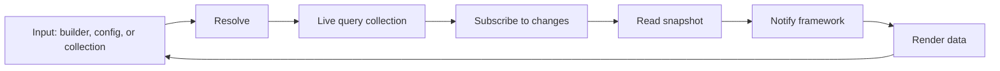
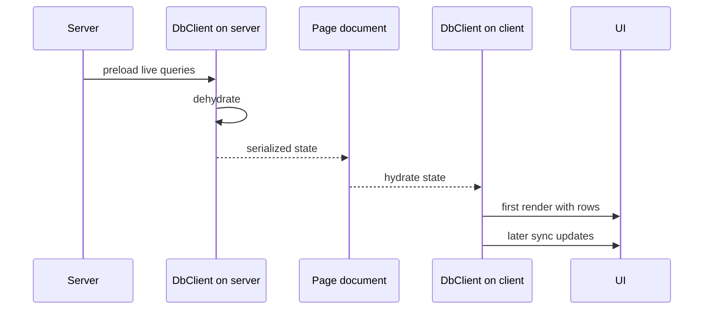

# Framework Adapters

A framework adapter turns a collection into a reactive value for one user interface (UI) framework. The repository ships adapters for React, Preact, Vue, Solid, Svelte, and Angular, plus a TanStack Router server-side rendering (SSR) package. This document explains the common model and the differences.

## The common model

Every adapter follows the same four steps. This list is this study's summary of the adapter files in the source map; the repository does not state the model in one place.

1. Resolve the input into a live query collection. A live query collection is a collection that `createLiveQueryCollection` builds from a query description; document [02-collections.md](02-collections.md) defines that construct and document [03-live-queries.md](03-live-queries.md) explains the query.
2. Subscribe to that collection.
3. Read a snapshot.
4. Notify the framework when the snapshot changes.

A reactive value is a value that the framework re-reads when the underlying collection changes. The input can be a query builder function, an options record that describes a query, or an existing collection. An options record is a plain object with the query fields. See `packages/react-db/src/useLiveQuery.ts:517-570`. A query key is the serialized identity of a declarative query, and a declarative query states what to read instead of subscribing by hand. The adapter turns an options record into a built query object before it creates the collection.

Every adapter also exposes the same status shape. It reports a `status` value and the derived flags from `LiveQueryStatusFlags`: `isLoading`, `isReady`, `isIdle`, `isLoadingError`, `isCrashed`, `isCleanedUp`, `isSyncError`, and `health`, the health tree for the query and its sources. `status` is the collection status string, and `CollectionStatus` is its union type: `idle`, `loading`, `ready`, `error`, `crashed`, or `cleaned-up`. A health tree is a record that reports the health of the query and of each source collection that the query reads, including any failure reason. See `packages/db/src/live-query-primitives.ts:55-80` and `packages/db/src/types.ts:797-813`.



The first edge accepts three input forms. The second edge produces one collection. The third edge attaches a change listener. The fourth edge reads the current snapshot. The fifth edge marks the framework value dirty. The sixth edge renders. The last edge is not an automatic loop: it shows that a new user input can start a new render, and that the new input can have a new query identity. A query identity is the value set that decides whether the adapter keeps or rebuilds the collection: a query key, an identity dependency list, or an existing collection. Without a new input, the cycle stops after the render.

The adapters share a helper layer from `@tanstack/db`. The helper functions resolve a query, compute a stable query hash, create an observer, and manage the collection lifetime. The Preact adapter imports these names, and the other adapters import the same names. A stable query hash is a string identity derived from the query structure, so the same query maps to the same hash across renders. An observer is an object that watches a live query collection and produces snapshots. An observer has two modes: `wholesale` delivers a whole new snapshot, and `granular` also delivers row deltas. This document calls the second mode granular mode. See `packages/preact-db/src/useLiveQuery.ts:2-11` and `packages/db/src/live-query-observer.ts:740-758`. The framework package supplies only the binding to its own reactivity system.

## React

### The hook

`useLiveQuery` is the main React hook. See `packages/react-db/src/useLiveQuery.ts:517-519`.

It calls `useLiveQueryImpl`. `useLiveQueryImpl` is the shared implementation function that the hook calls. See `packages/react-db/src/useLiveQuery.ts:543-560`.

The implementation does four things:

1. Resolve the input and compute a query key or an identity dependency list.
2. Create or reuse the live query collection.
3. Create a `LiveQueryObserver`.
4. Subscribe with `useSyncExternalStore`.

An identity dependency list is the list of values that the adapter captured from the query input; a change in the list rebuilds the collection. `LiveQueryObserver` is the observer class; the hook creates one instance for the collection. See `packages/react-db/src/useLiveQuery.ts:570-800`.

`useSyncExternalStore` is the React hook that subscribes a component to an external store and reads a snapshot from it.

```ts
const returned = useSyncExternalStore(
  subscribe,
  () => {
    const snapshot = observer.getSnapshot()
    return suspense ? suspense.read(snapshot) : snapshot
  },
  () => {
    const snapshot = observer.getServerSnapshot(forSuspense)
    return suspense ? suspense.read(snapshot) : snapshot
  },
)
```

The citation is `packages/react-db/src/useLiveQuery.ts:788-798`. `suspense` is the optional `SuspenseBinding` argument. `suspense.read(snapshot)` returns the binding's seed snapshot when it has one; otherwise it returns the given snapshot. When the snapshot is not ready, the hook throws the binding promise, and React suspends the component until that promise settles. `forSuspense` is a boolean that tells the server snapshot whether a binding exists. See `packages/react-db/src/useLiveSuspenseQuery.ts:77-183`.

### The observer mode

React uses `mode: 'wholesale'`. The other mode is `granular`. See `packages/react-db/src/useLiveQuery.ts:739-745` and `packages/db/src/live-query-observer.ts:758`.

Wholesale means the observer does not deliver row deltas to React. React re-reads `getSnapshot()` on each notification. The observer keeps a stable snapshot object. The comment explains the reason: `useSyncExternalStore` must not be notified synchronously inside its own subscribe call. A synchronous notification could make React read a snapshot before the subscription finished and render an inconsistent value. See `packages/react-db/src/useLiveQuery.ts:733-738`. Granular mode is the observer's default. React, Preact, and Angular override it with wholesale (`packages/angular-db/src/index.ts:251-255`). Vue, Solid, and Svelte use the default, and it delivers row deltas. See `packages/db/src/live-query-observer.ts:740-758`, `packages/preact-db/src/useLiveQuery.ts:269`, and `packages/angular-db/src/index.ts:251-255`.

### Identity

React rebuilds the collection when the identity dependencies change. The adapter builds the list in three cases. When the input has a query key, the key is the identity. When the input is an existing collection, the identity list is empty. Otherwise the adapter prepares the options record: it runs the query callback in a tracking scope and records each value that the callback reads. The recorded values form the identity list. "Captured" means that the callback records each value it read during that run. See `packages/react-db/src/useLiveQuery.ts:588-618`.

The comparison is `deepEquals` on that list. See `packages/react-db/src/useLiveQuery.ts:611-617`.

This rule prevents an inline query function from creating a new collection on every render. An inline function with no changed values produces the same identity, so the collection survives the render.

### Other React hooks

| Hook | Purpose | Citation |
| --- | --- | --- |
| `useLiveSuspenseQuery` | Suspend until the first result is ready | `packages/react-db/src/useLiveSuspenseQuery.ts:365-380` |
| `useLiveInfiniteQuery` | Page through a live result | `packages/react-db/src/useLiveInfiniteQuery.ts:117-140` |
| `usePacedMutations` | Debounce, throttle, or queue mutations | `packages/react-db/src/usePacedMutations.ts:95-140` |
| `useLiveQueryEffect` | Run callbacks when a row enters, updates, leaves, or arrives in a batch | `packages/react-db/src/useLiveQueryEffect.ts:34-66` |

`useLiveSuspenseQuery` uses the same implementation with a `SuspenseBinding`. See `packages/react-db/src/useLiveSuspenseQuery.ts:365-390`. A suspense binding is an object that holds the collection for one suspense query and the promise for its first load. A deferred collection start is a collection creation that waits until the component reads the data. When the snapshot is not ready, the hook throws the binding promise, and React suspends the component until that promise settles. A disabled query throws an error instead, because a suspense query must always have data.

`usePacedMutations` wraps `createPacedMutations`. `createPacedMutations` is the core function that binds `onMutate` and `mutationFn` to a pacing strategy. A strategy decides when the mutation runs. The strategies are `debounceStrategy`, `throttleStrategy`, and `queueStrategy`. A debounce strategy waits for a quiet period after the last call. A throttle strategy limits how often a call may run. A queue strategy keeps each call in order. See `packages/db/src/strategies/index.ts:1-4` and `packages/react-db/src/usePacedMutations.ts:1-40`.

```ts
const mutate = usePacedMutations<string>({
  onMutate: (value) => {
    formCollection.update(formId, (draft) => { draft.content = value })
  },
  mutationFn: async ({ transaction }) => {
    await api.save(transaction.mutations)
  },
  strategy: debounceStrategy({ wait: 500 }),
})
```

The citation is `packages/react-db/src/usePacedMutations.ts:20-40`. In this example, `formCollection` is a collection that the caller created earlier, `formId` is a key in that collection, and `api` is the caller's server client. The example does not show their definitions.

### Provider

`DbProvider` supplies a `DbClient` through React context. `DbClient` is the object that owns collections, live queries, server preloads, and the dehydration state for one application; the "Server-side rendering" section below defines it in full. See `packages/react-db/src/DbProvider.tsx:1-30`.

`useDbClient` throws when the component is outside the provider. `useOptionalDbClient` returns `undefined`. See `packages/react-db/src/DbProvider.tsx:20-30`.

The provider is optional for a simple application that only calls `useLiveQuery`. It is required when a component calls `useDbClient`, and `HydrationBoundary` calls that hook, so SSR hydration through that component requires the provider. A `DbClient` that the application shares between components also requires the provider. See `packages/react-db/src/HydrationBoundary.tsx:13-25`.

## Preact

Preact uses the same model as React. The package exposes `useLiveQuery` with the same input forms as React. See `packages/preact-db/src/useLiveQuery.ts:227-230`.

Preact does not use `useSyncExternalStore`. The hook reads `observer.getSnapshot()` during render, keeps a revision counter from `useState`, and subscribes in `useLayoutEffect`. The hook uses `useRef` to keep the observer and the subscription across renders. The subscription callback increments the revision, which re-renders the component. After subscribing, the hook compares the current snapshot with the snapshot from the render and re-renders if they differ, to cover a publish between the render and the subscription. See `packages/preact-db/src/useLiveQuery.ts:275-297`.

The primitives come from `preact/hooks`: `useLayoutEffect`, `useRef`, and `useState`. See `packages/preact-db/src/useLiveQuery.ts:1`.

## Vue

Vue uses `computed` and `watchEffect`. `computed` is a Vue value that recalculates when its dependencies change. `watchEffect` is a Vue function that runs an effect and tracks the values that the effect reads. See `packages/vue-db/src/useLiveQuery.ts:318-341` and `packages/vue-db/src/useLiveQuery.ts:374-380`.

The input is resolved inside a `computed`. That `computed` does not throw; it returns either the collection or the error. The exported collection value is a second `computed`, and the excerpt below is that second one. It reads the first value and throws the stored error. The adapter uses two steps because of a Vue rule: a `computed` that throws can keep its previous value on a later read. The resolver avoids that rule by returning the error as data. The second `computed` then throws the error at each read, so a component never renders a stale value after a failure. See `packages/vue-db/src/useLiveQuery.ts:320-341`.

A `watchEffect` subscribes to the collection. It uses `onInvalidate` to dispose the previous subscription when the input changes. `onInvalidate` is the Vue callback that runs when the effect stops or re-runs. See `packages/vue-db/src/useLiveQuery.ts:374-380`.

```ts
const collection = computed(() => {
  const { collection: current, error } = resolved.value
  if (error !== undefined) throw error
  return current
})
```

The citation is `packages/vue-db/src/useLiveQuery.ts:335-340`.

The return object contains reactive references for data, size, status, and flags. A reactive reference is a Vue object with a `value` field that Vue tracks on each read. See `packages/vue-db/src/useLiveQuery.ts:429-441`.

## Solid

Solid uses fine-grained reactivity. `createMemo` is a Solid value that recomputes when its dependencies change; it resolves the collection. See `packages/solid-db/src/useLiveQuery.ts:253-275`.

The adapter keeps a `ReactiveMap` for the result rows. A `ReactiveMap` is a map that Solid can track a key in. The adapter also keeps a Solid store for the data array, created with `createStore`; a store is a reactive object with nested tracking. It keeps signals for status and health; a signal is a reactive value that notifies its readers on a write. See `packages/solid-db/src/useLiveQuery.ts:277-315`.

The adapter subscribes with `createEffect`. The effect reads the collection memo, creates a `LiveQueryObserver`, and subscribes to it. The callback applies each change to the `ReactiveMap` and to the data store, and `onCleanup` disposes the observer. See `packages/solid-db/src/useLiveQuery.ts:440-505`.

The materialization layer is in `packages/solid-db/src/store-materialization.ts`. It is the code that turns each row object into a Solid store. It maintains one stable store per row. The `createRowStore` function creates that store and reuses one store for each source object. See `packages/solid-db/src/store-materialization.ts:48-70`.

This design differs from React. React re-reads a whole snapshot. Solid updates only the rows that changed.

## Svelte

Svelte uses runes. A rune is a Svelte compiler directive for reactive state. `useLiveQuery` uses `$derived` for the resolved collection; `$derived` declares a value that recomputes from its inputs. See `packages/svelte-db/src/useLiveQuery.svelte.ts:328-350`.

The Svelte file has the `.svelte.ts` extension. The extension is required for runes outside a component.

The adapter subscribes in an `$effect`. The effect creates a `LiveQueryObserver` for the resolved collection, calls `observer.subscribe`, and runs `syncFromObserver` for each change. `syncFromObserver` writes the runes that the component reads. The effect returns a cleanup function that disposes the observer. See `packages/svelte-db/src/useLiveQuery.svelte.ts:572-610`.

The package also exports `DbProvider.svelte` and `db-context.ts`. The first is the provider component, and the second is the context helper module. See `packages/svelte-db/src/DbProvider.svelte` and `packages/svelte-db/src/db-context.ts`.

## Angular

Angular uses signals. A signal is a reactive value that notifies its readers on a write. The hook is `injectLiveQuery`. See `packages/angular-db/src/index.ts:97-150`.

It returns a record of signals. The record has twelve signals: `status`, the eight flags from `LiveQueryStatusFlags` (`isLoading`, `isReady`, `isIdle`, `isLoadingError`, `isCrashed`, `isCleanedUp`, `isSyncError`, and `health`), plus `state`, `data`, and `collection`. The flag signals come from the mapped type `InjectLiveQueryFlags`; the interface excerpt below shows the `extends` clause and the three data fields. See `packages/angular-db/src/index.ts:42-62`.

The adapter uses `effect` to own the observer and to dispose it when the injection context is destroyed. `effect` is the Angular function that runs work in a reactive context, and an injection context is the scope in which Angular dependency injection can run. See `packages/angular-db/src/index.ts:241-260`.

```ts
export interface InjectLiveQueryResult<TContext extends Context>
  extends InjectLiveQueryFlags {
  state: Signal<Map<string | number, GetResult<TContext>>>
  data: Signal<InferResultType<TContext>>
  collection: Signal<Collection<GetResult<TContext>, string | number, {}> | null>
}
```

The citation is `packages/angular-db/src/index.ts:47-64`. `InjectLiveQueryFlags` adds the `status` signal and one signal for each of the eight flags. `Context` is the query context type. `GetResult<TContext>` is the row type. `InferResultType<TContext>` is the data array type. `CollectionStatus` is the status union from the core. The `{}` argument is an empty utility type parameter. See `packages/angular-db/src/index.ts:40-52`.

## Server-side rendering

The SSR path uses `DbClient`. `DbClient` is the object that owns collections, live queries, server preloads, and the dehydration state for one application. Dehydration is the step that turns preload rows and their sync positions into a serializable state. A preload is a live query that the server starts before render so that its rows are present in the first page. A sync position is the place in a source stream that an adapter has reached, such as an offset or a cursor. A source stream is the ordered change feed that a sync adapter reads. Hydration is the step that restores the state on the client, so sync resumes from that place. See `packages/db/src/client.ts:412-440`.

The server calls `dehydrate()`. See `packages/db/src/client.ts:699-710`.

The client calls `hydrate(state)`. See `packages/db/src/client.ts:767-790`.

```ts
const client = new DbClient()
// on the server
const state = client.dehydrate()
// on the client
client.hydrate(state)
```

The citation is `packages/db/src/client.ts:699-790`.

The React helper is `HydrationBoundary`. It reads the `DbClient` from the provider, calls `hydrate(state)` when the client or the state changes, and then renders its children. See `packages/react-db/src/HydrationBoundary.tsx:13-25`.

TanStack Router has a dedicated package, `@tanstack/react-router-with-db`. See `packages/react-router-with-db/package.json:2-4`.



The first arrow preloads on the server. The second arrow builds the dehydrated state. The third arrow carries it in the page. The fourth arrow restores it on the client. The fifth arrow renders with rows already present. The last arrow applies later changes. `Page` is the Hypertext Markup Language (HTML) document that the server sends. A dashed arrow is a transfer of the serialized state outside a call between objects; the client does not call the server to get it.

## Key insight

**Key insight:** the framework adapters do not subscribe to a source. They subscribe to a live query collection, which is itself a collection. That is why six frameworks share one implementation strategy.

The difference between frameworks is only the notification primitive: `useSyncExternalStore` in React; a revision counter with `useState` and `useLayoutEffect` in Preact; `computed` and `watchEffect` in Vue; `createMemo` and `createStore` in Solid; `$derived` in Svelte; and `signal` and `effect` in Angular.

That separation is clean. It also means a framework binding cannot fix a query compiler problem. The query compiler is the part that turns a query description into the differential dataflow pipeline; document [03-live-queries.md](03-live-queries.md) explains it. If a query is slow, every binding is slow.

## Source map

| Framework | File |
| --- | --- |
| React | `packages/react-db/src/useLiveQuery.ts` |
| React provider | `packages/react-db/src/DbProvider.tsx` |
| React hydration | `packages/react-db/src/HydrationBoundary.tsx` |
| Preact | `packages/preact-db/src/useLiveQuery.ts` |
| Vue | `packages/vue-db/src/useLiveQuery.ts` |
| Solid | `packages/solid-db/src/useLiveQuery.ts` |
| Svelte | `packages/svelte-db/src/useLiveQuery.svelte.ts` |
| Angular | `packages/angular-db/src/index.ts` |
| Client | `packages/db/src/client.ts` |
| Strategies | `packages/db/src/strategies/` |

## Related documents

- [02-collections.md](02-collections.md): the collection contract.
- [03-live-queries.md](03-live-queries.md): the query that each hook resolves.
- [04-mutations.md](04-mutations.md): the write path behind a paced mutation.
- [07-persistence.md](07-persistence.md): the restore path that feeds the first render.
