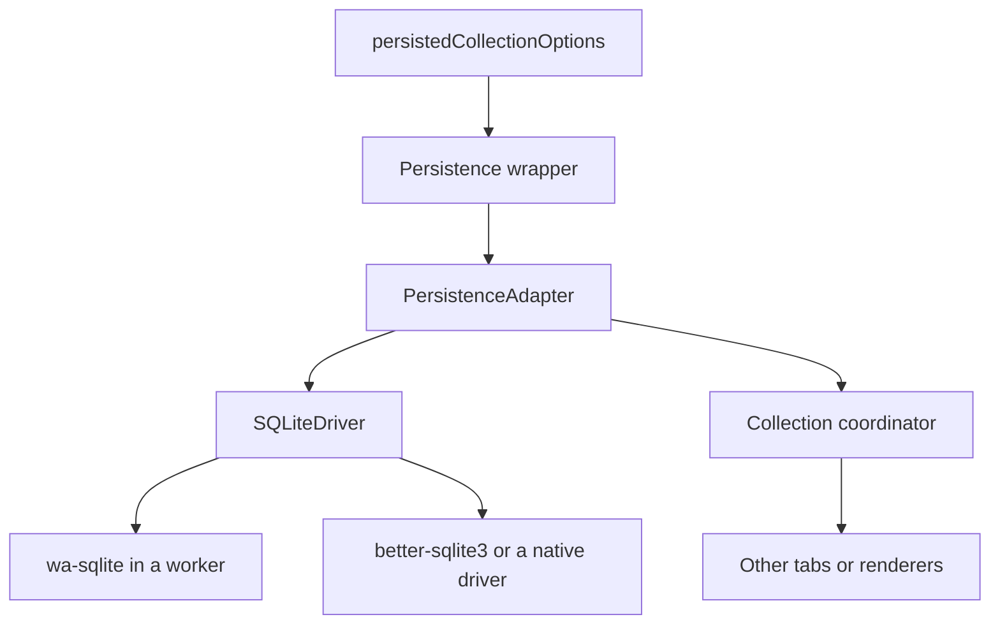
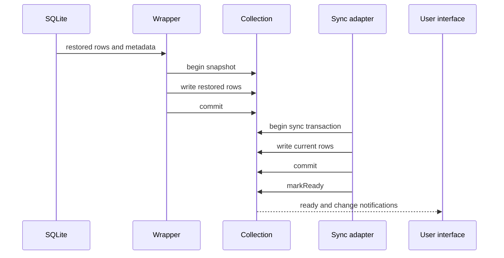
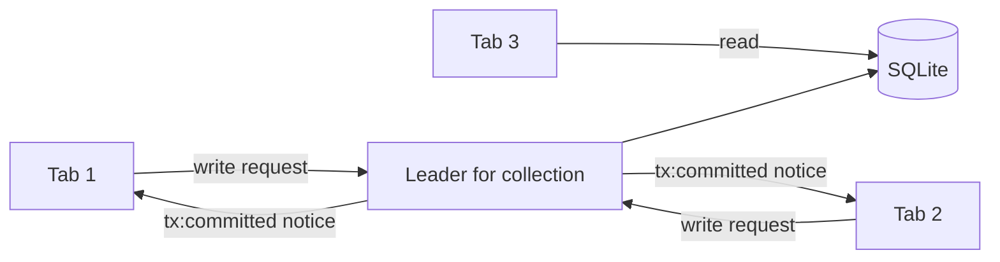

# Persistence

A browser reload destroys memory. TanStack DB can restore collection rows from structured query language (SQL) storage. This document explains the persistence layer, the restore rules, multiple-tab coordination, and the limits.

## What persistence stores

Persistence stores two things:

1. **Rows.** The applied data of a collection.
2. **Metadata.** The sync position, index definitions, schema version, and cache generation. A cache generation is a named version of the managed on-demand cache; the wrapper replaces it when a claim expires. A claim is a reservation of a generation with a time limit. The managed on-demand cache is the stored on-demand rows under one generation.

Persistence does not send changes to the server. The guide states the rule: persistence "retains source data and metadata." It "does not define how an application sends local changes to a server." See `docs/guides/sqlite-persistence.md:419`.

`retains source data` means that persistence keeps the rows that came from the source, plus metadata. It does not mean that persistence replaces the source.

That rule separates persistence from mutation handling. A restored row is not a queued write. A queued write belongs to the offline transaction outbox. An outbox is a durable queue of pending writes that the offline transaction executor, `OfflineExecutor`, retries when it can reach the server. Document [04-mutations.md](04-mutations.md) defines that executor. See `docs/guides/offline-transactions.md:6-8` and `docs/guides/sqlite-persistence.md:419`.

## The layers



The first edge adds persistence options to a collection configuration. `persistedCollectionOptions` is the wrapper factory. The second edge creates a persistence adapter, `PersistenceAdapter`. The third edge runs SQL through a driver, `SQLiteDriver`. The fourth and fifth edges show two driver families: WebAssembly (WASM) SQLite in a worker, and a native SQLite binding. A worker is a separate background execution context that the browser runs beside the page. The sixth edge attaches a coordinator, an object that coordinates writes between tabs. The last edge connects other tabs or renderer processes.

## The adapter contract

The `PersistenceAdapter` interface has four core operations. See `packages/db-sqlite-persistence-core/src/persisted.ts:519-632`.

| Operation | Purpose |
| --- | --- |
| `loadSubset` | Read rows that match a query demand, the filter, order, and limit that a query asks for |
| `loadResumeSnapshot` | Read rows and the last sync position |
| `applyCommittedTx` | Write one accepted source transaction |
| `ensureIndex` | Create a stored index for a query signature |

A sync position is the place in a source stream that the adapter reached, such as an offset or a cursor. A query signature is the identity of one query demand, derived from its filter, order, and limit.

The adapter also provides optional cache generation and recovery methods: `claimCacheGeneration`, `reconcileCommittedTx`, `scanRows`, `getStreamPosition`, and `runInHydrationScope`. See `packages/db-sqlite-persistence-core/src/persisted.ts:561-632`.

Each optional method covers one recovery need. `claimCacheGeneration` reserves a cache generation for on-demand mode. `reconcileCommittedTx` resolves a write whose reply was lost. `scanRows` reads rows without a query demand. `getStreamPosition` reads the last term, sequence, and row version. `runInHydrationScope` runs a restore as one scheduler unit. The last term, sequence, and row version are the durable position marks that a resume needs. A hydration scope is one restore run. A scheduler unit is one job in the scheduler queue.

The adapter runs on a `SQLiteDriver`. See `packages/db-sqlite-persistence-core/src/persisted.ts:666-682`.

```ts
export interface SQLiteDriver {
  exec: (sql: string) => Promise<void>
  query: <T>(sql: string, params?: ReadonlyArray<unknown>) => Promise<ReadonlyArray<T>>
  run: (sql: string, params?: ReadonlyArray<unknown>) => Promise<void>
  transaction: <T>(fn: (driver: SQLiteDriver) => Promise<T>) => Promise<T>
  transactionWithDriver?: <T>(fn: (driver: SQLiteDriver) => Promise<T>) => Promise<T>
}
```

The citation is `packages/db-sqlite-persistence-core/src/persisted.ts:666-682`. `exec` runs a statement with no parameters. `run` runs one parameterized statement. `query` returns rows. `transaction` passes a driver into a callback and commits when the callback resolves. `transactionWithDriver` is the optional form that a platform driver can supply. The source does not state a behavioral difference between `transaction` and `transactionWithDriver`; the optional form lets a platform driver supply its own transaction runner.

A platform package supplies the driver. The browser package is `@tanstack/browser-db-sqlite-persistence`. It opens an origin private file system (OPFS) database and runs SQLite in a worker. OPFS is a private file system that the browser gives to one origin. SQLite in the browser is wa-sqlite, the WebAssembly build of SQLite. See `packages/browser-db-sqlite-persistence/src/opfs-database.ts:234-260` and `packages/browser-db-sqlite-persistence/package.json:2-3`.

## The wrapper

`persistedCollectionOptions` wraps a normal collection configuration. See `packages/db-sqlite-persistence-core/src/persisted.ts:7727-7800`.

```ts
const todos = createCollection(
  persistedCollectionOptions({
    ...queryCollectionOptions({ /* ... */ }),
    persistence: browserPersistence,
    schemaVersion: 1,
    initialRender: { strategy: 'network-first', networkTimeoutMs: 3_000 },
  }),
)
```

The citation is `docs/guides/sqlite-persistence.md:191-224`. `queryCollectionOptions` builds a normal collection configuration that a TanStack Query client backs; the wrapper adds the persistence fields to it. See `packages/query-db-collection/src/query.ts:574-620`. In the example, `browserPersistence` is the persistence instance from the browser package. `schemaVersion` is the stored schema version; a mismatch triggers the reset rules that the "Schema versions and recovery" section below describes. `initialRender` is the option that controls readiness from restored rows. `network-first` is its strategy that prefers the network for `networkTimeoutMs`, the timeout in milliseconds (ms), before it accepts restored rows.

The wrapper has two modes. See `docs/guides/sqlite-persistence.md:232-238`:

| Collection options | Behavior |
| --- | --- |
| `sync` present | Load persisted rows, then apply source sync transactions |
| `sync` absent | Load and save local rows through a loopback sync adapter |

The first mode is a cache in front of a source. The second mode is a local database with no remote source. A loopback sync adapter is an adapter that writes rows back into the same collection.

## The restore sequence



The first arrow reads the stored snapshot. The next three arrows install it as a snapshot transaction. A snapshot transaction is one that carries every row, so a row that the snapshot lacks is absent after commit. The next three arrows apply current source rows over it. The eighth arrow marks readiness. The last arrow notifies the user interface (UI).

The order matters. The restore comes first. The wrapper holds a source answer that arrives before the restore commits, so the source writes wait until the restore transaction commits. See `docs/guides/sqlite-persistence.md:289-291`.

## When the collection becomes ready

Without `initialRender`, the collection becomes ready when the sync adapter calls `markReady()`. The restored rows are present, but the status stays `loading`, the status that means that the first load is not complete. `error` means that the first load failed, and `crashed` means that local storage cannot serve reads. Document [01-architecture.md](01-architecture.md) lists every status. See `docs/guides/sqlite-persistence.md:245-247` and `packages/db/src/types.ts:797-813`.

With `initialRender: { strategy: 'network-first', networkTimeoutMs }`, the collection prefers the network for the timeout. The default timeout is 3 seconds. The collection becomes ready from restored rows when two conditions hold:

1. The restore completed and installed at least one row.
2. The deadline passed, or the sync adapter failed its first load.

See `docs/guides/sqlite-persistence.md:249-253`.

These rules keep `ready` meaningful. See `docs/guides/sqlite-persistence.md:287-293`:

- An empty restore waits for the network. The collection does not show an empty list that the network did not confirm.
- The restore comes first. A source answer waits for it. A remote failure then opens the collection from restored rows and shows the failure as a sync error. Without restored rows, the first load fails with status `error`.
- A failed restore is a crash. The guide gives the reason: local storage cannot serve reads, so the collection becomes `crashed`.
- The deadline does not stop network sync. Later changes apply over the restored rows.

A healthy restore with zero rows is indistinguishable from a collection that truly has zero rows. The guide states this limit directly. See `docs/guides/sqlite-persistence.md:289`. The consequence is that a truly empty collection cannot become ready from restored rows; it waits for the network load, or it reports an error if that load fails.

## On-demand persistence

An on-demand collection loads rows for each query demand. A demand is the filter, order, and limit that a query asks the source for. Persistence applies the same rule to each demand. Progressive mode is the Electric mode that serves query subsets at once and syncs the full set in the background. See `docs/guides/sqlite-persistence.md:320-350`.

A demand becomes covered after three things happen:

1. An online load of that exact demand settles.
2. The rows are saved in SQLite.
3. A later load of the same demand settles from those rows when the network does not answer.

A different filter, order, or limit is a different demand, even when the rows overlap. See `docs/guides/sqlite-persistence.md:343`.

The coverage rule has these parts. See `docs/guides/sqlite-persistence.md:343-360`:

- When a covered demand loads, it shows stored rows at once. If the network does not answer within `networkTimeoutMs` or it fails, the load settles on those rows.
- Only the load settles. The on-demand collection's own status does not change.
- The network load keeps running. Its rows replace the restored rows when they arrive. A later network failure leaves the query ready on the rows that it shows.
- A demand that never settled online is not covered. A query that never ran stays loading offline, unless a completed progressive full sync already holds every row.
- A source truncate, such as an Electric `must-refetch`, ends coverage for every demand because it replaces all synced rows. A snapshot transaction also ends coverage, for the same reason. A new cache generation starts without coverage.
- A scoped recovery also ends coverage for the rest of that sync run. A scoped recovery is a recovery that is limited to a defined scope. The capability method `startScopedRecovery` retires the untrusted on-demand rows, which are rows from the replaced generation, and it keeps the reset metadata that the persistence provider supplies to restart sync.
- A load that is released before it settles records no coverage. A load is released when its demand stops being needed, and the adapter calls the release function.
- Coverage also ends when SQLite holds fewer rows for the demand than it held when the demand settled. A source delete, or a retention removal after `gcTime`, therefore ends coverage until the demand loads online again. A retention removal is a row that a retention policy removes. `gcTime` is the delay before an unused collection is cleaned up.
- An ordered window with a limit stays covered only while SQLite holds the same rows for it, in any order. An ordered window is the set of rows in one order with one limit; a row that leaves, joins, or replaces a row of the window ends its coverage.
- A load with `refetch: true` always waits for the network.
- Only the default single-process coordinator supports this rule. The default coordinator runs inside one process and does not coordinate between tabs. With a multi-tab coordinator, such as `BrowserCollectionCoordinator`, on-demand loads wait for the network.

Coverage proves that the rows were complete when the earlier load settled. It does not prove that they are current. For a query that joins an eager source and an on-demand source, the query becomes ready when the eager source is ready and every demand that the query reaches on the on-demand source has settled. A network failure alone does not settle a demand that is not covered. See `docs/guides/sqlite-persistence.md:355-357`.

Built-in adapters use managed cache generations. A generation has a claim with a time limit. If the claim expires, the wrapper retires the old source callbacks, rotates the cache, and calls the source's `sync` again. A source callback is a function that the previous generation registered with the source. To retire it means to stop using it. To rotate the cache means to start a new generation and clear the old claim. See `docs/guides/sqlite-persistence.md:241`.

An on-demand cache is not a certified offline snapshot. A certified snapshot is a snapshot that the capability protocol certifies before a run uses it; the "The capability protocol" section below lists the methods. The first managed generation does not import legacy cache tables, tables from an earlier cache format. A private replacement after a claim expiry is a generation that one collection creates for itself, and it is not the next run's shared cache, the generation that a new adapter run would reuse. See `docs/guides/sqlite-persistence.md:243`.

## Multiple tabs and processes

The browser package defaults to single-tab coordination. When tabs share one OPFS database, the caller supplies a `BrowserCollectionCoordinator`. See `docs/guides/sqlite-persistence.md:359-374`.

```ts
const coordinator = new BrowserCollectionCoordinator({ dbName: 'app' })
const persistence = createBrowserWASQLitePersistence({ database, coordinator })
```

The citation is `docs/guides/sqlite-persistence.md:366-373`. In the example, `dbName` is the SQLite database name that the coordinator puts in its messages. `database` is the open OPFS database handle from `openBrowserWASQLiteOPFSDatabase`, the function that opens the OPFS database and starts the SQLite worker. `BrowserCollectionCoordinator` is the browser coordinator, and `createBrowserWASQLitePersistence` is the factory that builds the persistence instance.

The coordinator elects an owner for each collection and routes writes between tabs. See `docs/guides/sqlite-persistence.md:361`. An election is a decision, made over a broadcast channel, about which tab owns the write path for one collection. A broadcast channel is a browser channel that sends messages between tabs. A tab that is not the owner sends a write request to the owner instead of writing directly. That tab is a follower. When the owner commits a write, it broadcasts a `tx:committed` notice that lists the changed rows and deleted keys; a follower then pulls those changes with `pullSince`, the coordinator call that reads changes after a given position. See `packages/db-sqlite-persistence-core/src/broadcast-coordinator.ts:2155-2185` and `packages/db-sqlite-persistence-core/src/broadcast-coordinator.ts:835-870`.

`BrowserCollectionCoordinator` extends `BroadcastCollectionCoordinator`, the shared coordinator implementation that uses a broadcast channel. See `packages/browser-db-sqlite-persistence/src/browser-coordinator.ts:1-15`.

The Electron package is `@tanstack/electron-db-sqlite-persistence`. In that package the main process owns the SQLite file, and a renderer bridge forwards database calls from a renderer process to the main process. Add `ElectronCollectionCoordinator` when several renderers share one database. See `docs/guides/sqlite-persistence.md:378`.

The SQLite coordinator calls the elected tab the owner. The offline transaction executor calls its elected tab the leader. The two roles are separate: the owner routes SQLite writes, and the leader drains the outbox. The offline transaction executor is the `OfflineExecutor` from document [04-mutations.md](04-mutations.md). The guide states that this election is separate from the SQLite coordinator. See `docs/guides/sqlite-persistence.md:380`.



The first two edges route writes to the elected leader. The third edge lets a tab read directly; the diagram shows Tab 3 in that role, and any tab can use it. The fourth edge is the leader's write. The last two edges notify the other tabs, which then pull the new rows. A tab that is not the leader does not write directly.

## Schema versions and recovery

By default, a synced collection resets its persisted data after a schema mismatch. A reset deletes the stored rows and metadata, and the sync adapter then loads current data. A collection without a source reports an error instead, because it has no source that can restore the deleted local rows. See `docs/guides/sqlite-persistence.md:403-405`.

The runtime factories accept `schemaMismatchPolicy`. A runtime factory is the function, such as `createBrowserWASQLitePersistence`, that builds a persistence instance for one platform. An explicit `reset` policy has the same delete effect, so use it only when the application can restore that data. See `docs/guides/sqlite-persistence.md:407`.

The guide states that the Node package, `@tanstack/node-db-sqlite-persistence`, prunes its applied transaction log by default. The applied transaction log is the stored record of committed source transactions that persistence replays to resume. If a resume position is older than the retained log, replay cannot start at that position, so persistence loads a full snapshot instead. See `docs/guides/sqlite-persistence.md:409`.

## Failure behavior

A missing browser storage capability raises `PersistenceUnavailableError`. A failed durable write raises `PersistedCollectionDurabilityError` and crashes the collection. A crash moves the collection to `crashed` even after it was ready. Every live query and effect over it also crashes. An effect is a reactive computation that reads the collection. See `docs/guides/sqlite-persistence.md:411-415`.

A lost coordinated write response raises `IndeterminateCommitError`. The application must check the durable state before it retries. See `docs/guides/sqlite-persistence.md:417`.

The errors are defined in `packages/db-sqlite-persistence-core/src/errors.ts:105-199`.

## The capability protocol

The persistence wrapper, which this section calls the persistence-aware collection adapter, and a sync adapter can exchange a capability object. A capability object is a record that one side supplies and the other side checks before it uses the shared protocol. The protocol name is `@tanstack/db/sync-persistence`. The version is `1`. See `packages/db/src/sync-persistence.ts:9-12`.

The validator is the function that checks a capability object. It requires these functions. See `packages/db/src/sync-persistence.ts:73-96` and `packages/db/src/types.ts:602-669`:

| Function | What it does |
| --- | --- |
| `hydrateBaseline` | Load the persisted baseline rows into the collection |
| `reserveCommitTurn` | Reserve the open sync transaction's place in the commit queue, so a later hydration waits for that commit |
| `scanPersistedRows` | Scan persisted rows, with an optional filter |
| `resumeSnapshot.certify` | Certify the resume snapshot before a run uses it |
| `resumeSnapshot.getKeySetEvidence` | Return the key-set evidence for the snapshot; key-set evidence is the record of which keys the snapshot held |
| `resumeSnapshot.expectCurrentCommit` | Require that the snapshot matches the current commit |

A commit turn is the place of one sync transaction in the queue of commits. A run is one start of the sync adapter. See `packages/db/src/sync-persistence.ts:73-96`. Two further methods are optional: `startScopedRecovery` retires untrusted on-demand rows and keeps the provider's reset metadata, and `resumeSnapshot.expectSourceProgress` compares the durable source token with the transaction's predecessor. A source token is the durable position mark of the source. The predecessor is the transaction that applied immediately before it.

The source marks this protocol as internal. Application code "should not construct or depend on this value directly." See `packages/db/src/sync-persistence.ts:4-8`.

This is an unstable seam. This study judges it unstable because the source calls it internal. A third-party adapter that wants persistence must implement it, but the source does not promise stability at version 1.

## Simpler local persistence

The core also ships three lighter persistence options:

1. **Local-only.** Rows exist in memory only. Nothing survives a reload.
2. **Local storage.** Rows survive a reload as JavaScript Object Notation (JSON) in `localStorage`. See `packages/db/src/local-storage.ts:1185-1245`.
3. **IndexedDB.** Rows survive a reload in an object store. See `packages/db/src/indexed-db.ts:99-165`.

These options do not use the SQLite adapter. The source does not show them using the `@tanstack/db/sync-persistence` capability: neither module imports that module. See `packages/db/src/local-storage.ts:1-20` and `packages/db/src/indexed-db.ts:7-20`. They are appropriate for small local data, not for a large synced collection. This last sentence is this study's judgement.

## Key insight

**Key insight:** persistence is a copy, not a source of truth. The sync adapter remains responsible for current data. The restore only shortens the time to a first useful screen.

The design has a sharp edge. A restored row can be stale or unauthorized. The guide states that restored rows do not prove current authorization and tells the application to isolate SQLite data by user or tenant. See `docs/guides/sqlite-persistence.md:318`.

There is no built-in tenant partition in the persistence adapter. A tenant partition is a storage namespace that separates one tenant's rows from another tenant's rows. This document finds no partition parameter in the `PersistenceAdapter` interface. See `packages/db-sqlite-persistence-core/src/persisted.ts:519-632`. That is an application responsibility.

## Source map

| Area | File |
| --- | --- |
| Persistence guide | `docs/guides/sqlite-persistence.md` |
| Persistence adapter | `packages/db-sqlite-persistence-core/src/persisted.ts:519-682` |
| Wrapper | `packages/db-sqlite-persistence-core/src/persisted.ts:7727-7800` |
| Capability protocol | `packages/db/src/sync-persistence.ts:1-111` |
| Errors | `packages/db-sqlite-persistence-core/src/errors.ts:105-199` |
| Browser coordinator | `packages/browser-db-sqlite-persistence/src/browser-coordinator.ts` |
| Electron persistence | `packages/electron-db-sqlite-persistence/` |
| Browser OPFS | `packages/browser-db-sqlite-persistence/src/opfs-database.ts:234-260` |
| Local storage | `packages/db/src/local-storage.ts:1185-1245` |
| IndexedDB | `packages/db/src/indexed-db.ts:99-203` |

## Related documents

- [02-collections.md](02-collections.md): the persistence adapter contract.
- [04-mutations.md](04-mutations.md): the write path that persistence does not own.
- [05-sync-engines.md](05-sync-engines.md): the source that supplies current rows.
- [06-framework-adapters.md](06-framework-adapters.md): the first render from restored rows.
- [09-critical-assessment.md](09-critical-assessment.md): the risks of the restore rules.
