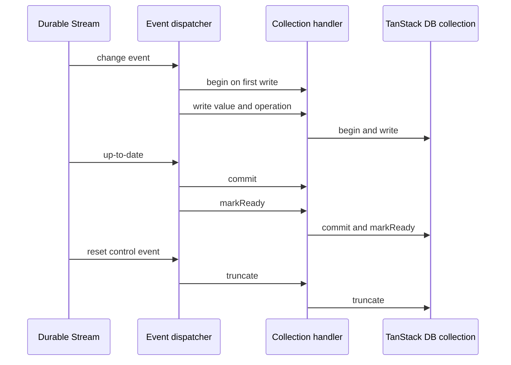
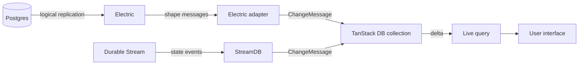
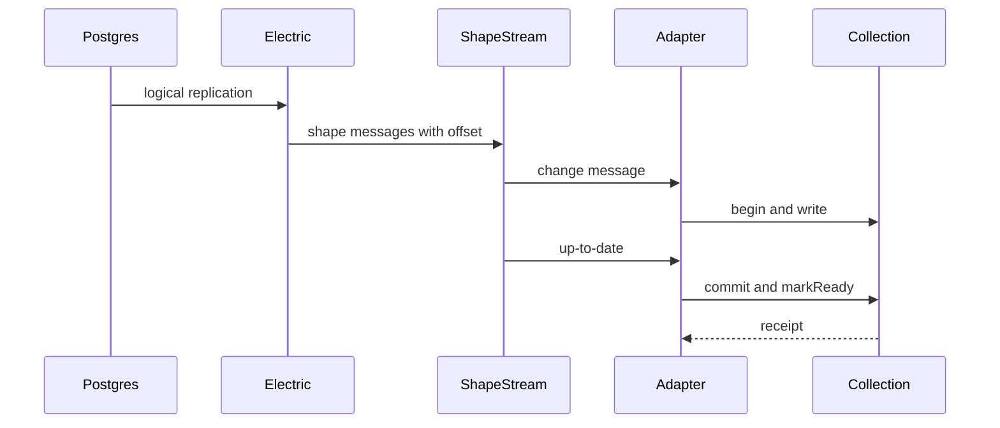

# Durable Streams and Electric

Readers often meet TanStack DB, Electric, and Durable Streams in the same discussion. This document states the relation precisely. It separates shared ideas from real dependencies. It does not claim a dependency that the source does not show.

This document cites two repositories. A path without a leading slash is relative to the TanStack DB repository root, `/Users/darkvoid/GitSources/src.Electric/src.tanstack-db/db`. The parent directory, `/Users/darkvoid/GitSources/src.Electric/src.tanstack-db`, holds seven sibling repositories. A path with a leading slash is absolute and names a file in the sibling Durable Streams repository.

## The three systems in one paragraph

TanStack DB is a reactive client store. A reactive store is a store that notifies its readers when a value changes. It holds rows and answers queries in the browser. See `docs/overview.md:8-14`.

Electric is a sync engine for Postgres. The Electric sync adapter inside TanStack DB reads an Electric shape stream. Neither the TanStack DB repository nor the Durable Streams repository defines the word "shape" in prose. This document uses "shape" for the filtered view of a table that the Electric protocol streams, and "shape stream" for the ordered log of changes for that view. A `ShapeStream` is the Electric client object that reads that log. See `packages/electric-db-collection/src/electric.ts:2025-2042`.

Durable Streams is a protocol for ordered, replayable streams. It uses the Hypertext Transfer Protocol (HTTP). See `/Users/darkvoid/GitSources/src.Electric/durable-streams/README.md:33-35`.

The three systems share an engineering lineage. That statement is a reading of the sources, not a source fact. The Durable Streams README says its protocol is "based on 1.5 years of production use at Electric for real-time Postgres sync," and the TanStack DB Electric adapter uses the Electric client. See `/Users/darkvoid/GitSources/src.Electric/durable-streams/README.md:58`. The sources do not state a shared codebase. The three systems are not one product. One bridge between TanStack DB and Durable Streams does exist, and it lives in the Durable Streams repository. This document describes that bridge below.

## Dependency check, both directions

### From TanStack DB to Durable Streams

The TanStack DB core has three runtime dependencies:

- `@standard-schema/spec`
- `@tanstack/db-ivm`
- `@tanstack/pacer-lite`

See `packages/db/package.json:57-62`.

No package in the TanStack DB repository lists `@durable-streams/client`, `@durable-streams/server`, or `@durable-streams/state`. This study searched every `packages/*/package.json` for the string `@durable-streams` and found no match. The search covers dependency fields, not code imports.

The Electric adapter has these dependencies:

- `@electric-sql/client`
- `@standard-schema/spec`
- `@tanstack/db`
- `debug`

See `packages/electric-db-collection/package.json:50-60`.

The adapter does not depend on Durable Streams. It depends on the Electric shape client.

### From Durable Streams to TanStack DB

The reverse direction is different. The Durable Streams repository ships a package named `@durable-streams/state`. That package has two entry points:

- `@durable-streams/state` — the protocol surface with no database dependency. The protocol surface is the set of message types, control events, and helpers for the stream, without a query engine.
- `@durable-streams/state/db` — a reactive layer backed by TanStack DB.

See `/Users/darkvoid/GitSources/src.Electric/durable-streams/packages/state/README.md:13-20`.

The `/db` entry declares `@tanstack/db` as an optional peer dependency in the range `>=0.6.0 <1.0.0`. The peer is optional because `peerDependenciesMeta` marks it `optional: true`; a package manager therefore does not require it for the base entry. The `/db` entry imports it at run time. See `/Users/darkvoid/GitSources/src.Electric/durable-streams/packages/state/package.json:65-71`.

So the dependency runs from Durable Streams to TanStack DB, not the other way. The TanStack DB repository does not ship the StreamDB adapter. The Durable Streams repository does.

```mermaid
flowchart LR
    subgraph TDB["TanStack DB repository"]
        CORE["@tanstack/db"]
        ELAD["electric-db-collection"]
    end
    subgraph DSRepo["Durable Streams repository"]
        STATE["@durable-streams/state"]
        SDB["@durable-streams/state/db"]
        AR["tanstack-ai-transport"]
    end
    SHAPE["Electric shape endpoint"]
    DS["Durable Streams protocol"]

    ELAD -->|@electric-sql/client| SHAPE
    STATE -->|exports subpath /db| SDB
    SDB -->|optional peer dependency| CORE
    DS -->|stream events| SDB
    AR -->|@durable-streams/client| DS
    CORE -.->|no dependency| DS
```

The first edge is the real dependency of the Electric adapter. The second edge says that the `state` package exports the subpath `/db`, and the module at that subpath is `SDB`. The third edge is the optional peer dependency of that entry on the core. The fourth edge is the stream that StreamDB reads; the arrow starts at the protocol because the events come from the stream. The fifth edge is the separate transport for TanStack AI, not TanStack DB. The dotted edge marks an absence: the core itself has no dependency on Durable Streams. A dotted edge is not a data flow. The solid edges between packages show a dependency or an export. The solid edges to `SHAPE` and `DS` show that the package speaks that protocol or reads that stream. The edge labels state which kind each edge is.

The `tanstack-ai-transport` package is a different client. Its description is "TanStack AI adapters for Durable Streams." See `/Users/darkvoid/GitSources/src.Electric/durable-streams/packages/tanstack-ai-transport/package.json:2-4`. It is not the database adapter. Do not confuse the two.

## The bridge that exists: StreamDB

The Durable Streams state package defines a state protocol with change events and control events. Change events are `insert`, `update`, and `delete`. Control events are `snapshot-start`, `snapshot-end`, and `reset`. Each event also carries an entity type, a discriminator string that routes the event to one collection, and a primary key. See `/Users/darkvoid/GitSources/src.Electric/durable-streams/packages/state/STATE-PROTOCOL.md:87-118` and `/Users/darkvoid/GitSources/src.Electric/durable-streams/packages/state/STATE-PROTOCOL.md:203-255`.

`createStreamDB` turns each state definition into a TanStack DB collection. See `/Users/darkvoid/GitSources/src.Electric/durable-streams/packages/state/src/stream-db.ts:633-646`. A state definition is one entry in the `state` object. It holds three fields: `schema`, the validator; `type`, the entity type string; and `primaryKey`, the name of the key field. `schema` here is the caller's object that maps each entity name to a state definition. The `type` string is the discriminator that routes each event to this definition.

```ts
const db = createStreamDB({
  streamOptions: {
    url: "https://api.example.com/streams/my-stream",
    contentType: "application/json",
  },
  live: "sse", // optional: true, "long-poll", "sse", or false
  state: schema,
})
```

The citation is `/Users/darkvoid/GitSources/src.Electric/durable-streams/packages/state/README.md:79-86`.

Each collection gets a `sync` function. That function is the collection's sync configuration, the in-process contract that document [02-collections.md](02-collections.md) defines. It registers a handler with a shared event dispatcher. The dispatcher is one object for the whole StreamDB; it is shared by every collection in that StreamDB. It receives each state event and routes the event to the handler for that entity type. `registerHandler` attaches one handler under one entity type. See `/Users/darkvoid/GitSources/src.Electric/durable-streams/packages/state/src/stream-db.ts:530-556` and `/Users/darkvoid/GitSources/src.Electric/durable-streams/packages/state/src/stream-db.ts:624`.

```ts
sync: ({ begin, write, commit, markReady, truncate }) => {
  dispatcher.registerHandler(eventType, {
    begin,
    write: (value, type, _cursor) => {
      write({
        value: value as T,
        type,
      })
    },
    read: (key) => read(key),
    commit,
    markReady,
    truncate,
    primaryKey,
  })
```

The citation is `/Users/darkvoid/GitSources/src.Electric/durable-streams/packages/state/src/stream-db.ts:530-548`.

The excerpt uses these names. `eventType` is the entity type that the handler accepts. `read(key)` returns the row that the collection currently holds for one key. `primaryKey` is the name of the key field in the state definition. `_cursor` is the stream position of the event; the handler ignores it, and the leading underscore marks that choice. `truncate` clears the collection. A handler is the object that the dispatcher calls for one entity type. `read` and `primaryKey` are StreamDB values, not core functions; the sync configuration function in `createStreamSyncConfig` adds both fields to the handler object before it calls `registerHandler`. See `/Users/darkvoid/GitSources/src.Electric/durable-streams/packages/state/src/stream-db.ts:526-556`. The `type` argument of `write` is the operation that the dispatcher computed: `insert`, `update`, or `delete`.

The handler receives five functions from the core: `begin`, `write`, `commit`, `markReady`, and `truncate`. An up-to-date signal means that the StreamDB client has read every message that the server holds at that moment. A hint is a control event that the dispatcher ignores for collection state. The handler maps each stream event to one core operation:

| Stream event | Core operation |
| --- | --- |
| A change event for this entity type | `begin` once, then `write` |
| The client's up-to-date signal | `commit` |
| The first up-to-date signal | `markReady` |
| The `reset` control event | `truncate` |
| A `snapshot-start` or `snapshot-end` control event | Nothing; the dispatcher treats both as hints |

The citations are `/Users/darkvoid/GitSources/src.Electric/durable-streams/packages/state/src/stream-db.ts:304-345` and `/Users/darkvoid/GitSources/src.Electric/durable-streams/packages/state/src/stream-db.ts:353-442`.

The commit point is not a state-protocol control event. The Durable Streams client reports when the stream has reached its current end, and StreamDB calls `markUpToDate`. `markUpToDate` is the dispatcher call that consumes that report. It commits every handler that has an open transaction. The first such call also sends `markReady` to every handler, so every collection becomes ready on that first signal; after that, readiness is a per-collection status. The `snapshot-start` and `snapshot-end` events carry no action. See `/Users/darkvoid/GitSources/src.Electric/durable-streams/packages/state/src/stream-db.ts:381-435`.

The bridge is small. Its sync configuration function, `createStreamSyncConfig`, occupies 36 lines. See `/Users/darkvoid/GitSources/src.Electric/durable-streams/packages/state/src/stream-db.ts:523-558`. That size is similar to the smaller adapters in the TanStack DB repository; that comparison is this study's judgement, not a source claim. The bridge uses the public `createCollection` function and the public sync contract. See `packages/db/src/types.ts:446-552` and `/Users/darkvoid/GitSources/src.Electric/durable-streams/packages/state/src/stream-db.ts:530-556`.



The first arrow reads one state event. The second opens a sync transaction. The third writes one row. The fourth stages the row in the open collection transaction; the handler's `begin` forwards to the core `begin`, and its `write` forwards the row, so the row becomes visible at commit. The fifth reports that the client has reached the current end of the stream; in live mode the same signal recurs each time the client reaches the new end. The sixth publishes the batch. The seventh marks the collection ready. The eighth passes the commit and the ready state to the collection. The ninth delivers a reset from the producer. On that reset the dispatcher first clears its key tracking, its pending transaction set, and its ready flag; the tenth arrow then sends the truncate to the handler. The last arrow clears the collection; it is the only arrow in the diagram that clears the collection. A producer is the client that appends messages to the stream.

The dispatcher normalizes some events before the write:

- An `upsert` is a write event whose operation states neither insert nor update. The protocol requires one of `insert`, `update`, or `delete`; the source does not state where an `upsert` operation comes from. The dispatcher chooses insert or update from its key set. The seen keys are the keys that the dispatcher has applied since it started or since the last reset; a reset clears the set. A key in the set gives `update`, and a key outside it gives `insert`. See `/Users/darkvoid/GitSources/src.Electric/durable-streams/packages/state/src/stream-db.ts:306-320`.
- An `insert` for a key that the collection already holds becomes `update`. The dispatcher checks its key set first. For a string key, it also reads the current row from the handler and compares the values deeply; an equal row gives `update`. The comment gives the reason: a reconnect can replay an insert, and the core treats a duplicate insert as an error. See `/Users/darkvoid/GitSources/src.Electric/durable-streams/packages/state/src/stream-db.ts:318-335`.

That second rule is evidence about the core. The code comment says that a replayed insert would reach the duplicate-key path. So the core does not silently ignore a second insert for a known key; the adapter normalizes the event to `update` instead. See `/Users/darkvoid/GitSources/src.Electric/durable-streams/packages/state/src/stream-db.ts:318-335`.

## Same problem family

These three systems can be compared on one problem: a client needs a current view of state that changes elsewhere, and the network can fail. This framing is this document's comparison, not a problem statement that any source gives. In this table, a source adapter is the same thing as a sync adapter: the code that implements the `sync` contract for one source. A live subscription is the adapter's read that stays open and receives later changes. Normalized rows are rows with one copy per key. A handle is Electric's opaque resume token, a string that the server gives the client and the client sends back to continue from a point. A transaction identifier is the `txid`. An idempotent producer key is the triple of `Producer-Id`, `Producer-Epoch`, and `Producer-Seq`; the epoch changes when a producer restarts, and the sequence increases with each request.

| Problem | TanStack DB | Electric | Durable Streams |
| --- | --- | --- | --- |
| Where is the source of truth? | The source adapter | Postgres | The append-only stream |
| How does a client resume? | An adapter can store a position | Shape offset and handle | Stream offset |
| How does a client catch up? | The adapter's first sync transaction, the catch-up load | Shape catch-up reads | Catch-up reads |
| How does a client stay live? | The adapter's live subscription | Shape live mode | Long-poll or server-sent events |
| How is a duplicate detected? | The adapter must normalize it | A transaction identifier | An idempotent producer key |
| What does the client hold? | Normalized rows | Rows from a shape | Messages in order |

The citations for the TanStack DB column are `packages/db/src/types.ts:446-552`. The duplicate row also uses `/Users/darkvoid/GitSources/src.Electric/durable-streams/packages/state/src/stream-db.ts:318-335`; that source is a Durable Streams adapter, and it shows the normalization that a TanStack DB adapter must do.

The citations for the Electric column are `packages/electric-db-collection/src/electric.ts:2025-2042` and `packages/electric-db-collection/src/electric.ts:1064-1090`.

The citations for the Durable Streams column are `/Users/darkvoid/GitSources/src.Electric/durable-streams/docs/concepts.md:29-54` and `/Users/darkvoid/GitSources/src.Electric/durable-streams/docs/concepts.md:126-210`.

The table is this study's comparison, not a source table. The row "How is a duplicate detected?" maps three mechanisms at different layers, where a layer is one part of the path: store, source engine, or transport. TanStack DB has no duplicate rule of its own; this study searched the core contract and found none. The StreamDB adapter normalizes a replayed insert. Electric carries a transaction identifier. Durable Streams deduplicates an idempotent producer request. These are similar goals, not the same mechanism.

## Shared idea 1: an ordered log

Durable Streams defines a stream as an ordered sequence. See `/Users/darkvoid/GitSources/src.Electric/durable-streams/docs/concepts.md:12-28`.

Electric orders shape messages by offset. The adapter stores the offset and uses it to resume. See `packages/electric-db-collection/src/electric.ts:2030-2042`.

TanStack DB does not require a log. The sync contract does not, however, accept arbitrary order: an adapter must call `begin` before `write`, and the core applies commits in the order they arrive, first-in, first-out. Inside one transaction, the adapter is responsible for source order; if it writes two rows in the wrong order, the collection receives that wrong order. The StreamDB dispatcher relies on the stream order and applies each event as it arrives. See `/Users/darkvoid/GitSources/src.Electric/durable-streams/packages/state/src/stream-db.ts:290-305`.

The shared idea is order. The difference is where the order comes from: Durable Streams assigns the order, Electric exposes a position in its log, and TanStack DB requires the adapter to supply changes in order.

## Shared idea 2: replay from a position

Durable Streams gives each message an offset. A consumer can read from an offset after a disconnect. See `/Users/darkvoid/GitSources/src.Electric/durable-streams/docs/concepts.md:29-54`.

The Electric adapter stores an offset and a handle. On restart it passes them to `ShapeStream`. See `packages/electric-db-collection/src/electric.ts:2030-2042`.

The TanStack DB SQLite persistence layer stores a source position with the rows. `loadResumeSnapshot` returns `latestTerm`, `latestSeq`, and `latestRowVersion`. This study reads them as three counters that locate a position in the source history: a term, a sequence inside that term, and a version for the row. The repository does not define the three words in prose, so that reading is not a source fact. See `packages/db-sqlite-persistence-core/src/persisted.ts:536-556`.

The StreamDB layer loads initial data with `db.preload()`, where `db` is the object that `createStreamDB` returns. `preload` reads the stream until the up-to-date signal and resolves when every collection is ready. See `/Users/darkvoid/GitSources/src.Electric/durable-streams/packages/state/README.md:88-89` and `/Users/darkvoid/GitSources/src.Electric/durable-streams/packages/state/src/stream-db.ts:443-475`.

The source does not state how StreamDB stores the read position for its stream. The `state` package declares no offset field in its schema. The two possible readings are:

1. The Durable Streams client keeps the position.
2. StreamDB re-reads the whole log on each connection.

The source does not state which reading is correct.

These resume positions are not the same value. The Durable Streams offset, the Electric offset and handle, and the TanStack DB `latestTerm`, `latestSeq`, and `latestRowVersion` all locate a point in a history, but each has a different form. StreamDB's own position is the open question above. The three positions serve the same purpose: resume without a full reload.

## Shared idea 3: a projection

Durable Streams stores messages. A consumer projects them into a model. To project is to read a stream of changes and build a derived state from them. The state package calls the simple form `MaterializedState`, an in-memory container that applies change events. `get(type, key)` and `getType(type)` are methods of `MaterializedState`; `type` is the entity type string, `key` is the row key, and `get` returns one row while `getType` returns all rows of that type. See `/Users/darkvoid/GitSources/src.Electric/durable-streams/packages/state/README.md:120-140`.

TanStack DB is a projection layer. It takes a source and builds normalized rows. See `docs/overview.md:24-29`.

Electric is also a projection. It projects Postgres changes into a shape. The TanStack DB adapter then projects the shape into a collection. This study calls Electric a projection because it derives the shape from the Postgres log; the sources use the word only in the Durable Streams documents. See `packages/electric-db-collection/src/electric.ts:2025-2042`.

The stack is a chain of projections:



The first edge is Postgres logical replication into Electric. Logical replication is the Postgres mechanism that streams row changes from the write-ahead log. The second edge is the shape stream. The third edge converts a shape message to a change message. `ChangeMessage` is the core record for one row change: a type, a key, a value, optional `old_value`, and optional `headers`. A delta is the set of row changes between two query results. The fourth edge sends a delta into a live query. A live query is a query whose result collection updates incrementally instead of by a full re-run; document [03-live-queries.md](03-live-queries.md) explains the mechanism. The fifth edge renders. The bottom path is the Durable Streams path: state events enter the dispatcher and reach the same collection contract. The two arrows into `COL` both stand for the collection's sync handler: the adapter or the dispatcher calls the handler, and the handler writes the row into the collection. The two paths share the projection. They do not share a transport. A transport is the mechanism that carries messages, such as an HTTP connection or a stream.

## Shared idea 4: catch-up plus live

Durable Streams separates catch-up reads from live tailing. See `/Users/darkvoid/GitSources/src.Electric/durable-streams/docs/concepts.md:126-210`.

The TanStack DB sync contract has the same shape. The `sync` function receives `begin`, `write`, `commit`, and `markReady` for a basic load; it also receives `truncate` and the health calls, which this section does not use. The first snapshot and later changes use the same functions. The first snapshot is the catch-up read that sends the existing rows. See `packages/db/src/types.ts:451-482`.

Electric implements both with one `ShapeStream`. The adapter passes one client object, and that object performs the catch-up read and then stays live. See `packages/electric-db-collection/src/electric.ts:2025-2042`.

StreamDB sets the live mode in its options. The mode is `true`, `long-poll`, `sse` (server-sent events), or `false`. The value `true` is the default, and it lets the Durable Streams client select its transport. The value `long-poll` holds the read request open until data arrives or a timeout expires. The value `sse` uses a server-sent events connection. The value `false` stops after catch-up and does not tail. See `/Users/darkvoid/GitSources/src.Electric/durable-streams/packages/state/README.md:83-86`, `/Users/darkvoid/GitSources/src.Electric/durable-streams/docs/stream-db.md:89`, and `/Users/darkvoid/GitSources/src.Electric/durable-streams/packages/client/src/stream-response-state.ts:66-70`.

## Shared idea 5: a transaction identifier as the confirmation token

Electric uses a transaction identifier, `txid`, to prove that the shape stream returned the application's own write. `awaitTxId(txid)` is a method in `collection.utils`, the utility object of one collection; it returns a promise that resolves when the shape stream returns that identifier. See `packages/electric-db-collection/src/electric.ts:1064-1090`.

The Durable Streams state protocol defines a field with the same name and purpose. A change message may carry `headers.txid`, "transaction identifier for grouping related changes." See `/Users/darkvoid/GitSources/src.Electric/durable-streams/packages/state/STATE-PROTOCOL.md:115`.

StreamDB implements the same wait. It exposes `awaitTxId(txid, timeout)`, collects each `txid` from an event header, and resolves the waiting promise when the batch commits. A batch is the group of events that one up-to-date signal closes. See `/Users/darkvoid/GitSources/src.Electric/durable-streams/packages/state/src/stream-db.ts:268-270` and `/Users/darkvoid/GitSources/src.Electric/durable-streams/packages/state/src/stream-db.ts:412-423`.

The StreamDB wait has a default timeout of 5,000 milliseconds. On expiry it rejects with an error that names the identifier; the caller can pass a different timeout. See `/Users/darkvoid/GitSources/src.Electric/durable-streams/packages/state/src/stream-db.ts:483-515`.

So the two adapters share a confirmation pattern. A caller appends or sends the write with an identifier. The caller then waits for the stream to return that identifier. The wait turns "the request finished" into "the store observed the change." Here the store is the client-side collection, not the server.

## Real difference 1: protocol versus library

Durable Streams is a protocol. It defines HTTP endpoints and message framing. See `/Users/darkvoid/GitSources/src.Electric/durable-streams/README.md:33-35`.

TanStack DB is a library. It has no wire protocol. The `sync` function is an in-process contract. See `packages/db/src/types.ts:446-552`.

The `@durable-streams/state/db` entry crosses that line. It reads the protocol and calls the in-process contract. This study searched the Durable Streams repository for `createCollection` and found it only in the state package. This study found no other adapter between the two projects.

## Real difference 2: data model

Durable Streams stores messages with the content type that the stream was created with. With most content types, the stream is a raw sequence of bytes, so the messages are opaque and the server does not interpret their boundaries; the application must supply a self-delimiting format, a format in which the end of each message is visible from the bytes themselves. With the JavaScript Object Notation (JSON) content type, the server preserves one message per POST payload and returns a JSON array for a read. See `/Users/darkvoid/GitSources/src.Electric/durable-streams/docs/concepts.md:55-86`.

The state protocol adds structure: an entity type, a primary key, and an operation. The operation is the header field `headers.operation`, and its value is `insert`, `update`, or `delete`. See `/Users/darkvoid/GitSources/src.Electric/durable-streams/packages/state/STATE-PROTOCOL.md:258-285`.

TanStack DB stores typed rows with a primary key. A collection validates each row against a schema when one is configured. See `packages/db/src/collection/mutations.ts:112-181`.

The collection needs a key. StreamDB supplies one from the schema definition. The `state` object holds one definition for each entity. A definition has three fields: `schema`, the validator; `type`, the entity type string; and `primaryKey`, the name of the key field. See `/Users/darkvoid/GitSources/src.Electric/durable-streams/packages/state/src/stream-db.ts:574-575`. `createStreamDB` reads the `primaryKey` field name and passes `getKey: (item) => String(item[definition.primaryKey])`. See `/Users/darkvoid/GitSources/src.Electric/durable-streams/packages/state/src/stream-db.ts:633-646`.

## Real difference 3: query model

TanStack DB has a query engine. It compiles a query into a differential dataflow (D2) graph; the graph updates a result by differences instead of a full re-run. The query builder passes the query to the compiler in the core package, and document [03-live-queries.md](03-live-queries.md) explains the compiler. See `docs/overview.md:154-158`.

Durable Streams has no query engine. A consumer reads messages and projects them. Any query is the consumer's job. This study searched the Durable Streams package list and documentation for a query engine and found none. That absence is a result of this study, not a statement in the source.

This document uses "shape" as in the first section: the filtered view of a table that the Electric protocol streams. The TanStack DB repository does not define the shape selection grammar. In the adapter, `shapeOptions` is the required configuration field of type `ShapeStreamOptions`, and it holds the options for the shape stream. The adapter uses the Electric service address (`shapeOptions.url`) and the table name (`shapeOptions.params.table`). The adapter passes `shapeOptions` to `ShapeStream`. See `packages/electric-db-collection/src/electric.ts:352-357`, `packages/electric-db-collection/src/electric.ts:1797-1798`, `packages/electric-db-collection/src/electric.ts:2878-2879`, and `packages/electric-db-collection/src/electric.ts:2025-2042`.

The three systems answer different questions. TanStack DB answers "what rows match this query?" Durable Streams answers "what messages follow this offset?" Electric answers "what rows are in this shape?"

## Real difference 4: write path

A TanStack DB mutation runs a `mutationFn` and then settles. A transaction settles when it reaches `completed` or `failed`, as document [04-mutations.md](04-mutations.md) explains. See `packages/db/src/transactions.ts:746-800`.

A Durable Streams producer appends a message and uses an idempotent producer key to avoid duplicates. The key is the triple of `Producer-Id`, `Producer-Epoch`, and `Producer-Seq`. The epoch changes when the producer restarts, and the sequence increases with each request. The server tracks the last accepted sequence number for each stream, producer, and epoch, and returns a deduplicated success when a request repeats one. The source gives 204 No Content as the response to a repeated request. See `/Users/darkvoid/GitSources/src.Electric/durable-streams/docs/concepts.md:87-120`.

An Electric write goes to the application's own backend, through its application programming interface (API) or directly to its database. Electric is not the write target; it observes the change and sends it through the shape. See `packages/electric-db-collection/src/electric.ts:365-400`.

The state package supports optimistic actions in its `/db` entry. The action object has two parts: `onMutate` writes the optimistic row to the collection, and `mutationFn` appends the state event with a `txid`. If `mutationFn` rejects, TanStack DB rolls back the optimistic row; document [04-mutations.md](04-mutations.md) explains that path. See `/Users/darkvoid/GitSources/src.Electric/durable-streams/packages/state/README.md:348-410`.

StreamDB wraps each action with `createOptimisticAction` from TanStack DB, the wrapper that document [04-mutations.md](04-mutations.md) defines. See `/Users/darkvoid/GitSources/src.Electric/durable-streams/packages/state/src/stream-db.ts:764-775`.

So the write path shares a pattern with the Electric adapter: an optimistic local step, a send step, and a wait for the stream to confirm. The caller supplies a function. That function sends the change with a transaction identifier. The mutation function then waits with `db.utils.awaitTxId` for the stream to return the identifier. See `/Users/darkvoid/GitSources/src.Electric/durable-streams/packages/state/README.md:361-410`.

The real difference is the transport. Electric sends an HTTP request to the application's backend. StreamDB appends an event to a Durable Stream.

## Real difference 5: durability

Durable Streams is durable by design. A message survives a client disconnect and a server restart. The source does not state the storage mechanism or the retention period. See `/Users/darkvoid/GitSources/src.Electric/durable-streams/README.md:27-35`.

TanStack DB is not durable by itself. Its rows live in memory. Durability comes from an optional SQLite persistence adapter. The adapter is optional because it is a separate package that the application must configure. See `docs/guides/sqlite-persistence.md:185-240`.

Electric's durability comes from Postgres and from the shape log. The shape log is Electric's server-side record of the messages for one shape. A client reads the log from an offset, so it can resume. The source does not state how long Electric keeps the log. See `packages/electric-db-collection/src/electric.ts:2030-2042`.

## Where Electric fits

The Electric adapter is the clearest bridge inside the TanStack DB repository, in this study's judgement.



The first edge is the database change. The second edge is the shape protocol. The third edge is one message. The fourth edge stages it. The fifth edge reports the end of the current read. The sixth edge publishes the batch. The last edge is the return value of the commit call: `true` when the writes are already visible, or a promise that resolves when they become visible. See `packages/db/src/types.ts:461-473`.

The diagram shows one batch. The first snapshot uses the same path: Electric sends the existing rows as change messages before the first up-to-date signal. In live mode the up-to-date signal recurs each time the client reaches the current end.

The adapter does not use Durable Streams. It uses the Electric shape client. This study reads the shape client and the Durable Streams protocol as products of one engineering lineage. That lineage claim is this study's inference from the Durable Streams README sentence at line 58; the source does not state a shared codebase or a runtime dependency.

## What the source does not state

The source does not state that Electric shapes are implemented on Durable Streams. The Durable Streams README says the protocol is "based on 1.5 years of production use at Electric for real-time Postgres sync." See `/Users/darkvoid/GitSources/src.Electric/durable-streams/README.md:58`.

That sentence describes shared experience. It does not prove a runtime dependency.

The source does not state a compatibility policy between TanStack DB releases and the StreamDB entry. The peer range is `>=0.6.0 <1.0.0`, and the studied TanStack DB version is the release candidate `1.0.0-rc.1.3`. See `/Users/darkvoid/GitSources/src.Electric/durable-streams/packages/state/package.json:65-71` and `packages/db/package.json:2-3`. Under semantic versioning, a release candidate has a lower precedence than the final release. A range without a prerelease comparator normally excludes prerelease versions. A prerelease comparator is the part of a version range that names an allowed prerelease tag, such as `-rc.1`. The rule is that a prerelease version normally matches only a comparator on the same major, minor, and patch tuple. The source does not state whether a package manager accepts this pair. The two possible readings are:

1. The range is not yet updated for the release candidate.
2. The integration is tested only on the 0.6 line.

The source does not state which reading is correct. This study did not run a package manager, so it makes no claim about the actual install result.

## Key insight

**Key insight:** the shared idea is the projection chain, not the transport. Postgres changes become shape messages. Stream state events become change messages. Either path ends in the same collection contract and the same query engine.

The dependency also runs one way. TanStack DB does not know about Durable Streams. Durable Streams knows about TanStack DB through one optional peer dependency and one adapter module. That boundary is clean in this study's judgement: an application can use TanStack DB with Electric and never load the Durable Streams state package.

## Source map

| Claim | Source |
| --- | --- |
| Core dependencies | `packages/db/package.json:57-62` |
| Electric adapter dependencies | `packages/electric-db-collection/package.json:50-60` |
| StreamDB entry points | `/Users/darkvoid/GitSources/src.Electric/durable-streams/packages/state/README.md:13-20` |
| Optional peer dependency | `/Users/darkvoid/GitSources/src.Electric/durable-streams/packages/state/package.json:65-71` |
| StreamDB collection creation | `/Users/darkvoid/GitSources/src.Electric/durable-streams/packages/state/src/stream-db.ts:633-646` |
| StreamDB sync config | `/Users/darkvoid/GitSources/src.Electric/durable-streams/packages/state/src/stream-db.ts:530-556` |
| StreamDB optimistic action | `/Users/darkvoid/GitSources/src.Electric/durable-streams/packages/state/README.md:348-410` |
| Transaction identifier | `/Users/darkvoid/GitSources/src.Electric/durable-streams/packages/state/STATE-PROTOCOL.md:115` |
| StreamDB confirmation wait | `/Users/darkvoid/GitSources/src.Electric/durable-streams/packages/state/src/stream-db.ts:483-490` |
| State protocol events | `/Users/darkvoid/GitSources/src.Electric/durable-streams/packages/state/STATE-PROTOCOL.md:87-255` |
| Durable Streams purpose | `/Users/darkvoid/GitSources/src.Electric/durable-streams/README.md:27-35` |
| Offsets | `/Users/darkvoid/GitSources/src.Electric/durable-streams/docs/concepts.md:29-54` |
| Catch-up and live | `/Users/darkvoid/GitSources/src.Electric/durable-streams/docs/concepts.md:126-210` |
| Electric shape stream | `packages/electric-db-collection/src/electric.ts:2025-2042` |
| TanStack DB sync contract | `packages/db/src/types.ts:446-552` |

## Related documents

- [00-overview.md](00-overview.md): the TanStack DB thesis.
- [05-sync-engines.md](05-sync-engines.md): the Electric adapter among the other engines.
- [07-persistence.md](07-persistence.md): the position that TanStack DB stores for resume.
- [09-critical-assessment.md](09-critical-assessment.md): the risk of relying on an external sync engine.
