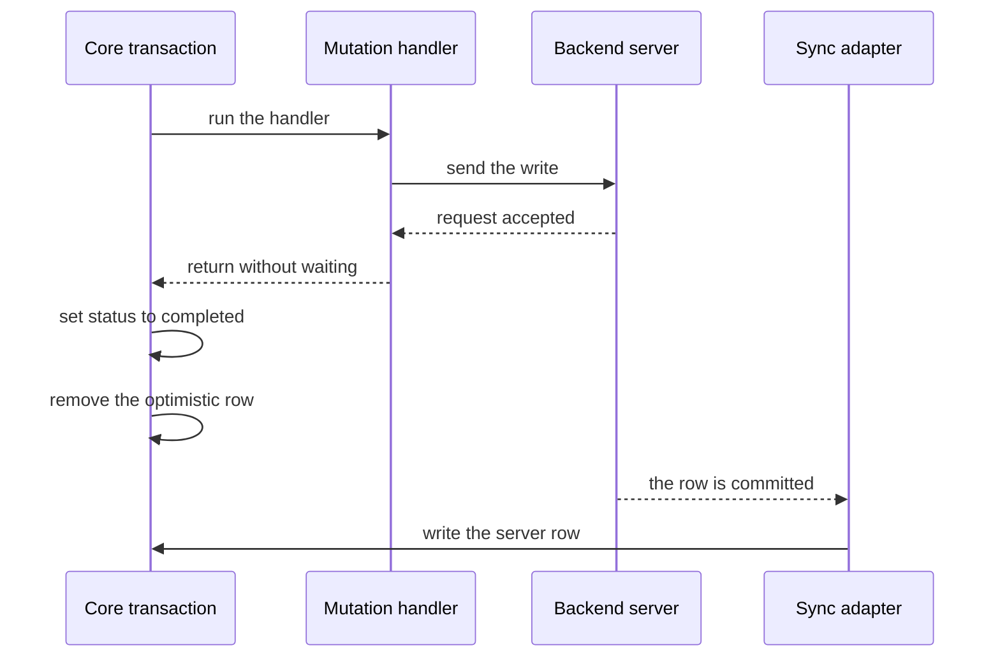
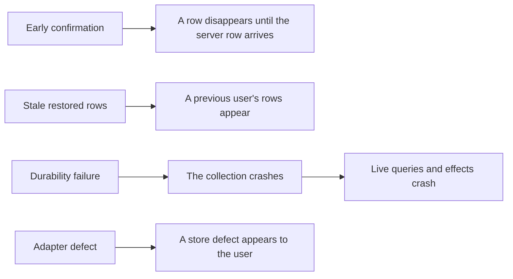

# Critical Assessment

This document tests the TanStack DB design. It lists the strengths, the limits, the open questions, and the risks. Every factual finding cites the source, and every judgement is marked as a judgement. Where the source is silent, this document says so. An absence claim is a result of this study's search; it is not a quoted statement, and the document names the search where it matters.

The studied version is `1.0.0-rc.1.3`. See `packages/db/package.json:2-3`. A release candidate is not a stable release. Some findings below come from that status.

## Strengths

### A small core with a narrow seam

The core does not know about any sync engine. A sync engine here is a system that moves changes from a source into the store. The core knows one contract: `begin`, `write`, `commit`, `markReady`, `reportError`, `fail`, `reportHealthy`, `truncate`, and `invalidateLoadedSubsets`, plus an optional metadata interface, `SyncMetadataApi`, which exposes adapter metadata for insert operations. See `packages/db/src/types.ts:446-552`.

The nine verbs have five jobs. `begin`, `write`, and `commit` run one sync transaction. `markReady` ends the first load. `reportError`, `fail`, and `reportHealthy` report source health. `truncate` replaces all synced rows. `invalidateLoadedSubsets` reports that served pages shifted. A subset is the set of rows that one query demand needs, and a served page is one block of rows in an ordered result that the adapter loaded for a subset. See `packages/db/src/types.ts:452-525`.

That seam lets nine engines share one store. A seam here is the contract boundary: the nine verbs plus the optional metadata interface. An engine here is one way to fill a collection: a sync adapter package or a built-in local collection option. The engines include Electric, PowerSync, TrailBase, RxDB, Convex, TanStack Query, and three local engines. The three local engines are the local-only collection, the `localStorage` collection, and the IndexedDB collection, all inside the core package. See `packages/db/src/local-only.ts:152-176`, `packages/db/src/local-storage.ts:496-529`, and `packages/db/src/indexed-db.ts:438-468`. See also document [05-sync-engines.md](05-sync-engines.md).

The seam also works across repositories. The Durable Streams state package uses the same contract from outside the TanStack DB repository. See `/Users/darkvoid/GitSources/src.Electric/durable-streams/packages/state/src/stream-db.ts:530-556`.

### Incremental query results

A live query is a query whose result collection updates as the data changes. A live query does not re-run when data changes. It pushes a weighted delta through a differential dataflow (D2) graph. A weighted delta is a set of rows with integer counts; a count of `+1` adds an occurrence, and a count of `-1` retracts one. See `docs/overview.md:155-157`.

That design is correct for the stated goal: sub-millisecond updates on a large collection. The source gives one measurement: about 0.7 milliseconds to update one row in a sorted 100,000-row collection on an M1 Pro MacBook. The source states no browser, operating system, or measurement method. See `docs/overview.md:159`.

This study did not run that benchmark. The number is a documentation claim, not an independent result.

### The optimistic overlay

The core does not edit a synced row in place. A transaction adds a layer, the optimistic overlay of unsettled writes. A rollback removes the layer. See `docs/overview.md:192` and `packages/db/src/collection/state.ts:580-656`.

This design makes rollback mechanical. A rollback removes one layer, and the core does not have to reconstruct the previous row. The design also makes a transaction's effects easy to show and hide. In this study's judgement, that is a strength.

### Careful persistence rules

The persistence guide states the hard cases: an empty restore, a timeout, a schema mismatch, and a lost write response. An empty restore returns no rows. A timeout means the restore deadline expires. A schema mismatch means the stored columns differ from the current collection schema. A lost write response means the backend applied a write but the client did not receive the answer. See `docs/guides/sqlite-persistence.md:287-293` and `docs/guides/sqlite-persistence.md:403-417`.

In the cases that the guide documents, the design chooses correctness over a fast first paint. First paint is the first rendering of the page. In this study's judgement, that is a defensible choice.

### Framework breadth

Six framework bindings share one model. A model here is the common pattern: hold a live query collection and subscribe to it with the framework's own reactive primitive. React, Preact, Vue, Solid, Svelte, and Angular each subscribe to the same live query collection. A seventh package, not a framework binding, adds TanStack Router server-side rendering. Server-side rendering builds the page Hypertext Markup Language (HTML) on the server before the browser takes over. See document [06-framework-adapters.md](06-framework-adapters.md).

**Key insight:** TanStack DB separates the optimistic write from the confirmed write. That separation gives the fast interface. It also moves the confirmation rule out of the core and into each mutation handler. The confirmation rule is the rule that a completed transaction must wait for a source signal before the application treats the write as confirmed. In this study's judgement, the design is sound only when every handler and every adapter keeps that rule. The rest of this document tests that condition.

## Limit 1: the release is a candidate

The version is `1.0.0-rc.1.3`. See `packages/db/package.json:2-3`.

The persistence protocol calls itself internal and unstable. The persistence protocol is the internal interface in `packages/db/src/sync-persistence.ts`. The source says application code "should not construct or depend on this value directly." See `packages/db/src/sync-persistence.ts:4-8`.

A third-party persistence adapter must implement this protocol, because the persistence wrapper calls an adapter through this interface. The protocol version is 1. The source does not promise stability for that version. See `packages/db/src/sync-persistence.ts:9-13`.

The risk is concrete, though the sources do not record an instance: a change to the protocol can break an adapter between two TanStack DB patch releases. This is a risk judgement, not an observed event.

## Limit 2: documentation and code disagree on sync modes

The overview document says collections support three sync modes: eager, on-demand, and progressive. A sync mode decides how much data the collection loads. Eager loads the whole collection at start. On-demand loads incremental snapshots when a query asks for rows; an incremental snapshot is one partial set of rows, not the whole table. Progressive loads the whole collection in the background and uses incremental snapshots to give a fast path to the rows that queries need; a fast path here means those rows become usable before the full load finishes. See `docs/overview.md:124-128` and `packages/electric-db-collection/src/electric.ts:320-345`.

The core type has two modes. `SyncMode` is `eager | on-demand`. See `packages/db/src/types.ts:815`.

The Electric adapter defines the third mode, `progressive`, in its own type. See `packages/electric-db-collection/src/electric.ts:326-339`.

So the documentation describes the union of core modes and Electric modes. A reader can believe that every adapter supports three modes. The source does not support that belief.

In this study's judgement, this is a documentation defect, not a design defect. It still costs a reader time.

## Limit 3: eager mode has a documented size limit and no row eviction

Eager mode is the default. See `packages/db/src/collection/sync.ts:135`.

The documentation recommends eager mode for fewer than 10,000 rows of mostly static data. It recommends on-demand mode for large data sets, with 50,000 rows as the example. The source gives 50,000 only as an example size; it does not state a threshold. See `docs/overview.md:126-127`.

The gap between 10,000 and 50,000 rows has no guidance. The source does not state a rule for that range.

Eager mode loads the entire collection. The core evicts a whole collection after it is unused for 300,000 milliseconds (ms), which is 5 minutes. Unused here means no active subscriber, no pending preload, and no persisting transaction. To evict is to clean up the collection; the source does not state the cost of the next use. See `packages/db/src/collection/lifecycle.ts:42`, `packages/db/src/collection/lifecycle.ts:579-586`, and `packages/db/src/collection/lifecycle.ts:598`.

The core does not evict single rows from an active collection. An active collection is one that a subscriber or live query still uses. This study found no per-row eviction in the state manager's row stores. A state manager is the object that holds a collection's rows and status. A row store is a map in the state manager that holds rows by key. See `packages/db/src/collection/state.ts:148-215`. The source does not state a per-row memory bound.

The risk, in this study's judgement: a large eager collection stays in memory while the application uses it. On a low-memory mobile browser, that can end the page; "end the page" means the browser terminates the tab. This is a risk judgement, not an observed event.

## Limit 4: transaction completion does not prove server confirmation

A transaction becomes `completed` when its handler or `mutationFn` returns. A handler is a collection-level function: one of the collection's `onInsert`, `onUpdate`, or `onDelete` options. A `mutationFn` is the function that `createTransaction` or `createOptimisticAction` runs. `createTransaction` starts a transaction from a configuration record, `TransactionConfig`. `createOptimisticAction` builds a function that runs an `onMutate` step and then a `mutationFn`. See `packages/db/src/transactions.ts:320-324`, `packages/db/src/optimistic-action.ts:54-81`, and `packages/db/src/transactions.ts:746-800`.

The guide states the rule: completion proves backend confirmation "only when the handler explicitly waited for that confirmation." See `docs/guides/mutations.md:8` and `docs/guides/mutations.md:247-260`.

The core does not enforce the wait. This study read the settlement path and found no check that a handler awaited a confirmation from the source. See `packages/db/src/transactions.ts:746-800`. A handler that returns at once marks the transaction complete before the server applies the write.

The Electric adapter offers a wait function, `awaitTxId`. See `packages/electric-db-collection/src/electric.ts:1064-1090`. The core does not define a wait function.

Only the Electric adapter provides `awaitTxId`. The Convex adapter provides a different wait, `awaitSync`, which resolves when the source accepts its current result. The conformance package, `@tanstack/db-adapter-conformance`, lists both as optional capabilities, so no adapter must provide either one. A capability here is a named behavior that the conformance checks run only when the adapter declares it. See `packages/convex-db-collection/src/options.ts:19` and `packages/db-adapter-conformance/src/eager-live-source-oracle.ts:303-310`. The source does not state a common confirmation contract.

The risk: an application switches from Electric to another adapter. Its handlers may still look correct. They now confirm too early, and the optimistic row can drop before the server row arrives.

The first arrow starts the handler. The second arrow sends the write to the backend. The third arrow reports that the request was accepted; it does not report that the backend applied the write. The fourth arrow returns before any confirmation from the sync adapter. The fifth arrow completes the transaction. The sixth arrow removes the optimistic overlay; at this point the row can vanish from the result because the synced row has not arrived. The seventh arrow shows the backend commit, which the sync adapter observes; the dashed line marks an observation, not a call. The eighth arrow delivers the row through the sync adapter. If the eighth arrow has not happened, the row is absent from the result until it does. A held row, which the open questions discuss, can prevent the removal at the sixth arrow in some cases.

## Limit 5: a failed transaction does not retry

The core has no retry for a failed `mutationFn`. A failure here means that the function throws or its promise rejects. A failure moves the transaction to `failed` and rolls back its overlay. See `packages/db/src/transactions.ts:640-675`.

Retry lives in a separate package, `@tanstack/offline-transactions`. See `packages/offline-transactions/package.json:2-4`. That package adds an outbox, a leader election, and a retry policy. An outbox is a durable queue of pending transactions. The guide says that the leader holds this outbox and retries the stored mutations, so a leader election chooses the tab that runs them. A retry policy decides when a failed send runs again. The source does not state the election mechanism or what happens when the leader tab closes. See `docs/guides/offline-transactions.md:6-8` and `packages/offline-transactions/src/OfflineExecutor.ts:46-160`.

So an application that wants durable writes must adopt a second package and a second set of rules. The core alone gives no offline guarantee.

## Limit 6: the rollback cascade has no documented opt-out

A rollback also rolls back other transactions that write the same global key. A global key is the string that names one row across collections. The core builds it as `KEY::` plus a JavaScript Object Notation (JSON) array of three values: the collection identifier, the JavaScript type of the key, and the key string. See `packages/db/src/transactions.ts:640-675` and `packages/db/src/collection/mutations.ts:183-186`.

The reason is sound: a second transaction can build on the value that the first transaction supplied.

The source does not state a flag to disable the cascade. The two possible readings are:

1. The cascade is always active.
2. A caller avoids it only by using different keys or by committing in sequence.

The code shows no opt-out flag. The first reading is stronger for that reason.

The risk: an unrelated user action can be undone because another action failed. An application must show that outcome clearly, or a user will see work disappear.

## Limit 7: the adapters are not equally mature

The repository ships nine engines, counted by this study in the workspace package list. See `pnpm-workspace.yaml:10-13` and document [05-sync-engines.md](05-sync-engines.md). They do not share one difficulty level. Difficulty level here means the amount of adapter-specific code and edge-case handling, in this study's judgement.

The TanStack Query adapter is the most complex, in this study's judgement. It has no change stream, which is a subscription that delivers each source change as it happens. It must reconcile three sources of truth: the TanStack Query cache, a fetch in flight, and a local direct write. To reconcile is to decide which source is current when they disagree. The cache holds the stored results of the queries that the client ran. A local direct write is a write that the adapter applies to the collection without a source event. It uses a direct write generation to cancel an older fetch: when a fetch started before a local write returns, the adapter discards that result because it is older than the write. A direct write generation is a counter that increases on each local write, so the adapter can compare a fetch with the newest local write. See `packages/query-db-collection/src/query.ts:996-1020`.

It must also report a page shift, a change in which a row moves between two neighbouring pages of one ordered result and appears in neither page. A page is one block of rows in an ordered query result. If the adapter does not repair the window, the row is missing from the query result until a later refetch. See `packages/query-db-collection/src/query.ts:1260-1280`.

The Convex adapter receives a whole query result. It must compute the delta itself. The work is difficult because the adapter must compare the new result with the stored result to derive the writes and the deletes; a wrong difference adds or removes a row that did not change. See `packages/convex-db-collection/src/options.ts:91-155`.

The RxDB adapter must normalize an insert to an update, because the initial read can already hold the document. To normalize here means to change the event type from insert to update. The initial read is the first load of the existing rows. A document is the RxDB term for one row. See `packages/rxdb-db-collection/src/rxdb.ts:237-242`.

Each of these is a different solution to the same family of three problems: delete detection, ordering, and resume. Delete detection is how an adapter learns that a row was removed when the source sends no row. Ordering is how it keeps changes in source order. Resume is how it restarts from a saved point after a disconnect. The examples do not map one problem each: the Query adapter handles cache and page repair, Convex handles result diffing, and RxDB handles replayed inserts. The core does not supply a shared answer. See document [05-sync-engines.md](05-sync-engines.md).

The risk: a bug in one adapter looks like a bug in the store. In this study's judgement, a user cannot tell the difference from the outside.

## Limit 8: on-demand mode requires adapter work that the type does not show

The sync configuration function in a collection may return an object, `SyncConfigRes`, with a `loadSubset` handler. A `loadSubset` handler syncs the rows for one subset request, and its options describe the requested rows. A subset request is one query's demand for the rows it needs. The type marks the handler optional. See `packages/db/src/types.ts:432-445`.

At run time the core validates the combination. A collection with `syncMode: "on-demand"` and no `loadSubset` throws an error. The message tells the caller to provide a handler or to use eager mode. See `packages/db/src/collection/sync.ts:488-495`.

So the type permits a configuration that the runtime rejects. In this study's judgement, that is a small type-safety gap. It appears only at collection start, not at build time.

## Limit 9: persistence is not authorization

A restored row, which is a row read from the persistence store at startup, can be stale. It can also belong to a user who is no longer signed in. See `docs/guides/sqlite-persistence.md:287-293`.

The guide states that restored rows do not prove current authorization. It tells the application to isolate SQLite data by user or tenant. See `docs/guides/sqlite-persistence.md:318`.

The persistence adapter surface has no built-in tenant partition. A tenant partition is a separate storage namespace, such as a separate database or file, for each tenant. This study searched the methods of `PersistenceAdapter` for a tenant option and found none. The application must supply one; the guide tells the application to isolate the stored data. See `docs/guides/sqlite-persistence.md:318`.

The risk: two users share one origin private file system (OPFS) database. OPFS is a private file system that the browser gives to one origin, and the browser persistence package stores its SQLite database there. A fast restore shows the previous user's rows before the sync adapter confirms the current user's rows.

The guide also states that a healthy restore with zero rows is indistinguishable from a collection that truly has zero rows. The application therefore cannot tell from the row count alone whether the restore was empty or the data is empty. See `docs/guides/sqlite-persistence.md:289`.

## Limit 10: persistence failures are fatal

A failed durable write raises `PersistedCollectionDurabilityError` and crashes the collection. A durable write is a write to the persistence store. See `docs/guides/sqlite-persistence.md:411-415`.

A crash moves the collection to `crashed`, even after it was ready. Every live query and effect over it also crashes. An effect is a reactive computation that re-runs when a value it reads changes. The guide states that both crash; it does not state how a consumer observes the crash. See `docs/guides/sqlite-persistence.md:411-415`.

The design fails closed. A design fails closed when a failure stops the operation, instead of continuing with data that may be wrong. In this study's judgement, that is safe for data and harsh for a user interface. The guide gives the recovery path: call `cleanup({ dependents: true })` and then `preload()`. See `docs/guides/sqlite-persistence.md:413`.

A lost coordinated write response raises `IndeterminateCommitError`. A coordinated write is a write routed through the cross-tab coordinator. The application must check the durable state before it retries. The source does not state which method to use for that check. See `docs/guides/sqlite-persistence.md:417`.

The source does not state a built-in reconciliation helper for that case. This study searched the persistence packages for such a helper and found none.

## Limit 11: version skew across repositories

The Durable Streams state package declares `@tanstack/db` as an optional peer in the range `>=0.6.0 <1.0.0`. That package provides StreamDB, the stream-backed database that applies state-protocol messages to TanStack DB collections. See `/Users/darkvoid/GitSources/src.Electric/durable-streams/packages/state/package.json:65-71`.

The range excludes version 1.0.0 and every later version. The studied TanStack DB version is the release candidate `1.0.0-rc.1.3`. See `packages/db/package.json:2-3`.

The source does not state whether a package manager accepts this pair. Under semantic versioning, a release candidate has a lower precedence than the final release. A range without a prerelease comparator normally excludes prerelease versions. A prerelease comparator is the part of a version range that names an allowed prerelease tag, such as `-rc.1`. The rule is that a prerelease version normally matches only a comparator on the same major, minor, and patch tuple. The two possible readings are:

1. The range is not yet updated for the release candidate.
2. The integration is tested only on the 0.6 line.

The source does not state which reading is correct. Either way, a user who installs both packages at their newest versions can receive a peer warning. A peer warning is a package manager message that the installed peer does not satisfy the declared range; the install can still complete. If the install completes, a run-time mismatch is possible. This study did not run a package manager, so the warning is a possibility, not an observed result.

## Limit 12: the store has no server and no security model

TanStack DB is a client library. This study searched the package descriptions for a server process, an authentication layer, or an authorization layer and found none. That search covers the package descriptions, not every source file. The core package describes itself as "A reactive client store for building super fast apps on sync." See `packages/db/package.json:2-4`.

Row access is the job of the sync adapter and of the backend that serves it. The core applies whatever rows the adapter writes. See `packages/db/src/types.ts:446-552`.

The persistence guide repeats the warning for restored rows. See `docs/guides/sqlite-persistence.md:318`.

In this study's judgement, a reader who expects a sync service will be disappointed. The repository supplies the client half only.

## Open questions

The source does not answer these questions. Each one gives two possible readings.

1. **How long can an optimistic hold last?** `heldOptimisticRows` and `pendingSyncedTransactions` hold a row over newer synced data. `heldOptimisticRows` is the map of held rows. `pendingSyncedTransactions` is the list of committed sync transactions that are not yet applied. A held row is the optimistic row of a completed transaction that stays in the overlay while a committed sync transaction for the same key has not applied. The match is by key: the core collects the keys of committed sync transactions and holds a completed optimistic mutation when its key is in that set. See `packages/db/src/collection/state.ts:596-628`. Either a hold lasts until the matching sync transaction applies, or a hold expires by timeout. This study found no timeout in that range.

2. **Can a caller opt out of the rollback cascade?** See `packages/db/src/transactions.ts:640-675`. Either the cascade is always active, or only different keys avoid it.

3. **How does the query engine treat a non-linear user function?** A non-linear user function is a function whose output for a combined input is not the combination of its outputs for the parts. For example, an average over a group is not the average of the averages of the parts. A D2 operator graph expects deltas. Either the compiler rejects such a function, or it treats the function as a per-row value, a function evaluated for each row independently, and re-evaluates it on each delta. Document [03-live-queries.md](03-live-queries.md) states that the source does not say.

4. **What does a StreamDB `reset` do to an uncommitted batch?** The dispatcher truncates every collection and clears the pending set. The dispatcher is the StreamDB component that reads protocol messages and calls the collection sync handlers. The pending set is the set of handlers that have an open but uncommitted transaction. See `/Users/darkvoid/GitSources/src.Electric/durable-streams/packages/state/src/stream-db.ts:360-370`. Either the truncate discards the pending writes, or a later `commit` applies them after the reset. The source does not state which one happens.

5. **What is the supported row count for each sync mode?** The documentation gives 10,000 and 50,000 as examples. See `docs/overview.md:126-127`. These are guidance values, not measured limits.

## Risks for an adopter

The risk column names the failure that each row concerns; the evidence column gives the source for that failure. The mitigation column is this study's recommendation, not a source statement. A sync signal is a message from the sync adapter that the source observed the write, such as the Electric `awaitTxId` result. `awaitTxId` is the Electric adapter method that returns a promise and resolves when the shape stream returns the given transaction identifier. See `packages/electric-db-collection/src/electric.ts:1064-1090`.

Each left node comes from a limit in this document: early confirmation from Limit 4, stale restored rows from Limit 9, durability failure from Limit 10, and an adapter defect from Limit 7. The diagram selects four risks for clarity; the table below lists seven. Each arrow states a consequence; the second arrow of the durability pair states the effect that a user can see. The arrow from the crash to the live queries shows that the crash propagates to every query and effect over the collection. The last effect is a user-visible fault that the core did not cause.

| Risk | Evidence | Mitigation |
| --- | --- | --- |
| Early confirmation of writes | `docs/guides/mutations.md:8` | Await a source-specific confirmation in every handler; only Electric and Convex provide a wait utility |
| Memory growth in eager mode | `docs/overview.md:126` | Use on-demand mode above 10,000 rows, and supply a `loadSubset` handler |
| Data leak from a restored cache | `docs/guides/sqlite-persistence.md:318` | Partition storage by user or tenant |
| A crash from a durability failure | `docs/guides/sqlite-persistence.md:411-415` | Call `cleanup({ dependents: true })` and `preload()` to recover |
| Adapter-specific bugs | document [05-sync-engines.md](05-sync-engines.md) | Test the sync path of each engine |
| Peer version skew with StreamDB | `/Users/darkvoid/GitSources/src.Electric/durable-streams/packages/state/package.json:65-71` | Pin both packages to a tested pair |
| Unstable persistence protocol | `packages/db/src/sync-persistence.ts:4-8` | Do not build a custom adapter on the internal persistence protocol without a compatibility test |

## Who should use it

Use TanStack DB when these conditions hold:

- The application already has an authoritative backend, a backend that owns the data.
- The application needs a fast local query layer with joins, queries that combine rows from two collections.
- The application can accept an adapter per data source.
- The team can test the sync path, the code path from source changes to collection rows, for the chosen engine.

Do not use it as a replacement for a sync service. It is not one. A sync service here is a system that moves data between a backend and a client. Use Electric, PowerSync, Durable Streams, or another sync engine or protocol to move the data. Use TanStack DB for the client store.

## The weakest area of the repository

In this study's judgement, the weakest area is confirmation and retry. The store gives a strong optimistic model. It gives no core rule that ties transaction completion to server confirmation. Retry lives in a separate package. This area is the weakest because a failure here can remove a visible row without an error, whereas the other limits need a specific environment or event.

A new user can read the optimistic examples and believe that a completed transaction is a confirmed write. The documentation does state the rule. The type system does not enforce it: the handler types return `Promise<void>`, and a promise that resolves at once satisfies the type. See `packages/db/src/types.ts:762-781`. The default behavior does not enforce it either; the settlement path has no confirmation check, as Limit 4 states. See `docs/guides/mutations.md:8`.

In this study's judgement, this is the finding that most affects correctness in production. It should be the first item on any adoption review.

## Source map

| Area | Source |
| --- | --- |
| Version | `packages/db/package.json:2-3` |
| Sync contract | `packages/db/src/types.ts:446-552` |
| Sync modes in documentation | `docs/overview.md:124-128` |
| Sync modes in code | `packages/db/src/types.ts:815` |
| Eager default | `packages/db/src/collection/sync.ts:135` |
| Garbage collection default | `packages/db/src/collection/lifecycle.ts:42` |
| Transaction completion | `packages/db/src/transactions.ts:746-800` |
| Rollback | `packages/db/src/transactions.ts:640-675` |
| Confirmation rule | `docs/guides/mutations.md:8` |
| Persistence guide | `docs/guides/sqlite-persistence.md` |
| Persistence protocol | `packages/db/src/sync-persistence.ts:4-12` |
| StreamDB peer range | `/Users/darkvoid/GitSources/src.Electric/durable-streams/packages/state/package.json:65-71` |

## Related documents

- [04-mutations.md](04-mutations.md): the transaction model that this document tests.
- [05-sync-engines.md](05-sync-engines.md): the uneven adapter surface.
- [07-persistence.md](07-persistence.md): the restore rules and their failure modes.
- [08-durable-streams-and-electric.md](08-durable-streams-and-electric.md): the cross-repository relation and its version skew.
- [00-overview.md](00-overview.md): the thesis that this document measures against.
