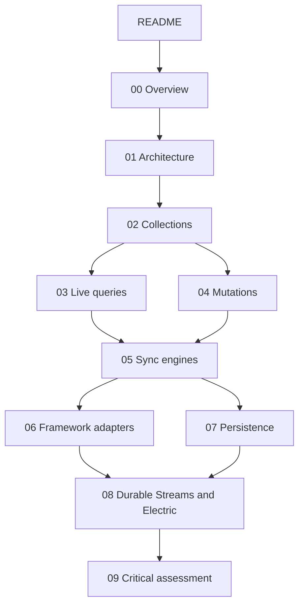
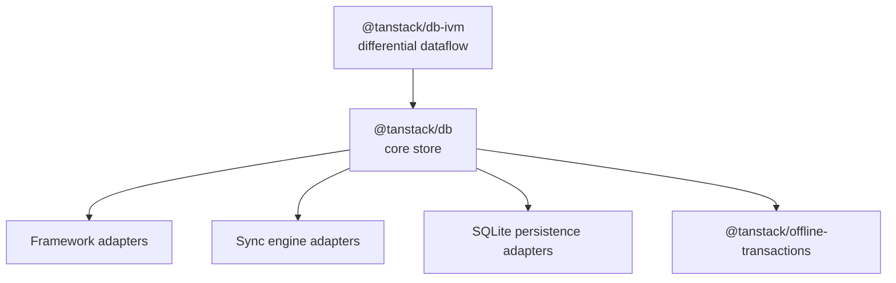

# TanStack DB

TanStack DB is a reactive client store for an application programming interface (API). It loads rows into normalized collections, answers queries from memory, and applies writes before the network answers.

This directory is a source-grounded study of the repository at `/Users/darkvoid/GitSources/src.Electric/src.tanstack-db`.

## Repository scope

The path `/Users/darkvoid/GitSources/src.Electric/src.tanstack-db` holds seven independent Git repositories:

| Directory | Project |
| --- | --- |
| `ai` | TanStack AI |
| `db` | TanStack DB |
| `devtools` | TanStack Devtools |
| `query` | TanStack Query |
| `router` | TanStack Router |
| `table` | TanStack Table |
| `virtual` | TanStack Virtual |

This study covers `db` only. The `db` remote is `git@github.com:TanStack/db.git`. The checked-out commit is `36f879727d594601e28329e177c802dc179bf9e9`. The date of that commit is 2026-11-03.

The root package version is `1.0.0-rc.1.3`. The repository is a beta release candidate. The root `README.md` says "Tanstack DB is currently in BETA." See `README.md:50-55`.

All paths in this study are relative to `/Users/darkvoid/GitSources/src.Electric/src.tanstack-db/db` unless this document states another base.

Document [08-durable-streams-and-electric.md](08-durable-streams-and-electric.md) also reads the sibling repository at `/Users/darkvoid/GitSources/src.Electric/durable-streams`. The only adapter between TanStack DB and Durable Streams lives in that repository, not in the TanStack DB repository.

## Terms used in this study

| Term | Meaning |
| --- | --- |
| **Collection** | A typed, observable set of rows. It is observable because a subscriber receives a notification for each row change. It is normalized when each row appears once and other rows refer to it by key. A collection has a key function, a schema, and a sync adapter. |
| **Sync adapter** | The function in a collection configuration that receives rows from a source. It calls `begin`, `write`, `commit`, and `markReady`. |
| **Persistence adapter** | The object that stores collection rows and metadata in structured query language (SQL) storage. It implements the `PersistenceAdapter` interface. |
| **Live query** | A query whose result collection updates incrementally when a source collection changes. |
| **Incremental view maintenance** | The method that keeps a query result correct by applying only the differences, not by re-running the query. The abbreviation is IVM. |
| **Optimistic update** | A local row change that becomes visible before the server confirms it. |
| **Transaction** | A group of mutations that commit together and roll back together. |
| **Standard Schema** | A common validation interface. A collection uses it to check each row against a schema. |
| **Change message** | One row change with a key, a value, a previous value, and a type (`insert`, `update`, or `delete`). |
| **D2** | The differential dataflow library that executes live query pipelines. Differential dataflow computes a result by applying changes to the previous result, not by re-running the query. The repository imports it as `@tanstack/db-ivm`. The upstream project name is `d2ts`. |

## The problem and the thesis

The project states three problems in `docs/overview.md:8-14`:

1. View-specific API endpoints cause "endpoint sprawl and network waterfalls."
2. Loading all data and filtering on the client causes slow loads.
3. The client needs fast queries, real-time reactivity, and instant writes.

The answer in `docs/overview.md:27-31` has five parts:

1. Normalized collections.
2. Query-driven sync.
3. Sub-millisecond live queries.
4. Optimistic mutations.
5. A backend that stays simple.

The thesis is that the client should hold normalized rows and derive every view from them. When a user reads or writes, the client answers from memory. It does not wait for a request. The network then leaves the interaction path. See `README.md:55-61` and `docs/overview.md:8-14`.

Document [00-overview.md](00-overview.md) explains the thesis in full.

## A short example

The documentation example defines a collection descriptor. See `docs/overview.md:62-67`.

```ts
const todoCollection = collectionOptions('todos', () => ({
  id: 'todos',
  // ...your config
  onUpdate: updateMutationFn,
}))
```

A live query reads from the collection. See `docs/overview.md:77-80`.

```ts
const { data: todos } = useLiveQuery({
  query: (q) =>
    q.from({ todo: todoCollection }).where(({ todo }) => not(todo.completed)),
})
```

An update applies at once as optimistic state. See `docs/overview.md:84-86`.

```ts
todosCollection.update(todo.id, (draft) => {
  draft.completed = true
})
```

## Documents

| Document | What you learn |
| --- | --- |
| [00-overview.md](00-overview.md) | The problem, the thesis, the main concepts, and the repository history |
| [01-architecture.md](01-architecture.md) | The layers, the collection managers, the data flow, and the D2 engine |
| [02-collections.md](02-collections.md) | Collection types, the sync adapter contract, and the persistence adapter contract |
| [03-live-queries.md](03-live-queries.md) | The query builder, the compiler, weighted multisets, operators, indexes, and incremental results |
| [04-mutations.md](04-mutations.md) | Optimistic state, the transaction model, rollback, and the path to the server |
| [05-sync-engines.md](05-sync-engines.md) | Electric, PowerSync, TrailBase, RxDB, Convex, TanStack Query, and the local adapters |
| [06-framework-adapters.md](06-framework-adapters.md) | React, Preact, Vue, Solid, Svelte, Angular, and the reactive model |
| [07-persistence.md](07-persistence.md) | SQLite persistence, restore after reload, multiple tabs, and the capability protocol |
| [08-durable-streams-and-electric.md](08-durable-streams-and-electric.md) | The relation to Durable Streams and Electric, shared ideas, and real differences |
| [09-critical-assessment.md](09-critical-assessment.md) | Limits, open questions, risks, and the weakest parts of the design |

## Reading order

| Order | Document | Why |
| --- | --- | --- |
| 1 | [00-overview.md](00-overview.md) | Establish the vocabulary and the thesis |
| 2 | [01-architecture.md](01-architecture.md) | See where each part lives |
| 3 | [02-collections.md](02-collections.md) | Learn the central data structure |
| 4 | [03-live-queries.md](03-live-queries.md) | Learn how reads become reactive |
| 5 | [04-mutations.md](04-mutations.md) | Learn how writes become visible and durable |
| 6 | [05-sync-engines.md](05-sync-engines.md) | Compare the shipped adapters |
| 7 | [06-framework-adapters.md](06-framework-adapters.md) | Connect the store to a user interface (UI) |
| 8 | [07-persistence.md](07-persistence.md) | Survive a browser reload |
| 9 | [08-durable-streams-and-electric.md](08-durable-streams-and-electric.md) | Place the project beside Electric and Durable Streams |
| 10 | [09-critical-assessment.md](09-critical-assessment.md) | Judge the design |

A reader who knows the collection model can start at [03-live-queries.md](03-live-queries.md). A reader who wants the comparison with Electric can start at [08-durable-streams-and-electric.md](08-durable-streams-and-electric.md).



Every edge in this map is a reading-order edge. It does not show a data flow. The edge from 02 to 03 moves from the collection to its read path. The edge from 02 to 04 moves from the collection to its write path. The two edges into 05 move from the read and write paths to the engines that supply both. The edge from 05 to 06 moves from the engines to the framework bindings. The edge from 05 to 07 moves from the engines to the persistence layer. Both 06 and 07 lead to 08 because the comparison needs the complete picture. The last edge asks for a judgement after the evidence.

## Package map

The repository has 28 packages under `packages/`. Every package is TypeScript, except where the table states another language. The purpose column comes from each `package.json` description.

| Package | Language | Purpose |
| --- | --- | --- |
| `@tanstack/db` | TypeScript | The core store: collections, transactions, queries, indexes, and persistence interfaces |
| `@tanstack/db-ivm` | TypeScript | Incremental view maintenance based on differential dataflow |
| `@tanstack/react-db` | TypeScript and TypeScript with JSX (TSX) | React integration: hooks, provider, hydration, and paced mutations |
| `@tanstack/preact-db` | TypeScript | Preact integration |
| `@tanstack/vue-db` | TypeScript | Vue integration |
| `@tanstack/solid-db` | TypeScript | Solid integration |
| `@tanstack/svelte-db` | TypeScript and Svelte | Svelte integration |
| `@tanstack/angular-db` | TypeScript | Angular integration |
| `@tanstack/react-router-with-db` | TSX | TanStack Router server-side rendering (SSR) integration |
| `@tanstack/query-db-collection` | TypeScript | A collection backed by a TanStack Query `QueryClient` |
| `@tanstack/electric-db-collection` | TypeScript | A collection backed by an Electric shape stream |
| `@tanstack/powersync-db-collection` | TypeScript | A collection backed by a PowerSync local database |
| `@tanstack/trailbase-db-collection` | TypeScript | A collection backed by a TrailBase record API |
| `@tanstack/rxdb-db-collection` | TypeScript | A collection backed by an RxDB database |
| `@tanstack/convex-db-collection` | TypeScript | A collection backed by a Convex query subscription |
| `@tanstack/offline-transactions` | TypeScript | An outbox, retries, leader election, and offline mutation execution |
| `@tanstack/db-sqlite-persistence-core` | TypeScript | The shared SQLite persistence adapter, schema, and coordination protocol |
| `@tanstack/browser-db-sqlite-persistence` | TypeScript | Browser persistence with WebAssembly (WASM) SQLite and the origin private file system (OPFS) |
| `@tanstack/node-db-sqlite-persistence` | TypeScript | Node.js persistence with `better-sqlite3` |
| `@tanstack/expo-db-sqlite-persistence` | TypeScript | Expo persistence |
| `@tanstack/react-native-db-sqlite-persistence` | TypeScript | React Native persistence |
| `@tanstack/electron-db-sqlite-persistence` | TypeScript | Electron main-process persistence and renderer bridge |
| `@tanstack/tauri-db-sqlite-persistence` | TypeScript | Tauri persistence |
| `@tanstack/capacitor-db-sqlite-persistence` | TypeScript | Capacitor persistence |
| `@tanstack/cloudflare-durable-objects-db-sqlite-persistence` | TypeScript | Cloudflare Durable Objects persistence |
| `@tanstack/db-adapter-conformance` | TypeScript | Conformance oracles for sync adapters |
| `@tanstack/db-collection-e2e` | TypeScript | End-to-end collection tests |
| `db-collections` | None | An empty private placeholder package |

The citations are the `name` and `description` fields in each `packages/<name>/package.json`. For example, the core description is in `packages/db/package.json:2-4`.



The edge from `db-ivm` to `db` is a real package dependency. The citation is `packages/db/package.json:58`. The edges from the core to the adapters show the direction of the dependency: each adapter imports `@tanstack/db`. The core does not import an adapter. The citations are `packages/electric-db-collection/package.json:50-52` and `packages/react-db/package.json:50`.

## The three surfaces

The repository has three public surfaces:

1. **The store.** `createCollection`, `createLiveQueryCollection`, and `createTransaction`. See `packages/db/src/index.ts:6-18`.
2. **The adapters.** Sync adapters turn a source into change messages. Persistence adapters store rows in SQLite.
3. **The bindings.** Framework hooks turn a collection into a reactive value for a UI.

Document [01-architecture.md](01-architecture.md) explains how the three surfaces connect.

## Key insight

**Key insight:** TanStack DB does not replace the cache. It adds a normalized store beside it. A TanStack Query collection uses a `QueryClient`, the cache object of TanStack Query, that the caller supplies. An Electric collection creates a `ShapeStream`, the object that reads an Electric shape. The core owns neither. It defines one small contract, `SyncConfig.sync`, and every source implements that contract. See `packages/db/src/types.ts:446-552` and `packages/query-db-collection/src/query.ts:185-186`.

That single contract is why the repository can ship nine different sync engines and eight persistence runtimes without branching the core. The eight persistence runtimes are the platform packages: browser, Node.js, Expo, React Native, Electron, Tauri, Capacitor, and Cloudflare Durable Objects.

## Source map

| Area | File |
| --- | --- |
| Root summary | `README.md` |
| Project overview | `docs/overview.md` |
| Core types | `packages/db/src/types.ts` |
| Collection | `packages/db/src/collection/index.ts` |
| Transactions | `packages/db/src/transactions.ts` |
| Live query root | `packages/db/src/query/live-query-collection.ts` |
| Differential dataflow | `packages/db-ivm/src/d2.ts` |
| React binding | `packages/react-db/src/useLiveQuery.ts` |
| Persistence core | `packages/db-sqlite-persistence-core/src/persisted.ts` |
| Guides | `docs/guides/` |

## Related documents

- [00-overview.md](00-overview.md) gives the thesis.
- [01-architecture.md](01-architecture.md) gives the layer map.
- [09-critical-assessment.md](09-critical-assessment.md) gives the judgement.
