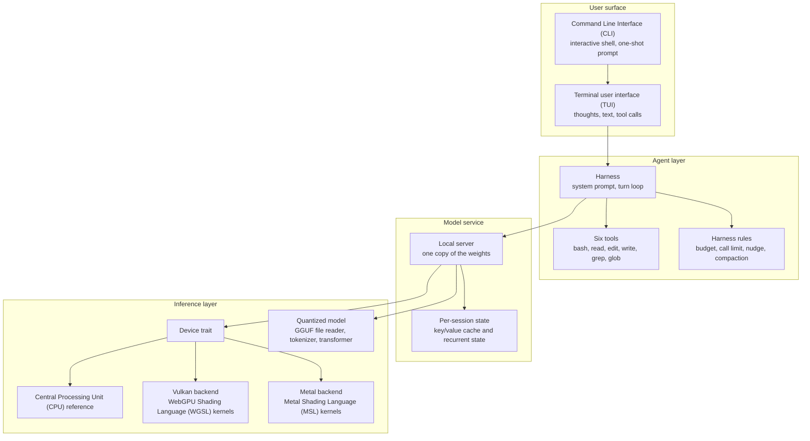
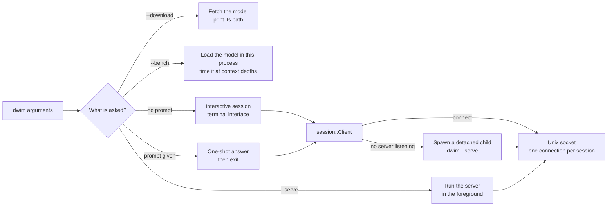
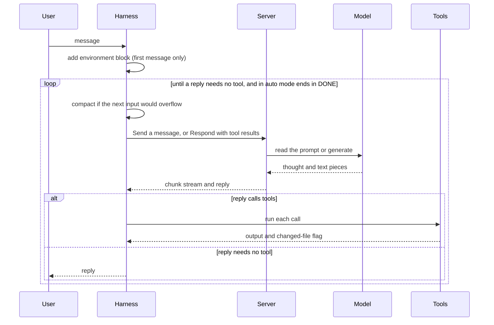

# Overview: a coding agent that owns its model

**Thesis.** dwim is one Rust program that contains a coding agent, a quantized model, and the engine that runs the model. The agent does not call a remote Application Programming Interface (API). After the model file is on disk, the program needs no network. This document gives the mental model. The later documents open each layer.

## 1. The problem dwim answers

A normal coding agent is a loop around a remote model. The loop sends messages to an API, reads tool calls from the reply, runs the tools locally, and sends the results back. The model is a service. The agent owns the loop and the tools.

That design has three costs:

1. **A network dependency.** The agent stops when the API is unreachable.
2. **A data boundary.** The prompt, the source code, and the tool output leave the machine.
3. **A price per token.** Every turn has a metered cost.

dwim removes all three by moving the model into the process tree of the agent. The agent runs the model locally instead of calling a service. The cost is different: the user must have a machine with enough memory, a supported Graphics Processing Unit (GPU), and the model file on disk, and the agent supports one model family.

The project states the privacy part of the trade in its own words:

```markdown
# README.md:8-11
**A coding agent that runs on your own GPU.**

The agent, the model, and the engine that runs it, in one Rust program:
no API key, no cloud, and nothing leaves your machine.
```

The quote covers the privacy part of the trade only. The memory requirement, the supported GPU, and the one-family limit are separate costs. Section 3 gives the memory requirement and the model limit.

## 2. The three layers



The layers have one direction of control. A **session** is one conversation with the server: one socket connection, one harness, and one slot for the model state. The command-line interface starts a session. The session sends messages to the server. The server generates tokens with the model and the engine. The harness reads the reply, runs a tool if the model asks for one, and sends the result back.

The library root names the five public modules:

```rust
// lib.rs:1-7
//! A coding agent harness: the agent, the model, and the engine that runs it.

pub mod gpu;
pub mod harness;
pub mod models;
pub mod server;
pub mod tools;
```

`cli/` is a binary module, not a library module. The package declares two binaries:

```toml
# Cargo.toml:9-15
[[bin]]
name = "dwim"
path = "cli/main.rs"

[[bin]]
name = "difftest"
path = "testing/difftest/main.rs"
```

The `cli/` directory holds the binary's own modules: `main` (parse and dispatch), `opts` (the options), `run` (the interactive session), `once` (the one-shot answer), `session` (server control and shared settings), `serve` (the foreground server), `bench` (the speed measurement), `fetch` (the model download), `model` (model identity and sizing), and `tui` (screen and line editor). They are not library modules. The library model module is `dwim::models::qwen35`.

The `dwim` binary runs the agent. The `difftest` binary compares the GPU result with the CPU result for the real weights. A third entry point, `scripts/swebench.py`, runs the Software Engineering Benchmark Lite (SWE-bench Lite) evaluation.

## 3. The model

dwim supports one model: Qwen3.8-27B. It reads a Q4_0 GGUF file of about 16 gibibytes (GiB), prepared by bartowski from the weights that Qwen released. The project describes the architecture and the drafter:

```markdown
# AGENTS.md:45-54
The one model is `qwen3.8-27b`, Qwen3.8-27B as Qwen released it, in
bartowski's Q4_0 GGUF conversion (16 GB): a hybrid of full attention every
fourth layer and Gated DeltaNet linear attention elsewhere, which
`models/qwen35.rs` runs and documents in detail. Q4_0 and Q8_0 matrices run
as they are, and Q4_1 and Q6_K are quantized again as Q8_0 on loading. It
needs a 32 GiB Mac. It thinks by default and calls tools as
`<tool_call><function=bash>…`. Its 65th block predicts the token after the
next, and the model drafts with it: the chat drafts `--speculate` tokens
after each it picks and the model verifies them in one pass, keeping the
ones the sampler accepts.
```

The quote uses terms that the rest of this document needs:

- **Block.** One transformer layer. The file holds 65 blocks. Blocks 1 to 64 are the model. Block 65 is the drafter.
- **Full attention.** A block that compares each token with every earlier token. It keeps a key/value cache that grows with the conversation.
- **Linear attention.** A block that carries a fixed-size state from one token to the next. This model uses Gated DeltaNet: a linear-attention rule with a decay gate and a write gate. Its state does not grow with the conversation.
- **`full_attention_interval`.** Every fourth block uses full attention (`models/qwen35.rs:193-195`). The other three use Gated DeltaNet.
- **Drafter.** The extra block that predicts the token after the next. The chat uses it to propose tokens ahead. `--speculate N` sets how many tokens it proposes after each token that the chat picks. The model verifies the batch in one pass, and the sampler keeps the proposals that it accepts.

The module is named `qwen35.rs`, and the model is named `qwen3.8-27b`. The names differ because the model file declares its architecture as `qwen35` (`models/qwen35.rs:102-105`) and the project names the model after its release (`models/qwen35.rs:21`). One module runs this one architecture.

Three facts matter for the rest of the exploration:

- **One model, not a catalogue.** The code can load another GGUF file only if the file declares the `qwen35` architecture and has the same tensor layout. There is no generic model registry.
- **Quantized weights stay quantized.** The four block formats are `Q4_0` (4-bit values, 32 per block, one 16-bit scale), `Q8_0` (8-bit values, 32 per block, one 16-bit scale), `Q4_1` (4-bit values, 32 per block, a scale and a minimum), and `Q6_K` (6-bit values in 256-value super-blocks with 16 8-bit scales). The kernels run `Q4_0` and `Q8_0` directly. `models/quants.rs` converts `Q4_1` and `Q6_K` to `Q8_0` when the file loads (`models/quants.rs:37-52`, `:82-88`).
- **The model drafts, then verifies.** The drafter proposes several tokens. The main model checks them in one forward pass. This is **speculative decoding**. It trades extra compute for fewer sequential steps.

The file also holds a byte-pair encoding (BPE) tokenizer, the chat template, and the sampling defaults.

The memory requirement is enforced before any download:

```rust
// cli/main.rs:253-271 (condensed)
#[cfg(target_vendor = "apple")]
const MIN_MEMORY: u64 = 32 << 30;

fn check_memory() -> Result<(), Box<dyn Error>> {
    let memory = dwim::gpu::host::total().ok_or("cannot determine the memory size")?;
    if memory < MIN_MEMORY {
        return Err(format!(
            "dwim requires {} GiB or more DRAM on a Mac, and this one has {} GiB",
            MIN_MEMORY >> 30,
            memory >> 30
        )
        .into());
    }
    Ok(())
}
```

```rust
// cli/main.rs:274-277
#[cfg(not(target_vendor = "apple"))]
fn check_memory() -> Result<(), Box<dyn Error>> {
    Ok(())
}
```

The check is compiled on Apple targets only. The second definition returns success on every other target, so the program does not refuse to start on Linux. A machine with too little memory then fails when the weights do not fit.

The requirement needs one distinction. The weights are about 16 GiB. The check requires 32 GiB. One GiB is 1,073,741,824 bytes. One gigabyte (GB) is 1,000,000,000 bytes. The weights therefore take half of the required dynamic random-access memory (DRAM). The other half holds the key/value caches, the recurrent states, the activations, and the operating system. On an Apple machine the Central Processing Unit (CPU) and the Graphics Processing Unit (GPU) share one memory pool, so the model, the caches, and the system compete for it. A Linux machine passes this early check and fails later, when the device reports too little free memory for the weights.

## 4. What dwim does not do

The README is explicit about the security boundary:

```markdown
# README.md:62-65
- **Bring your own sandbox.** `dwim` expects to run inside a sandbox, such as
  a container or a virtual machine, and does not confine the model itself.
  Commands run without confirmation and without a time limit, until they
  finish.
```

The model has the full authority of the user who starts the program. The harness has no approval prompt. The README sentence about the time limit is out of date. The code gives every command a default limit:

```rust
// tools/bash.rs:113
pub const TIMEOUT: u64 = 300;

// tools/bash.rs:84-92 (condensed)
Parameter::integer(
    "timeout",
    format!(
        "Seconds the command may run (default {TIMEOUT}; 0 for no limit). Give a long build or test run more."
    ),
)
.optional(),
```

The tool stops a command after 300 seconds unless the call asks for more. A call that gives 0 removes the limit. Isolation is the caller's responsibility.

The program is also experimental:

```markdown
# README.md:18-22
> [!WARNING]
> **dwim is experimental software.** Expect bugs, rough edges, and changes that
> break things from one commit to the next. The model runs shell commands on
> your machine without asking first, so use it on code that you have committed or
> backed up.
```

## 5. The five entry paths



The dispatch is a chain of conditions in `cli/main.rs`:

```rust
// cli/main.rs:43-63 (condensed)
let settings = opts.settings();
let prompt = opts.prompt.join(" ");
let result = check_memory().and_then(|()| {
    if opts.download {
        let mut stderr = Stderr::new();
        let dir = session::fetch_model(&settings, |loading| stderr.report(&loading))?;
        println!("{}", dir.join(qwen35::WEIGHTS).display());
        return Ok(());
    }
    if opts.bench {
        return bench::bench(&settings);
    }
    if opts.serve {
        return serve::serve(&settings);
    }
    let log = log(opts.transcript)?;
    match prompt.trim() {
        "" => run::run(settings, opts.thinking, log),
        prompt => once::once(&settings, prompt, opts.stats, log),
    }
});
```

`--version` prints the version and returns before the memory check and before every path below (`cli/main.rs:39-42`). `--help` exits inside the argument parser. A run with no prompt and no other option opens the interactive session. A run with a prompt answers it once. Both paths reach the model through the server, not through a direct call, so two terminals share one loaded model. `--serve` runs that server in the foreground. `--bench` and `--download` do not use the socket: `--bench` loads the model in its own process and measures it (`cli/bench.rs:38-40`), and `--download` only writes the file.

The snippet calls modules of the `cli` binary (`session`, `bench`, `serve`, `run`, `once`) and the library module `dwim::models::qwen35`. Section 2 lists the `cli` modules.

## 6. The server is the center of the design

The model is large and the sessions are small. dwim uses that fact to share work:

```markdown
# README.md:58-61
- **Built-in local inference server.** The model is loaded once, in a
  `dwim` server that every `dwim` you run connects to. The first one starts
  it in the background, and it exits when idle. Sessions share the weights,
  and each has its own context on the GPU, so you can run several at once.
```

The server is the same binary, run with `--serve` as a detached child process of the first client. The boundary is a Unix domain socket. The protocol is JavaScript Object Notation (JSON), one message per line. One connection holds one session and makes one request at a time:

```rust
// server/protocol.rs:1-5
//! What a client and the server say to each other, over a Unix socket:
//! JSON, one message a line. A request is answered with a response, with
//! what the server has to say in the meantime, such as a reply's pieces or
//! how loading is going, streamed ahead of it. One connection holds one
//! session, and makes one request at a time.
```

The `Size` value is part of the protocol. The server computes it when it loads the model, and it reports the value in `Status::Sized` while loading and in `Opened` when a session opens:

```rust
// server/protocol.rs:219-230
/// How many sessions the model has room for at once, the tokens of
/// conversation each has room for, and the device memory they take:
/// `model` bytes for the weights and the activations, which the sessions
/// share, and `conversation` bytes more for each session, for its recurrent
/// states and its tokens of context.
#[derive(Clone, Copy, Debug, Deserialize, PartialEq, Serialize)]
pub struct Size {
    pub sessions: usize,
    pub context: usize,
    pub model: u64,
    pub conversation: u64,
}
```

**Aha: the session count is an input, and the context length is the result.** The command line takes `--sessions` and defaults it to 2 (`cli/model.rs:35`). The client passes that value to the server when it starts it (`cli/session.rs:370-373`). The server then calls the size function. The function takes the free device memory, subtracts the shared model bytes and a small headroom, divides the rest by the session count, and derives the context that each session can hold from the bytes that remain (`cli/model.rs:121-163`). The number of sessions is therefore a chosen limit. The context size is the consequence of that choice, the model size, and the device memory. The `sessions` field of `Size` reports the value that the caller chose. The `context` field reports the result.

## 7. The agent loop in one page

The harness wraps a conversation and runs it until a reply calls no tool. In auto mode it also waits for the last line of the reply to be `DONE`. A turn has these steps:



**Auto mode** is the mode with no human present. The one-shot path turns it on (`cli/once.rs:36-37`). The interactive path turns it on with `/auto on`. In auto mode, a reply that calls no tool and does not end in `DONE` receives the `GO_ON` instruction, and the turn continues. The harness gives that instruction at most `AUTO_ROUNDS` times, which is 10 (`harness/mod.rs:100-110`). `DONE` is the last line that the model writes when nothing remains.

The **environment block** is a short text that states the working directory, the date, the branch, and the files in the directory. The harness puts it ahead of the first message, not in the system prompt, so the saved prompt state stays valid across days and branches (`harness/mod.rs:13-18`).

The loop has four guards:

```rust
// harness/mod.rs:74-100 (constants, condensed)
pub const THINKING_BUDGET: Option<usize> = Some(2048);
pub const MAX_CALLS: usize = 100;
pub const NUDGE_AFTER: usize = 20;
pub const AUTO_ROUNDS: usize = 10;
```

- **Thinking budget.** A thought that runs to 2,048 tokens is ended with a sentence in the model's voice. Before the first tool call of the turn, the sentence says that the model will check in the code (`RECALL_CLOSING`, `harness/mod.rs:117-121`). After a tool call, it says that the model will decide from the output that it has (`DECIDE_CLOSING`, `harness/mod.rs:127-133`). The chat appends the sentence to the thought and continues the reply. A value of `None` removes the budget.
- **Call cap.** After 100 calls in one turn, the model is asked for an account of the turn, and the tools are off for that answer.
- **No-change nudge.** After 20 calls without a file change, the result carries a system reminder to make the change or say what remains.
- **Auto mode.** With no human present, a reply that does not end in `DONE` is answered with an instruction to go on, at most 10 times in one turn.

The six tools are a static table, in the order that the system prompt declares them:

```rust
// tools/mod.rs:42-50
/// The tools, in the order the system prompt lists them.
static TOOLS: [Tool; 6] = [
    bash::TOOL,
    read::TOOL,
    edit::TOOL,
    write::TOOL,
    grep::TOOL,
    glob::TOOL,
];
```

Each tool has a signature, a flag that says whether it changes a file, a description for the screen, and a function that runs it. The harness uses the change flag for the nudge and uses the description for the terminal display.

## 8. The engine in one page

The engine is behind a `Device` trait. The CPU implementation is the reference. The GPU implementations must agree with it. The repository states the rule:

```markdown
# AGENTS.md:33-36
* `gpu/`: devices a model runs on: the `Device` trait, `cpu` as the reference,
  `vulkan` (WGSL kernels compiled to Standard Portable Intermediate Representation (SPIR-V) at build time), and `metal`
  (MSL kernels compiled when the device opens). `quant` is the 4- and 8-bit
  block weight formats.
```

The names in that paragraph need expansion:

- **WGSL** is WebGPU Shading Language. It is a text language for GPU programs.
- **SPIR-V** is Standard Portable Intermediate Representation, version V. It is the binary form that a Vulkan driver consumes.
- **MSL** is Metal Shading Language. It is the text language that Apple's Metal framework compiles.
- **Vulkan** is a cross-platform graphics and compute API.
- **Metal** is Apple's graphics and compute API.

The build compiles the Vulkan kernels before the Rust code is linked. `build.rs` reads every `.wgsl` file, parses it, validates it, and writes SPIR-V bytes to the build output directory:

```rust
// build.rs:26-38 (condensed)
let source = fs::read_to_string(&path).unwrap();
let module = wgsl::parse_str(&source)
    .unwrap_or_else(|e| panic!("{}: {}", path.display(), e.emit_to_string(&source)));
let info = Validator::new(ValidationFlags::all(), Capabilities::all())
    .validate(&module)
    .unwrap_or_else(|e| panic!("{}: {}", path.display(), e.emit_to_string(&source)));
```

The build dependency is `naga` 30.0.1 with the `wgsl-in` and `spv-out` features (`Cargo.toml:17-18`). The Rust code includes the bytes at compile time with `include_bytes!` (`gpu/vulkan/mod.rs:344-384`). The Metal path is different: the shader source is compiled when the device opens, so the binary does not need a Metal compiler at build time.

**Aha: the CPU path is not a fallback. It is the specification.** The `difftest` binary runs the same operations on the CPU and on the GPU with the real weights and compares the results. A GPU kernel is correct when it matches the reference, not when it "looks right". The CPU implementation is compiled into every build (`gpu/cpu.rs:1-12`), and the backend tests use it as the reference. It is too slow to hold a conversation, because it does the same arithmetic with parallel loops on the CPU cores instead of thousands of GPU threads. It remains in the binary for the tests and for `difftest`.

## 9. Where the comparison starts

`foundation_ai` is the inference and agent library of the ewe_platform workspace. It is not a program. An application calls it. It reaches cloud providers through their Application Programming Interfaces (APIs), and it reaches local models through llama.cpp or Candle. A **provider** is one of those sources: a cloud API, a llama.cpp process, or a Candle model in the same process. A **safetensors** file is a tensor file format from Hugging Face. **Steering** is a mid-turn instruction from the application. **Memory tiers** are summaries of older messages. **Loop detection** finds repeated work. **Token budgets** limit how many tokens a session may use.

dwim and `foundation_ai` solve different parts of the same problem:

| Question | dwim | `foundation_ai` |
|----------|------|-----------------|
| Who runs the model? | dwim, with its own kernels | The provider: a cloud API, llama.cpp, or Candle |
| How many models? | One architecture (`qwen35`) and one file layout | Many cloud models, and any GGUF or safetensors model that a local backend supports |
| Who owns the agent loop? | dwim, with a compact set of guards | `foundation_ai`, with steering, memory tiers, loop detection, and token budgets |
| What is the product? | A command-line coding agent | A library for applications |

Document 07 gives the function-by-function comparison, the evidence for each row, and an assessment of what each design should borrow.

## 10. Terms used in this document

| Term | Meaning |
|------|---------|
| **Agent** | The program that runs a model in a loop, calls tools, and continues until the task is done. In dwim, the `dwim` binary with its harness. The model is not the agent. |
| **Block** | One transformer layer. This model has 64 model blocks and one drafter block. |
| **Block format** | A quantization layout that stores a group of values with one or more scales. |
| **Byte-pair encoding (BPE)** | A tokenizer method that merges frequent character pairs into tokens. |
| **Candle** | A Rust machine-learning library. `foundation_ai` uses it as one local provider. |
| **Compaction** | The replacement of a long conversation with a note and a recent tail. |
| **Context** | The model state for one conversation: the key/value caches and the recurrent states. |
| **Context window** | The number of tokens that a conversation can hold. |
| **Drafter** | The 65th block. It predicts the token after the next. |
| **Dynamic random-access memory (DRAM)** | The main working memory of a computer. |
| **Environment block** | The text ahead of the first message that states the directory, date, branch, and file list. |
| **`foundation_ai`** | The inference and agent library of the ewe_platform workspace. It is comparison subject of document 07. |
| **Gated DeltaNet** | A linear-attention rule with a decay gate and a write gate. |
| **Gibibyte (GiB)** | 1,073,741,824 bytes. One GB is 1,000,000,000 bytes. |
| **GGUF** | The model file format from the llama.cpp project. The letters are the format name, not an abbreviation. |
| **Harness** | The agent loop: system prompt, turn loop, guards, tools, and compaction. |
| **Key/value cache** | The stored attention keys and values for tokens that the model already processed. |
| **llama.cpp** | A C/C++ inference project. `foundation_ai` uses it as one local provider and dwim takes its block formats. |
| **Linear attention** | Attention with a fixed-size state instead of a cache that grows with the conversation. |
| **Quantization** | The storage of weights in fewer bits than a floating-point format. |
| **Recurrent state** | The state that a linear-attention block carries from one token to the next. |
| **safetensors** | A tensor file format from Hugging Face. |
| **Session** | One conversation with the server: one socket connection, one harness, and one slot for the model state. |
| **Speculative decoding** | Drafting several tokens and verifying them in one model pass. |
| **Token** | The unit of text that a model reads and writes. |
| **Turn** | One user message and all the work that the agent does in response. |

## 11. What to read next

Read [01 Architecture](01-architecture.md) for the repository layout and the dependency rules. If you want the comparison first, read [07 Comparison](07-comparison-foundation-ai.md); it repeats the facts that it needs from this document.
