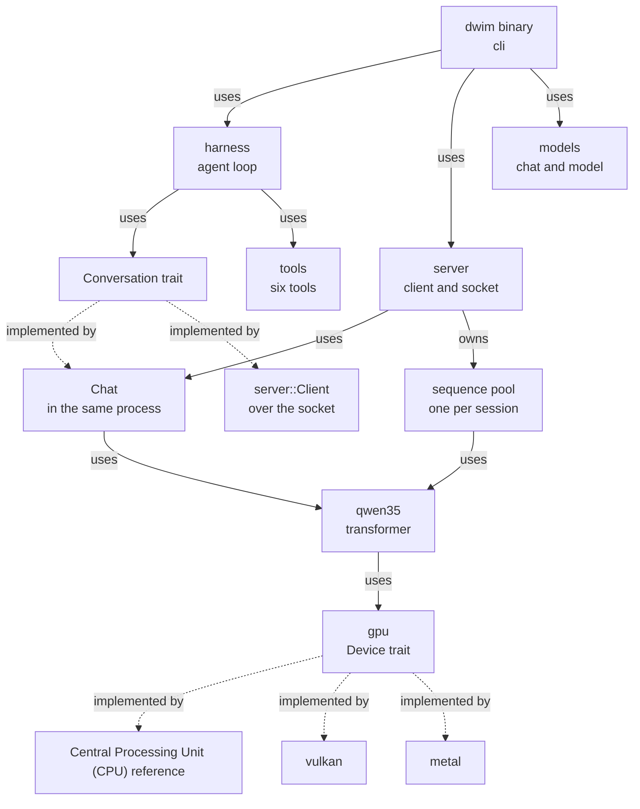
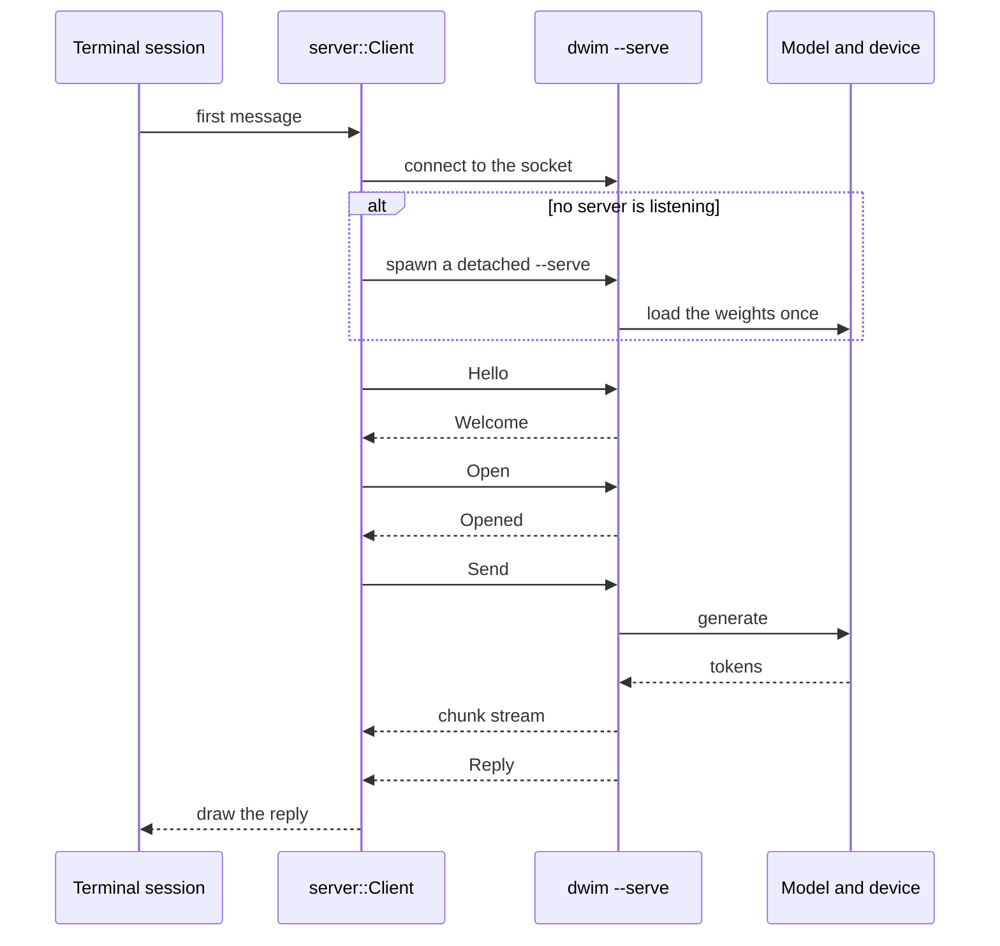

# 01 Architecture: one package, two binaries, five modules

**Thesis.** dwim is a single Rust package. The package has one library, five library modules, and two binary programs. The library holds the whole system: the model, the engine, the agent loop, the tools, and the server. The `dwim` binary is a client of a local server. The same binary can also be that server. This document gives the repository layout, the dependency direction, the process and thread model, and the build.

## 1. The package

The package manifest declares a library and two binaries:

```toml
# Cargo.toml:6-15
[lib]
path = "lib.rs"

[[bin]]
name = "dwim"
path = "cli/main.rs"

[[bin]]
name = "difftest"
path = "testing/difftest/main.rs"
```

The library root is short. It names the five public modules:

```rust
// lib.rs:1-7
//! A coding agent harness: the agent, the model, and the engine that runs it.

pub mod gpu;
pub mod harness;
pub mod models;
pub mod server;
pub mod tools;
```

`cli/` is not a library module. It is the source directory of the `dwim` binary. The binary uses the library through `dwim::…` paths. The same rule applies to `testing/difftest/`.

The repository describes the layout in one paragraph:

```markdown
# AGENTS.md:8-10
One package: `lib.rs` is the library, with the directories below as its
modules, `cli/` and `testing/difftest/` are its two binaries, and `build.rs`
compiles the Vulkan kernels.
```

## 2. Directory map

| Directory | Files | Lines | Owns |
|-----------|------:|------:|------|
| `cli/` | 10 Rust files | 3,548 | Arguments, model download, one-shot mode, terminal interface, `--serve`, `--bench` |
| `gpu/` | 7 Rust files, 14 WebGPU Shading Language (WGSL) kernels, 21 Metal Shading Language (MSL) kernels | 7,922 | The `Device` trait, Central Processing Unit (CPU) reference, Vulkan and Metal backends, quantization |
| `models/` | 9 Rust files | 5,799 | GGUF (the model file format) reader, block formats, byte-pair encoding (BPE) tokenizer, Qwen3.8 transformer, sampler, chat, Hugging Face cache |
| `harness/` | 3 Rust files | 2,630 | System prompt, turn loop, compaction, transcript log |
| `server/` | 3 Rust files | 1,698 | Protocol, client, socket server, sequence pool |
| `tools/` | 8 Rust files | 4,560 | Six tools and the tool-call parser |
| `testing/` | 1 Rust file | 444 | The `difftest` binary |
| `scripts/` | 1 Python file, 1 shell file | 373 | SWE-bench Lite runner, release helper |
| `man/` | 1 file | 409 | The manual page |

The totals include kernel source. The Rust library and binaries are 23,768 lines. The Vulkan kernels are 986 lines of WGSL. The Metal kernels are 1,854 lines of MSL. The Rust count covers `lib.rs` and the module directories. It does not include `scripts/`, `man/`, or `third_party/`.

Two modules handle quantization, and they do different work. `models/quants.rs` unpacks the file's blocks into floats when the file loads. `gpu/quant.rs` lays out the blocks that the devices keep and computes dot products over them. The first reads the file format. The second defines the device format. `Q4_0`, `Q4_1`, `Q8_0`, and `Q6_K` are llama.cpp format names: the digit is the bit width, the letter is the layout family, and `K` marks the k-quant super-block layout.

The tree is small enough to read in one pass:

```
dwim/
├── lib.rs                 five public modules
├── build.rs               WGSL → Standard Portable Intermediate Representation (SPIR-V) at build time
├── Cargo.toml
├── cli/                   the dwim binary
│   ├── main.rs            parse, dispatch, memory check
│   ├── opts.rs            every option
│   ├── run.rs             interactive terminal interface
│   ├── once.rs            one-shot mode
│   ├── session.rs         connect, spawn, retire the server
│   ├── serve.rs           foreground server
│   ├── bench.rs           throughput at context depths
│   ├── fetch.rs           resumable model download
│   ├── model.rs           model identity and device sizing
│   └── tui.rs             screen, wrapping, line editor
├── models/
│   ├── mod.rs             LanguageModel and Conversation traits
│   ├── gguf.rs            GGUF v3 reader and memory map
│   ├── quants.rs          Q4_0, Q4_1, Q8_0, Q6_K
│   ├── tokenizer.rs       byte-level BPE
│   ├── qwen35.rs          transformer and drafter
│   ├── chat.rs            chat template, generation, speculation
│   ├── sampler.rs         top-k, top-p, min-p, verification
│   ├── hub.rs             Hugging Face cache paths
│   └── testing.rs         scripted model for tests
├── harness/
│   ├── mod.rs             prompt, turn loop, guards
│   ├── compaction.rs      note, replay, retention
│   └── log.rs             JavaScript Object Notation (JSON) Lines transcript
├── server/
│   ├── protocol.rs        request and response types
│   ├── client.rs          Connection and Client
│   └── mod.rs             socket, accept loop, sessions
├── tools/
│   ├── mod.rs             registry and shared helpers
│   ├── call.rs            JSON and XML call parser
│   ├── bash.rs            shell with timeout and spill
│   ├── read.rs            paged file reads
│   ├── edit.rs            tiered string replacement
│   ├── write.rs           whole-file write
│   ├── grep.rs            regular-expression search
│   └── glob.rs            path matching
├── gpu/
│   ├── mod.rs             Device trait and cache quantization
│   ├── cpu.rs             reference implementation
│   ├── vulkan/            ash backend and WGSL kernels
│   ├── metal/             objc2 backend and MSL kernels
│   ├── quant.rs           host-side block layout
│   ├── host.rs            total and free memory
│   └── tests.rs           backend-against-CPU tests
├── testing/difftest/      real-weight differential test
├── scripts/               swebench.py, release
├── man/dwim.1
└── third_party/           reference code, not built
```

## 3. Dependency direction

The modules form a stack. Each layer uses the layer below it. No lower layer uses a higher one.



Solid arrows are uses. Dotted arrows are implementations. The graph has one edge that points upward: `Conversation` is declared in `models`, and `server::Client` implements it. That edge is a trait implementation, not a call, so `models` does not use `server`.

Three boundaries carry most of the design:

1. **`Conversation`** separates the harness from the model, and from the transport. The harness owns no model code. It sends messages and receives chunks.
2. **`LanguageModel`** separates the chat from the transformer. The server holds one value behind this trait, and each session uses one sequence. A **sequence** is one slot in the model's caches and recurrent state.
3. **`Device`** separates the transformer from the hardware. The transformer calls ten operations: `matmul`, `add`, `rmsnorm`, `l2norm`, `rope`, `attention`, `silu_mul`, `sigmoid_mul`, `conv`, and `delta_net`. The backends supply them.

The chat is generic over the model:

```rust
// models/chat.rs:99-101 (condensed)
pub struct Chat<M: LanguageModel> {
    model: M,
    format: Format,
    sampler: Sampler,
```

The harness is generic over the conversation:

```rust
// harness/mod.rs:428-430 (condensed)
pub struct Harness<C: Conversation> {
    chat: C,
    tools: Tools,
```

The server holds a boxed model, and every session is a `Chat` that borrows it through a shared pool. This is how one copy of the weights serves many sessions (document 03).

The word **session** has two related meanings in this system:

- **Server session.** One `Chat` on the server, with one conversation and one sequence: its own key/value caches and recurrent states in the shared model.
- **Client session.** One terminal process, with one harness, that holds one connection to one server session.

The overview uses the client meaning. Document 03 uses the server meaning when it describes the pool.

## 4. The `Conversation` seam

The `Conversation` trait is the contract between the agent loop and the model. Its methods do four jobs: conversation control (`system`, `clear`, `replay`, `feed_results`), space accounting in tokens (`measure`, `answer_tokens`, `tokens`, `capacity`, `free`, `reserve`), thought limits (`thought_limit`, `limit_thoughts`), and observation (`stats`, `sampler`).

```rust
// models/mod.rs:156-177 (condensed)
pub trait Conversation {
    fn system(&mut self, text: &str, on_progress: impl FnMut(usize, usize)) -> Result<()>;
    fn clear(&mut self) -> Result<()>;
    fn replay(&mut self, turns: &[Turn]) -> Result<()>;
    fn measure(&mut self, turn: &Turn) -> Result<usize>;
    fn answer_tokens(&mut self, message: &str, limit: usize) -> Result<usize>;
    fn tokens(&self) -> usize;
    fn capacity(&self) -> usize;
    fn free(&self) -> usize;
    fn reserve(&mut self, tokens: usize);
    fn thought_limit(&self) -> Option<usize>;
    fn limit_thoughts(&mut self, tokens: Option<usize>, closing: &str);
    fn feed_results(&mut self, outputs: &[String]) -> Result<()>;
    fn stats(&self) -> Stats;
    fn sampler(&self) -> &Sampler;
}
```

Two types implement it:

- `Chat<M>` runs the model in the current process. The `--serve` path and the server use it.
- `server::Client` sends requests over a Unix domain socket. The normal interactive and one-shot paths use it.

The tests use neither type directly. `models/testing.rs` supplies a scripted model, `Scripted`, that implements `LanguageModel` (`models/testing.rs:109`), and `Chat<Scripted>` then implements `Conversation`. The test path is therefore the first type with a stub model, not a third implementation.

**Aha: the harness cannot tell the difference.** The agent loop is written once against `Conversation`. It does not know whether the model is in the same process or behind a socket. This lets the server exist without a second agent implementation, and it lets a test use a scripted conversation.

The cost is that the trait must carry every operation the agent needs, including space accounting. `capacity`, `free`, `reserve`, and `measure` are the model's space facts, all in tokens of conversation. `answer_tokens` estimates how many tokens an answer would take. The caller must plan the turn around these values.

## 5. Two processes, one model

A session does not load the weights. It connects to a server. If no server is listening, the session starts one as a detached child process.



The socket is the transport. The client retries the connection every 50 milliseconds for up to ten seconds while a server that it just started loads (`cli/session.rs:33`, `:41`, `:258-300`).

The spawn call is a shell command with the executable path as `$0`. This avoids quoting the path:

```rust
// cli/session.rs:389-399
let status = Command::new("sh")
    .arg("-c")
    .arg(r#"exec "$0" "$@" &"#)
    .arg(exe)
    .args(args)
    .stdin(Stdio::null())
    .stdout(Stdio::null())
    .stderr(log)
    .process_group(0)
    .status()
```

The server survives the session. It exits after ten minutes with no sessions and no request (`server/mod.rs:58`). Idle therefore means no request of any kind for that time. A second terminal therefore finds the model already loaded.

**Aha: the architecture makes the restart boundary cheap.** `/server restart` stops the server and starts a new one, then replays the transcript through `Harness::reopen`. The new server loads the weights again; that delay is the cost. Only the conversation is replayed from text. No checkpoint of the model's memory is needed, because the conversation is the only state that matters to the agent. The stop is refused while another session is open, so a restart cannot disturb another terminal (`cli/session.rs:215-237`).

## 6. Threads, not an asynchronous runtime

dwim does not use an asynchronous runtime. `Cargo.toml` has no `tokio`, no `async-std`, and no `futures`. The code uses three concurrency tools:

1. **One model thread and one user-interface thread** in the interactive path. They exchange `Request` and `Reply` values over `std::sync::mpsc` channels.
2. **One accept thread** in the server. The accept thread starts one reader thread for each connection (`server/mod.rs:406-430`). A reader answers the requests that need no model and forwards the rest through a channel to the main loop. When the connection ends, the reader removes its peer and sends `Closed`; the main loop then removes that session.
3. **Rayon** in the CPU reference for parallel matrix work.

The interactive split is visible at the top of `run`:

```rust
// cli/run.rs:49-63 (condensed)
let (requests, requests_rx) = mpsc::channel();
let (replies_tx, replies) = mpsc::channel();
let stop = Arc::new(AtomicBool::new(false));
let (done, finished) = mpsc::channel::<()>();
thread::spawn(move || {
    let _done = done;
    if let Err(e) = work(&settings, log, requests_rx, &replies_tx, &stop) {
        let _ = replies_tx.send(Reply::Failed(e.to_string()));
    }
});
```

The user-interface thread polls every 80 milliseconds, redraws the screen, and sends key actions to the model thread. The model thread runs the harness and blocks on it: it waits for the server's tokens and runs tools inline. Loading and generation happen in the server process, not on this thread.

**Aha: the model thread is also the tool thread.** The harness runs tools inline. A slow `cargo build` therefore stops generation but does not stop the screen from redrawing, because the screen is a different thread. The design accepts that one session does one thing at a time.

The server is stricter. It serves one request at a time, and it tells other sessions `Busy`. Sessions take turns at whole-reply granularity, not at token granularity (`server/mod.rs:434-503`). The benefit of several sessions is therefore the resident weights, not parallel generation: a second terminal starts work at once, without a load delay, and then waits its turn.

## 7. The build

The build has two different kernel paths.

**Vulkan kernels are compiled before the Rust code is linked.** The build script reads every `.wgsl` file, parses it, validates it, and writes SPIR-V bytes to `OUT_DIR`:

```rust
// build.rs:26-38 (condensed)
let source = fs::read_to_string(&path).unwrap();
let module = wgsl::parse_str(&source)
    .unwrap_or_else(|e| panic!("{}: {}", path.display(), e.emit_to_string(&source)));
let info = Validator::new(ValidationFlags::all(), Capabilities::all())
    .validate(&module)
    .unwrap_or_else(|e| panic!("{}: {}", path.display(), e.emit_to_string(&source)));
```

The Rust code includes each output with a small macro. `spv!("matmul_bf16")` expands to `include_bytes!(concat!(env!("OUT_DIR"), "/", "matmul_bf16", ".spv"))` (`gpu/vulkan/mod.rs:364-370`). The build dependency is `naga` 30.0.1 with the `wgsl-in` and `spv-out` features (`Cargo.toml:17-18`).

**Metal kernels are compiled when the device opens.** The MSL source is embedded as text. The Metal backend concatenates `#define` lines, creates a library from the source, and builds a pipeline for each kernel (`gpu/metal/mod.rs:242-300`). The binary therefore needs no Metal compiler at build time. The cost is a compile delay at startup.

The build script has no platform condition. It compiles all WGSL kernels on every platform, including Apple. The Vulkan module is also compiled everywhere, but `Gpu` selects Metal on Apple (`gpu/mod.rs:9-27`). A Vulkan build on a Mac is therefore possible, but the default device on a Mac is Metal, so the normal build does not use it.

The development profile optimizes the package even in debug builds:

```toml
# Cargo.toml:40-41
[profile.dev.package.dwim]
opt-level = 3
```

This keeps a debug build usable for the model. It also makes a first build slow.

Installation uses a small `Makefile`:

```make
# Makefile:12-16 (condensed)
PREFIX ?= $(HOME)/.local
BINARY = target/release/dwim

$(BINARY): $(SOURCES)
	cargo build --release --locked
```

`make install` puts the binary in `$(BINDIR)/dwim` and the manual page in `$(MANDIR)/man1/dwim.1`. The defaults are `$(PREFIX)/bin` and `$(PREFIX)/share/man/man1`, with `PREFIX` set to `$(HOME)/.local` (`Makefile:12-14`, `:40-46`).

## 8. How the architecture is checked

The repository has four test layers:

| Layer | Command | What it proves |
|-------|---------|----------------|
| Unit tests | `cargo test` | Parsers, tools, compaction, protocol, tokenizer, sampler, and the backend checks |
| Backend tests | `cargo test gpu::` | Each GPU operation matches the CPU reference, when a device opens |
| Real-model test | `cargo test real_model -- --ignored --nocapture` | The transformer, on the default device with the real weights, completes a prompt with and without the drafter (`models/qwen35.rs:2046-2085`) |
| Differential test | `cargo run --bin difftest` | The GPU agrees with the CPU with the real weights |

The first row runs every test, including the GPU tests. The second row selects the GPU subset. The real-model test loads the weights that are on disk; if they are absent, it prints a skip message.

The backend tests use one macro. The macro defines fifteen checks for each backend: the ten operations, three memory checks (write and read, allocation and copy, resize), one check that the cache quantizes as the CPU does, and three `matmul` variants (bfloat16, `Q4_0`, and `Q8_0`). It skips the backend if the device cannot open:

```rust
// gpu/tests.rs:7-39 (condensed)
macro_rules! check_against_cpu {
    ($open:expr; $($check:ident),*) => {
        $(
            #[test]
            fn $check() {
                match $open {
                    Ok(gpu) => crate::gpu::tests::$check(&gpu),
                    Err(e) => eprintln!("skipping: {e}"),
                }
            }
        )*
    };
}
```

The skip is deliberate. A machine without a GPU still passes `cargo test gpu::`. The repository says so in `CONTRIBUTING.md:66-67`. The real-model test and the differential test both use the real weights. The differential test is the one that compares two devices, token by token and in distribution (document 04, section 9).

The **Software Engineering Benchmark Lite (SWE-bench Lite)** is a set of GitHub issues with known repairs. Each instance has a container image with the project, its dependencies, and its tests. The script runs the agent on the host and runs each shell command that the agent calls inside the instance's container (`scripts/swebench.py:47-52`). It then applies the patch and runs the instance's tests. It is the only end-to-end quality measure in the repository.

## 9. Platform and process limits

The architecture assumes a Unix-like system.

- **The socket is a Unix domain socket.** The path is `runtime_dir()/dwim-{uid}.sock`, or the temporary directory when no runtime directory exists (`server/mod.rs:65-70`). `runtime_dir()` is the per-user runtime directory that the `dirs` crate reports; `uid` is the numeric user identifier.
- **The process, file, and memory tools are Unix tools.** `setsid`, process groups, `SIGKILL`, `libc::getuid`, `mmap`, and `munmap` are used directly. The server spawn uses `process_group(0)` (`cli/session.rs:389-399`); the `bash` tool uses `setsid` (`tools/bash.rs:224-253`).
- **The GPU selection is by target vendor, then by option.** The default device is Metal on Apple and Vulkan elsewhere, chosen at compile time. `--device cpu` selects the CPU at run time. There is no Direct3D backend. There is no WebGPU backend either: WGSL is only the source language of the Vulkan kernels.
- **The memory gate is Apple-only.** A Mac needs 32 gibibytes of random-access memory (`cli/main.rs:255-271`). The client performs the check before it starts a server, because the server loads the weights. The check reads total memory, not free memory. The context size is a separate calculation, and the server performs it against the free memory that the device reports (`cli/model.rs:150-163`).
  The README states the requirement as a 32 GiB Mac. The code also builds and runs the Vulkan path on other systems (document 04).

These limits are consistent with the product: one user, one machine, one local model.

## 10. The design in five rules

1. **The model is a local resource.** It is loaded once by a server, not once per session.
2. **The agent loop is transport-blind.** It runs on `Conversation`, which is either a local chat or a socket client.
3. **The engine is a trait.** The transformer expresses itself in ten compute operations. The backends supply them, and the CPU version is the specification.
4. **The conversation is the state.** A restart replays text, not model memory.
5. **The caller supplies the sandbox.** dwim does not confine the model. It expects a container or a virtual machine around the whole process (README.md:62-65). In the benchmark path, the caller wraps each shell command in the instance's container. The file tools stay on the host. That split is the caller's choice, not a property of dwim (document 06, section 8).

## 11. Terms used in this document

| Term | Meaning |
|------|---------|
| **Binary** | A program that the package builds and a user can run. |
| **Block format** | A quantization layout that stores a group of weights with one or more scales. |
| **Agent** | The program that runs a model in a loop, calls tools, and continues until the task is done. |
| **Byte-pair encoding (BPE)** | A tokenizer method that merges frequent character pairs into tokens. |
| **Central Processing Unit (CPU)** | The general-purpose processor. In dwim, the reference device. |
| **Crate** | A Rust compilation target. This package has one library target and two binary targets. In ordinary use, "the crate" means the library target. |
| **Drafter** | The 65th block of the model. It predicts tokens ahead for speculative decoding. |
| **Gated DeltaNet** | A linear-attention rule with a decay gate and a write gate. Most of this model's blocks use it. |
| **GGUF** | The model file format from the llama.cpp project. The letters are the format name, not an abbreviation. |
| **Graphics Processing Unit (GPU)** | The parallel processor that runs the model in production. |
| **Harness** | The agent loop: system prompt, turn loop, guards, tools, and compaction. |
| **Linear attention** | Attention with a fixed-size state instead of a cache that grows with the conversation. |
| **Metal** | Apple's graphics and compute Application Programming Interface (API). |
| **Metal Shading Language (MSL)** | The text language for Metal kernels. |
| **Module** | A Rust namespace declared by `mod`. |
| **Sequence** | One session's model state on the device: its caches, recurrent states, and position in the model. |
| **Session** | One conversation with the server: one socket connection, one harness on the client, and one `Chat` with one sequence on the server. |
| **SPIR-V** | Standard Portable Intermediate Representation, a binary form for shader programs. |
| **Unix domain socket** | A socket addressed by a file-system path on one machine. |
| **Vulkan** | A cross-platform graphics and compute API. |
| **WebGPU Shading Language (WGSL)** | The text language that `naga` translates to SPIR-V. |

## 12. What to read next

Read [02 CLI and sessions](02-cli-and-sessions.md) for the path from the command line to the first token. Read [03 Server and protocol](03-server-and-protocol.md) for the boundary that this document introduced. Read [04 Inference engine](04-inference-engine.md) for the `Device` trait and its three implementations.
