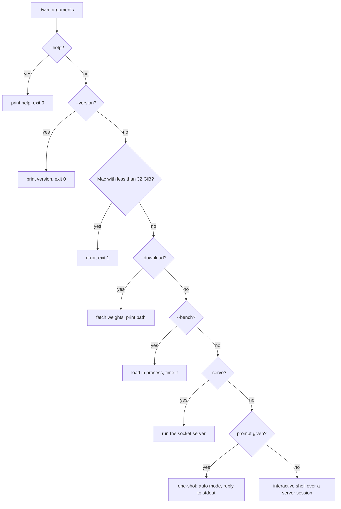
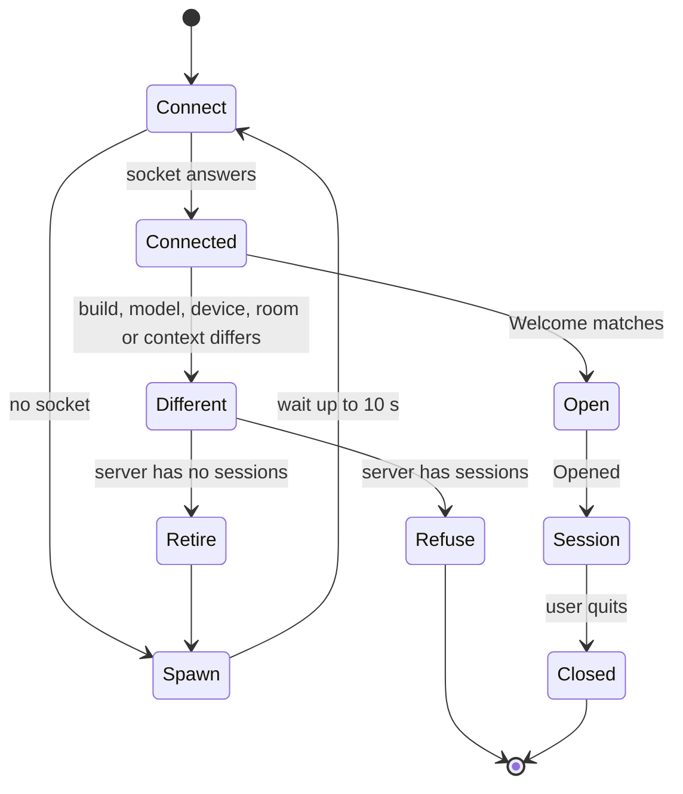

# 02 Command line and sessions: from arguments to the first token

**Thesis.** The `dwim` binary has five entry paths: download, benchmark, server, one-shot prompt, and interactive shell. Every path except download, benchmark, help, and version reaches the model through the local server; `--serve` is that server. The client decides whether to use an existing server, start one, or replace one from another build. This document follows each path and states the rules that the code enforces.

Four words recur in this document:

- A **session** is one conversation with the local server: one socket connection, one harness, and one slot of model state.
- The **server** is the process that holds the model in memory and answers sessions over a Unix domain socket.
- The **harness** is the loop that runs the model's tool calls and feeds the results back (document 06).
- The **agent** is the model and the harness working together in one directory.

## 1. Five paths, one dispatch

The argument parser is `argh`. After parsing, `main` dispatches in a fixed order:

```rust
// cli/main.rs:43-63 (condensed)
let settings = opts.settings();
let prompt = opts.prompt.join(" ");
let result = check_memory().and_then(|()| {
    if opts.download {
        let mut stderr = Stderr::new();
        let dir = session::fetch_model(&settings, |loading| stderr.report(&loading))?;
        println!("{}", dir.join(qwen35::WEIGHTS).display());
        return Ok(());
    }
    if opts.bench {
        return bench::bench(&settings);
    }
    if opts.serve {
        return serve::serve(&settings);
    }
    let log = log(opts.transcript)?;
    match prompt.trim() {
        "" => run::run(settings, opts.thinking, log),
        prompt => once::once(&settings, prompt, opts.stats, log),
    }
});
```

The precedence is:

1. `--help` exits inside the argument parser, before anything else.
2. `--version` prints the version and exits before the memory check (`cli/main.rs:39-42`).
3. The memory check runs on Apple and exits with an error if it fails.
4. `--download` fetches the model and exits.
5. `--bench` loads the model in the current process and measures it.
6. `--serve` runs the server in the current process.
7. A non-empty prompt runs one-shot mode.
8. No prompt runs the interactive shell.

A run can therefore combine a prompt with `--bench` and get the benchmark, because the benchmark check comes first. The help text puts five options under the heading "Instead of a session:": `--bench`, `--download`, `--help`, `--serve`, and `--version` (`cli/main.rs:127-133`). The four headings are "The model:", "Thinking and sampling:", "The session:", and "Instead of a session:" (`cli/main.rs:110-134`).



## 2. The options

The options fall into four groups. The table gives the type, the default, and the enforcement rule.

| Option | Type | Default | Rule in code |
|--------|------|---------|--------------|
| `--model` | string | `qwen3.8-27b` | Only the known name is accepted (`cli/model.rs:47-52`) |
| `--device` | `cpu` or `gpu` | `gpu` | Any other value is an error (`cli/opts.rs:142-149`) |
| `--context` | integer | computed from free memory | Must be 1 or more and no more than the trained context (`cli/model.rs:124-150`) |
| `--sessions` | integer | none; the server uses 2 (`cli/model.rs:35`) | 0 is refused; a non-number is refused (`cli/opts.rs:119-125`) |
| `--download` | switch | off | Downloads only |
| `--version` | switch | off | Prints and exits |
| `--stats` | switch | off | One-shot mode only |
| `--bench` | switch | off | Runs the benchmark |
| `--serve` | switch | off | Runs the server |
| `--thinking` | switch | off | The initial state of the display that Ctrl+O toggles; interactive only |
| `--thinking-budget` | integer | 2,048 | 0 means no limit; the parser turns 0 into `None` (`cli/opts.rs:113-116`) |
| `--reasoning-effort` | `xhigh`, `medium`, `low` | `medium` | How much the system prompt asks the model to reason; other values are refused (`harness/mod.rs:225-238`) |
| `--temperature` | float | the GGUF metadata value | Must be finite and 0 or more (`cli/opts.rs:128-133`) |
| `--speculate` | integer | 4 | Tokens drafted per pick; the model clamps the value to `MAX_DRAFTS`, 8 (`models/qwen35.rs:69`, `:1085`) |
| `--shell` | path | `sh` | The shell program that the `bash` tool runs (`tools/bash.rs`) |
| `--transcript` | path | a file under the state directory | Explicit path failure is fatal; default failure is a warning |
| prompt | words | none | Joined with one space (`cli/main.rs:44`) |

The file that holds the model is `models/qwen35.rs`, but the model name it declares is `qwen3.8-27b` (`models/qwen35.rs:21`). The file name is historical. The constant and the weights file name are the authority: `Qwen3.8-27B-Q4_0.gguf` (`models/qwen35.rs:24`).

Sampling settings also have defaults. `model::sampler` reads `general.sampling.temp`, `top_k`, `top_p`, and `min_p` from the GGUF metadata. A missing value becomes a temperature of 1.0, `top_k` of 20, `top_p` of 0.95, or `min_p` of 0.05 (`cli/model.rs:213-226`). The source comment says the file does not carry `min_p`, so the default applies in practice. The code still reads the key, which means a file that does carry it overrides the default.

Two parsers show the validation style. Both return a sentence that names the correct form:

```rust
// cli/opts.rs:119-134
fn sessions(value: &str) -> Result<usize, String> {
    match value.parse::<usize>() {
        Ok(0) => Err("a server needs room for one session at least".to_string()),
        Ok(n) => Ok(n),
        Err(_) => Err("expected a number of sessions, 1 or more".to_string()),
    }
}

fn temperature(value: &str) -> Result<f32, String> {
    match value.parse::<f32>() {
        Ok(t) if t.is_finite() && t >= 0.0 => Ok(t),
        _ => Err("expected a temperature, a number 0 or more".to_string()),
    }
}
```

**Aha: the temperature parser rejects a value that the model could use.** A negative temperature and `NaN` are not clamped. They are refused at the command line. The sampler therefore never sees a value it cannot interpret.

## 3. The help is computed for the machine

The program does not print the help that `argh` generates. It parses that help into a list, groups the options under four headings, and wraps the result to 80 columns. It also computes the real default context for the device on this machine:

```rust
// cli/main.rs:170-181
fn layout(output: &str, size: Option<model::Size>) -> String {
    let mut options = options(output);
    if let (Some(size), Some((_, description))) = (size, options.get_mut("--context")) {
        *description = format!(
            "tokens of conversation each session has room for (default: {} on this machine, \
             taking {} a session beside the model's {}, with room for {} sessions)",
            size.context,
            model::bytes(size.conversation),
            model::bytes(size.model),
            size.sessions
        );
    }
```

The default context is a memory calculation, not a constant. `model::default_size` opens the device and calls `size` with no context (`cli/model.rs:167-174`). `size` reads the free device memory, subtracts the shared model bytes and 256 mebibytes of headroom, divides the rest by the session count, subtracts each session's fixed state (its recurrent state and cache metadata), and divides by the bytes that one token of context takes. The result is rounded down to a multiple of 1,024 tokens and clamped to at least `MIN_CONTEXT` and at most the trained context (`cli/model.rs:121-163`). The help text prints the consequence.

If the model is not downloaded or the device cannot open, the computation returns `None`, and the static help text remains. The two forms of the help are therefore different, and both are correct for their situation.

The help layout has tests. They check that every option appears exactly once, that each group is sorted, that `--thinking-budget` shows its default, and that every line is at most 80 columns (`cli/main.rs:294-350`).

## 4. The memory gate

On Apple, the program refuses to start on a machine with less than 32 gibibytes of random-access memory:

```rust
// cli/main.rs:255-271 (condensed)
#[cfg(target_vendor = "apple")]
const MIN_MEMORY: u64 = 32 << 30;

fn check_memory() -> Result<(), Box<dyn Error>> {
    let memory = dwim::gpu::host::total().ok_or("cannot determine the memory size")?;
    if memory < MIN_MEMORY {
        return Err(format!(
            "dwim requires {} GiB or more DRAM on a Mac, and this one has {} GiB",
            MIN_MEMORY >> 30,
            memory >> 30
        )
        .into());
    }
    Ok(())
}
```

On other systems a second definition replaces it and returns success:

```rust
// cli/main.rs:274-277
#[cfg(not(target_vendor = "apple"))]
fn check_memory() -> Result<(), Box<dyn Error>> {
    Ok(())
}
```

The check uses total memory, not free memory. A Mac with 32 gibibytes passes even if other programs use most of it. The failure then comes later, when the device cannot hold the weights and their caches.

## 5. The transcript

A session writes a JavaScript Object Notation (JSON) Lines transcript by default, under the state directory:

```rust
// cli/main.rs:82-89
let Some(dir) = dirs::state_dir().or_else(dirs::data_local_dir) else {
    return Ok(Log::none());
};
let path = dir
    .join("dwim")
    .join("projects")
    .join(project(&env::current_dir()?))
    .join(Log::name());
```

`project` replaces every character that is not an American Standard Code for Information Interchange (ASCII) letter or digit with a dash (`cli/main.rs:102-107`). A project at `/home/u/proj` therefore has its transcripts in `.../projects/-home-u-proj/`.

The **state directory** is `~/.local/state` on Linux. macOS has no state directory, so the program uses the local data directory, `~/Library/Application Support` (`cli/session.rs:407-417`).

The file name is a date and time without colons, followed by the process identifier: `2026-10-01T093012-4242.jsonl` (`harness/log.rs:96-102`). The file mode is `0o600`: the owner can read and write it, and no other user can.

Each line is one JSON object with a `type` and a `time`. There are fifteen record types (`harness/log.rs:109-282`):

| Record | What it holds |
|--------|---------------|
| `start` | The model, device, directory, context size, sampling settings, thinking budget, and system prompt. |
| `user` | A user message, the text that went ahead of it, and the token count before it. |
| `thought` | A thought, gathered from streamed pieces. |
| `text` | Reply text, gathered from streamed pieces. |
| `note` | The text of a compaction note. |
| `reply` | One complete reply: its calls, whether it was cut, and the tokens after it. |
| `thinking_budget` | A change to the budget. |
| `call` | One tool call, with its name and detail. |
| `output` | The result of that call, with its duration. |
| `nudge` | The reminder after many calls without a change. |
| `compacting` | The start of a compaction. |
| `compacted` | The end of a compaction, with the token counts before and after. |
| `error` | The session ended with an error. |
| `interrupted` | The session was interrupted. |
| `end` | The session finished: tokens in the context, time per stage, and tool count. |

**Aha: streamed text is rewritten in place.** A thought or a reply arrives in pieces. The logger records the byte offset of the open record. At most once per second it seeks back to that offset, writes the whole record with the text so far, and truncates the file after it (`harness/log.rs:151-177`, `285-329`). The file therefore holds complete records up to the last rewrite. A kill during a rewrite can leave a partial final line. The test `keeps_streamed_text_of_a_killed_session` covers a kill between rewrites (`harness/log.rs:381-402`).

A session with no state directory keeps no transcript: the log is empty and the session goes on (`cli/main.rs:82-84`). An explicit `--transcript` path that cannot be written is fatal. A default path that cannot be written is not: the program prints a warning and continues with no transcript (`cli/main.rs:90-96`).

## 6. One-shot mode

One-shot mode answers one prompt, prints the reply, and exits. It always enables auto mode:

```rust
// cli/once.rs:36-42
// No one is here to answer the model, so it goes on by itself.
loaded.harness.set_auto(true);
let mut printer = Printer::default();
loaded.harness.send(prompt, |event| {
    printer.print(event);
    ControlFlow::Continue(())
})?;
```

Auto mode answers a reply that does not say it is done with `GO_ON`, a message that tells the model to do the next thing that remains (`harness/mod.rs:107`). The model is told to end its final reply with `DONE` on a line of its own. The check finds the last non-empty line and removes every character that is not a letter or a digit before it compares the line with `DONE` (`harness/mod.rs:1008-1013`). The harness sends `GO_ON` at most `AUTO_ROUNDS` times a turn, and `AUTO_ROUNDS` is 10 (`harness/mod.rs:100`, `:926-940`). The account that the model gives at the call cap is answered the same way. The turn ends when the model says `DONE`, when the ten rounds are used, or when the turn is interrupted.

The output streams are split. The reply text goes to standard output. Thoughts, notices, tool calls, tool outputs, and the transcript path go to standard error (`cli/once.rs:60-117`). This makes the reply usable in a pipe:

```bash
dwim "summarize this repository" 2>/dev/null
```

`--thinking` is not passed to one-shot mode. Thoughts still go to standard error, because the printer always handles them. The option only changes the interactive screen (document 06 covers the display rules).

`--stats` is passed to one-shot mode only. After the reply it prints timing rows from `Stats::report` to standard error (`cli/once.rs:44-52`). In interactive mode the same report is available through `/stats`.

## 7. The interactive shell

The interactive path has two threads. The user-interface thread owns the terminal. The model thread owns the harness:

```rust
// cli/run.rs:49-63 (condensed)
let (requests, requests_rx) = mpsc::channel();
let (replies_tx, replies) = mpsc::channel();
let stop = Arc::new(AtomicBool::new(false));
let (done, finished) = mpsc::channel::<()>();
thread::spawn(move || {
    let _done = done;
    if let Err(e) = work(&settings, log, requests_rx, &replies_tx, &stop) {
        let _ = replies_tx.send(Reply::Failed(e.to_string()));
    }
});
```

The request types are `Message`, `Compact`, `ThinkingBudget`, `Auto`, and `Server` (`cli/run.rs:240-251`). The reply types are `Status`, `Ready`, `Reopened`, `Event`, `Notice`, `ThinkingBudget`, `Auto`, `Done`, `Error`, and `Failed` (`cli/run.rs:254-275`). The last two have different meanings: `Error` means the turn failed and the model is still open for the next turn; `Failed` means the model itself is gone (`cli/run.rs:271-274`).

### 7.1 Slash commands

The shell has eight commands:

```rust
// cli/run.rs:154-175 (condensed)
const COMMANDS: [(&str, &str); 8] = [
    ("/model", "the model, the device it runs on, and its context window"),
    ("/stats", "where this session's time has gone"),
    ("/transcript", "where this session's transcript is"),
    ("/compact", "compact the conversation now"),
    ("/thinking-budget N", "cap the model's thinking at N tokens, 0 for no cap"),
    ("/auto on|off", "go on by itself until it says it is done, or ask"),
    ("/server stop|start|restart", "the dwim server the model runs in; stop, start or restart it"),
    ("/help", "this list"),
];
```

`/model`, `/stats`, `/transcript`, `/help`, and the query forms of `/thinking-budget` and `/auto` are answered inside the user-interface thread. `/compact`, the set forms of `/thinking-budget` and `/auto`, and every form of `/server` — show, stop, start, and restart — become requests to the model thread (`cli/run.rs:948-978`, `cli/run.rs:325-340`).

The parser splits the line at the first whitespace and matches the pair. A bad argument has a specific message:

```rust
// cli/run.rs:225-234
("auto", None) => Ok(Command::Auto),
("auto", Some("on")) => Ok(Command::SetAuto(true)),
("auto", Some("off")) => Ok(Command::SetAuto(false)),
("auto", Some(_)) => Err("/auto takes on or off".to_string()),
("server", None) => Ok(Command::Server(ServerAction::Show)),
("server", Some("stop")) => Ok(Command::Server(ServerAction::Stop)),
("server", Some("start")) => Ok(Command::Server(ServerAction::Start)),
("server", Some("restart")) => Ok(Command::Server(ServerAction::Restart)),
("server", Some(_)) => Err("/server takes stop, start or restart".to_string()),
_ => Err(format!("Unknown command /{text} · /help lists them")),
```

### 7.2 Keys

| Key | Effect |
|-----|--------|
| Enter | Submit when idle; ignored while busy |
| Shift+Enter, Alt+Enter, Ctrl+J | Insert a newline |
| Ctrl-C | Interrupt generation; clear the input when idle; quit when the input is empty |
| Ctrl-D | Quit when the input is empty |
| Escape | Interrupt generation |
| Ctrl-O | Toggle thoughts. When thoughts show, a `read` call shows its whole output; when hidden, it shows only the last line (`cli/run.rs:585-590`, `861-866`, `921`) |
| Ctrl-A, Home | Move to the start of the line |
| Ctrl-E, End | Move to the end of the line |
| Ctrl-U, Ctrl-K | Delete to the start or the end |
| Ctrl-W, Alt+Backspace | Delete the previous word |
| Up, Down | Recall history |

The bindings are in `cli/run.rs:558-615`. History recall is disabled when the input contains a newline.

### 7.3 Rendering

The screen redraws every 80 milliseconds while busy (`cli/run.rs:38`, `532`). A thought or a note is dark grey and italic with a `✻ ` prefix. Reply text is plain with a `● ` prefix (`cli/run.rs:1307-1321`). A four-frame spinner advances every 150 milliseconds (`cli/run.rs:1066-1139`).

The line under the input box shows the directory that the agent works in (`cli/run.rs:1142-1144`). Above the input box, the status line shows what is happening: a spinner, a verb, and details that change with the stage (`cli/run.rs:1066-1131`). While the server starts, the details give the percentage of the start and the seconds spent. While the system prompt is read, they give the percentage of the prompt read and the seconds. During generation they give the token rate, the hint to show or hide thoughts, and the key that interrupts. During a download they give the bytes done, the percentage of the file, the speed, and the time left. Before one second has passed, the token rate is left out rather than shown as a misleading number (`cli/run.rs:1151-1155`).

**Aha: the screen is not part of the agent.** The model thread sends events. The screen decides how to draw them. A test or a pipe can consume the same events with no terminal. This is why one-shot mode and the interactive mode share the harness.

## 8. The session lifecycle

The normal path does not load the model. It opens a session on the server. The client state machine has five states:



A **Welcome** is the server's answer to `hello`: its build, its process identifier, its model, its device, the context it was asked for, its room, and its open session count (`server/protocol.rs:129-143`). The **room** is how many sessions the server can hold at once. An **Opened** is the answer to opening a session: the device, the size, the capacity, the sampling settings, and the state (`server/protocol.rs:146-153`).

The comparison is a function with one check for each property:

```rust
// cli/session.rs:303-335 (condensed)
fn difference(welcome: &Welcome, settings: &Settings) -> Option<String> {
    if welcome.build != server::build() {
        return Some("is from another build of dwim".to_string());
    }
    if welcome.model != settings.model {
        return Some(format!("runs {}, not {}", welcome.model, settings.model));
    }
    if welcome.device != settings.device.to_string() {
        return Some(format!("runs the model on the {}, not the {}", ...));
    }
    if let Some(sessions) = settings.sessions
        && welcome.room != sessions
    {
        return Some(format!("has room for {} {}, not {sessions}", ...));
    }
    if let Some(context) = settings.context
        && welcome.context != Some(context)
    {
        return Some(match welcome.context { ... });
    }
    None
}
```

A server with sessions cannot be replaced. The client returns an error that tells the user to quit the other sessions or to use the same options (`cli/session.rs:264-272`). A server with no sessions is asked to retire, and the client waits up to 30 seconds for it to exit.

If no server answers, the client starts one:

```rust
// cli/session.rs:389-399
let status = Command::new("sh")
    .arg("-c")
    .arg(r#"exec "$0" "$@" &"#)
    .arg(exe)
    .args(args)
    .stdin(Stdio::null())
    .stdout(Stdio::null())
    .stderr(log)
    .process_group(0)
    .status()
```

The shell form avoids quoting the executable path. The child is in its own process group, so it does not receive the terminal's signals. Its standard error goes to a log file under the state directory. The parent waits until the shell exits, which happens immediately because the shell puts the server in the background.

`/server stop` is safe. It reads the session count first:

```rust
// cli/session.rs:224-241 (condensed)
pub fn stop(client: &mut Client) -> Result<(), Box<dyn Error>> {
    let mut connection = Connection::connect(&server::socket_path())
        .map_err(|_| "no dwim server is running")?;
    let welcome = connection.hello()?;
    let others = welcome.sessions.saturating_sub(1);
    if others > 0 {
        return Err(format!(
            "the dwim server has {others} other {}: quit {} first",
            plural(others, "session"),
            if others == 1 { "it" } else { "them" }
        ).into());
    }
    connection.retire()?;
    drop(connection);
    client.close();
    wait_for_exit(welcome.pid);
    Ok(())
}
```

`welcome.sessions` counts every open session, and the connection that asks is one of them. `stop` subtracts one for that connection, so `others` counts only the other sessions. This is why the command works when the calling client is the only session, and refuses when another session is open.

The server identifies itself by build string, process identifier, model, device, context, room, and open session count (`server/protocol.rs:129-143`).

## 9. Restart and replay

A restart does not save model memory. It saves the conversation as text and feeds it to a new session:

```rust
// cli/session.rs:169-176
pub fn reopen(
    settings: &Settings,
    harness: &mut Harness<Client>,
    on_status: impl FnMut(Status) + 'static,
) -> Result<(), Box<dyn Error>> {
    let (client, _) = open(settings, on_status)?;
    harness.reopen(client)
}
```

`Harness::reopen` replaces the conversation, copies the transcript turns, prepends the environment block if it was never fed, and calls `chat.replay(&turns)` (`harness/mod.rs:658-674`). The new server reads the system prompt again through `client.start`.

The **environment block** is a short text that states the working directory, the files in it, whether it is a git repository and on which branch, the platform, and the date (`harness/mod.rs:274-303`). It goes ahead of the first user message instead of into the system prompt, because it changes from one run to the next and the saved prompt state must stay valid across days and directories.

**Aha: the replay path is also the crash-recovery path.** If the server dies, the session can start a new one and replay the transcript. The conversation survives because every turn is already in the harness transcript. The model's key/value cache does not survive, and the next turn pays the prompt cost again.

The replay is not free. A long conversation is re-read token by token. The **prefill** is the model state after it has read the system prompt. The server saves that state in a state file, so a new session compares the prompt text with the file and skips the prompt read when the two match (`server/mod.rs:95-150`). The conversation turns still need a pass.

## 10. The model download

The downloader uses the Hugging Face cache layout. A file is stored as a blob named by its digest, and a snapshot path is a symbolic link to it (`models/hub.rs:36-53`).

The download resumes from a partial file. In the code below, `done` is the number of bytes that the partial file already holds:

```rust
// cli/fetch.rs:104-112
let mut request = ureq::get(&hub::url(qwen35::REPO, qwen35::REVISION, file.name));
if done > 0 {
    request = request.header("Range", &format!("bytes={done}-"));
}
let response = request.call()?;
// A server that ignores the range sends the whole file, from the start.
if done > 0 && response.status() != 206 {
    done = 0;
}
```

Status 206 is Partial Content: the server sends only the rest of the file. Status 200 means that the server ignored the range and sent the whole file, so the byte count starts again at zero.

The partial file is named `{digest}.incomplete`. If another process wrote to it less than 60 seconds ago, the downloader waits and checks again. It sleeps two seconds between checks (`cli/fetch.rs:82-98`). A completed download is renamed to the blob name and linked into the snapshot directory.

Four environment variables change where and how the downloader works, with their Hugging Face meanings (`CONTRIBUTING.md:26-33`):

| Variable | Meaning |
|----------|---------|
| `HF_HOME` | The base cache directory. |
| `HF_HUB_CACHE` | The cache directory for models, when it differs from the base. |
| `HF_HUB_OFFLINE` | Forbids network access. |
| `HF_ENDPOINT` | Replaces the server address. |
 Offline mode with no cached file is an error with a clear next step:

```
the model is not downloaded, and HF_HUB_OFFLINE is set: run `dwim --download` where there is network
```

**Aha, and a gap: the digest is not checked.** The pinned digest names the blob and appears in the snapshot link. The downloader checks the byte count, not the hash (`cli/fetch.rs:127-171`). A corrupted or substituted file with the right length is accepted. The digest in `qwen35.rs:44-51` is a cache name, not an integrity check. An engineer who needs integrity must add a SHA-256 pass after the download.

## 11. The benchmark

`--bench` loads the model in the current process, not through the server. It fills the context to each of five fixed depths that the context has room for, and measures two operations at each depth:

```rust
// cli/bench.rs:16-31 (condensed)
const DEPTHS: [usize; 5] = [1 << 10, 8 << 10, 32 << 10, 64 << 10, 128 << 10];
const PAGE = 2048;
const GENERATED = 32;
const FILL = 4096;
const FILLER: &str = include_str!("bench.rs");
```

The depths are 1,024, 8,192, 32,768, 65,536, and 131,072 tokens. A depth is used only when the page of 2,048 tokens and the 32 generated tokens fit after it, so a small context reports a subset (`cli/bench.rs:82-88`). The filler is the source of `bench.rs` itself: code, because a session's context is mostly code. The filler goes in pieces of at most `FILL`, which is 4,096 tokens, so the filling can be reported as it goes (`cli/bench.rs:26-29`). The output is a table of tokens per second for context reading and for generation at each depth (`cli/bench.rs:35-78`).

The benchmark is a developer tool. It does not use the socket, so the numbers are not affected by the protocol. It does compete with a running server for memory.

## 12. What the code does not do

- **No Windows support.** The socket, process-group, and raw-terminal code are Unix-specific.
- **No automatic GPU fallback.** A failed `Gpu::new()` is an error. The user must pass `--device cpu`.
- **No authentication on the socket.** The socket is `$XDG_RUNTIME_DIR/dwim-{uid}.sock`, or in the temporary directory when there is no runtime directory (`server/mod.rs:65-70`). The user identifier in the name stops two users from meeting at the same socket. It does not stop another process of the same user.
- **No integrity check on the model file** (section 10).
- **No config file.** Every option is a command-line argument. The model file supplies sampling defaults.

## 13. Terms used in this document

| Term | Meaning |
|------|---------|
| **Agent** | The model and the harness working together in one directory. |
| **Application Programming Interface (API)** | A defined way for one program to call another. |
| **ASCII** | American Standard Code for Information Interchange: the 7-bit character set that the project directory name keeps. |
| **Byte** | Eight bits. |
| **Command Line Interface (CLI)** | The text interface of a program. |
| **Digest** | A hash value that names a file. |
| **Environment block** | The short text that states the working directory, its files, the git state, the platform, and the date. It goes ahead of the first user message. |
| **Gibibyte (GiB)** | 1,024 mebibytes. |
| **Harness** | The loop that runs the model's tool calls and feeds the results back. |
| **Hugging Face** | A model hosting service and its cache format. |
| **JavaScript Object Notation (JSON)** | A text format for values made of objects, arrays, strings, and numbers. |
| **JSON Lines** | A file format with one JavaScript Object Notation (JSON) object on each line. |
| **Mebibyte (MiB)** | 1,024 kibibytes. |
| **Open (Opened)** | The server's answer to opening a session: the device, the size, the capacity, the sampling settings, and the state. |
| **Partial Content** | The Hypertext Transfer Protocol (HTTP) status 206: the answer to a range request, holding only the requested part. |
| **Prefill** | The model state after it has read the system prompt. |
| **Process group** | A set of processes that receive signals together. |
| **Random-access memory (RAM)** | The working memory of the machine. |
| **Room** | How many sessions the server can hold at once. |
| **Server** | The process that holds the model and answers sessions over a Unix domain socket. |
| **Session** | One conversation with the server: one connection, one harness, and one slot of model state. |
| **State directory** | The directory where the program keeps its state: `~/.local/state` on Linux, and the local data directory on macOS. |
| **Standard error** | The output stream for messages and diagnostics. |
| **Standard output** | The output stream for the main result. |
| **Symbolic link** | A file that points to another path. |
| **Token** | The unit of text that a model reads and writes. |
| **Unix domain socket** | A socket addressed by a path on one machine. |
| **Welcome** | The server's answer to `hello`: its build, process, model, device, context, room, and open session count. |

## 14. What to read next

Read [03 Server and protocol](03-server-and-protocol.md) for the other side of the socket. Read [06 Agent harness and tools](06-agent-harness-and-tools.md) for the loop that the model thread runs.
