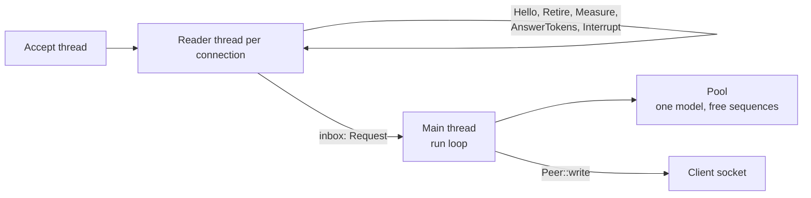
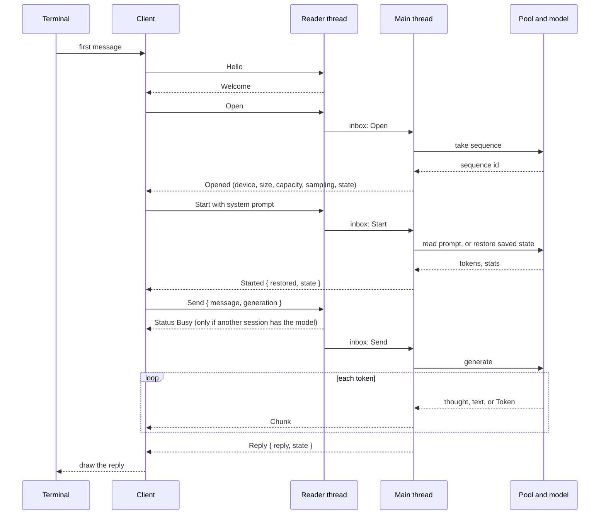

# 03 Server and protocol: one model, several sessions

**Thesis.** The weights of the Qwen3.8-27B model are one GGUF file of about 16 gigabytes (GB), named `Qwen3.8-27B-Q4_0.gguf` (`models/qwen35.rs:21-24`, `README.md:45-54`). A process that loads them cannot also be a process per terminal without wasting memory. dwim therefore loads the model once, in a server process, and gives each terminal a session on that server. The boundary between them is a Unix domain socket that speaks JavaScript Object Notation (JSON), one message per line. This document describes the protocol, the server loop, the sequence pool that gives each session its own model state, and the rules that keep the sessions apart.

A **GGUF** file is the model file format that llama.cpp defines. It holds the weights, the tokenizer, and the metadata, including the sampling settings. The model constant `qwen35::NAME` holds the string `qwen3.8-27b` (`models/qwen35.rs:21`). The file name `qwen35.rs` is historical; the constant and the weights file name are the authority.

## 1. Why the server exists

The server module states its own reason:

```rust
// server/mod.rs:1-18 (condensed)
//! The model takes most of the memory a machine has, so one process loads
//! it, and every `dwim` session is a client of that process over a Unix
//! socket: `dwim` starts the server itself when none is running, and the
//! server exits once it has gone a while without a session. The harness,
//! the tools, and the terminal stay in the client; the server has the
//! model, the sampling, and each session's conversation with it, as a
//! [`Chat`], and speaks the [`protocol`].
//!
//! The model's weights are shared, and each session has a sequence of its
//! own on the device: its key/value caches, its linear layers' recurrent
//! states, and what the drafter carries over. ...
//! Requests are served one at a time, in the order they arrive, each whole,
//! so sessions take turns with the model at reply granularity. The ones
//! that need no model, such as measuring a turn, are answered at once, by
//! the thread that reads the connection.
```

Five facts follow from that paragraph and shape the rest of this document:

1. **The client keeps the agent.** The harness, the tools, and the terminal are in the client process. The server has no tools and no terminal.
2. **The server keeps the conversation.** Each session is a `Chat` value on the server side, with its own position in the model.
3. **The weights are shared.** The server has one model value. The sessions borrow it.
4. **One request is served at a time.** A request is served whole. Sessions wait for each other at reply granularity, not at token granularity.
5. **Some requests do not need the model.** The reader thread answers them directly.

Four types carry that design:

- A **Chat** is the server's value for one conversation. It holds the chat format, the sampler, the model state, and the conversation length.
- A **Format** is the chat format: the tokenizer plus the role markers and tool tags that turn turns into tokens.
- A **Peer** is one connection as the threads share it: a writer socket behind a lock and an interrupt flag.
- **Shared** is a session's handle on the shared model. It selects the session's sequence each time the chat uses it.

## 2. The socket and the identity of the server

The socket path is derived from the user identifier:

```rust
// server/mod.rs:63-70
pub fn socket_path() -> PathBuf {
    let dir = dirs::runtime_dir().unwrap_or_else(env::temp_dir);
    // SAFETY: getuid takes nothing and cannot fail.
    let uid = unsafe { libc::getuid() };
    dir.join(format!("dwim-{uid}.sock"))
}
```

The runtime directory is the value of the X Desktop Group (XDG) `XDG_RUNTIME_DIR` environment variable when the system sets it. When the system has no runtime directory, the temporary directory is used. On a typical Linux desktop this is `/run/user/{uid}`; on macOS the variable is usually absent, so the temporary directory is used. The name includes the numeric user identifier, so two users on one machine do not collide.

The server also has a build identity, not only a version:

```rust
// server/mod.rs:72-88 (condensed)
pub fn build() -> String {
    let version = env!("CARGO_PKG_VERSION");
    match env::current_exe().and_then(fs::metadata) {
        Ok(metadata) => {
            let modified = metadata
                .modified()
                .ok()
                .and_then(|time| time.duration_since(UNIX_EPOCH).ok())
                .map_or(0, |elapsed| elapsed.as_secs());
            format!("{version}-{}-{modified}", metadata.len())
        }
        Err(_) => version.to_string(),
    }
}
```

**Aha: the identity is version, file size, and modification time.** Two builds of the same version are almost always different servers, because the executable size or its modification time in whole seconds differs. A rebuild that reproduces both values is not detected. The modification time fails to `0` when the file system does not supply one, so the size is then the only difference. A client that was rebuilt does not reuse a server from the old binary. When that server has no sessions, the client retires it and starts a new one; when it has sessions, the client stops with an error, because two servers would not fit in memory (`cli/session.rs:264-272`). The check removes an entire class of failure in which a new client sends a message that an old server does not know.

## 3. The protocol

The protocol is a set of Rust enums, serialized as JavaScript Object Notation (JSON). The module comment gives the transport rules:

```rust
// server/protocol.rs:1-5
//! What a client and the server say to each other, over a Unix socket:
//! JSON, one message a line. A request is answered with a response, with
//! what the server has to say in the meantime, such as a reply's pieces or
//! how loading is going, streamed ahead of it. One connection holds one
//! session, and makes one request at a time.
```

Each message is one line. A writer serializes the value with `serde_json::to_vec`, appends a newline, then takes the writer mutex and writes the bytes under it, so two threads cannot interleave bytes on one socket (`server/mod.rs:172-179`). Rust enums use the default external tag: a request is an object with one key, the variant name, and its fields as the value. A request to open is therefore:

```json
{"Open":{"temperature":null,"speculate":4}}
```

A missing field is an error. An unknown field is ignored, because no protocol type sets `deny_unknown_fields`. A line that does not parse gets an `Error` response and the connection stays open; the server does not drop the client for one bad message. There is no protocol version number. The build string in `Hello` and `Welcome` is the version test, and the older-build test in section 10 shows that a missing field takes its default.

### 3.1 Requests

There are fourteen requests. Each has one answer, except `Interrupt`, which has none.

```rust
// server/protocol.rs:13-82 (condensed)
pub enum Request {
    Hello { build: String },
    Retire,
    Open { temperature: Option<f32>, speculate: usize },
    Start { prompt: String },
    System { text: String },
    Clear,
    Replay { turns: Vec<Turn> },
    Measure { turn: Turn },
    AnswerTokens { message: String, limit: usize },
    FeedResults { outputs: Vec<String> },
    Send { message: String, generation: Generation },
    Respond { outputs: Vec<String>, generation: Generation },
    Answer { message: String, heads: Vec<String>, limit: usize, generation: Generation },
    Interrupt,
}
```

| Request | Needs the model | Answer | Purpose |
|---------|-----------------|--------|---------|
| `Hello { build }` | No | `Welcome` | Ask who the server is; the client compares the build string with its own |
| `Retire` | No | `Retired` | Ask the server to give up the socket and exit when free |
| `Open { temperature, speculate }` | Pool only | `Opened` | Take a sequence and start a conversation; `temperature` overrides the file default, and `speculate` is the number of tokens the drafter produces after each pick |
| `Start { prompt }` | Yes | `Started` | Restore a saved state of the prompt, or read the prompt and save its state |
| `System { text }` | Yes | `Ok` | Read a system prompt and never use a saved state |
| `Clear` | Yes | `Ok` | Forget the conversation: length zero and a model reset |
| `Replay { turns }` | Yes | `Ok` | Feed the turns of an earlier conversation, as if they had happened |
| `Measure { turn }` | No | `Count` | Count the tokens of one turn in its chat format |
| `AnswerTokens { message, limit }` | No | `Count` | Count the most tokens an answer to `message` can take, up to `limit` |
| `FeedResults { outputs }` | Yes | `Ok` | Feed tool results with no reply |
| `Send { message, generation }` | Yes | `Reply` | Send a user message and stream the reply |
| `Respond { outputs, generation }` | Yes | `Reply` | Feed tool results and stream the reply to them |
| `Answer { message, heads, limit, generation }` | Yes | `Answered` | Generate a plain answer, split under a list of headings, at most `limit` tokens |
| `Interrupt` | No | none | End the reply in progress |

The `Count` answer for `Measure` and `AnswerTokens` is computed from the tokenizer and the chat format alone. The reader thread answers it, because it needs no device and no model state. This is why the server can answer a measure request while another session generates. Before the model loads, there is no format, and both requests return `not_loaded()`, an `Error` response that says the model is not ready (`server/mod.rs:441-451`). The test asserts the equality with a local `Format`:

```rust
// server/mod.rs:899-908 (condensed)
let turn = Turn::Reply {
    text: "Ok.".to_string(),
    calls: vec!["<function=bash>\n</function>".to_string()],
};
let format = Format::new(Tokenizer::tiny()).unwrap();
assert_eq!(a.measure(&turn).unwrap(), format.measure(&turn).unwrap());
assert_eq!(
    a.answer_tokens("note", 100).unwrap(),
    format.answer_tokens("note", 100).unwrap()
);
```

### 3.2 Responses

```rust
// server/protocol.rs:96-124 (condensed)
pub enum Response {
    Welcome(Welcome),
    Retired { sessions: usize },
    Status(Status),
    Opened(Opened),
    Chunk(Piece),
    Started { restored: bool, state: State },
    Ok(State),
    Count(usize),
    Reply { reply: Reply, state: State },
    Answered { answer: Answer, state: State },
    Error { message: String },
}
```

`Chunk` and `Status` are interim messages. They arrive before the answer to the request that caused them. Every other response is final for one request.

A **piece** is one streamed part of a reply. A **chunk** is the client's borrowed view of one piece: `Piece::chunk()` converts `Thought(text)` to `Chunk::Thought(&str)`, `Text(text)` to `Chunk::Text(&str)`, and `Token` to `Chunk::Token`. The connection layer speaks in `Response`, and the client layer speaks in `Chunk`; they are two views of the same stream, not two protocols (`server/client.rs:277-282`).

A piece has three forms:

```rust
// server/protocol.rs:178-182
pub enum Piece {
    Thought(String),
    Text(String),
    Token,
}
```

`Token` carries no text. It marks that the model picked a token with no printable output, so that the client can count tokens and advance the spinner. The sampler still produced a token.

### 3.3 Status

`Status` reports work in progress. Three of its values are never sent by a server; the client uses them for its own screen: `Restarting` while the client replaces a server of a different build, `Starting` while the client launches a server process, and `Opening` while the client waits for `Opened`.

```rust
// server/protocol.rs:185-217 (condensed)
pub enum Status {
    Downloading { file: String, done: u64, total: Option<u64> },
    Device(String),
    Sized(Size),
    Weights { done: usize, total: usize },
    Prompting { read: usize, total: usize },
    Busy,
    Restarting,
    Starting,
    Opening,
}
```

The server sends `Downloading`, `Device`, `Sized`, `Weights`, `Prompting`, and `Busy`. The first four are broadcast to every connection while the model loads; `Downloading` counts bytes (`done` and `total`, both unsigned 64-bit), `Weights` counts tensors loaded out of the total, and `Sized` carries the `Size` in bytes. `Prompting` goes only to the connection whose prompt is being read, and counts tokens read out of the total. `Busy` goes to a connection whose request must wait. `Device` carries the device name as text.

### 3.4 State

Every answer that changes the conversation returns a `State`:

```rust
// server/protocol.rs:160-163
pub struct State {
    pub tokens: usize,
    pub stats: Stats,
}
```

`tokens` is the length of the conversation in tokens. `stats` is where the session's time went: prompt reading, generation, cache hits, and so on.

**Aha: the client does not track the conversation; it tracks the server's numbers.** The server owns the conversation. After each answer, it sends the new length and the new statistics. The client stores `tokens`, `stats`, the sampler, the generation settings, the context capacity, the size, and the device name. It uses those values for its own space accounting. There is no second copy of the token stream on the client.

### 3.5 Generation

The three fields that change how a reply is generated travel with each request for a reply:

```rust
// server/protocol.rs:85-92
pub struct Generation {
    pub reserve: usize,
    pub thought_limit: Option<usize>,
    pub closing: Option<String>,
}
```

`reserve` is the number of context tokens kept free, so that a tool result can be fed after the reply. `thought_limit` is the thinking budget in tokens, and `closing` is the sentence written to close a thought that reached the budget. The harness always supplies both together: `thought_limit = Some(2048)` and a non-empty closing (`harness/mod.rs`).

The server applies them at the start of each reply:

```rust
// server/mod.rs:620-628
fn apply<M: LanguageModel>(&self, chat: &mut Chat<M>) {
    chat.reserve(self.reserve);
    if let Some(closing) = &self.closing {
        chat.limit_thoughts(self.thought_limit, closing);
    }
}
```

**Discrepancy to know: the thought limit is applied only when a closing sentence is present.** A client that sends `thought_limit = Some(n)` with `closing = None` gets no thought limit. The dwim client always sets both values together (`harness/mod.rs` sets the limit and the closing text in one call), so the product is correct. A different client of the protocol must follow the same rule.

## 4. The server lifecycle

The server binds the socket **before** it loads the model. This is deliberate: sessions that connect during loading can watch the progress.

```mermaid
stateDiagram-v2
    [*] --> Bound: bind socket
    Bound --> Loading: model::load_model
    Loading --> Loading: Status Downloading, Device, Sized, Weights
    Loading --> Failed: load error
    Failed --> [*]: Error broadcast to every peer, exit
    Loading --> Running: Server::run
    Running --> Running: requests from sessions
    Running --> Running: idle timeout but sessions open
    Running --> Retired: Retire, no sessions
    Running --> Idle: idle timeout, no sessions
    Retired --> [*]: socket removed, exit
    Idle --> [*]: socket removed, exit
```

`--serve` in the foreground shows the same steps:

```rust
// cli/serve.rs:23-49 (condensed)
let server = Server::bind(&path, hello)?;
eprintln!("listening on {}", path.display());
let mut stderr = Stderr::new();
let loaded = match session::load_model(settings, sessions, |status| {
    stderr.report(&status);
    server.status(&status);
}) {
    Ok(loaded) => loaded,
    Err(e) => {
        server.fail(&e.to_string());
        return Err(e);
    }
};
let format = Format::new(loaded.tokenizer)?;
let gguf = loaded.gguf;
let temperature = settings.temperature;
let sampler = move |asked: Option<f32>| model::sampler(&gguf, asked.or(temperature));
server.run(loaded.model, format, loaded.device, loaded.size, sampler)
```

The `Hello` value is what the server says about itself before the model exists:

```rust
// server/mod.rs:151-159
pub struct Hello {
    pub model: String,
    pub device: String,
    pub context: Option<usize>,
    pub room: usize,
}
```

These are the values from the command line. `context` is `None` when the user did not choose a context length, because the server computes the length from the free device memory. `room` is the number of sessions that the server was started to serve (`--sessions`), and `model` is the model name that the server will load.

The reader answers `Hello` with a `Welcome`, which is the same information plus the running identity:

```rust
// server/protocol.rs:131-143
pub struct Welcome {
    pub build: String,
    pub pid: u32,
    pub model: String,
    pub device: String,
    pub context: Option<usize>,
    #[serde(default)]
    pub room: usize,
    pub sessions: usize,
}
```

`build` is the identity from section 2, `pid` is the process identifier, and `sessions` is the number of sessions open at that moment. The `#[serde(default)]` on `room` is what lets a client read a `Welcome` from a build that predates the field; it takes the default zero. The test in section 10 builds such a message from JSON.

The handshake order on one connection is:

1. The client connects and sends `Hello { build }`.
2. The server answers `Welcome`. The client compares `build`, `model`, `device`, `room`, and `context` with what it asked for. A different build with no sessions causes a `Retire` and a new server; a different build with sessions is an error (`cli/session.rs:264-272`).
3. The client sends `Open { temperature, speculate }`. The main thread takes a sequence and answers `Opened`. `Opened` carries the device name, the memory `Size`, the context capacity, the sampling settings, and the starting `State`.
4. The client sends `Start` or `System` with the system prompt, then `Send` or `Answer`.

A connection has no session until `Open`. `Hello` and `Retire` work without one, and `Measure` and `AnswerTokens` work without one after the model loads. The client starts the server process itself when the socket is absent; the server is the same binary with `--serve`, which document 02 covers in its section 8.

### 4.1 A stale socket

A server that was killed without cleanup leaves its socket file. `bind` handles that case:

```rust
// server/mod.rs:226-242 (condensed)
let listener = match UnixListener::bind(path) {
    Ok(listener) => listener,
    Err(e) if e.kind() == io::ErrorKind::AddrInUse => {
        if UnixStream::connect(path).is_ok() {
            return Err(io::Error::new(
                io::ErrorKind::AddrInUse,
                format!("another dwim server is listening on {}", path.display()),
            ));
        }
        fs::remove_file(path)?;
        UnixListener::bind(path)?
    }
    Err(e) => return Err(e),
};
```

The test is a connection attempt, not a file test. A file that accepts a connection is a live server. A file that refuses is stale, and is removed. Two errors are possible: `AddrInUse` when another process is listening, and any other `io::Error` when the bind fails for a different reason, such as a path that is too long or a directory that the user cannot write. The connect-and-remove sequence has a race: a server that is alive but not accepting a new connection can refuse the connect, and the code then removes a live socket and binds a second server. Existing connections stay with the first server, and new clients reach the second. The window is small, and the cost is a second copy of the model if the first server still has sessions.

### 4.2 Exit rules

The server exits for three reasons:

1. **No sessions for the idle time.** The default is 600 seconds (`server/mod.rs:58`). The timeout is measured from the last received request, and it does not apply while any session is open.
2. **It was asked to retire and has no sessions.** `Retire` sets a flag and removes the socket at once. The loop ends when `retiring` is true and `sessions` is zero.
3. **Its inbox channel is closed**, which happens when every sender is gone. Each reader thread holds a sender clone, and the accept thread holds one. When the last one is dropped, `recv_timeout` returns `Disconnected` and the loop ends.

The main thread is the only thread that owns the sessions and the pool. It leaves the loop when one of those conditions holds, then drops the sessions. Dropping a session drops its `Shared` handle, which returns the sequence to the pool.

The `Drop` implementation removes the socket unless `Retire` already did:

```rust
// server/mod.rs:384-390
fn drop(&mut self) {
    if !self.inner.retiring.load(Ordering::Relaxed) {
        let _ = fs::remove_file(&self.inner.path);
    }
}
```

**Aha: the idle timer does not apply while a session is open.** The loop continues after a timeout when sessions exist. `recv_timeout(self.idle)` returns `Timeout`, the code checks `sessions.is_empty()`, and the loop continues. A terminal left open all day keeps the model loaded and the memory used.

## 5. Threads in the server



The server has no asynchronous runtime. It uses threads and one channel:

- **One accept thread.** It blocks on `listener.incoming()`, numbers each connection, and starts a reader thread for it.
- **One reader thread per connection.** It reads lines, answers the requests that need no model, and sends the rest to the main thread.
- **One main thread.** It runs the loop, owns the sessions and the pool, and serves requests one at a time.

The channel carries only two kinds of message:

```rust
// server/mod.rs:183-187
enum Message {
    Request(Request),
    /// The connection is gone.
    Closed,
}
```

`Closed` is how the main thread learns that a connection ended. The reader thread sends it after `read` returns, so the main thread can drop that session and return its sequence. The removal from the peer table belongs to the reader thread, not to the main thread; the snippet above is the reader's own cleanup.

Both the reader thread and the main thread write to the same socket. A reader answers `Hello`, `Retire`, `Measure`, and `AnswerTokens`; the main thread streams `Status`, `Chunk`, `Reply`, and the other answers. `Peer::write` is the only writer. It serializes the whole `Response` to one vector, appends a newline, takes the writer mutex, and writes the bytes under the lock (`server/mod.rs:172-179`). This is why a broadcast status and a reply chunk can never interleave in the middle of a line.

The accept loop also removes the peer from the shared table and sends `Closed`:

```rust
// server/mod.rs:402-428 (condensed)
for (id, stream) in listener.incoming().enumerate() {
    ...
    inner.peers().insert(id, peer.clone());
    thread::spawn({
        let inner = inner.clone();
        let inbox = inbox.clone();
        move || {
            read(id, reading, &peer, &inner, &inbox);
            inner.peers().remove(&id);
            let _ = inbox.send((id, Message::Closed));
        }
    });
}
```

The connection number identifies the peer. It is assigned in order, starts at zero, and is not reused. The sequence identifier is a different number; it identifies the model state that the session took from the pool.

### 5.1 What the reader thread answers

```rust
// server/mod.rs:447-500 (condensed)
let response = match request {
    Request::Hello { .. } => Response::Welcome(Welcome { ... }),
    Request::Retire => {
        inner.retiring.store(true, Ordering::Relaxed);
        let _ = fs::remove_file(&inner.path);
        Response::Retired { sessions: inner.sessions.load(Ordering::Relaxed) }
    }
    Request::Measure { turn } => match inner.format.get() {
        Some(format) => count(format.measure(&turn)),
        None => not_loaded(),
    },
    Request::AnswerTokens { message, limit } => match inner.format.get() {
        Some(format) => count(format.answer_tokens(&message, limit)),
        None => not_loaded(),
    },
    Request::Interrupt => {
        peer.interrupted.store(true, Ordering::Relaxed);
        continue;
    }
    request => {
        ...
        inbox.send((id, Message::Request(request))).is_err()
        ...
    }
};
```

`Hello` and `Retire` must work while the model loads, or a waiting client could not even ask what the server is doing. `Measure` and `AnswerTokens` must not wait behind a long generation, because the harness uses them to plan the next step.

### 5.2 Busy

When the model is on another session's request, the reader thread tells the client before it queues the request:

```rust
// server/mod.rs:397-403
fn busy_for(&self, id: usize) -> bool {
    self.serving
        .lock()
        .unwrap_or_else(|e| e.into_inner())
        .is_some_and(|serving| serving != id)
}
```

```rust
// server/mod.rs:482-492 (condensed)
if matches!(request, Request::Send { .. } | Request::Respond { .. } | Request::Answer { .. }) {
    peer.interrupted.store(false, Ordering::Relaxed);
}
if inner.busy_for(id) {
    let _ = peer.write(&Response::Status(Status::Busy));
}
if inbox.send((id, Message::Request(request))).is_err() {
    break;
}
```

`Busy` is information, not a refusal. The request still goes to the inbox and waits its turn. The client shows it on the screen, so that the user knows the delay is another session's work.

**Aha: the interrupt flag is cleared when a new reply request arrives, not when the reply ends.** The flag is per connection. The reader thread sees the requests on one connection in order. It clears the flag when it reads a `Send`, `Respond`, or `Answer`, and it sets the flag when it reads an `Interrupt`. The client sends the reply request first and the `Interrupt` later, so the clear happens before the set. The main thread may then serve the `Send` after the flag is already set. The serving closure writes one chunk and checks the flag, so that reply stops after its first piece. A stale interrupt from an earlier reply cannot stop a later one, because the later reply request clears it first.

### 5.3 Interrupt

`Interrupt` is not answered. It sets a flag that the serving thread checks on every chunk:

```rust
// server/mod.rs:537-548 (condensed)
let stream = |piece: Piece| -> ControlFlow<()> {
    if peer.write(&Response::Chunk(piece)).is_err() || peer.interrupted.load(Ordering::Relaxed) {
        ControlFlow::Break(())
    } else {
        ControlFlow::Continue(())
    }
};
```

The generation function receives this closure. When the closure returns `Break`, generation stops as if the client had stopped reading the chunks. The request still gets its `Reply`, with the text produced so far and the tool calls completed so far.

The client produces the interrupt from a `ControlFlow::Break` in its own chunk handler:

```rust
// server/client.rs:100-122 (condensed)
self.write(request)?;
let mut interrupted = false;
loop {
    let response = self.read()?;
    match response {
        Response::Status(_) | Response::Chunk(_) => {
            if !interrupted && on(&response).is_break() {
                interrupted = true;
                self.write(&Request::Interrupt)?;
            }
        }
        Response::Error { message } => return Err(message.into()),
        response => return Ok(response),
    }
}
```

The client asks only once. It then drops every chunk until the answer arrives.

The test holds the model after 20 tokens, so the interrupt always lands inside the reply, whatever the thread schedule:

```rust
// server/mod.rs:960-995 (condensed)
let reply = client
    .send("go", |chunk| {
        if let Chunk::Thought(_) = chunk { thoughts += 1; }
        if thoughts >= 3 { ControlFlow::Break(()) } else { ControlFlow::Continue(()) }
    })
    .unwrap();
assert!(thoughts < 100, "{thoughts}");
assert!(reply.calls.is_empty());
let (next, _) = ask(&mut client, "on");
assert_eq!(next.trim(), "Next.");
```

The closure receives a `Chunk`, which is the client's borrowed view of a `Piece`; the connection layer would receive a `Response::Chunk(Piece)`. `ask` is a test helper that sends one message with no generation settings and returns the reply text and the new `State`. It exists so that each test line does not repeat the send-and-read loop.

The reply stops after the third thought piece. The tool call that the model was about to write never arrives. The next turn works normally.

## 6. The sequence pool

A model that serves several conversations needs several independent states. In dwim, each state is a **sequence**.

### 6.1 What a sequence holds

A sequence is the per-session model state:

- The key/value caches of the full-attention layers.
- The convolution and recurrent states of the Gated DeltaNet layers. A **convolution state** is the last few inputs that the short convolution filter needs. A **recurrent state** is the Gated DeltaNet matrix that carries information from earlier positions.
- The **hidden state** carried between batches: the last layer output that the next batch continues from. A **batch** is one call to the model with one or more tokens.
- The tokens that a **speculative batch** is verifying. In a speculative batch, the model drafts up to eight tokens ahead, then verifies them in one forward pass. The sequence holds the drafted tokens and the hidden state that the verification needs.
- A **parity** flag for the two convolution buffers, which says which buffer holds the newest input. A **carry** value for the recurrence, and a **mark** used to rewind a failed draft.

The device memory for one sequence is what `Size::conversation` reports, in bytes. `Size::context` is the maximum number of tokens, `Size::model` is the weight memory in bytes, and `Size::sessions` is the number of sequences that the server allocated.

### 6.2 Allocation at start

The server allocates all sequences before it serves a request:

```rust
// server/mod.rs:298-303 (condensed)
let mut free = vec![0];
for _ in 1..size.sessions {
    free.push(model.add_sequence()?);
}
free.reverse();
let pool = Rc::new(RefCell::new(Pool { model, free }));
```

The first sequence exists from model load. Each call to `add_sequence` allocates another sequence of the same maximum length. `size.sessions` is the number of sequences that the server decided to allocate. The model planner computes it from the free device memory and the `--sessions` limit (`cli/model.rs:144-149`), and the option itself is in `cli/session.rs`. The allocation happens before the server serves any request, so a failure here stops the server before a client can open a session.

```rust
// models/qwen35.rs:1285-1298
fn add_sequence(&mut self) -> Result<usize> {
    let id = self.parked.len() + 1;
    let seq = Sequence::new(
        &self.config,
        &self.device,
        id,
        self.state.seq.max_len,
        self.caches,
        self.slots,
    );
    self.parked.insert(id, seq);
    Ok(id)
}
```

The `free` vector is reversed so that sequence zero is at the end of the vector, and `pop` takes it first. Sequence zero is the one that is already selected after loading, and selecting it costs no swap. The first session therefore gets the sequence that needs no work.

**Aha: the pool is a stack, not a queue.** `pop` takes from the end, and `free.reverse()` puts the most valuable sequence there. Without the reverse, the first session would get the sequence with the highest number, which costs a swap, and sequence zero would wait for the last session.

### 6.3 Take and give back

A session takes a sequence when it opens:

```rust
// server/mod.rs:680-699 (condensed)
fn take(pool: &Rc<RefCell<Pool>>) -> Result<Self, Box<dyn Error>> {
    let mut p = pool.borrow_mut();
    let Some(id) = p.free.pop() else {
        return Err(
            "the dwim server has no room for another session: quit one, or start the server with more --sessions"
                .into(),
        );
    };
    p.model.select_sequence(id)?;
    p.model.reset();
    drop(p);
    Ok(Self { id, pool: pool.clone() })
}
```

`reset` returns the sequence to its starting state: it zeroes the convolution and recurrent states of every linear layer, clears any speculative batch, and clears the parity, carry, and mark flags (`models/qwen35.rs:1263-1277`). It does not clear the key/value caches or set a position counter. The comment in the source gives the reason: attention reads only positions below the current one, so bytes from an earlier conversation at higher positions are never read. The conversation restarts at position zero, and each new token overwrites the cache entry at its position before attention reads it. A new session therefore never reads a previous session's text.

If `select_sequence` or `reset` fails after `pop`, the identifier is lost: the function returns the error and does not push the identifier back onto `free`. The pool then has one fewer sequence for the rest of the server's life. This is an error path that the tests do not cover. It cannot happen in the normal flow, because the identifier came from the same pool and the main thread is the only user, but a future change to `reset` could make it reachable.

**Aha: the reset is smaller than it looks, and the safety comes from the position.** A full cache clear would cost a device write over the whole sequence. dwim avoids it: the new conversation writes at positions from zero, and attention only reads the positions that the conversation has written. The zeroed linear states are still required, because those states are read at every position.

The session gives the sequence back when its `Shared` handle is dropped:

```rust
// server/mod.rs:712-716
impl Drop for Shared {
    fn drop(&mut self) {
        self.pool.borrow_mut().free.push(self.id);
    }
}
```

`Shared` is dropped when the session's `Chat` is removed, which happens on `Message::Closed` or when the server exits.

### 6.4 Selecting a sequence copies nothing

The model keeps one sequence active and every other sequence parked:

```rust
// models/qwen35.rs:1300-1314 (condensed)
fn select_sequence(&mut self, id: usize) -> Result<()> {
    if self.state.seq.id == id {
        return Ok(());
    }
    if !self.state.seq.verified.is_empty() {
        return Err("a batch is being verified".into());
    }
    let mut seq = self.parked.remove(&id).ok_or_else(|| format!("no sequence {id}"))?;
    std::mem::swap(&mut self.state.seq, &mut seq);
    self.parked.insert(seq.id, seq);
    Ok(())
}
```

**Aha: a context switch between sessions is one pointer swap, not a copy.** The sequence value owns device buffers. A `mem::swap` exchanges the handles. The data stays where the device put it. This is why the server can serve several sessions without doubling the cost of a switch.

The refusal when a batch is being verified is a real rule. A reply that failed part way can leave a speculative batch uncommitted. The main loop calls `chat.settle()` after every request, which commits that batch, so the next session can select its sequence:

```rust
// server/mod.rs:358-365 (condensed)
Some(chat) => {
    let response = serve(chat, request, &peer);
    // A reply that failed part way may leave a batch
    // being verified: it is committed before another
    // session has the model.
    chat.settle();
    response
}
```

### 6.5 The session handle is a language model

`Shared` implements the `LanguageModel` trait by delegating to the shared model on the session's sequence:

```rust
// server/mod.rs:718-758 (condensed)
impl LanguageModel for Shared {
    fn save(&self, len: usize) -> Option<Vec<u8>> { self.model().save(len) }
    fn restore(&mut self, state: &[u8]) -> crate::models::Result<usize> { self.model().restore(state) }
    fn forward(&mut self, tokens: &[u32], pos: usize) -> Vec<f32> { self.model().forward(tokens, pos) }
    fn draft(&mut self, token: u32, pos: usize, k: usize) -> Vec<u32> { self.model().draft(token, pos, k) }
    fn verify(&mut self, tokens: &[u32], pos: usize) -> Vec<f32> { self.model().verify(tokens, pos) }
    fn rewind(&mut self, keep: usize) { self.model().rewind(keep) }
    fn mark(&mut self) -> bool { self.model().mark() }
    fn rewind_to_mark(&mut self) -> crate::models::Result<()> { self.model().rewind_to_mark() }
    fn reset(&mut self) { self.model().reset() }
    fn max_len(&self) -> usize { self.pool.borrow().model.max_len() }
    ...
}
```

Each call selects the session's sequence first. The selection is inside the private `model` method that every delegating method calls:

```rust
// server/mod.rs:698-704
fn model(&self) -> std::cell::RefMut<'_, Box<dyn LanguageModel>> {
    let mut pool = self.pool.borrow_mut();
    pool.model
        .select_sequence(self.id)
        .expect("no batch is verified across requests");
    pool
}
```

The `expect` states the invariant: the main thread calls `settle` after every request, so no speculative batch is being verified when the next request begins. A broken invariant would panic the main thread, which ends the server. This is a deliberate choice: a wrong sequence switch would be worse than a stopped server.

This is why the session's `Chat` can be a normal `Chat<Shared>` with no special code. `Chat` does not know that the model is shared.

`Shared` owns exactly one sequence, so the trait's selector has nothing to select. It accepts zero as a no-op and refuses every other identifier:

```rust
// server/mod.rs:760-770
fn add_sequence(&mut self) -> crate::models::Result<usize> {
    Err("a session runs one sequence".into())
}

fn select_sequence(&mut self, id: usize) -> crate::models::Result<()> {
    if id == 0 {
        Ok(())
    } else {
        Err("a session runs one sequence".into())
    }
}
```

The `0` is not a reference to the server's sequence zero. It is the only selector value that a `Chat<Shared>` can ask for, because the `Shared` handle already knows its own identifier. A caller that asks for another identifier gets an error instead of a silent switch to a sequence that the session does not own.

**Aha: this is the whole sharing mechanism.** There is no reference counting, no lock on the weights, and no copy of the model. The sessions are `Chat` values over a model handle that selects a sequence. The single main thread is what makes the shared `Rc<RefCell<Pool>>` safe without a mutex.

## 7. The flow of one session



The first request that needs the model waits until loading ends, because the main thread is still in `load_model`. The client sees `Status` messages for download, device, size, and weights, then its `Open` is answered.

## 8. Saved system prompt states

Reading a system prompt of several thousand tokens costs time proportional to its length, and the cost is paid again for every new session. The server saves the model state after reading one, and restores it the next time a session sends the same prompt:

```rust
// server/mod.rs:95-117 (condensed)
pub fn start<M: LanguageModel>(
    chat: &mut Chat<M>,
    prompt: &str,
    on_progress: impl FnMut(usize, usize),
) -> Result<bool, Box<dyn Error>> {
    let path = state_path(prompt);
    if let Some(path) = &path
        && let Ok(state) = fs::read(path)
        && chat.restore(&state).is_ok()
    {
        return Ok(true);
    }
    chat.system(prompt, on_progress)?;
    if let Some(path) = path
        && let Some(state) = chat.save()
        && let Some(dir) = path.parent()
        && fs::create_dir_all(dir).is_ok()
        && fs::write(&path, state).is_ok()
    {
        prune(dir);
    }
    Ok(false)
}
```

The file name is a hash of the model name and the prompt text:

```rust
// server/mod.rs:121-134 (condensed)
// FNV-1a, so that the name is the same from one build to the next.
let mut hash: u64 = 0xcbf29ce484222325;
for byte in qwen35::NAME.bytes().chain([0]).chain(prompt.bytes()) {
    hash ^= byte as u64;
    hash = hash.wrapping_mul(0x100000001b3);
}
Some(dirs::cache_dir()?.join("dwim").join("states").join(format!("{hash:016x}.bin")))
```

The hash is Fowler–Noll–Vo, version 1a (FNV-1a): a fast non-cryptographic hash that the code writes out by hand, so that the name of the state file is the same from one build to the next. `STATES_KEPT` is 4. `prune` sorts by modification time and removes all but the newest four (`server/mod.rs:61`, `137-150`).

**Aha: the state is the model's memory, not the conversation.** It holds the key/value caches and recurrent states after the system prompt. It does not hold the system prompt text, the tokenizer output, or the turns. If the model name or the prompt text changes, the hash changes and the state is not found. If the format is corrupt or from an incompatible build, `restore` fails and the prompt is read normally.

The file has a fixed header, so a wrong file is rejected rather than read as numbers. The first eight bytes are the American Standard Code for Information Interchange (ASCII) string `dwimstat`. The next four bytes are the layout version, currently `3`, in little-endian order. Then come seven 64-bit numbers: the token length, the key/value cache length, the recurrent-state length, the key/value dimension, the convolution width, the recurrent width, and the drafter's hidden width. The body is the attention caches, then the convolution and recurrent states, then the drafter's hidden state when the model has a drafter (`models/qwen35.rs:926-975`).

`restore` checks the magic, the version, and every dimension against the loaded model. It returns a different error for a cut-short file, a file that is not a state, a state of another version, and a state of another model (`models/qwen35.rs:977-1020`). The saved state is keyed by prompt, not by device or context length. A machine with a different device that finds a state file can try to restore it. The dimension check rejects a state whose shape does not fit, and the code then reads the prompt. A state file from another device that is structurally valid but numerically wrong is not detectable here. This is a small risk, and it belongs to the cache.

## 9. What the server does not do

- **No authentication.** Any process of the same user, and root, can connect to the socket. The path name is not a secret. The security boundary is the user account and any sandbox around it, such as a container or a separate account.
- **No network transport.** The socket is local. There is no Transmission Control Protocol port and no transport encryption.
- **No token-level interleaving.** One reply at a time. A long reply delays every other session until it ends or is interrupted.
- **No priority or fairness rule.** Requests are served in arrival order. A session that sends many requests can delay another, within the reply-at-a-time rule.
- **No backpressure limit.** A client that does not read its socket can make the reader thread block on write. The server does not measure this.
- **No persistence of sessions.** A server exit loses every conversation. The client's transcript is the only record, and it lives in the client.
- **No per-session memory limit.** The context length is fixed for every sequence when the model loads. A session that fills its context compacts: the harness replaces the old turns with a note and a tail, and sends the new conversation to the server (document 06). The server does not enforce a smaller limit for one session.

## 10. What is verified and what is not

The server tests use a scripted model, not the real weights. They check four properties:

1. **Sessions take turns with their own state.** Two sessions alternate, and each sees only its own tokens (`server/mod.rs:859-958`).
2. **A reply is interrupted and the session goes on.** The next turn is normal (`server/mod.rs:960-1004`).
3. **An older `Welcome` is read.** A missing field takes its default. The test uses this line and expects `room` to be zero (`server/mod.rs:1006-1012`):

   ```json
   {"Welcome":{"build":"0.0.10-1-2","pid":7,"model":"qwen3.8-27b","device":"gpu","context":null,"sessions":1}}
   ```
4. **An idle server exits** (`server/mod.rs:1015-1061`).

What the tests do not cover: a real model with a real sequence pool and real device memory, the `Busy` path under load, and a client that dies in the middle of a write. The first is covered indirectly by `difftest` and the real-model test (document 04).

## 11. Terms used in this document

| Term | Meaning |
|------|---------|
| **Backpressure** | A rule that stops a sender when the receiver cannot keep up. |
| **Build identity** | The version, executable size, and modification time that identify a running server build. |
| **Channel** | A Rust queue that moves values between threads. |
| **Chat** | The server's value for one conversation: a chat format, a sampler, a model state, and a conversation length. |
| **Chat format** | The rules that turn messages into model tokens: role markers, endings, tool syntax. |
| **Client** | The process that holds the harness, the tools, and the terminal. It connects to the server. |
| **Conversation** | The turns of one session, and the token positions that they occupy in its sequence. |
| **FNV-1a** | Fowler–Noll–Vo hash, version 1a: a fast non-cryptographic hash function. |
| **Format** | The tokenizer plus its role markers and tool tags. |
| **Gated DeltaNet** | A linear-attention layer that carries a recurrent state instead of a growing cache. |
| **GGUF** | The model file format that llama.cpp defines; it holds weights, tokenizer, and metadata. |
| **GiB** | Gibibyte: 2 to the power 30 bytes. |
| **Hello** | The request that asks the server what it is, before any session exists. |
| **Interrupt** | A request that ends a reply early. |
| **JSON** | JavaScript Object Notation: a text format for values made of objects, arrays, strings, and numbers. |
| **JSON Lines** | A file or stream format with one JavaScript Object Notation (JSON) value on each line. |
| **Key/value cache** | The stored attention keys and values for tokens already processed. |
| **Materialized state** | See *sequence*. |
| **Opened** | The answer to `Open`: device name, memory `Size`, context capacity, sampling settings, and the starting `State`. |
| **Peer** | One connection as the server's threads share it: a writer socket behind a lock and an interrupt flag. |
| **Piece** | One streamed part of a reply: a thought, a text, or a token mark. |
| **Pool** | The set of sequence identifiers that no session has. |
| **Process** | A running program with its own memory. |
| **Room** | The number of sessions that the server was started to serve. |
| **Sequence** | One session's model state on the device: caches, recurrent states, and position. |
| **Session** | One conversation with the model, held on one connection with one sequence and one `Chat`. |
| **Shared** | A session's handle on the shared model; it selects the session's sequence on every use. |
| **Size** | The byte and count report: sessions, context, model bytes, and conversation bytes. |
| **Stale socket** | A socket file whose server is gone. |
| **State (model)** | The caches and recurrent buffers after a prefix of a conversation. |
| **State (protocol)** | The conversation token count and the session statistics. |
| **Status** | An interim progress message: loading, sizing, prompting, or busy. |
| **Thread** | A unit of execution inside a process. |
| **Token** | The unit of text that a model reads and writes. |
| **Unix domain socket** | A socket addressed by a file-system path on one machine. |
| **Welcome** | The answer to `Hello`: the build identity, process identifier, model, device, context, room, and open sessions. |

## 12. What to read next

Read [04 Inference engine](04-inference-engine.md) for the device operations behind `select_sequence`, `forward`, and `verify`. Read [06 Agent harness and tools](06-agent-harness-and-tools.md) for the client loop that sends the requests in section 3.
