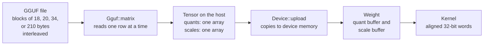
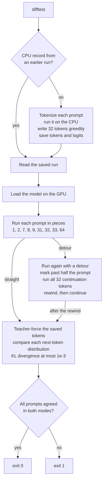

# 04 Inference engine: one trait, three devices, one specification

**Thesis.** dwim does not use a general tensor library. The transformer states what it needs as ten operations on buffers and weight matrices. A `Device` trait names those operations and three associated types for memory. The central processing unit (CPU) implementation is the reference. The Vulkan and Metal implementations are hand-written kernels. They must agree with the reference: bit for bit where the cache format requires it, and within a stated tolerance elsewhere. A differential test with the real weights decides whether they do. This document describes the trait, each implementation, the quantization formats, the cache format, and the test that ties them together.

**Prerequisites and scope.** dwim is the project's local coding agent. It is one Rust program that contains the agent, the model, and the inference engine. The model is Qwen3.8-27B, a 27-billion-parameter hybrid transformer. The project calls it `qwen3.8-27b`. The weights are a quantized file of about 16 gigabytes (GB). Most matrices are `Q4_0`, a 4-bit block format: 32 weights share one 16-bit scale, and each weight is a 4-bit integer (section 3.1). The file also holds `Q4_1`, `Q8_0`, `Q6_K`, and `F32` tensors. Section 10.2 lists which tensor groups use each format. The file is in GGUF, the model file format that llama.cpp uses. llama.cpp is the C++ inference program whose file formats and quantization blocks the project follows. The model's source file is `models/qwen35.rs`. This document describes commit `38885264dc75a02294cc53c18c4afa7e07ee5b58` of the source, version `0.0.12`. This document uses the following facts from [00 Overview](00-overview.md) and [05 Model and tokenizer](05-model-and-tokenizer.md):

- The file holds 65 blocks. A model block is one transformer layer, with its weights. Model blocks 1 to 64 are the model. Block 65 is the drafter: a small extra layer with its own key/value cache. The drafter predicts the token after the one the model has just picked (section 10.2).
- Every fourth model layer is full attention. The other 48 layers are Gated DeltaNet linear attention.
- The model's hidden width is 5,120. The feed-forward width is 17,408. The vocabulary is about a quarter of a million entries. The exact count is not recorded in the repository (section 10.2).
- Full attention has 24 query heads and 4 key/value heads. Each head is 256 wide. Rotary position embedding (RoPE) rotates 64 elements of each head.
- Linear attention has 16 key heads, 48 value heads, and a state width of 128.

This document repeats each fact that it needs. A reader does not need to open another document to follow the engine.

## 1. The boundary

The graphics processing unit (GPU) module says why the boundary exists:

```rust
// gpu/mod.rs:1-4
//! Devices a model runs on: the operations a transformer's forward pass is
//! built from, and their implementations. [`Cpu`] is the reference; the
//! `metal` and [`vulkan`] devices run the same operations on a GPU with
//! hand-written compute kernels.
```

The device owns almost all model memory. One exception: the embedding table stays in the file on the host and is looked up there (`models/qwen35.rs:310-313`). The file is a read-only memory map. `Gguf::open` calls `mmap` with `PROT_READ` and `MAP_PRIVATE`, so the bytes are paged in on demand and are never written (`models/gguf.rs:283-292`). The source gives two facts as the reason: the table is large, and a token needs one row of it (`models/qwen35.rs:310-312`). The table is stored as `Q4_0`: 18 bytes for each 32 values, which includes the 2-byte scale. [05 Model and tokenizer](05-model-and-tokenizer.md), section 4.2, computes 437,575,680 bytes, or about 0.44 GB (0.41 GiB), from the published 151,936-entry Qwen3 vocabulary. The source comment's "most of a third of a gigabyte" is a rough estimate, and it is slightly low for these numbers. The vocabulary is read from the file, and the exact count in this file is not recorded in the repository. The transformer holds device handles, not host vectors. A buffer holds 32-bit floating-point numbers (`f32`). A weight holds bfloat16 (`bf16`) bits or quantized integers. A cache holds 8-bit integers and 16-bit half-precision floating-point (`f16`) scales.

```rust
// gpu/mod.rs:176-239 (condensed)
pub trait Device {
    /// A vector of f32 activations in device memory.
    type Buffer;
    /// A weight matrix in device memory, in any of [`Tensor`]'s formats.
    type Weight;
    /// A key or value cache in device memory: activations stored in blocks
    /// of [`CACHE_BLOCK`] as [`quantize`] makes them, 8.5 bits each.
    type Cache;

    fn name(&self) -> String;
    fn memory(&self) -> Option<u64>;
    fn upload(&self, tensor: Tensor) -> Self::Weight;
    fn alloc(&self, len: usize) -> Self::Buffer;
    fn alloc_cache(&self, len: usize) -> Self::Cache;
    fn resize(&self, buf: &mut Self::Buffer, len: usize);
    fn read(&self, buf: &Self::Buffer) -> Vec<f32>;
    fn write(&self, buf: &mut Self::Buffer, data: &[f32]);
    fn copy(&self, dst: &mut Self::Buffer, dst_offset: usize,
            src: &Self::Buffer, src_offset: usize, len: usize);
    fn store(&self, cache: &mut Self::Cache, offset: usize, src: &Self::Buffer);
    fn read_cache(&self, cache: &Self::Cache, len: usize) -> Vec<u8>;
    fn write_cache(&self, cache: &mut Self::Cache, data: &[u8]);
    // ten compute operations follow
}
```

The three associated types are the important design choice. A device can use whatever representation is fastest for it:

| Device | `Buffer` | `Weight` | `Cache` |
|--------|----------|----------|---------|
| CPU | `Vec<f32>` | `Tensor` on the host | `Cache` with `Vec<i8>` quants and `Vec<u16>` scales |
| Vulkan | device buffer of `f32` | one device buffer of quants and one of scales, or one of bf16 bits | two device buffers: quants and scales |
| Metal | shared-memory Metal buffer (`MTLBuffer`) | one shared-memory buffer of weights, plus one of scales for block formats | two shared-memory buffers: quants and scales |

`MTLBuffer` is Metal's object for a block of memory. A shared-memory buffer is one that the CPU and the GPU both address. `Tensor` is the host-side weight value, and `Weight` is the device-side handle to it.

### 1.1 Memory methods

Each memory method has a unit and a precondition. The types are the ones in `gpu/mod.rs:188-239`.

| Method | Unit and meaning | Precondition |
|--------|------------------|--------------|
| `name()` | A string: the GPU's name, or `cpu`. | None. |
| `memory()` | Bytes free for a model, as `Option<u64>`. It is not elements and not megabytes. | None. The value is an estimate. `None` means the device has no estimate. The Vulkan implementation returns `None` when it finds no device-local memory heap (`gpu/vulkan/mod.rs:876-909`). |
| `upload(tensor)` | Copies a host `Tensor` into device memory. It does not quantize. | The tensor's shape and data must agree. |
| `alloc(len)` | `len` activations, each an `f32`. The buffer is zeroed. | `len` can be zero. |
| `alloc_cache(len)` | `len` activations, each in a cache block. The cache is zeroed. | `len` must be a multiple of `CACHE_BLOCK`, which is 32. |
| `resize(buf, len)` | Sets the logical length to `len` activations. It does not change the allocation. | `len` must not exceed the allocated capacity. New activations are undefined. |
| `read(buf)` | Returns a `Vec<f32>` with one value per activation. | None. It waits for pending device work. |
| `write(buf, data)` | Copies `data` into the buffer. | `data.len()` must equal the buffer's length. |
| `copy(dst, dst_offset, src, src_offset, len)` | Copies `len` activations, not bytes. | Both ranges must fit. |
| `store(cache, offset, src)` | Quantizes `src` into the cache as `quantize` does. | `offset` and `src.len()` must be multiples of 32. |
| `read_cache(cache, len)` | Returns raw bytes: `len` signed bytes, then `len / 32` little-endian `f16` scales. | `len` must be a multiple of 32. |
| `write_cache(cache, data)` | Writes raw bytes in the format of `read_cache`. It has no `len` argument. | `data.len()` must equal `cache_bytes(len)` for a whole number of blocks. The method derives `len` from the data length, as `data.len() / 34 * 32`, and checks the result (`gpu/cpu.rs:96-106`; `gpu/vulkan/mod.rs:1067-1073`; `gpu/metal/mod.rs:898-900`). |

`memory()` has three implementations. The CPU reports the host's available memory. Vulkan reports the first device-local heap. With the `VK_EXT_memory_budget` extension, it reports `heap_budget[heap] − heap_usage[heap]`, with a floor of zero, for that heap. The extension reports how much of the heap the driver expects to be available; it does not raise the heap's size. It also caps an integrated GPU's value at the host's available memory. The Vulkan implementation returns `None` when no device-local heap is found (`gpu/vulkan/mod.rs:876-909`). Metal reports `recommendedMaxWorkingSetSize()` minus what the device already allocated. `recommendedMaxWorkingSetSize()` is Metal's estimate of the most memory the GPU can use without hurting performance. It also caps that value at the host's available memory and at 9/16 of total host memory minus the allocation. The 9/16 is the project's `SHARE` constant, not a Metal value. The cap reflects that model memory is wired. The operating system locks it in physical memory, so it is not paged to disk. The system and other programs keep the other 7/16 (`gpu/metal/mod.rs:695-732`).

The model's `mark` and `rewind_to_mark` methods are not on `Device`. They are on the `LanguageModel` trait (`models/mod.rs:58-66`). Section 10.3 describes them.

**Aha: the trait is ten operations, not a tensor language.** There is no general matrix type, no broadcasting, and no shape algebra. A kernel exists because the transformer needs it. The engine's `gpu/` directory is 7,922 lines. The 7 Rust files hold 5,082 lines. They are `gpu/mod.rs`, `gpu/cpu.rs`, `gpu/host.rs`, `gpu/quant.rs`, `gpu/vulkan/mod.rs`, `gpu/metal/mod.rs`, and `gpu/tests.rs`. The 14 WebGPU Shading Language (WGSL) kernels hold 986 lines. The 21 Metal Shading Language (MSL) kernels hold 1,854 lines. The command is `wc -l gpu/*.rs gpu/vulkan/*.rs gpu/vulkan/kernels/*.wgsl gpu/metal/*.rs gpu/metal/kernels/*.metal`. The repository records no measured size for a general-purpose inference library. This document therefore does not claim a size ratio. [07 Comparison](07-comparison-foundation-ai.md) compares the design qualitatively.

## 2. The ten operations

All compute operations use `f32` activations. A weight matrix has shape `[rows, cols]`. A buffer of `n` tokens has `n * cols` activations for a weight of `cols` columns. The output buffer has `n * rows` activations. The letter `n` always means the number of tokens in the current batch.

The engine uses these helper functions:

```rust
// gpu/mod.rs:345-352
pub fn sigmoid(x: f32) -> f32 {
    1.0 / (1.0 + (-x).exp())
}

/// `ln(1 + e^x)`, without overflowing for large `x`.
pub fn softplus(x: f32) -> f32 {
    if x > 20.0 { x } else { (1.0 + x.exp()).ln() }
}
```

`head_dim` is the width of one attention head. The model uses two widths: 256 in full attention and 128 in linear attention. `n_heads` is the number of query heads. `n_kv_heads` is the number of key/value heads. `group = n_heads / n_kv_heads` is the number of query heads that share one key/value head. `n_v_heads` is the number of value heads in linear attention. `n_k_heads` is the number of key heads in linear attention. In linear attention, `n_v_heads / n_k_heads` value heads share one key head. The mapping is:

| Symbol | Meaning | Model value |
|--------|---------|-------------|
| `n_heads` | Query heads in full attention | 24 |
| `n_kv_heads` | Key/value heads in full attention | 4 |
| `n_k_heads` | Key heads in linear attention | 16 |
| `n_v_heads` | Value heads in linear attention | 48 |
| `head_dim` | Width of one head | 256 in full attention, 128 in linear attention |

`eps` is a small `f32` floor that the caller supplies. `rmsnorm` adds it to the mean square, and `l2norm` adds it to the sum of squares, before the square root. It is an absolute constant, not a relative term. The tests use `1e-6`. The model reads `qwen35.attention.layer_norm_rms_epsilon` from the file; the file's value is not recorded in the repository (`gpu/tests.rs:450-472`; `models/qwen35.rs:131`).

### 2.1 Operation specification

| Operation | Inputs and outputs | Shapes and preconditions | Formula and edge cases | Kernel files |
|-----------|--------------------|--------------------------|------------------------|--------------|
| `matmul` | Weight `w`, activations `x`, output `out`. | `w` is `[rows, cols]`. `x` is `n * cols`. `out` is `n * rows`. `cols % 8 == 0`. A `Q4_0` or `Q8_0` weight is built from whole 32-value blocks, so its `cols` is also a multiple of 32 (`gpu/vulkan/mod.rs:1080`; `gpu/metal/mod.rs:920`; `gpu/quant.rs:19-26`). | `out[t * rows + r] = Σ_c w[r, c] * x[t * cols + c]`. The weight may be `Bf16`, `Q4_0`, or `Q8_0`. | Vulkan: `matmul_bf16.wgsl`, `matmul_q4_0.wgsl`, `matmul_q8_0.wgsl`. Metal: the same names with `.metal`, plus `matmul_quant_tile.metal` and `matmul_quant_mma.metal`. |
| `add` | `x` and `y`, in place on `x`. | `x.len() == y.len()`. | `x[i] += y[i]`. | `add.wgsl`, `add.metal`. |
| `rmsnorm` | `x` in place, weight vector, `eps`. | `weight.len() == dim`. `x.len()` is a multiple of `dim`. | For each row: `scale = 1 / sqrt(mean(v²) + eps)`, then `v *= scale * weight[i]`. | `rmsnorm.wgsl`, `rmsnorm.metal`. |
| `l2norm` | `x` in place, `dim`, `eps`. | `x.len()` is a multiple of `dim`. | For each row: `scale = 1 / sqrt(Σ v² + eps)`, then `v *= scale`. | `l2norm.wgsl`, `l2norm.metal`. |
| `rope` | `x` in place, angle table, `pos`, `n_heads`, `head_dim`, `rot_dim`. | `x` is `n * n_heads * head_dim`. The table holds `(pos + n) * rot_dim` values. `rot_dim` is even and at most `head_dim`. | For token `t`, position `p = pos + t`. Let `half = rot_dim / 2`. For each head and each `i` below `half`: `a = head[i]`, `b = head[i + half]`, then `head[i] = a cos − b sin` and `head[i + half] = b cos + a sin`. The cosine and sine come from `table[(p * half + i) * 2]` and the next value. Elements past `rot_dim` do not rotate. | `rope.wgsl`, `rope.metal`. |
| `attention` | Query `q`, key cache, value cache, output `out`, `pos`, `n_heads`, `head_dim`, `n_kv_heads`. | `q` is `n * n_heads * head_dim`. Each cache holds `n_kv_heads * head_dim` values per position. `head_dim` is a multiple of 32 and at most 256. `group = n_heads / n_kv_heads` is at most 8. The caches already hold the current tokens' keys and values. | For token `token` at position `pos + token`, causal length `L = pos + token + 1`. For query head `h`, the key/value head is `h / group`. Score `s[t] = dot(q_head, K[t]) / sqrt(head_dim)` for `t < L`. Apply softmax to `s`: `s[t] = exp(s[t]) / Σ exp(s[t'])`. Then `out = Σ_t s[t] * V[t]`. | Vulkan: `attention.wgsl` and `attention_combine.wgsl`. Metal: `attention.metal`, `attention_flash.metal`, `attention_mma.metal`, and `attention_combine.metal`. |
| `silu_mul` | `gate` in place and `up`. | `gate.len() == up.len()`. | `gate[i] = gate[i] * sigmoid(gate[i]) * up[i]`. This is the SwiGLU activation. | `silu_mul.wgsl`, `silu_mul.metal`. |
| `sigmoid_mul` | `x` in place and `gate`. | `x.len() == gate.len()`. | `x[i] *= sigmoid(gate[i])`. | `sigmoid_mul.wgsl`, `sigmoid_mul.metal`. |
| `conv` | `x`, `state`, taps `weight`, outputs `q`, `k`, `v`, and `state_out`. | `channels = weight.len() / 4`. `x` is `n * channels`. `state` and `state_out` are `3 * channels`. `q` is `n * q_dim`, `k` is `n * k_dim`, and `v` is `n * v_dim`, where `v_dim = channels − q_dim − k_dim`. | For token `t` and channel `c`: `y = silu(Σ_{j=0..3} weight[c*4+j] * input(t+j−3, c))`. `input` reads `state` for negative token positions and `x` otherwise. `state_out` keeps the last three rows of the stream `state` then `x`. Channel `c` below `q_dim` goes to `q`; the next `k_dim` channels go to `k`; the rest go to `v` (`gpu/vulkan/kernels/conv.wgsl:44-58`). | `conv.wgsl`, `conv.metal`. |
| `delta_net` | `q`, `k`, `v`, `gates`, `decay`, `state` in place, output `out`, `n_k_heads`, `n_v_heads`, `head_dim`. | `q` and `k` are `n * n_k_heads * head_dim`. `v` and `out` are `n * n_v_heads * head_dim`. `gates` is `n * 2 * n_v_heads`. `decay` is `2 * n_v_heads`. `state` is `n_v_heads * head_dim * head_dim`. The GPU kernels require `head_dim == 128` (`gpu/vulkan/mod.rs:1301`; `gpu/metal/mod.rs:1314`). | See section 2.2. | `delta_net.wgsl`, `delta_net.metal`. |

The rope table is built by `rope_table(max_len, rot_dim, theta)` (`models/mod.rs:140-151`). For each position and each frequency index `i < rot_dim / 2`, the frequency is `1 / theta^(2i / rot_dim)`. The table stores `[cos, sin]` for that position and frequency, so it holds `max_len * rot_dim` values.

`conv` is depthwise and causal. The `silu` in its formula is the sigmoid linear unit: `silu(x) = x * sigmoid(x)`. The state holds the three rows before the batch. At the start of a sequence the state is zero. The convolution has four taps because `CONV_KERNEL = 4` (`gpu/mod.rs:36-37`).

The model's widths show the sizes. `q` and `k` are 2,048 channels wide (16 key heads × 128). `v` is 6,144 channels wide (48 value heads × 128). `channels` is 10,240 (2 × 2,048 + 6,144). The Vulkan `ConvParams.q_dim` and `ConvParams.k_dim` fields carry the two split points, 2,048 and 2,048 (`gpu/vulkan/mod.rs:793-860`). The convolution state and `state_out` are therefore 30,720 values (3 × 10,240). The recurrent state of one layer is 786,432 values (48 × 128 × 128). These widths are channel counts for one token; a batch multiplies each by `n`.

### 2.2 The Gated DeltaNet rule

Gated DeltaNet is a linear-attention layer. It keeps a recurrent state instead of a key/value cache. Each value head `h` owns a `head_dim` by `head_dim` matrix `S`. The matrix entry `S[i, j]` pairs key element `i` with value element `j`.

The inputs come from the projection that feeds the layer:

- `q` and `k` hold `n_k_heads` heads per token.
- `v` holds `n_v_heads` heads per token.
- `gates` holds `alpha` for every value head, then `beta` for every value head, per token. `alpha` is the input gate's raw score. `beta` is the write gate's raw score; the rule applies `sigmoid` to it. The address is `gates[t * 2 * n_v_heads + h]` for `alpha` and `gates[t * 2 * n_v_heads + n_v_heads + h]` for `beta`.
- `decay` holds `a` for every value head, then `dt_bias` for every value head. `a` is the decay rate, and `dt_bias` is a bias on the input gate. The address is `decay[h]` and `decay[n_v_heads + h]`. The test draws `a` from `(−1, 0]` and `dt_bias` from `[−4, 4)` (`gpu/tests.rs:804-853`). A negative `a` makes `exp(a * softplus(...))` a decay below one.

Let `group = n_v_heads / n_k_heads`. The layer computes these values for each token `t` and value head `h`. The indices `i` and `j` run from 0 to `head_dim − 1`. `S[i, j]` is the state matrix of value head `h`.

```text
kh   = h / group                  // the key head that value head h shares
alpha = gates[t * 2 * n_v_heads + h]
beta  = sigmoid(gates[t * 2 * n_v_heads + n_v_heads + h])
g     = exp(decay[h] * softplus(alpha + decay[n_v_heads + h]))
S     = S * g
kv[j] = Σ_i S[i, j] * k[t, kh, i]
S[i,j] = S[i,j] + k[t, kh, i] * (v[t, h, j] − kv[j]) * beta
out[t, h, j] = Σ_i S[i, j] * q[t, kh, i] / sqrt(head_dim)
```

The notation `k[t, kh, i]` means key token `t`, key head `kh`, element `i`. `v[t, h, j]` means value token `t`, value head `h`, element `j`. `q` uses the same key head as `k`.

`softplus` is `x` when `x > 20`, and `ln(1 + e^x)` otherwise. The test uses `head_dim = 128`, `n_k_heads = 2`, and `n_v_heads = 6` (`gpu/tests.rs:804-853`). The model uses `head_dim = 128`, `n_k_heads = 16`, and `n_v_heads = 48` (`gpu/tests.rs:404-405`).

The CPU loop follows that formula exactly (`gpu/cpu.rs:296-361`). It keeps the state as `S[key][value]` and runs one value head per Rayon task. The matrix decays first, then the key is used to read `kv`, then the state takes the error `v − kv`, and the query reads the output. The output is scaled by `1 / sqrt(head_dim)`.

**Aha: the linear-attention rule is a device operation, not a loop over operations.** A generic tensor library would make at least four calls per head per token. The calls would decay the state, compute `kv`, update the state, and compute the output. One token through the whole model needs four calls for each of 48 value heads in each of 48 linear layers. That is `4 × 48 × 48 = 9,216` small calls, before the surrounding projections. Here the rule is one kernel with a state buffer that lives on the device. The state stays on the device across tokens. That choice removes the per-token state traffic that a host loop would cause. The state is 48 × 128 × 128 = 786,432 `f32` values per layer. At 4 bytes a value, that is 3,145,728 bytes, or 3 mebibytes (MiB) per layer (`gpu/tests.rs:404-405`).

### 2.3 The model's shapes

The engine reads these values from the GGUF metadata at load. The tests use the same values and call them the model's shapes (`gpu/tests.rs:404-407`). The last two rows are not in the file. They are constants in the model's source.

| Name | Value |
|------|-------|
| Hidden width | 5,120 |
| Feed-forward width | 17,408 |
| Model layers | 64 |
| Full-attention layers | 16 |
| Linear-attention layers | 48 |
| Query heads | 24 |
| Key/value heads | 4 |
| Head width | 256 |
| RoPE width | 64 |
| Linear key heads | 16 |
| Linear value heads | 48 |
| Linear state width | 128 |
| Batch limit (`BATCH`) | 64 |
| Draft limit (`MAX_DRAFTS`) | 8 |

`BATCH = 64` is the largest batch a forward pass takes. `MAX_DRAFTS = 8` is the largest number of drafts one step may propose. Both are constants in `models/qwen35.rs:65,69`, not metadata.

The full-attention layers are layers 4, 8, 12, and so on, when the layers are numbered from 1. The rule on the zero-based index is `is_attention(layer) = (layer + 1) % interval == 0`, where `interval` comes from the file's `full_attention_interval` key (`models/qwen35.rs:127,193-195`). The value for this model is 4. The other 48 layers are linear attention. The 48 linear layers are therefore most of the model's 64 layers.

## 3. Weight formats

The in-memory weight enum has three variants: unquantized bfloat16, `Q4_0`, and `Q8_0`.

```rust
// gpu/mod.rs:43-61 (condensed)
pub enum Tensor {
    Bf16 { shape: Vec<usize>, data: Vec<u16> },
    Q4_0 { shape: Vec<usize>, scales: Vec<u16>, quants: Vec<u8> },
    Q8_0 { shape: Vec<usize>, scales: Vec<u16>, quants: Vec<i8> },
}
```

The file has six data types that the loader accepts. The loader maps each to one of the three in-memory variants.

| On-disk type | Block | Bytes per block | Layout | In-memory result |
|--------------|-------|-----------------|--------|------------------|
| `F32` | none | 4 per value | 32-bit float | `Bf16`, rounded to nearest bf16, ties to even |
| `BF16` | none | 2 per value | bfloat16 bits | `Bf16`, unchanged |
| `Q4_0` | 32 | 18 | 2-byte `f16` scale, then 16 nibble bytes | `Q4_0`, scales and quants in separate arrays |
| `Q4_1` | 32 | 20 | 2-byte `f16` scale, 2-byte `f16` minimum, then 16 nibble bytes | `Q8_0`, after reconstruction and requantization |
| `Q8_0` | 32 | 34 | 2-byte `f16` scale, then 32 signed bytes | `Q8_0`, scales and quants in separate arrays |
| `Q6_K` | 256 | 210 | 128 low-nibble bytes, 64 high-bit bytes, 16 8-bit sub-scales, 2-byte `f16` block scale | `Q8_0`, after reconstruction and requantization |

The byte counts follow from the block sizes:

- `Q4_0`: 2 scale bytes plus 32 nibbles at 2 per byte = 2 + 16 = 18 bytes.
- `Q4_1`: 2 scale bytes plus 2 minimum bytes plus 16 nibble bytes = 20 bytes.
- `Q8_0`: 2 scale bytes plus 32 signed bytes = 34 bytes.
- `Q6_K`: 128 low bytes plus 64 high bytes plus 16 sub-scale bytes plus 2 block-scale bytes = 210 bytes.

`Q6_K` packs each weight as a 6-bit value. The block has two halves of 128 weights. Each half has 64 low-bit bytes, 32 high-bit bytes, and eight 8-bit signed sub-scales. In one half, for `l` from 0 to 31 and `k` from 0 to 3, weight `l + 32k` takes its low four bits from low byte `l + 32(k % 2)`. The bits are `4(k / 2)` to `4(k / 2) + 3` of that byte. It takes its high two bits from bits `2k` and `2k + 1` of high byte `l`. Its sub-scale is sub-scale `2k + l / 16` of the half's eight. The first 128 bytes hold the two halves' low bytes. The next 64 bytes hold their high bytes. The next 16 bytes hold the sub-scales, and the last two bytes hold the block's `f16` scale. A weight is `d × subscale × q`, where `q = (low | high << 4) − 32`, so `q` runs from −32 to 31 (`models/quants.rs:73-104`).

The loader is `Gguf::matrix` (`models/gguf.rs:393-423`). It reads the file bytes for one matrix and calls one of the constructors in `models/quants.rs`. `Q4_0` and `Q8_0` are split into scales and quants there. `Q4_1` and `Q6_K` are reconstructed row by row, then quantized again as `Q8_0` by `requantize_q8_0` (`models/quants.rs:140-159`). `F32` is rounded to bf16. `BF16` is copied as bits. The loader therefore performs the layout split. `Device::upload` only copies the resulting `Tensor` to the device.



The split happens once, at load time. The kernels never see the file's layout. `Bf16` weights take the same path without scales: the loader keeps one array of `u16` bits.

### 3.1 The `Q4_0` mapping

A `Q4_0` block holds element `j` in the low nibble of byte `j`. It holds element `j + 16` in the high nibble of the same byte. Each nibble is an unsigned value from 0 to 15. The value 0 means −8 times the scale, and the value 15 means 7 times the scale. The signed multiplier range is therefore −8 to 7. The reconstructed value is `(nibble − 8) * d`, where `d` is the block's `f16` scale. The scale is `max / −8`, where `max` is the weight of largest magnitude, with its sign. That weight therefore becomes exactly −8 times the scale. Because `max` keeps its sign, `d` can be negative. A negative `d` reverses the order of the 16 multiples but does not change the set of them. The quantizer maps each weight to `(w / d + 8.5)`, truncates it, and clamps it to 0 to 15 (`gpu/quant.rs:82-106`).

A `Q8_0` block holds 32 signed bytes in order. The reconstructed value is `q * d`. The scale is the largest magnitude divided by 127 (`gpu/quant.rs:28-43`).

A row must be a whole number of blocks. `quant::blocks(cols)` asserts that `cols % 32 == 0` and returns `cols / 32` (`gpu/quant.rs:19-26`). `Gguf::row_bytes` returns an error when a `Q4_0`, `Q4_1`, or `Q8_0` row is not a whole number of 32-value blocks. It also returns an error when a `Q6_K` row is not a whole number of 256-value blocks (`models/gguf.rs:92-110`). The loader refuses the file. It does not pad a row. A padded row would put zeros into the model's weights.

**Aha: the split layout is a performance decision that costs compatibility.** The GGUF file on disk uses llama.cpp's interleaved blocks. The loader must reorganize every row into quants and scales when it creates a `Tensor`. In exchange, the kernels can read 32-bit-aligned words with no shuffle and no per-block byte math. "No shuffle" means that a block's words sit together: four words for `Q4_0`, eight for `Q8_0`. A kernel does not have to move nibbles across a word boundary or skip a scale in the middle of a word. The model file stays standard. Only the in-memory layout is dwim's own.

The conversion at load is a separate path, not a fourth in-memory weight variant. The engine has three variants: `Bf16`, `Q4_0`, and `Q8_0`. `Q4_1` and `Q6_K` exist only in the file. Their weights are reconstructed and quantized again as `Q8_0`. The requantization keeps each weight within a 254th of the block's largest magnitude. The step of `Q8_0` is the largest magnitude divided by 127, and nearest rounding is at most half a step, which is 1/254. The source formats have coarser steps. A `Q4_1` block has 16 levels spaced by its `f16` scale, with its `f16` minimum added. A `Q6_K` value is `d × subscale × q`, so its step is one `d × subscale`. The source states that the `Q8_0` error is finer than either format's own step (`models/quants.rs:1-11`; test at `models/quants.rs:277-284`).

## 4. The CPU reference

The CPU device uses `Vec<f32>` directly and Rayon for parallel rows:

```rust
// gpu/cpu.rs:1-4
//! The model on the CPU: the reference implementation of every operation,
//! which the GPU kernels are checked against.

use rayon::prelude::*;
```

The matrix product shows the layout choice. It computes results by weight row, because each weight row is read once for all tokens. It then transposes the results into the output layout, which is by token. The excerpt shows the transpose and all three match arms:

```rust
// gpu/cpu.rs:108-147 (condensed)
fn matmul(&self, out: &mut Vec<f32>, w: &Tensor, x: &Vec<f32>) {
    let (rows, cols) = (w.shape()[0], w.shape()[1]);
    let n = x.len() / cols;
    assert_eq!(x.len(), n * cols);
    assert_eq!(out.len(), n * rows);
    // Each row of the weights is read from memory once, for every
    // token: the results come out by row, and are transposed into `out`,
    // which holds them by token.
    let mut by_row = vec![0.0; rows * n];
    let row_dot = |results: &mut [f32], dot: &dyn Fn(&[f32]) -> f32| {
        for (result, x) in results.iter_mut().zip(x.chunks_exact(cols)) {
            *result = dot(x);
        }
    };
    match w {
        Tensor::Bf16 { data, .. } => by_row
            .par_chunks_exact_mut(n)
            .zip(data.par_chunks_exact(cols))
            .for_each(|(results, row)| row_dot(results, &|x| dot(row, x))),
        Tensor::Q4_0 { scales, quants, .. } => by_row
            .par_chunks_exact_mut(n)
            .zip(scales.par_chunks_exact(quant::blocks(cols)))
            .zip(quants.par_chunks_exact(cols / 2))
            .for_each(|((results, scales), quants)| {
                row_dot(results, &|x| quant::dot_q4_0(scales, quants, x))
            }),
        Tensor::Q8_0 { scales, quants, .. } => by_row
            .par_chunks_exact_mut(n)
            .zip(scales.par_chunks_exact(quant::blocks(cols)))
            .zip(quants.par_chunks_exact(cols))
            .for_each(|((results, scales), quants)| {
                row_dot(results, &|x| quant::dot_q8_0(scales, quants, x))
            }),
    }
    for (r, results) in by_row.chunks_exact(n).enumerate() {
        for (t, &result) in results.iter().enumerate() {
            out[t * rows + r] = result;
        }
    }
}
```

The helpers are simple. `quant::blocks(cols)` is `cols / 32` after a divisibility check (`gpu/quant.rs:19-26`). `quant::BLOCK` is 32 (`gpu/quant.rs:16-17`). It is a separate constant from `CACHE_BLOCK`, with the same value, because a weight block and a cache block are both 32 values. `dot` is the bf16 dot product: it converts each `u16` bf16 bit pattern to `f32` and accumulates in eight independent sums (`gpu/cpu.rs:364-382`). The source comment gives the reason: eight independent sums let the compiler vectorize the loop, and one running sum would not (`gpu/cpu.rs:364-368`). `from_f16` converts `f16` bits to `f32` (`gpu/mod.rs:413-423`).

The CPU does not dequantize block weights. It calls the quantized dot product directly:

```rust
// gpu/quant.rs:61-80 (condensed)
pub fn dot_q8_0(scales: &[u16], quants: &[i8], x: &[f32]) -> f32 {
    let mut acc = 0.0;
    for ((&scale, quants), x) in scales.iter()
        .zip(quants.chunks_exact(BLOCK))
        .zip(x.chunks_exact(BLOCK))
    {
        let mut sum = [0.0f32; 8];
        for (q, x) in quants.chunks_exact(8).zip(x.chunks_exact(8)) {
            for i in 0..8 {
                sum[i] += q[i] as f32 * x[i];
            }
        }
        acc += from_f16(scale) * sum.iter().sum::<f32>();
    }
    acc
}
```

**Aha: the reference is quantized arithmetic too, with one bf16 exception.** The CPU does not use the ideal real-valued weights. For `Q4_0` and `Q8_0`, it uses the same quantized integers that the GPU uses. For `Bf16`, it uses the bf16 values that the loader rounded. A difference between CPU and GPU is therefore a difference in execution, not a difference in the stored data. This makes the comparison strict and meaningful.

The CPU is slow. The `difftest` module documentation states the cost directly: "The CPU takes seconds a token" (`testing/difftest/main.rs:8-10`). The repository records no measured tokens-per-second figure and no test machine. This document therefore does not give a rate. The CPU path is the reference and the test oracle. It is also an explicit choice for a machine without a usable GPU. The GPU path is the default: `--device gpu` is the default, and `--device cpu` is an explicit choice (`cli/opts.rs:14-16`).

## 5. The cache format: 8.5 bits

The key and value caches hold activations, not weights. They are also quantized:

```rust
// gpu/mod.rs:39-41
/// Activations a block of a key or value cache holds: 8-bit integers
/// sharing an f16 scale, as [`quantize`] makes them.
pub const CACHE_BLOCK: usize = 32;
```

The size follows from the block. 32 signed bytes plus one `f16` scale of 2 bytes is 34 bytes for 32 values. That is 8.5 bits a value, not 8. The trait comment says "8.5 bits each, for about half the memory of half-precision floats" (`gpu/mod.rs:183-185`). The byte count for `len` activations is:

```rust
// gpu/mod.rs:407-411
pub fn cache_bytes(len: usize) -> usize {
    assert!(len.is_multiple_of(CACHE_BLOCK));
    len + len / CACHE_BLOCK * 2
}
```

`cache_bytes` requires `len` to be a multiple of 32. It panics otherwise. `read_cache` and `write_cache` also require whole blocks. `write_cache` computes `len = data.len() / 34 * 32` and asserts that `data.len() == cache_bytes(len)` (`gpu/cpu.rs:96-106`).

The quantizer is written to produce identical bits on the host and on the device:

```rust
// gpu/mod.rs:379-405 (condensed)
/// Quantizes a block of [`CACHE_BLOCK`] activations as caches hold them: the
/// scale is the largest magnitude over 127 rounded to f16, and each
/// activation the nearest multiple of it, ties away from zero. Returns the
/// scale's bits and the multiples. Every device gets the same bits: the
/// multiples are settled by comparing with the midpoints between them,
/// which are exact in f32, so a division that is not correctly rounded, as
/// on a GPU, does not change them.
pub fn quantize(block: &[f32]) -> (u16, [i8; CACHE_BLOCK]) {
    assert_eq!(block.len(), CACHE_BLOCK);
    let amax = block.iter().fold(0.0f32, |m, x| m.max(x.abs()));
    let bits = to_f16(amax * (1.0 / 127.0));
    let d = from_f16(bits);
    let mut q = [0; CACHE_BLOCK];
    if d > 0.0 {
        for (q, &x) in q.iter_mut().zip(block) {
            let a = x.abs();
            let mut n = (a / d).round().min(128.0);
            if a >= (n + 0.5) * d {
                n += 1.0;
            } else if n > 0.0 && a < (n - 0.5) * d {
                n -= 1.0;
            }
            *q = (n.min(127.0) as i8) * if x < 0.0 { -1 } else { 1 };
        }
    }
    (bits, q)
}
```

The value 128 and the clamp to 127 need an explanation. The guess is `n = round(a / d)`, where `d` is `to_f16(amax / 127)`. The value 128 requires `a / d >= 127.5`. A half-precision value has 11 bits of significand, so nearest rounding changes a value by at most `2^-11` of its size, in either direction. If `d` is the smaller rounded value, then `a / d` is at most `127 / (1 − 2^-11)`, which is about 127.06. A normal block therefore gives `n = 127`, not 128. The bound of 128 is defensive: it caps the initial guess if a device division is far from correct. If the guess is 128, the upper midpoint test can increment it to 129. The final `min(127.0)` guarantees that the result fits an `i8`, whose largest value is 127. The upper midpoint test is `a >= (n + 0.5) * d`. The lower one is `a < (n − 0.5) * d`, and it requires `n > 0`. The `round()` call rounds halfway cases away from zero, as the doc comment says.

The scale conversion is deterministic. `to_f16` returns the nearest IEEE half-precision float, ties to even, clamped to `F16_MAX = 65504.0`. The subnormal path uses `round_ties_even` (`gpu/mod.rs:364-377`). The GPU store kernel does not use a driver conversion. It implements the same round-to-nearest, ties-to-even conversion in software, then uses the same midpoint comparison:

```rust
// gpu/vulkan/kernels/store_q8.wgsl:24-45 (condensed)
fn to_f16(x: f32) -> u32 {
    let sign = (bitcast<u32>(x) >> 16u) & 0x8000u;
    let bits = bitcast<u32>(min(abs(x), 65504.0));
    if bits < (113u << 23u) {
        return sign | u32(round(bitcast<f32>(bits) * 16777216.0));
    }
    let rebased = bits - (112u << 23u);
    let rest = rebased & 0x1fffu;
    var half = rebased >> 13u;
    if rest > 0x1000u || (rest == 0x1000u && (half & 1u) == 1u) {
        half += 1u;
    }
    return sign | half;
}
```

The constants decode as follows. `113u << 23u` is the `f32` bit pattern of 2^−14, the smallest normal half. `16777216.0` is 2^24, the reciprocal of the spacing of subnormal halves, which is 2^−24. A subnormal half is a whole number of 2^−24, so multiplying by 2^24 gives the integer to round. `112u << 23u` rebases the `f32` exponent bias of 127 to the half bias of 15. `0x1fff` masks the 13 bits that rounding discards. `0x1000` is half of 2^13. `>> 13u` moves the exponent and the 10-bit mantissa into the half's layout. A remainder above `0x1000` rounds up; a remainder of exactly `0x1000` rounds to the even half.

The GPU then uses the same midpoint comparison as the host (`gpu/vulkan/kernels/store_q8.wgsl:71-82`):

```wgsl
n = min(round(a / d), 128.0);
if a >= (n + 0.5) * d {
    n += 1.0;
} else if n > 0.0 && a < (n - 0.5) * d {
    n -= 1.0;
}
n = min(n, 127.0);
```

**Aha: a rounded division result is corrected by a midpoint comparison.** A GPU division may not be correctly rounded. If the code trusted `round(a / d)`, two devices could produce different integers for the same activation, and the caches would diverge. The comparison with `(n ± 0.5) * d` uses only exact `f32` arithmetic, so every device settles on the same integer. This is the kind of detail that makes a differential test pass rather than nearly pass.

The cache read and write functions expose the exact bytes, not floats:

```rust
// gpu/mod.rs:232-239 (condensed)
/// The first `len` activations of a cache, a whole number of blocks, as
/// the bytes they are stored in: their 8-bit integers, then their
/// blocks' scales as little-endian f16 bits, [`cache_bytes`] in all.
fn read_cache(&self, cache: &Self::Cache, len: usize) -> Vec<u8>;

/// Sets the first activations of a cache to `data`, bytes as
/// [`read_cache`](Self::read_cache) gives them.
fn write_cache(&self, cache: &mut Self::Cache, data: &[u8]);
```

These two methods make a saved conversation state portable. The model's `save` writes a header first. It then writes every attention cache's keys, then every attention cache's values, as `read_cache` bytes. The drafter's cache is among them. It then writes each linear layer's convolution state and recurrent state as little-endian `f32` values. Finally it writes the carried hidden state when a drafter exists (`models/qwen35.rs:931-975`).

The header is the 8 bytes `dwimstat`, a 4-byte little-endian version, and seven 8-byte little-endian counts. The counts are:

1. the number of saved positions;
2. the number of key caches: 16 full-attention layers, plus 1 for the drafter, so 17 when a drafter exists. The number of value caches is not stored as a separate count; it equals the number of key caches;
3. the number of linear layers: 48;
4. the key/value width in activations: 1,024 (4 heads × 256);
5. the convolution width in activations: 30,720 (3 × 10,240);
6. the recurrent width per linear layer in activations: 786,432 (48 × 128 × 128);
7. the carried-hidden width: 5,120, or 0 without a drafter.

The version is 3. `restore` checks the magic, the version, and the last six counts. It also checks that the position count is not more than the context `max_len` that the model was loaded with (`models/qwen35.rs:977-1010`). `max_len` must be from 1 to `qwen35.context_length` from the file; the file's value is not recorded in the repository (`models/qwen35.rs:397-400`). A state is therefore accepted only by a build with the same version and the same model dimensions. It can move between devices, because caches are saved as bytes and states as `f32` values (`models/qwen35.rs:977-1010`).

## 6. The Vulkan device

The Vulkan backend uses `ash`, a direct binding to the Vulkan Application Programming Interface (API). Its module comment gives the execution model. The comment names SPIR-V, the Standard Portable Intermediate Representation that a Vulkan driver reads:

```rust
// gpu/vulkan/mod.rs:1-8
//! The model on a GPU, through Vulkan compute: every operation is a
//! hand-written kernel in `kernels/`, compiled to SPIR-V at build time.
//!
//! Operations are recorded into a command buffer as they are called, with a
//! barrier between each, and submitted every so many of them without
//! waiting, from a ring of command buffers, so that the GPU works on the
//! first kernels of a forward pass while the CPU records the rest. Reading
//! a buffer back waits for everything submitted.
```

SPIR-V is a binary intermediate representation. The build writes SPIR-V version 1.3. The build compiles WGSL to SPIR-V.

### 6.1 Requirements

The device is refused unless the first four requirements below hold. The fifth is a preference with a fallback. The code checks all of them:

```rust
// gpu/vulkan/mod.rs:232-295 (condensed)
if props.api_version < vk::API_VERSION_1_1 {
    return Err(format!("{name} does not support Vulkan 1.1").into());
}
let mut subgroup = vk::PhysicalDeviceSubgroupProperties::default();
let mut props2 = vk::PhysicalDeviceProperties2::default().push_next(&mut subgroup);
instance.get_physical_device_properties2(physical, &mut props2);
let needed = vk::SubgroupFeatureFlags::BASIC
    | vk::SubgroupFeatureFlags::ARITHMETIC
    | vk::SubgroupFeatureFlags::SHUFFLE;
if !subgroup.supported_operations.contains(needed) || subgroup.subgroup_size < 16 {
    return Err(format!("{name} lacks the subgroup operations the kernels use").into());
}
for needed in [push_descriptor::NAME, shader_float16_int8::NAME] {
    if !extensions.iter().any(|ext| ext.extension_name_as_c_str() == Ok(needed)) {
        return Err(format!("{name} lacks {}", needed.to_string_lossy()).into());
    }
}
let mut float16 = vk::PhysicalDeviceShaderFloat16Int8Features::default();
let mut features = vk::PhysicalDeviceFeatures2::default().push_next(&mut float16);
instance.get_physical_device_features2(physical, &mut features);
if float16.shader_float16 == 0 {
    return Err(format!("{name} lacks 16-bit float arithmetic, which the kernels use").into());
}
let compute = |flags: vk::QueueFlags| {
    families.iter().position(|family| {
        family.queue_flags.contains(vk::QueueFlags::COMPUTE)
            && !family.queue_flags.intersects(flags)
    })
};
let family = compute(vk::QueueFlags::GRAPHICS)
    .or_else(|| compute(vk::QueueFlags::empty()))
    .ok_or("no compute queue")? as u32;
```

1. **Vulkan 1.1 or later.** The instance requests `vk::API_VERSION_1_1`, and the physical device must report at least that version.
2. **Subgroup operations BASIC, ARITHMETIC, and SHUFFLE, with a subgroup size of at least 16.** The kernels use `subgroupAdd` for the reductions in `matmul_bf16.wgsl`, `matmul_q4_0.wgsl`, `matmul_q8_0.wgsl`, `rmsnorm.wgsl`, `l2norm.wgsl`, and `attention.wgsl`. They also use `subgroup_id`, `num_subgroups`, and `subgroup_invocation_id`. BASIC covers the subgroup identity built-ins. ARITHMETIC covers `subgroupAdd`. SHUFFLE covers value exchange. The kernels are written for at least 16 lanes, and the code refuses a smaller subgroup.
3. **`VK_KHR_push_descriptor`.** Buffer bindings go into the command stream with each dispatch. The device does not use a descriptor pool.
4. **`VK_KHR_shader_float16_int8`, with 16-bit float arithmetic enabled.** The code checks the extension name and the `shader_float16` feature. Device creation enables the feature with `shader_float16(true)` and enables both extension names (`gpu/vulkan/mod.rs:283-292`).
5. **A compute queue family.** The code first looks for a family with `COMPUTE` and without `GRAPHICS`. If none exists, it accepts any family with `COMPUTE`. If none exists, it returns `no compute queue`. Item 5 is a preference with a fallback, not a refusal for graphics.

The code explains the queue preference:

```rust
// gpu/vulkan/mod.rs:265-269 (condensed)
// A compute-only queue family when there is one: the graphics
// family is the display's, on the same hardware ring, so a
// kernel that hangs there takes the display with it and gets the
// graphics ring's shorter timeout, and its commands wait behind
// the compositor's.
```

### 6.2 Binding and dispatch

Every kernel binds up to eight storage buffers. The bindings are written with each dispatch by a push descriptor. A push descriptor names buffers. A push constant carries scalar parameters. The two are separate mechanisms, and the code uses both. The layout declares a 32-byte push-constant range at offset 0:

```rust
// gpu/vulkan/mod.rs:315-342 (condensed)
// Every kernel binds up to eight storage buffers, pushed with each
// dispatch, and takes its sizes as push constants.
let bindings: Vec<_> = (0..8).map(|i| {
    vk::DescriptorSetLayoutBinding::default()
        .binding(i)
        .descriptor_type(vk::DescriptorType::STORAGE_BUFFER)
        .descriptor_count(1)
        .stage_flags(vk::ShaderStageFlags::COMPUTE)
}).collect();
...
let push_range = [vk::PushConstantRange::default()
    .stage_flags(vk::ShaderStageFlags::COMPUTE)
    .offset(0)
    .size(32)];
```

The push constants are one `#[repr(C)]` struct per kernel. Each field is a `u32` except `eps`, which is an `f32`. The sizes are the struct sizes in bytes:

| Struct | Fields | Size |
|--------|--------|------|
| `MatmulParams` | `rows`, `cols`, `n`, `stride`, `splits` | 20 |
| `RmsnormParams` | `dim`, `eps` | 8 |
| `RopeParams` | `n_heads`, `head_dim`, `rot_dim`, `pos`, `n` | 20 |
| `ConvParams` | `n`, `channels`, `q_dim`, `k_dim` | 16 |
| `DeltaNetParams` | `n`, `n_k_heads`, `n_v_heads`, `head_dim` | 16 |
| `AttentionParams` | `n_heads`, `head_dim`, `n_kv_heads`, `pos`, `first`, `chunks` | 24 |
| `StoreParams` | `offset`, `len` | 8 |
| `LenParams` | `len` | 4 |

The sizes are in bytes. The largest struct is 24 bytes, so the 32-byte range has room for every one. The dispatch function sends exactly `size_of::<P>()` bytes, not the whole 32 (`gpu/vulkan/mod.rs:678-684`). The mapping from operation to struct is as follows. `MatmulParams` serves the three matrix products. `RmsnormParams` serves `rmsnorm` and `l2norm` (`gpu/vulkan/mod.rs:1128-1136`), `RopeParams` serves `rope`, `ConvParams` serves `conv`, `DeltaNetParams` serves `delta_net`, and `AttentionParams` serves `attention`. `StoreParams` serves `store`. `LenParams` serves `add`, `silu_mul`, and `sigmoid_mul`.

Some fields need explanation. `rows`, `cols`, and `n` are the matrix product's dimensions. `stride` is the number of workgroups in one row of the two-dimensional dispatch grid. `token_groups` is `ceil(n / 8)`, the number of groups of eight tokens. In the shader, a group's `x` index selects its place in that row. Its `y` index selects both the row of groups and the group of eight tokens: `r = (wg.y / token_groups) * stride + wg.x`, and `t0 = (wg.y % token_groups) * 8` (`gpu/vulkan/kernels/matmul_q4_0.wgsl:55-59`; `gpu/vulkan/mod.rs:1085-1102`). `splits` is a field that the shaders declare for a column-splitting tile kernel. The Vulkan backend has no such kernel, and it sets `splits` to 1. The Vulkan shaders do not read the field (`gpu/vulkan/mod.rs:1101`; `gpu/vulkan/kernels/matmul_q4_0.wgsl:16-17`). For attention, `first` is the first token in this dispatch and `chunks` is the number of position chunks. `StoreParams.offset` and `StoreParams.len` count activations, not bytes.

The dispatch function uses fixed-size stack arrays. It asserts the eight-buffer limit and states why:

```rust
// gpu/vulkan/mod.rs:649-696 (condensed)
let cmd = self.cmd();
self.wait_for_writes(cmd, pipeline, buffers);
// A kernel binds at most eight buffers; a thousand dispatches a token
// is worth not allocating for.
assert!(buffers.len() <= 8);
let mut infos = [vk::DescriptorBufferInfo::default(); 8];
for (info, &buf) in infos.iter_mut().zip(buffers) {
    *info = vk::DescriptorBufferInfo::default()
        .buffer(buf)
        .offset(0)
        .range(vk::WHOLE_SIZE);
}
let mut writes = [vk::WriteDescriptorSet::default(); 8];
for (i, (write, info)) in writes.iter_mut().zip(&infos).enumerate() {
    *write = vk::WriteDescriptorSet::default()
        .dst_binding(i as u32)
        .descriptor_type(vk::DescriptorType::STORAGE_BUFFER)
        .buffer_info(std::slice::from_ref(info));
}
unsafe {
    self.device.cmd_bind_pipeline(cmd, vk::PipelineBindPoint::COMPUTE, pipeline);
    self.push.cmd_push_descriptor_set(cmd, vk::PipelineBindPoint::COMPUTE,
        self.layout, 0, &writes[..buffers.len()]);
    self.device.cmd_push_constants(cmd, self.layout,
        vk::ShaderStageFlags::COMPUTE, 0, bytes(params));
    self.device.cmd_dispatch(cmd, groups.0, groups.1, 1);
}
self.barrier(cmd);
```

The arrays are on the stack. The comment gives the reason: a token can cause a thousand dispatches. `infos` holds the buffer description for each binding, and `writes` holds the descriptor write that names it. The binding order is the kernel's own. Binding 0 is the main output or the in-place buffer. For example, `attention` binds `out` at 0 and `q` at 1. It binds the key cache's quants and scales at 2 and 3, and the value cache's at 4 and 5. It binds its partial sums at 6 (`gpu/vulkan/kernels/attention.wgsl:28-34`). `delta_net` binds `out` at 0, `q` at 1, `k` at 2, `v` at 3, `gates` at 4, `decay` at 5, and its in-place `state` at 6 (`gpu/vulkan/kernels/delta_net.wgsl:16-22`). `conv` binds `q`, `k`, `v`, and `state_out` at 0 to 3, then `x`, `state`, and `weight` at 4 to 6 (`gpu/vulkan/kernels/conv.wgsl:16-22`). `store_q8` binds quants and scales at 0 and 1.

### 6.3 The ring and the submit interval

```rust
// gpu/vulkan/mod.rs:29-32
/// Command buffers in the ring, and kernels recorded into one before it is
/// submitted.
const RING: usize = 4;
const SUBMIT_EVERY: usize = 128;
```

The device records kernels into one of four command buffers. After 128 kernels it submits that buffer without waiting and starts another. The GPU therefore works on the first kernels while the CPU records the rest. The ring rules are:

1. `cmd()` returns the current command buffer. If the buffer is not open, it checks `in_flight[current]`. If that buffer is in flight, it waits on its fence and resets the fence. It then resets the buffer and begins recording.
2. `submit()` ends the buffer, submits it with its fence, sets `in_flight[current] = true`, and advances `current = (current + 1) % 4`.
3. `dispatch()` increments `recorded`. At 128, it calls `submit()`.
4. `flush()` submits the open buffer, then waits on every in-flight buffer. It also clears the staging-slot record.
5. `read()` calls `download_bytes`, which calls `flush()` for each chunk.

The ring can hold four submissions. `submit()` does not block. It advances to the next slot. Recording into a slot waits only when that slot's earlier submission is still in flight. That can happen when four submissions are outstanding. The wait is on that slot's fence, and that submission is the oldest in the slot order. The ring therefore bounds the number of pending submissions. It does not grow without limit.

### 6.4 The dependency event

A pipeline barrier after every dispatch was not enough on the test machine. The buffer hazard is a write by one kernel that a later matrix product reads. The Vulkan memory model needs a dependency between the write and the read. A pipeline barrier should provide that dependency. On a Navi 10 GPU under Radeon Vulkan (RADV), the Mesa driver for Advanced Micro Devices (AMD) GPUs, it did not do so reliably. Navi 10 is the AMD GPU family of the RX 5700 XT used in section 10.3. The source records the measurement. A step here is one forward pass over one token. The model's kernels on fixed data gave a different result about once in 500 steps with a barrier after every kernel. A different result means a different output from one run to the next, with the same input and the same code. It is not a comparison with the CPU. The variation happened whatever the queue, the ring depth, or the number of kernels in a submission. A fence after every kernel gave no difference in 14,000 steps. The kernel that went wrong was a single-token matrix product (`gpu/vulkan/mod.rs:152-164`). The event is the fence's wait without the CPU round trip. The source treats the event as a workaround for this driver. It does not name a root cause, and it does not record how many steps the event path ran.

The backend tracks which buffers were written since the last wait. Before a matrix product that binds such a buffer, it puts an event wait in the command stream:

```rust
// gpu/vulkan/mod.rs:564-600 (condensed)
fn wait_for_writes(&self, cmd: vk::CommandBuffer, pipeline: vk::Pipeline,
                   buffers: &[vk::Buffer]) {
    let mut ring = self.ring.lock().unwrap();
    if self.kernels.matmul(pipeline)
        && buffers.iter().any(|buf| ring.written.contains(buf))
    {
        let (stages, barrier) = Self::dependency();
        unsafe {
            self.device.cmd_set_event(cmd, self.event,
                vk::PipelineStageFlags::ALL_COMMANDS);
            self.device.cmd_wait_events(cmd, &[self.event],
                vk::PipelineStageFlags::ALL_COMMANDS, stages,
                &[barrier], &[], &[]);
            self.device.cmd_reset_event(cmd, self.event,
                vk::PipelineStageFlags::TOP_OF_PIPE);
        }
        ring.written.clear();
    }
    let written = self.kernels.written(pipeline);
    for (i, &buf) in buffers.iter().enumerate() {
        if written >> i & 1 == 1 {
            ring.written.push(buf);
        }
    }
}
```

`Self::dependency()` returns the stages and the memory barrier:

```rust
// gpu/vulkan/mod.rs:533-546
fn dependency() -> (vk::PipelineStageFlags, vk::MemoryBarrier<'static>) {
    let stages = vk::PipelineStageFlags::COMPUTE_SHADER
        | vk::PipelineStageFlags::TRANSFER;
    let barrier = vk::MemoryBarrier::default()
        .src_access_mask(vk::AccessFlags::SHADER_WRITE
            | vk::AccessFlags::TRANSFER_WRITE)
        .dst_access_mask(vk::AccessFlags::SHADER_READ
            | vk::AccessFlags::SHADER_WRITE
            | vk::AccessFlags::TRANSFER_READ
            | vk::AccessFlags::TRANSFER_WRITE);
    (stages, barrier)
}
```

The event has three roles:

- `cmd_set_event` at `ALL_COMMANDS` records that all earlier commands reached that point.
- `cmd_wait_events` waits for the event. The source stage is `ALL_COMMANDS`. The destination stages are `COMPUTE_SHADER` and `TRANSFER`. The memory barrier makes earlier shader and transfer writes visible to later shader and transfer reads and writes.
- `cmd_reset_event` at `TOP_OF_PIPE` clears the event after the wait has passed. The reset is after the wait, so the next wait cannot see an earlier set.

`Kernels::written` returns a bitmask of the bindings a kernel writes. `attention` and `delta_net` write bindings 0 and 6 (`0b100_0001`): the output and the partial sums for attention, the output and the state for `delta_net`. `store_q8` writes bindings 0 and 1 (`0b11`): the quants and the scales. `conv` writes bindings 0 to 3 (`0b1111`): `q`, `k`, `v`, and `state_out`. Every other kernel writes binding 0 (`0b1`): its output, or its in-place buffer. The wait clears the list after it uses it, so a buffer is waited for once per write sequence.

**Aha: the wait is on the GPU, not the CPU.** `cmd_wait_events` puts a wait in the command stream. The CPU keeps recording. A naive implementation would call `queue_wait_idle` and lose the overlap between recording and execution. The wait happens only before a matrix product that reads a buffer written since the last wait. The source says the event is placed "before the kernels that were seen to need it." It does not claim that other kernels cannot create a hazard. It places the event where the failure was observed.

### 6.5 Staging

Weights are uploaded through two staging buffers of 64 MiB:

```rust
// gpu/vulkan/mod.rs:20-23
/// Size of each of the two staging buffers host memory is copied to and
/// from the device through: uploads alternate between them, so that one is
/// filled while the device copies from the other.
const STAGING: usize = 64 << 20;
```

One MiB is 1,048,576 bytes, so 64 MiB is 67,108,864 bytes. The project states that the model is about 16 GB. That is the decimal figure from the README, not a measured byte count. One GiB is 1,073,741,824 bytes, and 16 GB is about 14.9 GiB. An upload of exactly 16 GiB would be 256 chunks of 64 MiB. An upload of 16 GB is about 239 chunks. The repository does not record the exact file size. One source comment gives 16.9 GB for the weights and states together before any context, which includes the recurrent states, not only the file (`gpu/metal/mod.rs:695-700`).

The upload loop splits the data into chunks of `STAGING` bytes:

1. Choose the next staging slot. If the submission that last read that slot is still in flight, wait on its fence.
2. Copy the host chunk into the mapped staging buffer.
3. Record a buffer copy from the staging buffer to the device buffer at offset `offset + i * STAGING`.
4. Add a barrier, note that the destination was written, and submit at once.
5. Record the slot and flip `staging_next`.

The code is `upload_bytes` (`gpu/vulkan/mod.rs:708-746`). The copy to the device is submitted immediately. The host fills the other staging buffer while the device copies the first. `download_bytes` uses staging slot 0 and calls `flush()` for each chunk (`gpu/vulkan/mod.rs:748-765`).

**Aha: uploads are pipelined in both directions.** One staging buffer is filled by the CPU while the device copies from the other. The upload of the model is therefore limited by the slower of the disk, the host copy, and the device copy, not by their sum. The alternation is synchronized by the fence of the submission that last read each slot.

## 7. The Metal device

The Metal backend uses `objc2` and `objc2-metal`. `objc2` is a Rust binding to the Objective-C runtime. `objc2-metal` is the Metal part of that binding. Its module comment gives the two differences from Vulkan:

```rust
// gpu/metal/mod.rs:1-10
//! The model on a GPU, through Metal: every operation is a hand-written
//! kernel in `kernels/`, in the Metal Shading Language, compiled for the GPU
//! when the device opens.
//!
//! As with Vulkan, operations are encoded into a command buffer as they are
//! called, and committed every so many of them without waiting, so that the
//! GPU works on the first kernels of a forward pass while the CPU encodes
//! the rest; reading a buffer back waits for everything committed.
//! Buffers live in memory the CPU shares with the GPU, so reading and
//! writing them needs no staging, only waiting for the commands before.
```

1. **The kernels are compiled at device open, not at build time.** The binary contains the Metal Shading Language (MSL) source as text.
2. **Memory is shared.** `StorageModeShared` means the CPU and the GPU see the same bytes. There is no staging copy.

### 7.1 Kernel selection by GPU family

The Metal backend has more than one implementation of its heavy operations. It chooses at open. The code names Apple10, Apple GPU family 10, and Metal 4, Apple's Metal version 4:

```rust
// gpu/metal/mod.rs:294-319 (condensed)
// The matrix accelerators of an Apple GPU of the tenth family, which
// Metal 4's tensor operations run on; a GPU without them takes the
// tile kernel instead, as does a system without Metal 4. Where both
// are there, the kernels must compile.
let matmul_quant_mma = if device.supportsFamily(MTLGPUFamily::Apple10)
    && device.supportsFamily(MTLGPUFamily::Metal4)
{
    let metal4 = MTLCompileOptions::new();
    metal4.setLanguageVersion(MTLLanguageVersion::Version4_0);
    let quant = |bits, tokens| {
        compile(&device, "matmul_quant_mma", MATRIX_THREADS,
            &[("BITS", bits), ("TOKENS", tokens)],
            &[source!("matmul_quant_mma")], Some(&metal4))
    };
    Some([
        [quant(4, 16)?, quant(4, 32)?, quant(4, 64)?],
        [quant(8, 16)?, quant(8, 32)?, quant(8, 64)?],
    ])
} else {
    None
};
```

The matrix accelerator path exists only when both are present. The code compiles 4-bit and 8-bit variants at 16, 32, and 64 tokens. It does not compile a bf16 variant. The bf16 path is separate. A single-instruction, multiple-data (SIMD) group is one instruction's worth of threads. The source counts four SIMD groups in `MATRIX_THREADS = 128` threads and eight in `THREADS = 256`, so a group is 32 threads (`gpu/metal/mod.rs:65-72`). `THREADS = 256` is the thread count of the bf16 and block-quantized row kernels, and of the elementwise, cache, convolution, and linear-attention kernels.

The matrix product decision is:

| Weight format | Condition | Path |
|---------------|-----------|------|
| `Bf16` | Always | `matmul_bf16`; one SIMD group takes one weight row for 8 tokens |
| `Q4_0` or `Q8_0` | `n <= 4` or `cols % 128 != 0` | Row kernel `matmul_q4_0` or `matmul_q8_0`; one SIMD group takes one row, 8 tokens at a time |
| `Q4_0` or `Q8_0` | `n > 4` and `cols % 128 == 0` | Tile path; the token tile is 16, 32, or 64 tokens (`TILE_TOKENS`), and a tile is 64 output rows (`TILE_ROWS`); matrix-accelerator kernel if Apple10 and Metal 4, else `matmul_quant_tile` |

The two thresholds are:

```rust
// gpu/metal/mod.rs:90-97 (condensed)
/// Most tokens that go through the block-quantized row kernels rather than
/// their tile kernels: the row kernels read the weights once for eight
/// tokens but are bound by their arithmetic past two, so that on an M5
/// four tokens through them cost what a tile of 64 does; and the columns
/// a step of the tile kernels takes, which a matrix must be a whole number
/// of.
const QUANT_TOKENS: usize = 4;
const QUANT_COLS: usize = 128;
```

The numbers reconcile as follows:

- "Eight tokens" is the row kernel's token batch. The constant is named `BF16_TOKENS = 8`, after the bf16 kernel. The block-quantized row kernels also take eight tokens at a time: their Metal kernel declares `TOKENS = 8` (`gpu/metal/kernels/matmul_q4_0.metal:18`; `gpu/metal/mod.rs:87-88`).
- "Bound by their arithmetic past two" is the source's statement that the row kernel stops gaining throughput after two tokens.
- `QUANT_TOKENS = 4` is the cutoff. At four or fewer tokens, the row kernel is used. Above four, the tile path is used, if the column condition also holds. The source does not record a separate measurement at two or three tokens. It states the four-token comparison, and the code keeps the row kernel at four (`n <= QUANT_TOKENS`).
- "A tile of 64" is `TILE_ROWS = 64`, which is 64 output rows, not 64 tokens (`gpu/metal/mod.rs:80-84`).
- `QUANT_COLS = 128` is the column step of a tile. A weight matrix must have a whole number of 128-column steps for the tile path.
- The accelerator path is selected by `Apple10` and `Metal4`, not by `QUANT_TOKENS` or `QUANT_COLS`. When present, it replaces the SIMD tile kernel. It does not change the decision to use a tile.

The tile size comes from `TILE_TOKENS = [16, 32, 64]`. The code picks the first size that is at least `n`, then pads the batch to a whole multiple of that size (`gpu/metal/mod.rs:949-968`). A batch of 9 tokens uses the 16-token tile and pads to 16. A batch of 33 uses the 64-token tile and pads to 64. The output rows are separate: `TILE_ROWS = 64` is the number of weight rows one threadgroup of the tile kernel takes (`gpu/metal/mod.rs:80-84`). `MATRIX_THREADS = 128` is the thread count of the matrix-product tile and accelerator kernels (`gpu/metal/mod.rs:72`). The attention accelerator kernels are a separate set, and they use `MMA_THREADS = 256` (`gpu/metal/mod.rs:320-341`).

**Aha: the threshold was measured on a specific machine.** "On an M5 four tokens through them cost what a tile of 64 does" is a measurement, not a guess. M5 is Apple's M5 chip. A different Apple chip may have a different best threshold. The constant is a tuning fact that the code states openly. The repository records the comparison in words, not a full table of times.

### 7.2 Attention paths

Attention has the same multi-path structure. A flash-attention kernel handles batches of at least two tokens. A separate path handles single-token decoding beyond a context depth:

```rust
// gpu/metal/mod.rs:32-59 (condensed)
/// Positions one threadgroup of the attention kernel takes.
const CHUNK: usize = 128;

/// Fewest tokens that go through the flash attention kernel, the positions
/// and the rows (a token's query head each) a threadgroup of it takes.
const FLASH_TOKENS: usize = 2;
const FLASH_CHUNK: usize = 512;
const FLASH_ROWS: usize = 32;

/// Rows a threadgroup of the attention kernel on the matrix accelerators
/// takes, and its threads, eight SIMD groups.
const MMA_ROWS: usize = 64;
const MMA_THREADS: usize = 256;
/// Most chunks of positions it splits a context into.
const MMA_CHUNKS: usize = 32;

/// Rows of the threadgroups of the accelerators' attention for a token
/// decoded at a time, and their threads: a token has as many rows as a
/// key/value head has query heads, six for the model, so that a tile of
/// 64 is mostly padding the accelerators multiply for nothing.
const DECODE_ROWS: usize = 16;
const DECODE_THREADS: usize = 128;

/// Positions of context from which a token decoded at a time takes the
/// accelerators' attention rather than `attention.metal`, whose own loop
/// reads the caches at under half the rate the accelerators' does at 8k
/// positions and more, and is no slower at 1k.
const DECODE_DEPTH: usize = 2048;
```

The constants count different things:

- `CHUNK = 128` is the number of positions one threadgroup of the plain `attention.metal` kernel takes.
- `FLASH_CHUNK = 512` is the number of positions one threadgroup of the flash kernel takes.
- `FLASH_ROWS = 32` is the number of query rows a flash threadgroup takes. Each row is one query head of one token.
- `FLASH_TOKENS = 2` is the smallest batch that uses the flash kernel.
- `MMA_ROWS = 64` is the number of query rows an accelerator threadgroup takes for a batch.
- `MMA_CHUNKS = 32` is the most chunks a context is split into on the accelerators.
- `DECODE_ROWS = 16` is the number of rows for a single decoded token. The model has 24 query heads and 4 key/value heads, so each key/value head has 6 query heads. The decode attention kernels are compiled with `ROWS = 16`, and the dispatch uses `DECODE_ROWS = 16` for their row count. That pads the 6 rows of one token's key/value head group to 16 (`gpu/metal/mod.rs:332-337`; `gpu/metal/kernels/attention_mma.metal:56-62`). The source does not state why the row tile is 16 rather than another size.
- `DECODE_DEPTH = 2048` is the context depth at which a single-token decode switches from `attention.metal` to the accelerator kernel.

The selection is:

```rust
// gpu/metal/mod.rs:1088-1113 (condensed)
let decode = n == 1 && pos + 1 >= DECODE_DEPTH
    && self.kernels.attention_mma.is_some();
let batched = match head_dim {
    128 if n >= FLASH_TOKENS || decode => Some(0),
    256 if n >= FLASH_TOKENS || decode => Some(1),
    _ => None,
}.map(|which| match &self.kernels.attention_mma {
    Some(mma) if decode => Batched {
        kernel: &mma[2 + which], rows: DECODE_ROWS,
        threads: DECODE_THREADS, accelerators: true,
    },
    Some(mma) => Batched {
        kernel: &mma[which], rows: MMA_ROWS,
        threads: MMA_THREADS, accelerators: true,
    },
    None => Batched {
        kernel: &self.kernels.attention_flash[which], rows: FLASH_ROWS,
        threads: MATRIX_THREADS, accelerators: false,
    },
});
```

Two tables describe the choice. The first maps a condition to a path. The second gives each path's resources.

| Condition | Path |
|-----------|------|
| `head_dim` is 128 or 256, and `n >= 2` | Batched kernel |
| `head_dim` is 128 or 256, `n == 1`, `pos + 1 >= 2048`, and an accelerator is present | Batched decode kernel |
| `head_dim` is 128 or 256, `n == 1`, and `pos + 1 < 2048` | Plain `attention.metal` |
| `head_dim` is 128 or 256, `n == 1`, `pos + 1 >= 2048`, and no accelerator is present | Plain `attention.metal` |
| Other `head_dim` | Plain `attention.metal` |

| Path | Rows per threadgroup | Threads | Chunk |
|------|----------------------|---------|-------|
| `attention_mma` decode kernel | 16 | 128 | `ceil((pos + n) / 32)` rounded up to 512 |
| `attention_mma` batch kernel | 64 | 256 | `ceil((pos + n) / 32)` rounded up to 512 |
| `attention_flash` | 32 | 128 | 512 |
| Plain `attention.metal` | not stated | not stated | 128 |

The `Chunk` column counts positions.

The `mma` array holds four kernels, built by `mma(DIM, ROWS, THREADS)` (`gpu/metal/mod.rs:320-341`). They are `mma(128, 64, 256)`, `mma(256, 64, 256)`, `mma(128, 16, 128)`, and `mma(256, 16, 128)`, in that order. `mma[0]` is the 128-wide batch kernel, `mma[1]` the 256-wide batch kernel, `mma[2]` the 128-wide decode kernel, and `mma[3]` the 256-wide decode kernel. The expression `mma[2 + which]` selects a decode kernel, and `mma[which]` selects a batch kernel.

The chunk formula is in the code: `Some(_) if accelerators => (pos + n).div_ceil(MMA_CHUNKS).next_multiple_of(FLASH_CHUNK)`, `Some(_) => FLASH_CHUNK`, and `None => CHUNK` (`gpu/metal/mod.rs:1123-1127`). `(pos + n).div_ceil(MMA_CHUNKS)` is `ceil((pos + n) / 32)`, the number of positions in each chunk if the context is split into 32 chunks. `next_multiple_of(FLASH_CHUNK)` rounds that number up to a multiple of 512. The result is a chunk size in positions, and it keeps the number of chunks at 32 or fewer.

**Aha: decoding and prefill are different problems.** A prompt of 1,000 tokens is processed in large batches. A reply is one token at a time against a growing cache. The batch path wants parallelism over tokens. The decode path wants parallelism over the cache. dwim has separate kernels. The source gives two measurement points. The plain kernel's loop reads the caches at under half the accelerator rate at 8k positions and more. It is no slower at 1k. The source does not give the unit of the rate, such as positions a second or bytes a second. This document reads "1k" and "8k" as 1,024 and 8,192 positions. The value 2,048 is a chosen threshold between 1,024 and 8,192, not a recorded crossover. The repository does not contain the full curve. This document therefore does not derive 2,048 from a formula.

### 7.3 Buffer versions

The Metal device records an identifier and a version for each buffer:

```rust
// gpu/metal/mod.rs:105-121 (condensed)
pub struct Buffer {
    buf: Object<dyn MTLBuffer>,
    len: usize,
    cap: usize,
    /// Which buffer this is, of all the device has allocated, and how many
    /// times it has been written: together, what it holds.
    id: u64,
    version: u64,
}

impl Buffer {
    /// Notes that the buffer is written by the operation being encoded.
    fn touch(&mut self) {
        self.version += 1;
    }
}
```

The pair decides when the packed half-float copy of a buffer's activations is stale. The tile kernels read activations as `f16` values. `pack_halves` is a Metal kernel that converts `n` tokens of `f32` activations to half precision and writes zeros for the tokens up to `padded`. The padded rows are past the `n` tokens whose outputs the caller reads. The kernel writes them, so no bytes from an earlier batch remain there. The device keeps one packed buffer, so one buffer's packed form is live at a time. The cache record is:

```rust
// gpu/metal/mod.rs:123-132
#[derive(Clone, Copy, PartialEq)]
struct Packed {
    id: u64,
    version: u64,
    n: usize,
    cols: usize,
    padded: usize,
}
```

`Packed.n` is the real token count, `Packed.cols` the activations per token, and `Packed.padded` the token count rounded up to a whole tile. `packed_for` holds the `Packed` value of the buffer that is packed now. `pack` builds a `Packed` value from the source buffer and the batch shape. If the value equals `packed_for`, `pack` returns without work. Otherwise it records the pack kernel and stores the new value (`gpu/metal/mod.rs:501-532`). A concrete case:

1. A buffer `x` is allocated with `id = 7` and `version = 0`.
2. A tile matrix product calls `pack(x, n, cols, padded)`. The device packs `x`, and `packed_for` becomes `Packed { id: 7, version: 0, ... }`.
3. Another tile matrix product uses the same `x` with the same batch. `pack` sees the same `Packed` value and does nothing.
4. A write or `add` calls `x.touch()`. The version becomes 1.
5. The next `pack` builds `Packed { id: 7, version: 1, ... }`. It does not match, so the device packs again.

The `id` distinguishes two different buffers that happen to have the same version. Without it, a buffer at version 3 could reuse another buffer's packed data. The Vulkan `written` list is a different mechanism. It tracks which buffers were written since the last dependency wait. It does not store a content version. Two backends, two mechanisms, one goal: do not read stale data.

## 8. Choosing the device

The choice is made at compile time from the target vendor, not at run time:

```rust
// gpu/mod.rs:22-34 (condensed)
/// The GPU device of the platform: Metal on Apple's, Vulkan elsewhere.
#[cfg(target_vendor = "apple")]
pub type Gpu = Metal;
#[cfg(not(target_vendor = "apple"))]
pub type Gpu = Vulkan;

/// The name of the API [`Gpu`] drives the GPU through.
#[cfg(target_vendor = "apple")]
pub const BACKEND: &str = "Metal";
#[cfg(not(target_vendor = "apple"))]
pub const BACKEND: &str = "Vulkan";
```

The module declarations show which code a build contains:

```rust
// gpu/mod.rs:10-20 (condensed)
pub mod cpu;
pub mod host;
#[cfg(target_vendor = "apple")]
pub mod metal;
pub mod quant;
pub mod vulkan;

pub use cpu::Cpu;
#[cfg(target_vendor = "apple")]
pub use metal::Metal;
pub use vulkan::Vulkan;
```

The `host` module reads the machine's total and available memory from the operating system. The Metal device uses those values in its `memory()` method, and so does the Vulkan device on an integrated GPU (`gpu/host.rs:1-4`).

**Aha: the platform alias is what selects a backend, not a full conditional build.** The `Gpu` alias chooses Metal on Apple and Vulkan elsewhere at compile time. The Metal module is compiled only on Apple. The Vulkan module is compiled in every build. A Metal build therefore compiles both the Vulkan and Metal modules. This document does not claim that the linker removes the unused Vulkan code. A non-Apple build has no Metal. One binary cannot use both APIs. A system that needs the other path needs the other build.

`--device cpu` selects `Cpu` at run time. `--device gpu` is the default. A failed GPU open returns the error from `Gpu::new()?`. There is no automatic fallback (`cli/model.rs:78-82`). The user must pass `--device cpu` after a failed GPU open.

## 9. The build

The Vulkan kernels are WGSL text files. The build script parses, validates, and compiles them to SPIR-V with `naga`. `naga` is the shader translation library. The script writes the SPIR-V words to `OUT_DIR`:

```rust
// build.rs:26-55 (condensed)
let source = fs::read_to_string(&path).unwrap();
let module = wgsl::parse_str(&source)
    .unwrap_or_else(|e| panic!("{}: {}", path.display(), e.emit_to_string(&source)));
let info = Validator::new(ValidationFlags::all(), Capabilities::all())
    .validate(&module)
    .unwrap_or_else(|e| panic!("{}: {}", path.display(), e.emit_to_string(&source)));
let options = spv::Options {
    lang_version: (1, 3),
    flags: spv::WriterFlags::empty(),
    zero_initialize_workgroup_memory: spv::ZeroInitializeWorkgroupMemoryMode::None,
    force_loop_bounding: false,
    ..Default::default()
};
let words = spv::write_vec(&module, &info, &options, None)
    .unwrap_or_else(|e| panic!("{}: {e}", path.display()));
let bytes: Vec<u8> = words.iter().flat_map(|w| w.to_le_bytes()).collect();
let name = path.file_stem().unwrap().to_str().unwrap();
fs::write(out.join(format!("{name}.spv")), bytes).unwrap();
```

The binary then includes the SPIR-V bytes:

```rust
// gpu/vulkan/mod.rs:363-367 (condensed)
macro_rules! spv {
    ($name:literal) => {
        kernel(include_bytes!(concat!(env!("OUT_DIR"), "/", $name, ".spv")))?
    };
}
```

**Aha: a kernel error stops the build, not the first run.** The validator runs with every capability and every validation flag. A type error, a missing binding, or an illegal operation fails `cargo build`. The Metal path cannot get this check, because its compiler is on the device. A Metal kernel error appears when the device opens.

## 10. How the engine is checked

There are three levels of test.

### 10.1 Operation tests against the reference

A macro defines the same checks for each backend:

```rust
// gpu/tests.rs:7-39 (condensed)
macro_rules! check_against_cpu {
    ($open:expr; $($check:ident),*) => {
        $(
            #[test]
            fn $check() {
                match $open {
                    Ok(gpu) => crate::gpu::tests::$check(&gpu),
                    Err(e) => eprintln!("skipping: {e}"),
                }
            }
        )*
    };
}
```

The macro generates fifteen tests. A machine without a GPU prints a skip message and passes. The tests therefore do not fail on a machine that cannot run the backend. They also do not prove anything there.

The fifteen checks are. A matrix shape is `(rows, cols, n)`: output rows, weight columns, and tokens in the batch.

| Check | Covers | Inputs | Criterion |
|-------|--------|--------|-----------|
| `write_and_read_round_trip` | Buffer read and write | 100,003 `f32` values, seed 1 | Exact equality |
| `alloc_is_zeroed_and_copy_moves_ranges` | Allocation and copy | 1,000 zero values; 20 values copied from source offset 10 to destination offset 30, seed 2 | Exact equality |
| `matmul_matches_cpu` | `Bf16` matrix product | Shapes `(1,8,1)`, `(200,192,1)`, `(77,1032,3)`, `(70_000,8,2)`, seed 4 | `close` at 1e-4 |
| `q4_0_matmul_matches_cpu` | `Q4_0` matrix product | 11 shapes from `(1,32,1)` to `(2500,5120,64)`, weight seed 40 | 1e-4 for one token; `close_batch` for batches |
| `q8_0_matmul_matches_cpu` | `Q8_0` matrix product | The same 11 shapes, weight seed 80 | 1e-4 for one token; `close_batch` for batches |
| `rmsnorm_matches_cpu` | Root-mean-square normalization | `(dim, rows)` = `(128,5)`, `(1024,3)`, `(8,1)`, seed 5, `eps = 1e-6` | `close` at 1e-5 |
| `l2norm_matches_cpu` | Unit-length normalization | The same shapes, seed 15, `eps = 1e-6` | `close` at 1e-5 |
| `rope_matches_cpu` | Rotary position embedding | `(n_heads, head_dim, rot_dim, n, pos)` = `(4,16,16,3,7)`, `(3,256,64,2,5)`, seed 6 | `close` at 1e-5 |
| `attention_matches_cpu` | Causal attention | 13 cases, including one token at 5,000 and 40,000 positions, seed 7 | `close` at 1e-4 after dividing both outputs by the test's scale of 1 or 1e-3 |
| `store_quantizes_like_cpu` | Cache store | 64 random blocks and 7 edge blocks, stored in two calls split at 11 blocks (352 values), seed 9 | Exact bytes |
| `cache_round_trips` | Cache read and write | 32 blocks, stored in two calls split at 7 blocks, seed 10 | Exact bytes |
| `elementwise_match_cpu` | `add`, `silu_mul`, `sigmoid_mul` | 3,001 values, seed 8 | `close` at 1e-6 |
| `conv_matches_cpu` | Causal convolution | `q_dim = 16`, `k_dim = 16`, `v_dim = 48` channels per token, so `channels = 80`; `n = 1, 2, 7`, seed 11 | `close` at 1e-5; state at 1e-6 |
| `delta_net_matches_cpu` | Gated DeltaNet | `n_k_heads = 2`, `n_v_heads = 6`, `head_dim = 128`, `n = 1, 5`, seed 12 | `close` at 1e-4 for output and state |
| `resize_keeps_capacity` | Buffer resize | 64 to 16 to 64 activations | Exact length |

The attention cases use a scale of 1.0 or 1e-3. The test multiplies the cache values by that scale, and divides both the CPU and the GPU output by the same factor before `close`. The small scale gives caches whose block scales are subnormal `f16` values, which a driver may flush to zero. The two cache tests call `store` twice, at a split that is not a multiple of the device's internal grouping, so a store starts part way into a group (`gpu/tests.rs:630-733`).

Ten functions exercise compute operations: three matrix products, `rmsnorm`, `l2norm`, `rope`, `attention`, `elementwise`, `conv`, and `delta_net`. The `elementwise` function covers three operations. Five functions exercise memory and cache behaviour. The count of fifteen is therefore not a count of operations.

The block matrix shapes include the edge cases the kernels branch on. `(1,32,1)` is one row and one token. `(70_000,32,2)` has more rows than one dimension of a Vulkan dispatch grid can take: `max_compute_work_group_count[0]` is at least 65,535, and the code splits the rows across grid rows (`gpu/vulkan/mod.rs:1085-1102`). `(77,1056,3)` has a column count that is not a multiple of 128. `(300,1152,130)` has more tokens than one batch. `(2500,5120,64)` is the model's full batch. Each test builds the weights from its seed and the activations from a separate generator seeded with `rows + n` (`gpu/tests.rs:216-243`).

The four bf16 shapes belong to `matmul_matches_cpu`. The eleven block shapes belong to each of `q4_0_matmul_matches_cpu` and `q8_0_matmul_matches_cpu`. These are separate tests, so the two shape lists do not contradict each other.

The required precision depends on the output:

| Output | Requirement |
|--------|-------------|
| Cache store bytes | Bit-identical to the CPU |
| Cache read and write | Bit-identical to the CPU |
| Buffer write and read | Bit-identical to the CPU |
| Buffer copy | Bit-identical to the CPU |
| Matrix products and the other compute operations | `close` or `close_batch` tolerance |
| Full forward pass (section 10.3, the differential test) | Kullback–Leibler (KL) divergence below `1e-3` |

The test inputs come from a small linear congruential generator (LCG). The state is a `u64`. The multiplier is `6364136223846793005`, and the increment is `1442695040888963407`. The multiplication and addition use wrapping arithmetic, so the state runs modulo 2^64. The output takes the top 24 bits and divides by 2^24, which gives a value `u` in `[0, 1)`. It then computes `2u − 1`, which maps the result to `[−1, 1)`. The values have a step of 2^−24 (`gpu/tests.rs:41-51`).

The comparison functions are:

```rust
// gpu/tests.rs:129-137
fn close(a: &[f32], b: &[f32], tolerance: f32) {
    assert_eq!(a.len(), b.len());
    for (i, (a, b)) in a.iter().zip(b).enumerate() {
        assert!(
            (a - b).abs() <= tolerance * (1.0 + a.abs().max(b.abs())),
            "element {i}: {a} vs {b}"
        );
    }
}
```

`close` is a relative tolerance with an absolute floor. The allowed error is `tolerance * (1 + max(|a|, |b|))`. The batch comparison is:

```rust
// gpu/tests.rs:195-208 (condensed)
let typical = (want.iter().map(|v| (v * v) as f64).sum::<f64>()
    / want.len() as f64).sqrt();
let (mut worst, mut sum) = (0.0f64, 0.0f64);
for (g, w) in got.iter().zip(want) {
    let e = (g - w).abs() as f64;
    worst = worst.max(e);
    sum += e * e;
}
let rms = (sum / got.len() as f64).sqrt();
assert!(rms <= 1e-3 * typical && worst <= 1e-2 * typical, ...);
```

`close_batch` requires the root-mean-square (RMS) error to be at most `1e-3` of the expected values' typical magnitude. It requires the worst error to be at most `1e-2` of that magnitude. The typical magnitude is the RMS of the expected values. The test uses this looser criterion for batches because Metal's tile kernels multiply a batch in `f16`. The source comment compares the limits with the error that eight-bit activations would give: it calls them a tenth of that error. It does not show the arithmetic behind the comparison (`gpu/tests.rs:190-208`).

### 10.2 The real-model test

`cargo test real_model -- --ignored --nocapture` loads the real weights and generates with and without the drafter. It runs on the platform GPU (`Gpu`) with a context of 256 tokens (`models/qwen35.rs:2055-2062`). The 256 is the `max_len` passed to `Model::load`. It sizes the key/value caches and the recurrent states, and it limits the highest position. It is not a prompt length or a reply length. `max_len` must be at most `qwen35.context_length` from the file (`models/qwen35.rs:397-400`). It proves that the whole model runs. It does not prove that the GPU agrees with the CPU. The test asserts that the greedy completion of `The capital of France is` starts with ` Paris.` (`models/qwen35.rs:2089`).

The model is:

| Item | Value |
|------|-------|
| Name | Qwen3.8-27B |
| Project name | `qwen3.8-27b` |
| File | `Qwen3.8-27B-Q4_0.gguf` |
| Source | `bartowski/Qwen3.8-27B-GGUF` |
| Revision | `87410e7b9a5c21e6ca70c0c9cc5237de909fe621` |
| Size | About 16 GB, the project's stated decimal figure (about 14.9 GiB); the exact file size is not recorded |
| Parameters | About 27 billion, from the model name |
| Blocks | 65 |
| Model layers | 64 |
| Drafter block | 65 |
| Vocabulary | About 250,000 entries |

The file's quantization mix is:

- Most matrices are `Q4_0`.
- The first layers' down projections are `Q4_1`.
- The linear attention's output projections are `Q8_0`.
- The output projection and a few query projections are `Q6_K`.
- The norms and the small linear-attention tensors are `F32`.

The source comment names these tensor groups (`models/qwen35.rs:28-35`). It does not give the number of tensors in each group. The repository records no count of `Q4_1` or `Q6_K` tensors.

A down projection is the matrix at the end of a feed-forward block that returns its width to the hidden width. An output projection is a matrix at the end of a block, after the mixers. A query projection is a matrix that makes the queries of an attention layer.

The exact parameter count beyond "27 billion" and the exact vocabulary size are not recorded in the repository. The parameter count is the model's marketed size. The vocabulary size is the sampler's "quarter of a million entries" (`models/sampler.rs:73-75`).

The drafter is block 65. It is a full-attention transformer layer, not a single attention head, and it has its own key/value cache. It receives two inputs: the embedding of the token that was picked, and the hidden state from which that token was picked. The file stores one `eh_proj` weight matrix with shape `[5,120, 10,240]`. The loader splits it by column groups into `embed_proj` and `hidden_proj`, each `5,120 × 5,120` (`models/qwen35.rs:433-446`). Each input is normalized and multiplied by its half. The two products are added and passed through the layer. The layer's output is normalized and passed through the model's output projection, the same matrix that produces the logits. The drafter predicts the token after the one the model has just picked. If the model has just picked the token at position `p`, the drafter predicts the token at position `p + 1` (`models/qwen35.rs:329-340`). The carried hidden state that the drafter reads is the normalized hidden state after the last token of the latest batch. `carry_over` copies it into row 0 of `seq.hidden`, which holds 5,120 `f32` values, and sets `carry = true` (`models/qwen35.rs:1475-1483`).

`draft(token, pos, k)` returns up to `k` tokens. `k` is capped at `MAX_DRAFTS = 8` and at the room left in the context. It runs greedily. It needs the carried hidden state. It returns an empty vector if the model has no drafter, no state is carried, `pos` is 0, or the context has no room (`models/qwen35.rs:1069-1100`). `pos == 0` disables drafting because the drafter runs at `pos − 1`, which would be −1, not a position. It also returns an empty vector while a verified batch is pending. `rewind` has not yet accepted or dropped that batch, so its carried state is not settled. Generation with the drafter drafts up to 8 tokens, then runs the just-picked token and the drafts as one batch in `Model::verify`, the batch forward pass (`models/qwen35.rs:1102-1118`). That is why `verify` accepts from 1 to `MAX_DRAFTS + 1` tokens: the batch holds the picked token and up to 8 drafts. `verify` also requires a drafter, no pending batch, a carried state, and room in the context. Generation without the drafter runs one token at a time. The drafter is an optimization. `Sampler::verify` then accepts or rejects each draft. A draft is accepted with the probability that `Sampler::sample` would pick it. If it is rejected, another token is picked from the remaining candidates in proportion to their probabilities. The `Sampler::verify` doc comment states that the tokens come out distributed as `Sampler::sample`'s picks are (`models/sampler.rs:40-46`). The repository records no measurement of that statement.

The four `difftest` prompts are:

| Name | Characters | Whitespace-separated runs | Text |
|------|------------|---------------------------|------|
| `capital` | 24 | 5 | `The capital of France is` |
| `recipe` | 123 | 26 | `To make a loaf of bread, mix flour, water, salt and yeast, then knead the dough until it is smooth and leave it to rise for` |
| `rust` | 406 | 77 | `A function that reverses a string takes the string, splits it into the characters it is made of, puts them back in the opposite order, and returns the result. In Rust, a string is a sequence of bytes in UTF-8, so the characters have to be found first: the chars method gives them one at a time, rev turns the sequence around, and collect gathers them into a new String. Written out in full, the function is` |
| `code` | 1,347 | 143 | The Rust source below |

The `code` prompt is:

```rust
use std::collections::HashMap;

/// Counts how many times each word occurs in `text`, ignoring case.
pub fn word_counts(text: &str) -> HashMap<String, usize> {
    let mut counts = HashMap::new();
    for word in text.split_whitespace() {
        let word = word
            .trim_matches(|c: char| !c.is_alphanumeric())
            .to_lowercase();
        if !word.is_empty() {
            *counts.entry(word).or_insert(0) += 1;
        }
    }
    counts
}

/// The `n` most frequent words in `text`, the most frequent first, and
/// those as frequent in alphabetical order.
pub fn most_frequent(text: &str, n: usize) -> Vec<(String, usize)> {
    let mut counts: Vec<_> = word_counts(text).into_iter().collect();
    counts.sort_by(|a, b| b.1.cmp(&a.1).then_with(|| a.0.cmp(&b.0)));
    counts.truncate(n);
    counts
}

#[cfg(test)]
mod tests {
    use super::*;

    #[test]
    fn counts_words_regardless_of_case_and_punctuation() {
        let counts = word_counts("The cat saw the dog. The dog ran!");
        assert_eq!(counts["the"], 3);
        assert_eq!(counts["dog"], 2);
        assert_eq!(counts["cat"], 1);
    }

    #[test]
    fn orders_by_frequency_then_alphabetically() {
        let top = most_frequent("b a c b a b", 2);
        assert_eq!(top, vec![("b".to_string(), 3), ("a".to_string(), 2)]);
    }

    #[test]
    fn 
```

The source literal ends here, in the middle of a test name (`testing/difftest/main.rs:91`). This document reproduces it as written.

The source comment describes the four prompts in order (`testing/difftest/main.rs:33-35`). The first is of a few tokens. The second is of a few dozen. The third is of more than a batch of the model. The fourth is of more than a chunk of positions that attention splits the keys into. The batch limit is 64 tokens. The attention chunk is 128 positions on Vulkan and on the plain Metal path (`gpu/vulkan/kernels/attention.wgsl:36`). Exact token counts depend on the tokenizer and are not stored in the repository. The character counts and whitespace-separated run counts above come from the source literals. They are a size proxy, not a tokenizer count.

### 10.3 The differential test

`difftest` is the check that matters. It compares the GPU with the CPU on the real weights, with a measured tolerance.



The procedure has two sides.

**CPU record.** `Run::record` tokenizes the prompt with the model's tokenizer. It sets `prompt` to the number of prompt tokens. It calls `run(cpu, 32, false)` (`testing/difftest/main.rs:253-269`).

`run` has the signature `run(&mut self, model: &mut Model<D>, write: usize, detour: bool)`. `write` is the number of tokens to add after the saved ones. The CPU record passes 32. The GPU replay passes 0. `pos` is the number of tokens already run through the model; the next token goes at that position. A token is known when it is already in `self.tokens`: a prompt token or a continuation token written earlier. `run` resets the model. It runs the prompt in pieces. The pieces repeat the list `PIECES` and truncate the last piece to the remaining prompt. After each piece it stores the logits and a check `(pos − 1, size)`. The logits after a piece are the scores for the token at position `end + 1`. For the last prompt piece, that is the first continuation token. Then it writes 32 continuation tokens. When `pos` equals the number of known tokens, no token is known at that position, so the code appends `argmax` of the last logits. The CPU is therefore greedy. It uses no temperature, no top-k, and no top-p. It runs the appended token through the model, stores the logits, and stores a check `(pos, 1)`. It repeats until 32 continuation tokens exist (`testing/difftest/main.rs:285-325`).

**GPU replay.** `replay` copies the saved tokens and prompt length. It calls `run(model, 0, detour)`. The GPU runs the prompt in the same pieces. It then runs the saved continuation tokens one at a time. The GPU is teacher-forced: it does not choose its own tokens. It returns the logits after each check. The main loop compares those logits with the CPU logits (`testing/difftest/main.rs:271-283`).

`checks` is a list of `(end, piece)`. `end` is the position of the piece's last token. `piece` is the piece's size. The comparison is at the position after `end`. The last check of the prompt is at the prompt's last token. Each continuation check is one token.

The prompt pieces are chosen to cross token-count boundaries that a kernel distinguishes:

```rust
// testing/difftest/main.rs:95-102
/// The sizes of the pieces the GPU runs a prompt in, in turn: a token, a
/// few, one short of eight and eight and one past, one short of the tiled
/// product and the smallest it takes and one past, and a whole batch.
const PIECES: &[usize] = &[1, 2, 7, 8, 9, 31, 32, 33, 64];

/// Tokens the CPU writes after each prompt, which the GPU then runs one at
/// a time.
const CONTINUATION: usize = 32;
```

The pieces map to these boundaries:

| Piece | Boundary |
|-------|----------|
| 1 | A single token: the single-token path |
| 2 | `FLASH_TOKENS = 2`: the smallest batch that takes a batched attention kernel |
| 7, 8, 9 | `BF16_TOKENS = 8`: the bf16 and row kernels' 8-token batch |
| 31, 32, 33 | The source's "tiled product" of 32. That is the 32-token entry of `TILE_TOKENS = [16, 32, 64]`, the smallest tile that can hold 32 tokens. |
| 64 | `BATCH = 64`: the model's largest batch |

The claim is not that every kernel threshold is crossed. The jump from 2 to 7 passes `QUANT_TOKENS = 4`, but the list does not test a batch of 4 or 5 specifically. It does not reach `QUANT_COLS = 128`, `FLASH_CHUNK = 512`, or `DECODE_DEPTH = 2048`. `QUANT_COLS` is a column count, which depends on the weight matrix, not on the batch size. `FLASH_CHUNK` and `DECODE_DEPTH` are position counts. The pieces vary only the number of tokens in a batch, so they cannot cross a column or position threshold. The list covers token-count boundaries, not every size boundary.


The tolerance is stated with the measurement that justifies it:

```rust
// testing/difftest/main.rs:104-106
/// Largest KL divergence of the GPU's next-token distribution from the
/// CPU's. On an RX 5700 XT under RADV, the GPU is at most 1.1e-5 off.
const MAX_KL: f64 = 1e-3;
```

KL divergence measures how one probability distribution differs from another. The function is:

```rust
// testing/difftest/main.rs:423-431
fn kl(p: &[f32], q: &[f32]) -> f64 {
    let (p, q) = (softmax(p), softmax(q));
    p.iter()
        .zip(&q)
        .filter(|(p, _)| **p > 0.0)
        .map(|(p, q)| p * (p / q).ln())
        .sum()
}
```

The call is `kl(want, got)`. `want` is the CPU logits and `got` is the GPU logits. The direction is `D_KL(CPU || GPU)`. The softmax is computed in `f64`. The logarithm is natural, so the unit is nats, not bits. The sum covers the full vocabulary. There is no temperature scaling. Terms with `p = 0` are skipped, which avoids the undefined `0 * ln 0` and does not change the sum. A term with `q = 0` and `p > 0` would give an infinite divergence, and the code does not guard that case. The limit `1e-3` is compared with the worst KL over all checks and both modes. The measured value on one machine is `1.1e-5`. The source does not give a distribution across machines, and it does not derive the 1e-3 margin. The margin is about 90 times the one measured value. A different driver may use more of the margin.

The test counts top-token agreement but does not assert it:

```rust
// testing/difftest/main.rs:207-217 (condensed)
let got = want.replay(&mut gpu, detour);
let (mut worst, mut tops) = ((0.0, 0, 0), 0);
for ((&(end, piece), got), want) in want.checks.iter().zip(&got).zip(&want.logits) {
    let kl = kl(want, got);
    if kl > worst.0 {
        worst = (kl, end, piece);
    }
    tops += usize::from(argmax(got) == argmax(want));
}
let ok = worst.0 < MAX_KL;
```

`worst` is `(largest KL, end, piece)`. The test prints "the same top token at {tops} of {n}". It does not fail when `tops` is below `n`. The pass or fail decision is only `worst.0 < MAX_KL`. `want.replay` is the method that runs the saved tokens on a model and returns the logits after each check (`testing/difftest/main.rs:275-283`). `argmax` returns the index of the largest logit (`testing/difftest/main.rs:440-444`).

**Aha: the detour tests the rewind path, not the forward path.** A wrong rewind makes a model that is correct on a fresh prompt and wrong after a dropped thought. A dropped thought is the chat's removal of the model's thinking text from the conversation state. Thinking text is the model's visible reasoning before its answer. The detour sequence is:

1. Run the prompt in pieces.
2. After the first piece for which `pos >= prompt / 2`, call `model.mark()`. `pos` is the number of prompt tokens run so far.
3. Run all 32 saved continuation tokens at that position in one forward call: `model.forward(&self.tokens[self.prompt..], pos)`. This is one batch of 32 tokens.
4. Call `model.rewind_to_mark()`.
5. Continue the prompt and the continuation from the mark. The detour flag is cleared, so the sequence happens once.

`mark()` copies the convolution state and the recurrent state of every linear layer, and the carried hidden state when a drafter exists. The attention caches need no copy. Attention reads only the positions before the current token, so the positions after the mark are written over as the sequence continues (`models/qwen35.rs:1205-1230`). Each linear layer keeps a pair of convolution buffers, `conv_state[slot][0]` and `conv_state[slot][1]`. They hold the same three-row history in alternation: a pass reads one and writes the other, then flips the parity. `mark()` copies the buffer that the current parity selects as the input, not both buffers. `rewind_to_mark()` copies the states back and restores the carried hidden state. It writes the saved convolution history into buffer 0. It sets the parity to `true`, so buffer 0 is the input and buffer 1 is the output for the next batch. The old contents of buffer 1 do not matter, because the next pass writes that buffer before it reads it (`models/qwen35.rs:651`; `models/qwen35.rs:1232-1258`). The output must match the straight run within the same tolerance.

The unit test `qwen35.rs::rewinds_to_a_mark` also covers `mark` and `rewind_to_mark` (`models/qwen35.rs:1786-1819`). It runs the CPU and, when a GPU opens, the platform GPU (`Gpu`, which is Metal on Apple and Vulkan elsewhere). The CPU comparison is exact for logits and drafts. On the GPU, the logits use `close` at `2e-3`, and the drafts must match exactly. The test also checks that a rewind before a mark and a rewind after a reset both return an error.

The CPU records are cached. The cache key hashes the CPU code, the model code, the prompts, the pieces, the continuation length, and the model file's size and modification time:

```rust
// testing/difftest/main.rs:376-405 (condensed)
fn key(root: &Path, model: &Path) -> Result<u64> {
    let mut files: Vec<PathBuf> = ["cpu.rs", "mod.rs", "quant.rs"]
        .iter()
        .map(|f| root.join("gpu").join(f))
        .collect();
    for entry in std::fs::read_dir(root.join("models"))? {
        let path = entry?.path();
        if path.extension().is_some_and(|e| e == "rs") {
            files.push(path);
        }
    }
    files.sort();
    let mut hash = Fnv(0xcbf29ce484222325);
    for file in files {
        hash.write(file.file_name().unwrap().as_encoded_bytes());
        hash.write(&std::fs::read(file)?);
    }
    hash.write(format!("{PROMPTS:?} {PIECES:?} {CONTINUATION}").as_bytes());
    let meta = std::fs::metadata(model)?;
    hash.write_u64(meta.len());
    hash.write_u64(meta.modified()?.duration_since(std::time::UNIX_EPOCH)?.as_secs());
    Ok(hash.finish())
}
```

The hash is Fowler–Noll–Vo (FNV) 1a, 64-bit. The offset basis is `0xcbf29ce484222325`. The prime is `0x100000001b3` (`testing/difftest/main.rs:407-421`). The key does not hash the model file's contents. A modified file with the same size and a restored modification time reuses a stale record. The key also does not hash `testing/difftest/main.rs`, so a change to the comparison code does not invalidate the record. These are real limits of the cache.

**Aha: the cached record is only valid when its inputs are unchanged.** A change to `gpu/cpu.rs` or any `models/*.rs` file changes the key, so the CPU runs again. A change to a GPU kernel does not change the key, because the GPU is the subject of the test, not the recorded side. A change to the differential test's own code also does not change the key. The first choice is correct: a GPU change should be tested against the same recorded CPU output. The second is a gap: a change to the comparison can reuse an old record.

The record format is a sequence of 32-bit little-endian words:

1. `tokens.len()`.
2. `prompt`, the number of prompt tokens.
3. The token values, `tokens.len()` words.
4. `checks.len()`.
5. `vocab`, the number of logits per check.
6. For each check: `end`, `size`, then `vocab` words. Each word is the bit pattern of an `f32` logit.

`Run::read` reads that format, and `Run::write` writes it (`testing/difftest/main.rs:327-373`). The test writes each record to a `.partial` file and renames it, so a run that is killed leaves no half-written record:

```rust
// testing/difftest/main.rs:359-372 (condensed)
let bytes: Vec<u8> = words.iter().flat_map(|w| w.to_le_bytes()).collect();
let partial = path.with_extension("partial");
std::fs::write(&partial, bytes)?;
std::fs::rename(partial, path)?;
```

## 11. Limits and gaps

- **No NVIDIA-specific path.** Vulkan works on NVIDIA hardware, but there is no Compute Unified Device Architecture (CUDA) kernel. The repository does not describe or measure one.
- **No fallback device.** A failed GPU open is fatal for the GPU path. The user must choose `--device cpu`. The repository records no measured rate for that path.
- **Two disk formats are converted at load.** `Q4_1` and `Q6_K` become `Q8_0`. The conversion costs time at load and memory during the conversion. The source states that the requantization error is finer than either source format's own step (`models/quants.rs:1-11`).
- **The differential test covers four prompts.** Four prompts, 32 continuation tokens, and two modes. This is strong evidence for the operations that these prompts exercise. It is not a proof of every path in every kernel.
- **The 1e-3 tolerance is not zero.** A GPU may diverge from the CPU by up to that much without failing. The measured value on one machine, `1.1e-5`, is much smaller. The repository does not contain a distribution across drivers or machines. The source does not derive the margin.
- **The test's piece list does not cross every kernel threshold.** It does not test a batch of 4 or 5, which is the `QUANT_TOKENS = 4` boundary. It does not test `QUANT_COLS = 128`, `FLASH_CHUNK = 512`, or `DECODE_DEPTH = 2048`. It crosses token-count boundaries only.
- **The cache key does not hash the model contents or the test code.** A model file with the same size and modification time can reuse a stale record. A changed comparison can also reuse one.
- **The device uses one compute queue family.** It prefers a family with compute and not graphics, and falls back to any family with compute. It does not use a graphics-only queue or a transfer-only queue. Staging copies are recorded on the compute queue.
- **The Metal path cannot be tested on a machine without Metal.** On a Linux system, the Metal tests do not exist and the Vulkan tests run. The `Gpu` alias is the platform's GPU, not both GPUs in one build.
- **Some numbers are not in the repository.** These are the exact parameter count beyond "27 billion", the exact vocabulary size, and the exact model file size. They also include a measured CPU tokens-per-second rate, a measured size for a general-purpose inference library to compare against, and the full Metal attention curve. This document states each limitation instead of inventing a value.

## 12. Terms used in this document

| Term | Meaning |
|------|---------|
| **Apple10** | Apple GPU family 10. The Metal backend checks for it before it compiles the matrix-accelerator kernels. |
| **argmax** | The index of the largest value in a list. In `difftest`, it picks the most likely token. |
| **ash** | A Rust binding to the Vulkan API. |
| **Attention** | The operation in which each token reads the keys and values of earlier tokens. |
| **bfloat16 (bf16)** | A 16-bit float format with the same exponent range as an `f32`. |
| **Block format** | A quantization layout that stores a group of values with one scale. |
| **Buffer** | A vector of `f32` activations in device memory. |
| **Cache** | A device's store for a key/value cache, in blocks of 32 values. The recurrent state of linear attention is held in `Buffer`s of `f32`, not in `Cache`. |
| **Causal** | A restriction that a token can read only itself and earlier tokens, not later ones. |
| **Central Processing Unit (CPU)** | The general-purpose processor. In dwim, the reference device. |
| **Command buffer** | A recorded list of GPU commands. |
| **Compute Unified Device Architecture (CUDA)** | The NVIDIA GPU compute API and language. |
| **DeltaNet** | Gated DeltaNet. The linear-attention layer with a recurrent state, described in section 2.2. |
| **Descriptor** | A handle that tells a shader where a buffer is. |
| **Detour** | A test sequence that marks the model's state, runs extra tokens, and rewinds to the mark. |
| **Device** | The trait that names the three memory types, the memory methods, and the ten compute operations. |
| **Differential test** | A test that compares two implementations on the same input. |
| **Drafter** | Block 65. It predicts the token after the one the model has just picked. |
| **dwim** | The project's local coding agent, one Rust program with an agent, a model, and an engine. |
| **f16** | A 16-bit half-precision float. |
| **f32** | A 32-bit single-precision float. |
| **Feed-forward block** | The two projections and the `silu_mul` between them in a transformer layer. |
| **Flash attention** | An attention kernel that processes the cache in blocks to save memory traffic. |
| **Fowler–Noll–Vo (FNV)** | A non-cryptographic hash family. The test uses the 64-bit FNV-1a variant. |
| **Full attention** | Attention that keeps a key/value cache. In this model, 16 of the 64 layers use it. |
| **GGUF** | The model file format that llama.cpp uses. It holds metadata, a tokenizer, and quantized tensors. |
| **Graphics Processing Unit (GPU)** | The parallel processor that runs the model in production. |
| **Gated DeltaNet** | See DeltaNet. |
| **Head** | One attention sub-vector. A layer has several heads over the same token. |
| **head_dim** | The width of one attention head. |
| **Key/value (KV) cache** | The stored keys and values that attention reads. |
| **Kernel** | A program that runs on a GPU. |
| **Kullback–Leibler (KL) divergence** | A number that measures how one probability distribution differs from another. |
| **LanguageModel** | The trait with the model's forward pass, its state methods, and `mark` and `rewind_to_mark`. |
| **Linear attention** | Attention with a recurrent state instead of a key/value cache. In this model, 48 of the 64 layers use it. |
| **llama.cpp** | The C++ inference program whose file formats and quantization blocks the project follows. |
| **Logits** | The raw scores before softmax. The model produces one per vocabulary entry. |
| **mark / rewind** | The model methods that copy the recurrent state aside and restore it. They are on `LanguageModel`, not on `Device`. |
| **Matrix accelerator** | A hardware unit that multiplies small matrices in one instruction. |
| **Metal** | Apple's graphics and compute API. |
| **Metal 4** | Apple's Metal version 4, which provides the tensor operations that the accelerator kernels use. |
| **M5** | Apple's M5 chip. The Metal comments cite a measurement made on it. |
| **Metal Shading Language (MSL)** | The text language for Metal kernels. |
| **MiB, GiB, GB** | 1 MiB is 1,048,576 bytes. 1 GiB is 1,073,741,824 bytes. 1 GB is 1,000,000,000 bytes. |
| **MTLBuffer** | Metal's object for a block of memory. A shared-memory `MTLBuffer` is visible to the CPU and the GPU. |
| **Model** | The transformer that predicts the next token and keeps the sequence so far in its state. |
| **Model block** | One transformer layer, with its weights. The file has 65 blocks: 64 model layers plus the drafter as block 65. |
| **n_k_heads** | The number of key heads in linear attention. The model uses 16. |
| **n_v_heads** | The number of value heads in linear attention. The model uses 48. |
| **objc2** | A Rust binding to the Objective-C runtime. |
| **objc2-metal** | The Metal part of `objc2`. |
| **Parity** | The flag that chooses which of the two convolution buffers a linear layer reads as its input. |
| **Prefill** | The first pass over a prompt, before token-by-token decoding. |
| **Projection** | A matrix product that changes a vector's width, such as the query, key, value, or output projection. |
| **Push constant** | A small block of parameters passed to a shader directly in the command stream. |
| **Push descriptor** | A buffer binding written into the command stream with each dispatch. It is not a push constant. |
| **Q4_0** | A 4-bit block format. 32 weights share an `f16` scale and use nibbles from −8 to 7. |
| **Q4_1** | A 4-bit block format with an `f16` scale and an `f16` minimum. It is converted to `Q8_0` at load. |
| **Q6_K** | A 6-bit block format with 256 weights. It is converted to `Q8_0` at load. |
| **Q8_0** | An 8-bit block format. 32 weights share an `f16` scale and use signed bytes. |
| **Quantization** | The storage of values in fewer bits than a floating-point format. |
| **RADV** | Radeon Vulkan, the Mesa Vulkan driver for AMD GPUs. |
| **Rayon** | A Rust library for parallel iteration. |
| **Residual connection** | The addition of a block's input to its output. |
| **Root mean square (RMS)** | The square root of the mean of the squares. |
| **RoPE** | Rotary position embedding. It rotates pairs of elements by an angle that depends on the token's position. |
| **Sampler** | The component that picks a token from logits, by temperature, top-k, top-p, and min-p. |
| **SiLU** | The sigmoid linear unit: `x * sigmoid(x)`. |
| **SIMD** | Single instruction, multiple data. One instruction operates on several values at once. |
| **Softmax** | The function that turns logits into probabilities that sum to one. |
| **Softplus** | `ln(1 + e^x)`, computed as `x` when `x > 20` to avoid overflow. |
| **Speculative decoding** | Drafting several tokens, then checking them in one batch and keeping the accepted ones. |
| **SPIR-V** | Standard Portable Intermediate Representation. The build writes version 1.3. It is the binary form that a Vulkan driver reads. |
| **Staging buffer** | Host memory used to move data to or from a device buffer. |
| **Subgroup** | A group of shader threads that can exchange values directly. |
| **SwiGLU** | The gated activation `silu(gate) * up`. |
| **Tensor** | A weight matrix on the host, in `Bf16`, `Q4_0`, or `Q8_0` form. |
| **Threadgroup** | A group of GPU threads that the device runs together and that share a small local memory. |
| **Token** | One unit of text in the model's vocabulary. |
| **Vulkan** | A cross-platform graphics and compute API. |
| **WebGPU Shading Language (WGSL)** | The text language that `naga` translates to SPIR-V. |
| **Weight** | The device handle to a weight matrix. |
| **Weights** | The model parameters. |
| **Wired** | Locked in physical memory by the operating system, so it is not paged to disk. |
| **Workgroup** | A group of GPU work items. In this document it means the same as threadgroup. |

## 13. What to read next

Read [05 Model and tokenizer](05-model-and-tokenizer.md) for the transformer that calls these operations. Read [07 Comparison](07-comparison-foundation-ai.md) for how this engine compares with the backends in `foundation_ai`. Read [00 Overview](00-overview.md) first if the model's architecture is new to you.
