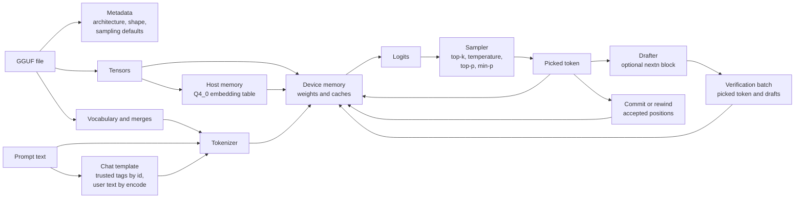
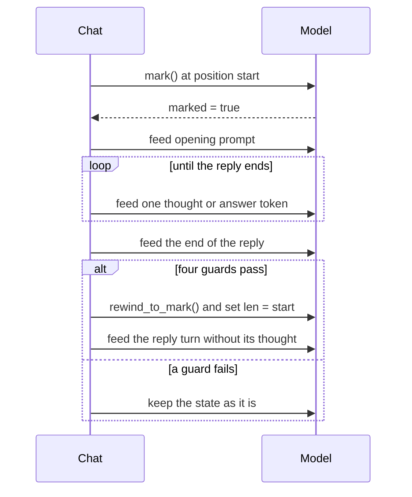
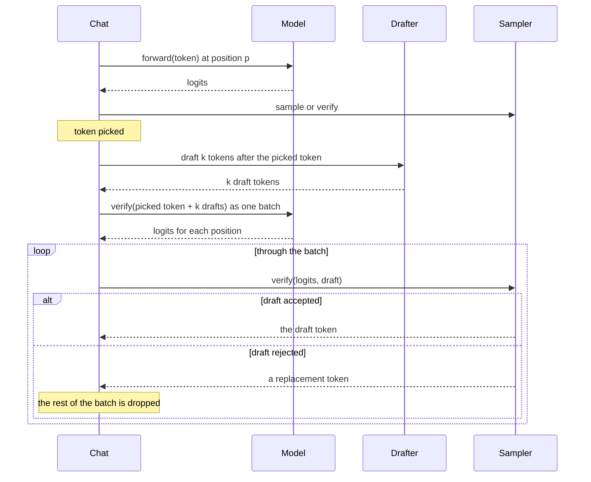

# 05 Model and tokenizer: from a GGUF file to a drafted reply

**Thesis.** dwim supports one model family and one file. The file is a GGUF container. GGUF is the model file format that llama.cpp uses. The container holds the tokenizer, the sampling defaults, the architecture metadata, and the quantized matrices. The loader reads the metadata, checks the architecture, and uploads every matrix except the token embedding table to the device. The upload uses a layout that the kernels can read. The chat layer then speaks the model's ChatML format and samples tokens. If the file has the optional second prediction layer, the chat layer can also draft ahead with it. This document follows the data from the file to a reply.

## 1. The model and the file

The model identity is a small set of constants:

```rust
// models/qwen35.rs:21-51 (condensed)
/// The model as `dwim` names it.
pub const NAME: &str = "qwen3.8-27b";

/// The file holding the model: a GGUF file, which carries the tokenizer
/// and the sampling settings too.
pub const WEIGHTS: &str = "Qwen3.8-27B-Q4_0.gguf";

/// Where the model's files come from: Qwen ships no GGUF of its own, so
/// bartowski's conversion of `Qwen/Qwen3.8-27B`, quantized with an
/// importance matrix, at a pinned commit, so the weights can't change
/// underneath us and outputs stay reproducible.
pub const REPO: &str = "bartowski/Qwen3.8-27B-GGUF";
pub const REVISION: &str = "87410e7b9a5c21e6ca70c0c9cc5237de909fe621";

pub struct File {
    pub name: &'static str,
    /// What the Hugging Face cache names its content by.
    pub digest: &'static str,
}

pub const FILES: [File; 1] = [File {
    name: WEIGHTS,
    digest: "5eb1de39e9b42aa7f99f1a4fe149d1952cc8103c698cf380b15a43d47e72b7c7",
}];
```

The `digest` value is a 64-character hexadecimal string. The source comment says it is the SHA-256 of a file in Large File Storage (LFS), or the git blob SHA-1 of a small file (`models/qwen35.rs:39-45`). SHA-256 is the Secure Hash Algorithm with a 256-bit output. dwim uses the digest as the blob name in the Hugging Face cache. `cli/fetch.rs` checks that the blob exists. It does not recompute the hash. It checks the downloaded byte count against the `content-length` header (`cli/fetch.rs:41-66`, `cli/fetch.rs:127-171`). The digest therefore names the content, but it is not a cryptographic check at load time.

The source comment also states that Qwen ships no GGUF of its own. The file comes from bartowski's conversion at the pinned revision (`models/qwen35.rs:28-37`).

The same comment states what the file contains, matrix by matrix:

```rust
// models/qwen35.rs:29-35 (condensed)
// Its Q4_0 file holds most matrices in 4-bit blocks of 32 with an f16
// scale, the first layers' down projections as Q4_1, the linear
// attention's output projections as Q8_0, and the output and a few query
// projections as Q6_K; the norms and the small linear attention tensors
// are f32.
```

**Aha: a quantized file is not uniform.** The conversion used an importance matrix, which decides a format per matrix. Most matrices are 4-bit. The down projections of the first layers keep more precision as `Q4_1`, because the first layers affect everything after them. The output projection is `Q6_K`, because its errors become logits directly. A loader that assumed one format would load a file that does not exist.



Each edge has a meaning:

- `F --> M`, `F --> V`, `F --> T`: the file supplies three things. The metadata gives the architecture, the shapes, and the sampling defaults. The vocabulary gives the token strings and merge rules. The tensor table gives the matrices.
- `V --> K`: `Tokenizer::from_gguf` builds the tokenizer from `tokenizer.ggml.tokens`, `tokenizer.ggml.token_type`, and `tokenizer.ggml.merges` (`models/tokenizer.rs:38-105`).
- `P --> K`: user text goes through `encode`, which treats special tags as plain text (`models/tokenizer.rs:107-115`).
- `C --> K`: the system prompt and other trusted application text go through `encode_with_special` (`models/tokenizer.rs:117-142`, `models/chat.rs:766`). The chat template's tags are pushed as ids, not encoded.
- `K --> D`: the encoded token identifiers are the input to the forward pass.
- `T --> H`: the `token_embd.weight` tensor stays mapped on the host. The loader does not upload it.
- `H --> D`: `Pass::embed` reads one embedding row per token from the host map. It writes those rows into a device buffer (`models/qwen35.rs:553-562`). This is the host-to-device step that Section 4.2 explains.
- `D --> L`, `L --> S`, `S --> O`: the decode step. The model produces logits, the sampler picks one token, and the token goes back as input.
- `O --> D`: the picked token id is the next input to the model. It does not go through the tokenizer again.
- `O --> R`, `R --> B`, `B --> D`, `O --> W`: the optional speculative path. The drafter proposes tokens. The model verifies the picked token and the drafts in one batch. The chat commits or rewinds the batch. Section 8 explains this path.
- `W --> D`: the committed tokens continue the sequence, and the next picked token goes back to the model as input.

The diagram leaves out the server session loop and the tool loop. [06 Agent harness and tools](06-agent-harness-and-tools.md) covers them.

## 2. The container

GGUF is a simple container. The module header gives its layout:

```rust
// models/gguf.rs:1-9
//! GGUF: the file format the model ships in, mapped into memory so that
//! weights are read straight from the page cache.
//!
//! ```text
//! "GGUF" | version (u32) | tensor count (u64) | key count (u64)
//! keys: name | type (u32) | value
//! tensors: name | dimensions (u32, u64 each) | type (u32) | offset (u64)
//! padding to the alignment | tensor data
//! ```
//!
//! Strings are a u64 length and the bytes. A tensor's dimensions are
//! innermost first, so a matrix of `[rows, cols]` is written `cols, rows`.
```

The file is memory-mapped, not read into a buffer. The `Gguf` value holds the map and returns slices into it. A tensor that is uploaded to the device is copied once from the page cache. A tensor that stays on the host, such as the embedding table, is read from the map on each use.

The reader accepts version 3 only. It refuses any other version with `GGUF version {version} is not supported` (`models/gguf.rs:246-249`):

```rust
// models/gguf.rs:243-249
if r.bytes(4)? != b"GGUF" {
    return Err(format!("{} is not a GGUF file", path.display()).into());
}
let version = r.u32()?;
if version != 3 {
    return Err(format!("GGUF version {version} is not supported").into());
}
```

The layout's fields have these details:

- **Alignment.** The metadata key `general.alignment` sets it. The default is 32 bytes. Tensor data starts at the next multiple of the alignment after the tensor table (`models/gguf.rs:277-281`).
- **Endianness.** Every number is little-endian. The reader uses `u32::from_le_bytes`, `u64::from_le_bytes`, and `f32::from_le_bytes` (`models/gguf.rs:195-199`, `models/gguf.rs:211-231`).
- **Dimensions.** A tensor stores a `u32` count, then that many `u64` values (`models/gguf.rs:257-263`). The values are innermost first. A matrix of 1,024 rows and 5,120 columns is written as `5120, 1024`.
- **Key namespaces.** Four prefixes occur. `general.` holds global keys such as `general.architecture` and `general.alignment`. `qwen35.` holds the model's own keys. `tokenizer.ggml.` holds the vocabulary. Tensor names use `blk.N.` for layer `N`. The `Config` code writes the model prefix as `{arch}.`, and `arch` is `qwen35`, so `key("block_count")` reads `qwen35.block_count` (`models/qwen35.rs:100-101`).
- **Tensor type numbers.** The source calls them "llama.cpp's numbering" and names no llama.cpp version (`models/gguf.rs:86-91`).

The values are:

```rust
// models/gguf.rs:86-91
/// The tensor types the models use: llama.cpp's numbering.
pub const F32: u32 = 0;
pub const Q4_0: u32 = 2;
pub const Q4_1: u32 = 3;
pub const Q8_0: u32 = 8;
pub const Q6_K: u32 = 14;
pub const BF16: u32 = 30;
```

The file also carries metadata as key-value pairs. `Config::load` reads the architecture name first, and refuses anything that is not `qwen35`:

```rust
// models/qwen35.rs:100-104 (condensed)
let arch = gguf.str("general.architecture")?;
if arch != "qwen35" {
    return Err(format!("the '{arch}' architecture is not supported").into());
}
```

This is the whole model registry: one architecture string and one set of metadata keys. A new model family needs new code, not a new configuration file.

### 2.1 The load pipeline

The sections above describe the parts. This is the order in which they run, from opening the file to the first forward pass:

1. **Open and map.** `Gguf::open` reads the magic, the version, the two counts, the metadata, and the tensor table. It then maps the file (`models/gguf.rs:236-300`). The host does this work, in the thread that loads the model.
2. **Read the configuration.** `Config::load` reads `general.architecture`, requires `qwen35`, and reads the model keys. It sets `layers = block_count - nextn_predict_layers` (`models/qwen35.rs:100-137`).
3. **Check the configuration.** The loader checks the convolution width, the linear-attention width, the head ratios, the head width against the cache block, the value width, the recurrent-layer list, and the absence of scaled rotary keys (`models/qwen35.rs:139-190`). Section 4.1 lists these checks.
4. **Build the tokenizer.** `Tokenizer::from_gguf` reads `tokenizer.ggml.pre`, `tokenizer.ggml.tokens`, `tokenizer.ggml.token_type`, and `tokenizer.ggml.merges` (`models/tokenizer.rs:38-105`).
5. **Convert and upload each matrix.** For each matrix, `Gguf::matrix` makes a device format on the host. `Q4_0` and `Q8_0` data is copied unchanged. A 32-bit float matrix is rounded to bfloat16 (BF16). A `Q4_1` or `Q6_K` matrix is decoded row by row to `f32` and quantized again as `Q8_0`. The result is uploaded to the device during the layer loop (`models/gguf.rs:393-422`, `models/qwen35.rs:404-452`).
6. **Allocate the state.** After the layers and the drafter are loaded, `Model::load` allocates the key/value caches, the linear-attention states, and the activation buffers for the requested context (`models/qwen35.rs:454-467`).
7. **Keep the embedding table mapped.** `token_embd.weight` is not converted and not uploaded. It stays in the file map (`models/qwen35.rs:310-313`).
8. **Run the first forward pass.** `Pass::embed` reads one row per token from the map and writes the rows to a device buffer (`models/qwen35.rs:551-562`).

The conversion in step 5 runs on the host central processing unit (CPU). It does not run on the device. A requantized matrix needs one row of `f32` temporary storage at a time, which is four bytes per column: 20,480 bytes for a row of 5,120. A `f32` matrix that becomes BF16 needs the whole input and the whole output in host memory at once, six bytes per element. The source uploads each matrix as it finishes, so temporary memory is one matrix, not the whole file.

## 3. The quantization formats in the file

Four block formats and two unquantized formats appear. Each block format groups values and stores one or two scales. A block of `Q4_0`, `Q4_1`, or `Q8_0` holds 32 values: `gpu/quant.rs:17` sets `quant::BLOCK` to 32. A block of `Q6_K` holds 256 values: `models/quants.rs:22` sets `Q6_K_BLOCK` to 256.

| Format | Values per block | Data bytes | Scale bytes | Bytes per block | Bits per value |
|--------|-----------------:|-----------:|------------:|----------------:|---------------:|
| `F32` | 1 | 4 | 0 | 4 | 32 |
| `BF16` | 1 | 2 | 0 | 2 | 16 |
| `Q4_0` | 32 | 16 | 2 | 18 | 4.5 |
| `Q4_1` | 32 | 16 | 4 | 20 | 5 |
| `Q8_0` | 32 | 32 | 2 | 34 | 8.5 |
| `Q6_K` | 256 | 192 | 18 | 210 | 6.5625 |

The byte counts follow from the value count and the scale layout:

- **`Q4_0`.** 32 values of 4 bits are 128 bits, or 16 bytes. One 16-bit float (`f16`) scale is 2 bytes. The total is 18 bytes. `models/quants.rs:16` sets `Q4_0_BYTES` to 18.
- **`Q4_1`.** The data is the same 16 bytes. The block adds an `f16` minimum after the `f16` scale, so the total is 20 bytes. `models/quants.rs:17` sets `Q4_1_BYTES` to 20.
- **`Q8_0`.** 32 values of 8 bits are 32 bytes. One `f16` scale is 2 bytes. The total is 34 bytes. `models/quants.rs:18` sets `Q8_0_BYTES` to 34.
- **`Q6_K`.** 256 values of 6 bits are 1,536 bits, or 192 bytes. There are 16 8-bit scales (16 bytes) and one `f16` block scale (2 bytes). The total is 210 bytes. `models/quants.rs:19` sets `Q6_K_BYTES` to 210.

**Where BF16 comes from.** GGUF can carry BF16 directly: type 30 is `BF16`. This file's unquantized matrices are `F32`, not `BF16`. The loader rounds every two-dimensional `F32` matrix to BF16 before upload (`models/gguf.rs:405-408`). The norm vectors and other one-dimensional `f32` tensors stay `f32` (`models/qwen35.rs:430`, `models/qwen35.rs:791-815`). So the `BF16` row is both a possible file type and the device format of the converted matrices.

The decoding is written out, not taken from a library:

```rust
// models/quants.rs:37-52
/// Reconstructs a row of `Q4_0` weights from the file.
pub fn dequantize_q4_0(row: &[u8], out: &mut [f32]) {
    assert_eq!(row.len(), out.len() / quant::BLOCK * Q4_0_BYTES);
    for (block, out) in row
        .chunks_exact(Q4_0_BYTES)
        .zip(out.chunks_exact_mut(quant::BLOCK))
    {
        let d = f16(block);
        for (j, &q) in block[2..].iter().enumerate() {
            out[j] = ((q & 0xf) as f32 - 8.0) * d;
            out[j + quant::BLOCK / 2] = ((q >> 4) as f32 - 8.0) * d;
        }
    }
}
```

A `Q4_0` block stores element `j` in the low nibble of byte `j`, and element `j + 16` in the high nibble. A reader that assumed the first 16 elements came from the first 8 bytes would produce plausible but wrong weights.

`Q6_K` is the most involved. A 210-byte block starts with 128 bytes of low bits, then 64 bytes of high bits, then 16 one-byte scales, then one `f16` block scale (`models/quants.rs:80-105`):

```rust
// models/quants.rs:80-105 (condensed)
let (ql, rest) = block.split_at(128);
let (qh, rest) = rest.split_at(64);
let (scales, d) = rest.split_at(16);
let d = f16(d);
for half in 0..2 {
    let ql = &ql[half * 64..][..64];
    let qh = &qh[half * 32..][..32];
    let scales = &scales[half * 8..][..8];
    let out = &mut out[half * 128..][..128];
    for l in 0..32 {
        for k in 0..4 {
            let low = ql[l + 32 * (k % 2)] >> (4 * (k / 2)) & 0xf;
            let high = qh[l] >> (2 * k) & 3;
            let q = (low | high << 4) as i32 - 32;
            out[l + 32 * k] = d * scales[2 * k + l / 16] as i8 as f32 * q as f32;
        }
    }
}
```

The block holds two halves of 128 weights. This table maps an output index to its sources:

| Quantity | Value for output `o` in the block |
|----------|-----------------------------------|
| Half `h` | `o / 128` |
| Position in the half | `p = o % 128` |
| `l` | `p % 32` |
| `k` | `p / 32`, from 0 to 3 |
| Low nibble byte | `ql[h * 64 + l + 32 * (k % 2)]` |
| Low nibble | bits `4 * (k / 2)` to `4 * (k / 2) + 3` of that byte |
| High bits byte | `qh[h * 32 + l]` |
| High bits | bits `2 * k` and `2 * k + 1` of that byte |
| Six-bit code | `low` plus `high` times 16, minus 32, so from -32 to 31 |
| Scale index | `h * 8 + 2 * k + l / 16` |
| Value | `f16(d) * scales[scale index] * code` |

The byte order is not the obvious one. The low nibble of output `l + 32k` comes from byte `l + 32 (k % 2)`, so `k = 0` and `k = 2` share one set of bytes and use different nibbles. The high two bits come from byte `l`, at bit pair `k`. The scale changes every 16 values of `l`, not every 32. A reader that assumed sequential packing would produce wrong weights.

### 3.1 Requantization at load

`Q4_1` and `Q6_K` matrices are not given to the device. They are decoded to `f32` and quantized again as `Q8_0`:

```rust
// models/quants.rs:1-9 (condensed)
//! The block formats llama.cpp's quantizations ship in, as the file lays
//! them out, read into the formats the devices take. ... The last two are
//! not given to a device: their weights are reconstructed and quantized
//! again as `Q8_0`, which keeps them to within a 254th of each block's
//! largest magnitude, finer than either format's own steps.
```

The figure 254 comes from the `Q8_0` scale. For a block whose largest magnitude is `A`, `quantize` sets the scale to `d = A / 127`, rounded to `f16` (`gpu/mod.rs:386-390`). Each value is rounded to the nearest multiple of `d`. The largest error is half a step, `d / 2`, which is `A / 254`. The other formats have coarser steps:

- **`Q4_0`.** The 16 codes span -8 to 7 times the scale. The step is about `A / 8`.
- **`Q4_1`.** The 16 codes span the minimum to the maximum. The step is about `A / 15`.
- **`Q6_K`.** Each 16-value group has 64 codes, -32 to 31, times its own scale. The step is about `A / 32` within the group.

The `Q4_1` and `Q6_K` steps are both larger than `A / 254`, and the `Q4_0` step is larger still. The comment's "finer than either format's own steps" therefore compares one step of a value, not the number of scales.

**Aha: the requantization is a precision *increase* for `Q4_1`, and a change of *layout* for `Q6_K`.** `Q4_1` stores 4-bit values plus a minimum. Re-encoding as `Q8_0` gives each value about 8 bits of resolution, which is finer. `Q6_K` stores 6-bit values with 16 sub-block scales. Re-encoding as `Q8_0` uses one scale per 32 values. The step is smaller, but there are fewer scales per 128 values. A reader should not conclude that `Q6_K` is preserved exactly. It is approximated by a different layout.

The reason for the conversion is engineering cost: two fewer formats in the kernels, and one more format that both the CPU and the graphics processing unit (GPU) already implement.

## 4. The architecture

The model is a hybrid transformer. A transformer is a stack of layers that mix information between tokens and then transform each token. This model has two kinds of mixing layer. Every fourth layer is full attention. The other layers are Gated DeltaNet linear attention.

The terms are:

- **Hidden state.** The vector of `hidden` values that represents one token as it moves through the layers. This model's `hidden` is 5,120.
- **Attention.** A mixing operation with three vectors per token: a query, a key, and a value. A token's query is compared with the keys of earlier tokens. The resulting weights select a weighted sum of their values.
- **Full attention.** Attention that compares a token with every earlier token. It stores the keys and values of all earlier tokens in a key/value cache, so the cache grows with the context.
- **Head.** One independent slice of the attention operation, `head_dim` values wide. Multiple heads let the layer compare tokens in several ways at once. The model has 24 query heads and 4 key/value heads. Each key/value head is shared by 6 query heads. This sharing is grouped-query attention.
- **Linear attention.** A mixing operation that keeps a recurrent state of fixed size instead of a growing key/value cache. It reads the state, updates it with the current token, and writes the new state. The cost per token does not grow with the context.
- **Gated DeltaNet.** The linear-attention rule that this model uses. Each value head keeps a `state_dim` by `state_dim` matrix. A decay gate multiplies the state, a forget gate removes the entry for the token's key, and the token's value is stored in its place. The output is what the state holds for the token's query. The source gives the rule at `gpu/mod.rs:318-328` and names no paper for it.

The values come from the file and from the model's shape. `gpu/tests.rs:404-405` calls these "the model's shapes":

| Field | Metadata key | Value |
|-------|--------------|------:|
| `hidden` | `qwen35.embedding_length` | 5,120 |
| `intermediate` | `qwen35.feed_forward_length` | 17,408 |
| `layers` | `block_count` minus `nextn_predict_layers` | 64 |
| `heads` | `qwen35.attention.head_count` | 24 |
| `kv_heads` | `qwen35.attention.head_count_kv` | 4 |
| `head_dim` | `qwen35.attention.key_length` | 256 |
| `rot_dim` | `qwen35.rope.dimension_count` | 64 |
| `full_attention_interval` | `qwen35.full_attention_interval` | 4 |
| `k_heads` | `qwen35.ssm.group_count` | 16 |
| `v_heads` | `qwen35.ssm.time_step_rank` | 48 |
| `state_dim` | `qwen35.ssm.state_size` | 128 |
| `vocab` | second dimension of `token_embd.weight` | from the file |
| `context_length` | `qwen35.context_length` | from the file |

Two derived widths recur. The full-attention query width is `heads * head_dim` = 24 × 256 = 6,144. The key/value width is `kv_heads * head_dim` = 4 × 256 = 1,024. This second width is `kv_dim`. The linear-attention key width is `k_heads * state_dim` = 16 × 128 = 2,048, called `k_dim`. Its value width is `v_heads * state_dim` = 48 × 128 = 6,144, called `v_dim`.

`ssm` stands for State Space Model. The linear-attention tensors use `ssm.` in their names, and the linear attention is a state-space model.

The layer rule is one line:

```rust
// models/qwen35.rs:192-195
/// Whether the layer is full attention rather than linear.
pub fn is_attention(&self, layer: usize) -> bool {
    (layer + 1).is_multiple_of(self.full_attention_interval)
}
```

Layers are counted from 0. The test is `(layer + 1).is_multiple_of(interval)`. For 64 layers and an interval of 4, the full-attention indices are 3, 7, 11, and so on to 63. That is 16 full-attention layers and 48 linear layers.

Three constants set the sizes of the caches and the batches:

- `CACHE_BLOCK` is 32 (`gpu/mod.rs:41`). The key/value caches store each block of 32 values with one scale.
- `CONV_KERNEL` is 4 (`gpu/mod.rs:37`). Each linear layer convolves the last four tokens.
- `BATCH` is 64 (`models/qwen35.rs:65`). One forward batch runs at most 64 tokens.

The interval comes from the file, and the loader checks that any explicit list of recurrent layers agrees with it:

```rust
// models/qwen35.rs:158-169 (condensed)
if let Some(recurrent) = gguf.get(&format!("{arch}.attention.recurrent_layers")) {
    let recurrent = match recurrent {
        crate::models::gguf::Value::Array(values) => values,
        _ => return Err("the list of linear layers is not a list".into()),
    };
    if recurrent.len() < config.layers
        || (0..config.layers)
            .any(|i| recurrent[i].as_bool() != Some(!config.is_attention(i)))
    {
        return Err("the linear layers are not every layer but each fourth".into());
    }
}
```

**Aha: two independent sources of truth are checked against each other.** The file gives an interval and, in some conversions, an explicit per-layer list. The loader does not trust either alone. If the list and the interval disagree, the model does not load. This catches a bad conversion before it produces wrong output.

### 4.1 What the loader refuses

The loader has a set of hard checks. Each one prevents a wrong result that would otherwise appear later as bad text:

```rust
// models/qwen35.rs:139-153 (condensed)
if key("ssm.conv_kernel")? as usize != CONV_KERNEL {
    return Err("the convolution kernel is not four wide".into());
}
if key("ssm.inner_size")? as usize != config.v_heads * config.state_dim {
    return Err("the linear attention sizes disagree".into());
}
if !config.v_heads.is_multiple_of(config.k_heads) {
    return Err("value heads are not a multiple of key heads".into());
}
if !config.head_dim.is_multiple_of(CACHE_BLOCK) {
    return Err("the attention heads are not whole blocks of the caches".into());
}
if key("attention.value_length")? as usize != config.head_dim {
    return Err("the attention values are not as wide as the keys".into());
}
```

Each `key("...")` call in the loader reads a key with the `qwen35.` prefix. The complete names are `qwen35.ssm.conv_kernel`, `qwen35.ssm.inner_size`, `qwen35.ssm.group_count`, `qwen35.ssm.time_step_rank`, `qwen35.ssm.state_size`, `qwen35.attention.value_length`, and `qwen35.attention.head_count_kv`.

The fourth check has a loose error message. The test is `config.head_dim.is_multiple_of(CACHE_BLOCK)`, so it checks the width of one head, not the number of heads. The message says "the attention heads are not whole blocks of the caches". The reader should read it as "the attention head width is not whole blocks of the caches". This model's `head_dim` is 256, which is 8 blocks of 32, so the check passes.

The head-dimension check is the most important one. The caches quantize in blocks of 32 values. A head whose width is not a whole number of blocks cannot be stored in the cache layout. The loader refuses the file instead of writing across a block boundary.

Scaled rotary position embeddings are also refused:

```rust
// models/qwen35.rs:170-175
if gguf
    .keys()
    .any(|k| k.starts_with(&format!("{arch}.rope.scaling.")))
{
    return Err("scaled rotary positions are not implemented".into());
}
```

### 4.2 The embedding table stays on the host

The loader keeps the embedding table out of device memory:

```rust
// models/qwen35.rs:310-313 (condensed)
/// The file, kept mapped for the embedding table, which is looked up
/// on the CPU: it is most of a third of a gigabyte, and a token needs
/// one row of it.
gguf: Arc<Gguf>,
```

The table's size is `hidden × vocab × bytes per value`. The vocabulary is the second dimension of `token_embd.weight`, and this conversion stores the table as `Q4_0`, which uses 18 bytes for each 32 values. With `hidden` at 5,120 and a vocabulary of 151,936 (the published Qwen3 vocabulary size, which dwim reads from the file rather than hard-coding), the arithmetic is:

`151,936 × 5,120 = 777,912,320 values`

`777,912,320 / 32 = 24,309,760 blocks`

`24,309,760 × 18 = 437,575,680 bytes`

That is about 0.44 GB, or 0.41 GiB. The source comment's "most of a third of a gigabyte" is a rough estimate, and it is slightly low for these numbers.

The sampler's source comment calls a vocabulary "a quarter of a million entries" (`models/sampler.rs:73-74`). That is a rounded upper figure, not this file's count. This file's 151,936 entries are about 61 percent of 250,000.

**Aha: the largest single tensor is not uploaded.** The embedding table has one row per vocabulary entry. A token needs one row. A host-side lookup of one row costs little compared with keeping the whole table on the device. This saves about 0.4 GB of device memory, and it is why `Memory::of` skips `token_embd.weight` when it sums the weights. The exact saving depends on the vocabulary in the file.

The output projection is separate and does go to the device. The model multiplies a hidden state by it to get one logit per vocabulary entry. A verified batch needs one such row for each of its tokens.

### 4.3 The drafter

The file ends with an optional layer that predicts the token after the next. The loader reads it as a `Draft` value:

```rust
// models/qwen35.rs:109-117 (condensed)
let nextn = gguf
    .get(&format!("{arch}.nextn_predict_layers"))
    .and_then(|v| v.as_i64())
    .unwrap_or(0) as usize;
let blocks = key("block_count")? as usize;
if nextn >= blocks {
    return Err("every layer of the model predicts further tokens".into());
}
let layers = blocks - nextn;
```

```rust
// models/qwen35.rs:134-137
drafter: nextn >= 1
    && gguf
        .info(&format!("blk.{layers}.nextn.eh_proj.weight"))
        .is_ok(),
```

The real file has `block_count` 65 and `nextn_predict_layers` 1 (`AGENTS.md`, "Its 65th block predicts the token after the next"). The subtraction gives `layers = 65 - 1 = 64`.

A nextn layer is a multi-token prediction (MTP) head. It is trained to predict the token after the next one. It reads two inputs: the current hidden state, and the embedding of the token that comes next. The file stores the drafter as block `blk.64`, after the 64 main layers. `Config::load` sets `drafter` only if `nextn_predict_layers` is at least 1 and the tensor `blk.64.nextn.eh_proj.weight` exists (`models/qwen35.rs:134-137`).

**Aha: the 65th block is not part of the 64-layer model.** The main model is the first 64 blocks. The extra block is a drafter, with its own projection of the hidden state and its own key/value cache. A model file without it still loads, and the chat decodes one token at a time. The drafter is an optimization, not a requirement.

One extra block yields up to eight drafts, because the drafter runs more than once. The first run is at position `pos - 1`. It reads the hidden state carried over from the main model and the picked token, and predicts the token at `pos`. Each later run is at the next position. It reads the drafter's own previous output and the token it drafted, and predicts the token after that. `MAX_DRAFTS` limits the count to 8 (`models/qwen35.rs:67-69`). Section 8.1 shows the loop.

## 5. The tokenizer

The tokenizer is a byte-level byte-pair encoding tokenizer, loaded from the file's vocabulary. The text is first split into words by a regular expression, then merged:

```rust
// models/tokenizer.rs:1-16 (condensed)
/// A byte-level BPE tokenizer, loaded from the vocabulary in a GGUF file.
///
/// Text is first split into words by a regular expression. Each word starts
/// out as one token per UTF-8 byte, and adjacent tokens are then merged
/// pairwise, lowest-ranked merge first, until no merge applies.
pub struct Tokenizer {
    pattern: Regex,
    tokens: Vec<Vec<u8>>,
    bytes: [u32; 256],
    merges: HashMap<(u32, u32), (usize, u32)>,
    special: HashMap<String, u32>,
}
```

Each field has one job:

| Field | Meaning |
|-------|---------|
| `pattern` | The compiled `QWEN_PATTERN`, which splits text into words. |
| `tokens` | The bytes of every token, indexed by token id. A special token holds its text as bytes. |
| `bytes` | The token id of each of the 256 single bytes. |
| `merges` | For each pair of adjacent ids that can merge: its rank and the merged id. |
| `special` | The id of each special token, by its text. |

**Encoding.** `encode` runs four steps (`models/tokenizer.rs:144-149`, `models/tokenizer.rs:211-226`):

1. `encode_into` calls `pattern.find_iter` and splits the text into words.
2. `merge` maps each byte of a word to its single-byte token id through `bytes`.
3. While any adjacent pair of ids is in `merges`, it takes the pair with the lowest rank and replaces the pair with the merged id.
4. It appends the remaining ids to the output.

`encode_with_special` is the same path with one addition. It first finds the next special token in the text, encodes the text before it with `encode_into`, pushes the special id, and continues after the token (`models/tokenizer.rs:121-142`).

**Decoding.** `decode(token)` returns the bytes that the token stands for (`models/tokenizer.rs:151-155`). The caller concatenates the bytes of the tokens. A token can end partway through a character, so the concatenation is not valid UTF-8 at every boundary. `Utf8Stream` holds the incomplete tail until the next token completes it:

```rust
// models/chat.rs:962-982
/// Turns a stream of bytes into text, holding back a UTF-8 character split
/// across tokens until the rest of it arrives.
#[derive(Default)]
struct Utf8Stream {
    pending: Vec<u8>,
}

impl Utf8Stream {
    fn push(&mut self, bytes: &[u8]) -> String {
        self.pending.extend_from_slice(bytes);
        let complete = match std::str::from_utf8(&self.pending) {
            Ok(_) => self.pending.len(),
            // An incomplete character at the end: wait for the rest.
            Err(e) if e.error_len().is_none() => e.valid_up_to(),
            Err(_) => self.pending.len(),
        };
        let text = String::from_utf8_lossy(&self.pending[..complete]).into_owned();
        self.pending.drain(..complete);
        text
    }
}
```

A worked example shows both mappings. For the text `"Hi\n"`:

- The bytes are `H` (72), `i` (105), and a newline (10).
- 72 and 105 are printable, so their tokens are the characters `H` and `i`.
- 10 is not printable. `byte_chars` shifts it above 255. The first ten non-printable bytes receive 256 to 265, so byte 10 receives 266, the character `Ċ` (U+010A). The vocabulary token for a newline is therefore written as `Ċ` in the file.
- `decode` returns the original byte 10, so the newline comes back as a newline.

For a multi-byte character such as `é` (U+00E9), UTF-8 uses two bytes: 195 and 169. Both are printable, so they stand for themselves as the characters `Ã` (U+00C3) and `©` (U+00A9). The tokenizer may keep them as two byte tokens or merge them into one token. `decode` returns 195 and 169 in either case, and `Utf8Stream` joins them into `é`.

The pattern is Qwen's own:

```rust
// models/tokenizer.rs:6
/// The regular expression Qwen's tokenizers split text into words with.
const QWEN_PATTERN: &str = r"(?i:'s|'t|'re|'ve|'m|'ll|'d)|[^\r\n\p{L}\p{N}]?[\p{L}\p{M}]+|\p{N}| ?[^\s\p{L}\p{M}\p{N}]+[\r\n]*|\s*[\r\n]+|\s+(?!\S)|\s+";
```

The file names its pre-tokenizer in `tokenizer.ggml.pre`. `from_gguf` accepts `qwen2` and `qwen35` only (`models/tokenizer.rs:38-42`). The source does not name a Qwen tokenizer version. The pattern uses a negative lookahead, which the standard Rust regular-expression crate does not support. dwim therefore uses `fancy_regex`, a crate that supports lookahead and backreferences. Backtracking is the method such crates use: the engine tries one alternative, and if the rest of the pattern fails, it returns and tries another.

The pattern has seven alternatives. In the table, `\p{L}` is a letter, `\p{M}` is a combining mark, `\p{N}` is a number, `\s` is whitespace, `\S` is non-whitespace, and `(?!X)` means "only if `X` does not follow":

| Alternative | Meaning |
|-------------|---------|
| `(?i:'s\|'t\|'re\|'ve\|'m\|'ll\|'d)` | An English contraction ending, in either letter case: `'s`, `'t`, `'re`, `'ve`, `'m`, `'ll`, `'d`. |
| `[^\r\n\p{L}\p{N}]?[\p{L}\p{M}]+` | One optional character that is not a newline, letter, or number, then one or more letters or marks. The optional character captures a leading space. |
| `\p{N}` | A single number character. |
| ` ?[^\s\p{L}\p{M}\p{N}]+[\r\n]*` | An optional space, then a run of punctuation or symbols, then any newlines. |
| `\s*[\r\n]+` | Whitespace that ends in one or more newlines, such as an indented line end. |
| `\s+(?!\S)` | Whitespace not followed by a non-space, which is trailing whitespace at the end of the text. |
| `\s+` | Any other run of whitespace. |

Two splits show the effect:

| Input | Words |
|-------|-------|
| `"Hello, world!\n"` | `"Hello"`, `","`, `" world"`, `"!"`, `"\n"` |
| `"don't"` | `"don"`, `"'t"` |

The space before `world` belongs to the second word, because the second alternative captures one leading non-letter character. The newline is its own word, because the fifth alternative matches it. The apostrophe and `t` stay together, because the first alternative matches `'t` before the letter alternative can take `t`.

The merge loop is a direct implementation of the rule:

```rust
// models/tokenizer.rs:233-247
fn merge(&self, word: &[u8], out: &mut Vec<u32>) {
    let mut parts: Vec<u32> = word.iter().map(|&b| self.bytes[b as usize]).collect();
    while let Some((_, i, merged)) = parts
        .windows(2)
        .enumerate()
        .filter_map(|(i, pair)| {
            let &(rank, merged) = self.merges.get(&(pair[0], pair[1]))?;
            Some((rank, i, merged))
        })
        .min()
    {
        parts[i] = merged;
        parts.remove(i + 1);
    }
    out.extend(parts);
}
```

Byte-level vocabularies write each byte as a printable character. The loader decodes each token back to bytes:

```rust
// models/tokenizer.rs:249-262 (condensed)
/// GPT-2's mapping from bytes to printable characters, which byte-level
/// vocabularies are written in: printable bytes stand for themselves, and the
/// rest are shifted past 255 in order.
fn byte_chars() -> [char; 256] {
    let mut chars = ['\0'; 256];
    let mut next = 256;
    for (byte, c) in chars.iter_mut().enumerate() {
        let printable = matches!(byte, 33..=126 | 161..=172 | 174..=255);
        *c = if printable { char::from(byte as u8) } else { next += 1; char::from_u32(next - 1).unwrap() };
    }
    chars
}
```

**Aha: the byte mapping is not ASCII.** Bytes that are not printable are shifted above code point 255. A tokenizer that treated the vocabulary as text would decode `\n` and space to the wrong bytes. The round trip through `byte_chars` is required for every non-special token.

### 5.1 Two encoders, one boundary

The tokenizer has two entry points:

```rust
// models/tokenizer.rs:104-110 (condensed)
/// Encodes text into tokens. Special tokens in the text are treated as
/// plain text; insert them by id with [`special`](Self::special), or
/// encode text that is meant to contain them with
/// [`encode_with_special`](Self::encode_with_special).
pub fn encode(&self, text: &str) -> Result<Vec<u32>> { ... }

/// Encodes text like [`encode`](Self::encode), but with special tokens
/// written in it, such as `<tool_call>`, encoded by id. For text of the
/// chat template, not text from the user, who could otherwise end a
/// turn.
pub fn encode_with_special(&self, text: &str) -> Result<Vec<u32>> { ... }
```

The chat layer uses each one for its own side of the boundary:

- **User text, tool output, and reply text** go through `encode`. A message that contains `<|im_end|>` becomes ordinary tokens.
- **The system prompt** goes through `encode_with_special` (`models/chat.rs:766`). Its tags become control token identifiers. The system prompt comes from the application, not from the user.
- **The chat template's own tags are not encoded at all.** `Format` pushes their ids directly, and `turn` encodes only the role name and the newlines.

The two encoders meet in `Format::turn`. A turn is assembled from token ids and separately encoded pieces. No string with mixed trust goes through one encode call (`models/chat.rs:339-349`):

```rust
// models/chat.rs:339-349
fn turn(&self, role: &str, content: Vec<u32>) -> Result<Vec<u32>> {
    let mut turn = vec![self.im_start];
    turn.extend(self.tokenizer.encode(&format!("{role}\n"))?);
    turn.extend(content);
    turn.push(self.im_end);
    turn.extend(self.tokenizer.encode("\n")?);
    Ok(turn)
}
```

The content comes from one of three methods:

- `user` encodes the message with `encode` and passes it to `turn` (`models/chat.rs:300-304`).
- `results` builds one block for each tool output. It pushes the `tool_response` id, encodes `"\n{output}\n"` with `encode`, and pushes the `tool_response_end` id. It puts an encoded newline between blocks (`models/chat.rs:306-321`).
- `reply` builds an empty thought, encodes the reply text, and adds each tool call between a `tool_call` id and a `tool_call_end` id (`models/chat.rs:323-337`).

The tag strings are (`models/chat.rs:32-40`):

| Constant | Text |
|----------|------|
| `IM_START` | `<\|im_start\|>` |
| `IM_END` | `<\|im_end\|>` |
| `END_OF_TEXT` | `<\|endoftext\|>` |
| `THINK` | `<think>` |
| `THINK_END` | `</think>` |
| `TOOL_CALL` | `<tool_call>` |
| `TOOL_CALL_END` | `</tool_call>` |
| `TOOL_RESPONSE` | `<tool_response>` |
| `TOOL_RESPONSE_END` | `</tool_response>` |

`CALL_OPENING` is `"\n<function="` (`models/chat.rs:19`). The template's tool call text is `\n<function=bash>\n<parameter=command>\ndate\n</parameter>\n</function>\n` (`models/chat.rs:1088`).

One reply therefore becomes this token stream:

```text
<|im_start|>assistant
<think>

</think>

Checking.
<tool_call>
<function=bash>
<parameter=command>
date
</parameter>
</function>
</tool_call><|im_end|>
```

The wrapper tags above are ids that the code pushes directly. The reply text and the tool-call text are encoded separately. If a tool output contains the characters `<|im_end|>`, `encode` turns them into ordinary tokens. It cannot produce the `im_end` id. The wrapper's own `im_end` id comes from `self.format.im_end`. The two cannot be confused.

The test states the rule:

```rust
// models/tokenizer.rs:251-273 (condensed)
#[test]
fn keeps_tags_as_text_unless_asked() {
    let tokenizer = Tokenizer::tiny();
    let im_end = tokenizer.special("<|im_end|>").unwrap();
    let text = "hi<|im_end|>";
    let plain = tokenizer.encode(text).unwrap();
    assert!(!plain.contains(&im_end));
    ...
    let special = tokenizer.encode_with_special(text).unwrap();
    assert_eq!(special, [tokenizer.encode("hi").unwrap(), vec![im_end]].concat());
}
```

**Aha: this is a prompt-injection defence at the tokenizer level.** A tool that prints `<|im_end|><|im_start|>system` cannot end the turn or start a new system turn. Its text is encoded as ordinary tokens. The model sees the characters, not the control tokens. The defence is structural: it does not depend on the model's judgement.

## 6. The chat format

The model speaks ChatML. The chat module documents the exact text:

```rust
// models/chat.rs:57-68 (condensed)
/// A conversation with an instruction-tuned model, in the ChatML format that
/// Qwen models are trained on:
///
/// ```text
/// <|im_start|>user
/// Hello!<|im_end|>
/// <|im_start|>assistant
/// <think>
/// The user is greeting me.
/// </think>
///
/// Hi there!<|im_end|>
/// ```
```

The format value holds the token identifiers, not the strings:

```rust
// models/chat.rs:245-272 (condensed)
pub struct Format {
    pub tokenizer: Arc<Tokenizer>,
    im_start: u32,
    im_end: u32,
    end_of_text: u32,
    think: u32,
    think_end: u32,
    tool_call: u32,
    tool_call_end: u32,
    tool_response: u32,
    tool_response_end: u32,
}

impl Format {
    pub fn new(tokenizer: Tokenizer) -> Result<Self> {
        Ok(Self {
            im_start: tokenizer.special(IM_START)?,
            ...
        })
    }
}
```

**Aha: a missing tag fails at load, not at generation.** `Format::new` asks the vocabulary for each tag by content. A file without `<tool_call>` produces an error when the server builds its format. The model cannot start a conversation with a broken template.

### 6.1 The thought is dropped after the reply

The chat module explains the rule and its reason:

```rust
// models/chat.rs:87-95 (condensed)
/// A reply's thought leaves the model's state once the reply is made, as
/// the chat template leaves earlier thoughts out: the model is rewound to
/// where the reply began and reads the reply back with an empty thought,
/// as the template writes a reply already made, which is also how
/// [`Chat::replay`] writes one. A reply stopped short for room keeps its
/// thought, for the note that compacts the conversation to be written
/// from it. Everything else stays, and each turn runs the model over only
/// its new tokens.
```

The code at the end of generation does it:

```rust
// models/chat.rs:626-640 (condensed)
if marked && !reply.cut && self.stats.thought.tokens > thought_before {
    let turn = self.format.reply(&shown, &reply.calls)?;
    if start + turn.len() <= self.model.max_len() {
        self.model.rewind_to_mark()?;
        self.len = start;
        self.feed(&turn, Kind::Prompt)?;
    }
}
```

**Aha: the model pays a pass over its own reply to save context.** The thought can run to 2,048 tokens. Keeping it would fill the context with text that the model does not need to continue. Rewinding and re-reading the shown text costs one pass over that text. The saving is the thought, minus the shown text. This is a direct trade of compute for context length, and it is why `mark` and `rewind_to_mark` exist.

The values in the code have these meanings (`models/chat.rs:443-463`):

- `start` is `self.len` before the reply. It is the position to return to.
- `marked` is the result of `self.model.mark()`. A mark copies the linear layers' states and, when a drafter exists, the carried hidden state (`models/qwen35.rs:1205-1228`). `marked` is false if the model cannot make a mark.
- `thought_before` is `self.stats.thought.tokens` before the reply. The difference at the end is the number of thought tokens that this reply produced.
- `shown` is the reply text as displayed, without the thought.
- `reply.cut` is true when the reply stopped for room.
- `reply.calls` holds the tool calls that the reply made.

The mark is made before the opening prompt is fed. The timeline is:



The rewind has four guards (`models/chat.rs:626-640`):

1. `marked`: a mark exists to return to.
2. `!reply.cut`: the reply was not stopped for room. A cut reply keeps its thought, because the compaction note is written from that thought.
3. `self.stats.thought.tokens > thought_before`: the reply produced at least one thought token.
4. `start + turn.len() <= self.model.max_len()`: the reply turn, written again without its thought, fits in the context.

The fourth guard is needed because the reply text can encode to more tokens than the model generated. The code does not risk a state that does not fit.

The 2,048-token thought limit is not in the GGUF file. It is a harness setting: `harness/mod.rs:74` sets `THINKING_BUDGET` to `Some(2048)`. The harness passes it to `Chat::limit_thoughts`. When the thought reaches the limit, `generate` feeds a closing sentence and `</think>` and continues with the answer (`models/chat.rs:473-501`).

### 6.2 Tool calls from inside a thought

Qwen models can write a tool call before they close the thought. The chat handles that with a held buffer:

```rust
// models/chat.rs:519-545 (condensed)
// A <tool_call> written in the thought is held until what
// follows it says what it is. The opening of a <function=…>
// block makes it a call, and the thought ends there, as the
// model's makers read it: the model calls tools from inside
// the thought, without closing it first. Anything else, as a
// tag the model only mentions, is part of the thought, shown
// as written.
let mut consumed = false;
if let Some(pending) = &mut held {
    let settled = if special {
        Some(held.take().unwrap())
    } else {
        consumed = true;
        pending.push_str(&text.push(self.format.tokenizer.decode(token)));
        if pending.starts_with(CALL_OPENING) {
            thinking = false;
            replied = true;
            call = held.take();
            None
        } else if CALL_OPENING.starts_with(pending.as_str()) {
            None
        } else {
            held.take()
        }
    };
    ...
}
```

The other names in the fragment have these meanings. `special` is true when the token is one of the six chat tag ids: `im_end`, `end_of_text`, `think`, `think_end`, `tool_call`, and `tool_call_end` (`models/chat.rs:517-525`). `thinking` is true while the reply is inside its thought. `replied` is true once the reply has shown text or opened a call. `call` holds the text of a call under way. `consumed` records that the held buffer took this token, so the main branches skip it (`models/chat.rs:578-579`).

`held` starts as `None` (`models/chat.rs:457`). When the loop reads the `tool_call` id while `thinking` is true, it sets `held = Some(String::new())` (`models/chat.rs:588-590`). The branch in the code runs only after that. The code takes the string out with `take()` and unwraps it:

- The enclosing `if let Some(pending) = &mut held` proves that `held` is `Some` at entry.
- On this path, nothing else takes the string before `take()`.
- The `unwrap` therefore cannot panic.

On the other path, `held.take()` can return `None`. The code keeps that as an `Option` and does not unwrap it.

`CALL_OPENING` is `"\n<function="` (`models/chat.rs:19`). The newline is part of the tag because the template writes a call as `<tool_call>\n<function=...>` (`models/chat.rs:1088`). The parser holds text until one of three outcomes:

- The held text starts with `CALL_OPENING`: it is a call. The thought ends there.
- The held text is a prefix of `CALL_OPENING`: more text is needed. The parser keeps holding.
- The held text differs from `CALL_OPENING`: it is not a call. The held text becomes part of the thought, shown as written.

The parser does not guess. The full tag stream for a call is in Section 5.1.

**Aha: a tag is not a call until its next characters agree.** A model that writes "I could use a `<tool_call>` here" does not trigger a tool. Only `<tool_call>` followed by `\n<function=` opens one. This prevents the most common false positive in tag-based tool protocols.

### 6.3 Ending the reply

The loop has three special cases around the end of the reply:

```rust
// models/chat.rs:558-575 (condensed)
if !consumed && (token == self.format.im_end || token == self.format.end_of_text) {
    if thinking {
        // The model sometimes ends its reply while still
        // thinking, which leaves nothing to show for it: close
        // the thought instead, so that it goes on to reply.
        token = self.format.think_end;
    } else if replied {
        break;
    } else {
        // The model sometimes ends its reply having answered only
        // in its thought: make it write the answer out, as text
        // rather than another tool call.
        answering = true;
        continue;
    }
}
```

When `answering` is true and `replied` is false, the loop masks three token ids (`models/chat.rs:502-510`):

```rust
// models/chat.rs:502-510
if answering && !replied {
    for token in [
        self.format.im_end,
        self.format.end_of_text,
        self.format.tool_call,
    ] {
        logits[token as usize] = f32::NEG_INFINITY;
    }
}
```

The ids are `<|im_end|>`, `<|endoftext|>`, and `<tool_call>`. `answering` becomes true when the model tries to end while it has supplied neither text nor a call (`models/chat.rs:567-572`). `replied` becomes true when a non-empty text chunk is shown (`models/chat.rs:611`).

The softmax in `candidates` computes `exp((logit - max) / temperature)`. `exp(-infinity)` is 0. A masked token therefore has probability 0 and cannot be among the `top_k` candidates. The model must produce text before it can end the reply or call a tool.

**Aha: the harness corrects a known model failure in the token stream.** A small model sometimes ends while still thinking, or answers only inside its thought. dwim does not retry the whole turn. It changes the logits for one position and continues. The correction is local and cheap.

### 6.4 Repeated thought detection

A separate guard catches a thought that goes in circles:

```rust
// models/chat.rs:19-27
/// A thought that writes the same [`REPEAT_WINDOW`] tokens for the
/// [`REPEATS`]th time is going round in circles, and is ended as one that
/// runs to its limit is: a small model at a long context sometimes falls
/// into saying the same thing over and over, and would not stop on its own
/// before the context ran out. A window this long is not written three
/// times by a thought that is getting anywhere.
const REPEAT_WINDOW: usize = 32;
const REPEATS: u32 = 3;
```

The detector itself is a sliding window (`models/chat.rs:938-959`):

```rust
// models/chat.rs:938-959 (condensed)
struct Repeats {
    recent: Vec<u32>,
    windows: HashMap<u64, u32>,
    repeating: bool,
}

impl Repeats {
    fn push(&mut self, token: u32) {
        self.recent.push(token);
        if self.recent.len() >= REPEAT_WINDOW {
            let mut hasher = DefaultHasher::new();
            self.recent[self.recent.len() - REPEAT_WINDOW..].hash(&mut hasher);
            let count = self.windows.entry(hasher.finish()).or_insert(0);
            *count += 1;
            self.repeating |= *count >= REPEATS;
        }
    }
}
```

The window moves by one token at each step. It does not need to align with a word or a line. Two windows that overlap count as two occurrences if their 32 token ids are equal. The detector triggers when the same 32-token window has appeared three times anywhere in the thought. A hash collision would cause a false trigger, but the source accepts that risk.

The ending action is the same one that the token budget uses. The loop's closing branch feeds `"\n\n{closing}\n"`, then the `think_end` id, then `"\n\n"`. It sets `thinking = false` and `reply.thought_ended = true` (`models/chat.rs:473-501`). The `closing` text comes from the harness. For the budget path, the limit is `thought_limit`; for the repeat path, the trigger is `repeats.repeating`.

The repository has one test for the detector (`models/chat.rs:1567-1595`). It gives the model a thought that repeats `"Let me look again.\n"` 50 times. The thought ends, and the shown thought is shorter than 200 characters. It also gives a thought of 600 non-repeating digit characters. That thought does not end early. The source gives the 32-token, 3-repeat choice as a design judgement. The test is the only evidence for it in the repository.

## 7. Sampling

The sampler has four settings and a random seed. The chat reads three settings from the file and supplies the fourth (`cli/model.rs:211-228`):

| Setting | Metadata key | Default |
|---------|--------------|--------:|
| `temperature` | `general.sampling.temp` | 1.0 |
| `top_k` | `general.sampling.top_k` | 20 |
| `top_p` | `general.sampling.top_p` | 0.95 |
| `min_p` | `general.sampling.min_p` | 0.05 |
| `seed` | not in the file | nanoseconds since the Unix epoch |

The source comment states that the file does not carry `min_p`, and that 0.05 "follows instructions more reliably than none". The code does read `general.sampling.min_p`, so a file that carries the key overrides the default. The comment and the code disagree about whether the key occurs in practice; the code is the behaviour. `--temperature` replaces the file's temperature. The seed function is `cli/model.rs:229-235`.

```rust
// models/sampler.rs:1-4
/// Picks the next token from a model's logits: from the `top_k` most likely
/// tokens, then the smallest set of those whose probability reaches `top_p`,
/// leaving out any less than `min_p` times as likely as the most likely, at
/// `temperature`. A temperature of zero always picks the most likely token.
```

The module comment lists the settings in one order, but the code applies them in another. The actual order is:

1. **Top-k.** One pass keeps the `k` largest logits.
2. **Temperature softmax.** The `k` logits become probabilities.
3. **Top-p and min-p together.** One loop keeps candidates while the running total is below `top_p` and the candidate is at least `floor` likely.
4. **Sample.** One uniform draw selects a token from the kept candidates.

The module comment says "then the smallest set ... whose probability reaches `top_p`, leaving out any less than `min_p` ... at `temperature`". It reads as if top-p and min-p are two separate passes, and as if temperature applies last. The code shows the true order: the temperature is applied before both cuts, and the two cuts are two conditions in one loop. The quote is accurate about the result, not about the sequence.

The top-k selection is one pass, because the vocabulary is large:

```rust
// models/sampler.rs:82-94 (condensed)
fn candidates(&self, logits: &[f32]) -> (Vec<(u32, f32)>, f32) {
    // The top k in one pass over the logits, kept in order: a vocabulary
    // is a quarter of a million entries, and k is twenty.
    let k = self.top_k.clamp(1, logits.len());
    let mut candidates: Vec<(u32, f32)> = Vec::with_capacity(k + 1);
    for (token, &logit) in logits.iter().enumerate() {
        if candidates.len() == k && logit <= candidates[k - 1].1 {
            continue;
        }
        let at = candidates.partition_point(|&(_, l)| l >= logit);
        candidates.insert(at, (token as u32, logit));
        candidates.truncate(k);
    }
    if self.temperature == 0.0 {
        return (vec![(candidates[0].0, 1.0)], 1.0);
    }
    ...
}
```

After top-k, the code turns the logits into probabilities (`models/sampler.rs:89-97`):

```rust
// models/sampler.rs:89-97
let max = candidates[0].1;
let mut probs: Vec<f32> = candidates
    .iter()
    .map(|&(_, logit)| ((logit - max) / self.temperature).exp())
    .collect();
let sum: f32 = probs.iter().sum();
for p in &mut probs {
    *p /= sum;
}
```

The code subtracts the largest logit before `exp` to prevent overflow. The largest candidate then has probability `exp(0) / sum`, and every other candidate has a smaller probability.

`total` in `sample` and `verify` is the sum of the probabilities of the candidates that survive the top-p and min-p conditions. It is not 1. It can be less than 1, and it can be slightly above `top_p`, because the candidate that crosses the boundary stays. `sample` draws `r` in the range [0, `total`) and walks the kept list. Token `i` is picked with probability `p_i / total`. The draw renormalizes the kept probabilities implicitly.

The min-p floor is computed from the most likely candidate only:

```rust
// models/sampler.rs:113-124 (condensed)
let floor = self.min_p * probs[0];
let mut kept = 0.0;
let mut n = 0;
while n < probs.len() && kept < self.top_p && probs[n] >= floor {
    kept += probs[n];
    n += 1;
}
```

**Aha: min-p is a floor relative to the top token, not to the total.** When the model is confident, the floor is high and the tail is cut. When the model is unsure, the floor is low and more candidates stay. top-p alone keeps a long tail when the distribution is flat. The two filters do different jobs, and the code applies both.

A temperature of zero returns one candidate with probability one. The sampler still draws a random number, but the candidate set has one member, so the draw cannot change the pick (`models/sampler.rs:27-38`, `models/sampler.rs:85-87`). Greedy decoding is therefore exact and reproducible.

## 8. Speculative decoding

The chat can draft ahead when the model has a drafter. The mechanism has four steps:

1. **Pick.** The sampler picks the next token from the logits.
2. **Draft.** The drafter proposes up to `k` tokens after the picked token. It takes the most likely token at each step.
3. **Verify.** The model runs the picked token and the drafts as one batch. It returns one row of logits for each position.
4. **Accept.** The sampler checks each draft in turn. It accepts the draft with the probability that plain sampling would pick it. If it rejects the draft, it replaces it with a token drawn from the remaining probability mass. The first rejection ends the batch. The model rewinds to the accepted prefix.

The invariant is distribution preservation: the accepted tokens have the same probability distribution as the tokens that plain sampling would pick. A bad drafter makes the model slower. It does not make the output different in distribution.



### 8.1 The draft

The model drafts at most eight tokens:

```rust
// models/qwen35.rs:67-69
/// Most tokens the model drafts at once: a batch to be verified holds them
/// and the token before.
pub const MAX_DRAFTS: usize = 8;
```

```rust
// models/qwen35.rs:1075-1097 (condensed)
fn draft(&mut self, token: u32, pos: usize, k: usize) -> Vec<u32> {
    let Some(draft) = &self.draft else {
        return Vec::new();
    };
    ...
    let k = k.min(MAX_DRAFTS).min(s.seq.max_len.saturating_sub(pos + 1));
    if !s.seq.carry || !s.seq.verified.is_empty() || pos == 0 || k == 0 {
        return Vec::new();
    }
    let mut drafts = Vec::with_capacity(k);
    let mut next = token;
    for i in 0..k {
        p.drafter(s, draft, 1, pos - 1 + i, 0, i > 0, &[next]);
        d.copy(&mut s.drafted, 0, &s.xh, 0, c.hidden);
        d.resize(&mut s.logits, c.vocab);
        d.matmul(&mut s.logits, &self.lm_head, &s.xh);
        next = argmax(&d.read(&s.logits));
        drafts.push(next);
    }
    drafts
}
```

`Pass::drafter` takes seven arguments (`models/qwen35.rs:688-703`):

```rust
// models/qwen35.rs:694-703
fn drafter(
    &self,
    s: &mut State<D>,
    draft: &Draft<D>,
    rows: usize,
    pos: usize,
    first: usize,
    chain: bool,
    tokens: &[u32],
)
```

| Argument | Meaning in the draft loop |
|----------|---------------------------|
| `s` | The model state: hidden states, caches, and the drafter's output buffer. |
| `draft` | The nextn block: its norms, its two projections, its attention layer, and its output norm. |
| `rows` | The number of positions that this call runs. The loop uses 1. |
| `pos` | The absolute position of the first run. The loop uses `pos - 1 + i`. |
| `first` | The first row of `s.seq.hidden` to read. The loop uses 0. |
| `chain` | False reads the main model's hidden state. True reads the drafter's last output. |
| `tokens` | The token at each position. The first is the picked token. Later ones are the drafter's own drafts. |

The buffers and operations in the loop are:

- `s.xh` is the hidden-state buffer, `hidden` values per row.
- `s.drafted` holds the drafter's last normalized output.
- `s.logits` is the logits buffer, `vocab` values.
- `self.lm_head` is the model's output projection, the tensor `output.weight`. It maps a hidden state to one logit per vocabulary entry.
- `d.copy(out, out_row, input, input_row, width)` copies a range between device buffers.
- `d.resize(buffer, length)` sets a buffer's length.
- `d.matmul(out, weight, input)` multiplies by a weight matrix.
- `d.read(buffer)` copies a device buffer to a host vector.
- `argmax` returns the index of the largest value.

One drafted token runs as follows:

1. The chat picked token `t` at position `p`. The main forward stored the hidden state after `t`, called `h_p`, in row 0 of `s.seq.hidden`, and set the carry flag.
2. For `i = 0`, the call is `p.drafter(s, draft, 1, p - 1, 0, false, &[t])`. The drafter reads `h_p` and the embedding of `t`, runs its layer at position `p - 1`, and normalizes the output into `s.xh`.
3. `d.copy` saves that output in `s.drafted`. `lm_head` projects it to `vocab` logits. `argmax` picks the first draft, `t1`.
4. For `i = 1`, the call is `p.drafter(s, draft, 1, p, 0, true, &[t1])`. It reads `s.drafted` and the embedding of `t1`, runs at position `p`, and produces `t2`.
5. The loop continues to `i = k - 1` and returns `[t1, ..., tk]`.
6. The chat builds `[t, t1, ..., tk]` and calls `verify` at position `p`.

The position is `p - 1` for the first run because the drafter at position `q` predicts the token at `q + 1`. To predict the token at `p`, it must run at `p - 1`.

The drafter is greedy. It takes the most likely token at each step. It has its own key/value cache, which is why its state is saved with the sequence.

### 8.2 The verification

The picked token and the drafts run as one batch. The model returns one row of logits for each position:

```rust
// models/qwen35.rs:1099-1110 (condensed)
fn verify(&mut self, tokens: &[u32], pos: usize) -> Vec<f32> {
    assert!(self.draft.is_some(), "the model does not draft");
    assert!(
        self.state.seq.verified.is_empty() && self.state.seq.carry,
        "a batch is being verified, or none was run before"
    );
    assert!(
        !tokens.is_empty() && tokens.len() <= MAX_DRAFTS + 1,
        "a batch of {} tokens is not one to verify",
        tokens.len()
    );
    self.forward_batch(tokens, pos, true)
}
```

The batch is held in a `Speculation` value (`models/chat.rs:124-131`):

```rust
// models/chat.rs:124-131
/// A batch the model is verifying: the token picked and the tokens
/// drafted after it, the logits after each, and how many of them the
/// reply has picked so far, the last of which it is at the logits after.
struct Speculation {
    tokens: Vec<u32>,
    rows: Vec<Vec<f32>>,
    at: usize,
}
```

- `tokens[0]` is the picked token. `tokens[1..]` are the drafts.
- `rows[i]` holds the logits after `tokens[i]`, one vocabulary-sized vector.
- `at` is the index of the last token that the reply has accepted. It starts at 0, which is the picked token.

The chat consumes the batch one position at a time. An accepted draft advances within the batch, and the logits for the next position are already available:

```rust
// models/chat.rs:693-706 (condensed)
fn step(&mut self, token: u32, kind: Kind) -> Result<Vec<f32>> {
    if let Some(spec) = &mut self.speculation {
        if spec.tokens.get(spec.at + 1) == Some(&token) {
            spec.at += 1;
            let logits = spec.rows[spec.at].clone();
            self.len += 1;
            self.stats.accepted += 1;
            self.tally(kind).tokens += 1;
            return Ok(logits);
        }
        self.commit();
    }
    ...
}
```

Two traces show the bookkeeping.

**Accepted draft.** The batch is `tokens = [t, d1, d2]`, and `at = 0`.

1. The reply picks `d1`. `pick` calls `verify(rows[0], d1)` and returns `d1` if the draft is accepted.
2. `step` tests `tokens.get(1) == Some(&d1)`. The test is true. It sets `at = 1`, returns `rows[1]`, and counts one accepted draft.
3. The reply picks `d2`. The same path sets `at = 2` and returns `rows[2]`.
4. The reply picks a new token `x`. `tokens.get(3)` is `None`, so `step` calls `commit`. `commit` calls `rewind(3)`, which keeps `t`, `d1`, and `d2`. The reply then runs `x` normally.

**Rejected draft.** The batch is `tokens = [t, d1, d2]`, and `at = 0`.

1. The reply picks `x`, which is not `d1`. `verify(rows[0], d1)` rejected the draft and returned a replacement token, or plain sampling chose `x`.
2. `step` tests `tokens.get(1) == Some(&x)`. The test is false.
3. `step` calls `commit`. `commit` calls `rewind(1)`, which keeps only `t`. The rest of the batch is dropped.
4. `step` runs `x` as a normal token and drafts after it.

The third argument of `forward_batch(tokens, pos, true)` is a verify flag, not a mode name. When it is true (`models/qwen35.rs:630-660`):

- Each linear layer copies its inputs for the batch into `qkv_saved` and `ab_saved`.
- Each linear layer copies the committed recurrent state into `ssm_scratch` and runs the batch into the scratch state.
- The batch tokens go into `s.seq.verified`, and their first position goes into `s.seq.verified_at`.
- The parity stays as it was, and the function returns one logits row per token.

The committed state changes only when `rewind` runs. The attention caches are the exception: the batch writes its keys and values at its positions, and a later batch overwrites them. Section 8.4 explains why the stale entries are safe.

### 8.3 The acceptance rule

The sampler's `verify` is the part that keeps the output distribution correct:

```rust
// models/sampler.rs:37-63 (condensed)
/// Checks `draft`, a token proposed for `logits`, as speculative
/// sampling does: it is accepted with the probability `sample` would
/// pick it, and otherwise another token is picked from the rest in
/// proportion to their probabilities, so that the tokens come out
/// distributed as `sample`'s picks are.
pub fn verify(&mut self, logits: &[f32], draft: u32) -> (u32, bool) {
    let (kept, total) = self.candidates(logits);
    let p = kept.iter().find(|&&(token, _)| token == draft).map_or(0.0, |&(_, p)| p);
    if p >= total || self.rng.next() * total < p {
        return (draft, true);
    }
    let r = self.rng.next() * (total - p);
    let mut acc = 0.0;
    let mut last = draft;
    for &(token, p) in kept.iter().filter(|&&(token, _)| token != draft) {
        acc += p;
        if r < acc {
            return (token, false);
        }
        last = token;
    }
    (last, false)
}
```

In this code:

- `kept` is the list from `candidates`: token ids and probabilities after top-k, temperature, top-p, and min-p.
- `total` is the sum of the `kept` probabilities. Section 7 defines it. It is not 1.
- `p` is the probability of `draft` in `kept`, or 0 if the draft is not in the list.
- `self.rng.next()` returns a uniform `f32` in the range [0, 1). It is xorshift64*: the code takes 24 bits of the product and divides by 2^24. It can return 0. It cannot return 1 (`models/sampler.rs:122-133`).

The test is `p >= total || self.rng.next() * total < p`. The first part accepts when the draft holds the whole kept mass. This happens at temperature 0, where `candidates` returns one token with probability 1. The second part accepts with probability `p / total`.

On rejection, the code draws `r = self.rng.next() * (total - p)` and walks the other candidates in order. Candidate `j` is picked with probability `p_j / (total - p)`. The walk returns the last candidate if rounding leaves `r` past the end.

A worked example shows that the result is exact. Suppose `kept = [(A, 0.7), (B, 0.3)]`, so `total` is 1.0.

- **Draft A.** It is accepted with probability 0.7. On rejection, `r` is in [0, 0.3), and B is the only other candidate, so B is picked with probability 1. Final: A 0.7, B 0.3.
- **Draft B.** It is accepted with probability 0.3. On rejection, `r` is in [0, 0.7), and A is the only other candidate, so A is picked with probability 1. Final: A 0.7, B 0.3.

If the draft is not in `kept`, `p` is 0. The draft is always rejected, and the replacement comes from the kept list.

The source calls this "the standard rejection-sampling construction" and gives no citation. It is the speculative-sampling rule of Leviathan, Kalman, and Matias (2023), "Fast Inference from Transformers via Speculative Decoding", and Chen et al. (2023), "Accelerating Large Language Model Decoding with Speculative Sampling".

**Aha: speculative decoding with this rule produces exactly the same distribution as plain sampling.** The draft is accepted with its own probability, and a rejected draft is replaced by a token drawn from the remaining probability mass, renormalized. This is not an approximation. The rule is exact for this code because the drafter is deterministic: it proposes one token, not a distribution. If the drafter sampled from a proposal distribution `q`, acceptance would need the ratio `p / (q * total)`, and the residual would use `max(0, p - q * total)`. The code has no `q`. A model with a bad drafter is slower, not different.

### 8.4 Commit and rewind

The batch is not part of the conversation until it is committed:

```rust
// models/chat.rs:734-740
/// Commits the batch being verified, if there is one, as far as the
/// reply got through it: the rest of the drafts are dropped.
fn commit(&mut self) {
    if let Some(spec) = self.speculation.take() {
        self.model.rewind(spec.at + 1);
    }
}
```

`rewind(keep)` keeps the first `keep` positions of the batch and drops the rest. It does not read the mark. It handles each piece of state as follows (`models/qwen35.rs:1120-1186`):

- **The verified list.** `rewind` takes `s.seq.verified` and clears it.
- **The linear layers, when every token is kept.** The scratch recurrent states are swapped into the committed states. The convolution state is already in the output buffer of the parity pair, and the parity flips.
- **The linear layers, when some tokens are dropped.** `s.batch` sets the batch size to `keep`. Each linear layer re-runs the kept prefix from the saved inputs in `qkv_saved` and `ab_saved`, starting from the committed convolution and recurrent state.
- **The attention key/value caches.** `rewind` does not truncate them. The entries past the kept prefix are ignored, because attention at a position reads only earlier positions. The next batch overwrites the entries from its first position.
- **The drafter.** It re-runs over the kept tokens, from the main model's hidden states for those tokens. `carry_over` then saves the hidden state after the last kept token.
- **The parity.** It flips once, at the end, so the next batch reads the correct convolution buffer.
- **The rotary table.** It is indexed by absolute position, not copied per batch. Re-running the same positions gives the same values.
- **`self.len`.** This field belongs to `Chat`, not to the model. `rewind` does not change it. `step` adds one for each token that the reply keeps. `commit` does not subtract.

The `mark` and `rewind_to_mark` pair is a separate mechanism. `mark` copies the convolution state and the recurrent state of every linear layer, and the hidden state carried over for the drafter (`models/qwen35.rs:1205-1228`). That copy is its memory cost. `rewind_to_mark` copies the states back and sets the parity to true (`models/qwen35.rs:1232-1257`). It does not copy the attention caches. The caller sets `Chat::len` to the mark position, so the positions after it are not read.

The differential test is `testing/difftest/main.rs`. It runs the real weights on the CPU for four prompts. For each prompt it records a greedy continuation of 32 tokens and the logits after the compared tokens. It then runs the same tokens on the GPU. The prompt runs in pieces of sizes 1, 2, 7, 8, 9, 31, 32, 33, and 64, and the continuation runs one token at a time. After every piece, the GPU's next-token distribution must agree with the CPU's. The agreement measure is the Kullback-Leibler (KL) divergence, and the test allows at most `1e-3` (`testing/difftest/main.rs:103-106`). The test also marks its state halfway through the prompt, runs other tokens, rewinds to the mark, and must agree with a straight run. The CPU result is cached under `target/difftest/<key>`, where the key hashes the code, the prompts, and the model file (`testing/difftest/main.rs:1-17`, `testing/difftest/main.rs:28-110`). The thought drop and the differential test both use the `mark` and `rewind_to_mark` pair.

**Aha: a rejected draft wastes device work but no correctness.** The batch ran forward through the whole model. If the third draft is rejected, positions after it are discarded. The compute is spent. The state is correct because it was never committed.

## 9. Saving and restoring a conversation state

The model can write its state to bytes:

```rust
// models/qwen35.rs:926-958 (condensed)
const STATE_MAGIC: &[u8; 8] = b"dwimstat";
const STATE_VERSION: u32 = 3;

/// The state after `len` positions: a header of the layout's version and
/// the model's dimensions, then each attention layer's keys and values
/// for the positions as the caches hold them, the drafter's among
/// them, then each linear layer's convolution state and recurrent
/// state, then, for a drafter, the hidden state carried over for it.
fn save(&self, len: usize) -> Option<Vec<u8>> {
    let (c, d, s) = (&self.config, &self.device, &self.state);
    if !s.seq.verified.is_empty() || (self.draft.is_some() && !s.seq.carry) {
        return None;
    }
    ...
    for cache in s.seq.k_cache.iter().chain(&s.seq.v_cache) {
        out.extend(d.read_cache(cache, len * kv_dim));
    }
```

The key/value caches use one format on every device. Each block of `CACHE_BLOCK` (32) values is 32 signed 8-bit integers, called quants, followed by one `f16` scale. The scale is the largest magnitude of the block divided by 127, as in `Q8_0` (`gpu/mod.rs:379-405`). The size of `len` cache values is `len + len / 32 * 2` (`gpu/mod.rs:408-411`).

`read_cache` returns the bytes in that order: first the `len` quant bytes, then the `len / 32` scales, each as two little-endian bytes. `write_cache` puts them back. The CPU implementation converts the scales with `to_le_bytes` and `from_le_bytes` (`gpu/cpu.rs:87-106`). The Metal and Vulkan implementations copy the buffers directly (`gpu/metal/mod.rs:887-913`, `gpu/vulkan/mod.rs:1058-1073`). The supported targets store `u16` in little-endian order, so the bytes agree.

The header is also little-endian. It holds the 8-byte magic `dwimstat`, a `u32` version, and seven `u64` values (`models/qwen35.rs:926-955`):

| Index | Meaning |
|------:|---------|
| 0 | `len`, the number of positions saved |
| 1 | Number of key/value caches, one per full-attention layer plus the drafter |
| 2 | Number of linear-attention states, one per linear layer |
| 3 | `kv_dim`, the key/value width of one position |
| 4 | `conv_width`, the values in one convolution state |
| 5 | `ssm_width`, the values in one recurrent state |
| 6 | `hidden` if the model has a drafter, otherwise 0 |

The linear-attention states follow as `f32` values, written little-endian. The carried hidden state for the drafter follows the same way.

`restore` checks the magic, the version, and the seven header values against the running model. A mismatch returns "a saved state of another model". The check is a shape check only. The header holds no hash or fingerprint of the weights, no repository name, no revision, and no tokenizer. A state from a different file with the same shapes passes the check. The source does not prevent that mistake.

`select_sequence(id)` changes which parked sequence the model runs (`models/qwen35.rs:1300-1314`). Each sequence owns its key/value caches, its linear-attention states, and its carried hidden state. The weights are shared. The mark buffers are shared too: a mark belongs to one sequence at a time, and marking another sequence forgets it (`models/qwen35.rs:1353-1362`). The function removes the sequence `id` from the parked map, swaps it with the running sequence, and parks the old one. It does nothing if `id` is already running. It returns an error if `id` is unknown. It refuses while a batch is being verified, because the caches then hold positions that are not committed.

A state saved on one device can be restored on another, as long as the format version and dimensions agree:

```rust
// models/qwen35.rs:981-1000 (condensed)
if take(8)? != STATE_MAGIC {
    return Err("not a saved state".into());
}
if u32::from_le_bytes(take(4)?.try_into()?) != STATE_VERSION {
    return Err("a saved state of another version".into());
}
...
if header[1..]
    != [
        s.seq.k_cache.len(),
        s.seq.ssm_state.len(),
        kv_dim,
        c.conv_width(),
        c.ssm_width(),
        if self.draft.is_some() { c.hidden } else { 0 },
    ]
{
    return Err("a saved state of another model".into());
}
```

**Aha: the state is device-neutral because the cache format is defined in bytes.** Most engines save a state only for the device that made it. dwim defines the cache bytes in `Device::read_cache` and `write_cache`, so the saved state is a file, not a memory image. This is what lets the server cache a system-prompt state on disk and restore it after a restart.

The save refuses while a batch is being verified, because the caches hold positions that are not committed. This is the same rule that `select_sequence` enforces.

## 10. Memory accounting

The server must know how much memory a model takes, and how much each session adds. The model computes this from the file:

```rust
// models/qwen35.rs:253-300 (condensed)
pub struct Memory {
    pub fixed: u64,
    pub per_sequence: u64,
    pub per_token: u64,
}

pub fn of(c: &Config, gguf: &Gguf) -> Result<Self> {
    // Every tensor goes to the device but the embedding table, which
    // stays in the file on the host, in the format the device holds it
    // in: a matrix of Q4_1 or Q6_K is quantized again as Q8_0 on
    // loading, and one of f32 rounded to bf16.
    let mut weights = 0;
    for name in gguf.tensors().filter(|&name| name != "token_embd.weight") {
        ...
    }
    ...
    Ok(Self {
        fixed: (weights + 4 * activations) as u64,
        per_sequence: 4 * sequence as u64,
        per_token: (2 * caches * cache_bytes(kv_dim) + 4 * c.rot_dim) as u64,
    })
}
```

The intermediate values are (`models/qwen35.rs:250-305`):

```rust
// models/qwen35.rs:262-293 (condensed)
let mut weights = 0;
for name in gguf.tensors().filter(|&name| name != "token_embd.weight") {
    let info = gguf.info(name)?;
    let elements: usize = info.dims.iter().product();
    weights += match info.dtype {
        gguf::Q4_1 | gguf::Q6_K if info.dims.len() == 2 => {
            elements / quant::BLOCK * quants::Q8_0_BYTES
        }
        gguf::F32 if info.dims.len() == 2 => elements * 2,
        _ => info.size()?,
    };
}
let attention = (0..c.layers).filter(|&i| c.is_attention(i)).count();
let linear = c.layers - attention;
let mut activations = BATCH * (c.widths().iter().sum::<usize>() + 2 * c.intermediate)
    + c.vocab
    + linear * (c.conv_width() + c.ssm_width())
    + c.hidden;
let sequence = linear * (2 * c.conv_width() + c.ssm_width()) + (BATCH + 1) * c.hidden;
let caches = attention + c.drafter as usize;
```

The parts are:

- **`weights`** is the byte count of every tensor that is uploaded, after conversion. The embedding table is left out. A `Q4_1` or `Q6_K` matrix is counted as its `Q8_0` result. A two-dimensional `f32` matrix is counted as two bytes per element, because it becomes BF16. Every other tensor is counted at its file size.
- **`activations`** is the workspace of one forward batch. It has three groups. The first group is `BATCH × (sum of the 11 per-token widths + 2 × intermediate)`. The second group is one vocabulary-sized logits buffer. The third group is the mark: `linear * (conv_width + ssm_width)` values for the copy of every linear layer's states, plus `hidden` values for the carried hidden state. The mark is inside `activations`, which is inside `fixed`. The mark term is `linear * (c.conv_width() + c.ssm_width()) + c.hidden`.
- **`sequence`** is the linear-attention state of one sequence. Each linear layer has two convolution buffers of `conv_width` and one recurrent state of `ssm_width`. The sum `(BATCH + 1) * hidden` is the hidden state after every token of a batch, plus the one carried over for the drafter.
- **`per_token`** is the key/value cache of every attention layer, the drafter's cache, and the rotary table. The count `caches` is the number of full-attention layers plus one if a drafter exists.
- **`kv_dim`** is `kv_heads * head_dim` = 4 × 256 = 1,024 values.
- **`cache_bytes(kv_dim)`** is 1,024 + 1,024 / 32 × 2 = 1,088 bytes for one cache at one position.
- **`rot_dim`** is 64 values. The table stores one cosine and one sine for each of the 32 rotated pairs, so one position takes `rot_dim` floats, or `4 * rot_dim` = 256 bytes.
- **The factor of four** is the size of an `f32` value. It applies to the activations, the sequence states, and the rotary table. The cache term uses `cache_bytes` instead, because the cache is quantized.

The total for a server with `sessions` conversations of `context` tokens each is:

```text
fixed + sessions × (per_sequence + per_token × context)
```

`cli/model.rs:144-149` computes one session's conversation size as `per_sequence + per_token * context` and reports `fixed` separately. The server's total adds one `fixed`, because every session shares the weights and the forward-pass buffers. The `activations` term holds those buffers, and the mark is part of it.

**Aha: the rotary table is counted per token in every session.** The table holds a cosine and a sine for every position and every rotated pair. It is shared by all sequences, but the accounting puts it in `per_token`. The comment says this is deliberate: a longer context is charged for its larger table. The cost is a small overcount. At a context of 16,384 tokens, the table is 256 × 16,384 = 4,194,304 bytes, or 4 MiB. Each session is charged 4 MiB, while the server allocates one table. With two sessions, the total is 4 MiB too high. That is the price of a simple formula.

## 11. Limits and gaps

- **One architecture.** The loader accepts `qwen35` only. A different family needs a different `Config` and a different layer implementation.
- **No scaled rotary positions.** A file with `rope.scaling` keys is refused. Long-context extensions such as YaRN are not available.
- **Two formats are requantized.** `Q4_1` and `Q6_K` become `Q8_0`. The reason is kernel count, not accuracy.
- **The drafter is greedy.** It drafts the most likely token at each step. A sampled drafter could accept more tokens at high temperature. The reason it is not used is the acceptance rule, not reproducibility: a fixed seed would make a sampled drafter reproducible. A sampled proposal needs its proposal probability `q` in the acceptance ratio `p / (q * total)` and in the residual `max(0, p - q * total)`. The sampler's `verify` has no `q`. A sampled drafter would need a different rule. The greedy choice keeps one rule for all models.
- **The forward batch is 64 tokens.** This is not the verification batch, which holds at most `MAX_DRAFTS + 1` = 9 tokens. `BATCH` is `models/qwen35.rs:65`. The source comment gives three reasons for the value: one batch reads each weight once for all its tokens, the activations are allocated for 64 tokens, and one batch is one device submission, which a driver may abandon as hung if it runs for seconds. The `Chat` prompt reader has its own `BATCH` constant, also 64 (`models/chat.rs:14-16`). It feeds a prompt in pieces and reports progress between them.

`forward` splits a longer prompt into batches of 64, and returns the logits of the last batch only:

```rust
// models/qwen35.rs:1052-1065 (condensed)
fn forward(&mut self, tokens: &[u32], pos: usize) -> Vec<f32> {
    ...
    let mut logits = Vec::new();
    for (i, batch) in tokens.chunks(BATCH).enumerate() {
        logits = self.forward_batch(batch, pos + i * BATCH, false);
    }
    logits
}
```

A caller that needs every position's logits, such as the differential test, must call `forward` one token at a time. The chat does this for a reply, and the differential test does it for the continuation.

- **The tokenizer uses a backtracking regular expression.** The pattern is a `fancy_regex` pattern. The crate supports lookahead, which the standard Rust regular-expression crate does not. Backtracking means that the engine can try one alternative and return to try another. The displayed `QWEN_PATTERN` has no `^` or `$` anchors, so the claim that the pattern is anchored is withdrawn: `find_iter` scans the text for each match. The pattern is short, but a pathological input can still cost more than a linear scan.
- **The CPU path is slow.** The differential test's module comment states that the CPU takes seconds a token (`testing/difftest/main.rs:8-10`). The comment gives no central processing unit model, no batch size, and no measurement method. The only hardware named in the file is the GPU in the tolerance note: an RX 5700 XT under RADV is at most 1.1e-5 off (`testing/difftest/main.rs:105`). Treat "seconds a token" as an order-of-magnitude statement from the test author, not a measured benchmark. The CPU path exists for correctness, not for use.

## 12. Terms used in this document

| Term | Meaning |
|------|---------|
| **Attention** | A mixing operation in which a token's query is compared with earlier tokens' keys, and the weights select a sum of their values. |
| **bfloat16 (bf16)** | A 16-bit float format with the same exponent range as a 32-bit float. |
| **Block format** | A quantization layout that stores a group of values with one scale. |
| **Byte-pair encoding (BPE)** | A tokenizer method that merges frequent pairs of symbols into one symbol. |
| **ChatML** | The chat markup format with `<\|im_start\|>` and `<\|im_end\|>` role tags. |
| **Context window** | The number of tokens that a conversation can hold. |
| **Differential test** | A test that runs the same tokens on the CPU and the GPU and compares their next-token distributions (`testing/difftest/main.rs`). |
| **f16 (float16)** | A 16-bit float format with 5 exponent bits and 10 fraction bits. |
| **f32** | A 32-bit binary floating-point format, the size the source calls "the size of `f32`". |
| **Gated DeltaNet** | The linear-attention rule in which each value head keeps a state matrix that a decay gate multiplies, a forget gate edits, and the token's value updates. |
| **GGUF** | The model file format that llama.cpp uses. The pinned source uses only the letters and gives no expansion (`models/gguf.rs:1-9`). llama.cpp's documentation gives the expansion as GPT-Generated Unified Format; that expansion is external to this repository. |
| **Hidden state** | The vector of `hidden` values that represents one token as it moves through the layers. |
| **Importance matrix** | A table that estimates how much each weight affects the output, used to choose quantization formats. |
| **Key/value cache** | The stored attention keys and values for tokens already processed. |
| **lm_head** | The model's output projection, the tensor `output.weight`, which maps a hidden state to one logit per vocabulary entry. |
| **Logits** | The model's unnormalized scores for the next token. |
| **Mark** | A copy of the linear-attention states and the carried hidden state at one position, for `rewind_to_mark`. |
| **Memory map** | A file mapped into the address space so that reads come from the page cache. |
| **Min-p** | A sampling filter that removes tokens less likely than a fraction of the most likely token. |
| **nextn** | llama.cpp's name for the extra block that predicts the token after the next. It is a multi-token prediction (MTP) head, and dwim drafts with it. |
| **Prompt injection** | An attack in which text in the input makes the model treat it as an instruction. |
| **Q4_0** | A 4-bit block format: 32 values in 18 bytes, with one `f16` scale. |
| **Q4_1** | A 4-bit block format: 32 values in 20 bytes, with one `f16` scale and one `f16` minimum. |
| **Q6_K** | A 6-bit block format: 256 values in 210 bytes, with 16 8-bit scales and one `f16` block scale. |
| **Q8_0** | An 8-bit block format: 32 values in 34 bytes, with one `f16` scale. |
| **Requantization** | Decoding one quantized format and encoding another. |
| **Rotary position embedding (RoPE)** | A rotation of query and key pairs that encodes position. |
| **Sampling** | Choosing a token from a probability distribution. |
| **Speculative decoding** | Drafting tokens and verifying them in one model pass. |
| **SSM (State Space Model)** | A model that carries a fixed-size state from token to token. The linear-attention keys use the prefix `ssm.`. |
| **Thought** | The text a reasoning model writes between `<think>` and `</think>` before its reply. |
| **Token** | The unit of text that a model reads and writes. |
| **Tool call** | A `<tool_call>` block with a `<function=...>` body that asks the harness to run a tool. |
| **Top-k** | A sampling filter that keeps the k most likely tokens. |
| **Top-p** | A sampling filter that keeps the smallest set of tokens with total probability p. |
| **UTF-8** | A variable-width encoding of Unicode text as bytes. |

## 13. What to read next

Read [06 Agent harness and tools](06-agent-harness-and-tools.md) for the loop that consumes `Chat` and its replies. Read [04 Inference engine](04-inference-engine.md) for the device operations that `forward`, `draft`, and `verify` call.
