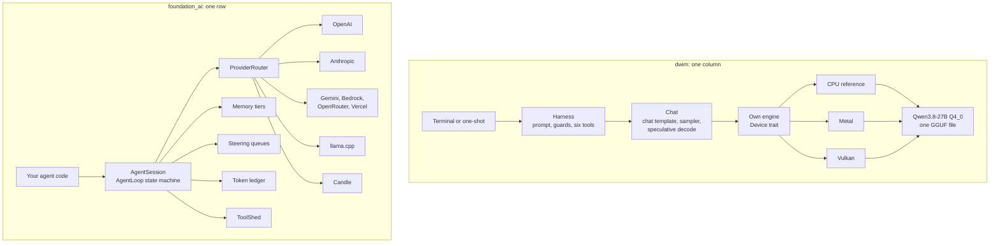

# 07 Comparison with the ewe_platform `foundation_ai` crate

**What is compared.** `dwim` expands to "do what I mean". It is a complete local coding agent: its own inference engine, one fixed model, one harness, a server, and a terminal client, in one Rust program. `foundation_ai` is a library crate in the [ewe_platform](https://github.com/ewe-studios/ewe_platform) Rust workspace. `ewe_platform` is a repository of shared crates for the ewe-studios products, and `foundation_ai` is its agent and model-provider layer. A **harness** is the code that turns a user message into model calls, tool calls, and replies. An **engine** is the code that runs the model's arithmetic on a device. A **provider** is a service or local library that serves a model.

**Thesis.** `dwim` and `foundation_ai` solve the same problem from opposite ends. `dwim` is a product: one model, one engine, one binary, one harness, built for a single job. `foundation_ai` is a platform crate: many providers, many models, a provider router, an agent state machine with memory tiers, steering, cost accounting, and a virtual file system, built to host many kinds of agents. Each is stronger where the other is thinner. This document compares them by function, by design, and by what each could take from the other.

**Measurement rule.** Every number in this document comes from the pinned source, or the text says that no measurement was made. No benchmark run was made for this document. Where a score would be needed, the document says so.

**Compared revisions.** `dwim` at `38885264dc75a02294cc53c18c4afa7e07ee5b58`, version `0.0.12`. `foundation_ai` at `c1b4751e7cfbe31293ffd8c63c5801b3ca6d4740`, version `0.0.9`. The revisions are recorded in [spec.md](../spec.md).

**Citation form.** `dwim: path:line` refers to the `dwim` repository. The path starts at the repository root, which holds `cli/`, `gpu/`, `harness/`, `models/`, `scripts/`, `server/`, `testing/`, and `tools/`. `foundation_ai: path:line` refers to the crate root. `foundation_core: path:line` refers to the `foundation_core` crate next to `foundation_ai` in the `ewe_platform` workspace; it is a dependency, not one of the two compared revisions. A bare `:line` or `:line-line` continues the project and file of the citation before it. The same file name can exist in both projects, so a citation that starts a new subject names its project. "Document 03", "document 04", and "document 05" mean the linked files in this folder, [03 Server and protocol](03-server-and-protocol.md), [04 Inference engine](04-inference-engine.md), and [05 Model and tokenizer](05-model-and-tokenizer.md).

**Aha.** The label **Aha:** marks this document's conclusion about a design. It does not mark a measurement. A claim that rests on a measurement gives the measurement and its citation in the same paragraph.

## 1. What each thing is for

A comparison is only useful if the two subjects have the same goal. These do not have the same goal.

| Question | `dwim` | `foundation_ai` |
|----------|--------|-----------------|
| What is it? | A complete coding agent product | A crate that other agents are built on |
| Who uses it? | A developer at a terminal | A Rust developer writing an agent |
| What runs the model? | Its own engine: the `Device` trait, with Metal and Vulkan backends | `llama.cpp`, Candle, or a cloud provider |
| Which model? | Qwen3.8-27B in Q4_0 GGUF, a quantized weight file, fixed. The download is about 16 gigabytes (GB), and on a Mac the command line refuses to start with less than 32 gibibytes (GiB) of memory (`dwim: README.md:45`, `:54`; `dwim: cli/main.rs:253-267`) | Any model in the catalog: 523 provider-model pairs (section 4.1 defines both terms) |
| Where does it run? | Native only, with a Graphics Processing Unit (GPU) | Native and WebAssembly (wasm) |
| How is state kept? | A transcript for inspection, saved model state, and a Unix socket server | Pluggable document and memory stores, in memory by default |
| What is the unit of work? | One session with one user | One agent session with a router, tools, memory, and policy |

The model name states 27 billion parameters. The file is a Q4_0 GGUF: GGUF is the file format that `llama.cpp` uses for quantized weights, and Q4_0 means groups of 32 weights, each group with one 16-bit floating-point scale that multiplies its 32 four-bit values (`dwim: models/gguf.rs:87-89`, `models/qwen35.rs:23-31`). Qwen ships no GGUF of its own, so `dwim` uses the `bartowski/Qwen3.8-27B-GGUF` conversion of `Qwen/Qwen3.8-27B` at revision `87410e7b9a5c21e6ca70c0c9cc5237de909fe621` (`dwim: models/qwen35.rs:28-37`). Bartowski is a publisher of quantized GGUF conversions on Hugging Face. The 16 GB figure is the README's decimal figure for the download. The repository records no measured file size and no measured memory use; the 32 GiB is a minimum check in the command line on a Mac.

**Aha: the difference is vertical integration against horizontal reach.** `dwim` owns the whole column, from the quantization formula to the terminal screen. `foundation_ai` owns a wide row, from OpenAI to a local GGUF file. Owning the column lets `dwim` make promises that a library cannot. One is that the GPU result agrees with the central processing unit (CPU) result within a Kullback-Leibler (KL) divergence of 1e-3 on the next-token distribution (section 3.1). Another is that there is no network call after the model download: the pinned source's only network client is the download path (`dwim: cli/fetch.rs:104-128`; `models/hub.rs:16`), though this document did not run a network trace. Owning the row lets `foundation_ai` offer choices that a product cannot, such as a main model and a fallback model from different vendors. A memory-model role also exists, but this revision does not call it (section 4.4).

## 2. Two shapes



The `dwim` box is one chain from the terminal to the weights. The `foundation_ai` box puts the caller and the router in one left-to-right path, with many providers and session services branching from it. The labels name those shapes. The shapes explain most of the differences that follow. A change in `dwim` can cross all layers, because one team owns all layers. A change in `foundation_ai` must keep a trait stable for every backend and every caller, so the crate carries abstraction that a product does not need.

The same difference appears in one turn:

```mermaid
sequenceDiagram
    participant U as User
    participant D as dwim harness
    participant T as dwim tools
    participant C as Chat and engine
    participant F as foundation_ai AgentLoop
    participant S as stores
    participant R as router
    U->>D: message
    D->>C: system prompt, environment, message
    C-->>D: thought, text, tool calls
    U->>D: interrupt
    D->>C: interrupt request
    Note over C: reader thread sets the flag
    Note over C: the reply ends at the next chunk (streamed piece) boundary
    D->>T: run calls in order
    T-->>D: output, changed flag
    D->>C: results, maybe a nudge
    C-->>D: reply
    D-->>U: events

    Note over U,R: The two halves are separate systems; the lower half is one foundation_ai turn
    U->>F: turn
    F->>S: assemble context
    S-->>F: memory tiers and messages
    F->>R: stream
    R-->>F: chunks
    U->>F: priority message or abort
    F->>F: set the cancel signal of each in-flight call
    F->>F: execute each call with its own cancel signal
    F->>S: persist records
    F-->>U: progress records and summary
```

A chunk is one streamed piece of the reply. The note says boundary because the server stops between chunks, not inside one.

**Aha: `dwim` has one place where a turn can be interrupted; `foundation_ai` has one per tool call.** The `dwim` half shows an interrupt that arrives after the reply and before the tools run. The same flag is checked at every streamed piece, so an interrupt during a reply ends it at the next piece. An interrupt that arrives while no reply streams, whether before or during tool execution, is seen only at the next streamed piece of the next reply. The `dwim` server streams one reply on one model thread, so a piece boundary is the natural stop point. The crate's loop holds each call as a cancellable task, so it can stop at the call boundary.

## 3. Where `dwim` is stronger

### 3.1 The inference stack is its own

`dwim` defines the compute boundary and implements both sides itself:

```rust
// dwim: gpu/mod.rs:176-338 (condensed)
pub trait Device {
    type Buffer;
    type Weight;
    type Cache;
    fn upload(...);
    fn matmul(...);
    fn attention(...);
    // 22 methods in all: 10 compute (matmul, add, rmsnorm, l2norm, rope,
    // attention, silu_mul, sigmoid_mul, conv, delta_net), 10 that move or
    // hold device memory (upload, alloc, alloc_cache, resize, read, write,
    // copy, store, read_cache, write_cache), and 2 that report the device
    // (name, memory). `delta_net` is the Gated DeltaNet linear-attention step,
    // which updates a recurrent state in place instead of keeping a key-value
    // cache for every past token.
}
```

`foundation_ai` defines a model boundary and delegates the compute to another project:

```rust
// foundation_ai: src/types/base_types.rs:1802
pub trait Model: Send + Sync {
    fn spec(&self) -> ModelSpec;
    fn tool_formatter(&self) -> Box<dyn ToolFormatter>;
    fn descriptor(&self) -> Option<ModelProviderDescriptor>;
    fn costing(&self) -> GenerationResult<UsageReport>;
    // generate, stream, ...
}
```

**Aha: the trait is at a different height.** `dwim`'s boundary is a matrix multiply and an attention call. `foundation_ai`'s boundary is a whole model interaction. `foundation_ai` therefore cannot control the sampler, the cache layout, the quantization arithmetic, or the GPU dispatch without changing `llama.cpp` or Candle. `dwim` controls all four, and can test them against each other.

The concrete gains from that control are:

- **A deterministic quantized reference.** The CPU path performs dot products in the quantized domain: it reads the 4-bit or 8-bit weights as integers, multiplies each by the float activation, and applies the group's 16-bit scale once. It does not rebuild the float weights first, so it is the specification, not an approximation (`dwim: gpu/cpu.rs:108-145`, `gpu/quant.rs:69-88`; [04 Inference engine](04-inference-engine.md), section 4).
- **A differential test with a numeric bound.** `difftest` compares the GPU with the CPU on the real weights. For each of four prompts, the CPU runs the prompt and writes a 32-token continuation one token at a time. It saves the generated tokens and the logits after every prompt piece and after every continuation token, so there is one saved next-token distribution for each position that the GPU will check. A piece is a group of tokens run through the model in one forward call. The GPU runs the prompt in pieces whose sizes cycle through 1, 2, 7, 8, 9, 31, 32, 33, and 64 tokens, with the last piece cut to the prompt's end. The sizes probe the model's boundaries. The sizes 1 and 2 are a single token and a small batch, below the groups of eight tokens that the row kernels take. The sizes 7, 8, and 9 are one short of, at, and one past 8. The sizes 31, 32, and 33 are one short of, at, and one past a tile of 32 tokens used by the tiled matrix kernels. The last size, 64, is a whole batch (`dwim: testing/difftest/main.rs:95-98`). It then runs the CPU's 32-token continuation one token at a time, each step fed the token the CPU chose, not a token the GPU chose. After every piece and every continuation token, it computes the KL divergence between the GPU's next-token distribution for that position and the CPU's saved distribution for the same position. The test fails if the worst divergence in a run is not below 1e-3. A source comment records at most 1.1e-5 on an RX 5700 XT under RADV, the AMD Vulkan driver; that is a comment, not a committed result file (`dwim: testing/difftest/main.rs:33-60`, `:95-106`, `:242-325`; [04 Inference engine](04-inference-engine.md), section 10). The comparison is "agrees within the bound", not "is equal".
- **Device-neutral saved state.** A session can move between devices because the state format is defined by `dwim`, not by a backend. A block is one transformer layer. The state holds the key and value caches for each attention layer, the convolution and recurrent states that each Gated DeltaNet layer keeps for its linear attention, and the hidden state that the drafter carries (the drafter is the 65th block, defined in the next bullet), behind a header with a magic marker and a format version. It does not hold sampler state. The server keys the file by a hash of the model name and the system prompt text, keeps the four newest files, and stores them in the user's cache directory (`dwim: models/qwen35.rs:927-975`; `dwim: server/mod.rs:95-150`; [05 Model and tokenizer](05-model-and-tokenizer.md), section 9). The repository records no measured size for a saved state; the size grows with the number of cached positions.
- **Speculative decoding inside the model file.** The file's last block, the 65th, is a drafter, and the sampler's verify step keeps the target distribution (`dwim: AGENTS.md:45-54`; `dwim: models/qwen35.rs:106-117`; `dwim: models/chat.rs:674-690`; [05 Model and tokenizer](05-model-and-tokenizer.md), section 8).

`foundation_ai` has speculative decoding too, through `SpeculativeConfig` and `LlamaMtp` (`foundation_ai: src/backends/llamacpp.rs:22`, `:77`). But both types come from the `infrastructure_llama_cpp` dependency, not from this crate. The difference is ownership, not existence.

The GGUF loader accepts six tensor types. They are F32 (32-bit float), BF16 (16-bit bfloat), Q4_0 (4-bit groups of 32 with a 16-bit scale), Q4_1 (4-bit groups with a scale and a minimum), Q8_0 (8-bit groups of 32 with a scale), and Q6_K (6-bit K-quant groups of 256; K-quant is a family of GGUF quantization formats). The devices accept three weight formats: BF16, Q4_0, and Q8_0. An F32 matrix is rounded to BF16 on load; an F32 vector, such as a normalization weight, stays F32. Q4_0 and Q8_0 matrices stay in their quantized form and use the quantized kernels. Q4_1 and Q6_K matrices are dequantized to float and then quantized again as Q8_0; "reconstructed" means this dequantize-then-requantize path (`dwim: models/gguf.rs:87-89`, `:392-420`; `dwim: models/quants.rs:1-11`; `dwim: models/qwen35.rs:28-35`). The two formats that are requantized are therefore Q4_1 and Q6_K.

### 3.2 The product is complete on first run

`dwim` ships a command-line interface (CLI), an interactive shell, a Unix-socket server, a terminal user interface, a download command, a transcript, and a benchmark runner. `foundation_ai` ships a library and examples; the caller writes the application.

**Aha: a library's missing pieces are the product's features.** `dwim`'s server protocol, idle exit, build identity handshake, saved prompt state, and terminal rendering are not in `foundation_ai` at all. They are application concerns, and `foundation_ai` correctly leaves them to the application. This is not a defect in the crate. It is a difference in what the repository promises.

Three of those terms need a definition here. **Idle exit** means that the server process exits after it has gone 10 minutes without a session; a session that starts after that pays the model-load time again (`dwim: server/mod.rs:52-58`, `:306-315`). **Build identity** means that the server reports its version, the size of its executable, and the executable's modification time, so a client can tell a same-version server from a different build (`dwim: server/mod.rs:81-105`). **Saved prompt state** means the model state after the system prompt, keyed by a hash of the model name and the prompt text, as defined in section 3.1.

### 3.3 The harness is tuned for one small model

`foundation_ai` has generic loop guards. `dwim` has prompt-level interventions for a small local model. The source comments record the failures that produced each rule, such as the runs on SWE-bench's `django-11797`; the repository records the reasoning, not a measurement table.

The table names seven interventions. The prose after it defines the environment block, the thinking budget and its two closings, the headed note, the no-change nudge, the repeated-call refusal, the `DONE` protocol, and the edit tiers. `Chat::answer` is the method that produces one reply.

| Intervention | `dwim` | `foundation_ai` |
|--------------|--------|-----------------|
| Environment outside the system prompt | Yes: working directory, file list, git branch, platform, and date go before the first user message (`dwim: harness/mod.rs:274-298`) | No equivalent split; context is assembled per turn |
| Thinking budget with two closings | Yes, 2,048 tokens; the closing depends on whether a tool was called (`dwim: harness/mod.rs:74`, `:122`, `:132`) | A `thinking_budget` field exists (`foundation_ai: src/types/base_types.rs:433`), but no backend reads it in this revision; no closing text |
| Headed note compaction | Yes, four fixed headings and one `Chat::answer` call (`dwim: harness/compaction.rs:35-42`, `:88-140`) | Truncation, plus memory tiers that a caller or a future generator fills |
| Repeated-call refusal | Yes, against the immediately previous call only (`dwim: harness/mod.rs:58`, `:883-885`) | Loop detection with escalation (`foundation_ai: src/agentic/loop_detection.rs:1-18`, `:176-181`) |
| No-change nudge | Yes, after 20 calls in a row without a file change (`dwim: harness/mod.rs:89`, `:911-917`) | None |
| `DONE` and automatic rounds | Yes, `DONE` as the last line, up to 10 automatic rounds (`dwim: harness/mod.rs:100-110`) | A follow-up queue serves caller-injected messages; the crate does not continue the model by itself |
| Edit fallback tiers | Exact, trailing space, trimmed, tried in that order (`dwim: tools/edit.rs:377-417`) | Exact string replacement only |

The **environment block** is a text block built from the working directory, the visible files in it, whether it is a git repository and on which branch, the platform, and the date. The file list is one directory level, not recursive. Hidden names are left out, and at most 50 names are shown, then an ellipsis (`dwim: harness/mod.rs:53`, `:300-323`). The harness puts the block ahead of the first message, not in the system prompt, so the system prompt and the saved state after it stay valid across days, branches, and directories (`dwim: harness/mod.rs:14-20`, `:274-298`).

A **thought** is the model's reasoning text between the `<think>` and `</think>` tags, before its reply text (`dwim: models/chat.rs:35-36`, `:72-85`). The **two closings** are sentences appended in the model's voice when a thought reaches the 2,048-token thinking budget. The harness chooses one per reply. Before the first tool call of the turn it uses `RECALL_CLOSING`: "I am not certain of this from memory, so I will check it in the code now with a tool, and decide from what it shows." After a tool call it uses `DECIDE_CLOSING`: "I have thought about this enough, and what I need is in the output above. I will go with what I have worked out rather than go over it again: if there is a change to make, I make it now with edit, and otherwise I reply with it." The first sends the model to check the code; the second tells it to decide from the results (`dwim: harness/mod.rs:116-132`, `:591-597`).

```rust
// dwim: harness/mod.rs:122
const RECALL_CLOSING: &str = "I am not certain of this from memory, so I will check it in the code now with a tool, and decide from what it shows.";

// dwim: harness/mod.rs:132
const DECIDE_CLOSING: &str = "I have thought about this enough, and what I need is in the output above. I will go with what I have worked out rather than go over it again: if there is a change to make, I make it now with edit, and otherwise I reply with it.";
```

The **headed note** is the compaction format. When the next message or tool result would take the context past four fifths of its capacity, the harness asks the model to write a note under four headings, then clears the conversation, restarts from the system prompt, and reads back the environment block, the note, the user's earlier messages, and the most recent whole exchanges, with thoughts left out (`dwim: harness/compaction.rs:18-32`, `:65-140`).

```rust
// dwim: harness/compaction.rs:35-42
/// The headings of the note, written into it for the model one at a time:
/// whatever makes the model stop early ends only a heading's section, and
/// the next heading has it go on, so every note reaches Next, the section
/// it acts on. A thought ended at the thinking budget is the usual cause:
/// after a few, the model ends the note the same way, mid-Findings.
const NOTE_HEADS: [&str; 4] = ["Task:", "\n\nFindings:", "\n\nDone:", "\n\nNext:"];
```

In the comment, "it" is the model: the next heading makes the model go on. "Reaches `Next`" means the `Next:` heading is written; the section under it can be empty.

The four headings are fed to the model one at a time. If the model stops early inside one section, only that section ends; the next heading continues the note. All four headings are written inside one `Chat::answer` call. While a section runs, the method reserves the token count of the headings that are still to come, plus the tokens of the reply's end. So "each section leaves room for the heads after it" means that a section can stop early rather than use the space that the later headings need. The method writes `Task:`, generates its section, writes `Findings:`, and so on, in the same model state, so an early stop in one section does not cost the later headings and the note costs one call (`dwim: models/chat.rs:842-919`). `Chat::answer` is one method call, not one request to the model. Inside it, the method feeds a heading, generates that section, then feeds the next heading, in a loop, all in the same model state. The note shape is:

```text
Task: <what the user asked for>
Findings: <paths, line numbers, functions, commands, results, exact errors>
Done: <what changed so far>
Next: <what remains, and what to do first>
```

The note costs one `Chat::answer` call. Its token budget is the context capacity divided by 32, clamped to between 256 and 2,048 tokens (`dwim: harness/compaction.rs:28-32`, `:52-56`, `:103`). After the note, the recent exchanges may take one eighth of the context and the user's earlier messages one sixteenth (`dwim: harness/compaction.rs:20-26`, `:115-116`). The compaction is not guaranteed: a caller event (a callback the caller passes to the harness; a `Break` from it stops the work) can stop it, and `make_room` returns an error if even one message cannot fit after the compaction (`dwim: harness/compaction.rs:77-83`, `:96-111`).

The **no-change nudge** counts tool calls whose result did not change a file. The flag comes from the tool declaration: `edit` and `write` report a change, and every other tool, including `bash`, reports none, even when its command writes a file (`dwim: tools/mod.rs:175-196`; `tools/edit.rs:54`; `tools/write.rs:24`; `tools/bash.rs:75`). The counter resets on any call that reports a change. At 20, the harness appends this text to the last tool result and resets the counter (`dwim: harness/mod.rs:89-95`, `:904-917`):

```text
<system-reminder>You have made many tool calls since you last changed a file. If you know what to change, make the change now with edit, then run the reproduction or the tests to check it. If you don't, say in a sentence what you still need to find out, and find that out next.</system-reminder>
```

The **repeated-call refusal** compares each parsed tool call with the last call that ran, by tool name and argument text. If the two are equal, the tool does not run. The harness returns a fixed `REPEATED` text instead: "error: you just ran this, and its output is above. Don't run it again: use that output, run something else, or reply to the user." A call with a different name or different arguments runs (`dwim: harness/mod.rs:58`, `:883-885`).

**Auto mode** is the mode with no user at the terminal; the command-line interface turns it on with `/auto`, usually for a one-shot or benchmark run (`dwim: cli/run.rs:143-196`; `harness/mod.rs:616-621`). The **`DONE` protocol** applies in this mode. A reply with no tool call that does not end with `DONE` on its last non-empty line is answered with the `GO_ON` prompt, which tells the model that the tools are on, that is, still available to the model, up to 10 times in a turn (`dwim: harness/mod.rs:96-110`, `:858-864`, `:927-937`, `:1006-1013`). `foundation_ai` has no automatic equivalent: its follow-up queue only carries messages that a caller pushes, and when the queue is empty the turn ends (`foundation_ai: src/agentic/agent_loop.rs:756-783`).

The **edit tiers** are three matching rules, tried in this order (`dwim: tools/edit.rs:377-417`):

```text
file line:      "    let x = 1;   "
model gives:    "let x = 1;"
Exact:          no match, because the white space differs at both ends
TrailingSpace:  no match, because the leading spaces still differ
Trimmed:        match, because white space at both ends is ignored
```

`foundation_ai` compresses by removing the oldest messages:

```rust
// foundation_ai: src/agentic/agent_loop.rs:1732-1756 (condensed)
if self.config.preflight_compression_threshold <= 0.0 {
    return;
}
// `budget` is `self.ledger.budget()`: the session's token ceiling, or
// `None` when unlimited. With `None`, this function returns at once.
let Some(budget) = self.ledger.budget() else { return; };
if budget == 0 {
    return;
}
let limit = f64::from(self.config.preflight_compression_threshold) * budget as f64;

// Drop oldest messages (front) until under the limit or only one left.
while ctx.messages.len() > 1 {
    // `token_estimate` is the estimated token count of the assembled
    // context. The variable is named `ratio`, but it holds a count.
    let ratio = ctx.token_estimate as f64;
    if ratio <= limit {
        break;
    }
    let dropped = ctx.messages.remove(0);
    let est = crate::agentic::context::estimate_tokens_pub(&dropped);
    ctx.token_estimate = ctx.token_estimate.saturating_sub(est);
}
```

With the default `preflight_compression_threshold` of 0.85, the limit is 85 percent of the session token budget. A threshold of 0.0, or a budget of 0, returns before any message is dropped; an unlimited budget also makes the function do nothing (`foundation_ai: src/agentic/agent_loop.rs:1722-1757`, `:133-143`).

**Aha: truncation preserves the recent turns and loses the early findings. The headed note preserves the findings and rebuilds a short recent tail.** For a long debugging session, the early findings are often the ones that matter: the failing command, the error text, the file and line. `dwim` spends one `Chat::answer` call to keep them. `foundation_ai` relies on the memory tiers to keep an abstraction of them, and on truncation to fit the window. The tiered memory is richer in principle, but its automatic distillation is not implemented in this revision (section 4.4). Both are defensible. They fail in different ways. Truncation loses the early findings. The note can omit a detail, and the model must then re-read it from disk; the note can also be stopped by a caller event, in which case the harness returns without compacting.

### 3.4 The shell tool is safer and more predictable

This is the clearest correctness gap in the tool layer: a timeout that does not stop the process is a defect, not only a difference in policy. Compare the two `bash` tools.

`dwim` runs the command in a new operating-system session (`setsid`), kills the process group on timeout, limits the output, spills the rest to a file, and refuses commands that would discard the agent's own work:

```rust
// dwim: tools/bash.rs:224-253 (condensed)
unsafe {
    shell.pre_exec(|| {
        if libc::setsid() == -1 {
            return Err(io::Error::last_os_error());
        }
        Ok(())
    });
}
// ...
if finished.recv_timeout(timeout).is_err() {
    timed_out.store(true, Ordering::Relaxed);
    unsafe { libc::kill(-(pid as libc::pid_t), libc::SIGKILL) };
}
```

`foundation_ai` runs the command on a thread and stops waiting on it:

```rust
// foundation_ai: src/agentic/tools/files.rs:316-335 (condensed)
let (tx, rx) = std::sync::mpsc::channel();
std::thread::spawn(move || {
    let mut cmd = std::process::Command::new("sh");
    cmd.arg("-c").arg(&command);
    if let Some(dir) = cwd {
        cmd.current_dir(dir);
    }
    let _ = tx.send(cmd.output());
});

let output = match rx.recv_timeout(timeout) {
    Ok(Ok(o)) => o,
    Ok(Err(e)) => return Err(exec_err("bash", format!("spawn failed: {e}"))),
    Err(_) => {
        return Err(exec_err(
            "bash",
            format!("command timed out after {}s", timeout.as_secs()),
        ))
    }
};
```

**Aha: a timeout on `recv_timeout` does not kill the child.** The spawned thread stays blocked in `cmd.output()`, and the shell and its children keep running. The model is told that the command timed out. The machine still runs it. In `dwim`, the negative process identifier sends `SIGKILL` to the whole process group, so a compiler, its workers, and their children all stop.

The other tool differences are not all defects, but each changes what the model can rely on.

| Property | `dwim` | `foundation_ai` |
|----------|--------|-----------------|
| Shell timeout | Default 300 seconds; the call may set it, and 0 means no limit, so no timer is started (`dwim: tools/bash.rs:113`, `:190-198`, `:247-254`) | Default 120 seconds; set when the tool is constructed, not per call (`foundation_ai: src/agentic/tools/files.rs:267-272`, `:281-284`) |
| Timeout kills children | Yes: a new session and process group, killed with `SIGKILL` (`dwim: tools/bash.rs:224-231`, `:249-253`) | No: the thread stays blocked in `cmd.output()` (`foundation_ai: src/agentic/tools/files.rs:317-336`) |
| Output limit | 32 kibibytes (KiB) for each stream; a stream longer than 32 KiB is shown as up to 16 KiB from its start and up to 16 KiB from its end, cut at line ends, and a shorter stream is shown whole (`dwim: tools/bash.rs:126-129`, `:472-497`) | None (`foundation_ai: src/agentic/tools/files.rs:338-343`) |
| Long output kept on disk | Yes: up to 4 mebibytes (MiB) of each stream (`dwim: tools/bash.rs:133`, `:160-166`, `:441-461`) | No |
| Editor and pager neutralized | Yes: the variables in the paragraph below (`dwim: tools/bash.rs:62-70`) | No |
| Git prompt disabled | Yes: `GIT_TERMINAL_PROMPT=0` (`dwim: tools/bash.rs:68`) | No |
| Refuses work-destroying git commands | Yes, when tracked files are changed (`dwim: tools/bash.rs:115-117`, `:279-332`) | No |
| Read limit | 1,000 lines or 48 KiB, whichever is reached first (`dwim: tools/read.rs:40-44`, `:149-152`) | Whole file when `offset` and `limit` are absent (`foundation_ai: src/agentic/tools/files.rs:74-94`) |
| Path confinement for search | Yes: the canonical path must stay at or under the working directory (`dwim: tools/mod.rs:245-265`) | No check in the crate; the search root and the virtual file system decide (`foundation_ai: src/agentic/tools/search.rs:108-122`) |
| Edit fallback for white space | Three tiers, tried in order (`dwim: tools/edit.rs:377-417`) | Exact only (`foundation_ai: src/agentic/tools/files.rs:171-173`) |

**The shell environment.** Every `dwim` command runs with these variables set over the user's own: `GIT_EDITOR`, `EDITOR`, and `VISUAL` set to `true`; `GIT_PAGER` and `PAGER` set to `cat`; `GIT_TERMINAL_PROMPT` set to `0`; and `GIT_SEQUENCE_EDITOR` set to `true` (`dwim: tools/bash.rs:57-70`). The first three stop `git commit --amend`, `git rebase`, and similar commands from opening an editor. The next two stop a pager from waiting for a key. The sixth makes a credential or host-key prompt fail instead of wait. The last lets an interactive rebase keep the sequence it was given. The command also runs with no terminal and with standard input closed (`:216-231`).

**The refused git commands.** `dwim` refuses a command when the work tree has changes to tracked files and the command would discard them (`dwim: tools/bash.rs:205-207`, `:326-332`). The patterns are `git stash` (push, save, or an option), `git checkout` of files (`.`, `--`, `-f`, `--force`, or an existing path), `git restore` of the work tree unless it is only `--staged`, `git reset --hard`, and `git clean` with force (`:284-321`). The check reads `git status --porcelain --untracked-files=no`, so a change to an untracked file does not trigger it (`:326-332`).

**The spill file.** When one stream of a command's output passes 32 KiB, `dwim` shows up to 16 KiB from its start and up to 16 KiB from its end, cut at line ends, and writes up to 4 MiB of that stream to a file. A stream at or below 32 KiB is shown whole and gets no file. The directory is `dwim-<process id>-<n>` under the system temporary directory, mode 0700; `<n>` is a counter for the `Bash` tool instances in one process, starting at 0. The instance numbers its calls, and each stream that passes the limit gets a file named by that call number, such as `3.stdout` or `3.stderr`; the file number is the call number, not the `<n>` of the directory (`dwim: tools/bash.rs:135-166`, `:180-183`, `:441-451`). The file holds the first 4 MiB of the stream. The result text says `whole in <path>` when 4 MiB covers the stream, or `the first 4194304 bytes in <path>, the rest discarded` when it does not (`:515-537`). The model is told to use `read` on that path. If a process leaves the directory behind, the next process removes the directories of processes that are no longer running (`:334-362`).

**The read page.** `read` starts at the line the call gives, or at the first line. It stops when it has shown the requested number of lines (1,000 at most) or when the next line would take the page past 48 KiB, whichever comes first. The first line is always shown. No shown line is longer than 1,000 bytes; a longer line is cut, and the page's end note gives the number of lines that were longer than 1,000 bytes and were cut (`dwim: tools/read.rs:46-47`, `:123-128`, `:134-156`, `:173-181`). The last line of the page says `next: read <path> from line <n>` when more remains (`:165-169`).

**Path confinement.** `dwim`'s `grep` and `glob` call `within`, which canonicalizes both the working directory and the target path, so `..` and symbolic links are resolved before the test. The target must start with the working directory as a sequence of path components (`Path::starts_with`), so `/tmp/foo` is not inside `/tmp/foobar`; otherwise the tool refuses and says to use `bash` for other places (`dwim: tools/mod.rs:245-265`). `foundation_ai`'s file tools pass the path to the virtual file system. Its search backend joins a relative path under its configured root but accepts an absolute path as given (`foundation_ai: src/agentic/tools/search.rs:108-122`). The crate does not enforce a working-directory boundary; that boundary is the virtual file system's or the caller's responsibility.

`foundation_ai`'s `read` returns the whole file when the call omits both `offset` and `limit`. When either is present, it skips to the offset and takes up to the limit, with no byte cap (`foundation_ai: src/agentic/tools/files.rs:74-94`). One large generated file can therefore fill the context.

The virtual file system is the counter-advantage, and it is real: `foundation_ai`'s file tools work over any `AsyncVfsFileSystem`, including an in-memory file system for tests, an overlay, or a remote store (`foundation_ai: src/agentic/tools/files.rs:7-11`). `dwim` calls `std::fs` directly. Section 4 gives the crate credit for this.

### 3.5 Persistence works without configuration

`dwim` writes a transcript of every session, saves model state, and keeps each live session in the server's memory while the server runs. It does not restart a conversation from the transcript: the `Log` is write-only, for finding out afterwards where a session's tokens went (`dwim: harness/mod.rs:22-30`, `harness/log.rs`). The saved state is the model state after a system prompt, as defined in section 3.1. It is not the conversation.

`foundation_ai` separates two stores. A **document store** holds the session's records: messages, memory records, failed actions, and the rest of the audit log. It has append, scan, delete, and count operations, and the trait comes from the `foundation_db` crate (`foundation_ai: src/agentic/session.rs:24-25`). A **memory store** holds only the latest record of each memory tier for a session, as a fast cache; a memory tier is one of the three record types in section 4.4 (`foundation_ai: src/agentic/memory_store.rs:98-119`). A session can resume by id with `resume(id)`, which marks the id as one that must already exist; `build()` then fails if the document store holds no records for that id (`foundation_ai: src/agentic/session.rs:261-271`). Context assembly then reads the messages and the memory tiers back from the stores (`:249-254`). The builder's doc comment states that the default stores are in memory:

```rust
// foundation_ai: src/agentic/session.rs:146-153 (condensed)
/// Start a builder over the in-memory stores and a fresh `SessionId`.
///
/// Swap the stores with
/// [`with_doc_store`](AgentSessionBuilder::with_doc_store) /
/// [`with_memory_store`](AgentSessionBuilder::with_memory_store) ...
```

The code below is from `AgentSession::builder`. It calls `AgentSessionBuilder::new`, which creates the fresh `SessionId` and takes those in-memory stores.

```rust
// foundation_ai: src/agentic/session.rs:168-172
let mut builder = AgentSessionBuilder::new(
    router,
    MemoryDocumentStore::new(),
    KvMemoryStore::new(MemoryStorage::new()),
    ctx,
);
```

**Aha: the flexible default is the fragile default.** A caller who reads the first example gets a session that forgets everything when the process exits. The default builder uses `MemoryDocumentStore` and `KvMemoryStore<MemoryStorage>`, both in memory (`foundation_ai: src/agentic/session.rs:146-172`). The crate documents this and offers durable implementations through `with_doc_store` and `with_memory_store`. `dwim` has one storage path: the transcript and the saved prompt state are durable, but the live conversation is not restarted. For a platform, pluggability is the right choice. For a product, a durable default is the right choice.

### 3.6 Build identity and prompt caching

`dwim` identifies the running server by version, executable size, and modification time. A client can tell whether the server it is talking to is the build it expects (`dwim`, [03 Server and protocol](03-server-and-protocol.md), section 2). It also saves the model state after the system prompt and reuses it when the prompt text matches (`dwim`, [03 Server and protocol](03-server-and-protocol.md), section 8). A second server with the same model name and system prompt reads that state from the cache directory and skips processing the prompt again (`dwim: server/mod.rs:95-116`). The repository records no measured time for the reuse.

`foundation_ai` has no server and no cross-process prompt cache. It has provider-side cache retention parameters:

```rust
// foundation_ai: src/types/base_types.rs:432
pub cache_retention: CacheRetention,
```

That is a request field for a vendor's cache, not a local state cache. The two are not the same thing. The field has four values: `None` (the default), `Short`, `Long`, and `Custom(String)` (`foundation_ai: src/types/base_types.rs:40-58`). No backend reads it in this revision: the search `grep -rn cache_retention src` returns only the field declaration and its default (`foundation_ai: src/types/base_types.rs:432`, `:457`).

## 4. Where `foundation_ai` is stronger

### 4.1 Provider and model breadth

The crate has eight backend implementations in `src/backends/` and 13 catalog files in `src/models/providers/`. The numbers measure different things. A backend is code that talks to a provider; a catalog is a list of model descriptors. One backend can serve several catalogs.

```text
foundation_ai/src/backends/        foundation_ai/src/models/providers/
  openai_provider.rs                 amazon_bedrock.rs        1
  openai_responses_provider.rs       anthropic.rs             2
  anthropic_messages_provider.rs     azure_openai_responses.rs 4
  huggingface_gguf_provider.rs       google_antigravity.rs    8
  huggingface_candle_provider.rs     google_gemini_cli.rs     5
  workers_ai.rs                      google_vertex.rs        12
  llamacpp.rs                        kimi_coding.rs           2
  candle.rs                          openai.rs                4
                                     openai_codex.rs          7
                                     opencode.rs             41
                                     openrouter.rs          273
                                     vercel_ai_gateway.rs   163
                                     xai.rs                   1
```

The counts at the right are the entries in each catalog file. The command was `grep -c "ModelProviderDescriptor {" src/models/providers/*.rs`; the counts sum to 523. Each entry is one model offered by one provider, so the number is **provider-model pairs**, not 523 distinct model names. This document did not count unique names. The 13 modules are listed in `foundation_ai: src/models/providers/mod.rs:6-18` and combined at `:20-51`.

Prices are part of each descriptor. For example, Anthropic's `claude-opus-4-6` descriptor has `input: 5.0`, meaning United States dollars (USD) 5.00 per million input tokens, with `output: 25.0`, `cache_read: 0.5`, and `cache_write: 6.25` (`foundation_ai: src/models/providers/anthropic.rs:9-26`). Each field is an `f64` in `ModelUsageCosting` (`foundation_ai: src/types/base_types.rs:495-501`). The costing function divides a price by 1,000,000 and multiplies it by the token count (`foundation_ai: src/costing.rs:70-96`). As section 4.7 shows, the built-in backends do not pass these catalog prices to that function, so a catalog price is data, not a reported cost today.

**Aha: breadth is not only choice; it can also be fallback, when the caller configures it.** `RouterMix` is a builder. Each role method gives its provider a unique routing name. That name is the model id string. The method also adds a `RoutingRule`, a mapping from the model id to that same name, so resolution does not depend on the unreliable `serves()` probe (`foundation_ai: src/harness/router.rs:19-35`, `:107-162`; `src/types/routable_provider.rs:202-208`). The preset has three roles: `primary`, `memory`, and `fallback`; a role is the slot that the model fills (`:46-52`, `:76-105`). The agent loop uses the fallbacks only when the caller gives them: a rate-limit error classifies as `SwitchModel`, the circuit breaker returns the next fallback after 3 consecutive failures, and the loop retries with it (`foundation_ai: src/agentic/errors.rs:352-360`, `:386-415`; `src/agentic/agent_loop.rs:1699-1710`). A mix with no fallback model has no automatic failover. `dwim` has one model. If it cannot run, there is no agent. That is an acceptable product decision for a local tool, and it is a real limitation for a platform.

The router solves a problem that looks simple and is not:

```rust
// foundation_ai: src/harness/router.rs:9-18 (condensed)
//! * `HuggingFaceGGUFProvider::serves()` always returns `false` (it has no
//!   catalog), so the router's automatic `serves()` probe never matches a local
//!   GGUF model.
//! * `AnthropicMessagesProvider::serves()` always returns `true` (it claims
//!   every id), so in a mixed router it would greedily capture models that
//!   belong to another provider.
```

**Aha: provider identity cannot be inferred from a model name.** `foundation_ai` learned this and uses explicit routing rules with distinct identities (`RouterMix`). `dwim` does not have the problem, because it has one provider. This is a good example of complexity that comes from reach.

### 4.2 A resumable agent state machine

`foundation_ai`'s `AgentLoop` is a resumable state machine. The state lives in memory; the crate does not serialize `AgentLoopState`. The loop implements a task iterator: each `next_status` call does one step and returns, so a state can be left and entered again without blocking a thread (`foundation_ai: src/agentic/agent_loop.rs:241-245`, `:1788-1807`). Each state carries the data needed to continue:

```rust
// foundation_ai: src/agentic/agent_loop.rs:246-287 (condensed)
pub enum AgentLoopState {
    Initializing,
    OuterBoundary,
    InnerAssemble,
    InnerAssembling { task: StoreTask<AgentContext> },
    InnerGenerate {
        stream: crate::types::ModelStreamBox,
        collected: Vec<Messages>,
    },
    InnerToolCalls { calls: Vec<ToolCallRequest> },
    InnerExecuting {
        calls: Vec<ToolCallRequest>,
        results: Vec<(ToolCallRequest, Result<ToolCallResult, ToolError>)>,
        idx: usize,
        active: Option<ToolDrivenIterator>,
        cancel_signals: Vec<Arc<AtomicBool>>,
    },
    InnerEmitResults { results: Vec<Messages>, idx: usize },
    OutputProcessing,
    Flushing { task: StoreTask<usize>, then: Box<AgentLoopState> },
    Ending,
    Summarizing,
    Done,
}
```

`dwim`'s harness is a synchronous loop of function calls. This excerpt is from inside the loop:

```rust
// dwim: harness/mod.rs:796-802 (condensed)
// `self.steps` counts tool calls; `max_calls` is the cap.
let capped = self.steps >= self.max_calls;
// `account_tokens` returns the tokens the final account will need; `more` is 0 below the cap.
let more = if capped { self.account_tokens()? } else { 0 };
// `fed` is the turn to feed: the user message with the environment block, or the tool results.
// `on_event` reports progress and can stop the turn.
if !compaction::make_room(self, &fed, more, on_event)? { ... }
```

These calls run in order, and each returns before the next line runs. If `make_room` returns false, the turn ends. Otherwise, the same function calls `Chat::send` or `Chat::respond`, waits for the reply, runs each tool call, and loops. The method is one function with a loop; it has no state enum that can be left and entered again, so a turn runs to its return unless a caller event stops it.

**Aha: the state machine can be parked, resumed, cancelled, and driven by another scheduler. The function stack can only run to completion.** `dwim` compensates with one thread for the model and one reader thread for each connection. The server sizes a pool of sequences at startup, two by default; a sequence is one slot of model state with its own key-value cache, so two sessions can hold device state. Generation still runs one request at a time, and sessions take turns at whole-reply granularity (`dwim: server/mod.rs:11-22`, `:298-303`). The model thread takes requests from a channel and serves them one at a time; each reader thread reads its connection and sets an interrupt flag that the model thread checks as it streams (`dwim: server/mod.rs:1-22`, `:305-367`, `:528-548`). That is enough for one local user. It would not be enough for a hosted service with thousands of sessions on a shared executor, which is what `foundation_ai` is built for.

### 4.3 Steering, pause, abort, and follow-up

`foundation_ai` has two queues and a cancel signal:

```rust
// foundation_ai: src/agentic/steering.rs:1-11 (condensed)
//! Steering queues & cancel signals (F13).
//!
//! WHY: the agent loop must be interruptible — the user can inject high-priority
//! messages (stop, pause, redirect) that should preempt current tool execution.
//!
//! WHAT: Two `EventQueue<Messages>` queues (priority for immediate
//! interrupt, follow-up for deferred injection) and an `Arc<AtomicU32>` cancel
//! signal carrying `CancelCode as u32`.
```

```rust
// foundation_ai: src/agentic/steering.rs:26-33
pub enum CancelCode {
    /// No cancellation requested; normal execution.
    None = 0,
    /// Pause current work and handle priority messages first.
    PauseForPriority = 1,
    /// Abort current session entirely.
    Abort = 2,
}
```

`dwim` has one interrupt, delivered at the next streamed piece:

```rust
// dwim: server/mod.rs:538-548 (condensed)
// A chunk goes to the client; the reply ends early when the client
// asked it to, or is gone.
let stream = |piece: Piece| -> ControlFlow<()> {
    if peer.write(&Response::Chunk(piece)).is_err()
        || peer.interrupted.load(Ordering::Relaxed)
    {
        ControlFlow::Break(())
    } else {
        ControlFlow::Continue(())
    }
};
```

The reader thread sets the flag, and the model thread checks it before each piece (`dwim: server/mod.rs:479-482`; `dwim`, [03 Server and protocol](03-server-and-protocol.md), section 5.3). The check happens only while a reply streams, so an interrupt during a tool call waits for the tool to finish and for the next streamed piece.

**Aha: `dwim`'s interrupt is coarse and honest.** It stops at the next piece, so the client keeps the text it has received, and the session keeps the state the model has built. It does not pause a tool call, redirect a thought, or inject a message mid-turn; a new message is a new request. `foundation_ai` can stop in-flight tool calls. The steering signal is the global `Arc<AtomicU32>` that carries `CancelCode`. Each in-flight tool call also has its own `Arc<AtomicBool>`. A priority push sets `PauseForPriority` on the global signal. The loop then sets every per-call boolean to `true`, drains the priority queue, clears the global signal, and goes back to `InnerAssemble` with the message (`foundation_ai: src/agentic/steering.rs:106-110`; `src/agentic/agent_loop.rs:1354-1367`). It does not resume a cancelled call; the model sees the turn restarted with the new message. Only the sub-agent tool has an explicit pause and resume, through an `AtomicBool` (`foundation_ai: src/agentic/tools/agent.rs:14-18`). For an interactive local agent, a piece-boundary interrupt is enough. For a multi-user system, per-call cancellation is required.

### 4.4 Memory tiers and semantic recall

`foundation_ai` defines three memory tiers as session records (`foundation_ai: src/agentic/memory_store.rs:24-31`):

- **Working memory** holds curated facts, each a `MemoryFact`, with a version. `foundation_ai`'s `memory` tool writes it; that tool is not one of the six `dwim` tools. The tool runs the commands `add`, `remove`, and `replace`, and calls `update_working_memory` to store a new version (`foundation_ai: src/agentic/tools/memory.rs:1-12`, `:111`).
- **Observation** holds time-scoped `ObservationEntry` items, written by `persist_observation`.
- **Reflection** holds condensed `ReflectionEntry` items, written by `persist_reflection`.

Each tier keeps only its latest record; a write replaces the previous one (`foundation_ai: docs/11-memory-system.md:9-17`). A record is the tier's struct, not a single entry. `WorkingMemory` holds `facts: Vec<MemoryFact>`, a version, and other fields. `Observation` holds `observations: Vec<ObservationEntry>` and a `token_count`. `Reflection` holds `reflections: Vec<ReflectionEntry>`. A write to the observation tier stores the caller's list of observations (the `Vec` in the record) and the caller's token count in the record. It also adds that count to a separate `observation_tokens` counter in the memory hierarchy; the record's `token_count` field is only the value for that write. A reflection write resets `observation_tokens` to zero. The reflection trigger compares the accumulated `observation_tokens` counter with its threshold (`foundation_ai: src/types/agentic.rs:197-223`, `:248-292`; `src/agentic/memory.rs:195-199`, `:219-243`, `:250-274`).

```rust
// foundation_ai: src/agentic/memory.rs:90-106
pub struct MemoryConfig {
    pub observation_trigger_tokens: u64,
    pub reflection_trigger_tokens: u64,
    pub memory_model: Option<ModelId>,
    pub parse_strategy: MemoryParseStrategy,
}

impl Default for MemoryConfig {
    fn default() -> Self {
        Self {
            observation_trigger_tokens: 30_000,
            reflection_trigger_tokens: 40_000,
            memory_model: None,
            parse_strategy: MemoryParseStrategy::default(),
        }
    }
}
```

Two triggers exist. The observation trigger compares the ledger's rolling count, input plus output tokens since the last reset, with `observation_trigger_tokens`, 30,000 by default. The reflection trigger compares the accumulated token count of observations with `reflection_trigger_tokens`, 40,000 by default. Each trigger returns a `MemoryAction`, and the loop reports `AgentProgress::ProcessingMemory { kind }` when it processes the model's output, before the next outer boundary (`foundation_ai: src/agentic/memory.rs:187-201`; `src/agentic/agent_loop.rs:1564-1580`; `docs/11-memory-system.md:19-28`).

Automatic distillation is not implemented in this revision. No code calls a memory model to write an observation or a reflection; the crate's own how-to states this (`foundation_ai: docs/11-memory-system.md:19-31`). With default settings the observation and reflection tiers stay empty. A caller that wants them watches for `ProcessingMemory`, generates the entries with its own model through `agent.router()`, and calls `persist_observation` or `persist_reflection` (`foundation_ai: docs/11-memory-system.md:30-44`). Because generation is not wired, `memory_model` has no effect today: whether it is `None` or `Some`, no call is made. The builder copies the field into `MemoryConfig`, and `MemoryHierarchy::memory_model()` returns it, but nothing reads it for generation (`foundation_ai: src/agentic/session.rs:423-430`; `src/agentic/memory.rs:320-322`). The tiers that do exist are included in the assembled context (`docs/11-memory-system.md:28`).

It also has an embedding interface, one caching implementation, and four search modes:

```rust
// foundation_ai: src/agentic/context.rs:29-40
pub enum SearchMode {
    /// Semantic vector recall over session messages.
    Semantic,
    /// Memory-tier vector recall (observation/reflection embeddings).
    Memory,
    /// Code-graph structural search (F27 — deferred).
    Graph,
    /// Hybrid fusion of vector + BM25 (F26 — deferred).
    Hybrid,
}
```

The crate ships one `EmbeddingProvider` implementation, `CachedEmbeddingProvider`. It caches vectors and asks a routed model for them. It has no dedicated embedding backend: the routed model must return `ModelOutput::Embedding`, and a caller wires the provider with `with_embedder` (`foundation_ai: src/agentic/embedding.rs:172`, `:264`, `:395-415`; `src/agentic/session.rs:358-367`). The enum's comments promise more than the code does. `SearchMode::Semantic` does use embeddings when an embedder is wired, and falls back to keyword search when it is not. `SearchMode::Memory` never embeds: it lower-cases the query and scores the memory tiers by keyword (`foundation_ai: src/agentic/context.rs:367-368`). `Graph` is not wired. It logs a warning and runs the same message search and tier search as `Hybrid` (`foundation_ai: src/agentic/context.rs:370-387`). `Hybrid` is semantic message search when an embedder exists, keyword message search when it does not, followed by the keyword tier search (`foundation_ai: src/agentic/context.rs:388-396`). No mode uses BM25, Best Matching 25, the keyword ranking function that the `Hybrid` comment names. There is no fusion rank either: hits from both sources are sorted by score, highest first, and cut to the requested count (`foundation_ai: src/agentic/context.rs:399-404`). The F-numbers are feature identifiers from the crate's design notes. F27 and F26 appear only in this enum's comments, and F13 and F16 appear in module documents. The pinned crate has no central list that maps the numbers to features (`foundation_ai: src/agentic/steering.rs:1`; `src/agentic/context.rs:1`).

`dwim` has none of this. Its only recall is `grep` and `glob` over the working directory. Its only persistent record of a session is the write-only transcript; the note lives in the context, not in a store. Neither restarts a conversation.

**Aha: the two systems remember different things.** `dwim` remembers what is on disk, because it reads the disk. `foundation_ai` can remember what was said: it can embed the conversation when an embedder is wired, and it provides records and triggers for distillation. A coding agent mostly needs the disk. A conversational agent mostly needs the conversation. The overlap is smaller than it first appears.

The crate's memory design needs a second model role, the "memory model," or the same model in a second role. `dwim` avoids a second role in the hot path, except for the compaction note, which uses the same model. In this revision the crate's second role is not called at all, so the design's cost is potential, not actual.

### 4.5 Tool discovery and extensibility

`dwim` declares six tools on every request (`dwim: tools/mod.rs:43-50`):

```rust
// dwim: tools/mod.rs:43-50
static TOOLS: [Tool; 6] = [
    bash::TOOL,   // run a shell command in the working directory
    read::TOOL,   // read a page of a file, with numbered lines
    edit::TOOL,   // replace exact text in a file
    write::TOOL,  // create or replace a whole file
    grep::TOOL,   // search file contents for a pattern
    glob::TOOL,   // list files that match a path pattern
];
```

The tool signatures are part of the system prompt, so they share the saved prompt state with it. This document did not measure the token count of the six signatures.

`foundation_ai` can offer tools lazily, through a `shed` meta-tool. A meta-tool is a tool that finds other tools. `shed` returns at most 5 tools by default. When the session has an embedder, embedding hits come first; name and description matches fill the rest of the limit, and are the whole search without an embedder. Every returned tool becomes active and is declared on the following requests (`foundation_ai: src/agentic/tool_impl.rs:754-800`; `src/agentic/tools/shed.rs:1-22`, `:45-46`):

```rust
// foundation_ai: src/agentic/tools/shed.rs:1-16 (condensed)
//! WHY: Declaring every registered tool on every request spends context on
//! schemas the model never uses. Instead the model is offered one tool,
//! `shed`, and asks it for what it needs; every tool `shed` returns becomes
//! *active* and is declared on the following requests.
//!
//! WHAT: [`ToolDiscovery`] — embedding search over tool descriptions (an
//! embedder plus a `VectorStore`); the `shed` argument/result types ...
```

**Aha: lazy tool discovery is the right answer for a large catalog and the wrong answer for six tools.** `dwim`'s static table costs a fixed amount of prompt text and never changes, so it can be cached with the system prompt. `foundation_ai`'s catalog can be large and caller-defined, so it trades prompt text for a search round trip. Each choice fits its scale.

The crate also has a sub-agent tool. The comment calls the model a Large Language Model (LLM):

```rust
// foundation_ai: src/agentic/tools/agent.rs:1-12 (condensed)
//! WHY: the parent agent needs to offload self-contained sub-tasks to a
//! background LLM (same router, named model) without pinning a worker for the
//! entire sub-turn. The tool returns a handle immediately; the work runs on the
//! pool; the handle supports pause, resume, and stop.
//!
//! WHAT: One `Tool::MultiCommands("agent", [start, stop, pause, resume, check,
//! result])` ...
```

The pool is a valtron engine. Valtron is `foundation_core`'s task execution engine. It runs task iterators on one thread, on a thread pool, or inside a WebAssembly (wasm) host (`foundation_core: src/valtron/README.md:3-7`).

`dwim` has no sub-agents, no tool plugins, and no external tool protocol. A sub-agent in `dwim` would mean a second model context and a second harness loop on one local device, which would compete for the same GPU. The product chose not to offer it. The platform offers it because it may have many workers and many models.

### 4.6 Typed errors, policy, and circuit breaking

`foundation_ai` has a typed error taxonomy and a policy that turns an error into an action:

```rust
// foundation_ai: src/agentic/errors.rs:1-12 (condensed)
//! WHY: The agentic loop spans LLM generation, tools, memory, storage, auth,
//! and steering — each fails differently. Failures travel the agent stream as
//! `SessionRecord::FailedAction { error: AgenticError, trace: ... }` ...
//!
//! WHAT: [`AgenticError`] ..., its boundary constructor, the [`ErrorPolicy`] →
//! [`AgentAction`] classifier, and the [`CircuitBreaker`] model-fallback decision.
```

```rust
// foundation_ai: src/agentic/agent_loop.rs:124-143
pub struct AgentConfig {
    pub max_inner_iterations: usize,
    pub max_outer_iterations: usize,
    pub circuit_breaker_threshold: u32,
    pub preflight_compression_threshold: f32,
    pub context_pressure_threshold: f32,
    pub model_params: ModelParams,
}

impl Default for AgentConfig {
    fn default() -> Self {
        Self {
            max_inner_iterations: 25,
            max_outer_iterations: 10,
            circuit_breaker_threshold: 3,
            preflight_compression_threshold: 0.85,
            context_pressure_threshold: 0.70,
            model_params: ModelParams::default(),
        }
    }
}
```

The fields have these meanings (`foundation_ai: src/agentic/agent_loop.rs:124-143`). `preflight_compression_threshold` and `context_pressure_threshold` are ratios, not percentages.

- `max_inner_iterations`: the number of tool-result cycles inside one outer turn. The loop moves to output processing when the count reaches 25 (`foundation_ai: src/agentic/agent_loop.rs:1538-1545`).
- `max_outer_iterations`: the number of boundary passes. The loop ends the session when the count passes 10 (`foundation_ai: src/agentic/agent_loop.rs:735-739`).
- `circuit_breaker_threshold`: the number of consecutive generation failures before the breaker moves to the next fallback model, when one is configured. The default is 3. A success resets the count. When no fallback remains, `on_failure` returns `None`, and its comment tells the caller to terminate (`foundation_ai: src/agentic/errors.rs:386-425`).
- `preflight_compression_threshold`: a fraction of the token budget. Before a request, the loop drops the oldest messages until the estimated context is at or below this fraction. The default is 0.85. A value of 0.0, no budget, or a budget of 0 disables the step. The step does not summarize; it removes messages (`foundation_ai: src/agentic/agent_loop.rs:1722-1757`).
- `context_pressure_threshold`: a fraction of the token budget. When the estimated context reaches this fraction, the loop adds a note to the system prompt that tells the model to be concise. The default is 0.70. The note does not force an action (`foundation_ai: src/agentic/agent_loop.rs:1759-1782`).
- `model_params`: the sampling and request parameters for the model.

`dwim` uses `Box<dyn Error>` and strings. A tool error becomes an `error:` prefixed string that the model reads (`dwim: tools/mod.rs:185-193`). The harness has no policy layer, no circuit breaker, and no fallback model, because there is only one model and no vendor to fail over to.

**Aha: `foundation_ai` treats a failure as a routing decision; `dwim` treats a failure as text for the model.** The first is right when a failure can be retried on another vendor. The second is right when the only remedy is for the model to see the error and try something else. `dwim` does survive an interrupted download: it keeps the partial file and resumes it with a Hypertext Transfer Protocol (HTTP) Range request on the next run (`dwim: cli/fetch.rs:104-113`). But it makes no retry within one run, and it has a `Busy` status on the server instead of a model fallback.

### 4.7 Cost accounting

`foundation_ai` tracks tokens per turn and per session, and has a money field:

```rust
// foundation_ai: src/agentic/token_ledger.rs:1-15 (condensed)
//! WHY: the agentic loop needs two token measures that must NOT live in the
//! memory layer: a **cumulative session budget** (halt generation when exhausted,
//! recoverable) and a **rolling "recent interaction" count** ...
//!
//! HOW: counters are `AtomicU64` ... The budget basis is computed
//! `input + output + cache_read + cache_write` — NOT a provider
//! `total_tokens` field, which is inconsistent across providers ...
```

The ledger keeps two token measures. The cumulative total is the budget basis: input, output, cache read, and cache write tokens, summed over all turns. Cache read tokens are tokens that the provider served from its prompt cache. Cache write tokens are tokens that the provider wrote into that cache. The rolling count is input plus output tokens since the last reset. It feeds the 30,000-token observation trigger (`foundation_ai: src/agentic/token_ledger.rs:95-130`, `:153-164`).

Budget exhaustion is recoverable. When the cumulative total reaches the budget, the loop sends `AgenticError::BudgetExhausted { snapshot }` as a failed action (`foundation_ai: src/agentic/agent_loop.rs:807-812`). The caller can raise or clear the budget with `set_budget`, then continue the session. A budget of 0 halts at once. A budget of `None` means unlimited (`foundation_ai: src/agentic/token_ledger.rs:166-196`).

```rust
// foundation_ai: src/agentic/token_ledger.rs:29-31
/// `u64::MAX` is the "unlimited budget" sentinel — `0` is a VALID budget meaning
/// "halt immediately".
const UNLIMITED: u64 = u64::MAX;
```

The ledger stores the ceiling as a `u64`. `u64::MAX` is its internal sentinel for unlimited, and `budget()` turns that sentinel into `None`. A caller who passes `Some(u64::MAX)` also gets unlimited, because the stored value is the sentinel. `Some(0)` is a real ceiling of zero, so `is_exhausted` is true before any token is spent.

The pricing data lives in the model descriptors. Prices are in United States dollars (USD) per million tokens. The costing module converts tokens to money with `(price per million / 1,000,000) * token count` for each of input, output, cache read, and cache write, and it sets the currency to `"USD"` (`foundation_ai: src/costing.rs:70-97`). The built-in backends, however, report zero money. The cloud backends do call `calculate_cost`, but the pricing they pass comes from each provider's own `describe()`, which sets all four rates to 0.0 (`foundation_ai: src/backends/openai_provider.rs:508-513`, `:534`; `src/backends/anthropic_messages_provider.rs:644-649`, `:670`). The catalog prices in `src/models/providers/` are not connected to that field. The local backends return an `input`, `output`, `cache_read`, and `cache_write` of `0.0` and pass through only the token count (`foundation_ai: src/backends/llamacpp.rs:519-530`, `src/backends/candle.rs:1055-1069`), and the Workers AI backend returns an empty report because it does not model that vendor's pricing (`foundation_ai: src/backends/workers_ai.rs:488-491`). No built-in provider returns a nonzero money value today, so the ledger's money total stays at zero unless a caller supplies its own usage report. A cloud provider that builds a report from its own response would carry the real cost. `dwim` reports token counts in the transcript's end record, with cached, prompt, thought, and answer tallies, plus seconds (`dwim: harness/log.rs:262-282`). It enforces no token budget. That is why the matrix marks its token ledger as partial: it measures, but it does not limit. It has no money cost, because there is no bill. That is a product simplification, not a missing capability for its use case.

### 4.8 Reach: wasm, virtual file systems, and storage

`foundation_ai` compiles for wasm, with a browser fetch client and target-gated dependencies (`foundation_ai: Cargo.toml:59-66`). Its file tools use a virtual file system, so the same tool code runs against a real file system, an in-memory file system, or a remote one. Its session stores are traits, so a caller can put sessions in a database.

`dwim` depends on memory-mapped files, process spawning, Unix domain sockets, Metal, and Vulkan. It cannot run in a browser, and it does not try.

**Aha: this is not a feature gap that `dwim` should close. It is a scope boundary.** A browser cannot run a 16-gigabyte model with a Metal backend today. Adding wasm support to `dwim` would add abstraction for a target that cannot satisfy the product's central promise.

## 5. Function matrix

The mark shows whether the capability is present:

- **Yes**: the capability is present and usable.
- **Partial**: the capability is present in a limited form, and the cell states the limit.
- **No**: the capability is absent.
- **Not applicable**: the system has no place for the capability.
- **Through the delegate**: the capability comes from `llama.cpp` or Candle, not from crate code.
- **Caller-supplied**: the crate accepts the data or the function, but does not provide it.
- **Not in the crate**: the capability is absent from this crate, and a caller can build it outside.

"Partial" means present in a limited form. SWE-bench Lite is a benchmark of software engineering issues with test-based scoring; the name is from the Software Engineering (SWE) benchmark, and Lite is its smaller published subset.

| Capability | `dwim` | `foundation_ai` |
|------------|:------:|:---------------:|
| Own inference engine | Yes | No; delegates to `llama.cpp` or Candle |
| CPU reference implementation | Yes | Through the delegate; not verified as a reference |
| Metal backend | Yes, own | Through Candle or `llama.cpp` |
| Vulkan backend | Yes, own | Through `llama.cpp` |
| Quantized reference arithmetic | Yes | No; in the delegate |
| Differential GPU/CPU test | Yes | No equivalent |
| GGUF loading | Yes, six tensor formats | Yes, through `llama.cpp` |
| Requantization of two formats to Q8_0 | Yes | No |
| Speculative decoding | Yes, own drafter | Yes, through `llama.cpp` multiple-token prediction (MTP) |
| Deterministic sampling | Yes | Through the delegate; seed behavior not checked |
| Prompt-state cache across runs | Yes | No; cache fields exist, but no backend reads them |
| Server with a socket protocol | Yes | No |
| Multiple sessions on one model | Yes; two sequences by default, and the command line can change the count; a session that finds none free is refused, and replies are serialized (`dwim: cli/model.rs:35`; `dwim: server/mod.rs:11-16`) | Yes, many sessions; each streams through the router, and the provider or local runtime supplies capacity |
| Idle exit | Yes, after 10 minutes | Not applicable; no server |
| Build identity check | Yes | No |
| Download command with resume | Yes | No |
| Transcript of every session | Yes | Through stores, if configured |
| Session restart and replay | No; the transcript is write-only, and saved prompt state is not a conversation | Resume, with configured stores |
| Terminal user interface | Yes | No |
| One-shot mode | Yes | No |
| Agent harness | Yes, one | Yes, configurable |
| System prompt assembly | Yes | Yes, caller-supplied |
| Environment block | Yes | No equivalent |
| Thinking budget | Yes, with closings | A `thinking_budget` field only; no backend reads it |
| Compaction | Yes, headed note | Truncation plus memory tiers; automatic distillation is not wired |
| Context pressure warning | No | Yes, a system-prompt note at 0.70 of the token budget |
| Repeated-call guard | Yes | Yes, loop detection |
| Loop escalation | No | Yes: redirect, then try a fallback model, then a fourth detection ends with a loop error; a vacuous repeated answer is passed through instead (`foundation_ai: src/agentic/loop_detection.rs:507-518`; `src/agentic/agent_loop.rs:1088-1112`) |
| Call cap and account | Yes: the cap is 100 tool calls (`dwim: harness/mod.rs:81`, `:980-983`). At the cap, `dwim` asks for a final text account through `Chat::answer`, which blocks the token that starts a tool call, so the account cannot call a tool | Yes: 25 inner and 10 outer iterations (`foundation_ai: src/agentic/agent_loop.rs:124-143`); no separate call cap |
| Automatic rounds and `DONE` | Yes, `DONE` as the last line, up to 10 rounds | Follow-up queue only; no automatic continuation |
| Steering queues | No | Yes |
| Pause, abort, resume | Abort at the next streamed piece | Abort or priority restart at call level; pause and resume only for sub-agents |
| Sub-agents | No | Yes |
| Tool discovery | No | Yes, `shed` |
| Six core coding tools | Yes | Yes, plus more |
| Shell timeout kills children | Yes | No |
| Output limit and spill file | Yes | No |
| Git discard guard | Yes | No |
| Edit white-space fallback | Yes | No |
| Read paging | Yes | Yes, `offset` and `limit`; no default page |
| Search path confinement | Yes | Virtual file system scope |
| Semantic recall | No | Yes over messages, when an embedder is wired; keyword only over tiers |
| Embeddings | No | Yes, `CachedEmbeddingProvider`; caller-wired, and the routed model must return embeddings |
| Memory tiers | No | Records and triggers; automatic generation is not wired |
| Token ledger | Partial: reports token counts, enforces no budget | Yes, cumulative and rolling |
| Money cost | No | Partial: catalog prices, but built-in backends report zero |
| Typed error taxonomy | No | Yes |
| Circuit breaker and fallback | No | Yes, when fallbacks are configured |
| Token budget access control | No | Yes, through `SessionAccessProvider` |
| Virtual file system | No | Yes |
| WebAssembly target | No | Yes |
| Provider implementations | 1: the local engine. Its Metal, Vulkan, and CPU devices are backends of that engine, not providers | 8 backend implementations |
| Catalog files | None | 13 |
| Model descriptor count | 1 | 523 descriptors, each a provider-model pair |
| Custom tools by the caller | No | Yes |
| Benchmark runner in the repository | Yes, SWE-bench Lite runner; no score committed | No |
| End-to-end differential test | Yes | No |
| Total Rust lines, tests included | 23,825 | 72,051 |

The line count is from `find . -name '*.rs' -not -path './target/*' -not -path './.git/*' -not -path './vendor/*' -print0 | xargs -0 wc -l` in each repository. `dwim` has no separate test directory, so its tests are inside the counted files. `foundation_ai` has 39,926 lines under `src`; the rest of its count is in `tests` and examples. Neither repository has a `vendor` directory, so that exclusion changed no count. No line count is a measure of quality.

## 6. Functions only in `dwim`

These are capabilities that a caller cannot get from `foundation_ai` without writing them:

1. **A local model that needs no runtime other than the binary.** No `llama.cpp` shared library, no Candle build, no vendor key.
2. **A GPU and CPU that are proven equivalent by a test with a numeric bound.**
3. **A cache of the model state after the system prompt, keyed to the prompt text, reused across processes.**
4. **A session server on a Unix socket with sequence pooling, build identity, and idle exit.** Sequence pooling means that the one loaded model keeps a small set of independent sequence slots, two by default, and each session uses one slot. The slots share the model weights but keep separate key-value (KV) cache state (`dwim: server/mod.rs:11-22`, `:298-303`; `dwim: cli/model.rs:35`).
5. **A headed compaction note whose headings are written in turn, so an early stop in one section does not cost the later headings.** The `Next:` heading is always written, but its section can be empty. The harness writes each heading after the section before it (`dwim: harness/compaction.rs:37-42`).
6. **A thinking budget whose closing sentence changes after the first tool call.**
7. **A repeated-call refusal that compares only the immediately previous call.**
8. **A no-change nudge appended to a tool result.**
9. **A git discard guard that refuses destructive commands when tracked files are changed.**
10. **A shell timeout that kills a whole process group, and an output preview that keeps both ends.**
11. **An edit tool with exact, trailing-space, and trimmed match tiers.**
12. **A `DONE` protocol with a bounded number of automatic rounds.**
13. **A committed SWE-bench Lite runner that scores with the official harness.** The official harness is the Python `swebench` package from the SWE-bench authors. The runner calls `swebench.harness.run_evaluation` and reads its report (`dwim: scripts/swebench.py:59-83`, `:246-294`). No score is recorded in the repository, because no full run is committed.
14. **A command that downloads the model with resume.**

## 7. Functions only in `foundation_ai`

These are capabilities that a caller cannot get from `dwim` without writing them:

1. **A provider router with explicit routing rules and fallback models.**
2. **Eight provider implementations, 13 catalog files, and 523 provider-model pairs with prices.** A provider-model pair is one model name under one provider; the same model name can appear under two providers. Catalog prices are data; the built-in backends do not pass them to the costing function.
3. **A resumable agent state machine, held in memory, driven as a non-blocking task.**
4. **Steering queues for priority interrupt and deferred follow-up.**
5. **A per-call cancellation signal, with explicit pause and resume only for sub-agents.** A cancel ends the in-flight call and restarts the turn; it does not resume the cancelled call. The sub-agent tool adds pause and resume through an `AtomicBool` (`foundation_ai: src/agentic/steering.rs:26-33`, `:107-151`; `src/agentic/tools/agent.rs:14-18`).
6. **Background sub-agent delegation with start, check, pause, resume, stop, and result.**
7. **Records and token triggers for three memory tiers: observation, reflection, and working memory.** Automatic distillation is not implemented in this revision; the caller must generate and persist entries.
8. **Embeddings through a caller-wired `CachedEmbeddingProvider`, semantic recall over messages, and keyword recall over memory tiers.**
9. **Lazy tool discovery through the `shed` meta-tool.**
10. **A virtual file system that makes the tools testable and remote-capable.**
11. **Typed errors, an error policy, and a circuit breaker.**
12. **A token ledger with a session budget, plus a money field that stays zero with every built-in backend.**
13. **A session access provider and token budget for hosted use.** `SessionAccessProvider` checks session, model, tool, and spend access, reads the user's token budget, and records usage (`foundation_ai: src/agentic/access.rs:47-83`; `src/agentic/session.rs:528-551`; `src/agentic/agent_loop.rs:898`, `:1233`, `:1418`).
14. **A WebAssembly target.**
15. **Caller-defined tools through `ToolShed` and `ToolImpl`.**

## 8. Design trade-offs

| Decision | `dwim` | `foundation_ai` | Effect |
|----------|--------|-----------------|--------|
| One model or many | One fixed model | A router and a catalog | `dwim` is predictable; the crate is flexible |
| Own engine or delegate | Own engine | `llama.cpp`, Candle, cloud | `dwim` controls correctness; the crate gains reach |
| One binary or a library | One binary | A library and examples | `dwim` ships an experience; the crate ships a foundation |
| Native only or wasm | Native only | Native and wasm | `dwim` can use the GPU and processes; the crate can run in a browser |
| Persisted records or pluggable stores | Persisted transcript and prompt state; live session in memory | Pluggable stores, in-memory default | `dwim` writes a durable transcript and prompt state, but does not restart a conversation; the crate fits any store |
| Synchronous loop or state machine | Synchronous functions | A resumable state machine | `dwim` is easy to read; the crate can be scheduled and paused |
| Prompt-level guards or loop-level policy | Prompt-level guards | Loop-level policy | `dwim` shapes one model's behaviour; the crate shapes any model's failure |
| Note compaction or truncation | A model-written note | Truncation plus memory records; automatic distillation is not wired | `dwim` keeps findings; the crate keeps the window and the abstraction |
| Six static tools or a tool catalog | Six tools | A configurable catalog | `dwim` can cache its prompt; the crate can grow |
| One interrupt point or many | The next streamed piece | Per call, then the turn restarts | `dwim` is simple; the crate can react inside a call |
| Strings or typed errors | Strings to the model | Typed taxonomy and policy | `dwim` is direct; the crate can route a failure |
| What usage is measured | Seconds and tokens | Tokens and money | `dwim` measures seconds and tokens; the crate measures tokens, and money only from a priced usage report |

## 9. What `dwim` could borrow

These are the strongest candidates, in order of likely value for a coding agent. The order is the author's estimate, from the cost of the failure each item prevents and the size of the change. It is not a measurement.

1. **A loop detector with escalation.** `dwim` refuses only an immediate repeat. `foundation_ai` looks for repetition in three ways: a text comparison, a SimHash, and a tool-call pattern (`foundation_ai: src/agentic/loop_detection.rs:1-18`). A SimHash is a 64-bit similarity hash. It splits text into words and hashes each word to 64 bits. For each bit, every word adds one vote if that bit is set and one against if it is clear. The final bit is 1 when the votes are positive. Two hashes are similar when few of their 64 bits differ: `hamming_similarity` is `1 - differing bits / 64`. A value of 0.9 or more signals a loop. The detector keeps a window of 5 outputs. The exact check counts how many of the newest outputs are identical to the newest one, so it looks only at the consecutive identical run at the end. The SimHash check compares the newest output with only the one before it. The tool-call check uses a separate 5-signature window and counts identical signatures at the end; three in a row is a loop (`foundation_ai: src/agentic/loop_detection.rs:55-68`, `:186-216`, `:399-455`, `:457-478`). An output is one `ModelOutput`: reply text, thought text, or a tool call (`src/types/base_types.rs:893-922`). The escalation policy counts detections. With the default `max_redirects` of 3, the first detection returns `Redirect`, the second and third return `SwitchModelOrTemperature`, and the fourth returns `Terminate` (`:507-518`). On each `SwitchModelOrTemperature`, the loop asks the circuit breaker for a fallback. The breaker returns one only when a fallback is configured and its failure threshold is reached. Its `Terminate` branch hands over a vacuous answer instead of stopping, and otherwise ends the turn with a loop error (`foundation_ai: src/agentic/agent_loop.rs:1063-1112`). In this revision the loop ignores the `delta` value on the switch variant, so the temperature does not change; `temperature_delta` is defined but not applied (`foundation_ai: src/agentic/agent_loop.rs:1063-1082`). A small model can loop with small variations that the exact check misses. A similarity check on the last few thoughts would catch more, with little cost.
2. **A typed error boundary.** Even with one model, a typed distinction between a context overflow, a tool failure, and an internal error would let the harness choose the right recovery. Today the harness inspects strings and event flags.
3. **A pause point inside a tool call.** A user who presses the stop key waits for the current command. A cancellation flag checked by the tool runner would let the harness kill the process group at once, which `dwim` already knows how to do.
4. **A memory note that survives sessions.** The compaction note is a good summary. If it were written to a file next to the transcript and read at the start of a related session, the agent would begin with the findings of the last session.
5. **A tool budget per turn.** The output limits are per call. A cumulative output budget would prevent ten large reads from filling the context in one turn.
6. **Caller-defined tools.** A small plugin seam, even a static list of extra tools in a configuration file, would let users add a test runner or a linter without a fork.

Items that `dwim` should **not** borrow without a change of goal:

- **A provider router.** It contradicts the central promise of one local model and one engine.
- **A memory model.** A second model role would add a second context and would increase the memory and the latency on one device. This document measured neither, and the crate does not call its memory model in this revision. The cost is a risk, not a measured quantity.
- **A virtual file system.** It adds an abstraction over `std::fs` with little benefit for a local tool.
- **wasm.** The product needs a GPU, processes, and a socket.

## 10. What `foundation_ai` could borrow

These are the strongest candidates, in order of likely value for a platform crate. The order is the author's estimate, from the cost of the failure each item prevents and the size of the change. It is not a measurement.

1. **The system prompt and environment split.** Moving the working directory, date, and branch out of the system prompt is what makes a saved prompt state reusable across days and directories. The crate has no local state cache today, but the same split helps vendor prompt caches, which key on the prefix.
2. **A headed compaction note.** Truncation keeps the recent turns and loses early findings. A note pass that preserves task, findings, done, and next would keep the information that a long turn needs.
3. **Process-group kill on timeout.** This is a correctness defect in the current shell tool, not only a feature gap. A timed-out command keeps running after the tool returns.
4. **A git discard guard.** An agent that can run `git checkout .` can erase its own work. The crate runs arbitrary shell commands by design, but a refusal for the same small set of commands costs little.
5. **A read limit.** A default page size and a byte limit would protect a small context from one large file.
6. **An edit fallback for white space.** Exact matching fails on tabs versus spaces, which is a common round-trip loss for a model that copies text.
7. **A two-ended output preview and a spill file.** The first and last parts of a compiler's output are the parts that matter.
8. **A repeated-call refusal for the immediate previous call.** Loop detection is broader but slower and later. A cheap immediate check is complementary.
9. **The `DONE` protocol.** A clear final marker and a bounded number of automatic rounds is simpler than a follow-up queue for a single-agent turn.
10. **A differential test for backends.** The crate relies on the backends it calls. Where it has its own code, an equivalence test would catch a regression that unit tests miss.

Items that `foundation_ai` should **not** borrow:

- **A single fixed model.** The crate's value is breadth.
- **A single static tool table.** The crate's value is a caller-defined catalog.
- **A synchronous loop.** The crate's value is a schedulable state machine.

## 11. Assessment

The honest summary is that neither is a better version of the other.

**`dwim` is deeper.** It does the hard thing that `foundation_ai` delegates: it runs the model. It proves the engine correct against itself, it controls the sampler and the cache, and it ships the whole product around it. Its harness shows what a small local model needs, rule by rule, with the failures that produced each rule. In the areas it covers, the engineering is specific and tested. Its weaknesses are scope: one model, one provider, no sub-agents, no semantic memory, no typed policy, native only.

**`foundation_ai` is wider.** It meets a caller wherever the caller is: any vendor, any model, any store, any tool, any runtime including a browser. Its agent state machine, steering, memory records and triggers, token ledger, and error policy are the parts a platform needs; automatic memory distillation is left to the caller in this revision. In the areas it covers, the engineering is thoughtful and the documentation explains the trade-offs. Its weaknesses are integration and defaults: the pieces are present but a caller must assemble them, the default stores are in memory, the shell tool leaves a timed-out process running, and the read tool has no limit.

**Where the same job is done in both, `dwim` is often more careful about the model's context.** The environment block, the thinking closings, the headed note, the read page, the edit tiers, and the two-ended preview all exist to keep a small model productive. `foundation_ai` assumes a larger model and a richer scaffold. That assumption is reasonable for its customers and wrong for a Qwen3.8-27B model, which has about 27 billion parameters, on a laptop.

**Where the same job is done in both, `foundation_ai` is often more careful about the system's behaviour.** The state machine, the steering queues, the loop escalation, the error policy, the circuit breaker, and the token ledger all exist to keep a long-running, multi-tenant agent predictable. `dwim` assumes one user and one model. That assumption is reasonable for its product and wrong for a hosted platform.

**The clearest borrowable lesson in each direction is a design idea, not a feature.** `dwim` should take the loop escalation and the typed error boundary. `foundation_ai` should take the prompt and environment split and the headed note. Each is small, each fits the other's architecture, and each fixes a real failure.

## 12. Terms used in this document

| Term | Meaning |
|------|---------|
| **Aha moment** | A short statement that names a non-obvious design insight. |
| **Application Programming Interface (API)** | A defined way for one program to call another. |
| **Attention** | The model step that mixes each token with the tokens before it. |
| **Auto mode** | The harness mode with no user at the terminal, usually for a one-shot or benchmark run. |
| **Best Matching 25 (BM25)** | A keyword ranking function that weights rare words more than common words. |
| **BF16** | A 16-bit floating-point format used for model weights. |
| **Block** | One layer of the model, with an attention step and a feed-forward step. |
| **Build identity** | A server report of its version, executable size, and executable modification time, so a client can tell one build from another. |
| **Caller event** | A callback that the caller passes to the harness; a `Break` from it stops the current work. |
| **Catalog** | A list of model descriptors that one provider offers. |
| **Central Processing Unit (CPU)** | The general processor that runs the reference implementation. |
| **Circuit breaker** | A rule that stops calls to a failing service after a number of failures. |
| **Closing sentence** | A fixed sentence that the harness appends to a thought when the thought reaches the thinking budget; it tells the model what to do next. |
| **Command line interface (CLI)** | A program interface that takes arguments and text input. |
| **Compaction** | Replacing a long conversation with a short note and a recent tail. |
| **Context window** | The number of tokens that a conversation can hold. |
| **Document store** | A storage interface for session records. |
| **Drafter** | The block inside the model, or a separate model, that proposes tokens in speculative decoding. |
| **dwim** | The name of the local coding agent. It stands for "do what I mean." |
| **Embedding** | A list of numbers that represents the meaning of text. |
| **Embedding provider** | A component that turns text into embedding vectors. |
| **Engine** | The inference engine that loads a model and produces tokens. |
| **Environment block** | The part of the prompt that states the working directory, visible files, git branch, platform, and date. |
| **ewe_platform** | The Rust workspace that contains the `foundation_ai` crate. |
| **Fallback model** | A second model used when the first model fails. |
| **Gated DeltaNet** | The model's linear-attention step, which keeps a recurrent state instead of a key-value cache for every past token. |
| **GGUF** | The file format that `llama.cpp` uses for quantized weights. |
| **Gibibyte (GiB)** | 1,024 mebibytes. |
| **Graphics Processing Unit (GPU)** | A processor with many parallel units, used for matrix work. |
| **Hamming similarity** | The fraction of bits that two hashes of equal length have in common. |
| **Harness** | The loop that sends messages to the model, runs tools, and repeats. |
| **Headed note** | A compaction note with Task, Findings, Done, and Next headings. |
| **Idle exit** | Shutdown of the server after a set time with no session. |
| **Key-value (KV) cache** | Stored attention state from earlier tokens, reused for later tokens. |
| **K-quant** | A family of GGUF quantization formats; Q6_K uses groups of 256 weights. |
| **Kibibyte (KiB)** | 1,024 bytes. |
| **Kullback-Leibler (KL) divergence** | A number that measures how much one probability distribution differs from another. |
| **Large Language Model (LLM)** | A model that predicts the next token of text. |
| **Logit** | A raw score for one possible next token, before the sampler turns scores into probabilities. |
| **Mebibyte (MiB)** | 1,024 kibibytes. |
| **Memory store** | A storage interface for the latest memory record of each tier. |
| **Memory tier** | One of the three record types for session memory: working, observation, or reflection. |
| **Meta-tool** | A tool whose job is to find and activate other tools. |
| **Model descriptor** | A record of a model's identity, provider, prices, and limits. |
| **Multiple-token prediction (MTP)** | A method that predicts several future tokens at once. |
| **Observation memory** | A memory tier of time-scoped items that a caller may add; automatic generation is not wired. |
| **Process group** | A set of processes that receive a signal together. |
| **Provider** | A service or local library that serves a model. |
| **Provider router** | A layer that chooses which provider serves a model name. |
| **Provider-model pair** | One model name under one provider. |
| **Q4_0** | A 4-bit weight format in GGUF. |
| **Q4_1** | A 4-bit weight format in GGUF, with a scale and a minimum. |
| **Q6_K** | A 6-bit K-quant weight format in GGUF, with groups of 256 weights. |
| **Q8_0** | An 8-bit weight format in GGUF. |
| **Quantization** | Storing numbers with fewer bits. |
| **Quantization group** | A fixed number of weights that share a scale, or a scale and a minimum, in a quantized format. |
| **Reflection memory** | A memory tier of condensed items that a caller may add; automatic generation is not wired. |
| **Routing rule** | A mapping from a model id to a provider name. |
| **Sampler** | The code that turns model scores into the next token. |
| **Sequence** | One slot of model state with its own key-value cache. |
| **Sequence pool** | Independent sequence slots in one loaded model, each with its own KV cache state. |
| **SIGKILL** | The Unix signal that forces a process to stop. |
| **SimHash** | A 64-bit hash compared with Hamming similarity, one minus the fraction of differing bits. |
| **Speculative decoding** | Drafting several tokens with a drafter, then checking them with the main model. |
| **State machine** | A program structure with named states and defined transitions. |
| **Steering queue** | A queue that carries user messages into a running agent turn. |
| **SWE-bench Lite** | A benchmark of software engineering issues with test-based scoring. |
| **System prompt** | The instructions that start a conversation and stay in effect for it. |
| **Temperature** | A sampling setting that controls how random the next-token choice is. |
| **Terminal user interface (TUI)** | A text interface that draws on a terminal screen. |
| **Thought** | The model's reasoning text, before its reply text. |
| **Token** | A unit of text that a model reads or writes. |
| **Token budget** | The most tokens that a session may use. |
| **Token ledger** | A record of tokens used, against a budget. |
| **Tool** | A function that the model can ask the harness to run. |
| **ToolShed** | The crate's registry that holds the tools a session may declare. |
| **United States dollar (USD)** | The currency unit of the cost fields. |
| **Unix domain socket** | A socket that connects processes on one computer through the file system. |
| **Valtron** | The task execution engine of `foundation_core`. |
| **Virtual file system (VFS)** | A file interface that can be backed by a real disk, memory, or a remote store. |
| **WebAssembly (wasm)** | A portable binary format that runs in a browser or a sandbox. |
| **Working memory** | A memory tier of curated facts, each with a version. |

## 13. What to read next

Read [00 Overview](00-overview.md) for the product in one page. Read [01 Architecture](01-architecture.md) for the layer diagram of `dwim`. Read [02 Command line and sessions](02-cli-and-sessions.md) for startup and session handling. Read [03 Server and protocol](03-server-and-protocol.md) for the socket, sequence pool, and interrupt path. Read [04 Inference engine](04-inference-engine.md) for the engine, device trait, and correctness tests. Read [05 Model and tokenizer](05-model-and-tokenizer.md) for the GGUF file, tokenizer, and speculative decoding. Read [06 Agent harness and tools](06-agent-harness-and-tools.md) for the details of the `dwim` harness that this comparison cites. Read [08 Glossary](08-glossary.md) for the terms in this document. Read [spec.md](../spec.md) for the revisions and the task list.
