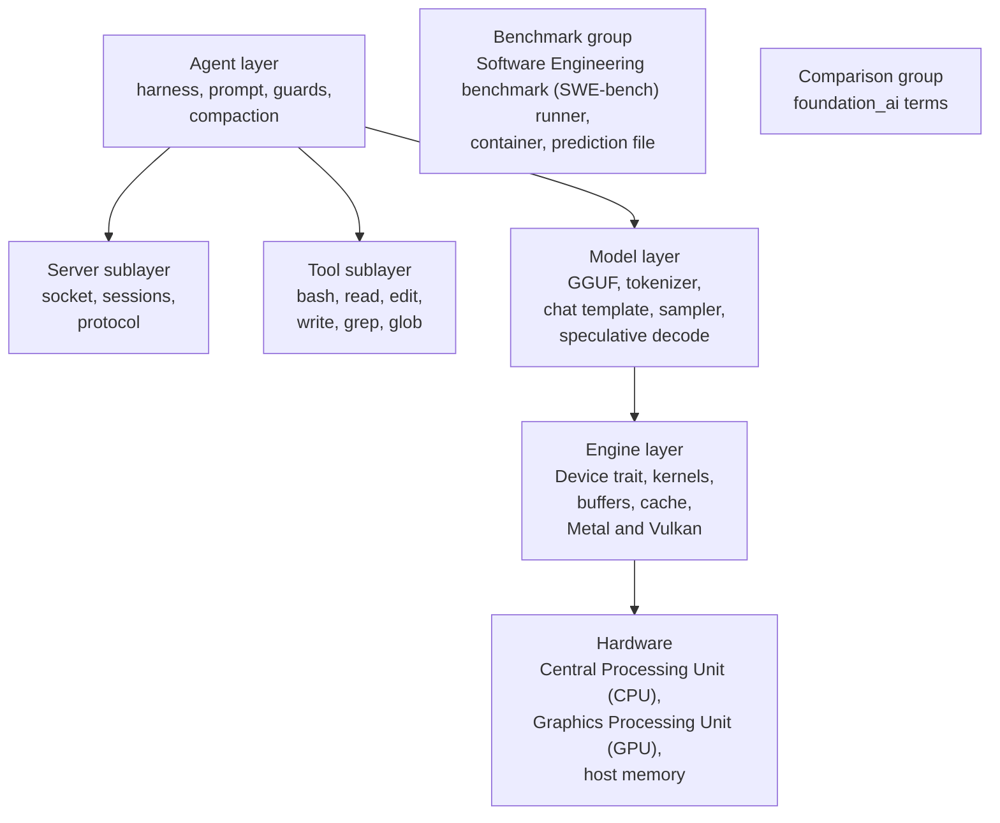
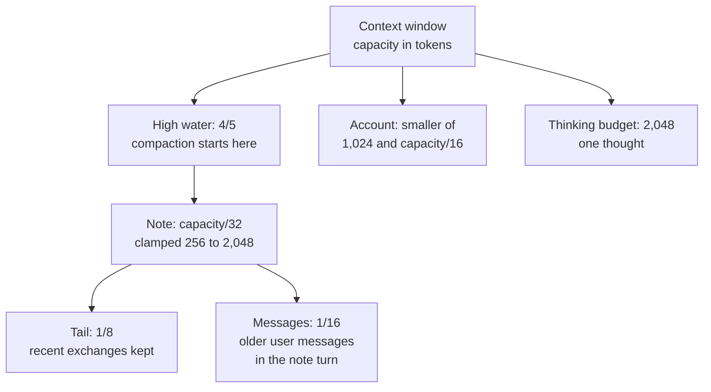

# 08 Glossary

**Purpose.** This document collects the terms, abbreviations, and constants that the other documents use. Each entry gives a short definition. Where useful, the entry also names the source file or the document that gives the full behavior. The entries are grouped by subject. The last sections give the constants and the abbreviations.

## 1. How the subjects fit

**Reading rule.** The document has three layers and two separate groups.

- A term in the agent layer describes work with text and files. The server part and the tool part are sublayers of the agent layer. A server term describes a socket, a connection, or a shared model. A tool term describes a command, a search, or a change to a file.
- A term in the model layer describes work with tokens and numbers.
- A term in the engine layer describes work with buffers and parallel threads.
- The benchmark group describes the software engineering benchmark runner. It is not part of the agent layer.
- The comparison group describes `foundation_ai`, a different Rust agent library, not the system these documents describe (`dwim`). Read those entries only with document 07.

Each section below states its layer or group.

**Aha: one word changes meaning as it moves down the layers.** The word **session** has four senses: a client process, a server connection, a harness conversation, and an operating-system process group. The word **state** has three: a protocol record, model data, and a file on disk. The word **block** has three technical senses: a transformer layer, a quantization unit, and a cache block. The word **head** has two: a note heading and an attention head. The glossary gives each sense its own row. The reader must take each term in its stated layer.

## 2. Agent and harness terms

*Layer: agent.*

### 2.1 The loop and its parts

| Term | Meaning |
|------|---------|
| **Account** | The plain answer that the harness asks for when a turn reaches the call cap. The harness sends the fixed account prompt (`STEPS_PROMPT`) in one `answer` call with no tools and no note headings. The turn ends with the account. The limit is the smaller of 1,024 tokens (`ACCOUNT_TOKENS`) and one sixteenth of the context window (`harness/mod.rs:112-114, 976-979`, document 06). |
| **Agent** | The model together with the harness loop. The loop ends on a reply with text and no tool calls when auto mode is off, on a `DONE` reply in auto mode, or on the account at the call cap. One model reply is not the agent. |
| **Chat** | The in-process class that holds one conversation. It applies the chat template, samples tokens, drafts with the drafter, and counts tokens (`models/chat.rs`). |
| **Conversation** | The Rust trait through which the harness sends messages to one conversation, receives replies, and reads token counts. `Chat` implements it in process. The server client implements it over a socket. The methods are `system`, `clear`, `replay`, `measure`, `answer_tokens`, `tokens`, `capacity`, `free`, `reserve`, `thought_limit`, `limit_thoughts`, `feed_results`, `stats`, `sampler`, `send`, `respond`, and `answer` (`models/mod.rs:156-228`). |
| **Harness** | The code in `harness/mod.rs` that runs the agent loop. It builds the system prompt, sends the environment block, reads events, parses and runs tool calls, applies the guards, compacts the conversation, and writes the transcript. It has no model code and no network code (`harness/mod.rs`, document 06). |
| **Message** | One block of the chat template: a role, the content, and the start and end tags. The roles are `system`, `user`, and `assistant` (`models/chat.rs`). |
| **Reply** | One assistant message: a thought, the visible text, and zero or more tool calls. `Chat::send` returns a `Reply` value with `calls`, `cut`, and `thought_ended` (`models/chat.rs:197-204`). |
| **Turn (agent)** | One user message and all the work that follows it, until the harness stops. In auto mode a `GO_ON` round stays in the same turn. The call cap counts across the rounds. The count resets at the next user message, not at a `GO_ON` message (`harness/mod.rs:744-748`). |
| **`GO_ON`** | The fixed user message that auto mode sends after a reply without `DONE`. Its text starts "Go on with the work" (`harness/mod.rs:107`). |
| **Round** | One auto-mode iteration: one reply and the `GO_ON` message after it. `AUTO_ROUNDS` is 10. |
| **Auto mode** | The mode that sends `GO_ON` after a reply without `DONE`, for at most 10 rounds. The one-shot command (`dwim` with a prompt and no terminal) turns auto mode on. `/auto on` turns it on in the shell (`harness/mod.rs:927-940`, `cli/once.rs:36-37`, document 02). |
| **`DONE`** | The marker that stops auto mode. The harness takes the last non-empty line of the reply, removes non-alphanumeric characters at both ends, and compares the result with `DONE`. The comparison is case-sensitive. Only the last non-empty line counts. A `DONE` on an earlier line does not stop auto mode (`harness/mod.rs:1006-1014`). |
| **System prompt** | The text that the model reads before the conversation. The order is: the effort line if there is one, the tool signatures, the behavior instructions, and `AGENTS.md` cut to 32 kibibytes (`MAX_INSTRUCTIONS`). Medium effort adds no effort line (`harness/mod.rs:245-262`, document 06). |
| **Prompt** | Text that the model reads. The entries in this document that say "the prompt" with no qualifier mean the system prompt. |
| **Effort line** | The first part of the system prompt. The effort is `xhigh`, `medium` (the default), or `low`. The line tells the model how much reasoning to use. It is present for `xhigh` and `low`; `medium` adds none (`harness/mod.rs:212-226`). |
| **Tool signature** | The name, description, and parameters of one tool, written as a JavaScript Object Notation (JSON) object in the system prompt (`tools/mod.rs:109-142`). |
| **`AGENTS.md`** | The project instruction file, read from the working directory. Its first 32 kibibytes go into the system prompt under "# Project instructions" (`harness/mod.rs:245-262`). |
| **Environment block** | The working directory, the file list (50 names at most), the git branch, the platform, and the date. The harness sends it ahead of the first user message, not in the system prompt (`harness/mod.rs:274-300`, document 06). |
| **Context window** | The number of tokens that one conversation can hold. `Conversation::capacity` returns it. |
| **Event** | A value that reports one step of a turn to the user interface. The variants are `Thought(text)`, `Text(text)`, `Token`, `Call { name, detail }`, `Output(text)`, `Cut`, `Compacting`, `Note(text)`, and `Compacted { before, after }` (`harness/mod.rs:373-400`). |
| **Transcript** | The JSON Lines record of one harness session. The records are `start`, `user`, `thought`, `text`, `note`, `reply`, `thinking_budget`, `call`, `output`, `nudge`, `compacting`, `compacted`, `error`, `interrupted`, and `end`. Each record is one JSON object with a `kind` and its fields (`harness/log.rs:109-257`, document 02). |

### 2.2 Guards and limits

| Term | Meaning |
|------|---------|
| **Guard** | The umbrella term for a rule that stops a known failure of the small model. The guards are the thinking budget, the call cap, the repeated-call guard, the nudge after 20 calls without a file change, auto mode with `DONE`, and compaction. The repeated-call guard and the call cap refuse a tool call. The nudge changes the last tool result. The thinking budget and auto mode end the reply. Compaction replaces the conversation (`harness/mod.rs`, document 06). |
| **Call cap** | The most tool calls in one turn before the harness asks for an account: 100 (`MAX_CALLS`). |
| **Nudge** | A fixed reminder that the harness appends to the last tool result after 20 calls without a file change (`NUDGE_AFTER`). It starts with `<system-reminder>` (`harness/mod.rs:85-99`). |
| **Repeated-call guard** | A check that compares the tool name and the serialized arguments with the immediately previous call in the same turn. A repeat does not run. The model receives the `REPEATED` error text, which tells it to use the output above (`harness/mod.rs:858-868`). |
| **File change** | A successful call of a tool that declares `changes: true`. Only `edit` and `write` declare it. A `bash` command that writes a file does not count (`tools/mod.rs:176-197`). |
| **Thinking budget** | The most tokens in one thought: 2,048 by default (`THINKING_BUDGET`). The chat ends an over-budget thought with a closing sentence and `</think>` (document 06). |
| **Closing sentence** | One of two fixed texts that the chat writes into a thought that reaches the thinking budget or repeats itself. `RECALL_CLOSING` applies before the first tool call in a turn. `DECIDE_CLOSING` applies after it (`harness/mod.rs:116-134`). |
| **Thought** | Text between the `<think>` and `</think>` markers. The model writes it before the visible reply. It is shown as `Event::Thought` and logged in `thought` records. |
| **Cut** | The flag on a reply that stopped because the context window was full. The harness reports `Event::Cut`, compacts, and runs the turn again with `CONTINUE` once. A second cut ends the turn (`harness/mod.rs:766-787`). |

### 2.3 Compaction

| Term | Meaning |
|------|---------|
| **Compaction** | Replacing the conversation with a note, the recent tail, and the user's earlier messages. The rebuilt conversation fits the context window (`harness/compaction.rs`, document 06). |
| **High water** | The share of the full context at which compaction starts: four fifths (`HIGH_WATER` = 4/5). The check runs before new input is fed (`harness/compaction.rs:73-92`). |
| **Note** | The text that the model writes during compaction, in four sections: Task, Findings, Done, and Next. The model writes it, not the harness. The target size is `capacity/32` tokens, where `capacity` is the context window in tokens. The target is clamped to 256 to 2,048, both inclusive (`NOTE_TOKENS`). |
| **Head (note heading)** | One of the four strings that the harness gives to the `answer` call: `"Task:"`, `"\n\nFindings:"`, `"\n\nDone:"`, and `"\n\nNext:"`. The harness writes each heading into the note after the model writes a section. A stop token ends only one section, and the next head continues the note. This is not an attention head (`harness/compaction.rs:40-48`). |
| **Note opening** | The fixed sentence `NOTE_HEAD`, which starts the note turn after a compaction. It reads: "The conversation so far was compacted to make room in the context window. This is the note you wrote before it was cleared, to go on from:" (`harness/compaction.rs:44-45`). |
| **Note turn** | The first user turn of the rebuilt conversation. It holds the fresh environment block, the note opening, the note in `<note>` tags, and the user's earlier messages (`harness/compaction.rs:196-208`). |
| **Tail** | The most recent whole exchanges that the harness reads back after compaction. The tail starts at the most recent reply and grows backward. It stops before `capacity/8` tokens would be exceeded (`TAIL`). It always includes the last reply (`harness/compaction.rs:140-160`). |
| **Exchange** | One user turn and the reply to it, with the tool results between them. The tail counts whole exchanges, so a tool result is never kept without its call. |
| **Messages (compaction share)** | The share of the full context for the user's own earlier messages in the note turn: one sixteenth (`MESSAGES`). The messages come from before the tail and leave out harness prompts (`harness/compaction.rs:114-131`). |
| **`CONTINUE`** | The message sent after a reply was cut for room and the conversation was compacted. It tells the model to go on from where it stopped (`harness/compaction.rs:58`). |

## 3. Server and session terms

*Layer: agent, server sublayer.*

| Term | Meaning |
|------|---------|
| **Server** | The process that owns the model and listens on a Unix socket. It loads the model once, allocates one sequence for each session slot, and serves many connections (`server/mod.rs`, document 03). |
| **Client** | The process that connects to the server. The interactive shell and the one-shot command are clients. A client holds one connection and one session. |
| **Session (client)** | One `dwim` process with one harness and one socket connection (document 01). |
| **Session (server)** | One connection with one `Chat` and one sequence from the pool. The server map is keyed by the connection identifier (`server/mod.rs`). |
| **Session (harness)** | One conversation: its transcript, its context, and its compaction history. |
| **Session (operating system)** | The process group that `setsid` creates. It is not a `dwim` session. See `setsid` in section 6. |
| **Build identity** | The version, the executable size, and the executable modification time, joined with hyphens. `Welcome.build` carries it, so a client can replace a server of a different build (`server/mod.rs:72-87`). |
| **Busy** | The `Status::Busy` response. The server sends it when another session is using the model and this request must wait. It is informational, not an error (`server/protocol.rs`). |
| **Idle exit** | The rule that the server exits when no request arrives for 600 seconds (`IDLE`) and no session is open. The timer starts after the last request. A server with an open session does not exit (`server/mod.rs:58, 310-316`). |
| **FNV-1a (Fowler-Noll-Vo, variant 1a, 64-bit)** | The hash that names the saved Session state files and keys the saved runs of the CPU device in the differential test. Parameters: 64-bit, offset basis `0xcbf29ce484222325`, prime `0x100000001b3`. The server hashes the model name, a zero byte, and the prompt. The file name is 16 hexadecimal digits (`server/mod.rs:120-138`, `testing/difftest/main.rs:376-410`). |
| **Interrupt** | The `Request::Interrupt` message. The connection's reader thread sets an atomic flag. The generation loop checks the flag after each streamed piece, so generation stops at the next piece, not at a fixed reply boundary. The request is not answered. The `Reply` response still carries the text produced so far (`server/mod.rs:479-481, 541`, `server/protocol.rs`). |
| **JSON Lines** | A file and stream format with one JSON object on each line. |
| **Sequence** | The model's per-conversation slot: its token history, its key and value (KV) caches, its linear-attention states, and the drafter's own KV cache. `LanguageModel::add_sequence` allocates one (`models/mod.rs:75-83`). |
| **Sequence pool** | The list of sequence numbers that no session has. The server allocates one sequence for each planned session slot; the plan uses the free device memory and is at most the `--sessions` value. A session takes one at `Open` and gives it back when it closes. A new session on a full server fails with "no room" (`server/mod.rs:664-700`). |
| **Session state** | The model state saved after the server reads a system prompt. It holds the token count, the KV caches, the recurrent states, and the drafter hidden state. Its file name is the FNV-1a hash of the model name and the prompt. The server keeps the newest 4 (`STATES_KEPT`). It is a State (disk) file (`server/mod.rs:60-151`, document 03). |
| **Socket** | A Unix domain socket file. The server path is `dwim-<uid>.sock` in the user's runtime directory, or in the temporary directory when there is no runtime directory. `<uid>` is the user identifier of the process (`server/mod.rs:63-70`). |
| **Stale socket** | A socket file left after a server exits. `Server::bind` tries to connect. It removes the file when the connect fails (`server/mod.rs`). |
| **State (protocol)** | The record `State { tokens, stats }`: the token count and the timing statistics (`server/protocol.rs`). |
| **State (model)** | The per-sequence data: the KV caches, the convolution state, the recurrent state, and the drafter hidden state (`models/qwen35.rs`). |
| **State (disk)** | A saved model state file. The header is the magic `dwimstat`, version 3, then seven `u64` dimensions: the token count, the key cache length, the state length, the key/value width, the convolution width, the state width, and the drafter hidden width. The body is the cache bytes and state bytes (`models/qwen35.rs:927-1000`, document 03). |

### 3.1 Requests and responses

*Layer: agent, server sublayer.*

| Request | Purpose |
|---------|---------|
| `Hello` | Reports the client build. Answered at once with `Welcome`. |
| `Retire` | Asks the server to release its socket and exit when no session remains. Answered with `Retired`. |
| `Open` | Opens the connection's session with a temperature and a draft count. Answered with `Opened`. |
| `Start` | Opens the conversation from a saved Session state, or by reading the prompt. Answered with `Started`. |
| `System` | Reads a system prompt into the conversation. Answered with `Ok`. |
| `Clear` | Forgets the conversation. Answered with `Ok`. |
| `Replay` | Feeds turns as the conversation so far. Answered with `Ok`. |
| `Measure` | Counts the tokens of a turn. Answered at once with `Count`. |
| `AnswerTokens` | Counts the tokens of a plain answer. Answered at once with `Count`. |
| `FeedResults` | Feeds tool results without a reply. Answered with `Ok`. |
| `Send` | Sends a user message and streams the reply. Answered with `Reply`. |
| `Respond` | Sends tool results and streams the reply. Answered with `Reply`. |
| `Answer` | Has the model answer plainly, under note headings and a token limit. Answered with `Answered`. |
| `Interrupt` | Stops the reply being generated on this connection. It is not answered. |

| Response | Purpose |
|----------|---------|
| `Welcome` | The build, process identifier, model, device, context window, room (the number of sessions the server can serve), and session count. |
| `Retired` | The session count at retirement. |
| `Status` | Progress, such as the download, the model load, or `Busy`. It is sent before the answer. |
| `Opened` | The device, the size record (`Size`: session count, context, model bytes, and conversation bytes), the context capacity, the sampling settings, and the state. |
| `Chunk` | One piece of a reply: a thought, text, or a sampled token. |
| `Started` | Whether a saved state was restored, and the state. |
| `Ok` | Success, with the state. |
| `Count` | A token count. |
| `Reply` | The reply and the state. |
| `Answered` | The plain answer and the state. |
| `Error` | A message that describes the failure. |

## 4. Model terms

*Layer: model.*

| Term | Meaning |
|------|---------|
| **Attention** | The operation in which each token compares itself with the earlier tokens and combines their values with weights that the model computes. One attention head is one parallel part of that operation. |
| **BPE (byte-pair encoding)** | A tokenizer method that starts from bytes and merges frequent adjacent pairs into one token. |
| **ChatML** | The chat format that the Qwen family of models is trained on. Qwen is the model family; `dwim` uses Qwen3.8-27B. The roles are `system`, `user`, and `assistant`. A minimal message sequence is `<\|im_start\|>user` newline `Hello` `<\|im_end\|>` newline, then `<\|im_start\|>assistant` newline the thought and the text, then `<\|im_end\|>` newline. Tool results go back in a `user` turn, each in `<\|tool_response\|>` tags (`models/chat.rs:57-95`). |
| **Chat template** | The text framing that turns messages into tokens: the start tag, the role, a newline, the content, the end tag, and a newline. Each Message is one such block (`models/chat.rs:339-348`). |
| **Block (transformer block)** | One transformer layer: its attention or linear-attention operation and its feed-forward network. The main model has 64. The 65th block in the file is the drafter. |
| **Drafter** | The 65th block (`blk.64.nextn`) of the model file. It is separate from the 64-layer main model and has its own projection and KV cache. It picks the most likely token at each step (greedy). It speeds generation; the model runs without it (`models/qwen35.rs:108-136`, document 05). |
| **Draft token** | A token that the drafter predicts. The main model then verifies it. |
| **Embedding** | The vector that stands for a token at the input of the model. In this model the embedding table stays in host memory (`models/qwen35.rs:300-306`). |
| **Full attention** | An attention layer that compares each token with every earlier token. When the interval from the file is 4, the model uses one every fourth layer: layer counts from 0, and `(layer + 1) % 4 == 0` (`full_attention_interval`) (`models/qwen35.rs:171-194`). |
| **GGUF** | The file format that holds the model metadata, vocabulary, and tensors. The name is not an abbreviation in the source. |
| **Gated DeltaNet** | The gated linear-attention operation in the layers that are not full attention. It carries a recurrent state instead of a cache that grows with the sequence (document 05). |
| **Hybrid attention** | The architecture of the model: three linear-attention layers and one full-attention layer in each group of four (`models/qwen35.rs`, document 05). |
| **KV cache (key and value cache)** | The saved keys and values from earlier tokens, so that the model does not recompute them. |
| **Logits** | The raw scores that the model gives to each possible next token. |
| **Recurrent layer** | A layer that keeps a fixed-size state instead of a KV cache that grows with the sequence. The state holds a convolution state and a recurrent state. The linear layers are recurrent. |
| **Recurrent state** | The fixed-size values that a linear layer carries from one token to the next. The model saves them with the sequence and in the state file. |
| **Rejection sampling** | The rule in `Sampler::verify`. It accepts a draft with the probability that the sampler would give that draft. Otherwise it picks one of the other candidates, with a probability in proportion to its probability. This keeps the output distribution equal to plain sampling (`models/sampler.rs:37-63`, document 05). |
| **Sampler** | The code that turns logits into one token. The filters run in this order: top-k, temperature with softmax, top-p, and min-p (`models/sampler.rs`, document 05). |
| **Softmax** | The function that turns logits into probabilities that sum to 1: `p_i = exp(x_i) / sum exp(x_j)` (`models/sampler.rs`). |
| **Special token** | A token with a fixed identifier that has a control meaning, such as the start of a message. The tokenizer adds it by identifier, not by text (`models/tokenizer.rs`, document 05). |
| **Speculative decoding** | The loop that drafts tokens and verifies them in one model pass. Steps: sample one token; ask the drafter for at most 8 tokens (`MAX_DRAFTS`); run the token and the drafts as one batch; verify each draft; keep the accepted prefix and one replacement token; drop the rest. The result has the same distribution as plain sampling (`models/chat.rs`, document 05). |
| **Stop token** | A token that ends the reply: `<\|im_end\|>` or `<\|endoftext\|>`. If the model stops while the thought is open, the chat closes the thought and continues (`models/chat.rs:558-575`). |
| **Target model** | The 64-layer main model. It supplies the logits that the rejection-sampling rule checks (section 4). |
| **Temperature** | A divisor that is applied to each logit before softmax. A value above 1 flattens the distribution. A value below 1 sharpens it. A value of 0 makes the most likely token certain (`models/sampler.rs`). |
| **Tensor** | A named multidimensional array in a GGUF file. |
| **Token** | The unit that the tokenizer produces and the model reads or writes. A token has a vocabulary identifier. It may be a word, a part of a word, or one byte (`models/tokenizer.rs`). |
| **Tokenizer** | The byte-level BPE encoder. It splits text with the Qwen regular expression, starts each word as one token for each 8-bit Unicode Transformation Format (UTF-8) byte, and merges adjacent pairs by the lowest merge rank. It reads the vocabulary and merges from the GGUF file (`models/tokenizer.rs`, document 05). |
| **Top-k** | A sampling filter that keeps the k most likely tokens. |
| **Top-p** | A sampling filter that runs after top-k and temperature. It keeps the smallest set of the most likely tokens whose total probability reaches p. The most likely token is always kept. |
| **Min-p** | A sampling filter that keeps a token only if its probability is at least min-p times the probability of the most likely token. |
| **Turn (model)** | One encoded role block: `<\|im_start\|>`, the role, a newline, the content, `<\|im_end\|>`, and a newline (`models/chat.rs:339-348`). |

## 5. Engine terms

*Layer: engine.*

| Term | Meaning |
|------|---------|
| **8.5-bit cache** | The KV cache format: 32 signed 8-bit values and one 16-bit float (f16) scale for each group of 32 values. That is 34 bytes for 32 values, or 8.5 bits a value (`gpu/mod.rs`). |
| **`ash`** | The Rust crate that `dwim` uses to call Vulkan. |
| **Backend** | One implementation of the `Device` trait: `Cpu`, `Metal`, or `Vulkan`. |
| **BF16 (bfloat16)** | A 16-bit float with 1 sign bit, 8 exponent bits with bias 127, and 7 fraction bits. It is the top half of an f32 (see F32 below), so it has the f32 exponent range with less precision. |
| **Block (quantization block)** | A group of values in a GGUF tensor with its scales. For `Q4_0`, `Q4_1`, and `Q8_0`, one scale covers 32 values; `Q4_1` also has one minimum. `Q6_K` covers 256 values and has 16 sub-block scales and one block scale. |
| **Buffer** | A region of device memory that holds activations or results. It is not a Vulkan command buffer. The device declares the type as `Device::Buffer`. `alloc` makes one. `read` copies it to the host, and `write` copies from the host. |
| **Cache block** | The 32 values that share one scale in the 8.5-bit cache. `CACHE_BLOCK` is 32. A head dimension must be a whole number of cache blocks. |
| **Cache (device)** | A device-local KV cache. The device declares the type as `Device::Cache`. `store` writes a vector. `read_cache` and `write_cache` move the exact bytes for a saved state. |
| **Compute shader** | A program that runs on the GPU over many data elements. |
| **CPU (Central Processing Unit)** | The general processor. The `Cpu` device implements the `Device` trait in scalar Rust and uses Rayon for parallel loops (`gpu/cpu.rs`). |
| **Dequantize** | Convert a quantized value back to a float. |
| **Differential test** | The test that runs the same model on the CPU device and a GPU device and compares the results. It fails above a KL divergence of 1e-3 (`MAX_KL`) (`testing/difftest/main.rs:104-106`). |
| **Deterministic quantization** | The cache quantizer. It sets the scale to the block's largest magnitude divided by 127, rounded to f16. It then rounds each value to the nearest step by comparing with the exact midpoint between two steps; ties go away from zero. The same f32 input always gives the same bytes, even when a division is not correctly rounded (`gpu/mod.rs:380-410`). |
| **Device** | The Rust trait in `gpu/mod.rs` that a backend implements. The associated types are `Buffer`, `Weight`, and `Cache`. The operations are `name`, `memory`, `upload`, `alloc`, `alloc_cache`, `resize`, `read`, `write`, `copy`, `store`, `read_cache`, `write_cache`, `matmul`, `add`, `rmsnorm`, `l2norm`, `rope`, `attention`, `silu_mul`, `sigmoid_mul`, `conv`, and `delta_net`. `Device` is the interface, not the hardware. When an entry says "device memory" or "the device opens", device means the hardware (`gpu/mod.rs:176-340`, document 04). |
| **Dispatch** | The act of starting a compute shader over a grid of work groups. |
| **F32** | A 32-bit binary floating-point value: 1 sign bit, 8 exponent bits with bias 127, and 23 fraction bits (the Institute of Electrical and Electronics Engineers (IEEE) 754 binary32 format). |
| **F16** | A 16-bit binary floating-point value: 1 sign bit, 5 exponent bits with bias 15, and 10 fraction bits (IEEE 754 binary16). |
| **Flash attention** | An attention kernel that processes the score matrix in tiles and never stores the whole matrix. The score matrix is the table of one weight for each pair of tokens. A tile is a small rectangular part of it. The result is the same as standard attention. It uses less memory and more recomputation (`gpu/metal`, document 04). |
| **GPU (Graphics Processing Unit)** | A processor with many parallel units, used for matrix work. |
| **Host** | The processor and memory that the operating system manages. The model file is memory-mapped on the host. The embedding table stays in host memory. On Apple hardware the GPU shares host memory. On other hardware, staging buffers carry data across the bus (`gpu/host.rs`). |
| **Kullback-Leibler (KL) divergence** | A measure of how one probability distribution differs from another. It is asymmetric. `dwim` uses the natural logarithm: `D_KL(P\|\|Q) = sum P(i) * ln(P(i)/Q(i))`. In the differential test (the test that compares the CPU device with a GPU device), P is the CPU distribution and Q is the GPU distribution, both after softmax. The test fails above 1e-3 (`testing/difftest/main.rs:104-106, 423-436`). |
| **`mmap`** | The system call that maps a file into memory, so that the model file is read on demand. |
| **MMA (matrix multiply-accumulate)** | A hardware instruction that multiplies and adds matrix tiles in one step. |
| **MSL (Metal Shading Language)** | The shader language for Apple Metal. |
| **Metal** | Apple's GPU interface. The Metal backend uses `objc2` and compiles each kernel from Metal source when the device opens (`gpu/metal/mod.rs:238-266`, document 04). |
| **Metallib** | The compiled form of a Metal shader library. `dwim` does not use a metallib file; it compiles Metal source when the device opens. See Metal. |
| **`naga`** | The shader translation library that `dwim` uses to compile WebGPU Shading Language (WGSL) to a backend format. |
| **`objc2`** | The Rust crate that `dwim` uses to call Apple frameworks. |
| **Pipeline** | The compiled kernel and its fixed settings. In Metal it is an `MTLComputePipelineState`. In Vulkan it is a `vk::Pipeline` with a pipeline layout. The settings include the entry point, the work-group size, and the resource bindings. In Vulkan they also include the push-constant range (`gpu/metal/mod.rs`, `gpu/vulkan/mod.rs`). |
| **Push constant** | A small block of data that a Vulkan shader receives without a buffer. The limit is 32 bytes. |
| **Quantization** | Storing numbers with fewer bits than an f32 value. The file uses blocks with a scale. The cache uses signed 8-bit values with a 16-bit float (f16) scale. The unquantized formats are f32 and BF16. |
| **Quantization block** | See **Block (quantization block)**. |
| **Reference implementation** | The `Cpu` device. It computes each operation in Rust from the same quantized values that a GPU receives. It defines the expected result for the differential test. It is also a selectable device (`--device cpu`), but it is slow and exists for correctness (`gpu/cpu.rs`, document 04). |
| **Requantize** | Convert one quantized format to another. At load, `Q4_1` and `Q6_K` matrices are decoded to f32 and encoded as `Q8_0` (`models/quants.rs`). |
| **Ring** | The fixed set of Vulkan command buffers (recorded lists of GPU commands) that the backend records into in turn: 4 buffers (`RING`). It submits every 128 recorded dispatches (`SUBMIT_EVERY`), so the CPU can record while the GPU executes (`gpu/vulkan/mod.rs`). |
| **RMSNorm (root mean square normalization)** | `x_i <- x_i * weight_i / sqrt(mean(x^2) + eps)`. The mean is over the hidden values of one token. There is no mean subtraction. `eps` is a small value from the file that prevents division by zero (`attention.layer_norm_rms_epsilon`) (`gpu/cpu.rs:155-164`). |
| **RoPE (rotary position embedding)** | A rotation of pairs of values that encodes position. For each head, element `i` and element `i + rot_dim/2` form a pair, for `i` from 0 to `rot_dim/2 - 1`. The pair rotates by angle `pos * theta^(-2i/rot_dim)`. `theta` comes from `rope.freq_base`, and `rot_dim` from `rope.dimension_count` (`models/mod.rs:136-151`, `gpu/cpu.rs:175-200`). |
| **SiLU (sigmoid linear unit)** | `silu(x) = x * sigmoid(x)`, where `sigmoid(x) = 1 / (1 + e^(-x))`. The gated feed-forward uses `silu(gate) * up` (`gpu/cpu.rs:236-241`). |
| **Staging buffer** | A host-visible Vulkan buffer. `dwim` uses two 64 mebibyte staging buffers and alternates between them for uploads and readbacks (`gpu/vulkan/mod.rs`). |
| **Vulkan** | A cross-platform graphics and compute interface. The Vulkan backend uses `ash` and compiles WGSL to Standard Portable Intermediate Representation (SPIR-V) with `naga` (`gpu/vulkan`, document 04). |
| **Weight** | A tensor in the format that a device uses for matrix multiply. The device declares the type as `Device::Weight`. A weight is device-local and read-only after upload. |
| **WGSL (WebGPU Shading Language)** | A shader language that `naga` translates. |
| **Work group** | The set of shader invocations that one dispatch runs together and that share the work-group memory. The size is set for each kernel. In the Vulkan matmul kernels one work group takes 8 tokens (`BF16_TOKENS`). In the attention kernel it takes 128 positions (`CHUNK`) (`gpu/vulkan/mod.rs`). |

### 5.1 Quantized formats

*Layer: engine. The formulas reconstruct the file's values.*

| Format | Bytes a block | Values a block | Layout | Value |
|--------|--------------:|---------------:|--------|-------|
| `Q4_0` | 18 | 32 | An `f16` scale, then 16 bytes. For `j` from 0 to 15, element `j` is the low nibble of byte `j`, and element `j + 16` is the high nibble. `q` is 0 to 15. | `(q - 8) * d` |
| `Q4_1` | 20 | 32 | An `f16` scale, an `f16` minimum, then 16 bytes. For `j` from 0 to 15, element `j` is the low nibble of byte `j`, and element `j + 16` is the high nibble. `q` is 0 to 15. | `q * d + m` |
| `Q8_0` | 34 | 32 | An `f16` scale, then 32 signed 8-bit values. `q` is -128 to 127. | `q * d` |
| `Q6_K` | 210 | 256 | 128 bytes of low 4-bit values, 64 bytes of high 2-bit values, 16 signed 8-bit sub-block scales, and one `f16` scale. | `d * scale * ((low \| high << 4) - 32)`, where `d` is the block scale and `scale` is the sub-block scale. |

In `Q6_K`, `l` is 0 to 31, `k` is 0 to 3, and a half is the first or second 128 values of the block. `l/16` is integer division. The sub-block scale for value `l + 32k` is `2k + l/16` (`models/quants.rs:37-101`, document 05).

## 6. Tool terms

*Layer: agent, tool sublayer.*

| Term | Meaning |
|------|---------|
| **Canonicalize** | Resolve a path to its real absolute form, including symbolic links. |
| **Context line** | A line shown around an edit so that the model can see where the change landed. The tool shows 2 (`CONTEXT`). |
| **Exit code** | The number that a command returns to say whether it succeeded. |
| **Glob** | A file-name pattern search. `*` matches within one name, `**` matches across directories, and `?` matches one character. A pattern with no slash matches a name at any depth. The tool returns up to 100 files (`tools/glob.rs:30-53`). |
| **Grep** | A search with a regular expression, not a literal string. The tool runs ripgrep (`rg`) when it is installed, and `grep -E` otherwise. It shows `file:line:text`, up to 100 matches, and cuts each match at 500 bytes. The search is case-sensitive (`tools/grep.rs`). |
| **Page** | The part of a file that one `read` call returns. It starts at the `start` line, which counts from 1. It stops at the first limit: the number of lines asked for (1,000 at most) or 48 kibibytes (`BYTES`). If the call asks for no line count, the count is 1,000. A line longer than 1,000 bytes is cut with `…`. The result gives the range and the start line of the next page (`tools/read.rs:36-47, 94, 134-184`). |
| **Pipefail** | A shell option that makes a pipeline fail when any part fails. |
| **Preview** | The first 16 kibibytes and the last 16 kibibytes of an output longer than 32 kibibytes (`HALF` from each end; `PREVIEW` is the threshold). An output of 32 kibibytes or less is shown whole. Up to 4 mebibytes of the stream goes to the spill file (`tools/bash.rs:120-133`, `469-495`). |
| **Process group** | A set of processes that receive a signal together. |
| **`SIGKILL`** | The signal that stops a process and cannot be caught. |
| **`setsid`** | The system call that puts a process in a new operating-system session and process group. `dwim` uses it so that the timeout can send `SIGKILL` to the whole group, and so that no command can open the user's terminal (`tools/bash.rs:224-232`). |
| **Spill file** | The file that holds up to 4 mebibytes of a long output, so that the model can read it in pages. Output past that limit is discarded, and the model is told how much (`RETAINED`). |
| **Tier** | One of the three edit match rules. `Exact` compares bytes. `TrailingSpace` ignores white space at the end of each line. `Trimmed` ignores white space at both ends of each line. The tool tries them in that order and uses the first tier that matches anywhere. When `Trimmed` matched, the replacement keeps the file's indentation. If more than one place matches at the chosen tier, the call fails as ambiguous unless the `start` parameter names the line where the match must begin, counting from 1 (`tools/edit.rs:382-434`, document 06). |
| **Tool** | One of the six functions in `tools/mod.rs`: `bash`, `read`, `edit`, `write`, `grep`, and `glob`. Each has a signature, a `changes` flag that says a successful call can change a file, a one-line description for the screen, and a run function. The run function returns text for the model or an error string (`tools/mod.rs:28-50`). |
| **Tool call** | A parsed request with a `name` and JSON `arguments`. The parser accepts a JSON object, or a `<function=name>` block of `<parameter=name>` tags whose text is the value (`tools/call.rs`). |
| **Tool result** | The text that a tool returns to the model. An error becomes `error: <message>`. The `changed` flag says whether this call changed a file; only a tool whose `changes` flag is true can (`tools/mod.rs:176-197`). |
| **VFS (virtual file system)** | A file interface that can be backed by a real disk, memory, or a remote store. This is a `foundation_ai` term. `dwim` uses `std::fs` directly. |

## 7. Benchmark and platform terms

*Group: benchmark. Not one of the three layers.*

| Term | Meaning |
|------|---------|
| **Benchmark depth** | The number of tokens that the benchmark puts in the context before it times a reply. The depths are 1,024, 8,192, 32,768, 65,536, and 131,072 tokens. The command is `dwim --bench`. It times only a depth that leaves room for a 2,048-token page and 32 generated tokens after it (`cli/bench.rs:14-20`, document 02). |
| **Conda** | The Python environment manager that the benchmark images use. |
| **Container** | An isolated process environment that shares the host kernel. The benchmark uses one container for each instance. |
| **Docker** | A container runtime. |
| **Image** | The Docker image for one benchmark instance. It holds the checkout and the project's dependencies. |
| **Patch** | The diff of the changes that the agent made in the checkout. The runner writes it in the `model_patch` field. |
| **Prediction file** | The JSON Lines file that the benchmark runner writes. Each object has `instance_id`, `model_name_or_path`, and `model_patch`. The official SWE-bench evaluation harness (not the `dwim` harness) reads it (`scripts/swebench.py:211-217`). |
| **SWE-bench Lite** | A smaller published subset of the SWE-bench benchmark of software engineering issues. It scores the patch of each issue with tests. SWE means Software Engineering. |
| **Testbed** | The conda environment inside an instance image that holds the project and its dependencies. The shell wrapper activates it before each command (`scripts/swebench.py:52-55`). |
| **WebAssembly (wasm)** | A portable binary format that runs in a browser or a sandbox. `foundation_ai` supports it. `dwim` does not. |

## 8. Comparison terms

*Group: comparison. These terms describe `foundation_ai`, a separate Rust library crate in the ewe_platform workspace, not `dwim`, the system these documents describe. Read them with document 07.*

| Term | Meaning |
|------|---------|
| **API (Application Programming Interface)** | A defined way for one program to call another. |
| **Circuit breaker** | A rule that stops calls to a failing provider after a number of failures. `foundation_ai` uses `AgentConfig::circuit_breaker_threshold`, default 3. `dwim` has no provider to fail over to (document 07, section 4.6). |
| **Fallback model** | A second model that the router uses when the first model fails. `dwim` has one model. |
| **Model descriptor** | A `foundation_ai` record of a model: its name, context size, and prices for input, output, cache read, and cache write. The `foundation_ai` provider catalog has 523 descriptors in 13 catalog files (document 07, section 4.1). |
| **Provider** | A service that serves a model, such as OpenAI or Anthropic. |
| **Provider router** | A layer in `foundation_ai` that chooses which provider serves a model name. It uses explicit routing rules, because a model name does not identify the provider. `dwim` has one provider (document 07, section 4.1). |
| **State machine** | A program structure with named states and defined transitions. `foundation_ai` uses `AgentLoopState`. `dwim` uses a synchronous call stack (document 07, section 4.2). |
| **Steering queue** | A queue that carries a priority or follow-up user message into a running `foundation_ai` turn. `dwim` has no such queue (document 07, section 4.3). |
| **Token ledger** | A `foundation_ai` record of tokens used against a session budget. The count is input + output + cache read + cache write. It halts generation when the budget is exhausted. `dwim` counts tokens and seconds, not money (document 07, section 4.7). |

## 9. Constants

These values are copied from the source. They are the numbers that a reader is most likely to need while reading the other documents.

The diagram shows the budgets that are shares of the full context, and the two fixed limits that are not.

### 9.1 Harness

| Constant | Value | Meaning |
|----------|------:|---------|
| `MAX_INSTRUCTIONS` | 32 kibibytes | Most of `AGENTS.md` that goes into the system prompt. |
| `MAX_FILES` | 50 | Most file names in the environment block. |
| `THINKING_BUDGET` | 2,048 | Most tokens in one thought. |
| `MAX_CALLS` | 100 | Most tool calls in one turn. |
| `NUDGE_AFTER` | 20 | Calls without a change before the nudge. |
| `AUTO_ROUNDS` | 10 | Most `GO_ON` rounds in auto mode. |
| `ACCOUNT_TOKENS` | 1,024 | Most tokens in the account reply. The effective limit is the smaller of this value and `capacity/16`. |
| `HIGH_WATER` | 4/5 | Share of the full context that triggers compaction. |
| `TAIL` | 1/8 | Share of the full context for the recent exchanges after compaction. |
| `MESSAGES` | 1/16 | Share of the full context for older user messages in the note turn. |
| `NOTE_TOKENS` | 256 to 2,048 | Bounds of the note. The target is `capacity/32`. |

### 9.2 Tools

| Constant | Value | Meaning |
|----------|------:|---------|
| `TIMEOUT` | 300 seconds | Default shell timeout. 0 means no timeout. |
| `PREVIEW` | 32 kibibytes | Threshold at or below which an output is shown whole. |
| `HALF` | 16 kibibytes | Bytes shown from each end of an output larger than `PREVIEW` (`PREVIEW / 2`). |
| `RETAINED` | 4 mebibytes | Most of a stream kept in the spill file. |
| `PAGE` | 1,000 lines | Most lines in one `read` page. |
| `BYTES` | 48 kibibytes | Most bytes in one `read` page. |
| `LINE` (read) | 1,000 bytes | Most bytes of one line shown. |
| `CONTEXT` | 2 lines | Lines shown around an edit. |
| `MOST` (edit) | 30 | Most lines of the old text that the new text may keep before the tool adds a note about the lines that stay. |
| `SHOWN` (edit) | 40 | Past this many lines, a shown range gives its first 20 and last 20 lines. |
| `MOST` (grep) | 100 | Most matches returned. |
| `LINE` (grep) | 500 bytes | Most bytes of one match. |
| `MOST` (glob) | 100 | Most files returned. |
| `CAP` (glob) | 5,000 | Most entries visited when no git file list is available (the walk). |

### 9.3 Engine and model

| Constant | Value | Meaning |
|----------|------:|---------|
| `BATCH` | 64 | Most tokens in one model forward batch. It is not the speculative batch: that batch is one sampled token plus up to 8 drafts, at most 9 tokens (`MAX_DRAFTS` + 1). |
| `MAX_DRAFTS` | 8 | Most speculative tokens in one step. |
| Layers | 64 | Transformer layers in the main model. The file may also hold a 65th drafter block. |
| Attention interval | 4 | Every fourth layer is full attention: `(layer + 1) % 4 == 0`. |
| `CACHE_BLOCK` | 32 | Values that share one `f16` scale in the 8.5-bit cache. |
| `CONV_KERNEL` | 4 | Width of the short convolution in the linear-attention layers: each value mixes the last four tokens of its channel. |
| `RING` | 4 | Command buffers in the Vulkan ring. |
| `SUBMIT_EVERY` | 128 | Dispatches recorded before the Vulkan backend submits. |
| `BF16_TOKENS` | 8 | Tokens in one Vulkan matrix multiply work group for BF16 input. |
| `CHUNK` | 128 | Positions in one Vulkan attention work group. |
| `STAGING` | 64 mebibytes | Size of each of the two Vulkan staging buffers. |
| Q4_0 size | 18 bytes | Bytes for 32 values. |
| Q4_1 size | 20 bytes | Bytes for 32 values. |
| Q8_0 size | 34 bytes | Bytes for 32 values. |
| Q6_K size | 210 bytes | Bytes for 256 values. |
| State magic | `dwimstat` | First 8 bytes of a saved model state. |
| State version | 3 | Version of the saved state format. The header then holds seven `u64` dimensions. |
| KL bound | 1e-3 | Largest acceptable natural-log KL divergence in the differential test. The measured value is 1.1e-5. |

### 9.4 Server and command-line interface (CLI)

| Constant | Value | Meaning |
|----------|------:|---------|
| `IDLE` | 600 seconds | Time with no request and no open session before the server exits. |
| `STATES_KEPT` | 4 | Number of system-prompt states kept. |
| Transcript mode | `0o600` | File permissions: owner read and write only. |
| Download resume | `Range` header | Mechanism that continues a partial model download. |
| Benchmark depths | 1,024 to 131,072 | Token depths used by `dwim --bench`: 1,024, 8,192, 32,768, 65,536, and 131,072. |

## 10. Abbreviations

| Abbreviation | Expansion | Where it appears |
|--------------|-----------|------------------|
| API | Application Programming Interface | Section 8, and documents 00, 01, 02, 04, and 07. |
| ASD-STE100 | Aerospace and Defence Simplified Technical English, issue 100 | The documentation rules for this set. |
| BF16 | bfloat16 | Section 5, and document 05. |
| BPE | byte-pair encoding | Section 4, and document 05. |
| CLI | command-line interface | Section 9, and documents 00, 01, 02, 06, and 07. |
| CPU | Central Processing Unit | Section 5, and documents 00, 01, 04, and 07. |
| GGUF | The model file format's name. The source does not expand it, so treat it as a name, not an abbreviation. | Section 4, and documents 00, 02, 04, 05, and 07. |
| GiB | gibibyte | Documents 00, 01, 02, and 03. |
| GPU | Graphics Processing Unit | Section 5, and documents 00, 01, 04, and 07. |
| IEEE | Institute of Electrical and Electronics Engineers | Section 5. |
| JSON | JavaScript Object Notation | Sections 2 and 3, and documents 00, 01, 02, 03, and 06. |
| KiB | kibibyte (1,024 bytes) | Document 06; the spelled-out form appears in sections 2 and 9. |
| KL | Kullback-Leibler | Section 5, and document 07. |
| KV | key and value | Section 4, and documents 03, 04, and 05. |
| LLM | Large Language Model | Document 07. |
| MCP | Model Context Protocol | Document 06. |
| MiB | mebibyte (1,024 kibibytes) | Documents 02 and 06; the spelled-out form appears in sections 6 and 9. |
| MMA | matrix multiply-accumulate | Section 5, and document 04. |
| MSL | Metal Shading Language | Section 5, and document 04. |
| MTP | multiple-token prediction. This is `llama.cpp`'s name for the speculative method. In `dwim` the same idea is the drafter. | Document 07, and section 4. |
| RAM | random-access memory | Document 02. |
| RMSNorm | root mean square normalization | Section 5, and documents 04 and 05. |
| RoPE | rotary position embedding | Section 5, and documents 04 and 05. |
| SiLU | sigmoid linear unit | Section 5, and documents 04 and 05. |
| SPIR-V | Standard Portable Intermediate Representation | Section 5, and document 04. |
| SWE-bench | Software Engineering benchmark | Section 7, and documents 02, 06, and 07. |
| TUI | terminal user interface | Document 00. |
| UTF-8 | 8-bit Unicode Transformation Format | Section 4, and document 05. |
| VFS | virtual file system | Section 6, and document 07. |
| wasm | WebAssembly | Section 7, and document 07. |
| WGSL | WebGPU Shading Language | Section 5, and document 04. |

Every row is used by at least one document in this set.

## 11. Where to go next

Return to [README](README.md) for the reading order. Use [07 Comparison](07-comparison-foundation-ai.md) for the terms that belong to `foundation_ai`. Use [06 Agent harness and tools](06-agent-harness-and-tools.md) for the full harness behavior.
