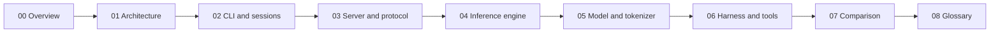

# dwim: the agent, the model, and the engine in one program

**Thesis.** dwim is a coding agent that runs on the user's own Graphics Processing Unit (GPU). It is unusual because it does not call a model through an Application Programming Interface (API). It contains the model runner: a GGUF reader, a byte-pair encoding (BPE) tokenizer, a Qwen3.8-27B transformer, quantized matrix kernels for Vulkan and Metal, a sampler, and a speculative drafter. Around that engine it adds a local server that shares one copy of the weights between sessions, and an agent harness with six tools. This exploration explains how the parts work and compares the design with the `foundation_ai` crate from the ewe_platform.

## Who this is for

The reader should know Rust and the general shape of a transformer model. The exploration does not assume knowledge of GGUF, Vulkan, Metal, quantization block formats, or speculative decoding. Each term is defined where it first appears, and the glossary collects every term.

## Reading order

| Document | Question it answers |
|----------|---------------------|
| [00 Overview](00-overview.md) | What is dwim, and what are its three layers? |
| [01 Architecture](01-architecture.md) | How is the repository organized, and what does each module own? |
| [02 CLI and sessions](02-cli-and-sessions.md) | What happens from the command line to the first reply? |
| [03 Server and protocol](03-server-and-protocol.md) | How does one model serve several sessions? |
| [04 Inference engine](04-inference-engine.md) | How does a matrix multiplication reach the GPU, and how is it checked? |
| [05 Model and tokenizer](05-model-and-tokenizer.md) | How does a GGUF file become tokens, logits, and a drafted reply? |
| [06 Harness and tools](06-agent-harness-and-tools.md) | How does the agent loop stay on task and inside the context window? |
| [07 Comparison](07-comparison-foundation-ai.md) | Where is dwim stronger than `foundation_ai`, and where is it weaker? |
| [08 Glossary](08-glossary.md) | What does each term and abbreviation mean? |

## Source revisions

| Source | Revision |
|--------|----------|
| dwim | `38885264dc75a02294cc53c18c4afa7e07ee5b58` (`0.0.12`) |
| `foundation_ai` | `c1b4751e7cfbe31293ffd8c63c5801b3ca6d4740` (`0.0.9`) |

The dwim source is at `/Users/darkvoid/GitSources/src.turso/dwim`. The comparison crate is at `/Users/darkvoid/Dev/ewe_platform/backends/foundation_ai`. Every implementation claim names a file and, where useful, a line. The source at these revisions is the authority. Where a README or a code comment disagrees with the code, the exploration says so.

## Conventions

- **Abbreviations** are spelled out at first use in each document. For example, Graphics Processing Unit (GPU) and Central Processing Unit (CPU).
- **Code snippets** are copied from the source. A snippet marked "condensed" removes lines but does not change the remaining lines.
- **Citations** use the form `path:line` or `path:start-end`. A path without a leading slash is relative to the dwim repository root. The comparison document uses `foundation_ai:` for paths in the crate.
- **"Must"**, **"can"**, and **"cannot"** describe what the code does, not what a user should do.
- **Aha** marks a design decision that is not obvious from the function name.

## The three subjects

1. **The engine.** The `gpu` module defines a `Device` trait, a CPU reference implementation, a Vulkan backend with WebGPU Shading Language (WGSL) kernels, and a Metal backend with Metal Shading Language (MSL) kernels. The CPU path is the specification; the GPU paths must match it.
2. **The model.** The `models` module reads a GGUF file, builds a tokenizer, runs the Qwen3.8-27B transformer, samples tokens, and drafts speculative tokens with a second prediction head.
3. **The agent.** The `harness` module builds a system prompt, runs tool calls until the model answers with text alone, compacts the conversation near the context limit, and enforces the thinking budget and call limits. The `server` module lets several sessions share one loaded model, and the `cli` module provides the terminal interface.

## What this exploration does not cover

- The contents of `third_party/`: the directory holds reference implementations for study, not built code.
- The exact numerical output of the model. The exploration reads the code; it does not run the 16-gigabyte model.
- The internal implementation of the Vulkan driver or the Metal framework. The exploration covers the calls that dwim makes, not the driver below them.
- The `foundation_ai` internals beyond the functions compared in document 07. That crate has its own documentation in its repository.

## Where to go next

Start with [00 Overview](00-overview.md). It gives the mental model that the later documents depend on. If you want the comparison first, read [07 Comparison](07-comparison-foundation-ai.md) after the overview; it repeats the small amount of dwim detail that it needs.
