# Spec: dwim, a coding agent on your own graphics processing unit

## 1. Source

| Property | Value |
|----------|-------|
| dwim location | `/Users/darkvoid/GitSources/src.turso/dwim` |
| dwim remote | `https://github.com/dwim-sh/dwim` |
| dwim commit | `38885264dc75a02294cc53c18c4afa7e07ee5b58` |
| dwim version | `0.0.12` |
| dwim license | Massachusetts Institute of Technology (MIT) |
| Comparison crate | `foundation_ai` in the ewe_platform workspace |
| Comparison location | `/Users/darkvoid/Dev/ewe_platform/backends/foundation_ai` |
| Comparison remote | `https://github.com/ewe-studios/ewe_platform` |
| Comparison commit | `c1b4751e7cfbe31293ffd8c63c5801b3ca6d4740` |
| Comparison version | `0.0.9` |
| Comparison license | Apache License 2.0 |
| Source of truth | The source at the commits above. Every claim names a file and, where useful, a line. |

The comparison uses the local `foundation_ai` crate as the authority for our system. It uses the local dwim checkout as the authority for their system. The two systems are not competitors in the same market. dwim is a complete local coding agent with its own inference engine. `foundation_ai` is an inference and agent library for the ewe_platform. The comparison therefore states where each design is stronger and which functions one has that the other does not.

## 2. What the Project Is

**dwim** means "do what I mean". It is a coding agent that runs entirely on the user's machine. The model, the engine that runs the model, and the agent loop are one Rust program. The program includes:

1. A **Graphics Processing Unit (GPU) inference engine** with a CPU reference implementation, a Vulkan backend with WebGPU Shading Language (WGSL) kernels, and a Metal backend with Metal Shading Language (MSL) kernels.
2. A **Qwen3.8-27B quantized model runtime** that reads GGUF files, unpacks 4-bit and 8-bit block formats, builds a byte-pair encoding (BPE) tokenizer, and runs a hybrid attention and Gated DeltaNet transformer.
3. A **local inference server** that loads the model once and shares it between sessions over a Unix domain socket. Each session has its own key/value cache and recurrent state.
4. An **agent harness** with a system prompt, six tools, a thinking budget, context compaction, a repeated-call guard, a no-change nudge, and an automatic mode.
5. A **command-line interface** with an interactive terminal user interface (TUI), one-shot prompts, model download, server control, and a benchmark mode.
6. A **differential test binary** that compares every GPU result with the CPU result using real weights, and a Software Engineering Benchmark Lite (SWE-bench Lite) runner.

`foundation_ai` is the comparison subject. It is a unified inference and agentic library. It fronts cloud providers such as Anthropic Messages, OpenAI Chat Completions, OpenAI Responses, OpenRouter, Google Vertex, Amazon Bedrock, and xAI. It also fronts local inference through llama.cpp and Candle, and it adds an agentic layer with sessions, steering queues, memory tiers, loop detection, token budgets, embeddings, cost tracking, and Virtual File System (VFS) backed tools. The comparison document, document 07, measures both systems against the same functions.

## 3. Documentation Goal

A reader must be able to:

1. State what dwim is, why it exists, and which parts of the system it owns end to end.
2. Trace one interactive session from the command-line interface, through the client and server protocol, into the model, the GPU kernels, the tool loop, and the terminal user interface.
3. Explain how the GGUF loader, quantized block formats, byte-pair encoding tokenizer, transformer, sampler, and speculative drafter work together.
4. Explain how the Vulkan and Metal backends execute the same operations, and how the CPU reference implementation proves them.
5. Explain how the server shares one set of weights between sessions while each session keeps a separate context.
6. Read the agent harness and state how the system prompt, tools, thinking budget, compaction, repeated-call guard, no-change nudge, and automatic mode shape one turn.
7. Describe the six tools, their limits, and their safety rules.
8. Compare dwim with `foundation_ai`: list the functions that each system has, state where each design is stronger, and name the functions that one has and the other does not.
9. Name every abbreviation and term used in the exploration.

## 4. Documentation Structure

```
src.dwim/
├── index.md                                  ← parent index: thesis, sources, document table
├── index.html                                ← generated from index.md
├── build.py                                  ← builds every child that holds markdown/
├── styles.css                                ← shared style sheet, copied into each html/ tree
└── dwim/
    ├── spec.md                               ← this file
    ├── markdown/
    │   ├── README.md                         ← thesis, reading order, document index
    │   ├── 00-overview.md                    ← the idea, the layers, the model, the constraints
    │   ├── 01-architecture.md                ← package layout, modules, dependencies, build
    │   ├── 02-cli-and-sessions.md            ← options, main dispatch, one-shot, TUI, transcripts
    │   ├── 03-server-and-protocol.md         ← Unix socket protocol, server lifecycle, shared weights
    │   ├── 04-inference-engine.md            ← GPU abstraction, CPU reference, Vulkan, Metal, quantization
    │   ├── 05-model-and-tokenizer.md         ← GGUF, tokenizer, Qwen3.8 transformer, sampler, speculation
    │   ├── 06-agent-harness-and-tools.md     ← system prompt, turn loop, compaction, six tools, SWE-bench
    │   ├── 07-comparison-foundation-ai.md    ← function matrix, strengths, gaps, recommendations
    │   └── 08-glossary.md                    ← every term and abbreviation
    └── html/                                 ← generated
```

The reading order follows the data path. A reader first meets the whole system, then the command-line entry, then the server boundary, then the engine, the model, the agent loop, and finally the comparison.

```mermaid
flowchart LR
    I["index.md"] --> R["README.md"]
    R --> O["00 overview"]
    O --> A["01 architecture"]
    A --> C["02 CLI and sessions"]
    C --> S["03 server and protocol"]
    S --> E["04 inference engine"]
    E --> M["05 model and tokenizer"]
    M --> H["06 harness and tools"]
    H --> X["07 comparison"]
    X --> G["08 glossary"]
```



## 5. Tasks

| Phase | Task | Status |
|-------|------|--------|
| 1 | Read the instruction set, the exploration agent, and the documentation directive | DONE |
| 2 | Map the dwim repository, its binaries, modules, and dependencies | DONE |
| 3 | Trace the command-line entry, options, terminal user interface, and transcripts | DONE |
| 4 | Trace the Unix socket protocol, server lifecycle, client, and session sharing | DONE |
| 5 | Trace the GPU abstraction, CPU reference, Vulkan kernels, Metal backend, and quantization | DONE |
| 6 | Trace the GGUF loader, tokenizer, transformer, sampler, and speculative decoding | DONE |
| 7 | Trace the agent harness, compaction, tools, and benchmark path | DONE |
| 8 | Inventory `foundation_ai` functions, providers, agentic layer, tools, and limits | DONE |
| 9 | Write documents 00 to 03 | DONE |
| 10 | Write documents 04 to 06 | DONE |
| 11 | Write the comparison document 07 and the glossary 08 | DONE |
| 12 | Grandfather review against both sources for every document | DONE |
| 13 | Fresh-reader review for every document, and fix every reported gap | DONE |
| 14 | Build the generated HyperText Markup Language (HTML) tree and check every local link | DONE |

A **grandfather review** is a check of every document against the pinned source. It checks names, numbers, flows, and coverage. A **fresh-reader review** is a read by an agent with no memory of the writing and no tools. It reports every place where the text loses the reader.

## 6. Build System

This exploration builds the HTML tree from its parent directory:

```bash
cd /Users/darkvoid/Dev/explorations/src.dwim
python3 -I build.py .
```

`build.py` finds every direct child directory that holds a `markdown/` directory. It converts each `markdown/*.md` file to `html/*.html`, copies the parent `styles.css` into the `html/` tree, and writes an `index.html` for the child and for the parent. It converts relative `.md` links to `.html` links and supplies previous and next navigation.

The parent index is `/Users/darkvoid/Dev/explorations/src.dwim/index.md`. It links to the generated pages under `dwim/html/`.

## 7. Quality Requirements

The ten Iron Rules from `markdown_engineering/documentation_directive.md` apply:

1. **Detailed sections with code snippets.** Every concept is grounded in a real file, function, table, or command.
2. **Teach key facts quickly.** The first sentence of each section is its thesis.
3. **Clear articulation.** One idea per sentence. Aerospace and Defence Simplified Technical English, issue 100 (ASD-STE100).
4. **Mermaid diagrams.** At least two per document. Every box and arrow matches the source.
5. **Visual assets.** Tables, trees, diagrams, and code blocks are preferred over long prose.
6. **Generated HTML.** The build uses the shared template and navigation.
7. **Cross-references.** Every document links to related documents with relative file names.
8. **Source references.** Every implementation claim cites a path and, where useful, a line.
9. **Aha moments.** At least one non-obvious design decision per document.
10. **Index and navigation.** `README.md` is the index. `build.py` supplies previous and next navigation.

Additional rules for this exploration:

- Spell out every abbreviation at first use in **each file**, not once in the whole project. Examples: Graphics Processing Unit (GPU), Central Processing Unit (CPU), Graphics Interchange Format (GIF), Large Language Model (LLM), Command Line Interface (CLI), Application Programming Interface (API).
- Each deep-dive document holds at least ten code snippets. A **deep-dive document** is one of documents 00 to 07.
- The comparison must state both directions: where dwim is stronger, where `foundation_ai` is stronger, and which functions exist in only one system.
- State unverified areas explicitly. Do not guess the behavior of code that the exploration did not read.
- Treat the local source as the authority, not a project README. Where a README and the code disagree, document the disagreement.

## 8. Expected Outcome

After reading, an engineer can explain how a complete local coding agent works from the command line to the GPU kernel. The engineer can state why dwim owns its own inference path, how its server shares weights between sessions, and how its agent loop stays inside a small context window. The engineer can also compare dwim with `foundation_ai` function by function. The engineer can name the functions that dwim has and `foundation_ai` does not, the functions that `foundation_ai` has and dwim does not, and the design choices behind each gap.

## 9. Resume Point

If work stops, read this file and the task table. The task table shows the last completed phase. Continue with the first `TODO` row. Each document is complete only after the grandfather review, the fresh-reader review, and a successful HTML build.
