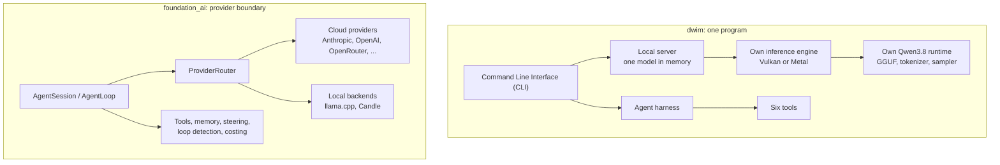

# dwim and foundation_ai: two answers to "run the agent where the model is"

**Thesis.** A coding agent needs three things: a model, an engine that runs the model, and a loop that turns model output into tool calls. Most agent projects own only the loop and call a remote Application Programming Interface (API). **dwim** owns all three. It is one Rust program that runs a quantized Qwen3.8-27B model on the local Graphics Processing Unit (GPU), serves that model to several sessions over a Unix domain socket, and runs a coding agent on top. The **`foundation_ai`** crate owns the loop and the provider boundary instead. It puts many cloud and local backends behind one `Model` trait, and it adds a deeper agentic layer: steering, memory tiers, loop detection, token budgets, embeddings, and cost tracking. This exploration documents both systems and compares them function by function.

| Subject | Kind | Location |
|---------|------|----------|
| dwim | Self-contained local coding agent with its own inference engine | `/Users/darkvoid/GitSources/src.turso/dwim` |
| `foundation_ai` | Inference and agentic library for the ewe_platform | `/Users/darkvoid/Dev/ewe_platform/backends/foundation_ai` |

## 1. Source revisions

| Source | Revision |
|--------|----------|
| dwim | `38885264dc75a02294cc53c18c4afa7e07ee5b58` (`0.0.12`) |
| `foundation_ai` | `c1b4751e7cfbe31293ffd8c63c5801b3ca6d4740` (`0.0.9`) |

dwim is published under the Massachusetts Institute of Technology (MIT) license. `foundation_ai` is published under the Apache License 2.0. The exploration reads the local checkouts at the revisions above. The source is the authority for every claim.

## 2. The two designs

dwim makes the model a local resource that the agent owns. `foundation_ai` makes the model an interchangeable dependency behind a trait. Each design buys different functions and gives up different ones. Document 07 measures the trade.

## 3. Headline findings

The comparison document gives the full evidence. These are the load-bearing differences:

- dwim runs with no network after the model download. It reads a GGUF file, unpacks quantized blocks, and executes every transformer operation on its own CPU, Vulkan, or Metal backend.
- `foundation_ai` reaches far more models. It has provider implementations for Anthropic Messages, OpenAI Chat Completions, OpenAI Responses, OpenRouter, Workers AI, and local llama.cpp and Candle. dwim has one model family and one weights file.
- `foundation_ai` has the deeper agentic layer. Steering queues, follow-up turns, resume across process restarts, a memory hierarchy, loop detection, error policy with fallback, cost accounting, embeddings, and sub-agent delegation are in the crate. dwim has a smaller, sharper loop: a thinking budget, context compaction, a repeated-call guard, a no-change nudge, and an automatic mode.
- dwim has functions that `foundation_ai` does not have as a library: a terminal user interface, a shared-model multi-session server, a model download and cache manager, a differential GPU test binary, and a Software Engineering Benchmark Lite (SWE-bench Lite) runner.
- `foundation_ai` has functions that dwim does not have: provider routing and fallback, cloud models, embeddings, mid-turn steering, persistent session records over a document store, Vector File System (VFS) tools, and WebAssembly (wasm) support.

## 4. Document index

These links point to the generated HyperText Markup Language (HTML) pages. The Markdown sources are in `dwim/markdown/`.

| Document | Content |
|----------|---------|
| [README](dwim/html/README.html) | Reading order and document map |
| [00 Overview](dwim/html/00-overview.html) | The idea, the layers, the model, and the constraints |
| [01 Architecture](dwim/html/01-architecture.html) | Package layout, modules, dependencies, and build |
| [02 CLI and sessions](dwim/html/02-cli-and-sessions.html) | Options, dispatch, one-shot mode, terminal user interface, transcripts |
| [03 Server and protocol](dwim/html/03-server-and-protocol.html) | Unix socket protocol, server lifecycle, shared weights |
| [04 Inference engine](dwim/html/04-inference-engine.html) | GPU abstraction, CPU reference, Vulkan, Metal, quantization |
| [05 Model and tokenizer](dwim/html/05-model-and-tokenizer.html) | GGUF, byte-pair encoding, Qwen3.8 transformer, sampler, speculation |
| [06 Harness and tools](dwim/html/06-agent-harness-and-tools.html) | System prompt, turn loop, compaction, six tools, benchmark |
| [07 Comparison](dwim/html/07-comparison-foundation-ai.html) | Function matrix, strengths, gaps, and recommendations |
| [08 Glossary](dwim/html/08-glossary.html) | Every term and abbreviation |

## 5. Reading note

Start with [00 Overview](dwim/html/00-overview.html). Read documents 01 to 06 in order for the dwim system. Read [07 Comparison](dwim/html/07-comparison-foundation-ai.html) for the assessment against `foundation_ai`. Use [08 Glossary](dwim/html/08-glossary.html) for terms. Every document states which source revision it describes.
