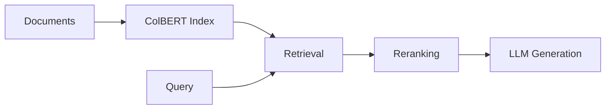

# RAGatouille — RAG Framework for Python

**RAG (Retrieval-Augmented Generation) framework with ColBERT late interaction.**

Source: 27 Python files

## Architecture

## Features

- ColBERT late interaction indexing
- Document retrieval with embeddings
- Query encoding
- Reranking support

## Docs

https://github.com/bclavie/RAGatouille
