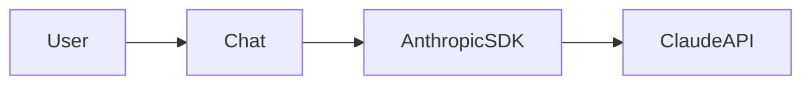

# claudette — Anthropic SDK Wrapper

**Wrapper for Anthropic's Python SDK with stateful Chat class, prefill, images, and tool use.**

Source: 5 Python files

## Features

- Chat class for stateful dialogs
- Prefill support (first words of response)
- Image support
- Tool Use API convenience

## Architecture



## Usage

```python
from claudette import Chat

chat = Chat(model="claude-3-5-sonnet-20241022")
chat("What is Python?")
```

## Docs

https://claudette.answer.ai
