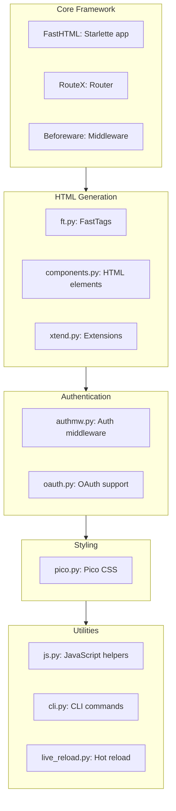

# fasthtml — Python Web Framework with HTMX

**Next-generation web framework for fast, scalable applications with minimal code. HTMX + Python.**

Source: `/home/darkvoid/Boxxed/@formulas/src.rust/src.AI/src.jeremychone/fasthtml/fasthtml/` — 33 Python files

## Architecture



## Module Structure

Source: `fasthtml/__init__.py:1-2`

```python
__version__ = "0.4.4"
from .core import *
```

Source files:

```
fasthtml/
├── core.py         # FastHTML app, RouterX, RouteX, Beforeware
├── common.py       # Common imports (starlette, basics, pico, auth)
├── ft.py           # FastTags import (components + xtend)
├── components.py   # HTML component generators
├── xtend.py        # Extended components
├── starlette.py    # Starlette integration
├── authmw.py       # Authentication middleware
├── oauth.py        # OAuth providers
├── pico.py         # Pico CSS styling
├── js.py           # JavaScript helpers
├── cli.py          # CLI commands
├── fastapp.py      # fast_app() helper
├── live_reload.py  # Hot reload for development
├── basics.py       # Basic utilities
└── toaster.py      # Toast notifications
```

## HTMX Headers

Source: `fasthtml/core.py:48-66`

```python
htmx_hdrs = dict(
    boosted="HX-Boosted",
    current_url="HX-Current-URL",
    history_restore_request="HX-History-Restore-Request",
    prompt="HX-Prompt",
    request="HX-Request",
    target="HX-Target",
    trigger_name="HX-Trigger-Name",
    trigger="HX-Trigger")

@dataclass
class HtmxHeaders:
    boosted:str|None=None
    current_url:str|None=None
    history_restore_request:str|None=None
    prompt:str|None=None
    request:str|None=None
    target:str|None=None
    trigger_name:str|None=None
    trigger:str|None=None
    def __bool__(self): return any(hasattr(self,o) for o in htmx_hdrs)
```

**Aha:** HtmxHeaders maps all HTMX request headers to a dataclass, automatically extracting them from HTTP requests. This provides structured access to HTMX-specific metadata like trigger name, target, and current URL.

## FastHTML App

Minimal app example:

```python
from fasthtml.common import *

app,rt = fast_app()

@rt('/')
def get(): return Div(P('Hello World!'), hx_get="/change")

@rt('/change')
def get(): return P('Nice to be here!')

serve()
```

**Aha:** `fast_app()` returns both the Starlette app and a route decorator (`rt`). Routes are just Python functions - FastHTML auto-generates HTML from function return values using FastTags (ft.py). HTMX attributes (hx_get, hx_post, etc.) are passed as keyword arguments.

## Type Casting

Source: `fasthtml/core.py:83-100`

```python
def _fix_anno(t):
    "Create callable type for casting str to type t"
    origin = get_origin(t)
    if origin is Union or origin is UnionType or origin in (list,List):
        t = first(o for o in get_args(t) if o!=type(None))
    d = {bool: str2bool, int: str2int}
    res = d.get(t, t)
    if origin in (list,List): return partial(_mk_list, res)
    return lambda o: res(o[-1]) if isinstance(o,(list,tuple)) else res(o)

def str2int(s)->int:
    "Convert s to an int"
    s = s.lower()
    if s=='on': return 1
    if s=='none': return 0
    return 0 if not s else int(s)
```

**Aha:** FastHTML automatically casts form data to Python types based on function signatures. bool→str2bool (on/none/true/false), int→str2int. Union types are handled by taking the first non-None type. This eliminates manual type conversion for route parameters.

## Common Imports

Source: `fasthtml/common.py:1-15`

```python
import uvicorn
from dataclasses import dataclass

from .starlette import *
from fastcore.utils import *
from fastcore.xml import *
from sqlite_minutils import Database
from fastlite import *
from .basics import *
from .pico import *
from .authmw import *
from .live_reload import *
from .toaster import *
from .js import *
from .fastapp import *
```

Imports include:
- **Starlette**: Web framework base
- **fastcore**: Utilities and XML generation
- **sqlite_minutils**: Database helpers
- **fastlite**: SQLite extensions
- **pico**: Pico CSS styling
- **authmw**: Authentication middleware

## Key Features

| Feature | Description |
|---------|-------------|
| HTMX integration | Hypermedia-based web apps |
| FastTags | HTML generation from Python |
| Type casting | Auto convert route params |
| SQLite support | Built-in database helpers |
| OAuth | Authentication providers |
| Hot reload | Development server |
| Pico CSS | Minimal CSS framework |

## Next

→ Documentation: https://docs.fastht.ml
→ About: https://about.fastht.ml
