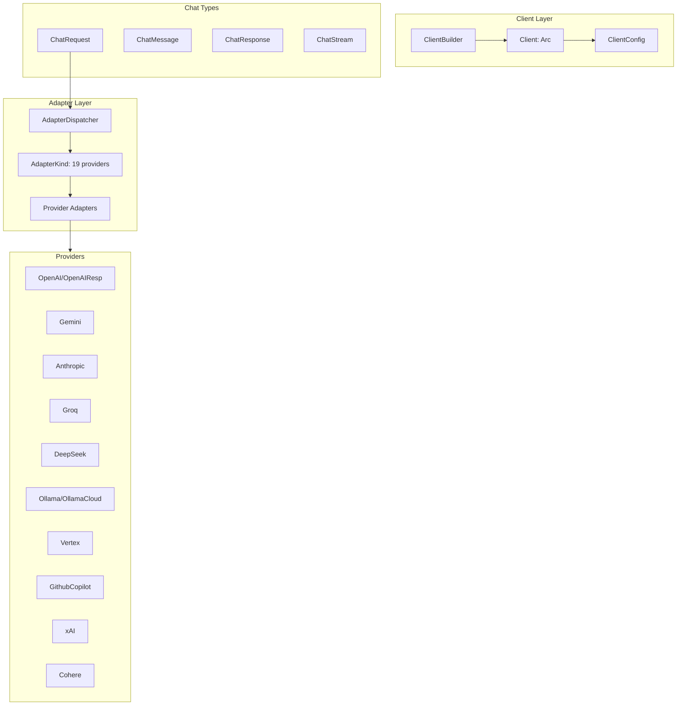

# rust-genai — Multi-Provider AI Client Library

**Rust client library for 19+ AI providers with unified API for chat, embeddings, and streaming.**

Source: `/home/darkvoid/Boxxed/@formulas/src.rust/src.AI/src.jeremychone/rust-genai/src/` — 65 Rust files

## Architecture



## Provider Support (19 Adapters)

Source: `src/adapter/adapter_kind.rs:28-70`

```rust
pub enum AdapterKind {
    OpenAI,      // Chat Completions API
    OpenAIResp,  // Responses API (stateful)
    Gemini,      // Google Gemini (native protocol)
    Anthropic,   // Claude (native protocol)
    Fireworks,   // fireworks.ai
    Together,    // Together AI
    Groq,        // Groq (OpenAI-compatible)
    Mimo,        // Mimo
    Nebius,      // Nebius
    Xai,         // xAI (Grok)
    DeepSeek,    // DeepSeek
    Zai,         // ZAI
    BigModel,    // Zhipu AI
    Aliyun,      // Alibaba Aliyun
    Cohere,      // Cohere (native protocol)
    Ollama,      // Local Ollama
    OllamaCloud, // ollama.com cloud
    Vertex,      // Google Vertex AI
    GithubCopilot, // GitHub Models inference
}
```

**Aha:** AdapterKind uses static dispatch with `AdapterDispatcher` - each adapter implements the same `Adapter` trait but with provider-specific request/response translation. This avoids runtime overhead and allows provider-specific optimizations (e.g., Gemini native protocol supports thinking budget).

## Client Structure

Source: `src/client/client_types.rs:12-14`

```rust
#[derive(Debug, Clone)]
pub struct Client {
    pub(super) inner: Arc<ClientInner>,
}

pub(super) struct ClientInner {
    pub(super) web_client: WebClient,
    pub(super) config: ClientConfig,
}
```

**Aha:** Client is Arc-wrapped for cheap cloning. The WebClient is shared across all requests, enabling connection pooling and reuse without explicit management.

### ClientBuilder

Source: `src/client/builder.rs:16-19`

```rust
#[derive(Debug, Default)]
pub struct ClientBuilder {
    web_client: Option<WebClient>,
    config: Option<ClientConfig>,
}
```

Builder pattern with passthrough setters:

```rust
impl ClientBuilder {
    pub fn with_reqwest(mut self, reqwest_client: reqwest::Client) -> Self
    pub fn with_config(mut self, config: ClientConfig) -> Self
    pub fn with_chat_options(mut self, options: ChatOptions) -> Self
    pub fn with_auth_resolver(mut self, auth_resolver: AuthResolver) -> Self
    pub fn with_service_target_resolver(mut self, target_resolver: ServiceTargetResolver) -> Self
    pub fn with_model_mapper(mut self, model_mapper: ModelMapper) -> Self
}
```

## ChatRequest

Source: `src/chat/chat_request.rs:10-33`

```rust
#[derive(Debug, Clone, Default, Serialize, Deserialize)]
pub struct ChatRequest {
    pub system: Option<String>,
    #[serde(default)]
    pub messages: Vec<ChatMessage>,
    pub tools: Option<Vec<Tool>>,
    
    // OpenAI Responses API (stateful sessions)
    #[serde(default, skip_serializing_if = "Option::is_none")]
    pub previous_response_id: Option<String>,
    #[serde(default, skip_serializing_if = "Option::is_none")]
    pub store: Option<bool>,
}
```

**Aha:** `previous_response_id` and `store` enable OpenAI's stateful Responses API. The server caches conversation state, so only new messages need to be sent - reducing token costs for multi-turn conversations.

### ChatRequest Constructors

Source: `src/chat/chat_request.rs:36-80`

```rust
impl ChatRequest {
    pub fn new(messages: Vec<ChatMessage>) -> Self
    pub fn from_system(content: impl Into<String>) -> Self
    pub fn from_user(content: impl Into<String>) -> Self
    pub fn from_messages(messages: Vec<ChatMessage>) -> Self
}

// Chainable setters
impl ChatRequest {
    pub fn with_system(mut self, system: impl Into<String>) -> Self
    pub fn append_message(mut self, msg: impl Into<ChatMessage>) -> Self
    pub fn append_messages<I>(mut self, messages: I) -> Self
    pub fn with_tools<I>(mut self, tools: I) -> Self
    pub fn append_tool_use_from_stream_end(mut self, end: &StreamEnd, tool_response: ToolResponse) -> Self
}
```

## ChatResponse

Source: `src/chat/chat_response.rs:102-134`

```rust
#[derive(Debug, Clone, Serialize, Deserialize)]
pub struct ChatResponse {
    pub content: MessageContent,
    pub reasoning_content: Option<String>,
    pub model_iden: ModelIden,
    pub provider_model_iden: ModelIden,
    pub stop_reason: Option<StopReason>,
    pub usage: Usage,
    pub captured_raw_body: Option<serde_json::Value>,
    pub response_id: Option<String>, // OpenAI Responses API
}
```

### StopReason

Source: `src/chat/chat_response.rs:23-36`

```rust
pub enum StopReason {
    Completed(String),
    MaxTokens(String),
    ToolCall(String),
    ContentFilter(String),
    StopSequence(String),
    Other(String),
}
```

Maps all provider-specific stop reasons to unified enum:

| StopReason | Provider Strings |
|------------|------------------|
| Completed | `stop`, `end_turn`, `STOP`, `COMPLETE` |
| MaxTokens | `length`, `max_tokens`, `MAX_TOKENS` |
| ToolCall | `tool_calls`, `tool_use`, `function_call` |
| ContentFilter | `content_filter`, `SAFETY`, `RECITATION` |

## Model Resolution

Source: `src/adapter/adapter_kind.rs:208-252`

Automatic provider detection from model name:

```rust
pub fn from_model(model: &str) -> Result<Self> {
    // Namespaced: "vertex::gemini-2.5-flash", "groq::llama-3"
    if let Some(adapter) = Self::from_model_namespace(model) {
        return Ok(adapter);
    };
    
    // Prefix-based:
    if model.starts_with("gpt") || model.starts_with("o3") || model.starts_with("o1") {
        Ok(Self::OpenAI)
    } else if model.starts_with("gemini") {
        Ok(Self::Gemini)
    } else if model.starts_with("claude") {
        Ok(Self::Anthropic)
    } else {
        Ok(Self::Ollama) // Fallback
    }
}
```

**Aha:** Namespaced model names (e.g., `vertex::gemini-2.5-flash`) allow explicit provider selection. Without namespace, automatic detection uses model prefixes - gpt→OpenAI, gemini→Gemini, claude→Anthropic, everything else→Ollama.

## Module Structure

Source: `src/lib.rs:4-24`

```
genai/src/
├── client/          # Client, ClientBuilder, ClientConfig
│   ├── builder.rs      # Builder pattern
│   ├── client_types.rs  # Client, ClientInner (Arc-wrapped)
│   ├── client_impl.rs   # Client methods
│   ├── config.rs        # ClientConfig
│   └── model_spec.rs    # Model specifications
├── chat/            # Chat types
│   ├── chat_request.rs  # ChatRequest
│   ├── chat_response.rs # ChatResponse, StopReason
│   ├── chat_message.rs  # ChatMessage, ChatRole
│   ├── message_content.rs # MessageContent types
│   ├── chat_stream.rs   # Streaming support
│   └── tool/           # Tool definitions
├── adapter/         # Provider adapters
│   ├── adapter_kind.rs  # AdapterKind enum (19 providers)
│   ├── dispatcher.rs    # AdapterDispatcher
│   └── adapters/        # Per-provider implementations
├── resolver/        # Model/auth resolution
├── embed/           # Embedding support
└── webc/            # HTTP client (reqwest wrapper)
```

## Next

→ [01-client.md](01-client.md) — ClientBuilder, ClientConfig, WebClient details
→ [02-chat-types.md](02-chat-types.md) — ChatMessage, MessageContent, Tool system
→ [03-adapters.md](03-adapters.md) — Per-provider adapter implementations
