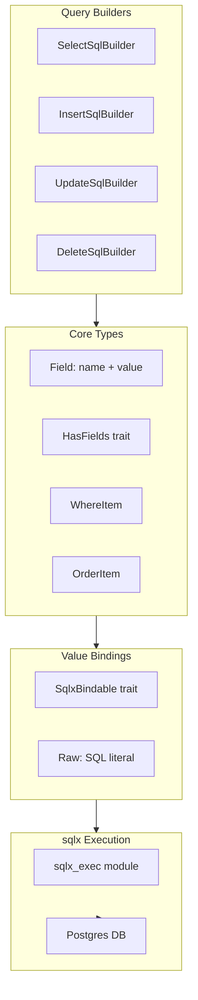

# rust-sqlb — SQL Builder for Rust

**Simple, expressive, progressive SQL builder with sqlx integration.**

Source: `src/` — 9 Rust files

## Architecture



## Module Structure

Source: `src/lib.rs:1-28`

```
rust-sqlb/src/
├── core.rs      # SqlBuilder trait, Field, HasFields, WhereItem, OrderItem
├── select.rs    # SelectSqlBuilder
├── insert.rs    # InsertSqlBuilder
├── update.rs    # UpdateSqlBuilder
├── delete.rs    # DeleteSqlBuilder
├── sqlx_exec.rs # sqlx execution functions
├── val.rs       # SqlxBindable trait, Raw value
└── utils.rs     # Column/table name formatting
```

```rust
// src/lib.rs exports
pub use crate::core::Field;
pub use crate::core::HasFields;
pub use crate::core::SqlBuilder;
pub use crate::core::Whereable;
pub use crate::delete::delete;
pub use crate::insert::insert;
pub use crate::select::select;
pub use crate::update::update;
pub use crate::val::Raw;
pub use crate::val::SqlxBindable;
pub use sqlb_macros::Fields;
```

## Core Types

Source: `src/core.rs:20-56`

```rust
#[derive(Debug)]
pub struct Field<'a> {
    pub name: String,
    pub value: Box<dyn SqlxBindable + 'a + Send + Sync>,
}

impl<'a, T: 'a + SqlxBindable + Send + Sync> From<(&str, T)> for Field<'a> {
    fn from((name, value): (&str, T)) -> Self {
        Field {
            name: name.to_owned(),
            value: Box::new(value),
        }
    }
}

/// Implement that this struct have "fields" that can be expressed as (name, value) vector.
/// Typically implemented with #[derive(Fields)]
pub trait HasFields {
    fn not_none_fields<'a>(self) -> Vec<Field<'a>>;
    fn all_fields<'a>(self) -> Vec<Field<'a>>;
    fn field_names() -> &'static [&'static str];
}
```

**Aha:** Field uses `Box<dyn SqlxBindable>` to store any bindable value without generics. HasFields trait is auto-derived with `#[derive(Fields)]` macro from sqlb-macros - extracts struct fields as Field tuples.

### WhereItem and OrderItem

Source: `src/core.rs:59-110`

```rust
pub(crate) struct WhereItem<'a> {
    pub name: String,
    pub op: &'static str,
    pub val: Box<dyn SqlxBindable + 'a + Send + Sync>,
}

#[derive(Clone)]
pub(crate) struct OrderItem {
    pub dir: OrderDir,
    pub name: String,
}

#[derive(Clone)]
pub(crate) enum OrderDir {
    Asc,
    Desc,
}

impl From<&str> for OrderItem {
    fn from(v: &str) -> Self {
        if let Some(s) = v.strip_prefix('!') {
            OrderItem {
                dir: OrderDir::Desc,
                name: x_column_name(s),
            }
        } else {
            OrderItem {
                dir: OrderDir::Asc,
                name: x_column_name(v),
            }
        }
    }
}
```

**Aha:** OrderItem uses `!` prefix for DESC ordering - `"!created_at"` becomes `"created_at DESC"`.

## SqlBuilder Trait

Source: `src/core.rs:112-135`

```rust
#[async_trait]
pub trait SqlBuilder<'a> {
    fn sql(&self) -> String;
    fn vals(&'a self) -> Box<dyn Iterator<Item = &Box<dyn SqlxBindable + 'a + Send + Sync>> + 'a + Send>;
    
    async fn fetch_one<'e, DB, D>(&'a self, db_pool: DB) -> Result<D, sqlx::Error>
    where DB: Executor<'e, Database = Postgres>, D: for<'r> FromRow<'r, sqlx::postgres::PgRow> + Unpin + Send;
    
    async fn fetch_optional<'e, DB, D>(&'a self, db_pool: DB) -> Result<Option<D>, sqlx::Error>;
    async fn fetch_all<'e, DB, D>(&'a self, db_pool: DB) -> Result<Vec<D>, sqlx::Error>;
    async fn exec<'q, DB>(&'a self, db_pool: DB) -> Result<u64, sqlx::Error>;
}

pub trait Whereable<'a> {
    fn and_where_eq<T: 'a + SqlxBindable + Send + Sync>(self, name: &str, val: T) -> Self;
    fn and_where<T: 'a + SqlxBindable + Send + Sync>(self, name: &str, op: &'static str, val: T) -> Self;
}
```

## SelectSqlBuilder

Source: `src/select.rs:9-200`

```rust
pub fn select<'a>() -> SelectSqlBuilder<'a> {
    SelectSqlBuilder {
        table: None,
        columns: None,
        and_wheres: Vec::new(),
        order_bys: None,
        limit: None,
        offset: None,
    }
}

pub struct SelectSqlBuilder<'a> {
    table: Option<String>,
    columns: Option<Vec<String>>,
    and_wheres: Vec<WhereItem<'a>>,
    order_bys: Option<Vec<OrderItem>>,
    limit: Option<i64>,
    offset: Option<i64>,
}

impl<'a> SelectSqlBuilder<'a> {
    pub fn table(mut self, table: &str) -> Self
    pub fn columns(mut self, names: &[&str]) -> Self
    pub fn and_where_eq<T>(mut self, name: &str, val: T) -> Self
    pub fn and_where<T>(mut self, name: &str, op: &'static str, val: T) -> Self
    pub fn order_by(mut self, odr: &str) -> Self
    pub fn order_bys(mut self, odrs: &[&str]) -> Self
    pub fn limit(mut self, limit: i64) -> Self
    pub fn offset(mut self, offset: i64) -> Self
    
    pub async fn fetch_one<DB, D>(&'a self, db_pool: DB) -> Result<D, sqlx::Error>
    pub async fn fetch_optional<DB, D>(&'a self, db_pool: DB) -> Result<Option<D>, sqlx::Error>
    pub async fn fetch_all<DB, D>(&'a self, db_pool: DB) -> Result<Vec<D>, sqlx::Error>
}
```

### SQL Generation

Source: `src/select.rs:114-163`

```rust
fn sql(&self) -> String {
    let mut sql = String::from("SELECT ");
    
    // Columns
    match &self.columns {
        Some(columns) => sql.push_str(&format!("{} ", names.join(", "))),
        None => sql.push_str("* "),
    }
    
    // FROM table
    if let Some(table) = &self.table {
        sql.push_str("FROM ");
        sql.push_str(&x_table_name(table));
    }
    
    // WHERE
    if !self.and_wheres.is_empty() {
        let sql_where = sql_where_items(&self.and_wheres, 1);
        sql.push_str(&format!("WHERE {} ", &sql_where));
    }
    
    // ORDER BY
    if let Some(order_bys) = &self.order_bys {
        sql.push_str(&format!("ORDER BY {} ", sql_order_bys.join(", ")))
    }
    
    // LIMIT/OFFSET
    if let Some(limit) = &self.limit { sql.push_str(&format!("LIMIT {limit} ")) }
    if let Some(offset) = &self.offset { sql.push_str(&format!("OFFSET {offset} ")) }
    
    sql
}
```

## InsertSqlBuilder

Source: `src/insert.rs:7-133`

```rust
pub fn insert<'a>() -> InsertSqlBuilder<'a> {
    InsertSqlBuilder {
        table: None,
        data: Vec::new(),
        returnings: None,
    }
}

pub struct InsertSqlBuilder<'a> {
    table: Option<String>,
    data: Vec<Field<'a>>,
    returnings: Option<Vec<String>>,
}

impl<'a> InsertSqlBuilder<'a> {
    pub fn table(mut self, table: &str) -> Self
    pub fn data(mut self, fields: Vec<Field<'a>>) -> Self
    pub fn returning(mut self, names: &[&str]) -> Self
    
    pub async fn exec<DB>(&'a self, db_pool: DB) -> Result<u64, sqlx::Error>
    pub async fn fetch_one<DB, D>(&'a self, db_pool: DB) -> Result<D, sqlx::Error>
}
```

### SQL Generation

Source: `src/insert.rs:72-96`

```rust
fn sql(&self) -> String {
    let mut sql = String::from("INSERT INTO ");
    sql.push_str(&x_table_name(table));
    
    let fields = &self.data;
    // (name1, name2, ...)
    sql.push_str(&format!("({}) ", sql_comma_names(fields)));
    
    // VALUES ($1, $2, ...)
    sql.push_str(&format!("VALUES ({}) ", sql_comma_params(fields).1));
    
    // RETURNING r1, r2, ...
    if let Some(returnings) = &self.returnings {
        sql.push_str(&format!("RETURNING {} ", sql_returnings(returnings)));
    }
    
    sql
}
```

**Aha:** `sql_comma_params` handles Raw values differently - they're inserted as SQL literals instead of `$n` bindings. This allows inserting SQL expressions like `Raw("NOW()")`.

## SqlxBindable Trait

Source: `src/val.rs:10-88`

```rust
pub trait SqlxBindable: std::fmt::Debug {
    fn bind_query<'q>(
        &'q self,
        query: sqlx::query::Query<'q, sqlx::Postgres, sqlx::postgres::PgArguments>,
    ) -> sqlx::query::Query<'q, sqlx::Postgres, sqlx::postgres::PgArguments>;
    
    fn raw(&self) -> Option<&str> {
        None
    }
}

// Macro for implementing SqlxBindable
#[macro_export]
macro_rules! bindable {
    ($($t:ty),*) => {
        $(impl SqlxBindable for $t {
            fn bind_query<'q>(&self, query) -> Query {
                query.bind(self.clone())
            }
        }
        impl SqlxBindable for &$t {
            fn bind_query<'q>(&self, query) -> Query {
                query.bind(<$t>::clone(self))
            }
        }
        )*
    };
}

// Bound types
bindable!(bool, i8, i16, i32, i64, f32, f64, Uuid, OffsetDateTime);
bindable_to_string!(String, str);
```

### Raw Value

Source: `src/val.rs:119-134`

```rust
#[derive(Debug)]
pub struct Raw(pub &'static str);

impl SqlxBindable for Raw {
    fn bind_query<'q>(&self, query) -> Query {
        query  // No binding
    }
    
    fn raw(&self) -> Option<&str> {
        Some(self.0)
    }
}
```

**Aha:** Raw values bypass binding entirely - they're inserted directly into SQL string. Used for SQL functions like `Raw("NOW()")`, `Raw("DEFAULT")`, or subqueries.

## Usage Examples

```rust
use sqlb::{select, insert, update, delete, Field, HasFields};

// SELECT
let users: Vec<User> = select()
    .table("users")
    .columns(&["id", "name", "email"])
    .and_where_eq("active", true)
    .order_bys(&["!created_at"])
    .limit(10)
    .fetch_all(&db_pool)
    .await?;

// INSERT with Fields derive
#[derive(Fields)]
struct NewUser {
    name: String,
    email: String,
}
let user: User = insert()
    .table("users")
    .data(newUser.not_none_fields())
    .returning(&["id", "created_at"])
    .fetch_one(&db_pool)
    .await?;

// UPDATE
let count = update()
    .table("users")
    .data(vec![("name".into(), "new_name")])
    .and_where_eq("id", user_id)
    .exec(&db_pool)
    .await?;

// DELETE
let count = delete()
    .table("users")
    .and_where_eq("id", user_id)
    .exec(&db_pool)
    .await?;
```

## Next

→ [01-sqlx-exec.md](01-sqlx-exec.md) — sqlx execution details
