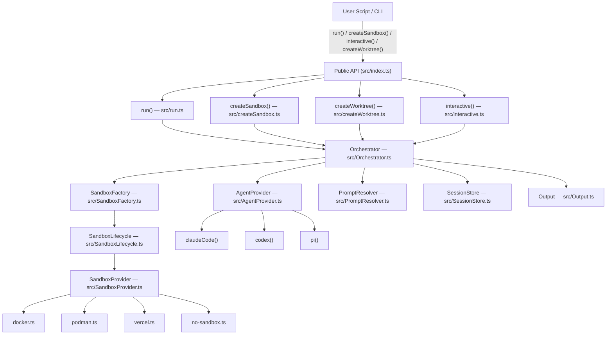

# Sandcastle — Exploration

## Project Overview

**@ai-hero/sandcastle** v0.12.0 is a TypeScript library by Matt Pocock for orchestrating AI coding agents in isolated sandbox environments. It provides a unified API to run agents (Claude Code, Codex, Pi, Cursor, OpenCode, Copilot) inside sandboxes (Docker containers, Podman containers, Vercel Firecracker microVMs, or directly on the host), with git worktree management, branch strategies, session capture/resume/fork, and structured output extraction.

## Architecture



## Directory Structure

```
sandcastle/
├── src/
│   ├── index.ts                  # Public API exports
│   ├── main.ts                   # CLI entry point (Effect platform)
│   ├── cli.ts                    # CLI command definitions
│   ├── run.ts                    # run() — primary orchestration API
│   ├── interactive.ts            # interactive() — TUI agent session
│   ├── createSandbox.ts          # createSandbox() — reusable sandbox
│   ├── createWorktree.ts         # createWorktree() — worktree lifecycle
│   ├── Orchestrator.ts           # Core iteration loop + agent execution
│   ├── SandboxFactory.ts         # Factory for worktree + sandbox creation
│   ├── SandboxLifecycle.ts       # Sandbox start/stop/exec + hooks
│   ├── SandboxProvider.ts        # Provider types + factory functions
│   ├── AgentProvider.ts          # Agent factories (claudeCode, codex, etc.)
│   ├── AgentStreamEmitter.ts     # Agent output stream event forwarding
│   ├── PromptResolver.ts         # Prompt source resolution (file vs inline)
│   ├── PromptPreprocessor.ts     # !`command` expansion in prompts
│   ├── PromptArgumentSubstitution.ts  # {{KEY}} placeholder substitution
│   ├── SessionStore.ts           # Session capture, transfer, resume
│   ├── Output.ts                 # Structured output extraction + retry
│   ├── extractStructuredOutput.ts # XML tag parsing + schema validation
│   ├── Display.ts                # Terminal UI (Clack) + file display
│   ├── EnvResolver.ts            # .sandcastle/.env resolution
│   ├── mergeProviderEnv.ts       # Provider env merge logic
│   ├── ErrorHandler.ts           # Error formatting + friendly messages
│   ├── errors.ts                 # SandboxError type definitions
│   ├── CwdError.ts               # CwdError class
│   ├── RecoveryMessage.ts        # Recovery suggestions on failure
│   ├── boundedTail.ts            # Bounded tail file reading
│   ├── raceAbortSignal.ts        # AbortSignal racing utility
│   ├── shutdownRegistry.ts       # Shutdown hook registry
│   ├── TextDeltaBuffer.ts        # Text delta accumulation
│   ├── MountConfig.ts            # Mount configuration types
│   ├── mountUtils.ts             # Mount path utilities
│   ├── resolveCwd.ts             # CWD resolution with Effect
│   ├── resumePrecheck.ts         # Resume session existence check
│   ├── sandboxExec.ts            # Sandbox exec helper
│   ├── startSandbox.ts           # Sandbox startup helper
│   ├── CopyToWorktree.ts         # File copy to worktree
│   ├── syncIn.ts                 # Code sync into sandbox
│   ├── syncOut.ts                # Code sync out of sandbox
│   ├── terminalCleanup.ts        # Terminal state restoration
│   ├── version.ts                # Version constant
│   ├── templates.ts              # Template definitions + metadata
│   ├── sandboxes/
│   │   ├── docker.ts             # Docker bind-mount provider
│   │   ├── podman.ts             # Podman bind-mount provider
│   │   ├── vercel.ts             # Vercel isolated provider
│   │   ├── daytona.ts            # Daytona provider stub
│   │   ├── no-sandbox.ts         # No-sandbox provider
│   │   ├── test-isolated.ts      # Test isolated provider (temp dirs)
│   │   ├── test-bind-mount.ts    # Test bind-mount provider
│   │   └── test-shared.ts        # Shared test utilities
│   └── templates/
│       ├── blank/                # Blank template
│       ├── simple-loop/          # Simple loop template
│       ├── sequential-reviewer/  # Sequential reviewer template
│       ├── parallel-planner/     # Parallel planner template
│       └── parallel-planner-with-review/
│                               # Parallel planner with review template
├── .sandcastle/                  # Sandcastle's own agent workflows
├── docs/                         # Documentation site (Next.js + MDX)
├── .github/workflows/            # CI/CD pipelines
├── package.json
├── tsconfig.json
├── tsup.config.ts
└── vitest.config.ts
```

## Key Components

### 1. Public API (`src/index.ts`)

Exports four main entry points:
- `run()` — one-shot agent invocation
- `createSandbox()` — reusable sandbox for multiple agent runs
- `createWorktree()` — worktree as first-class concept
- `interactive()` — interactive TUI agent session

Plus provider factories: `claudeCode()`, `codex()`, `pi()`, `cursor()`, `opencode()`, `copilot()`
Plus sandbox factories: `createBindMountSandboxProvider()`, `createIsolatedSandboxProvider()`
Plus session utilities: `transferClaudeSession()`, `transferCodexSession()`, `encodeProjectPath()`
Plus structured output: `Output`, `StructuredOutputError`

### 2. Sandbox System

**Provider architecture**: Two factory functions create custom providers:
- `createBindMountSandboxProvider()` — for providers that can mount host directories
- `createIsolatedSandboxProvider()` — for providers with their own filesystem

**Handle contract**: Every provider returns a handle with:
- `exec(command, opts?)` — run commands, optional streaming via `onLine`
- `close()` — teardown
- `copyFileIn/CopyFileOut` (bind-mount) or `copyIn/CopyFileOut` (isolated)
- `worktreePath` — absolute path to repo inside sandbox

**Built-in providers**: Docker, Podman (bind-mount), Vercel (isolated), no-sandbox, Daytona (stub)

### 3. Branch Strategies

Three strategies control where agent commits land:
- `head` — agent writes directly to host working directory (default for bind-mount)
- `merge-to-head` — temp worktree branch, merged back to HEAD (default for isolated)
- `branch` — explicit named branch, worktree reused across runs

### 4. Prompt System

- Inline prompts (`prompt: "..."`) — passed literally, no expansion
- File prompts (`promptFile: "..."`) — supports `{{KEY}}` substitution and `` !`command` `` expansion
- Built-in args: `{{SOURCE_BRANCH}}`, `{{TARGET_BRANCH}}`
- Commands run inside sandbox after `onSandboxReady` hooks

### 5. Agent Providers

Six agent factories: `claudeCode`, `codex`, `pi`, `cursor`, `opencode`, `copilot`
Three support session resume: Claude Code, Codex, Pi (with `sessionStorage` capability)

### 6. Session Management

- **Capture**: After each iteration, session JSONL copied from sandbox to host
- **Resume**: `resumeSession` option continues prior conversation
- **Fork**: `RunResult.fork()` creates child session, parent left intact
- Claude Code subagent transcripts also captured alongside main session

### 7. Templates

Five templates scaffolded by `sandcastle init`:
- `blank` — bare scaffold
- `simple-loop` — picks issues one by one
- `sequential-reviewer` — implement + review per issue
- `parallel-planner` — plan, execute in parallel, merge
- `parallel-planner-with-review` — plan, execute with review, merge

## Dependencies

- **Runtime**: `@clack/prompts` (interactive prompts)
- **Effect Platform** (dev): `effect`, `@effect/platform`, `@effect/platform-node`, `@effect/cli`, `@effect/printer`, `@effect/printer-ansi` — used for CLI and internal orchestration
- **Build**: `tsup` (bundling), `typescript`, `tsx` (runtime execution)
- **Test**: `vitest`, `zod` (validation in tests and structured output)
- **Optional peers**: `@vercel/sandbox`, `@daytona/sdk`

## Aha! Moments

1. **Branch strategy moved from provider to `run()`** — previously providers owned branch strategy; now it's a `run()` option, making providers agnostic to git concerns and enabling swap-ability.

2. **Session capture rewrites paths** — when capturing a Claude Code session from sandbox to host, `cwd` fields in the JSONL are rewritten to match the host repo root, so the provider's native resume command works without modification.

3. **Fork isolates sessions only, not branches** — `--fork-session` creates a new session ID but doesn't isolate the branch or worktree. Concurrent forks require distinct branches. This is a non-obvious constraint that would cause data loss if misunderstood.

4. **Completion timeout is independent of idle timeout** — `idleTimeoutSeconds` fires before any signal (genuinely stuck agent → fail); `completionTimeoutSeconds` fires after the signal (hanging process → succeed with warning). A clean process exit always wins the race.

5. **Inline prompts bypass all expansion** — `prompt: "..."` passes literally to the agent. No `{{KEY}}` substitution, no `` !`command` `` expansion, no built-in arg injection. `promptArgs` alongside inline prompt is an error.
