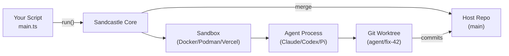

# Sandcastle — Overview

## What It Is

**@ai-hero/sandcastle** is a TypeScript library for orchestrating AI coding agents in isolated sandbox environments. You invoke agents with a single `run()` call, Sandcastle handles sandboxing the agent with a configurable branch strategy, and commits made on the branches get merged back.

The core thesis: agent orchestration should be provider-agnostic. Swap Docker for Podman for Vercel for a custom provider with one line of code. Swap Claude Code for Codex for Pi with one line of code. The orchestration logic — worktree management, branch strategies, session capture, prompt resolution — stays the same.

Source: `package.json:1-2` — `@ai-hero/sandcastle` v0.12.0, MIT license, repository `github.com/mattpocock/sandcastle`

## The Problem It Solves

Running AI coding agents (Claude Code, Codex, Pi) on real codebases has three challenges:

1. **Isolation** — agents make file changes. Running them directly on your working directory risks corruption, uncommitted changes, or unwanted commits.
2. **Parallelization** — running multiple agents on the same repo requires branch coordination, worktree management, and merge handling.
3. **Reproducibility** — agents need consistent environments (dependencies installed, tools available) across runs.

Sandcastle solves all three by wrapping agent execution in a sandbox (container or cloud VM) with git worktree indirection, then merging changes back when done.

## Architecture at a Glance



Four layers. Your code calls `run()`. Sandcastle creates a sandbox. The agent runs inside it, commits to a worktree branch. Sandcastle merges back. All local, no servers.

## Key Concepts

### Sandbox Provider

A provider tells Sandcastle how to create an isolated environment. Built-in options:

| Provider | Type | Isolation |
|----------|------|-----------|
| `docker()` | Bind-mount | Container mounts host worktree |
| `podman()` | Bind-mount | Container mounts host worktree |
| `vercel()` | Isolated | Firecracker microVM, own filesystem |
| `noSandbox()` | None | Agent runs directly on host |

**Aha:** Bind-mount providers mount the worktree into the container — the agent writes directly to the host filesystem through the mount, so no file sync is needed. Isolated providers (Vercel) need `copyIn`/`copyFileOut` to move code in and out.

### Branch Strategy

Controls where the agent's commits land:

| Strategy | Behavior | Default For |
|----------|----------|-------------|
| `head` | Agent writes to host working directory directly | Bind-mount |
| `merge-to-head` | Temp branch in worktree, merged back to HEAD when done | Isolated |
| `branch` | Commits land on an explicitly named branch | Neither (opt-in) |

**Aha:** Branch strategy is configured on `run()`, not on the provider. This makes providers fully swappable — Docker and Vercel accept the same branch strategy option.

### Agent Provider

A factory function that configures how to launch a specific coding agent:

```typescript
// src/AgentProvider.ts — agent factories
claudeCode("claude-opus-4-8", { effort: "high" })
codex("gpt-5.4", { effort: "high" })
pi("claude-sonnet-4-6", { thinking: "high" })
cursor("composer-2")
opencode("opencode/big-pickle")
copilot("claude-sonnet-4.5")
```

Three support session resume: Claude Code, Codex, Pi. Three do not: Cursor, OpenCode, Copilot.

## Quick Start

```typescript
// .sandcastle/main.ts
import { run, claudeCode } from "@ai-hero/sandcastle";
import { docker } from "@ai-hero/sandcastle/sandboxes/docker";

await run({
  agent: claudeCode("claude-opus-4-8"),
  sandbox: docker(),
  promptFile: ".sandcastle/prompt.md",
});
```

## API Surface Summary

| Entry Point | Purpose | Returns |
|-------------|---------|---------|
| `run()` | One-shot agent invocation | `RunResult` with commits, stdout, iterations |
| `createSandbox()` | Reusable sandbox for multiple runs | `Sandbox` with `run()`, `exec()`, `close()` |
| `createWorktree()` | Worktree as first-class concept | `Worktree` with `run()`, `interactive()`, `createSandbox()` |
| `interactive()` | Interactive TUI agent session | `InteractiveResult` |

See [01-architecture.md](./01-architecture.md) for the full dependency graph and module map.

## Why This Exists

Sandcastle emerged from the need to run AFK (away from keyboard) agents reliably at scale. Instead of manually creating branches, launching containers, running agents, and merging back, Sandcastle provides a single API that handles the entire lifecycle — with hooks for customization at every step.

The project is built on the **Effect** platform (`effect`, `@effect/platform`, `@effect/cli`) for its internal CLI and orchestration, but the public API is plain async/await TypeScript — callers don't need to know Effect.

Aha: The library is ~1,300 lines of custom code across ~60 source files (plus ~60 test files), yet it handles Docker/Podman/Vercel sandboxes, six agent types, five templates, session capture/resume/fork, structured output with retry, and a full CLI. The provider abstraction is what makes this scale — each new sandbox or agent is a thin adapter, not a rewrite.

---

Next: [01-architecture.md](./01-architecture.md) — Full dependency graph, layer diagram, and module map.
