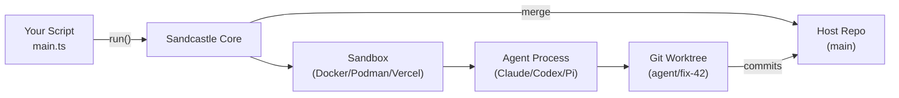
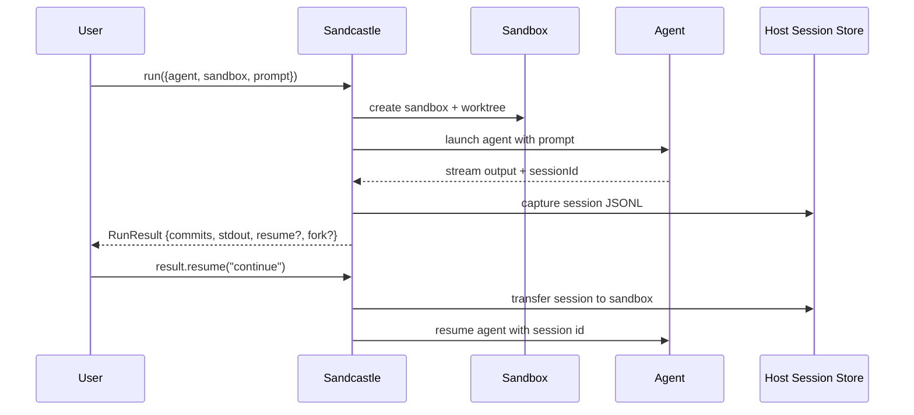

# Sandcastle — Overview

## What It Is

**@ai-hero/sandcastle** is a TypeScript library for orchestrating AI coding agents in isolated sandbox environments. You invoke agents with a single `run()` call, Sandcastle handles sandboxing the agent with a configurable branch strategy, and commits made on the branches get merged back.

The core thesis: agent orchestration should be provider-agnostic. Swap Docker for Podman for Vercel for a custom provider with one line of code. Swap Claude Code for Codex for Pi with one line of code. The orchestration logic — worktree management, branch strategies, session capture, prompt resolution — stays the same.

Source: `package.json:1-2` — `@ai-hero/sandcastle` v0.12.0, MIT license, repository `github.com/mattpocock/sandcastle`

## The Problem It Solves

Running AI coding agents (Claude Code, Codex, Pi) on real codebases has three challenges:

1. **Isolation** — agents make file changes. Running them directly on your working directory risks corruption, uncommitted changes, or unwanted commits.
2. **Parallelization** — running multiple agents on the same repo requires branch coordination, worktree management, and merge handling.
3. **Reproducibility** — agents need consistent environments (dependencies installed, tools available) across runs.

Sandcastle solves all three by wrapping agent execution in a sandbox (container or cloud VM) with git worktree indirection, then merging changes back when done.

## Architecture at a Glance



Four layers. Your code calls `run()`. Sandcastle creates a sandbox. The agent runs inside it, commits to a worktree branch. Sandcastle merges back. All local, no servers.

## Key Concepts

### Sandbox Provider

A provider tells Sandcastle how to create an isolated environment. Built-in options:

| Provider | Type | Isolation |
|----------|------|-----------|
| `docker()` | Bind-mount | Container mounts host worktree |
| `podman()` | Bind-mount | Container mounts host worktree |
| `vercel()` | Isolated | Firecracker microVM, own filesystem |
| `daytona()` | Isolated | Ephemeral sandbox via `@daytona/sdk` |
| `noSandbox()` | None | Agent runs directly on host (no `--dangerously-skip-permissions`) |

**Aha:** Bind-mount providers mount the worktree into the container — the agent writes directly to the host filesystem through the mount, so no file sync is needed. Isolated providers (Vercel) need `copyIn`/`copyFileOut` to move code in and out.

### Branch Strategy

Controls where the agent's commits land:

| Strategy | Behavior | Default For |
|----------|----------|-------------|
| `head` | Agent writes to host working directory directly (no worktree) | Bind-mount, No-sandbox |
| `merge-to-head` | Temp branch in worktree, merged back to HEAD when done | Isolated |
| `branch` | Commits land on an explicitly named branch | Opt-in (all providers) |

**Aha:** Branch strategy is configured on `run()`, `interactive()`, `createSandbox()`, and `createWorktree()` — not on the provider. This makes providers fully swappable — Docker and Vercel accept the same branch strategy option.

### Session Lifecycle



### Agent Provider

A factory function that configures how to launch a specific coding agent:

```typescript
// src/AgentProvider.ts — agent factories
claudeCode("claude-opus-4-8", { effort: "high" })
codex("gpt-5.4", { effort: "high" })
pi("claude-sonnet-4-6", { thinking: "high" })
cursor("composer-2")
opencode("opencode/big-pickle", { variant: "high", agent: "build" })
copilot("claude-sonnet-4.5", { effort: "high" })
```

Three support session resume: Claude Code, Codex, Pi. Three do not: Cursor, OpenCode, Copilot.

## Quick Start

```typescript
// .sandcastle/main.ts
import { run, claudeCode } from "@ai-hero/sandcastle";
import { docker } from "@ai-hero/sandcastle/sandboxes/docker";

await run({
  agent: claudeCode("claude-opus-4-8"),
  sandbox: docker(),
  promptFile: ".sandcastle/prompt.md",
});
```

## API Surface Summary

| Entry Point | Purpose | Returns |
|-------------|---------|---------|
| `run()` | One-shot agent invocation | `RunResult` with commits, stdout, iterations, resume/fork |
| `createSandbox()` | Reusable sandbox for multiple runs | `Sandbox` with `run()`, `exec()`, `close()` |
| `createWorktree()` | Worktree as first-class concept | `Worktree` with `run()`, `interactive()`, `createSandbox()` |
| `interactive()` | Interactive TUI agent session | `InteractiveResult` |

### Key Options on `run()`

| Option | Type | Default | Purpose |
|--------|------|---------|---------|
| `agent` | `AgentProvider` | — | Agent factory (`claudeCode`, `codex`, `pi`, etc.) |
| `sandbox` | `SandboxProvider` | — | Sandbox provider (`docker`, `podman`, `vercel`, etc.) |
| `branchStrategy` | `BranchStrategy` | per-provider | Where commits land (`head`, `merge-to-head`, `branch`) |
| `prompt` / `promptFile` | string | — | Prompt source (mutually exclusive) |
| `promptArgs` | `PromptArgs` | — | `{{KEY}}` placeholder values (file prompts only) |
| `maxIterations` | number | `1` | Max agent iterations |
| `logging` | `LoggingOption` | `file` | `{ type: "file", path }` or `{ type: "stdout" }` |
| `completionSignal` | string \| string[] | `<promise>COMPLETE</promise>` | Early stop signal(s) |
| `idleTimeoutSeconds` | number | `600` | Fail if no output for this long |
| `completionTimeoutSeconds` | number | `60` | Grace window after signal seen but process hanging |
| `output` | `OutputDefinition` | — | Structured output extraction (`Output.object` / `Output.string`) |
| `resumeSession` | string | — | Resume prior agent session by ID |
| `signal` | `AbortSignal` | — | Cancel the run mid-execution |
| `copyToWorktree` | string[] | — | Host paths to copy into worktree before sandbox start |
| `hooks` | `SandboxHooks` | — | Lifecycle hooks (`host.*`, `sandbox.*`) |

### Structured Output

Sandcastle can extract typed data from agent stdout via XML tags:

```typescript
import { Output } from "@ai-hero/sandcastle";
import { z } from "zod";

const result = await run({
  // ...
  output: Output.object({
    tag: "result",
    schema: z.object({ summary: z.string(), score: z.number() }),
    maxRetries: 2,  // Built-in retry via session resume
  }),
});

console.log(result.output.summary);  // typed as string
console.log(result.output.score);    // typed as number
```

On validation failure with `maxRetries > 0`, Sandcastle resumes the same agent session with a token-efficient feedback prompt — the agent doesn't redo its work, just re-emits the corrected tag.

### Session Capture, Resume & Fork

After each iteration with Claude Code, Codex, or Pi, Sandcastle captures the session JSONL from sandbox to host (with `cwd` fields rewritten to match the host repo root). You can then:

```typescript
const result = await run({ ... });

// Resume the same conversation
const continued = await result.resume?.("Continue where you left off");

// Fork for parallel review (leaves parent session intact)
const [reviewA, reviewB] = await Promise.all([
  result.fork?.("Review the auth layer", { branchStrategy: { type: "branch", branch: "review-a" } }),
  result.fork?.("Audit the data model", { branchStrategy: { type: "branch", branch: "review-b" } }),
]);
```

**Aha:** Fork isolates the session JSONL only — it does **not** isolate the branch or sandbox. Safe concurrent forks require distinct branches. The default `head` and `merge-to-head` strategies are not safe for concurrent forks.

### Logging Modes

- **File mode** (default): Writes progress to a log file under `.sandcastle/logs/`. Prints `tail -f <path>` at startup so you can watch in another terminal. Supports `onAgentStreamEvent` callback for observability forwarding and `verbose: true` for raw JSONL interleaving.
- **Stdout mode**: Renders interactive Clack UI in the terminal. `verbose: true` writes raw lines to stdout (interleaved with the UI).

### Effect Platform

Sandcastle's internal orchestration runs on the Effect platform (`Effect`, `Layer`, `Effect.runPromise`). This provides typed error channels, resource safety via `acquireUseRelease` (guaranteed cleanup even on abort), and dependency injection via Context/Tags/Layers. The public API is plain async/await TypeScript — callers don't need to know Effect.

**Aha:** The library is ~1,300 lines of custom code across ~60 source files (plus ~60 test files), yet it handles Docker/Podman/Vercel/Daytona sandboxes, six agent types, five templates, session capture/resume/fork, structured output with retry, and a full CLI. The provider abstraction is what makes this scale — each new sandbox or agent is a thin adapter, not a rewrite.

---

Next: [01-architecture.md](./01-architecture.md) — Full dependency graph, layer diagram, and module map.
