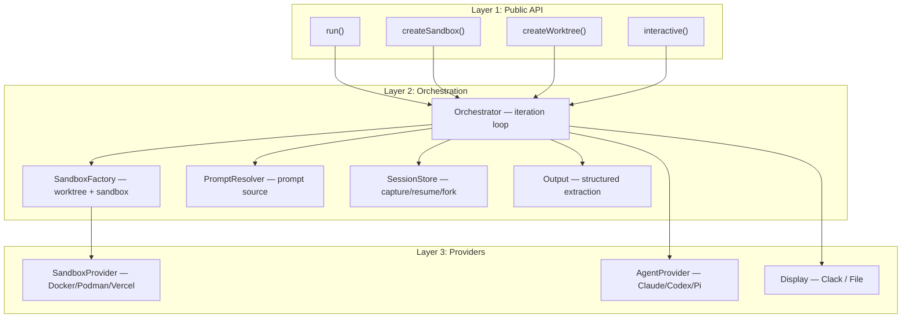
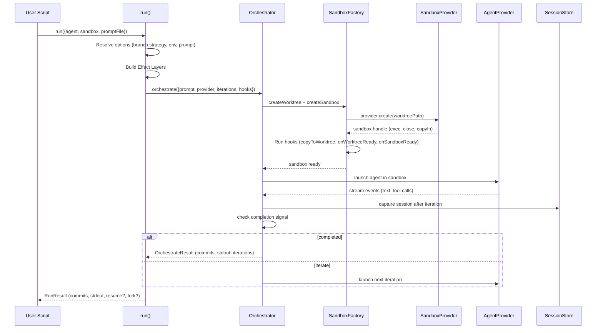

# Sandcastle — Architecture

## Full Dependency Graph

Sandcastle is organized as a set of loosely coupled modules, each responsible for one concern. The public API re-exports from these modules, and they communicate through Effect's dependency injection (Layers) or plain function calls.

```mermaid
flowchart TD
    subgraph Public["Public API (src/index.ts)"]
        API["run, createSandbox,\ncreateWorktree, interactive"]
    end

    subgraph Core["Core Orchestration"]
        Run["run.ts"]
        CreateSB["createSandbox.ts"]
        CreateWT["createWorktree.ts"]
        Interactive["interactive.ts"]
        Orch["Orchestrator.ts"]
    end

    subgraph Sandbox["Sandbox Layer"]
        Factory["SandboxFactory.ts"]
        Lifecycle["SandboxLifecycle.ts"]
        DockerLC["DockerLifecycle.ts"]
        PodmanLC["PodmanLifecycle.ts"]
        Provider["SandboxProvider.ts"]
        StartSB["startSandbox.ts"]
        SyncIn["syncIn.ts"]
        SyncOut["syncOut.ts"]
        CopyWT["CopyToWorktree.ts"]
        WTM["WorktreeManager.ts"]
    end

    subgraph Providers["Sandbox Providers"]
        Docker["sandboxes/docker.ts"]
        Podman["sandboxes/podman.ts"]
        Vercel["sandboxes/vercel.ts"]
        Daytona["sandboxes/daytona.ts"]
        NoSB["sandboxes/no-sandbox.ts"]
        TestISO["sandboxes/test-isolated.ts"]
        TestBM["sandboxes/test-bind-mount.ts"]
    end

    subgraph Agent["Agent Layer"]
        AgentP["AgentProvider.ts"]
        StreamE["AgentStreamEmitter.ts"]
        SessionS["SessionStore.ts"]
    end

    subgraph Prompt["Prompt System"]
        PromptR["PromptResolver.ts"]
        PromptPP["PromptPreprocessor.ts"]
        PromptAS["PromptArgumentSubstitution.ts"]
    end

    subgraph Output["Structured Output"]
        OutputM["Output.ts"]
        ExtractSO["extractStructuredOutput.ts"]
    end

    subgraph Support["Support Modules"]
        Display["Display.ts"]
        EnvR["EnvResolver.ts"]
        MergeE["mergeProviderEnv.ts"]
        ErrH["ErrorHandler.ts"]
        Errors["errors.ts"]
        CwdE["CwdError.ts"]
        Recovery["RecoveryMessage.ts"]
        TextBuf["TextDeltaBuffer.ts"]
        BoundedT["boundedTail.ts"]
        AbortS["raceAbortSignal.ts"]
        Shutdown["shutdownRegistry.ts"]
        MountC["MountConfig.ts"]
        MountU["mountUtils.ts"]
        ResolveC["resolveCwd.ts"]
        ResumeP["resumePrecheck.ts"]
        TCleanup["terminalCleanup.ts"]
        Version["version.ts"]
    end

    API --> Run
    API --> CreateSB
    API --> CreateWT
    API --> Interactive

    Run --> Orch
    CreateSB --> Orch
    CreateWT --> Orch
    Interactive --> Orch

    Orch --> Factory
    Orch --> PromptR
    Orch --> SessionS
    Orch --> AgentP
    Orch --> OutputM
    Orch --> Display
    Orch --> StreamE

    Factory --> Lifecycle
    Factory --> Provider
    Factory --> CopyWT
    Lifecycle --> StartSB
    Lifecycle --> SyncIn
    Lifecycle --> SyncOut

    Provider --> Docker
    Provider --> Podman
    Provider --> Vercel
    Provider --> NoSB

    AgentP --> SessionS

    PromptR --> PromptPP
    PromptR --> PromptAS

    OutputM --> ExtractSO
```

## Module Map

### Entry Points

| Module | Purpose | Key Exports |
|--------|---------|-------------|
| `src/main.ts` | CLI entry point. Sets up Effect platform, terminal cleanup, runs CLI command | N/A (side-effecting entry) |
| `src/cli.ts` | CLI command definitions using `@effect/cli` | `cli(argv)` — Effect program |
| `src/run.ts` | Primary orchestration API — single `run()` invocation | `run(options)`, `RunOptions`, `RunResult` |
| `src/interactive.ts` | Interactive TUI agent session | `interactive(options)`, `InteractiveOptions` |
| `src/createSandbox.ts` | Reusable sandbox for multiple agent runs | `createSandbox(options)`, `Sandbox` |
| `src/createWorktree.ts` | Worktree as first-class concept | `createWorktree(options)`, `Worktree` |

### Core Orchestration

| Module | Purpose | Key Types |
|--------|---------|-----------|
| `src/Orchestrator.ts` | Iteration loop + agent execution | `orchestrate()`, `IterationResult`, `IterationUsage` |
| `src/AgentProvider.ts` | Agent factory functions | `claudeCode()`, `codex()`, `pi()`, `cursor()`, `opencode()`, `copilot()` |
| `src/AgentStreamEmitter.ts` | Agent output stream event forwarding | `AgentStreamEvent`, `agentStreamEmitterLayer()` |
| `src/SessionStore.ts` | Session capture, transfer, resume | `transferClaudeSession()`, `transferCodexSession()`, `findClaudeSessionOnHost()` |
| `src/Output.ts` | Structured output definitions + error | `Output`, `StructuredOutputError`, `OutputDefinition` |

### Sandbox System

| Module | Purpose | Key Types |
|--------|---------|-----------|
| `src/SandboxFactory.ts` | Factory for worktree + sandbox creation | `WorktreeDockerSandboxFactory`, `SandboxConfig` |
| `src/SandboxLifecycle.ts` | Sandbox start, stop, exec, hooks | `SandboxHandle`, `SandboxHooks`, `startAndWait()` |
| `src/DockerLifecycle.ts` | Docker container start/stop | `startContainer()`, `removeContainer()` |
| `src/PodmanLifecycle.ts` | Podman container start/stop | `startContainer()`, `removeContainer()` |
| `src/SandboxProvider.ts` | Provider types + factory functions | `SandboxProvider`, `createBindMountSandboxProvider()`, `createIsolatedSandboxProvider()` |
| `src/WorktreeManager.ts` | Git worktree lifecycle | `create()`, `pruneStale()`, `generateTempBranchName()`, `getCurrentBranch()` |
| `src/sandboxes/docker.ts` | Docker bind-mount provider | `docker()` |
| `src/sandboxes/podman.ts` | Podman bind-mount provider | `podman()` |
| `src/sandboxes/vercel.ts` | Vercel isolated provider | `vercel()` |
| `src/sandboxes/daytona.ts` | Daytona isolated provider (via `@daytona/sdk`) | `daytona()` |
| `src/sandboxes/no-sandbox.ts` | No-sandbox provider (direct host) | `noSandbox()` |

### Prompt System

| Module | Purpose | Key Types |
|--------|---------|-----------|
| `src/PromptResolver.ts` | Resolve prompt source (file vs inline) | `resolvePrompt()` |
| `src/PromptPreprocessor.ts` | Expand `` !`command` `` in prompts | `preprocessPrompt()` |
| `src/PromptArgumentSubstitution.ts` | `{{KEY}}` placeholder substitution | `substitutePromptArgs()`, `PromptArgs` |

### Support Modules

| Module | Purpose |
|--------|---------|
| `src/Display.ts` | Terminal UI (Clack) + file-based display with Effect Layer |
| `src/EnvResolver.ts` | Resolve `.sandcastle/.env` + `process.env` |
| `src/mergeProviderEnv.ts` | Merge agent + sandbox provider env vars |
| `src/ErrorHandler.ts` | Format errors for terminal display |
| `src/errors.ts` | `SandboxError` type definitions |
| `src/CwdError.ts` | `CwdError` class for invalid directory paths |
| `src/RecoveryMessage.ts` | Recovery suggestions on failure |
| `src/TextDeltaBuffer.ts` | Accumulate text deltas from agent output |
| `src/boundedTail.ts` | Rolling output tail (64KB char limit, prevents V8 overflow) |
| `src/raceAbortSignal.ts` | Race Effect against AbortSignal via Effect.raceFirst |
| `src/shutdownRegistry.ts` | Process-wide signal fan-out (registerShutdown returns unregister fn) |
| `src/MountConfig.ts` | Mount configuration types |
| `src/mountUtils.ts` | Mount path utilities (tilde expansion, resolution) |
| `src/resolveCwd.ts` | Resolve CWD option with Effect |
| `src/resumePrecheck.ts` | Validate session file exists before resume |
| `src/terminalCleanup.ts` | Restore terminal state on exit |
| `src/version.ts` | Version constant |
| `src/templates.ts` | Template definitions + metadata |
| `src/CopyToWorktree.ts` | Copy files from host to worktree |
| `src/syncIn.ts` | Sync code into sandbox (isolated providers) |
| `src/syncOut.ts` | Sync code out of sandbox (isolated providers) |
| `src/startSandbox.ts` | Sandbox startup helper |
| `src/sandboxExec.ts` | Sandbox exec helper |
| `src/extractStructuredOutput.ts` | XML tag parsing + schema validation |

### Templates

| Template | Files | Purpose |
|----------|-------|---------|
| `src/templates/blank/` | `template.json`, `main.mts`, `prompt.md` | Bare scaffold |
| `src/templates/simple-loop/` | `template.json`, `main.mts`, `prompt.md` | Pick issues one by one |
| `src/templates/sequential-reviewer/` | `template.json`, `main.mts`, `implement-prompt.md`, `review-prompt.md`, `CODING_STANDARDS.md` | Implement + review per issue |
| `src/templates/parallel-planner/` | `template.json`, `main.mts`, `plan-prompt.md`, `implement-prompt.md`, `merge-prompt.md` | Plan, parallelize, merge |
| `src/templates/parallel-planner-with-review/` | `template.json`, `main.mts`, `plan-prompt.md`, `implement-prompt.md`, `review-prompt.md`, `merge-prompt.md`, `CODING_STANDARDS.md` | Plan, parallelize with review, merge |

## Layer Architecture

Sandcastle has three conceptual layers:

**Layer 1** (Public API): Thin wrappers that resolve options, build Effect Layers, and delegate to the Orchestrator. No business logic — just option validation and Layer assembly.

**Layer 2** (Orchestration): The core logic. Orchestrator runs the iteration loop. SandboxFactory creates worktrees and sandboxes. PromptResolver resolves and expands prompts. SessionStore captures and transfers sessions. Output extracts structured data.

**Layer 3** (Providers): The swappable implementations. SandboxProvider creates containers or VMs. AgentProvider launches agent processes. Display renders output.

Aha: Effect's Layer system is the glue. Each module that needs dependencies (Display, SandboxFactory, SessionStore, AgentStreamEmitter) defines its own `Layer.succeed()` or `Layer.effect()`, and `run()` merges them all into a single Layer before calling `Effect.runPromise()`. This means test files can swap in mock implementations by providing different Layers, and the production code never calls `new` directly.

## Data Flow: Single `run()` Call

---

Next: [02-sandbox-providers.md](./02-sandbox-providers.md) — Sandbox provider architecture, Docker/Podman/Vercel implementations, branch strategies, and custom provider patterns.
