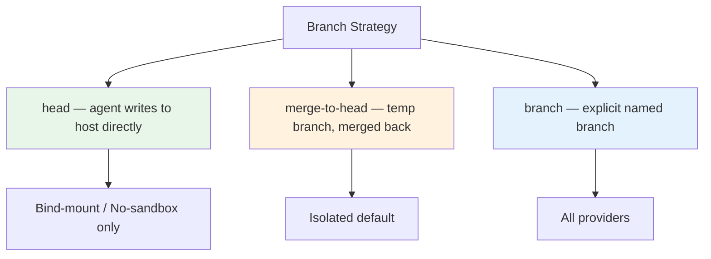
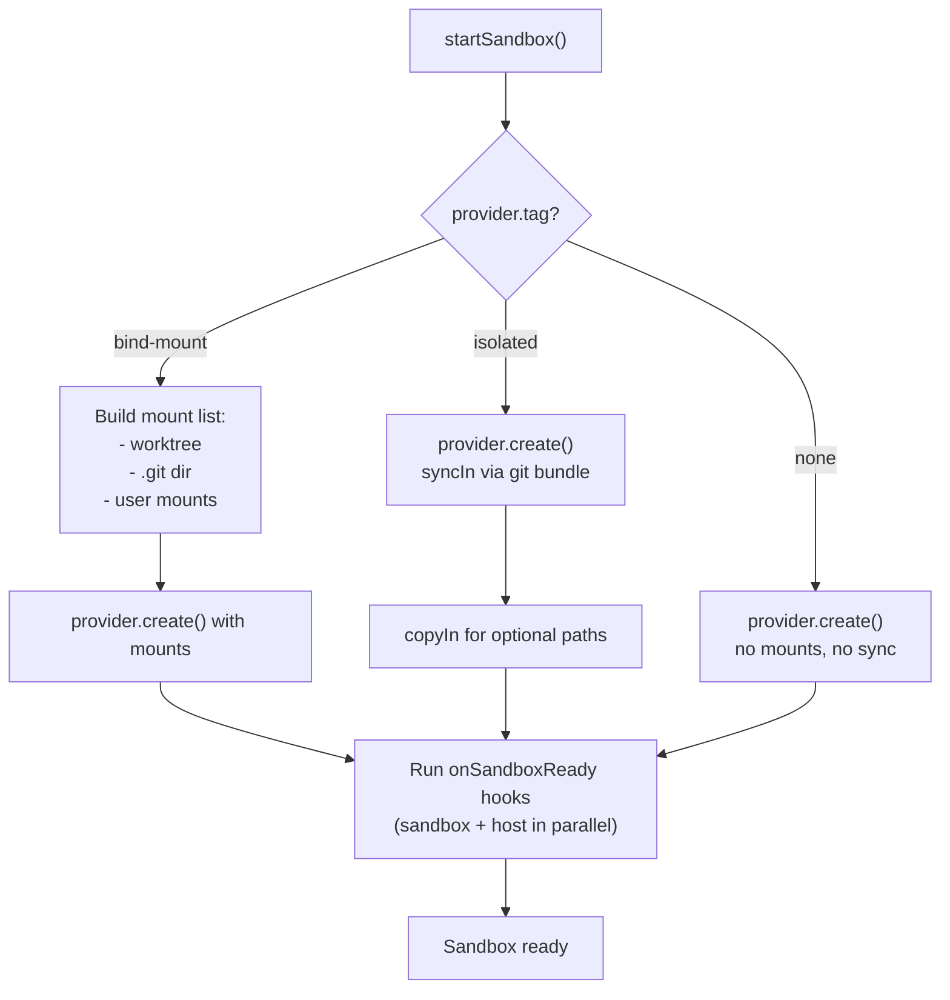

# Sandcastle — Sandbox Providers

## The Provider Contract

Sandcastle's sandbox system is built on a **provider abstraction**: the orchestration logic doesn't know about Docker, Podman, or Vercel. It only knows a `SandboxProvider` interface with a `tag` that determines how to interact with it.

Source: `src/SandboxProvider.ts` — `SandboxProvider`, `createBindMountSandboxProvider()`, `createIsolatedSandboxProvider()`

Three provider types, distinguished by their `tag`:

| Tag | Type | Filesystem | Sync Methods |
|-----|------|-----------|--------------|
| `bind-mount` | Container mounts host directory | Shared with host | `copyFileIn`, `copyFileOut` |
| `isolated` | Separate filesystem (cloud VM) | Independent | `copyIn`, `copyFileOut` |
| `none` | Runs directly on host | Host itself | None needed |

**Aha:** The `tag` is the single dispatch point for the entire sandbox system. `SandboxFactory.withSandbox()`, `startSandbox()`, and `syncIn()`/`syncOut()` all switch on `provider.tag` — adding a new provider type means adding a new case to these dispatch points, not rewriting the orchestration.

## The Sandbox Handle

Every provider's `create()` function returns a **sandbox handle** — the contract between the provider and Sandcastle:

```typescript
// src/SandboxProvider.ts — handle interfaces
interface BindMountSandboxHandle {
  worktreePath: string;       // Absolute path to repo inside sandbox
  exec(command, opts?): Promise<ExecResult>;    // Run command, optional streaming
  copyFileIn(hostPath, sandboxPath): Promise<void>;  // Copy single file in
  copyFileOut(sandboxPath, hostPath): Promise<void>; // Copy single file out
  interactiveExec?(): Promise<InteractiveExec>;      // TTY-capable exec
  close(): Promise<void>;     // Teardown
}

interface IsolatedSandboxHandle {
  worktreePath: string;
  exec(command, opts?): Promise<ExecResult>;
  copyIn(hostPath, sandboxPath): Promise<void>;  // Copy file or directory tree
  copyFileOut(sandboxPath, hostPath): Promise<void>;
  interactiveExec?(): Promise<InteractiveExec>;
  close(): Promise<void>;
}
```

The difference: bind-mount handles have `copyFileIn` (single file, both sides already accessible), while isolated handles have `copyIn` (can copy entire directory trees across the isolation boundary).

## Branch Strategies

Branch strategy moved from the provider to `run()` level (see `src/run.ts:508-520`), making providers fully agnostic to git concerns:



| Strategy | Behavior | Default For | Worktree? |
|----------|----------|-------------|-----------|
| `head` | Agent writes directly to host working directory | Bind-mount | No |
| `merge-to-head` | Temp branch in worktree, merged back to HEAD, temp deleted | Isolated | Yes |
| `branch` | Commits land on explicit named branch, worktree reused | Opt-in | Yes |

**Aha:** In `head` mode, there is no worktree and no merge step. The agent's changes appear directly in your working directory. This is the fastest option but risks polluting your working state. In `branch` mode, Sandcastle reuses the worktree across runs (ADR 0003) — calling `run()` twice with `branch: "agent/fix-42"` fast-forwards the existing worktree from origin rather than creating a new one.

## Docker Provider (`src/sandboxes/docker.ts`)

The Docker provider creates a long-lived container that mounts the host worktree:

```typescript
// src/sandboxes/docker.ts — docker() factory
export const docker = (options?: DockerSandboxOptions): DockerSandboxProvider =>
  createBindMountSandboxProvider({
    name: "docker",
    create: async (opts: BindMountCreateOptions) => {
      // 1. Pre-flight: check image exists, UID matches
      // 2. Build mount list: worktree + .git dir + user mounts
      // 3. docker run -d --name sandcastle-<uuid> --entrypoint sleep infinity
      // 4. Return handle with exec via docker exec
    },
  });
```

**Container lifecycle:**
- Creates container with `docker run -d --name sandcastle-<uuid>` (detached, name-prefixed)
- Dockerfile `ENTRYPOINT` is `["sleep", "infinity"]` — container stays alive for agent to attach
- Mounts worktree at `/home/agent/workspace` (overridden via `-w` at start)
- Mounts `.git` directory (resolves worktree `.git` file to actual gitdir)
- Runs as non-root `agent` user with host-matched UID/GID (via `--user` flag)

**Pre-flight checks:**
- Verifies image exists (`docker image inspect`)
- Checks UID inside image matches host UID (prevents permission errors on image-built files)

**Options:**
| Option | Type | Purpose |
|--------|------|---------|
| `imageName` | string | Image name (default: `sandcastle:<repo-dir>`) |
| `containerUid/containerGid` | number | Override host UID/GID for `--user` flag |
| `mounts` | `MountConfig[]` | User-provided mounts (tilde-expanded, path-resolved) |
| `selinuxLabel` | `"z"` \| `"Z"` \| `false` | SELinux volume label (`z` = shared, `Z` = private) |
| `network` | string \| string[] | Attach container to Docker network(s) |
| `groups` | (string \| number)[] | Supplementary groups via `--group-add` |
| `devices` | string[] | Host devices via `--device` |
| `cpus` | number | CPU limit via `--cpus` |
| `env` | `Record<string, string>` | Provider-level env vars |

**Exec implementation:** Uses `spawn` for streaming with `BoundedTail` capping buffered output to 64KB to prevent V8 string overflow. When `onLine` callback is provided, creates readline interface over `proc.stdout` for real-time line forwarding.

## Podman Provider (`src/sandboxes/podman.ts`)

Nearly identical to Docker but uses `podman` binary. Key differences:

- Uses `--userns=keep-id:uid=N,gid=N` for rootless ownership alignment
- On macOS/Windows: verifies Podman Machine is running before container creation
- Builds `Containerfile` instead of `Dockerfile` during `init`

Source: `src/sandboxes/podman.ts` — `podman()` factory, `--userns=keep-id` handling

## Vercel Provider (`src/sandboxes/vercel.ts`)

The Vercel provider uses Firecracker microVMs via `@vercel/sandbox` (peer dependency, dynamically imported):

```typescript
// src/sandboxes/vercel.ts — vercel() factory
export const vercel = (options?: VercelSandboxOptions): VercelSandboxProvider =>
  createIsolatedSandboxProvider({
    name: "vercel",
    create: async () => {
      // 1. Dynamic import of @vercel/sandbox
      // 2. Create sandbox via SDK
      // 3. syncIn via git bundle + copyIn
      // 4. Return handle with exec via sandbox.runCommand
    },
  });
```

**Key differences from bind-mount:**
- **Ephemeral**: one sandbox per run (no container reuse)
- **Sync-in**: transfers host repo via `git bundle create --all` → `copyIn` tarball → `git clone` in sandbox
- **Sync-out**: two-phase extraction (see [08-cross-cutting.md](./08-cross-cutting.md))
- **Exec**: uses `sandbox.runCommand()` with Writable streams for line-by-line output

**Aha:** The `@vercel/sandbox` import is dynamic (`import("@vercel/sandbox")`), not static. This means the package is only loaded when the Vercel provider is actually used. If you only use Docker, `@vercel/sandbox` doesn't need to be installed at all — it's an optional peer dependency.

## No-Sandbox Provider (`src/sandboxes/no-sandbox.ts`)

Runs the agent directly on the host with no isolation:

```typescript
// src/sandboxes/no-sandbox.ts — noSandbox() factory
export const noSandbox = (): NoSandboxProvider => ({
  tag: "none",
  name: "no-sandbox",
  create: async () => ({
    worktreePath: process.cwd(),
    exec: (cmd, opts) => spawn("sh", ["-c", cmd], ...),
    interactiveExec: () => ({ exec: (cmd) => spawn("sh", ["-c", cmd], { stdio: "inherit" }) }),
    close: async () => {},
    copyFileOut: async () => {}, // No-op — already on host
  }),
});
```

Used for:
- Interactive sessions where isolation isn't needed (`wt.interactive()` defaults to this)
- Quick testing and development
- Environments where containers aren't available

**Aha:** The no-sandbox provider does NOT pass `--dangerously-skip-permissions` to agents. This means the agent still asks for permission before each tool use in interactive mode — it's only the sandbox isolation that's skipped, not the agent's own safety checks.

## Custom Sandbox Providers

Two factory functions for building custom providers:

```typescript
// src/SandboxProvider.ts — factory signatures
createBindMountSandboxProvider(config: BindMountSandboxProviderConfig)
createIsolatedSandboxProvider(config: IsolatedSandboxProviderConfig)
```

### Bind-Mount Provider Example

For container runtimes that can mount host directories:

```typescript
import { createBindMountSandboxProvider, type BindMountCreateOptions, type BindMountSandboxHandle } from "@ai-hero/sandcastle";

const myProvider = createBindMountSandboxProvider({
  name: "my-container",
  create: async (opts: BindMountCreateOptions): Promise<BindMountSandboxHandle> => {
    const worktreePath = opts.worktreePath;
    return {
      worktreePath,
      exec: async (command, opts?) => { /* run command */ },
      copyFileIn: async (hostPath, sandboxPath) => { /* copy file */ },
      copyFileOut: async (sandboxPath, hostPath) => { /* copy file */ },
      close: async () => { /* teardown */ },
    };
  },
});
```

### Isolated Provider Example

For environments with their own filesystem:

```typescript
import { createIsolatedSandboxProvider, type IsolatedSandboxHandle } from "@ai-hero/sandcastle";

const myProvider = createIsolatedSandboxProvider({
  name: "my-vm",
  create: async (): Promise<IsolatedSandboxHandle> => {
    const worktreePath = "/path/in/vm";
    return {
      worktreePath,
      exec: async (command, opts?) => { /* run command */ },
      copyIn: async (hostPath, sandboxPath) => { /* copy file or directory */ },
      copyFileOut: async (sandboxPath, hostPath) => { /* copy file */ },
      close: async () => { /* teardown */ },
    };
  },
});
```

## Sandbox Startup Flow



Source: `src/startSandbox.ts` — startup dispatcher routing on `provider.tag`

## Mount Configuration

Mounts are configured on bind-mount providers (`src/MountConfig.ts`, `src/mountUtils.ts`):

```typescript
interface MountConfig {
  hostPath: string;      // Absolute, tilde-expanded (~), or relative (resolved from cwd)
  sandboxPath: string;   // Absolute or relative (resolved from sandbox repo dir)
  readonly?: boolean;    // Read-only mount
}
```

Path resolution:
- Tilde expansion: `~/.npm` → `/home/user/.npm`
- Relative paths: resolved from `process.cwd()` (host) or sandbox repo dir (sandbox)
- Git mounts: automatically resolved — if worktree's `.git` is a file, follows to actual gitdir

**Aha:** The mount resolution handles the git worktree edge case. When a worktree is created, its `.git` is a file pointing to the main repo's `.git` directory, not a directory itself. Sandcastle resolves this automatically so the container can run git commands correctly.

---

Next: [03-agent-integration.md](./03-agent-integration.md) — Agent provider system, stream parsing, session capture/resume/fork, and structured output.
