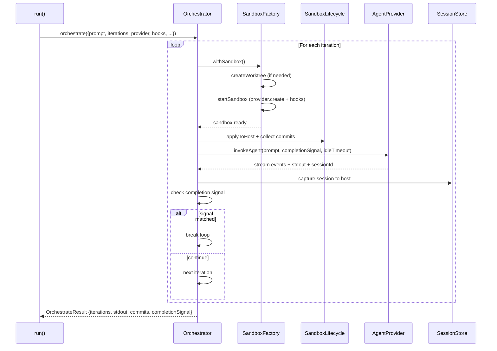
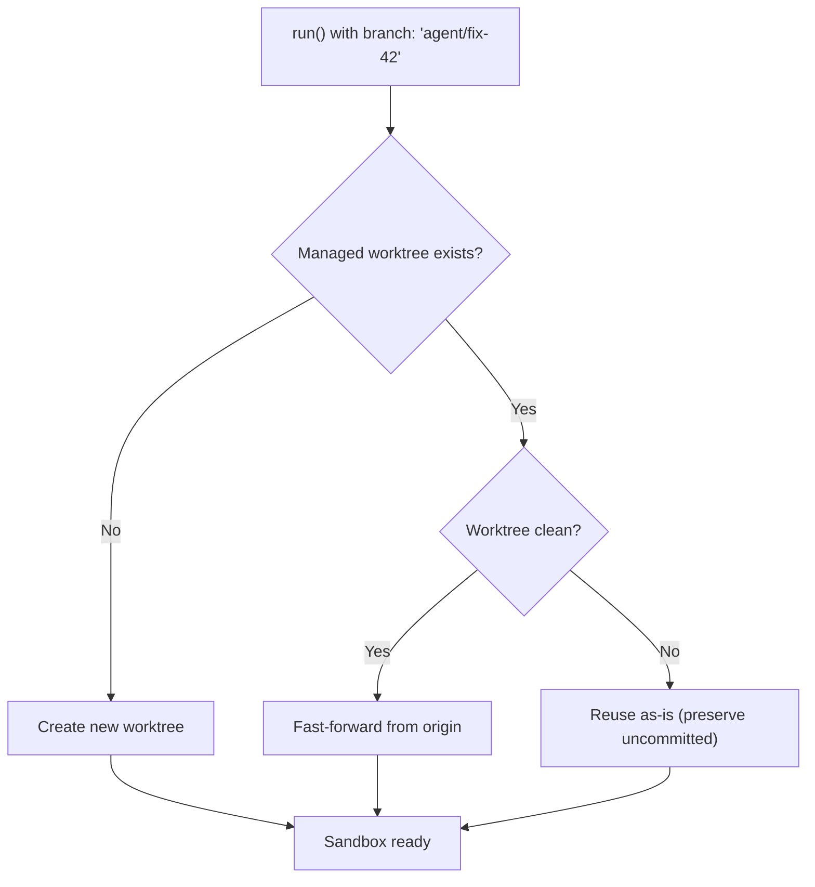
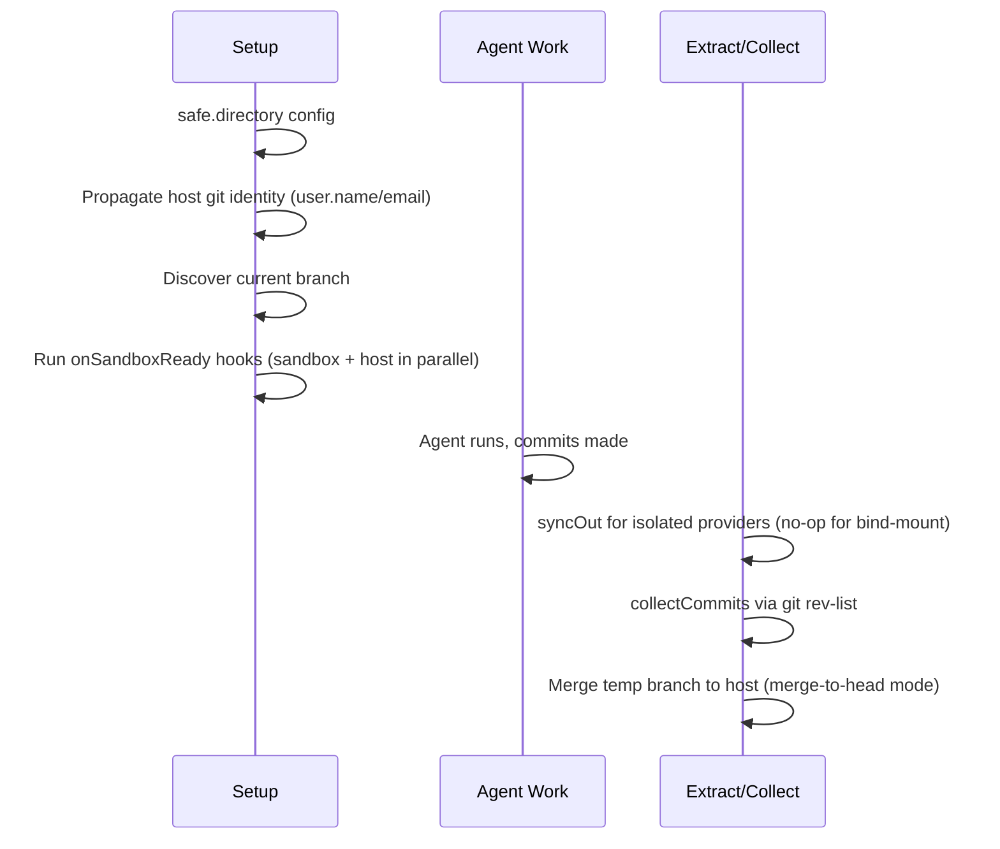

# Sandcastle — Orchestration & Workflow

## The Orchestrator

Source: `src/Orchestrator.ts` — `orchestrate()`, `invokeAgent()`

The Orchestrator is the core iteration engine. It runs the agent N times, manages the iteration loop, and collects results:



### `invokeAgent()` — Agent Execution

The heart of the orchestrator:

1. **Build agent command** via `provider.buildPrintCommand()` (e.g. `claude --dangerously-skip-permissions --output-format stream-json`)
2. **Spawn subprocess** inside sandbox (`sandbox.exec(cmd, { onLine })`)
3. **Stream parsing** — each line passed through `provider.parseStreamLine()` → typed events forwarded to `AgentStreamEmitter`
4. **TextDeltaBuffer** — coalesces token-by-token chunks into readable lines (especially Pi)
5. **Idle timeout** (default 600s) — fails if no output for this long
6. **Completion timeout** (default 60s) — grace window after completion signal seen but process hasn't exited
7. **AbortSignal** — kills subprocess on abort, preserves worktree

**Aha:** The completion timeout is independent of the idle timeout. `idleTimeoutSeconds` runs **before** any signal is seen (genuinely stuck agent → fail). `completionTimeoutSeconds` runs **after** the signal is seen (hanging process → succeed with warning). A clean process exit always wins the race — healthy runs gain zero added latency.

### Completion Signal Detection

The orchestrator checks every chunk of agent output against the completion signal(s):

Source: `src/run.ts:365-366` — `completionSignal` option definition
```typescript
/** Substring(s) the agent emits to stop the iteration loop early.
 * Matched via `includes` against agent output. */
readonly completionSignal?: string | string[];
```

Default: `<promise>COMPLETE</promise>`. Matched via simple `String.includes()` — not regex, not XML parsing, just substring matching.

When a hanging process is detected (completion signal seen but process hasn't exited):
1. Swap in `completionTimeoutSeconds` (default 60s)
2. Timer resets on every subsequent output line (trailing data is still captured)
3. On timeout: resolve successfully with a warning
4. `result.commits` and `result.completionSignal` populated as if clean exit

## The SandboxFactory

Source: `src/SandboxFactory.ts` — `WorktreeDockerSandboxFactory`, `SandboxConfig`

The `SandboxFactory` is an Effect Context tag. Its `withSandbox()` method is the central lifecycle orchestrator:

```mermaid
flowchart TD
    WS["withSandbox()"] --> Tag{provider.tag?}
    Tag -->|"bind-mount"| BM["Resolve git mounts\nCreate worktree\nCopy files\nRun hooks\nStart container"]
    Tag -->|"isolated"| ISO["Create worktree\nStart sandbox\nsyncIn via git bundle\ncopyIn optional paths\nRun hooks"]
    Tag -->|"none"| NS["Run directly on host"]
    BM --> Return["Execute agent work"]
    ISO --> Return
    NS --> Return
    Return --> Cleanup["cleanupWorktree()\nPreserve dirty, remove clean"]
```



**Key design:** All paths use `Effect.acquireUseRelease` for guaranteed cleanup. Even if the agent crashes or the signal is aborted, the cleanup function runs.

### Provider Tag Dispatch in SandboxFactory

The `withSandbox()` method dispatches on `provider.tag`:

**`bind-mount` path:**
- Resolves git mounts (handles both `.git` directory and worktree `.git` file)
- Patches for Windows (ADR-0006)
- Creates worktree, copies files, runs hooks
- Starts container via `startSandbox()`

**`isolated` path:**
- Creates worktree
- Starts sandbox via `startSandbox()` (calls `provider.create()`, then `syncIn()` via git bundle, then `copyIn()` for optional paths)
- Runs hooks

**`none` path:**
- Runs agent directly on host (no container, no worktree in `head` mode)
- No sync needed — already on host filesystem

## Worktree Management

Source: `src/WorktreeManager.ts` — `create()`, `pruneStale()`, `hasUncommittedChanges()`, `remove()`

### Worktree Creation

Worktrees are created under `.sandcastle/worktrees/<name>/`:

```typescript
// Temp branch name format
"sandcastle/<sanitized-name>/<YYYYMMDD-HHMMSS>-<randomHex>"
```

The random suffix prevents concurrent collisions (ADR 0018).

### Worktree Reuse (ADR 0003)

If the branch already exists in a managed worktree, Sandcastle reuses it and fast-forwards from origin:



**Aha:** Worktree reuse is a huge optimization for iterative agent workflows. Running `run()` multiple times with the same `branch: "agent/fix-42"` doesn't create new containers or worktrees each time — it reuses the existing one, so installed dependencies and build artifacts persist.

### Git Safety

- Uses `-c branch.autoSetupMerge=false -c push.autoSetupRemote=false` to avoid `.git/config.lock` races
- Forces `LC_ALL=C` for stable git error messages
- Stale worktree pruning removes orphaned directories under `.sandcastle/worktrees/`

## Sandbox Lifecycle

Source: `src/SandboxLifecycle.ts` — `startAndWait()`, `applyToHost()`, `collectCommits()`

### Three-Phase Lifecycle



**Git setup** retries transient exec failures (exit codes 126, 137) up to 2 times with 250ms delay.

### applyToHost (Sync-Out)

For bind-mount providers: no-op — the agent wrote directly to the mounted worktree.
For isolated providers: two-phase extraction:
1. Save artifacts to `.sandcastle/patches/<timestamp>/`
2. Apply via three-prong extraction:
   - Committed changes: `format-patch` + `git am --3way`
   - Uncommitted changes: `git diff HEAD` + `git apply`
   - Untracked files: `copyFileOut` each file

**Sync-base ref** (`refs/sandcastle/sync-base`, ADR 0017): Tracks the last-synced commit to avoid SHA mismatch from `git am` rewrites. On failure, preserves artifacts and prints recovery commands.

## createSandbox() — Reusable Sandbox

Source: `src/createSandbox.ts` — `createSandbox()`, `Sandbox` handle

Creates a sandbox once, returns a handle for multiple agent runs:

```typescript
await using sandbox = await createSandbox({
  branch: "agent/fix-42",
  sandbox: docker(),
});

// Run multiple times in the same sandbox
const impl = await sandbox.run({ agent: claudeCode("..."), promptFile: "implement.md" });
const review = await sandbox.run({ agent: claudeCode("..."), prompt: "Review the changes" });

// Run arbitrary commands
const tests = await sandbox.exec("npm test");
```

**Key properties:**
- Container stays alive between runs — installed dependencies and build artifacts persist
- Commits accumulate on the same branch
- `close()` tears down container; preserves worktree if dirty
- `[Symbol.asyncDispose]` for `await using` auto-cleanup

**Split ownership** (ADR 0018): When a sandbox is created via `wt.createSandbox()` from a `createWorktree()` handle, `sandbox.close()` tears down the container only — the worktree remains. `wt.close()` is responsible for worktree cleanup.

## createWorktree() — Independent Worktree Lifecycle

Source: `src/createWorktree.ts` — `createWorktree()`, `Worktree` handle

The worktree is a first-class concept, separate from any sandbox:

```typescript
await using wt = await createWorktree({
  branchStrategy: { type: "branch", branch: "agent/fix-42" },
  copyToWorktree: ["node_modules"],
});

// Interactive session (defaults to noSandbox)
await wt.interactive({ agent: claudeCode("..."), prompt: "Explore the bug" });

// AFK agent (sandbox required)
const result = await wt.run({ agent: claudeCode("..."), sandbox: docker(), prompt: "Fix it" });

// Create a long-lived sandbox from this worktree
await using sandbox = await wt.createSandbox({ sandbox: docker() });
// sandbox.close() tears down container only; worktree stays
```

Only `branch` and `merge-to-head` strategies are accepted; `head` is a compile-time type error (no worktree means no worktree handle).

## Hooks System

Source: `src/SandboxLifecycle.ts` — hook execution

Hooks are grouped by **where** they run:

| Hook | Runs on | When | Working directory |
|------|---------|------|-------------------|
| `host.onWorktreeReady` | Host | After `copyToWorktree`, before sandbox start | Worktree path |
| `host.onSandboxReady` | Host | After sandbox is up | Worktree path |
| `sandbox.onSandboxReady` | Sandbox | After sandbox is up | Sandbox repo directory |

**Ordering:**
```
copyToWorktree → host.onWorktreeReady (sequential) → sandbox created → host.onSandboxReady + sandbox.onSandboxReady (parallel)
```

**Aha:** Within each hook point, sandbox hooks run in parallel; host hooks within `onSandboxReady` also run in parallel with sandbox hooks. But `host.onWorktreeReady` hooks run **sequentially** in declared order. This is intentional — `onWorktreeReady` often does setup that subsequent steps depend on.

**Hook options:**
- Host hooks: `{ command: string; timeoutMs?: number }` — no `sudo`, no `cwd`
- Sandbox hooks: `{ command: string; sudo?: boolean; timeoutMs?: number }`
- Default per-hook timeout: 60s
- When `signal` is passed to `run()`, it's threaded to all hooks — aborting cancels in-flight commands

## CopyToWorktree

Source: `src/CopyToWorktree.ts` — `copyToWorktree()`

Copies files from host to worktree before sandbox start:

- Uses copy-on-write (`-cR` on macOS/APFS, `--reflink=auto` on Linux)
- Falls back to regular `-R` if CoW unsupported
- Missing paths silently skipped
- Not supported with `branchStrategy: { type: 'head' }` (no worktree in head mode)

## syncIn (Isolated Providers)

Source: `src/syncIn.ts` — `syncIn()`

Transfers host repo to sandbox via git bundle:

1. `git bundle create --all` on host
2. `copyIn` bundle to sandbox temp dir
3. `git clone` from bundle, move contents into worktree
4. Verify HEAD matches

This is how isolated providers (Vercel) get the code into their sandbox — they can't mount host directories.

## syncOut (Isolated Providers)

Source: `src/syncOut.ts` — `syncOut()`

Extracts changes from sandbox back to host:

1. Save artifacts to `.sandcastle/patches/<timestamp>/`
2. Three-prong extraction:
   - Committed: `format-patch` + `git am --3way`
   - Uncommitted: `git diff HEAD` + `git apply`
   - Untracked: `copyFileOut` each file
3. Update `refs/sandcastle/sync-base` ref

On failure: preserves artifacts and prints recovery commands for manual application.

---

Next: [05-prompt-system.md](./05-prompt-system.md) — Prompt resolution, `{{KEY}}` substitution, `` !`command` `` expansion, and built-in arguments.
